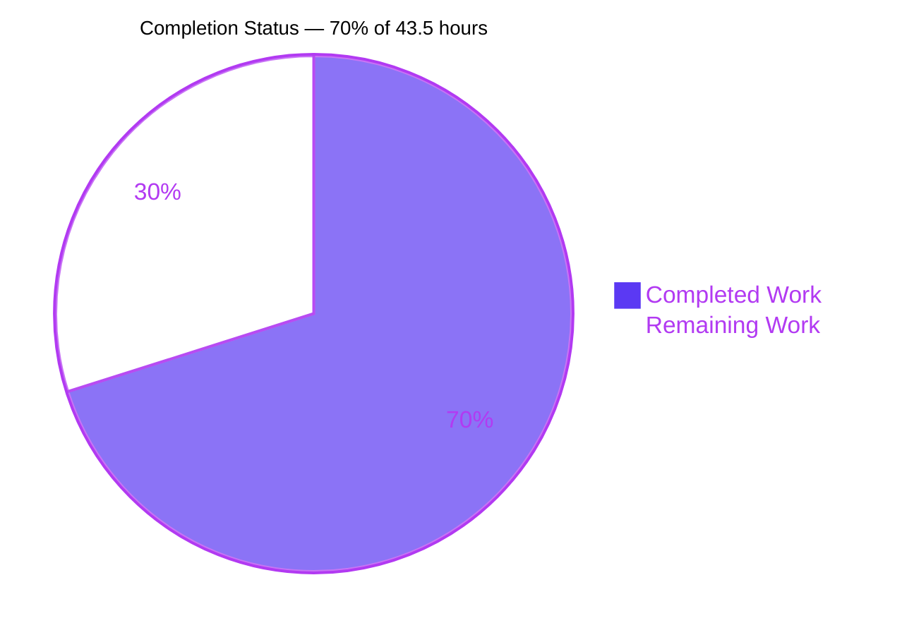
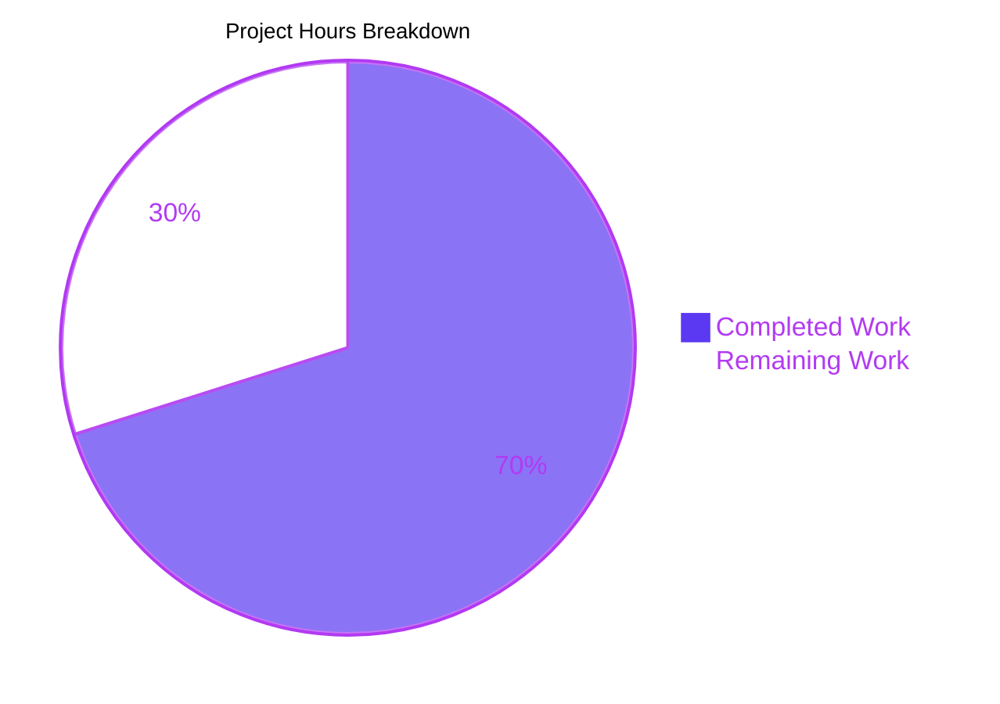

# 1. Executive Summary

This is the sign-off for the work: what the suite pins, what was exercised to prove it, what it does not cover, and what remains.

## 1.1 Project Overview

This project adds the first automated test suite for the application's HTTP server module, `app.js` — the file the repository runs as its server. It serves the developers who change the response pipeline, headers, error pages or listener behaviour: until now those could only be checked by hand against a running instance with a database behind it. The suite boots the real module in-process, injects its requests, binds one real socket to prove start and stop, and spawns one child process to prove the startup guard. No production file changed.

## 1.2 Completion Status

All sixteen specified deliverables are complete and verified; the remaining hours are path-to-production work.



Completed work is Dark Blue (#5B39F3); remaining work is White (#FFFFFF).

| Metric | Value |
|---|---|
| Total Hours | 43.5 |
| Completed Hours (Baseline: Human with agentic-assist) | 30.5 |
| Remaining Hours | 13 |
| Percent Complete | 70% |

**30.5 ÷ 43.5 = 70% complete.**

## 1.3 Key Accomplishments

- A 16-case Mocha suite boots the real server in-process, carries 76 assertions and needs no database, cache or fixed port.
- The JSON error contract: 404, 400, 401, 413 and 500 envelopes with the cache trio.
- The browser contract: the rendered 404 view, and a 302 redirect to `/login`.
- `X-Frame-Options: deny` proven on both sides of the configured deny list.
- The session cookie asserted as transmitted, written through the application's own login helper.
- The listener lifecycle on a real socket: ephemeral port, serve, refuse, double close.
- The startup guard in a child process: a five-character session password exits 1.
- `app.js` covered at 65.26% of lines and 48.95% of branches against 60%/45% floors.

## 1.4 Critical Unresolved Issues

Eight items are open of the twenty-four tracked: the sixteen specified deliverables are complete; the eight are three path-to-production activities, four capabilities no test exercises, and one pre-existing production defect.

| Issue | Impact | Owner | ETA |
|---|---|---|---|
| The repository's pre-PR command `npm test` aborts at load on an undeclared package (`test/helpers/catbox-redis.js:1`), so it executes no test at all — including this suite (1 item) | A regression in the server module reaches review undetected; the new suite is reachable only through `npm run test:server` | Backend / platform | 8 hours (Section 2.2) |
| The 60% line and 45% branch floors are measured once and enforced nowhere: no coverage tooling or threshold (1), and no automated job runs the suite (1) | Coverage and the suite itself can decay silently; nothing fails when either is ignored | Platform | 5 hours (Section 2.2) |
| Four capabilities are delivered but exercised by no test: the authenticated session lookup (`app.js:254-277`), the cookie-attribute wrapper's `Expires` / `SameSite=None; Secure` augmentation (`app.js:205-240`), the start gate under `app.start: true` (`app.js:307-312`), and the 60-second leak detector (`app.js:317-348`) | A regression in the authenticated request path or in the module-load branches would pass the suite | QA | Before release; see Section 3 |
| `config.app.cors` is read at `app.js:72` but defined in no configuration file (1 item) | The CORS decision silently evaluates to `false` for every request | Backend | Outside this work's file fence |

## 1.5 Access Issues

No access issues identified. The suite needs no credential, database, secret, deployment variable or reserved port; only the CSS build needs the gitignored 435 MB `public/components` archive.

## 1.6 Recommended Next Steps

1. **[High]** Make the pre-PR command run: repair the legacy harness so `npm test` executes (8 hours).
2. **[Medium]** Enforce the coverage floors: tooling plus a 60% line / 45% branch threshold (3 hours).
3. **[Medium]** Run the suite and the coverage gate automatically on every change (2 hours).
4. **[Low]** Resolve `config.app.cors`, which is read but defined nowhere, and align the container image with the documented Node floor.
5. **[Low]** Cover the authenticated session path with a datastore-backed case.

# 2. Project Hours Breakdown

Hours are estimated from the delivered artefacts and the work each one required: the size and complexity of the suite, the runtime behaviour that had to be measured before it could be asserted, and the verification runs behind every claim in Section 3. Every row traces to a requirement stated for this work, cited by its section in the specification.

## 2.1 Completed Work Detail

| Component | Hours | Description |
|---|---|---|
| Test harness, environment isolation and stub boundary (spec §0.5.3, §0.10.2) | 5.0 | The module-scope preamble in `test/server.js:1-88`: `NODE_ENV` and a `NODE_CONFIG` literal pinning every value the cases assert, five Sinon 1.x stubs ahead of the application require, the loopback probe helper and the settings-restoring teardown |
| Not-found, static-asset, header-scoping and error-branch cases S4–S8, S12 (R1, R2, R3, R6) | 6.0 | Six cases over the two response extensions: JSON and rendered not-found branches, the 200 asset branch with its no-store cache value, `X-Frame-Options` scoping, the 302/401 split, and a suite-registered throwing route |
| Startup contract and configuration guard S1–S3 (R4) | 3.0 | Export contract (`info.port` 3000, listener not listening), the nine published model globals with their schemas, and the child process that proves a five-character session password exits 1 |
| Content negotiation and edge cases S5b, S9, S10, S11 (R7) | 2.5 | Absent `Accept` treated as HTML, an undeclared method, malformed percent-encoding, and the payload boundary measured against the framework's 1,048,576-byte limit |
| Session cookie case S13 and the application's own login helper (R3) | 2.0 | A suite-registered route that logs in through `request.yar._logIn`, with the transmitted cookie attributes, the response body and `request.user` all asserted |
| Listener lifecycle and post-close injection S14, S15 (R5, R7) | 3.5 | A real socket on an OS-assigned port: start, serve, refuse after close, a safe second close, full settings restoration, and injection after the listener is gone |
| Case registry, titles, style and in-file rationale (spec §0.5.2, §0.8.2, §0.11.1) | 2.0 | Sixteen sentence-form case titles across ten describe blocks, repository style throughout, and the comments that record why the harness, the loopback pin and the cookie-as-transmitted assertions are what they are |
| `test:server` script and leak allowlist (spec §0.6.3) | 1.5 | Determining the ten-name `--globals` allowlist that makes `--check-leaks` reach a clean verdict, and keeping the existing `test` script untouched |
| Coverage measurement against the 60%/45% floors (spec §0.4.4, §0.8.1) | 2.0 | Instrumenting the target ad hoc, reading the uncovered regions back against the branches the requirements cannot reach, and confirming no tooling was added to the manifest |
| Determinism, isolation and repeat-run verification (spec §0.8.2, §0.10.2) | 3.0 | Repeat runs, single-case runs, an empty environment, a deliberately hostile `config/local.yaml`, and confirmation that no service, fixed port or ambient variable changes the outcome |
| **Total** | **30.5** | Matches the Completed Hours in Section 1.2 |

## 2.2 Remaining Work Detail

| Category | Hours | Priority |
|---|---|---|
| Make the repository's documented pre-PR test command runnable — repair the undeclared `catbox-redis` require in `test/helpers/catbox-redis.js`, rebuild the Supertest agent in `test/helpers/flow.js` from the resolved server rather than the promise, and settle the bootstrap order so `test/setup.js`'s globals exist before the model suites are collected | 8.0 | High |
| Enforce the coverage floors and automate the run — coverage tooling scoped to `app.js`, a 60% line / 45% branch threshold, and a verification job that runs the suite and the gate on every change | 5.0 | Medium |
| **Total** | **13.0** | Matches the Remaining Hours in Section 1.2 and Section 7 |

Both activities are path-to-production work rather than unfinished deliverables: the sixteen specified deliverables are complete. Until the first is done, the suite is reachable only through `npm run test:server`, and until the second is done nothing fails when its coverage or its result is ignored.

# 3. Test Results

Every count below was observed in a run against the delivered tree. The suite runs through `npm run test:server`, which invokes Mocha with the repository's `test/mocha.opts` (`--reporter spec`, `--recursive`, `--check-leaks`) plus the `--globals` allowlist that lets the leak check reach a clean verdict.

| Area / Category | Framework | Tests | Passed | Failed | Coverage | What This Proves |
|---|---|---|---|---|---|---|
| Module export, published model globals and the startup guard (S1–S3) | Mocha 3.5.3 / Chai 3.5.0 | 3 | 3 | 0 | — | The export resolves to a constructed server with no port bound, all nine models are published as globals carrying a Mongoose schema, and a five-character session password makes a child process exit 1 with the guard's diagnostic |
| Not-found responses for both client types (S4, S5, S5b) | Mocha 3.5.3 / Chai 3.5.0 | 3 | 3 | 0 | — | An unknown path answers 404 as a JSON envelope or as the rendered 404 view, and a request with no `Accept` header takes the HTML branch |
| Static asset serving and the cache contract (S6) | Mocha 3.5.3 / Chai 3.5.0 | 1 | 1 | 0 | — | A served file returns 200 with the full no-store `cache-control` value, the cache trio and no `X-Frame-Options`, byte-identical to the file on disk |
| Header scoping and session authentication (S7, S8) | Mocha 3.5.3 / Chai 3.5.0 | 2 | 2 | 0 | — | `X-Frame-Options: deny` appears on a deny-listed path and not off the list, and an unauthenticated page request is redirected to `/login` while the same path as JSON receives 401 |
| Session cookie written through the application's login helper (S13) | Mocha 3.5.3 / Chai 3.5.0 | 1 | 1 | 0 | — | A session write through `request.yar._logIn` returns the route's body, attaches `request.user` and transmits a cookie with `HttpOnly`, `SameSite=Lax` and `Path=/` |
| Edge cases: undeclared method, malformed encoding, oversized payload (S9, S10, S11) | Mocha 3.5.3 / Chai 3.5.0 | 3 | 3 | 0 | — | An undeclared method returns 404, malformed percent-encoding 400, and a payload past the 1,048,576-byte framework limit 413 with the framework's exact message |
| Error handling and the listener lifecycle (S12, S14, S15) | Mocha 3.5.3 / Chai 3.5.0 | 3 | 3 | 0 | — | A throwing handler becomes a 500 with the cache trio and the next request is served; a real listener binds an OS-assigned port, serves, refuses connections after close, closes twice safely, and injection keeps answering afterwards |
| **Total — the delivered suite** | Mocha 3.5.3 / Chai 3.5.0 | **16** | **16** | **0** | `app.js` 65.26% lines, 48.95% branches, 63.74% statements, 47.05% functions | The server module's response, header, cookie, startup and shutdown contract is pinned by executable assertions |

Two further runs were executed and are not capability rows. `npx mocha test/lib/util/user.js` reports 3 passing — the one pre-existing suite that stands alone, untouched by this work. `npm test`, the repository's documented pre-PR command, exits 1 at load because `test/helpers/catbox-redis.js` requires an undeclared `catbox-redis`; it executes zero tests (Section 1.4). Coverage of `app.js` was measured ad hoc with `nyc` against the project's 60% line and 45% branch floors; `nyc` is not a project dependency and no threshold is enforced, which is why the coverage figure is a measurement and not a gate.

**Not Covered**

- **The authenticated session lookup** (`app.js:254-277`). Reading a user from the session needs a live MongoDB read, so no test drives an authenticated request end to end. A human should add a datastore-backed case before relying on the session strategy.
- **The session-cookie attribute wrapper** (`app.js:205-240`). Its `Expires` and conditional `SameSite=None; Secure` augmentation has no observable effect on the framework version in use; the suite asserts the cookie as transmitted, so the augmentation itself is unproven.
- **The module-load start gate under `app.start: true`** (`app.js:307-312`). The suite starts the listener itself in order to choose an ephemeral port, so the gate is never taken.
- **The 60-second leak detector** (`app.js:317-348`) and **`init()`'s rejection path** (`app.js:352-353`). Neither is asserted; the startup guard that rejects is covered in a child process instead.
- **The rendered 403 and 50x error views.** Only the 404 view is asserted, so the browser-side error pages other than not-found are unproven.
- **The server-rendered page routes `/` and `/login`.** They answer 200 with controller and template output, which is application behaviour rather than the server's response pipeline.
- **Cache revalidation and conditional requests.** The static branch is asserted for its status, headers and payload, not for `If-None-Match` or `If-Modified-Since` handling.
- **Everything outside the server module.** The nine API suites and four model suites cannot load (Section 1.4), and the browser UI, the embed player, the serverside runner shells and the post-deployment smoke script have no automated tests at all.

# 4. Runtime Validation & UI Verification

The server was driven both through the suite's sixteen injected requests and through independent in-process probes of the same module, so each line below is an observed response rather than an inference from code.

- ✅ **Server construction and start-up** — the export resolves to a server reporting `info.port` 3000 with `listener.listening` false; nothing binds port 3000 at any point.
- ✅ **JSON error pipeline** — 404, 400, 401, 413 and 500 envelopes observed with `cache-control: no-cache`, `pragma: no-cache` and `expires: 0`.
- ✅ **Browser error pipeline and redirect** — the rendered 404 page carries `<title>Page not found</title>` and, on that branch, neither `pragma` nor `expires`; `/welcome` answers 302 with `location: /login`.
- ✅ **Static asset serving** — `/robots.txt` returns 200 `text/plain` with `private, s-maxage=0, max-age=0, no-cache, no-store, must-revalidate, proxy-revalidate`, the cache trio, and no `X-Frame-Options`.
- ✅ **`X-Frame-Options` scoping** — `deny` on a deny-listed path, absent on `/api/nothing`; the header is written on the JSON and non-Boom branches only, so an HTML client on a deny-listed path receives the rendered view without it.
- ✅ **Session cookie** — `session=…; HttpOnly; SameSite=Lax; Path=/` transmitted, with no `Expires` and no `Secure`.
- ✅ **Listener lifecycle on a real socket** — an OS-assigned port serves a request, refuses the next with `ECONNREFUSED` after close, closes a second time without error, and injection still answers 404.
- ✅ **Startup guard** — a child process with a five-character session password exits 1 with `ERROR: Session cookie password not configured!`.
- ⚠ **CSS build pipeline** — `npm run build` (vite 4.5.14 and sass) produces `public/css/base.css` (265.72 kB) and `public/css/embed.css` (296.32 kB); no test covers it.
- ❌ **Repository-wide gate `npm test`** — aborts at load on an undeclared package; zero tests execute.

**Never exercised at runtime.** The authenticated request path (the session strategy's database lookup), the cookie-attribute wrapper's `Expires` and `SameSite=None; Secure` augmentation, the start gate under `app.start: true`, and the 60-second leak detector are executed by no run. There is no browser runner in this repository, so the browser UI, the embed player and the serverside runner shells were never driven here, and the post-deployment smoke script was not run.

# 5. Compliance & Quality Review

Each delivered requirement is mapped below to the quality and compliance benchmark it was measured against, with its verified status as it stands now. The divergences that follow the matrix are the places where the delivered work departs from the agreed plan, recorded with their cause so nothing has to be discovered later.

## 5.1 Compliance Matrix

| Requirement | Status | Progress | Evidence |
|---|---|---|---|
| R1 — HTTP responses asserted against the real server instance | ✅ Pass | 100% | 16 injected requests; status, content type, redirect target and parsed `statusCode`/`error`/`message` fields asserted (`test/server.js:184-338`) |
| R2 — Status codes 200, 302, 400, 401, 404, 413, 500 and no-connection | ✅ Pass | 100% | Every class asserted and observed: 200 ×2, 302 ×1, 400 ×2, 401 ×2, 404 ×10, 413 ×2, 500 ×2, plus `ECONNREFUSED` |
| R3 — Headers: content type, cache contract, frame-option scoping, session cookie | ✅ Pass | 100% | Content type in eight cases; the cache trio through one helper (`test/server.js:84-88`, six call sites); `x-frame-options` on both sides of the deny list (`:253`, `:265`); four cookie attributes (`:421-423`) |
| R4 — Server startup: export shape, no bound port, refusal below a 32-character password | ✅ Pass | 100% | `test/server.js:131-137`, `:139-151`, and the child-process guard at `:155-181` |
| R5 — Server shutdown: ephemeral bind, serve, refuse, double close, injection after close | ✅ Pass | 100% | `test/server.js:429-462` and `:464-481` |
| R6 — Error handling: JSON for API clients, a rendered view for browsers, survival of a throwing handler | ✅ Pass | 100% | `test/server.js:353-385`, `:201-212`, `:288-297` |
| R7 — Edge cases: unknown path, undeclared method, malformed encoding, oversize payload, post-close request | ✅ Pass | 100% | `test/server.js:214-223`, `:302-314`, `:316-330`, `:332-350`, `:464-481` |
| Case registry complete, nothing skipped or silenced | ✅ Pass | 100% | Sixteen `it` cases in ten describe blocks; no `.only`, `.skip`, `xit` or `xdescribe` anywhere in the file |
| Harness isolation: no database, cache, mailer, object store or reserved port; its own configuration | ✅ Pass | 100% | Preamble at `test/server.js:4-59`; 16 passing under an empty environment (`env -i`) and under a deliberately hostile `config/local.yaml` |
| Manifest fence: one script line, no dependency change, lockfile untouched | ✅ Pass | 100% | `package.json:84`; 58 dependencies and 11 devDependencies unchanged; `package-lock.json` byte-identical to its pre-work state |
| Coverage floors met without adding instrumentation | ✅ Pass | 100% | `app.js` at 65.26% lines and 48.95% branches against 60%/45%; no coverage package, script or threshold in the manifest |
| Repository conventions and code quality | ✅ Pass | 100% | Two-space indent, single quotes, sentence-form `it` titles, chai `should`, Sinon 1.x API only; no line over 120 characters in `test/server.js`; no TODO, FIXME or placeholder text |

## 5.2 AAP & Rule Divergences and Gaps

| What the AAP/Rule Required | What Was Delivered Instead | Why It Diverged | Impact | Remediation |
|---|---|---|---|---|
| The published-globals case was specified as asserting `global.User` and `global.Trinket` (§0.5.2) | The case loops all nine model globals and asserts each carries a Mongoose schema (`test/server.js:139-151`) | §0.3.1 assigns the module's nine-name global publishing to this same case and its title promises "the models"; the two named globals are still asserted, and the wider loop is what makes a lost `File` global observable, because the runtime already defines a global `File` class | None — a superset; nothing specified is left unasserted | None |
| "All fifteen case identifiers are delivered" (§0.9.1) | Sixteen identifiers are delivered: S1 to S15 plus S5b for a request with no `Accept` header (`test/server.js:214-223`) | §0.5.2's case blueprint defines S5b as its own case and §0.4.3 gives it its own row, so the two statements conflict; the case matrix governed | None — a superset; no identifier was dropped or renamed | None, or correct the count in the specification |
| "The only mutation any case makes to shared state is `server.settings.port`, which the lifecycle case restores" (§0.8.2) | The lifecycle case also rewrites and restores `server.settings.host` and `server.info.port` (`test/server.js:112-116`, `:436-440`, `:460`) | The framework rewrites the reported port when a listener comes up and the case pins the bind host, so the specification's own isolation requirement — no case depending on state another left behind — fails unless all three are restored | None; after the suite the configuration reads back at port 3000 on loopback with no listener | None; optionally narrow that sentence in the specification |
| The lifecycle row states the port but no host (§0.4.3) | The case binds `127.0.0.1` rather than the configured `0.0.0.0` (`test/server.js:64`, `:440`) | One real listener on a machine whose port space is shared should not be reachable on every interface, and addressing it by literal IPv4 keeps the socket assertions independent of how the runtime resolves `localhost` | None — the listener is narrower and an OS-assigned port is still the only one used | None; the host could instead be pinned through the suite's configuration |
| The session-cookie row describes the suite's route as writing `request.yar.set('userId', …)` (§0.4.3) | The route calls `request.yar._logIn({ _id: 'test-user-id' })` (`test/server.js:402`) | §0.3.1 makes the `onPreHandler` extension that installs `_logIn` a unit this case must address, which a direct `yar.set` could not exercise; `_logIn` performs that same write one frame deeper, so the row stays true | None — the case additionally asserts `request.user`, so both statements of the helper are load-bearing | None |
| The require list for the new file enumerates sinon, chai, mongoose, the session provider, the application module, `http` and `child_process` (§0.6.2) | The file also requires Node's `fs` and `path` (`test/server.js:36`, `:38`) | Reading the static fixture's bytes for the asset assertion, and resolving the child process's working directory | None — both are Node built-ins and no package was added | None, or add them to the enumeration |
| `CONTRIBUTING.md` asks for lines under 120 characters | The `test:server` script occupies one 133-character line (`package.json:84`; its value is 111 characters) | **Sanctioned.** The specification fixes the script value character for character, JSON cannot wrap a string literal, and a manifest cannot carry an explanatory comment, so the prose guideline yields to the higher source | Cosmetic — one long line in a JSON manifest | None |
| The legacy test harness was placed out of scope, so the repository's documented pre-PR command keeps its pre-existing failure | `npm test` still aborts at load: `test/helpers/catbox-redis.js:1` requires an undeclared `catbox-redis`, and the harness is byte-identical to its earlier state | **Sanctioned.** Repairing the harness is a separate job the plan excluded, and the new suite is additive precisely so the documented command keeps its meaning | Material — the project's standard verification executes no test, so the suite runs only through `npm run test:server` | 8 hours: the High-priority task in Section 2.2 |

**The pre-PR gate runs nothing.** The one divergence that blocks release is the repository's own verification command. `npm test` is what `CONTRIBUTING.md` asks a contributor to run before a pull request, and it aborts at load: `test/helpers/catbox-redis.js:1` requires `catbox-redis`, a package that is neither declared nor installed — only `@hapi/catbox-redis` 7.0.2 is. Nothing in this work touched that file, and the suite was kept additive so the documented command keeps its meaning. The consequence is that no test in this project runs in the flow the project documents; the new suite runs only through `npm run test:server`. Closing it is the 8-hour task in Section 2.2.

**The listener is pinned to loopback deliberately.** The lifecycle case sets the bind host to `127.0.0.1` rather than the configured `0.0.0.0`, and that choice should survive review rather than be reverted as over-specification. Binding the configured wildcard would expose the one real listener on every interface of whatever machine runs the suite, which matters where port spaces are shared; binding by host name while probing by address would reintroduce the resolution dependence the probe exists to avoid. An OS-assigned port on loopback satisfies the rule that no fixed port is reserved. If you would rather express the host through configuration, pin it there and drop the assignment at `test/server.js:440`.

**The session case exercises the application's own login path.** The route log in the cookie case signs in through `request.yar._logIn`, the helper the server installs on every request at `app.js:116-124` and the one all three real login flows call (`lib/controllers/users.js:81`, `:158`, `:915`), instead of writing the session with `yar.set` beside it. That matters because `_logIn` is what production actually runs: emptying its body, or dropping only the `request.user` assignment, now fails the case where a direct `yar.set` would have hidden both. Keep the route that way, and keep the `request.user` assertion with it.

# 6. Risk Assessment

| Risk | Category | Severity | Probability | Mitigation | Status |
|---|---|---|---|---|---|
| The pre-PR command executes no test, so a change to the response pipeline, headers or listener behaviour reaches review undetected | Operational | High | Probable | Repair the legacy harness so `npm test` loads and runs, with the suite reachable from the documented command (Section 2.2, 8h) | Open |
| The coverage floors are measured once and enforced nowhere, so coverage of `app.js` can decay without a failure | Technical | Medium | Likely | Add coverage tooling scoped to `app.js` with a 60% line / 45% branch threshold (Section 2.2, 3h) | Open |
| No automated job runs the suite, so it depends on a developer remembering `npm run test:server` | Operational | Medium | Likely | Add a verification job that runs the suite and, once it exists, the coverage gate (Section 2.2, 2h) | Open |
| The authenticated request path is exercised by no test, so a regression in the session strategy's user lookup would pass the suite | Security | Medium | Possible | Add a datastore-backed case covering an authenticated request end to end | Open |
| `config.app.cors` is read at `app.js:72` but defined in no configuration file, so the CORS decision silently evaluates to `false` | Security | Medium | Possible | Define the setting in `config/default.yaml` or remove the read; production code outside this work's file fence, so it needs an owner | Open |
| The suite asserts pinned copies of configuration defaults — port, hostname, view root, the five-path deny list, session name — so a change to `config/default.yaml` will not fail `S7` or `S1` | Integration | Low | Likely | Review the pins in `test/server.js:10-30` whenever those defaults change; the decoupling is what keeps a developer's `config/local.yaml` from altering the result | Accepted |
| The container image pins Node 16 while the documentation states Node 18+ and the suite was verified on Node 22, so the deployed and documented runtimes can drift | Operational | Low | Possible | Align the image with the documented floor | Open |
| A future `npm install` under npm 11 rewrites the lockfile and drops the root `hasInstallScript` field, which is the fenced pre-work baseline | Technical | Low | Likely | No action needed: the field is derived metadata that npm accepts either way; adding an install script to justify it would change the manifest for no benefit | Accepted |

# 7. Visual Project Status



Completed work is Dark Blue (#5B39F3); remaining work is White (#FFFFFF), outlined in Violet-Black.

| View | Value |
|---|---|
| Total hours | 43.5 |
| Completed hours | 30.5 |
| Remaining hours | 13 |
| Completion | 70% |

| Remaining work by category | Hours | Priority |
|---|---|---|
| Make the documented pre-PR test command runnable | 8.0 | High |
| Enforce the coverage floors and automate the run | 5.0 | Medium |
| **Total** | **13.0** | |

# 8. Summary & Recommendations

**What was delivered and verified.** The application's HTTP server module now has an automated suite where it previously had none: sixteen cases, 76 assertions, one npm script and no change to production code. The suite boots the real module in-process with five dependency stubs in place of a database and a cache, drives it through the framework's injection API, binds one real socket on an OS-assigned port to prove start and stop, and spawns one child process to prove the startup guard rejects a short session password. All sixteen cases pass in about 0.6 seconds. Independent probes of the same module confirmed the status codes, headers, rendered error page, redirect, cookie and payload boundary the cases assert, and the suite passes unchanged under an empty environment and under a deliberately hostile `config/local.yaml`.

**What remains.** 30.5 of 43.5 hours are complete, so the project is **70%** complete. The sixteen specified deliverables are all closed; the outstanding 13 hours are path-to-production work that decides whether the suite keeps having an effect. The dominant item is the repository's pre-PR command: `npm test` aborts at load because `test/helpers/catbox-redis.js` requires an undeclared package, so the project's documented verification executes nothing. The second is that the coverage floors are a measurement rather than a gate, and nothing runs the suite automatically.

**Critical path to production.** Repair the legacy harness so `npm test` loads and runs (8 hours), then make coverage fail rather than drift (3 hours), then put both in an automated job (2 hours). In that order: nothing can be gated until the harness loads, and nothing is enforced until a job runs it. Section 9 gives the commands each step is verified against.

**Success metrics.** Sixteen of sixteen cases passing in under a second; `app.js` at 65.26% of lines and 48.95% of branches against the 60% and 45% floors; no case depending on a service, a fixed port or an ambient variable; the response pipeline exercised for both client types and every status class, with the database-backed session lookup the one named boundary.

**Production readiness.** The suite is complete, deterministic and ready to be relied on. The project around it is not yet: a repository whose documented verification command runs no test cannot claim regression protection, however good the new suite is. Treat the 13 remaining hours as the cost of making this work permanent, and treat the capabilities Section 3 lists as not covered as the boundary of what the suite promises.

# 9. Development Guide

### Prerequisites

- **Node.js 22.x** — verified on v22.23.4 with npm 11.21.0. The repository documents Node 18+ as its floor, and the suite's dependencies all support it.
- **A C/C++ toolchain and Python 3** for native modules if a prebuilt `bcrypt` binary does not match your platform.
- **No database, cache, mailer or object store is needed for the suite.** It stubs the only dependencies it would otherwise reach.
- **For the application itself only:** a reachable MongoDB and a gitignored `config/local.yaml`.

Run every command from the repository root. `node-config` resolves `./config` from the process working directory, so a command run elsewhere fails while loading configuration.

### Install dependencies

```bash
npm install --legacy-peer-deps     # ~642 packages; the `marked` dependency resolves from a git+https URL
npm rebuild bcrypt                 # confirms the bcrypt 5.1.1 native binding
```

npm 11 prints that a handful of packages have install scripts not yet covered by its allowlist. That notice is harmless here: `bcrypt`'s binding and `esbuild`'s platform binary are present. If `require('bcrypt')` ever fails, re-run `npm rebuild bcrypt esbuild`.

To install exactly what the lockfile records without rewriting it, use `npm ci` — `npm ci --dry-run` completes cleanly against the delivered lockfile:

```bash
npm ci
```

### Run the test suite

```bash
npm run test:server
```

Expected output, on the delivered tree:

```
  HTTP Server
    Module export
      ✓ should resolve to a Hapi server without binding a port
      ✓ should publish the models as globals
    Configuration guard
      ✓ should refuse to start when the session cookie password is too short (526ms)
    ...
  16 passing (641ms)
```

The script is:

```
mocha --globals User,Course,Lesson,Material,File,Trinket,Interaction,Folder,CourseInvitation,log test/server.js
```

`mocha` picks up `test/mocha.opts` (`--reporter spec --recursive --check-leaks`); the explicit file argument is what keeps recursive collection from pulling in the legacy bootstrap, and the `--globals` allowlist is what lets `--check-leaks` reach a clean verdict, because the server module publishes ten globals while it initialises.

### Run one case, or pass options through

```bash
npx mocha --globals User,Course,Lesson,Material,File,Trinket,Interaction,Folder,CourseInvitation,log \
  test/server.js --grep "should start on an ephemeral port"      # 1 passing
npm run test:server -- --reporter dot                            # npm forwards extra args
```

### Check syntax without running anything

```bash
node --check test/server.js
node --check app.js
```

### Measure coverage (ad hoc — not wired into the build)

Coverage tooling is deliberately not a project dependency. Measure the target with a throwaway install:

```bash
npx --yes nyc@18 --include=app.js --reporter=text npm run test:server
rm -rf .nyc_output
```

Expected for `app.js` on the delivered tree: 63.74% statements, 48.95% branches, 47.05% functions, 65.26% lines.

### Build the stylesheets

The CSS build reads a 435 MB `public/components` directory that is gitignored and absent from a fresh clone. Fetch it once, then build:

```bash
curl -L -o public-components.tgz https://github.com/trinketapp/trinket-oss/releases/download/v1.1.0/public-components.tgz
tar xzf public-components.tgz      # extracts public/components/ into the repository root
rm public-components.tgz
npm run build                      # vite 4.5.14 + sass
```

Expected: `public/css/base.css` 265.72 kB and `public/css/embed.css` 296.32 kB, built in about 1.4 seconds. Both outputs are gitignored. The suite does not need them.

### Start the application

The application needs a gitignored `config/local.yaml` and a reachable MongoDB. Without the file, the process prints a bordered `Session cookie password not configured!` diagnostic and exits 1 — which is exactly what the startup-guard case asserts in a child process.

```bash
cp config/local.example.yaml config/local.yaml
# set app.plugins.session.cookieOptions.password to a generated string of 32+ characters
openssl rand -hex 24
# set db.mongo.host, db.mongo.port and db.mongo.database for your own MongoDB
node app.js
```

The server binds `app.port` (3000 by default). A quick verification once it is up:

```bash
curl -si http://127.0.0.1:3000/robots.txt | head -8              # 200 text/plain, no-store cache headers
curl -si http://127.0.0.1:3000/api/nothing                       # 404 application/json
curl -s  http://127.0.0.1:3000/nothing-here-98765 | grep title   # <title>Page not found</title>
curl -si http://127.0.0.1:3000/welcome | head -3                 # 302 location: /login
```

### Troubleshooting

| Symptom | Cause | Resolution |
|---|---|---|
| `Cannot read properties of undefined (reading 'level')` while loading configuration | The command ran from a directory other than the repository root | `cd` to the repository root, or set `NODE_CONFIG_DIR=<repo>/config` |
| `global leaks detected: User, Course, …` | The suite ran without the `--globals` allowlist | Use `npm run test:server`, or pass the full `--globals` list shown above |
| `Error: Cannot find module 'catbox-redis'` from `npm test` | A pre-existing defect in the legacy harness, not in this suite | Use `npm run test:server`; see Section 1.4 for the repair |
| `Error: Cannot find module 'bcrypt'` or a native binding failure | The native module was not built by the install | `npm rebuild bcrypt esbuild` |
| `@import "public/components/...` not found during `npm run build` | The gitignored components archive is absent | Fetch and extract it as shown above |
| `EADDRINUSE` when starting the application | Another process holds the configured port | Override `app.port` in `config/local.yaml`; the suite itself only ever binds an OS-assigned port |
| The suite passes locally but the pre-PR gate does not | `npm test` does not reach this suite yet | Run `npm run test:server` explicitly until the harness is repaired |

# 10. Appendices

Reference material for running, extending and troubleshooting the suite. All paths are relative to the repository root.

## A. Command Reference

| Purpose | Command |
|---|---|
| Install dependencies | `npm install --legacy-peer-deps && npm rebuild bcrypt` |
| Install exactly from the lockfile | `npm ci` (verified as `npm ci --dry-run`, which completes cleanly against the delivered lockfile) |
| Run the server suite | `npm run test:server` |
| Run one case | `npx mocha --globals User,Course,Lesson,Material,File,Trinket,Interaction,Folder,CourseInvitation,log test/server.js --grep "<case title>"` |
| Forward options to mocha | `npm run test:server -- --reporter dot` |
| Run the standalone legacy suite | `npx mocha test/lib/util/user.js` |
| Run the documented pre-PR command | `npm test` (aborts at load — Section 1.4) |
| Measure coverage of the target | `npx --yes nyc@18 --include=app.js --reporter=text npm run test:server` |
| Syntax-check without running | `node --check test/server.js` |
| Build the stylesheets | `npm run build` |
| Start the application | `node app.js` |

## B. Port Reference

| Port | Used by | Notes |
|---|---|---|
| 3000 | The application (`app.port`) | The value the startup case asserts as `server.info.port`; the suite never binds it — it asserts that the listener is not listening at construction, and the only socket it opens is the ephemeral one |
| OS-assigned (ephemeral) | The suite's one real listener | Requested with `settings.port = 0` and read back from `server.info.port`; a different number on every run, so parallel runs cannot collide |
| 27017 | MongoDB | Needed only by the application and by the legacy API suites; the new suite stubs the connection and needs no database |
| 6379 | Redis | Not used: the suite's configuration selects the in-memory queue with `db.redis.enabled: false` |

## C. Key File Locations

| Path | What it is |
|---|---|
| `app.js` | The HTTP server module under test: configuration guard (49-66), server construction (68-87), plugins and views (90-149), the two `onPreResponse` extensions (152-240), the session strategy (243-287), the nine model globals (290-298), route registration and start gate (301-312), the leak detector (317-348), and the exported promise (350-356) |
| `test/server.js` | The new suite: preamble and stubs (1-88), the sixteen cases across ten describe blocks (90-483) |
| `package.json` | The `test:server` script at line 84; the existing `test` script and both dependency sections unchanged |
| `test/mocha.opts` | `--reporter spec`, `--recursive`, `--check-leaks` — inherited by every mocha run from the repository root |
| `test/lib/util/user.js` | The one legacy suite that stands alone (3 passing) |
| `test/helpers/` | The legacy harness: `catbox-redis.js` (the undeclared require behind the `npm test` failure), `flow.js`, `db.js`, `defaults.js`, `mail.js`, `queue.js`, `store.js` |
| `lib/util/catbox-mongoose.js` | The session cache provider whose `start`, `isReady`, `set` and `get` the suite stubs |
| `lib/views/404.html` | The rendered not-found page whose `<title>Page not found</title>` the HTML case asserts |
| `config/default.yaml` | `app.port` 3000 (28), `app.hostname` 0.0.0.0 (27), the session `cookieOptions` block, the five-path `app.xframeDeny` list (353-358) |
| `public/robots.txt` | The static asset the 200 branch is asserted against, including a byte-for-byte comparison |
| `CONTRIBUTING.md` | The contributing guide, including the pre-PR `npm test` instruction and the style conventions |

## D. Technology Versions

| Component | Version | Role |
|---|---|---|
| Node.js | 22.23.4 (verified) | Runtime; the repository documents Node 18+ as its floor, the container image pins Node 16 |
| npm | 11.21.0 | Package manager |
| Mocha | 3.5.3 (declared `^3.4.1`) | Test runner; force-exits when a run ends, which is why the module's 60-second interval needs no handling |
| Chai | 3.5.0 | Assertions, through the `should` interface |
| Sinon | 1.7.3 | Doubles; 1.x API only — `.returns()` is available, `.resolves()` and `.callsFake()` are not |
| @hapi/hapi | 20.3.0 | The framework under test: injection, start, stop, route registration |
| @hapi/boom | 10.0.1 | Source of the error envelopes the status and body assertions come from |
| @hapi/yar | 11.0.3 | Session plugin; produces the cookie the cookie case asserts |
| mongoose | 6.13.9 | Required only so its `connect` export can be stubbed |
| config | 0.4.37 | Layered configuration the suite's `NODE_CONFIG` merges over |
| bcrypt | 5.1.1 | Native binding the user model needs to load |
| vite / sass | 4.5.14 / 1.98.0 | CSS build only; not on the suite's path |
| nyc | 18 (ad hoc, not installed) | Coverage measurement; deliberately absent from the manifest |

## E. Environment Variable Reference

No environment variable, secret or credential has to be supplied to run the suite: it sets what it needs itself, at module scope, before the application module is required.

| Variable | Set by | Purpose |
|---|---|---|
| `NODE_ENV=test` | The suite (`test/server.js:4`) | Selects node-config's test overlay; no shell prefix is needed |
| `NODE_CONFIG` | The suite (`test/server.js:10-30`) | A JSON overlay with the highest precedence in node-config. It pins `app.start: false`, `app.port: 3000`, `app.hostname: 127.0.0.1`, `app.templates`, the five-path `app.xframeDeny` list, `app.log.debug.filename: null`, `app.plugins.session.name`, a 40-character session cookie password and `db.redis.enabled: false`, so a developer's untracked `config/local.yaml` cannot change the outcome |
| `NODE_CONFIG_DIR` | Optional | Needed only when a command must run from a directory other than the repository root |
| `app.plugins.session.cookieOptions.password` (config key) | `config/local.yaml` for the application; the suite's overlay for tests | Must be at least 32 characters, or the startup guard exits 1 |
| `db.mongo.*` (config keys) | `config/local.yaml` | Needed only by the application and the legacy API suites |
| `db.redis.enabled` (config key) | `false` in the suite's overlay | Selects the in-memory queue instead of a Redis-backed one |

## F. Developer Tools Guide

| Tool | Entry point | What it is for |
|---|---|---|
| Mocha | `node_modules/.bin/mocha` (also `_mocha`) | The project's only test runner; `npm run test:server` is the supported invocation |
| Chai | `require('chai').should()` inside the spec | Assertions in the repository's established idiom |
| Sinon | `require('sinon')` inside the spec | 1.x API: `sinon.stub(object, 'member').returns(value)` |
| `node --check` | Built into Node | Syntax-checks a file without executing it |
| nyc | Fetched ad hoc with `npx --yes nyc@18` | Coverage measurement; leaves `.nyc_output/` behind, which should be removed |
| vite | `node_modules/.bin/vite` via `npm run build` | The CSS build; needs `public/components` |
| git | System install | `git diff --stat` to review the change set, `git status --porcelain` to confirm a run left nothing behind |
| curl | System install | Verifying a running instance's responses |

Useful checks when reviewing or extending the suite:

```bash
grep -nE "\.only|\.skip|xit\(|xdescribe\(" test/server.js    # must print nothing
grep -c "it(" test/server.js                                   # must be 16
git diff --stat origin/main...HEAD                             # package.json and test/server.js only
npm run test:server && npx mocha test/lib/util/user.js          # the full in-scope verification
```

## G. Glossary

| Term | Meaning in this project |
|---|---|
| **Injection** | Driving the server through the framework's `server.inject()` API, which simulates a request without opening a socket. It carries the response-pipeline cases; the lifecycle case uses a real socket instead |
| **Ephemeral port** | A port the operating system assigns when a server asks for port 0; read back from `server.info.port`. It lets the lifecycle case prove a real socket without reserving a fixed number |
| **Boom error** | An error object the framework turns into a status-coded response envelope. The JSON branches assert its `statusCode`, `error` and `message` fields |
| **Cache trio** | The three headers the response extension writes on the branches it reaches: `cache-control`, `pragma: no-cache` and `expires: 0`. The rendered error pages return before it is applied and carry neither `pragma` nor `expires` |
| **`onPreResponse` extension** | A hook the module registers to rewrite every response. Two are installed: one for cache headers, error pages and frame-option scoping, one for session-cookie attributes |
| **`xframeDeny` list** | The configured list of paths that receive `X-Frame-Options: deny`; the header is written on the JSON and non-Boom branches for paths on that list |
| **Model globals** | Nine Mongoose models the module publishes as implicit globals for backward compatibility (`app.js:290-298`). The suite asserts all nine, each carrying a schema |
| **Session cache provider** | The MongoDB-backed store behind the session plugin. The suite stubs its `start`, `isReady`, `set` and `get`, which is what lets the suite run with no database |
| **`yar._logIn`** | The login helper the module installs on every request (`app.js:116-124`), used by all three real login flows. The cookie case writes its session through it |
| **Leak check** | Mocha's `--check-leaks`, which fails a run that leaves globals behind. The `--globals` allowlist names the ten globals the module legitimately creates |
| **Stub boundary** | The five Sinon stubs installed before the application module is required — one on `mongoose.connect` and four on the session cache provider — without which the module cannot even be loaded in a test process |
| **Pinned configuration** | The `NODE_CONFIG` literal in the suite that fixes every value the cases assert, so an untracked `config/local.yaml` cannot change a result |
