# Technical Specification

# 1. Introduction

## 1.1 Executive Summary

### 1.1.1 Project Overview

Trinket is an open-source, browser-based coding environment built for education. `README.md` and `docs/index.md` describe it identically: a system that "lets students and educators write and run code directly in the browser, supporting multiple programming languages including Python, HTML, Java, R, and more." The `package.json` manifest names the package `trinket` and carries the tagline "the key to open education" with the keywords `education`, `nodejs`, and `mongodb`.

The repository is a complete, self-hostable web application rather than a library or SDK. A single Node.js entry point (`app.js`) boots a Hapi 20 HTTP server that serves server-rendered Nunjucks pages, four AngularJS 1.x single-page bundles, a 116-endpoint JSON API, and a family of embeddable code-editor "trinkets" — one per supported language. Persistence is MongoDB through Mongoose; Redis is optional, with an in-memory fallback. A companion `serverside/` directory ships containerised language runners (Python 3, Java, R, Pygame) fronted by nginx for the languages that cannot execute in a browser sandbox.

`CHANGELOG.md` records exactly one entry — "[1.0.0] - Initial Open Source Release / First public release of Trinket" — and the repository carries tags `v1.0.0` and `v1.1.0`. Several source comments (`lib/models/roles.js`, `lib/util/translate.js`, `serverside/README.md`) mark features that were deliberately simplified or withheld when the hosted product was opened up, so this codebase is best understood as the open-source distillation of a previously commercial SaaS platform.

### 1.1.2 Core Business Problem

The problem the system addresses is stated in the project's own history note in `README.md` and `docs/index.md`: Trinket "was originally created by Elliott Hauser and Brian Marks to make coding education accessible to everyone." The technical obstacles that goal implies are visible throughout the codebase:

| Problem | How the repository addresses it |
|---|---|
| Local toolchain installation blocks classroom coding | Skulpt compiles Python to JavaScript in the browser; `README.md` promises "Write and run code without installing anything" |
| Languages that cannot run in a browser | `serverside/` runs "actual language interpreters in Docker containers, allowing execution of code that can't run in the browser" |
| Interactive examples cannot live inside teaching material | 17 embed templates in `lib/views/embed/` plus `GET /embed/{lang}/{trinketId}` routes render standalone, iframe-able editors |
| Coursework, assignments and feedback need a home | The `Course`/`Lesson`/`Material` models and ~50 course API endpoints implement authoring, enrolment, submission and grading |
| Untrusted student code must not compromise the host | `sandbox` config enforces an iframe `srcdoc` sandbox without `allow-same-origin`; `serverside/README.md` documents memory, CPU, PID and capability limits because "The shell containers run untrusted user code" |

### 1.1.3 Key Stakeholders and Users

User identity is modelled in `lib/models/user.js`; authorisation is a role-and-permission map in `lib/models/roles.js` whose header states "Simplified roles for open-source version / All users get full access to all trinket types."

| Stakeholder | Represented in the system as | Primary capabilities |
|---|---|---|
| Learners / students | `user` site role; `course-student` course role | Create and run trinkets in any enabled language, fork/remix, start and submit assignments (`view-course-content`) |
| Educators / course authors | `user` site role; `course-owner`, `course-admin`, `course-collaborator` | Author courses, lessons and materials, manage enrolment and access codes, review submissions, send feedback |
| Anonymous visitors / embed consumers | Guest requests — session auth is registered in `mode: 'try'` (`app.js`) | View public trinkets and embeds, run code, browse the library without an account |
| Site operators / administrators | `admin` site role, granted only via `scripts/make-admin.js` | `/admin` console: user administration, bulk user upload, featured-course curation, role grants |
| Self-hosting institutions & contributors | Configuration and contribution surface | Enable/disable languages and courses via `features.*`, re-brand via `app.siteName`/`logo`, contribute per `CONTRIBUTING.md` |

Two structural facts about this user model are worth flagging. First, there is no self-service path to administrator: `scripts/make-admin.js` must be run against the database by an operator, and it refuses users who have not already registered. Second, `lib/models/roles.js` maps the hosted product's paid tiers — `trinket-code`, `trinket-connect`, `trinket-connect-trial`, `trinket-codeplus`, `trinket-teacher` — onto the plain `user` role as "Legacy role aliases for backwards compatibility with existing user data", and `getLimits()` returns `undefined` with the comment "No limits in open-source version". Every registered user therefore receives the full feature set.

### 1.1.4 Value Proposition

| Value | Evidence in the repository |
|---|---|
| Zero-install coding for classrooms | Client-side Skulpt execution (`public/js/embed/python.js`, `public/js/skulpt/`); `features.trinkets.python: true` is the shipped default in `config/default.yaml` |
| Operable by a small team | `docker-compose up` with three services (app, mongodb, redis) per `docker-compose.yml`; only one configuration value — the 32-character session password — is mandatory, enforced at startup in `app.js` |
| Deploy only what you need | `lib/util/features.js` gates every language and the entire courses subsystem; unknown types "default to disabled for safety" |
| No vendor lock-in on identity, storage or mail | Google OAuth, S3, SMTP and reCAPTCHA are each optional; `docs/setup.md` records that without email "users can still register, log in, and use all coding features" and without S3 "the asset upload feature is disabled" |
| Institutional re-branding | `app.siteName`, `logo`, `logoIcon`, `supportEmail` are configuration values (`GETTING_STARTED.md`, "Branding") |
| Unrestricted reuse | `LICENSE` is CC0 1.0 Universal (public-domain dedication) |

One licensing inconsistency should be resolved by the project owners rather than assumed away: `LICENSE`, `README.md` and `docs/index.md` all declare CC0 1.0 Universal, while `package.json` line 99 declares `"license": "MIT"`.


## 1.2 System Overview

### 1.2.1 Project Context

#### 1.2.1.1 Business Context and Market Positioning

Trinket occupies the segment of browser-based coding environments aimed specifically at teaching rather than professional software development. Its positioning is expressed in three concrete design commitments visible in the repository:

| Positioning commitment | Where it is realised |
|---|---|
| Nothing to install for the learner | Skulpt compiles Python to JavaScript in the browser (`public/js/skulpt/`, `public/js/embed/python.js`) |
| Code examples belong inside teaching material | Dedicated embed templates and routes (`lib/views/embed/`, `GET /embed/{lang}`, `GET /tools/{version}/jekyll/embed/{lang}`) |
| Teaching workflow, not just an editor | A full course/assignment/submission/feedback subsystem (`lib/controllers/course.js`, 1,615 lines; `lib/models/course.js`, `material.js`, `lesson.js`) |

The distribution model is self-hosting: `docker-compose.yml` defines the complete stack, `GETTING_STARTED.md` reduces prerequisites to "Docker and Docker Compose, Git" and states "That's it! Everything else runs inside Docker", and `LICENSE` is a CC0 1.0 Universal public-domain dedication. `catalog-info.yaml` registers the repository as a Backstage `Component` of `spec.type: service` with `lifecycle: production`.

#### 1.2.1.2 Relationship to the Predecessor Hosted System

This repository is not a greenfield build. It is the open-sourced descendant of a hosted commercial product, and four artefacts mark precisely where the open-source system is narrower than its predecessor:

| Withheld or simplified capability | Evidence |
|---|---|
| Plan tiers and per-plan quotas | `lib/models/roles.js`: "Simplified roles for open-source version"; legacy roles `trinket-code`, `trinket-connect`, `trinket-connect-trial`, `trinket-codeplus`, `trinket-teacher` all alias the `user` role; `getLimits()` returns `undefined` — "No limits in open-source version" |
| Localisation | `lib/util/translate.js` is a four-line stub: "Full Jed-based translation was removed for OSS release" — it returns the key unchanged |
| Elastic execution capacity | `serverside/README.md`, "Production Scaling (Not Yet Included)": the EC2/GCP autoscaler, stats server, worker images and phone-home scripts are "not yet included in the OSS release. Contributions welcome." |
| Frontend vendor libraries | `COMPONENTS.md` and `docs/overview.md`: Ace, Skulpt, Blockly, GlowScript and peers live in the gitignored `public/components/` and are delivered as a prebuilt `public-components.tgz` release asset, not as repository source |

Several operational limitations of the current state follow directly from the code rather than from marketing copy. Sessions are persisted in MongoDB through the custom `lib/util/catbox-mongoose.js` engine registered in `app.js`, so MongoDB is a hard runtime dependency even in the minimal profile; Redis, by contrast, is genuinely optional — `lib/util/queues.js` substitutes an in-memory queue whose jobs are "essentially dropped" when no handler is registered, and `GETTING_STARTED.md` warns that "Without Redis, cache data is lost on restart and not shared between instances." The default `serverside/docker-compose.yml` runs a single shell container per language, and `serverside/README.md` characterises the pygame configuration as "suitable for development and small deployments."

There are also two documentation-versus-code inconsistencies a reader should be aware of before planning a deployment. `COMPONENTS.md` and `docs/overview.md` state that server-side execution "requires a separate code runner service (not included in this repository)", yet `serverside/` ships complete reference runners for Python 3, Java, R and Pygame; the prose appears to predate that directory. Separately, `README.md` lists "Node.js 18+" as a prerequisite while the `Dockerfile` builds on `node:16-bullseye`, and `COMPONENTS.md` instructs users to run `npm run setup-vendor`, a script that `package.json` does not define.

#### 1.2.1.3 Integration with the Existing Enterprise Landscape

Every external system the application touches is optional except MongoDB, and each is wired through configuration rather than code. The integration surface is fully enumerated by `config/default.yaml` and `config/local.example.yaml`:

| Integration | Configuration key | Consequence when unconfigured |
|---|---|---|
| MongoDB | `db.mongo`, `db.mongoread` | Required — holds all documents and server-side sessions |
| Redis | `db.redis` with logical `app`, `exports`, `sandbox` connections and `bullqueues: [exports]` | In-memory cache and queue fallback (`lib/util/queues.js`) |
| Google OAuth | `app.auth.google.{clientID,clientSecret,callbackURL}` | Local email/password login only (`lib/auth/passport.js`) |
| SMTP or AWS SES | `app.mail.*`, `aws.mail` | `docs/setup.md`: "password reset is unavailable but users can still register, log in, and use all coding features" |
| AWS S3 | `aws.buckets.*` — seven buckets: `userassets`, `snapshots`, `cdn`, `materials`, `useravatars`, `appassets`, `vendorassets` | `features.assets` stays `false`; asset upload disabled |
| AWS Lambda | `aws.lambda.createThumbnail.secret` | No server-side thumbnail generation |
| Google reCAPTCHA | `app.recaptcha.{sitekey,secretkey}` | `config/routes.js` downgrades the captcha field from `Joi.string().required()` to optional |
| Language runner tier | `app.serverside.{python3,java8,r3,pygame}.api.default` behind nginx on port 8080 | Server-side languages remain disabled by feature flag |
| Public CDNs | `app.assets.*` and `app.ngapps.*` | jQuery, AngularJS 1.3.20, MathJax, Restangular, Font Awesome, Video.js and others are loaded from `cdnjs.cloudflare.com` and `ajax.googleapis.com` at runtime |
| Reverse proxy / TLS | `serverside/nginx/nginx-ssl.conf`; `GETTING_STARTED.md` services table lists an optional nginx on 443 | `app.plugins.session.cookieOptions.isSecure` must stay `false` without HTTPS |

### 1.2.2 High-Level Description

#### 1.2.2.1 Primary System Capabilities

| Capability | Implementation anchor |
|---|---|
| Multi-language code authoring and execution | 11 languages in `config/constants.js` (`python`, `python3`, `console`, `music`, `html`, `blocks`, `glowscript`, `java`, `glowscript-blocks`, `R`, `pygame`); one driver per language in `public/js/embed/` |
| Embeddable, iframe-ready trinkets | 17 templates in `lib/views/embed/`; embed behaviour tuned per language by the `autorun`, `outputOnly`, `toggleCode`, `toggleEditor`, `hideGeneratedCode` and `runOption` matrices in `config/default.yaml` |
| Trinket lifecycle — create, autosave, draft, snapshot, fork, share, publish | 33 actions in `lib/controllers/trinket.js`; `Draft` model plus `draftDebounce`/`autosaveDebounce` of 1,000 ms; `_parent`/`_origin_id` fork lineage on the `Snippet` schema |
| Personal library and folder organisation | `library` AngularJS bundle; `GET /library/trinkets/{path*}`, `GET /library/folder/{slug}`; `Folder` model with per-trinket `instructions` |
| Course and classroom delivery | `Course` → `Lesson` → `Material` hierarchy; course types `private`, `public`, `open`, `demo`; invitations, access codes, join links, user roles and views |
| Assignments, submissions, feedback and dashboards | `Material.type = assignment` with `submissionsDue`, `submissionsCutoff`, `availableOn`, `hideAfter` windows; `submissionState` of `started`/`modified`/`submitted`/`completed`; three assignment embeds — student, teacher-feedback and view-only |
| Account management | Registration, login, logout, Google OAuth, password reset, email change and verification, editor settings, account deletion (`lib/controllers/users.js`, 1,128 lines) |
| Asset management | `File` model, `AssetSchema`, avatar upload, `assetFromURL`, thumbnails, soft-hide/restore — gated by `features.assets` |
| Bulk data export | `POST /api/exports` plus `lib/workers/exports.js`: zips a user's trinkets with per-language file extensions, stores to S3, emails the user, expires after `EXPORT_EXPIRY_DAYS = 3` |
| Learning analytics | `Interaction`, `ClientMetric` (per-minute buckets) and `ErrorEvent` (`encountered`/`repeated`/`resolved`) models, fed by `POST /api/trinkets/codeerror` and `POST /api/trinkets/clientmetric` |
| Site administration | `lib/controllers/admin.js`: user updates, role grants, bulk CSV user upload, featured-course curation |

#### 1.2.2.2 Major System Components

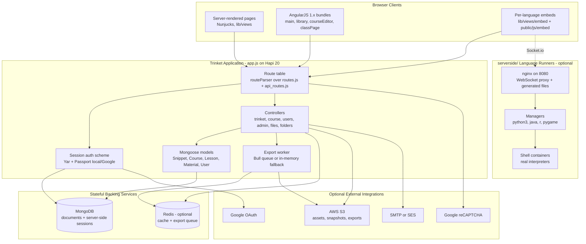

| Component | Location | Responsibility |
|---|---|---|
| Application bootstrap | `app.js` | Validates the session secret, creates the Hapi server, registers Inert/Vision/Yar, installs request/response extensions and the `session` auth scheme, loads models as globals, registers `config.routes`, starts the server |
| Configuration and route assembly | `config/` | YAML layering via `node-config`; `config/app.config.js` produces `config.routes = routeParser.parse(api_routes.concat(routes))` |
| Legacy-to-Hapi adapter | `lib/util/routeParser.js` | Translates `'METHOD /path controller.action'` declarations and Hapi 4-era pre-handlers into Hapi 20 routes; negotiates HTML vs JSON; auto-registers static pages from `lib/views/static`; supports administrator `loginAs` impersonation |
| Controllers | `lib/controllers/` (10 files, 5,718 lines) | Domain behaviour and authorisation, dominated by `course.js` and `trinket.js` |
| Models | `lib/models/` (14 collections + 7 plugins) | Mongoose schemas, ownership, slugs, pagination, timestamps, role/permission storage |
| Views | `lib/views/` | Nunjucks pages, email bodies, admin console, and one template per embed type |
| Browser application | `public/js/`, `static/scss/` | Four AngularJS bundles, per-language embed drivers, Skulpt integration; SCSS compiled to `public/css/` by Vite |
| Background work | `lib/workers/` | Export archiving and trinket snapshots over Bull or the in-memory queue |
| Language runner tier | `serverside/` | nginx plus manager and shell containers per language, selectable by Compose profile |
| Operations | `scripts/make-admin.js`, `test/smoke-test.sh` | Administrator promotion and post-deployment endpoint verification |

#### 1.2.2.3 Core Technical Approach

The system is a single CommonJS Node.js process fronted by Hapi 20, deliberately conservative in its choices and explicit about its legacy. Four decisions characterise the approach.

**Declarative, adapter-driven routing.** Routes are data, not code: each entry is a compact string plus metadata, and `lib/util/routeParser.js` expands it into a Hapi 20 route. `config/routes.js` additionally synthesises five routes for every language in `config.constants.trinketLangs` — landing page, trailing-slash redirect, short-code page, main-file download and arbitrary-file download — so adding a language multiplies into the route table automatically. Feature flags are enforced at this layer through `pre` handlers (`helpers.trinketTypeEnabled`, `helpers.validLang`, `helpers.coursesEnabled`).

**Configuration as the product surface.** `lib/util/features.js` is the single arbiter of what a deployment exposes; a language is enabled only when explicitly `=== true`, and "Unknown types default to disabled for safety." The shipped `config/default.yaml` turns on only `python` and `courses`, leaving every other language, asset uploads and the accessibility toggle off.

**Two-tier code execution with isolation as the organising constraint.** Client-side languages run in the learner's browser via Skulpt, GlowScript or Blockly-generated Python; the default `sandbox.mode: 'local'` renders untrusted output into an iframe whose permissions are `allow-scripts allow-forms allow-modals allow-popups`, with the explicit instruction "do NOT add 'allow-same-origin' for security". Languages that need a real interpreter are proxied over WebSockets to the `serverside/` tier, where each shell is a disposable container and the documentation states plainly that they "run untrusted user code."

**Server-side sessions and a defensive response pipeline.** `@hapi/yar` is configured with `maxCookieSize: 0` so session state lives in MongoDB via `lib/util/catbox-mongoose.js`, with a 24-hour TTL and sliding expiration on each authenticated request. The default auth mode is `try`, admitting guests. Two `onPreResponse` extensions apply no-store cache headers, render `404.html`/`50x.html` for browser failures while leaving `/api/` and `/partials/` responses as JSON, redirect browser 401s to `/login`, add `X-Frame-Options: deny` for the paths in `app.xframeDeny`, and normalise session cookie attributes.

A parallel observation: the codebase carries visible compatibility debt by design. `app.js` polyfills `Promise.prototype.spread`/`fail` "for Mongoose 6 compatibility", wraps `gleak` in a try/catch because it "is not compatible with Node 16+", and `config/app.config.js` documents that routes must load before the database "because mongoose-schema-extend conflicts with Joi 17."

### 1.2.3 Success Criteria

The repository defines success operationally — as startup gates, executable checks and configured limits — rather than as business targets. No service-level agreement, availability target, adoption goal or numeric KPI threshold appears anywhere in the codebase or documentation. The criteria below are exactly those the repository itself asserts.

#### 1.2.3.1 Measurable Objectives

| Objective | Verification artefact | Asserted value |
|---|---|---|
| The server refuses to start insecurely | `app.js` startup validation | Session cookie password present and ≥ 32 characters, else `process.exit(1)` |
| Core pages and assets respond after deployment | `test/smoke-test.sh` | `GET /` = 200 and contains `<html>`; `/css/base.css`, `/js/embed/embed.js`, `/login`, `/signup`, `/python`, `/html`, `/library` = 200; unknown path = 404; non-zero exit on any failure |
| Unit and API behaviour is regression-tested | `npm test` → mocha with `--reporter spec --recursive --check-leaks` | 25 test files across `test/lib/api/`, `test/lib/models/`, `test/lib/util/` |
| Editor input is persisted without flooding the API | `config/default.yaml` | `draftDebounce` and `autosaveDebounce` = 1,000 ms |
| Sessions expire predictably | `app.js` Yar cache | 24-hour `expiresIn` with sliding renewal via `yar.touch()` |
| Long-running student code is bounded | `serverside/README.md` | "Python shells have a 60-second timeout" |
| Sandbox and export artefacts are transient | `config/default.yaml`; `lib/workers/exports.js` | `sandbox.expiration` = 300 s; `EXPORT_EXPIRY_DAYS` = 3 |
| Runner containers stay within a resource envelope | `serverside/docker-compose.yml` and `README.md` | Recommended `mem_limit 500m`, `cpus 1.0`, `pids_limit 50`, read-only root with `tmpfs /tmp:size=100m`; pygame `1g` / `2.0` CPUs |

Two caveats about the smoke test are worth recording: it defaults to `http://localhost:3001` while `docker-compose.yml` publishes port 3000, and it asserts `GET /api` = 200 although no bare `/api` route is declared in `config/routes.js` or `config/api_routes.js`.

#### 1.2.3.2 Critical Success Factors

| Factor | Why it is critical | Source |
|---|---|---|
| Session secret configured | Hard startup failure otherwise | `app.js`; `config/local.example.yaml` |
| MongoDB reachable | Holds both domain documents and sessions | `config/db.js`; `lib/util/catbox-mongoose.js` |
| Frontend components present | `public/components/` is gitignored; the editor cannot render without the release tarball | `Dockerfile` (pulls `public-components.tgz` from release v1.1.0); `COMPONENTS.md` |
| CSS build executed | `public/css/base.css` is generated, not committed | `vite.config.mjs`; `.gitignore`; `GETTING_STARTED.md` troubleshooting |
| Feature flags aligned with deployed infrastructure | Enabling `python3`/`java`/`R`/`pygame` without the `serverside/` tier yields non-functional embeds | `config/default.yaml`; `serverside/README.md` |
| HTTPS terminated in production | Required before `cookieOptions.isSecure` can be enabled | `GETTING_STARTED.md` production checklist |
| Runner containers hardened | Shells execute untrusted learner code | `serverside/README.md` security-hardening section |
| Administrator bootstrapped out of band | `/admin` is unreachable until an operator runs the CLI | `scripts/make-admin.js` |

#### 1.2.3.3 Key Performance Indicators

The system ships instrumentation but no targets. What it measures, and where the data lands:

| Indicator | Storage | Collection path |
|---|---|---|
| Trinket engagement — runs, forks, email/embed/link shares and views | `Snippet.metrics` sub-document | `PUT /api/trinkets/{trinketId}/metrics` |
| Trinket popularity and momentum | Derived queries | `GET /api/trinkets/popular`, `GET /api/trinkets/active` |
| Client-side event and duration telemetry | `ClientMetric`, bucketed per minute with `event_type`, `lang`, `duration`, `user`, `trinket`, `session` | `POST /api/trinkets/clientmetric`, enabled by `app.embed.logClientMetric` |
| Learner error resolution | `ErrorEvent` with state `encountered`/`repeated`/`resolved`; the model header names the intended derived metrics, including "time to resolve" and "avg resolution attempts" | `POST /api/trinkets/codeerror`, enabled by `app.embed.logClientCodeError` |
| Per-trinket activity audit | `Interaction` with `action`, `_actor`, `referer`, `address` | `GET /api/trinkets/{trinketId}/interactions` |
| Course and assignment progress | `Snippet.submissionState`, `startedOn`, `submittedOn` | `GET /api/courses/{courseId}/dashboard`, `.../materials/{materialId}/dashboard` |
| Export job progress | `Export.progress.{total,processed,failed}` and `status` | `GET /api/exports/{exportId}` |
| Route handler latency | Winston logs only | `app.log.routehandlertiming: true` in `config/default.yaml` |

Because `lib/models/roles.js` returns no limits and no quota enforcement exists, none of these counters gates user behaviour; they are analytics, not entitlement checks.

## 1.3 Scope

### 1.3.1 In-Scope

#### 1.3.1.1 Core Features and Must-Have Capabilities

The following capabilities are implemented in this repository. "Must-have" is determined by what the default configuration enables and what the application cannot function without.

| Capability group | Status in the shipped default configuration |
|---|---|
| Accounts, authentication and sessions | Always active — local email/password via bcrypt, server-side sessions in MongoDB, guest browsing via `mode: 'try'` |
| Trinket authoring, execution, autosave, draft, fork, share and publish | Always active for enabled languages |
| Skulpt-based Python in the browser | Enabled — `features.trinkets.python: true` is the only language on by default |
| Personal library, folders and search | Always active |
| Embeddable trinkets, including the three assignment embed variants | Active for enabled languages |
| Courses, lessons, materials, assignments, submissions, feedback and dashboards | Enabled — `features.courses: true` |
| Site administration console and CLI-based admin promotion | Always active; `/admin` requires the `admin` role |
| Bulk account data export | Always active |
| Learning-analytics capture — interactions, client metrics, error events | Active; `logClientCodeError` and `logClientMetric` default to `true` |
| Other 10 trinket languages | Present in code but **disabled by default** — must be switched on per deployment |
| Asset uploads | Present but **disabled by default** — `features.assets: false`, requires S3 |
| Accessibility toggle in the embed toolbar | Present but **disabled by default** — `features.accessibilityToggle: false` |
| Server-side language runners for Python 3, Java, R, Pygame | Reference implementation in `serverside/`, started by explicit Compose profile |

The eleven language types declared in `config/constants.js` divide by execution model:

| Execution model | Languages | Runtime dependency |
|---|---|---|
| Client-side | `python`, `console`, `html`, `blocks`, `glowscript`, `glowscript-blocks`, `music` | Browser only — Skulpt, Blockly, GlowScript, MIDI.js |
| Server-side | `python3`, `java`, `R`, `pygame` | `serverside/` manager plus shell containers behind nginx on port 8080 |

#### 1.3.1.2 Primary User Workflows

| Workflow | Entry points |
|---|---|
| Register, verify email, sign in, reset password | `POST /users`, `POST /api/users/verify-email`, `GET /verify-email`, `POST /login`, `POST /send-pass-reset`, `POST /save-pass`, `GET /auth/google` → `GET /auth/google/callback` |
| Write and run code anonymously, then claim it | Language landing pages `GET /{lang}`, `POST /python`, `POST /api/trinkets`; `app.embed.enableLogin` and `enableCopyRemix` default to `true` |
| Iterate on a trinket | `POST /api/trinkets/{trinketId}/autosave`, `POST .../draft`, `DELETE /api/drafts/{trinketId}`, `PUT .../code`, `POST .../snapshot` |
| Fork, share and embed | `POST /api/trinkets/{trinketId}/forks`, `POST .../email`, `PUT .../published`, `GET /embed/{lang}/{trinketId}` |
| Organise a personal library | `GET /library/trinkets/{path*}`, `POST /api/folders`, `POST /api/trinkets/{trinketId}/folder`, `GET /api/trinkets/search` |
| Author a course | `GET /courses/new`, `POST /api/courses`, `POST .../lessons`, `POST .../materials`, `PUT .../assignment`, `PATCH /api/courses/{courseId}` to archive |
| Enrol learners | `POST /api/courses/{courseId}/invitations`, `GET /courses/accept/{token}`, `POST /api/courses/{courseId}/accessCode`, `GET /courses/join/{accessCode}`, `POST /api/courses/join` |
| Complete and submit an assignment | `GET /assignment-embed/{lang}/{trinketId}`, `POST .../startAssignment`, `POST .../submissions`, `POST /api/comments/{trinketId}` |
| Review, grade and give feedback | `GET /assignment-embed-feedback/{lang}/{trinketId}`, `GET .../materials/{materialId}/submissions`, `POST .../feedback`, `POST .../acceptSubmission`, `GET /api/courses/{courseId}/dashboard` |
| Study a course as a learner | `GET /{userSlug}/courses/{courseSlug}`, `GET /u/{username}/classes`, `GET /{userSlug}/courses/{courseSlug}/download.zip` |
| Copy or remix an existing course | `POST /{userSlug}/courses/{courseSlug}/copy`, `POST /api/courses/{courseId}/copy` |
| Manage the site | `GET /admin`, `POST /admin/upload` for bulk CSV users, `POST /api/admin/user/{userId}/grant`, featured-course endpoints |
| Take data out | `POST /api/exports` → `GET /api/exports/{exportId}` → `GET /api/exports/{exportId}/download` |
| Manage the account | `GET /account`, `POST /api/users/password`, `POST /api/users/email`, `POST /api/users/settings`, `DELETE /api/users` |

#### 1.3.1.3 Essential Integrations and Key Technical Requirements

Only MongoDB is non-negotiable, because `app.js` registers the Yar session cache against `lib/util/catbox-mongoose.js`. Everything else degrades gracefully.

| Requirement | Value asserted by the repository |
|---|---|
| Node.js runtime | `README.md` and `docs/setup.md` state Node.js 18+; the `Dockerfile` builds on `node:16-bullseye` |
| MongoDB | `README.md` states MongoDB 5.0+; `docker-compose.yml` runs `mongo:5` |
| Redis | Optional — `redis:latest` in Compose; `db.redis.enabled: false` in `config/local.example.yaml` |
| Mandatory secret | `app.plugins.session.cookieOptions.password`, minimum 32 characters, enforced at startup |
| Listen address | `0.0.0.0:3000` per `config/default.yaml`; published as `3000:3000` |
| Frontend components | `public-components.tgz` from GitHub release `v1.1.0`, fetched during the Docker build |
| CSS build | `npm run build:css` → Vite compiles `static/scss/base.scss` and `static/scss/embed/embed.scss` into `public/css/` |
| Process supervision in container | `pm2-docker start app.js`, running as the non-root `trinket` user |
| Server-side runner endpoint | `http://localhost:8080/{python3,java,r,pygame}` via `app.serverside.*.api.default` |
| Client-side sandbox | Iframe `srcdoc` with `allow-scripts allow-forms allow-modals allow-popups` and no `allow-same-origin` |

#### 1.3.1.4 Implementation Boundaries

**System boundaries.** The application's responsibility begins at the Hapi HTTP listener on port 3000 and ends at the MongoDB/Redis connections, the S3/SMTP/OAuth/reCAPTCHA clients, and the WebSocket handoff to the language runners. It owns: route handling, authorisation, persistence, server-side rendering, the AngularJS asset bundles, and background export/snapshot work. It does not own: TLS termination (an optional external nginx per the `GETTING_STARTED.md` services table), the interpreter processes themselves (separate containers in `serverside/`), the third-party CDNs that serve jQuery, AngularJS and MathJax at runtime, or the browser vendor libraries in the gitignored `public/components/`.

**User groups covered.** Exactly the roles defined in `lib/models/roles.js`: the site roles `user` and `admin`; the course roles `course-owner`, `course-admin`, `course-collaborator`, `course-student`, `course-associate`; the resource role `folder-owner`; and unauthenticated guests admitted by the `try` auth mode. Roles are stored per context on the user document — `{ context: 'site' | 'course:<id>', roles, permissions, thru, limits }` — so course permissions are scoped to a single course.

**Geographic and market coverage.** The repository defines no regional deployment topology, no locale catalogue and no market segmentation. `lib/util/translate.js` returns its key unchanged, so the user interface is effectively single-language; no server-side timezone logic exists in `lib/`, `config/` or `public/js`, with `moment-timezone-with-data` loaded from a CDN only in the `main` AngularJS bundle for client-side date display. `aws.region` defaults to `us-east-1` and the illustrative hostnames in `config/default.yaml` and `sandbox.cors.origin` use `trinket.dev`; both are placeholders a deployer replaces.

**Data domains included.** Fourteen MongoDB collections created through `lib/models/model.js`:

| Domain | Collections |
|---|---|
| Identity and authorisation | `User` — with the embedded per-context roles/permissions structure |
| Code artefacts | `Snippet` (the Trinket model's registered name), `Draft`, `File`, `Folder` |
| Course delivery | `Course`, `Lesson`, `Material`, `CourseInvitation`, `FeaturedCourses` |
| Telemetry and analytics | `Interaction`, `ClientMetric`, `ErrorEvent` |
| Data portability | `Export` |

`AssetSchema` (`lib/models/asset.js`) is an embedded sub-document rather than a collection, and assignment submissions are modelled as `Snippet` documents carrying `courseId`, `materialId` and `submissionState` rather than a separate submission collection. Seven reusable schema plugins live in `lib/models/plugins/`: `ownable`, `slug`, `timestamps`, `paginate`, `roles`, `isChanged`, `orderedList`. Namespace collisions between user slugs and application routes are prevented by the ~50-entry deny list in `config/reserved.yaml`.

### 1.3.2 Out-of-Scope

#### 1.3.2.1 Explicitly Excluded Features

| Exclusion | Evidence |
|---|---|
| Subscription plans, billing, payments and per-plan quotas | `lib/models/roles.js` collapses the legacy `trinket-code`, `trinket-connect`, `trinket-connect-trial`, `trinket-codeplus` and `trinket-teacher` tiers into the single `user` role; `getLimits()` returns `undefined` — "No limits in open-source version". No payment dependency appears in `package.json` |
| Internationalisation and localisation | `lib/util/translate.js`: "Full Jed-based translation was removed for OSS release" |
| Autoscaling of the execution tier | `serverside/README.md`: the scaler, stats server, worker images and phone-home scripts are "not yet included in the OSS release" |
| Build-time per-embed feature flags | `COMPONENTS.md` lists `ENABLE_PYTHON_EMBED`, `ENABLE_PYTHON3_EMBED`, `ENABLE_BLOCKS_EMBED`, `ENABLE_GLOWSCRIPT_EMBED`, `ENABLE_MUSIC_EMBED`, `ENABLE_PYGAME_EMBED` under the heading "Feature Flags (TODO)" — aspirational, not implemented |
| Frontend vendor libraries as source | `public/components/` and `public/vendor` are gitignored; components arrive as a release tarball |
| Bower-based dependency management | `COMPONENTS.md`: "Original bower.json preserved for reference but bower is deprecated"; `.bowerrc` remains but no `bower.json` is committed |
| Automated CI/CD, linting and coverage enforcement | No `.github/` directory or workflow files, and no ESLint/JSHint/Prettier/EditorConfig/coverage configuration exists. `CONTRIBUTING.md` documents code style as prose only |
| Database migration execution | `mongo-migrate` is a declared dependency and `.gitignore` reserves `config/migration.json` and `lib/migrations/backups`, but no migrations directory or migration script is committed |

#### 1.3.2.2 Future-Phase Considerations

These are items the repository itself flags as intended but incomplete, in its own words:

| Item | Source |
|---|---|
| Dynamic cloud scaling for the execution tier, with an invitation to contribute | `serverside/README.md`, "Production Scaling (Not Yet Included)" — "Contributions welcome." |
| Toggleable embeds so operators "can skip unnecessary dependencies" | `COMPONENTS.md`, "Feature Flags (TODO)" |
| A committed `setup-vendor` script for non-Docker component installation | Referenced by `COMPONENTS.md` and `docs/overview.md` but absent from `package.json` |
| Multi-instance horizontal scaling | Enabling Redis is described as being "For production with multiple app instances or better performance" in `GETTING_STARTED.md`, but no orchestration manifests beyond Compose are provided |
| Read-replica usage | `db.mongoread` exists in `config/default.yaml` with long connect/socket timeouts, but is blank by default |
| Processing.js embed provenance | `COMPONENTS.md` lists Processing.js with repository and version as "?" |

#### 1.3.2.3 Integration Points Not Covered

| Not covered | Note |
|---|---|
| LTI, SCORM, OneRoster, or gradebook sync with an external LMS | No such integration exists. `Course.externalLink.{source,sourceId}` is a bare reference field with no connector implementation |
| SSO beyond Google — SAML, OIDC providers, LDAP, Microsoft/Apple/GitHub identity | `lib/auth/passport.js` and `package.json` carry only `passport-local` and `passport-google-oauth` |
| Object storage other than AWS S3 | `config/aws.js` and `lib/workers/exports.js` use `aws-sdk` directly; `docs/setup.md` mentions "S3 (or S3-compatible)" storage, but no alternative provider client is present |
| Hosted analytics, APM, or error-tracking services | Telemetry is written to the application's own MongoDB collections and Winston logs. `config/production.yaml.dist` reserves `app.analytics.secret`, but no analytics vendor SDK is present |
| Managed container orchestration | Only Docker Compose manifests exist; there are no Kubernetes, Helm, Terraform or cloud-provider deployment descriptors |
| Webhooks or an outbound event bus | No webhook registration, publisher or event-bus client exists |
| Public API tokens for third-party developers | `jsonwebtoken` is a dependency used in token-bearing flows, but no API-key issuance, OAuth-provider role, or rate-limiting layer is implemented |

#### 1.3.2.4 Unsupported Use Cases

| Use case | Why it is unsupported |
|---|---|
| Running a server-side language without deploying the runner tier | Enabling `python3`, `java`, `R` or `pygame` in `features.trinkets` while `app.serverside.*.api.default` points at nothing yields a non-functional embed; the language-enabled check in `lib/util/features.js` does not probe runner availability |
| Long-running or compute-heavy student programs | `serverside/README.md`: "Python shells have a 60-second timeout"; recommended shell limits are 500 MB memory, 1 CPU and 50 PIDs |
| High-concurrency pygame usage | The default configuration runs a single `pygame-worker`, described as "suitable for development and small deployments" |
| Sharing pygame trinkets, or drafting console trinkets | `config/default.yaml` lists `pygame` under `notShareable` and `console` under `nodraft` |
| Persistent cache or reliable background jobs without Redis | `GETTING_STARTED.md`: "Without Redis, cache data is lost on restart and not shared between instances"; `lib/util/queues.js` notes that in-memory jobs with no registered handler are "essentially dropped" |
| Password reset or notification email without SMTP/SES | `docs/setup.md`: "Without email configured, password reset is unavailable" |
| Asset uploads without S3 | `features.assets` remains `false`; `config/local.example.yaml`: "Without S3, the asset upload feature is disabled. Code still works fine." |
| Secure cookies without HTTPS termination | `isSecure` must remain `false`, and `app.js` only appends `SameSite=None; Secure` when `isSecure` is set |
| Self-service administrator access | `/admin` requires a role that only `scripts/make-admin.js`, run against the database by an operator, can grant |
| Per-user subdomains | `app.usersubdomains` is `false` in both `config/default.yaml` and `config/test.yaml` |
| Screen-reader-optimised embeds out of the box | `features.accessibilityToggle` defaults to `false` |


## 1.4 References

Every file and folder below was inspected directly in the repository checkout and is cited as evidence somewhere in Section 1.

### 1.4.1 Project Documentation and Governance

- `README.md` - Product definition, five headline features, prerequisites, architecture summary, configuration table, CC0 licence statement, project history
- `docs/index.md` - Restates the product definition, features, licence and history for the published documentation site
- `docs/overview.md` - Architecture bullets, project-structure tree, component distribution model, embeds-by-feature tables, contribution summary
- `docs/setup.md` - Prerequisites, configuration file roles, required/optional settings, services-and-ports table, degradation statements for email and S3, admin creation
- `GETTING_STARTED.md` - Docker-only quick start, CSS build commands, admin promotion, email/OAuth/reCAPTCHA/branding setup, Redis optionality, production checklist
- `COMPONENTS.md` - Frontend component inventory with pinned versions per embed, Skulpt extension modules, unimplemented `ENABLE_*` feature-flag TODO list, bower-deprecation note
- `CONTRIBUTING.md` - Issue and pull-request process, development setup, prose code-style rules, `npm test` gate
- `CODE_OF_CONDUCT.md` - Community expectations
- `CHANGELOG.md` - Single entry: "[1.0.0] - Initial Open Source Release"
- `LICENSE` - CC0 1.0 Universal public-domain dedication
- `catalog-info.yaml` - Backstage component registration: `spec.type: service`, `lifecycle: production`, ownership and tags
- `mkdocs.yml` - TechDocs site definition and navigation over `docs/`

### 1.4.2 Application Entry Point, Build and Deployment

- `app.js` - Hapi 20 bootstrap: session-password startup gate, server/cache construction, Inert/Vision/Yar registration, request and response extensions, custom `session` auth scheme, global model loading, route registration, leak polling
- `package.json` - Package identity and tagline, dependency and devDependency inventory, npm scripts, repository metadata, `license` field
- `Dockerfile` - Node 16 base image, build dependencies, non-root `trinket` user, `public-components.tgz` retrieval from release v1.1.0, `pm2-docker` start command, exposed port
- `docker-compose.yml` - Application, MongoDB 5 and Redis services, published ports, volumes and bridge network
- `vite.config.mjs` - CSS-only build inputs and output mapping into `public/css/`
- `.gitignore` - Confirms which artefacts are generated or secret rather than committed
- `.bowerrc` - Legacy component directory and ignored dependencies
- `.dockerignore` - Build-context exclusion

### 1.4.3 Configuration

- `config/default.yaml` - Shipped feature-flag defaults, application identity and URLs, session and cookie policy, asset and AngularJS bundle manifests, per-language capability matrices, embed settings, Google OAuth and reCAPTCHA placeholders, server-side runner endpoints, `xframeDeny` list, worker output paths, MongoDB/Redis/AWS blocks, sandbox modes and permissions
- `config/local.example.yaml` - Required versus optional configuration, Docker-versus-local database hosts, degradation notes for email and S3
- `config/production.yaml.dist` - Production override template
- `config/test.yaml` - Test-environment overrides, including `app.start: false`
- `config/constants.js` - The eleven-entry `trinketLangs` list
- `config/app.config.js` - Environment flags, derived URLs, route assembly order and its documented dependency constraint
- `config/routes.js` - 57 web route declarations plus the five routes generated per language; conditional reCAPTCHA validation; reserved-name loading
- `config/api_routes.js` - 116 JSON API route declarations across courses, assignments, trinkets, folders, users, files, exports and administration
- `config/reserved.yaml` - Reserved slug and username deny list
- `config/` - Also contains `aws.js`, `db.js`, `log.js`, `redis.js` connection and logging adapters

### 1.4.4 Application Source

- `lib/` - Application layer: `util`, `models`, `views`, `workers`, `controllers`, `grammars`, `shared`, `auth`
- `lib/util/routeParser.js` - Legacy-declaration to Hapi 20 route adapter, HTML/JSON negotiation, static-page auto-registration, `loginAs` impersonation, `emailEnabled` computation
- `lib/util/features.js` - Feature-flag arbiter, including the "unknown types default to disabled for safety" rule
- `lib/util/translate.js` - i18n stub confirming that Jed-based translation was removed for the OSS release
- `lib/util/queues.js` - Redis-enabled detection and the in-memory queue fallback
- `lib/util/catbox-mongoose.js` - MongoDB-backed session cache engine referenced by `app.js`
- `lib/models/roles.js` - Role and permission map, legacy paid-tier aliases, `getLimits` returning no limits
- `lib/models/user.js` - Identity schema, bcrypt hooks, default role assignment, editor settings
- `lib/models/trinket.js` - The `Snippet` schema: code, short code, language enum, fork lineage, submission state, comments, metrics, last view
- `lib/models/course.js` - Course schema: membership, course types, access code, external link, archive flag
- `lib/models/lesson.js`, `lib/models/material.js` - Course content hierarchy and assignment scheduling windows
- `lib/models/file.js`, `lib/models/folder.js`, `lib/models/asset.js` - File, folder and embedded asset structures
- `lib/models/draft.js`, `lib/models/interaction.js`, `lib/models/clientMetric.js`, `lib/models/errorEvent.js`, `lib/models/export.js` - Draft persistence and the telemetry/analytics/export domains
- `lib/models/plugins/` - `ownable`, `slug`, `timestamps`, `paginate`, `roles`, `isChanged`, `orderedList`
- `lib/controllers/` - Ten domain controllers; `admin.js` action inventory and the controller line-weight distribution
- `lib/workers/exports.js` - Export worker: archiving, per-language extensions, S3 upload, mail notification, three-day expiry
- `lib/views/` - Nunjucks templates, including `lib/views/embed/` with one template per trinket type and `lib/views/static/`
- `lib/auth/passport.js` - Local and Google OAuth strategies
- `lib/grammars/musicNotation.jison` - Music-notation grammar
- `public/js/` - Four AngularJS bundles plus `public/js/embed/` per-language drivers and `public/js/skulpt/`
- `static/scss/` - SCSS sources compiled into `public/css/`

### 1.4.5 Language Runner Tier, Tooling and Tests

- `serverside/README.md` - Runner architecture and request flow, Compose profiles, manager shell selection, environment variables, SSL options, security-hardening guidance, shell timeout, pygame VNC architecture, "Production Scaling (Not Yet Included)"
- `serverside/docker-compose.yml` - nginx entry point and per-language manager/shell services with profiles, volumes and commented resource limits
- `serverside/` - Also contains the `python`, `java`, `r`, `pygame` and `nginx` build contexts and their configuration files
- `scripts/make-admin.js` - Sole administrator-promotion path and its role-context mutation
- `test/mocha.opts` - Mocha flags: `--reporter spec`, `--recursive`, `--check-leaks`
- `test/smoke-test.sh` - Post-deployment endpoint assertions, pass/fail accounting and exit behaviour
- `test/lib/` - 17 API, model and utility test files; `test/helpers/` and `test/data/` supporting fixtures
- Repository metadata - Git tags `v1.0.0` and `v1.1.0`; the absence of any `.github/` workflow, lint or coverage configuration was verified directly in the checkout

No external web sources were used; every statement in Section 1 is grounded in the repository contents listed above.


# 2. Product Requirements

## 2.1 Feature Catalog

### 2.1.0 Catalog Basis and Conventions

The features below are reconstructed from the shipped artefacts of this repository: the declarative route tables in `config/routes.js` (57 explicit declarations plus 55 generated per-language routes) and `config/api_routes.js` (116 declarations), the ten controllers in `lib/controllers/`, the fourteen Mongoose collections in `lib/models/`, the feature-flag arbiter `lib/util/features.js`, the background worker `lib/workers/exports.js`, and the reference language-runner tier in `serverside/`. No feature is listed that does not have an executable implementation path in the repository.

| Convention | Rule applied in this section |
|---|---|
| Feature ID | `F-NNN`, assigned by category; stable for the life of this document |
| Requirement ID | `F-NNN-RQ-NNN`, defined in §2.2 and traced in §2.5 |
| Priority | `Critical` = the application cannot serve its purpose without it; `High` = a primary documented workflow depends on it; `Medium` = a supporting workflow; `Low` = convenience only |
| Status | `Completed` = implemented and reachable in this release; `In Development` = implemented but with a gap the repository itself declares outstanding |

`Status` reflects code presence, not deployment state. A separate **Default state** column records whether the shipped `config/default.yaml` exposes the feature, because this codebase treats configuration as the product surface: `lib/util/features.js` enables a trinket type only when the flag is explicitly `=== true` and comments that "Unknown types default to disabled for safety".

#### 2.1.0.1 Feature Index

| ID | Feature name | Category | Priority |
|---|---|---|---|
| F-001 | Multi-Language Trinket Authoring and Client-Side Execution | Code Authoring & Execution | Critical |
| F-002 | Server-Side Language Execution Tier | Code Authoring & Execution | High |
| F-003 | Embeddable Trinkets and Assignment Embeds | Code Authoring & Execution | Critical |
| F-004 | Trinket Persistence and Lifecycle Management | Trinket Content Lifecycle | Critical |
| F-005 | Autosave and Draft Recovery | Trinket Content Lifecycle | High |
| F-006 | Fork, Copy and Remix | Trinket Content Lifecycle | High |
| F-007 | Sharing, Publishing and Engagement Metrics | Trinket Content Lifecycle | Medium |
| F-008 | Personal Library and Folder Organisation | Trinket Content Lifecycle | High |
| F-009 | Account Registration, Authentication and Sessions | Identity & Access | Critical |
| F-010 | Role-Based Authorisation and Permissions | Identity & Access | Critical |
| F-011 | Course Authoring and Content Hierarchy | Course Delivery | High |
| F-012 | Enrolment and Course Access Control | Course Delivery | High |
| F-013 | Assignments, Submissions and Feedback | Course Delivery | High |
| F-014 | Course Distribution, Archival and Curation | Course Delivery | Medium |
| F-015 | Asset and File Management | Data Portability & Assets | Medium |
| F-016 | Bulk Account Data Export | Data Portability & Assets | Medium |
| F-017 | Site Administration Console | Administration & Analytics | High |
| F-018 | Learning Analytics and Telemetry | Administration & Analytics | Medium |
| F-019 | Feature-Flag and Configuration Gating | Platform Services | Critical |
| F-020 | Transactional Email Notification | Platform Services | Medium |
| F-021 | Session, Cache and Background Queue Services | Platform Services | High |

#### 2.1.0.2 Status and Default Exposure

| ID | Status | Default state in `config/default.yaml` | Controlling evidence |
|---|---|---|---|
| F-001 | Completed | `features.trinkets.python: true` only; ten other languages `false` | `config/default.yaml`, `lib/util/features.js` |
| F-002 | In Development | Runner tier off; started by explicit Compose profile | `serverside/docker-compose.yml`, `serverside/README.md` "Production Scaling (Not Yet Included)" |
| F-003 | Completed | Active for enabled languages | `config/routes.js` embed routes, `lib/views/embed/` |
| F-004 | Completed | Always active | `lib/controllers/trinket.js`, `lib/models/trinket.js` |
| F-005 | Completed | Always active; `console` excluded via `app.nodraft` | `config/default.yaml`, `lib/models/draft.js` |
| F-006 | Completed | Always active; `app.embed.enableCopyRemix: true` | `config/default.yaml`, `lib/models/trinket.js` |
| F-007 | Completed | Active; `pygame` in `app.notShareable` | `config/default.yaml`, `lib/controllers/trinket.js` |
| F-008 | Completed | Always active | `config/routes.js`, `lib/controllers/folders.js` |
| F-009 | Completed | Always active; Google OAuth and reCAPTCHA blank | `app.js`, `lib/controllers/users.js`, `lib/controllers/auth.js` |
| F-010 | Completed | Always active; simplified role set | `lib/models/roles.js`, `lib/util/helpers.js` |
| F-011 | Completed | `features.courses: true` | `config/api_routes.js`, `lib/controllers/course.js` |
| F-012 | Completed | Enabled with courses; invitations need email | `lib/controllers/course.js`, `lib/models/courseInvitation.js` |
| F-013 | Completed | Enabled with courses | `lib/controllers/course.js`, `lib/models/material.js` |
| F-014 | Completed | Enabled with courses | `lib/controllers/courses.js`, `lib/models/featuredCourses.js` |
| F-015 | Completed | `features.assets: false` — requires S3 | `config/default.yaml`, `lib/controllers/files.js` |
| F-016 | Completed | Always active; requires an S3 bucket and email for delivery | `lib/workers/exports.js`, `lib/controllers/users.js` |
| F-017 | Completed | Always active; `/admin` requires the `admin` role | `lib/controllers/admin.js`, `scripts/make-admin.js` |
| F-018 | Completed | `app.embed.logClientCodeError` and `logClientMetric` both `true` | `config/default.yaml`, `lib/models/clientMetric.js` |
| F-019 | Completed | Always active | `lib/util/features.js`, `lib/util/helpers.js` |
| F-020 | Completed | `app.mail.*` blank — degrades to a no-op | `lib/util/mailer.js` |
| F-021 | Completed | MongoDB sessions required; Redis optional | `app.js`, `lib/util/catbox-mongoose.js`, `lib/util/queues.js` |

### 2.1.1 Code Authoring and Execution

#### 2.1.1.1 F-001 Multi-Language Trinket Authoring and Client-Side Execution

| Attribute | Value |
|---|---|
| Feature ID | F-001 |
| Category | Code Authoring & Execution |
| Priority | Critical |
| Status | Completed |

**Overview.** A learner opens a language landing page, writes code in an in-browser editor, and runs it without installing anything. `config/constants.js` declares eleven language types — `python`, `python3`, `console`, `music`, `html`, `blocks`, `glowscript`, `java`, `glowscript-blocks`, `R`, `pygame` — and `config/routes.js` synthesises five routes for each of them (`GET /{lang}`, a trailing-slash redirect, `GET /{lang}/{shortCode}`, and two download routes), so language support and route surface expand together. Seven of the eleven execute entirely in the browser through the drivers in `public/js/embed/` (`python.js`, `html.js`, `blocks.js`, `glowscript.js`, `glowscript-blocks.js`, `music.js`, `console.js`); the remaining four delegate to F-002.

**Business value.** Removing the install step removes the dominant setup cost in a classroom, and client-side execution means the marginal compute cost of a running program is zero for the operator.

**User benefits.** Learners see output immediately in the same page as their code; per-language capability matrices in `config/default.yaml` (`autorun`, `outputOnly`, `toggleCode`, `toggleEditor`, `downloadable`, `uploadable`, `configurable`, `hideGeneratedCode`, `runOption`) let the same editor present as a full IDE, a read-only demo, or a console REPL. When `features.accessibilityToggle` is enabled, `lib/views/embed/base.html` adds a screen-reader mode switch for seven of the languages.

**Technical context.** Untrusted output is isolated in an iframe. `config/default.yaml` sets `sandbox.mode: 'local'` and `sandbox.local.permissions: 'allow-scripts allow-forms allow-modals allow-popups'` with the instruction "do NOT add 'allow-same-origin' for security"; `public/js/embed/glowscript.js` and `html.js` apply that attribute string to the output frame, and an `external` mode POSTs the files to a separate sandbox origin whose token URL expires after `sandbox.expiration: 300` seconds. Editor preferences (`disableAceEditor`, `theme`, `lineWrapping`, per-language tab width) live on the `User` document.

| Dependency type | Detail |
|---|---|
| Prerequisite features | F-019 (a language renders only when its flag is `true`); F-003 for the embedded presentation |
| System dependencies | Nunjucks views in `lib/views/embed/`; `public/js/embed/` drivers; `public/css/embed.css` built by Vite from `static/scss/embed/embed.scss` |
| External dependencies | Browser component libraries in the gitignored `public/components/`, delivered as the `public-components.tgz` release asset — Skulpt 0.11.1.34, Blockly, GlowScript 2.7.5, Ace, MIDI.js, Processing.js per `COMPONENTS.md`; CDN-hosted jQuery, AngularJS 1.3.20 and Font Awesome per `app.assets` |
| Integration requirements | `lib/views/embed/base.html` injects `trinket.config` into the page — asset prefixes, pinned component versions, `vendorHost`, the four server-side API URLs, `logClientCodeError`, `logClientMetric`, `draftDebounce`, `autosaveDebounce`, `assetsEnabled` |

#### 2.1.1.2 F-002 Server-Side Language Execution Tier

| Attribute | Value |
|---|---|
| Feature ID | F-002 |
| Category | Code Authoring & Execution |
| Priority | High |
| Status | In Development |

**Overview.** Languages that need a real interpreter — `python3`, `java`, `R`, `pygame` — are executed in dedicated containers reached over WebSockets. `serverside/README.md` describes the chain: browser → nginx on port 8080 → a per-language *manager* Node process → a per-language *shell* container that spawns the interpreter and streams output back. `serverside/docker-compose.yml` gates each language behind a Compose profile (`python3`, `java`, `r`, `pygame`), and the pygame profile adds an Xvfb + TightVNC + noVNC pipeline so a graphical program can be streamed to the browser.

**Business value.** It extends the same authoring experience to languages that cannot be compiled to JavaScript, without putting interpreter processes inside the application tier.

**User benefits.** Learners run Python 3, Java, R and Pygame programs, including programs that create files: `serverside/python/manager/manager.js` detects images, SVG and HTML produced by user code, writes them under `manager.generatedDir` and returns a public URL under `manager.generatedUrl`, which is how matplotlib output reaches the page.

**Technical context.** The status is `In Development` because the repository declares its own gap: `serverside/README.md` has a section headed "Production Scaling (Not Yet Included)" stating that the scaler, stats server, worker images and phone-home scripts are "not yet included in the OSS release. Contributions welcome." A single shell per language is the default, selected at random from the `shells` array, and the pygame configuration is described as "suitable for development and small deployments". Two documentation artefacts (`COMPONENTS.md`, `docs/overview.md`) still say the runner service is "not included in this repository", which `serverside/` contradicts.

| Dependency type | Detail |
|---|---|
| Prerequisite features | F-019 for the per-language flag; F-003 to render the embed that opens the socket |
| System dependencies | `serverside/nginx/nginx.conf` reverse proxy; per-language `manager/manager.js` and `shell/trinket/server.js`; shared Docker volumes for sessions and generated files |
| External dependencies | Docker and Docker Compose; the language runtimes themselves (`python3` with `requirements.txt`, `java8`, `r3` with `install.r`/`packages.txt`); Socket.io on both hops |
| Integration requirements | `app.serverside.langmap` maps `python3→python3`, `R→r3`, `java→java8`, `pygame→pygame`, and `lib/controllers/trinket.js` `setServersideApi()` injects `app.serverside.<key>.api.default` into the embed; the manager reads `GENERATED_URL` and `CORS_ORIGINS` from the environment |

#### 2.1.1.3 F-003 Embeddable Trinkets and Assignment Embeds

| Attribute | Value |
|---|---|
| Feature ID | F-003 |
| Category | Code Authoring & Execution |
| Priority | Critical |
| Status | Completed |

**Overview.** Any trinket can be rendered as a standalone, iframe-ready page. `config/routes.js` declares `GET /embed/{lang}/{trinketId}`, `GET /embed/{lang}`, `GET /embed/beta/{type}`, the Blockly and GlowScript-Blocks iframe endpoints, a Jekyll helper at `GET /tools/{version}/jekyll/embed/{lang}`, and three assignment variants that differ only in their persistence behaviour: `/assignment-embed/{lang}/{trinketId}` (student view, autosave), `/assignment-embed-feedback/{lang}/{trinketId}` (teacher feedback view, draft) and `/assignment-embed-viewonly/{lang}/{trinketId}` (no autosave, no draft). `lib/views/embed/` holds one template per language plus `base.html`, `default-toolbar.html` and `left-menu.html`.

**Business value.** Embeds are the distribution mechanism for the product: a teacher's blog, textbook or course page carries a live, runnable example rather than a screenshot.

**User benefits.** The embedding author controls the presentation through query parameters that the handler validates against the capability matrices — `outputOnly`, `toggleCode`, `runOption`, `runMode`, `hideGeneratedCode`, `showInstructions`, `hideInstructions`, `start`, `leftMenu`, `noSharing`, `noRemix`, `font` — and the handler computes a three-tab, two-tab or no-tab layout accordingly.

**Technical context.** Every embed route is preceded by `helpers.trinketTypeEnabled`, `helpers.validLang` and `helpers.findTrinket`, so a disabled language yields `404 This trinket type is not available`, an unknown language yields 404, and a language mismatch between the URL and the stored document produces a permanent redirect to the canonical `/{lang}/{trinketId}`. `app.xframeDeny` lists the paths (`/`, `/login`, `/signup`, `/contact`, `/educators`) where `app.js` adds `X-Frame-Options: deny`; embed paths are deliberately absent from that list.

| Dependency type | Detail |
|---|---|
| Prerequisite features | F-001 or F-002 for execution; F-004 for the stored document; F-019 for the language gate |
| System dependencies | `lib/util/helpers.js` pre-handlers; `lib/controllers/trinket.js` `embed`, `assignment`, `assignmentFeedback`, `viewOnly`; `lib/views/embed/` |
| External dependencies | The browser component set in `public/components/`; for server-side languages, the runner endpoints of F-002 |
| Integration requirements | An email-share JWT is minted per render as `jwt.sign({shortCode}, app.mail.secret + shortCode)` and cached in the session under `emailToken:<shortCode>`, which F-007 later verifies |

### 2.1.2 Trinket Content Lifecycle

#### 2.1.2.1 F-004 Trinket Persistence and Lifecycle Management

| Attribute | Value |
|---|---|
| Feature ID | F-004 |
| Category | Trinket Content Lifecycle |
| Priority | Critical |
| Status | Completed |

**Overview.** The `Snippet` collection (registered from `lib/models/trinket.js`, 683 lines) is the system's central artefact. `POST /api/trinkets` creates one, `PUT /api/trinkets/{trinketId}/code|name|description|slug|published` mutate individual fields, `DELETE /api/trinkets/{trinketId}` removes one, `POST /api/trinkets/{trinketId}/snapshot` captures a rendered preview, and `GET /api/trinkets`, `/search`, `/popular` and `/active` read them back. The document also carries the assignment fields used by F-013 (`courseId`, `materialId`, `submissionState`, `submittedOn`, `submissionOpts`) and the comment thread used for teacher feedback.

**Business value.** Saved work is what turns a one-off code run into a shareable, embeddable, gradeable object; every other content feature reads or writes this collection.

**User benefits.** Anonymous visitors can create a trinket and claim it later — `POST /api/trinkets` carries no `auth` requirement while the mutation routes do. Work is addressable by a short URL: `alternateIds: ['shortCode']` makes `/{lang}/{shortCode}` a first-class identifier alongside the Mongo id, and a user-chosen `slug` is resolvable through `helpers.trinketByOwnerAndSlug` with permanent redirects from superseded slugs.

**Technical context.** `shortCode` is a 12-character prefix of `sha1(code + lang + _owner + _creator + _parent + Date.now())` and is uniquely indexed. Deletion is soft: `softDelete` sets `deletedAt`, and every `findById` server method in `lib/util/helpers.js` treats a document with `deletedAt` as `404`. Save hooks maintain the content hash and increment `File.metrics.trinkets` for newly attached assets; the post-remove hook deletes the associated snapshot object on a best-effort basis. API responses are constrained by `publicSpec`, a 24-field projection exported as `Trinket.publicModel`.

| Dependency type | Detail |
|---|---|
| Prerequisite features | F-019 (creation is gated per language); F-010 for ownership checks on mutation |
| System dependencies | MongoDB via Mongoose; `lib/models/plugins/` (`paginate`, `isChanged`, `slug`, `timestamps`, `ownable`); `lib/util/store/trinketStore.js` for slug and category indexes |
| External dependencies | None for the core document; `aws.buckets.snapshots` when snapshots are stored |
| Integration requirements | `canEdit(pre.trinket,user)` is applied declaratively in `config/api_routes.js`; `Interaction` documents are written as a side effect of metric updates (F-018) |

#### 2.1.2.2 F-005 Autosave and Draft Recovery

| Attribute | Value |
|---|---|
| Feature ID | F-005 |
| Category | Trinket Content Lifecycle |
| Priority | High |
| Status | Completed |

**Overview.** Two distinct persistence paths protect in-progress work. `POST /api/trinkets/{trinketId}/autosave` writes directly onto the owner's trinket, while `POST /api/trinkets/{trinketId}/draft` upserts a separate `Draft` document keyed by `{user, trinket}` so that a viewer who is *not* the owner — a student working inside an assignment embed, or a teacher composing a revision — accumulates changes without touching the original. `DELETE /api/drafts/{trinketId}` discards a draft.

**Business value.** Lost classroom work is unrecoverable time; a draft that survives a closed tab is the difference between a lesson completed and a lesson repeated.

**User benefits.** Editing resumes where it stopped. `Draft.findOneMoreRecent` compares the draft's `lastUpdated` against the trinket's `codeLastUpdated`, so a stale draft is not offered in place of a newer save; the embed handler passes the surviving draft into the template.

**Technical context.** Both endpoints require `auth: 'session'` and accept an optional base64 `zipCode` field, which is expanded with JSZip (entry name `zipCode`) for multi-file languages. Autosave additionally enforces creator identity in the controller and sets `submissionState = "modified"` as a side effect. Draft writes are deliberately best-effort: a failed `findOneAndUpdate` still resolves through `request.success()`. Client write pressure is bounded by `app.embed.draftDebounce` and `app.embed.autosaveDebounce`, both 1,000 ms, published to the browser through `trinket.config`.

| Dependency type | Detail |
|---|---|
| Prerequisite features | F-004 (a trinket must exist); F-009 (session required) |
| System dependencies | `lib/models/draft.js`; `lib/controllers/trinket.js` `autosave`, `draft`, `discardDraft` |
| External dependencies | JSZip for `zipCode` payloads |
| Integration requirements | `config/default.yaml` lists `console` under `app.nodraft`, so the console language opts out of drafting; F-013 consumes drafts in the feedback embed |

#### 2.1.2.3 F-006 Fork, Copy and Remix

| Attribute | Value |
|---|---|
| Feature ID | F-006 |
| Category | Trinket Content Lifecycle |
| Priority | High |
| Status | Completed |

**Overview.** `POST /api/trinkets/{trinketId}/forks` creates an independent copy of an existing trinket for the requesting user. The model supports two lineage relationships: `copy()` sets `_parent` to the source document, and `createRemix()` additionally sets `_origin_id` and appends " Remix" to the name, with `findRemix(parentId, userId)` allowing an existing remix to be reused rather than duplicated.

**Business value.** Remixing is how teaching material propagates — a worked example becomes a hundred student starting points without the author doing anything.

**User benefits.** A learner can take any visible trinket, modify it and own the result, while the original author retains an attributable lineage and a fork counter.

**Technical context.** Fork payloads are validated with `code` required, carry the same 10 MB cap as creation, and accept `_origin_id`, `_remix` and `shortCode` hints. The parent's `metrics.forks` counter is incremented through `findByIdAndUpdateMetrics`, which `test/lib/api/trinket.js` asserts explicitly ("should update the fork count of the parent"). Copy behaviour in embeds is suppressed when `app.embed.enableCopyRemix` is `false` or when the embed carries both `noSharing` and `noRemix`.

| Dependency type | Detail |
|---|---|
| Prerequisite features | F-004; F-003 for the in-embed remix affordance |
| System dependencies | `lib/models/trinket.js` `copy`, `createRemix`, `findRemix`; `lib/controllers/trinket.js` `createFork` |
| External dependencies | None |
| Integration requirements | Course copying (F-014) reuses the same copy semantics for the trinkets attached to materials |

#### 2.1.2.4 F-007 Sharing, Publishing and Engagement Metrics

| Attribute | Value |
|---|---|
| Feature ID | F-007 |
| Category | Trinket Content Lifecycle |
| Priority | Medium |
| Status | Completed |

**Overview.** A trinket can be shared by link, by embed code, or by email (`POST /api/trinkets/{trinketId}/email`), and can be marked publicly visible with `PUT /api/trinkets/{trinketId}/published`. Each channel is counted: the `metrics` sub-document tracks `runs`, `forks`, `emailShares`, `emailViews`, `embedShares`, `embedViews`, `linkShares` and `linkViews`, and `lastView` records `viewType`, `viewedOn`, `referer` and `address`.

**Business value.** Share counters and view provenance are the only quantitative signal the product keeps about which teaching artefacts actually circulate.

**User benefits.** Authors see how their work is used; recipients open a working program from a plain link with no account required.

**Technical context.** Email sharing is protected by a JWT rather than a session, because the sharer may be anonymous: `helpers.verifyEmailToken` requires a token signed with `app.mail.secret + shortCode`, taken either from the payload or from the session key the embed stored. A request without a valid token is rejected — `test/lib/api/trinket.js` asserts HTTP 400 for the tokenless case and a single `mailer.send` call for the valid case. `PUT /api/trinkets/{trinketId}/metrics` accepts only the three booleans `runs`, `linkShares` and `embedShares` and replies with the `metrics` sub-document alone. `app.notShareable` lists `pygame`, which disables sharing for anonymous viewers of that language.

| Dependency type | Detail |
|---|---|
| Prerequisite features | F-004; F-003 for token issuance; F-020 for the email channel |
| System dependencies | `lib/models/trinket.js` `findAndUpdateMetrics`; `lib/views/emails/`; `lib/util/helpers.js` `verifyEmailToken` |
| External dependencies | `jsonwebtoken`; an SMTP or SES transport for email shares |
| Integration requirements | Every metric increment also writes an `Interaction` document (F-018); `published: true` feeds `findPublishedByOwner` used by the library (F-008) |

#### 2.1.2.5 F-008 Personal Library and Folder Organisation

| Attribute | Value |
|---|---|
| Feature ID | F-008 |
| Category | Trinket Content Lifecycle |
| Priority | High |
| Status | Completed |

**Overview.** `GET /library/trinkets/{path*}` renders the AngularJS library application declared as the `library` bundle in `config/default.yaml`, and `GET /library/folder/{slug}` renders the same template scoped to one folder. Folders are first-class documents with their own CRUD API (`GET/POST /api/folders`, `PUT /api/folders/{folderId}/name`, `DELETE /api/folders/{folderId}`, `GET /api/folders/{folderId}/trinkets`), and trinkets are attached or detached with `POST`/`DELETE /api/trinkets/{trinketId}/folder`. `GET /api/trinkets/search` provides keyword search over a user's own work.

**Business value.** A teacher accumulating hundreds of examples needs retrieval, not just storage; folders with per-trinket instructions also serve as lightweight, ungraded activity sets.

**User benefits.** Named folders, rename-in-place, search, infinite-scroll listings (the `library` bundle loads `ngInfiniteScroll` and `Sortable`), and a per-trinket `instructions` field carried on the folder membership record.

**Technical context.** Creating a folder grants the creator the `folder-owner` role scoped to `{ id: folder.id }`, and `update`/`deleteFolder` re-check `update-folder-details` and `folder-owner` in the controller in addition to the declarative `canEdit` pre-handler. Duplicate folder names surface MongoDB error 11000 as the message "You already have a folder with this name. Please choose another." A rename fans out to each member trinket's embedded `folder.name`/`folderSlug` copy on a fire-and-forget basis. `GET /api/folders/{folderId}/trinkets` is implemented by an internal `server.inject` into `/api/trinkets?...&folder=<id>` that replays the caller's session credentials, and its reply is restricted to a thirteen-field whitelist.

| Dependency type | Detail |
|---|---|
| Prerequisite features | F-004; F-009; F-010 for the `folder-owner` grant |
| System dependencies | `lib/models/folder.js` with the `ownable` and `slug` plugins; `lib/controllers/folders.js`; `public/js/library/` |
| External dependencies | CDN-hosted AngularJS 1.3.20 and the `library` bundle's third-party modules |
| Integration requirements | `GET /api/folders` honours `query.user` only for callers holding the `admin` role, allowing support staff to inspect another user's folders |

### 2.1.3 Identity and Access

#### 2.1.3.1 F-009 Account Registration, Authentication and Sessions

| Attribute | Value |
|---|---|
| Feature ID | F-009 |
| Category | Identity & Access |
| Priority | Critical |
| Status | Completed |

**Overview.** The feature spans registration (`POST /users`, `POST /api/users`), local login and logout (`POST /login`, `POST /api/users/login`, `GET /logout`), optional Google OAuth (`GET /auth/google` → `GET /auth/google/callback`), password reset (`POST /send-pass-reset` → `GET /reset-pass` → `POST /save-pass`), in-session password change (`POST /api/users/password`), email verification (`POST /api/users/verify-email` → `GET /verify-email`), email change (`POST /api/users/email` → `GET /change-email`, with a resend endpoint), account activation for provisioned accounts (`GET`/`POST /activate-account`), profile and editor settings (`PUT /api/users/{userId}`, `POST /api/users/settings[/lineWrapping|/indentation]`) and account deletion (`DELETE /api/users`).

**Business value.** Accounts are the anchor for saved work, class rosters and submissions; the graceful-degradation design means a deployment with no mail server still supports registration, login and all coding features, which `docs/setup.md` states explicitly.

**User benefits.** Two sign-in paths, self-service recovery when email is configured, a verified-email badge, and editor preferences that follow the user across devices.

**Technical context.** Passwords are bcrypt-hashed by a pre-save hook on `lib/models/user.js` with `SALT_WORK_FACTOR = 10`. Sessions are server-side: `app.js` registers `@hapi/yar` with `maxCookieSize: 0` against a `CatboxMongoose` cache with a 24-hour `expiresIn`, refreshes them with `request.yar.touch()` on each authenticated request, and patches the session cookie with a one-year `Expires` plus `SameSite=None; Secure` only when `isSecure` is set. A custom `session` auth scheme resolves `userId` from the session, returns `Boom.unauthorized` for a missing session, an unknown user or a user holding the `disabled` role (clearing the session in the latter two cases), and is installed as the server default in `mode: 'try'`, which is what admits anonymous coding. Reset keys are eight hex characters from `crypto.randomBytes(48)` stored with an 86,400-second TTL and deleted on use; verification keys are sixteen hex characters stored without a TTL.

| Dependency type | Detail |
|---|---|
| Prerequisite features | F-021 (session store); F-020 for every recovery and verification flow |
| System dependencies | `lib/models/user.js`; `lib/controllers/users.js` and `auth.js`; `lib/auth/passport.js`; `lib/util/user.js` username generation; `config/reserved.yaml` |
| External dependencies | `bcrypt`; Google OAuth endpoints (`accounts.google.com`, `oauth2.googleapis.com`, `www.googleapis.com`); Google reCAPTCHA `siteverify`; SMTP or SES |
| Integration requirements | Both OAuth and reCAPTCHA self-disable when unconfigured — `lib/auth/passport.js` registers the Google strategy only when `clientID` is set, `lib/controllers/auth.js` returns an explanatory failure otherwise, and `lib/util/recaptcha.js` short-circuits to success when `secretkey` is blank or `config.isTest` |

#### 2.1.3.2 F-010 Role-Based Authorisation and Permissions

| Attribute | Value |
|---|---|
| Feature ID | F-010 |
| Category | Identity & Access |
| Priority | Critical |
| Status | Completed |

**Overview.** `lib/models/roles.js` defines the whole authorisation vocabulary: the site roles `user` and `admin`; the course roles `course-owner`, `course-admin`, `course-collaborator`, `course-student` and `course-associate`; and the resource role `folder-owner`. Roles are stored per context on the user document, so a permission can be scoped to a single course or folder, and enforcement happens in two places — declaratively in the route tables (`isAdmin(user)`, `canEdit(pre.trinket,user)`, `hasLesson(pre.course,params.lessonId)`) and imperatively in controllers via `request.user.hasPermission(<permission>, 'course', { id })`.

**Business value.** It is the mechanism that lets one deployment serve teachers and learners in the same course without exposing submissions or content controls to the wrong party.

**User benefits.** Learners see course content; collaborators edit it; owners control access, ownership and deletion; nobody has to be an administrator to run a class.

**Technical context.** The open-source role model is deliberately flattened. The file's own header says "Simplified roles for open-source version / All users get full access to all trinket types", the `admin` role carries the same creation permissions as `user` plus administrative capability, and the legacy commercial tiers `trinket-code`, `trinket-connect`, `trinket-connect-trial`, `trinket-codeplus` and `trinket-teacher` are all aliased to the `user` permission set "for backwards compatibility with existing user data". `getLimits()` returns `undefined` — "No limits in open-source version" — so no quota is enforced anywhere. Administrator impersonation is supported: `lib/util/routeParser.js` honours a `loginAs` session value only when the real user holds `admin`, substitutes the target user on the request and preserves the original id as `_realUserId`.

| Dependency type | Detail |
|---|---|
| Prerequisite features | F-009 (identity must be resolved before roles are evaluated) |
| System dependencies | `lib/models/plugins/roles.js`; `lib/util/roles.js`; `lib/util/helpers.js` server methods; `lib/util/routeParser.js` |
| External dependencies | None |
| Integration requirements | `scripts/make-admin.js` is the only path to the `admin` role — it appends the role and `Roles.getPermissions('admin')` to the user's `site` context, so administrator access is bootstrapped out of band by an operator |

### 2.1.4 Course Delivery

#### 2.1.4.1 F-011 Course Authoring and Content Hierarchy

| Attribute | Value |
|---|---|
| Feature ID | F-011 |
| Category | Course Delivery |
| Priority | High |
| Status | Completed |

**Overview.** A course is a three-level tree — `Course` → `Lesson` → `Material` — authored through the `courseEditor` AngularJS bundle against roughly fifty endpoints in `config/api_routes.js`: create and update course metadata, add/get/move/rename/delete lessons, add/get/move/rename materials, patch material content, and toggle draft state. A material is either a `page` or an `assignment`, and either kind can be held back with `isDraft` while the course remains published.

**Business value.** This is the subsystem that distinguishes Trinket from a plain editor: it turns runnable examples into sequenced teaching material, and it is the largest controller in the repository (`lib/controllers/course.js`, 1,615 lines).

**User benefits.** Drag-and-drop ordering (the `orderedList` plugin plus `PUT .../move` with an `index`), draft-then-publish authoring controlled by `globalSettings.contentDefault`, Markdown content rendered through the shared `lib/shared/trinket-markdown.js`, and MathJax in the editor bundle for mathematical notation.

**Technical context.** Containment is verified, not assumed: material routes chain `course(params.courseId)` → `hasLesson(pre.course,params.lessonId)` → `lesson(params.lessonId)` → `hasMaterial(pre.lesson,params.materialId)` → `material(params.materialId)`, so a valid id in the wrong parent is rejected. Every mutating handler re-checks `manage-course-content` for the course context. Course names are capped at 140 characters and descriptions at 500, and `ownerSlug` plus the `slug` plugin give each course a stable, redirect-aware URL.

| Dependency type | Detail |
|---|---|
| Prerequisite features | F-019 (`features.courses`, enforced by `helpers.coursesEnabled`); F-009; F-010 |
| System dependencies | `lib/models/course.js`, `lesson.js`, `material.js`; `lib/util/material-parser.js`; `public/js/courseEditor/`; `lib/views/courses/` |
| External dependencies | CDN-hosted MathJax, `angular-ui-tree`, `xeditable`, `jsdiff`, `ui-ace`, `file-saver` declared in `app.ngapps.courseEditor` |
| Integration requirements | Materials of type `assignment` reference a trinket by `trinketId`/`shortCode`/`lang`, joining this feature to F-004 and F-013 |

#### 2.1.4.2 F-012 Enrolment and Course Access Control

| Attribute | Value |
|---|---|
| Feature ID | F-012 |
| Category | Course Delivery |
| Priority | High |
| Status | Completed |

**Overview.** Three enrolment paths exist. An owner can invite by email (`POST /api/courses/{courseId}/invitations` with an `emailList`, plus list, remove, resend and edit-email endpoints, and `GET /courses/accept/{token}` for the recipient); a learner can self-enrol with a six-character access code (`POST /api/courses/{courseId}/accessCode` to mint, `GET /courses/join/{accessCode}` or `POST /api/courses/join` to redeem); and an owner can add a user directly (`POST /api/courses/{courseId}/users` after `POST .../userLookup`). Roster management covers role changes (`POST .../roles`), removal (`DELETE .../users/{userId}`) and per-user view visibility (`POST .../views` with an `action` of hide or show).

**Business value.** Getting a class onto a platform is the highest-friction moment in classroom software; an access code that a teacher can read aloud removes the need for email addresses entirely.

**User benefits.** Joining by code needs no invitation and no email; the code alphabet in `lib/controllers/course.js` deliberately excludes ambiguous characters (`I`, `O`, `l`, `o`, `0`, `1`), which matters when the code is dictated. Re-joining is idempotent — an already-enrolled learner receives `alreadyListed: true` rather than a duplicate row.

**Technical context.** All roster and access operations require `manage-course-access` in the course context and return `Boom.forbidden()` otherwise. `course.join` maps a redeemed code to the `course-student` role. Invitations hard-fail with "Email is not configured. Course invitations cannot be sent." when `mailer.isConfigured()` is false, so a deployment without SMTP retains the access-code path. Course visibility is additionally shaped by `globalSettings.courseType` (`private`, `public`, `open`, `demo`), although the create and update APIs accept only `public`, `private` and `open`.

| Dependency type | Detail |
|---|---|
| Prerequisite features | F-011; F-010 for the course-role grants; F-020 for the invitation path |
| System dependencies | `lib/models/courseInvitation.js` (`addList`, `sendEmails`); `lib/controllers/course.js`; `lib/controllers/classes.js` for the learner view |
| External dependencies | SMTP or SES for invitations only |
| Integration requirements | `helpers.courseBySlug` resolves and redirects superseded course slugs; `config/reserved.yaml` prevents slugs from colliding with application routes |

#### 2.1.4.3 F-013 Assignments, Submissions and Feedback

| Attribute | Value |
|---|---|
| Feature ID | F-013 |
| Category | Course Delivery |
| Priority | High |
| Status | Completed |

**Overview.** An assignment is a `Material` whose `trinket` sub-document carries four scheduling windows — `availableOn`, `submissionsDue`, `submissionsCutoff`, `hideAfter`, each with an `enabled` flag and a date. A learner starts work (`POST .../startAssignment`), autosaves code and comments (`POST /api/comments/{trinketId}`, `POST /api/submission-opt/{trinketId}`), and submits (`POST .../submissions`). A teacher reviews per-material and per-user submissions, returns a code revision plus comments (`POST .../feedback`), accepts a submission (`POST .../acceptSubmission`), and monitors progress through two dashboards (`GET /api/courses/{courseId}/dashboard`, `GET .../materials/{materialId}/dashboard`).

**Business value.** Feedback on running code — rather than on a screenshot of code — is the pedagogical core of the course subsystem, and it is what makes the three assignment embed variants of F-003 necessary.

**User benefits.** Learners get a private working copy, autosaved comments, and a clear submission state; teachers get a roster-wide view, the option to include a corrected revision (`includeRevision`) and to permit resubmission (`allowResubmit`).

**Technical context.** Submissions are `Snippet` documents, not a separate collection: `submitAssignment` creates a new trinket with `_parent` set to the student's working copy, `_creator` set to the learner, and `courseId`/`materialId` set from the route, then stores the learner's note as a `comments` entry of `commentType: 'student'`. Date rules are enforced server-side — before `availableOn` the request throws "Assignment is not available."; past `submissionsDue` with an enabled `submissionsCutoff` also passed throws "Assignment is past due."; past due but inside the cutoff is accepted and recorded as `submittedLate`, a state beyond the four the schema comment enumerates. Feedback creates a revision trinket whose `_parent` is the submission, sets the submission to `completed`, and records `submissionOpts`; sending feedback requires `send-submission-feedback` and viewing submissions requires `view-assignment-submissions`.

| Dependency type | Detail |
|---|---|
| Prerequisite features | F-011; F-012 (a learner must be enrolled); F-004 and F-005 for the working copy and drafts; F-003 for the three embed variants |
| System dependencies | `lib/models/material.js`; `lib/models/trinket.js` `createBlankForAssignment`, `courseDashboard`, `findSubmissionsByMaterial`, `findSubmissionsByUserAndCourse`; `public/js/classPage/` and the `classPage` bundle |
| External dependencies | None beyond the browser bundle's CDN modules |
| Integration requirements | `submissionState` and `submittedOn` are the progress indicators the dashboards aggregate (F-018) |

#### 2.1.4.4 F-014 Course Distribution, Archival and Curation

| Attribute | Value |
|---|---|
| Feature ID | F-014 |
| Category | Course Delivery |
| Priority | Medium |
| Status | Completed |

**Overview.** A course can be copied (`POST /{userSlug}/courses/{courseSlug}/copy`, `POST /api/courses/{courseId}/copy`), archived rather than deleted (`PATCH /api/courses/{courseId}` with `archived`), downloaded as a self-contained archive (`GET /{userSlug}/courses/{courseSlug}/download.zip?format=md|html`), deleted outright (`DELETE /api/courses/{courseId}`), and promoted onto the site's featured list (`GET /api/featured-courses` plus the administrator add/remove/move endpoints backed by `lib/models/featuredCourses.js`).

**Business value.** Copying is how a shared curriculum spreads between teachers, and the ZIP export is the escape hatch that keeps course content portable.

**User benefits.** A teacher can hand a colleague a course, retire a finished term without losing its content, take an offline copy in Markdown or HTML, and — for the operator — surface exemplary courses on the landing pages.

**Technical context.** `courses.download` permits the request when the caller holds `course-owner`, or the course type is `public` or `open`, or the caller holds `create-private-course` or `make-course-copy`; it then materialises `/tmp/<owner>/<course-slug>/<lesson-slug>/` directories, renders each material through `lib/views/courses/download/view.html`, downloads referenced assets into an `_assets` folder and streams a zip. The `format` query parameter is constrained to `md` or `html`. `Course.copy()` and `Lesson.copy()` deep-copy materials, and `test/lib/api/course.js` asserts that a download responds with a zip file and that a copy returns the new course URL.

| Dependency type | Detail |
|---|---|
| Prerequisite features | F-011; F-010; F-006 for trinket-level copying; F-017 for featured-course curation |
| System dependencies | `lib/controllers/courses.js` `download`, `copy`; `lib/models/course.js` `copy`, `userDeleted`; `lib/util/store/featuredStore.js`; `archiver` and `mkdirp` |
| External dependencies | `aws.buckets.materials` when material assets are stored in S3 |
| Integration requirements | Featured-course membership carries a `page` attribute so the same list can drive different landing pages |

### 2.1.5 Data Portability and Assets

#### 2.1.5.1 F-015 Asset and File Management

| Attribute | Value |
|---|---|
| Feature ID | F-015 |
| Category | Data Portability & Assets |
| Priority | Medium |
| Status | Completed |

**Overview.** Learners and teachers can attach files to trinkets and materials. `POST /file` uploads a material or trinket asset, `POST /file/avatar` uploads a profile image, `GET /api/files/{fileId}/{fileName}` streams a stored file back, and a user-level asset library is managed through `GET/POST /api/users/assets`, `POST /api/users/assets/{fileId}` (replace), `DELETE /api/users/assets/{fileId}`, `POST /api/users/assets/restore` and `POST /api/users/assetFromURL`.

**Business value.** Data files, images and notebooks are what make coding exercises concrete; the feature is nevertheless optional so that an operator can run the platform with no object storage at all.

**User benefits.** Images embed directly in output, non-image files download with a proper `Content-Disposition`, deleted assets can be restored, and an asset can be pulled straight from a URL instead of being downloaded and re-uploaded.

**Technical context.** The feature is flag-gated twice over: `features.assets` defaults to `false`, and `lib/controllers/files.js` returns `Boom.notImplemented('File uploads are not enabled')` or `'Avatar uploads are not enabled'` from inside the handlers rather than relying on the route layer alone. Uploads are written to disk (`output: 'file'`) with a 10 MB cap for material files and 5 MB for avatars and user assets; the stored `File` document records `url`, `type` (`embed` or `download`, inferred from the Content-Type when not supplied), `name`, `mime`, `hash`, `size` and a `metrics.trinkets` usage counter that the trinket save hook increments. `app.extensionWhitelist` maps `ipynb` to `text/plain` so notebooks survive MIME sniffing — a case `test/lib/api/files.js` covers directly. Thumbnails are produced out of process: `POST /api/files/{fileId}/thumbnail` is authenticated by a shared secret (`aws.lambda.createThumbnail.secret`) rather than a session, and composes the thumbnail URL from the bucket's `thumbnail` pattern and `thumbnailHost`.

| Dependency type | Detail |
|---|---|
| Prerequisite features | F-019 (`features.assets`); F-009; F-004 for attachment to a trinket |
| System dependencies | `lib/models/file.js`, `lib/models/asset.js`; `lib/util/file.js`; `lib/controllers/files.js` and the asset handlers in `users.js` |
| External dependencies | AWS S3 (`aws.buckets.userassets`, `useravatars`, `materials`, with `thumbnailBucket`/`thumbnailHost`); an external AWS Lambda thumbnailer |
| Integration requirements | `docs/setup.md` and `config/local.example.yaml` state the trade-off plainly: "Without S3, the asset upload feature is disabled. Code still works fine." |

#### 2.1.5.2 F-016 Bulk Account Data Export

| Attribute | Value |
|---|---|
| Feature ID | F-016 |
| Category | Data Portability & Assets |
| Priority | Medium |
| Status | Completed |

**Overview.** A signed-in user requests an export of everything they have written (`POST /api/exports`), watches its progress (`GET /api/exports`, `GET /api/exports/{exportId}`) and downloads the result (`GET /api/exports/{exportId}/download`). The work happens in `lib/workers/exports.js`, which consumes the `exports` queue, streams the user's trinkets into a zip with per-language file extensions, writes a manifest, uploads to S3 and emails the user.

**Business value.** It is the repository's answer to data portability and account closure: a user can leave with their work in a directly usable form.

**User benefits.** One request yields a zip of source files named by language convention (`.py`, `.html`, `.java`, `.R`, `.xml`), with assets included and a manifest recording what was exported and when, plus an email when it is ready.

**Technical context.** Concurrency and abuse are bounded by the request handler rather than by a quota system: an in-flight export (`Export.findPendingOrProcessing`) is refused with the existing `exportId`, and a completed export within the last hour is refused with "Please wait 1 hour between exports". The worker sets `status` through `pending → processing → completed|failed`, records `progress.total`/`processed`/`failed` (updating every ten trinkets), compresses at zlib level 6, names the artefact `trinket-export-<12-hex>.zip` under `exports/<userId>/`, sets `expiresAt` to three days out (`EXPORT_EXPIRY_DAYS = 3`), and always unlinks its temporary file. Download re-checks ownership, `completed` status and expiry before minting a one-hour presigned S3 URL and redirecting to it.

| Dependency type | Detail |
|---|---|
| Prerequisite features | F-009; F-021 (the `exports` queue is the only live Bull queue); F-020 for the completion notice |
| System dependencies | `lib/models/export.js`; `lib/workers/exports.js`; `lib/util/queues.js`; `archiver`; `Q` |
| External dependencies | AWS S3 for both the asset reads (`aws.buckets.userassets`) and the archive upload; SMTP or SES |
| Integration requirements | The worker and download handler reference `config.aws.buckets.exports.name`, which `config/default.yaml` does not define — an operator must add an `aws.buckets.exports` entry for this feature to complete |

### 2.1.6 Administration and Analytics

#### 2.1.6.1 F-017 Site Administration Console

| Attribute | Value |
|---|---|
| Feature ID | F-017 |
| Category | Administration & Analytics |
| Priority | High |
| Status | Completed |

**Overview.** `GET /admin` and `GET /admin/{adminPage*}` render an administrative console with user search, role management, bulk user provisioning (`POST /admin/upload`), direct role grants (`POST /api/admin/user/{userId}`, `POST /api/admin/user/{userId}/grant`), featured-course curation, and a client-error intake endpoint (`POST /api/ohnoes`). `scripts/make-admin.js`, exposed as `npm run make-admin <email>`, is the out-of-band bootstrap that creates the first administrator.

**Business value.** It gives a self-hosting operator the minimum tooling to run the site — provision a class of accounts, fix a broken user, promote exemplary content — without database surgery.

**User benefits.** For an operator: CSV account provisioning with per-row success and error counts, a `role:<name>` search syntax, and impersonation (`?loginAs=<userId>`) for reproducing a user's problem, cleared by `?logoutAs`.

**Technical context.** Every administrative route carries `pre: ['isAdmin(user)']`, which throws `Boom.forbidden()` for non-admins; browser requests fail over to rendering `login.html`, and `test/lib/api/admin.js` asserts all three cases (anonymous redirected to `/login`, non-admin denied, admin allowed). Bulk upload parses `userList` as CSV with a header row of `Email, Username, Name, Password`, defaults the display name to the email and the username to a generated one, tags accounts with `source: 'upload'`, and reports counts via `Promise.allSettled`. `grantRole` retains a legacy branch that, for the role `trinket-teacher`, also grants `trinket-connect` and `trinket-connect-trial` with a `thru` date roughly a month out — all three alias the ordinary `user` permission set in this release. `POST /api/ohnoes` formats a client-supplied session log and emails it to `app.adminEmail`.

| Dependency type | Detail |
|---|---|
| Prerequisite features | F-009; F-010 (`admin` role and impersonation); F-020 for the alert email; F-014 for featured courses |
| System dependencies | `lib/controllers/admin.js`; `lib/views/admin/`; `lib/util/store/featuredStore.js`; `scripts/make-admin.js`; the `csv` parser |
| External dependencies | SMTP or SES for `ohnoes` alerts |
| Integration requirements | `docs/setup.md` documents the bootstrap as `docker-compose exec app npm run make-admin user@example.com`; there is no self-service route to the `admin` role |

#### 2.1.6.2 F-018 Learning Analytics and Telemetry

| Attribute | Value |
|---|---|
| Feature ID | F-018 |
| Category | Administration & Analytics |
| Priority | Medium |
| Status | Completed |

**Overview.** Three collections capture behaviour. `Interaction` records every counted action against a trinket with actor, referer and address. `ClientMetric` aggregates browser-reported events into per-minute buckets carrying `event_type`, `lang`, `duration`, user, trinket, session, address, referer and user agent. `ErrorEvent` records learner code errors with a `state` of `encountered`, `repeated` or `resolved`, plus attempt counters and elapsed times. The intake endpoints are `POST /api/trinkets/codeerror` and `POST /api/trinkets/clientmetric`, complemented by `PUT /api/trinkets/{trinketId}/metrics` and the read endpoints `GET /api/trinkets/{trinketId}/interactions`, `/popular` and `/active`.

**Business value.** The `ErrorEvent` model header names the metrics the schema was built to derive — time to resolve, average resolution attempts, attempts per resolution, and resolved and unresolved errors per session — which is learning analytics about the debugging process itself, not merely page analytics.

**User benefits.** Authors see run, fork, share and view counts on their own work; teachers see submission progress through the dashboards of F-013; operators get engagement data without deploying a third-party analytics vendor, because everything is written to the application's own MongoDB.

**Technical context.** Both intake routes are deliberately unauthenticated so that anonymous embeds can report, and both are fire-and-forget: `trinket.logError` responds with success regardless of the save outcome, and `logClientMetric` enriches the payload from request headers before calling `ClientMetric.addMetric`, which `$push`es into a per-minute bucket keyed by a unique `timestamp_minute`. Collection is toggled client-side by `app.embed.logClientCodeError` and `app.embed.logClientMetric`, both `true` by default and published to the browser through `trinket.config`. Metric updates also write an `Interaction` without awaiting it, and any metric whose name matches `/views/` refreshes `lastView`. No thresholds, alerts or entitlement checks are attached to any of these counters.

| Dependency type | Detail |
|---|---|
| Prerequisite features | F-004; F-003 (the embed is the emitter); F-019 for the two logging switches |
| System dependencies | `lib/models/interaction.js`, `clientMetric.js`, `errorEvent.js`; `lib/controllers/trinket.js` `logError`, `logClientMetric`, `updateMetrics`, `interactions`; `public/js/embed/analytics/` |
| External dependencies | None — no external analytics or APM SDK is present |
| Integration requirements | `app.log.debug.routehandlertiming` adds per-handler latency to the Winston log as the only latency signal; `config/production.yaml.dist` reserves `app.analytics.secret` with no consumer in the codebase |

### 2.1.7 Platform Services

#### 2.1.7.1 F-019 Feature-Flag and Configuration Gating

| Attribute | Value |
|---|---|
| Feature ID | F-019 |
| Category | Platform Services |
| Priority | Critical |
| Status | Completed |

**Overview.** `lib/util/features.js` is the single arbiter of what a deployment exposes, offering `isCoursesEnabled()`, `isTrinketTypeEnabled(lang)`, `getEnabledTrinketTypes()`, `getDisabledTrinketTypes()` and `isKnownTrinketType(lang)`. Those predicates back the route pre-handlers `helpers.trinketTypeEnabled` and `helpers.coursesEnabled`, so a disabled capability is a `404` at the HTTP layer rather than a hidden link in a template.

**Business value.** It lets one codebase serve a minimal Python-only deployment and a full multi-language installation without branching, and it lets an operator switch off anything whose supporting infrastructure they have not deployed.

**User benefits.** Users never reach a control that cannot work: the flags are surfaced to the browser through `trinket.config` (`assetsEnabled`) and to the templates through `config.features` (the accessibility toggle in `lib/views/embed/base.html`).

**Technical context.** The semantics are fail-safe: courses are enabled when `features.courses` is absent or `true`, a trinket type is enabled only when explicitly `=== true`, and unknown types "default to disabled for safety". The shipped `config/default.yaml` enables `features.courses` and `features.trinkets.python` and disables the other ten languages, `features.assets` and `features.accessibilityToggle`, splitting the language list into commented groups of "Client-side languages - work out of the box" and "Server-side languages - require additional backend services". Configuration is layered by `node-config` across `default.yaml`, `local.yaml`, `production.yaml` and `test.yaml`, and `app.js` refuses to start unless `app.plugins.session.cookieOptions.password` is at least 32 characters. Two gating behaviours sit outside `features.*`: `config/routes.js` relaxes the reCAPTCHA schema when no secret key is configured, and `lib/util/routeParser.js` computes `emailEnabled` for the client from the mail configuration.

| Dependency type | Detail |
|---|---|
| Prerequisite features | None — this is the lowest layer; every other feature depends on it |
| System dependencies | `config/app.config.js` load order (routes before the database, "because mongoose-schema-extend conflicts with Joi 17"); `config/constants.js`; `lib/util/features.js`; `lib/util/helpers.js`; `lib/util/routeParser.js` |
| External dependencies | The `config` package (`~0.4.35`) |
| Integration requirements | `COMPONENTS.md` lists build-time per-embed toggles (`ENABLE_PYTHON_EMBED` and peers) under "Feature Flags (TODO)"; these are not implemented, so runtime `features.*` is the only mechanism |

#### 2.1.7.2 F-020 Transactional Email Notification

| Attribute | Value |
|---|---|
| Feature ID | F-020 |
| Category | Platform Services |
| Priority | Medium |
| Status | Completed |

**Overview.** `lib/util/mailer.js` wraps Nodemailer and is the single outbound mail path for password resets, email verification, email-change confirmation, trinket email shares, course invitations, export completion and failure notices, and administrator session alerts. Message bodies are Nunjucks templates in `lib/views/emails/`.

**Business value.** Email is what makes self-service recovery and email-based enrolment possible; making it optional is what keeps the smallest deployment viable.

**User benefits.** Password resets, verification links, share notifications and export-ready notices — and, where mail is absent, honest refusals instead of silent failures.

**Technical context.** `isConfigured()` is simply `mail.from && mail.host`. When false, `send()` logs "Email not configured, skipping send" and resolves `{ skipped: true }` rather than throwing, and the calling features check the same predicate to return an explanatory message: "Email is not configured. Password reset is not available.", "Email verification is not available.", "Email is not configured. Course invitations cannot be sent." The transport defaults to port 587 with `secure: false`, and `docs/setup.md` states the consequence directly: "Without email configured, password reset is unavailable but users can still register, log in, and use all coding features."

| Dependency type | Detail |
|---|---|
| Prerequisite features | F-019 for the configuration surface |
| System dependencies | `lib/util/mailer.js`; `lib/views/emails/`; `lib/util/routeParser.js` `emailEnabled` flag for the client |
| External dependencies | An SMTP server (`app.mail.*`) or AWS SES credentials (`aws.mail`); `nodemailer` |
| Integration requirements | `app.mail.secret` is reused as the signing secret for trinket email-share tokens, coupling F-007 to this configuration block |

#### 2.1.7.3 F-021 Session, Cache and Background Queue Services

| Attribute | Value |
|---|---|
| Feature ID | F-021 |
| Category | Platform Services |
| Priority | High |
| Status | Completed |

**Overview.** Three infrastructure services support the feature set: server-side sessions stored in MongoDB through the custom Catbox engine `lib/util/catbox-mongoose.js`; a cache abstraction (`lib/util/store.js` with the domain stores in `lib/util/store/`) used for slug aliases, password-reset and verification keys, featured lists and trinket categories; and a job queue (`lib/util/queues.js`) that runs the export worker.

**Business value.** These are what allow the documented "Redis optional" posture: a single-container deployment works, and a larger one gains shared cache and durable queues by enabling Redis.

**User benefits.** Sessions survive an application restart because they live in MongoDB, and long operations such as exports run outside the request.

**Technical context.** `app.js` registers Yar with `maxCookieSize: 0` and a named `sessions` cache backed by `CatboxMongoose.Engine` with a 24-hour TTL. `lib/util/queues.js` treats `db.redis.enabled !== false` as the switch: with Redis it creates Bull queues from the per-name connection settings in `db.redis` (`app`, `exports`, `sandbox`), and without it substitutes an `InMemoryQueue` that processes jobs on `setImmediate` and silently drops a job when no handler is registered — "This is fine for optional features like analytics/events". Nine legacy queue names (`receipts`, `reports`, `containers`, `notifier`, `events`, `snapshots`, `courses`, `trinkets`, `folders`) are hard-wired to a `NoOpQueue`, and only the names in `db.redis.bullqueues` — `['exports']` by default — are exported as factories.

| Dependency type | Detail |
|---|---|
| Prerequisite features | F-019 for the configuration surface |
| System dependencies | `app.js`; `lib/util/catbox-mongoose.js`; `lib/util/store.js` and `lib/util/store/*`; `lib/util/queues.js`; `lib/util/cachify.js`; `config/db.js`, `config/redis.js` |
| External dependencies | MongoDB 5.0+ (mandatory); Redis (optional) with `bull` and `@hapi/catbox-redis` |
| Integration requirements | `GETTING_STARTED.md` records the operational trade-off: "Without Redis, cache data is lost on restart and not shared between instances"; `config/local.example.yaml` ships `db.redis.enabled: false` with the note "Redis is OPTIONAL - sessions work without it" |


## 2.2 Functional Requirements

### 2.2.0 How to Read These Tables

Each feature carries two tables. The first enumerates its requirements; the second states the technical specification and validation rules that apply across those requirements.

| Column | Meaning |
|---|---|
| Requirement ID | `F-NNN-RQ-NNN`, unique across the document and traced in §2.5 |
| Requirement | The behaviour the system must exhibit, as implemented |
| Acceptance criteria | An observable, testable outcome — an HTTP status, a redirect target, a stored value, a rejection message, or a named assertion in `test/` |
| Priority / Complexity | `Must-Have`, `Should-Have` or `Could-Have`, followed by implementation complexity `High`, `Medium` or `Low` |

Requirements are derived from behaviour that exists in the repository. Where an acceptance criterion cites a message string, that string is the one the code emits. Where it cites a test, the assertion exists in the `mocha` suite reachable through `npm test`. Performance criteria are the values the repository configures; the repository states no latency or throughput targets, and none are invented here.

### 2.2.1 Code Authoring and Execution Requirements

#### 2.2.1.1 F-001 Multi-Language Trinket Authoring and Client-Side Execution

| Requirement ID | Requirement | Acceptance criteria | Priority / Complexity |
|---|---|---|---|
| F-001-RQ-001 | Serve a landing page, a canonical short-code page and file downloads for every language in `config.constants.trinketLangs` | Five routes exist per language; `GET /python` and `GET /html` return 200 in `test/smoke-test.sh`; `GET /{lang}/` issues a redirect to `/{lang}`; `GET /{lang}/{shortCode}` resolves the stored document | Must-Have / Medium |
| F-001-RQ-002 | Refuse any language that is not enabled or not known | `helpers.trinketTypeEnabled` returns 404 with "This trinket type is not available" unless `features.trinkets.<lang> === true`; `helpers.validLang` returns 404 when the value is outside the `lang` enum | Must-Have / Low |
| F-001-RQ-003 | Execute client-side program output inside a restricted iframe | The output frame's `sandbox` attribute equals `sandbox.local.permissions` (`allow-scripts allow-forms allow-modals allow-popups`) and never contains `allow-same-origin` | Must-Have / Medium |
| F-001-RQ-004 | Apply the per-language capability matrices when computing editor and toolbar affordances | A query parameter takes effect only when the language appears in the matching `config/default.yaml` list — `runOption` must be a member of `app.runOption[lang]`, `downloadable`/`uploadable`/`configurable`/`toggleEditor`/`hideGeneratedCode`/`autorun` are evaluated the same way | Should-Have / Medium |
| F-001-RQ-005 | Persist per-user editor preferences and apply them on load | `POST /api/users/settings` (`disableAceEditor`), `/settings/lineWrapping` and `/settings/indentation` (`pythonTab`, `javaTab`, `htmlTab`, `rTab`) update `User.settings`; defaults are `theme: "xcode"` and a tab width of 2 | Should-Have / Low |
| F-001-RQ-006 | Offer a screen-reader editor mode when the operator enables it | `lib/views/embed/base.html` renders `#toolbarEditorToggle` only when `config.features.accessibilityToggle` is true, the embed is not `outputOnly`, and the language is one of `python`, `python3`, `pygame`, `java`, `R`, `glowscript`, `html` | Could-Have / Low |

| Dimension | Specification |
|---|---|
| Input parameters | Path: `{lang}`, `{shortCode}`, `{path*}`. Query on landing and embed pages: `font`, `outputOnly`, `toggleCode`, `runOption`, `runMode`, `hideGeneratedCode`, `showInstructions`, `category`, `start`. Settings payloads as listed in F-001-RQ-005 |
| Output / response | Nunjucks-rendered HTML from `lib/views/trinket/` and `lib/views/embed/`, carrying the `trinket.config` object (asset prefixes, component versions, runner URLs, debounce values, `assetsEnabled`) |
| Performance criteria | Client-side execution consumes no server resources; static assets are cache-prefixed via `app.cachePrefix`; `app.assets`/`app.ngapps` load pinned library versions from CDNs; views are cached by Vision only when `config.isProd` |
| Data requirements | Read access to the `Snippet` document for short-code pages; `User.settings` for preferences; no write required to run code |
| Business rules | A language is available only when explicitly enabled; capability matrices, not the caller, decide what the toolbar exposes; `notShareable` and `nodraft` exclude specific languages from specific behaviours |
| Data validation | `lang` validated against the Mongoose enum; query parameters filtered against the configured matrices; settings payloads validated by Joi with `disableAceEditor` and `lineWrapping` required booleans |
| Security requirements | No `allow-same-origin` on the sandboxed frame; `app.js` sets `Cache-Control: no-cache, no-store`, `Pragma` and `Expires` on responses; `X-Frame-Options: deny` on the `app.xframeDeny` paths |
| Compliance requirements | None declared in the repository. The `LICENSE` is CC0 1.0 Universal, while `package.json` records `"license": "MIT"` — an inconsistency an adopter should resolve before redistribution |

#### 2.2.1.2 F-002 Server-Side Language Execution Tier

| Requirement ID | Requirement | Acceptance criteria | Priority / Complexity |
|---|---|---|---|
| F-002-RQ-001 | Relay an execution request from the browser to an available language shell and stream results back | The manager forwards a browser `run` event as a shell `eval` with `{init, code}` and relays `child ready`, `stdout`, `clear`, `script error`, `compile error`, `done` and `exit` back to the browser | Must-Have / High |
| F-002-RQ-002 | Support interactive console sessions and standard input | Browser `console` events produce `eval {interactive, init, files}` plus `write`; browser `write` events forward `input` to the shell | Must-Have / Medium |
| F-002-RQ-003 | Terminate a program that exceeds the execution budget | `serverside/python/shell/trinket/server.js` arms a 60,000 ms timer per child that disconnects the socket, logs the elapsed seconds, and falls back to `SIGKILL` when a child blocked on stdin ignores termination | Must-Have / Medium |
| F-002-RQ-004 | Publish files created by user code to a web-addressable location | Images, SVG and `.html` output are written to `<generatedDir>/<random 8 chars>/<name>` and returned as `<generatedUrl>/<dir>/<name>`; other detected types are flagged `binary`; text is returned inline; the raw buffer is deleted before relaying | Must-Have / Medium |
| F-002-RQ-005 | Reclaim generated files automatically | The cleanup scheduler removes generated directories older than `manager.cleanup.maxAgeHours` (24) every `intervalMinutes` (60) unless `cleanup.enabled` is false, and logs deleted and error counts | Should-Have / Low |
| F-002-RQ-006 | Constrain which origins may open a socket, and expose liveness | Socket.io CORS uses `manager.corsOrigins` (defaults `http://localhost:3000`, `http://localhost:3001`, overridable by `CORS_ORIGINS`); `GET /health` returns `{status:'ok'}` and `GET /stats.json` returns `{active, available, mode}` | Must-Have / Low |
| F-002-RQ-007 | Fail visibly when no shell can be reached | A shell connect attempt uses `timeout: 2000` with `reconnectionAttempts: 0`; on failure the browser receives `shell connect error` then `exit` and the socket is closed | Should-Have / Low |

| Dimension | Specification |
|---|---|
| Input parameters | WebSocket events `run {code}`, `console {init, files, input}`, `write {input}`, `connections`; environment `GENERATED_URL`, `CORS_ORIGINS`; configuration `manager.port`, `manager.generatedDir`, `manager.generatedUrl`, `shells[]` |
| Output / response | Streamed `stdout`, error events, `file added` payloads carrying `url`/`image`/`html`/`binary`/`content`, `done`, `exit`; HTTP `/health` and `/stats.json` |
| Performance criteria | One 60-second ceiling per program; 2-second shell connect timeout; one shell per language by default, chosen at random from `shells`; documented container envelope of 500 MB memory, 1.0 CPU and 50 PIDs (2 CPUs and 1 GB for pygame) |
| Data requirements | Per-session working directory holding `main.py` and uploaded files; shared Docker volumes for sessions and generated artefacts; no database access from the runner tier |
| Business rules | Only the four languages in `app.serverside.langmap` are routed server-side; `lib/controllers/trinket.js` `setServersideApi()` decides the endpoint per request; enabling a server-side language without deploying its runner produces a non-functional embed because `lib/util/features.js` does not probe availability |
| Data validation | File type determined by `fileTypeFromBuffer` and `isSvg` rather than by a client-supplied name; only image, SVG and `.html` output is published to a URL |
| Security requirements | `serverside/README.md` states the shells "run untrusted user code" and prescribes `mem_limit`, `cpus`, `pids_limit`, a read-only root filesystem with `tmpfs /tmp:size=100m`, `--security-opt=no-new-privileges`, `--cap-drop=ALL` and an internal-only network; the shell drops privileges by setting `options.uid`/`options.gid` on the spawned interpreter |
| Compliance requirements | None declared |

#### 2.2.1.3 F-003 Embeddable Trinkets and Assignment Embeds

| Requirement ID | Requirement | Acceptance criteria | Priority / Complexity |
|---|---|---|---|
| F-003-RQ-001 | Render a stored trinket as a standalone embed page | `GET /embed/{lang}/{trinketId}` returns 200 rendering `embed/{lang}.html`; `test/lib/api/trinket.js` asserts both "should allow me to embed the trinket" and the result-showing variant | Must-Have / Medium |
| F-003-RQ-002 | Canonicalise a language mismatch instead of rendering the wrong template | When the URL language differs from the document's `lang`, `helpers.findTrinket` replies with a permanent redirect to `config.url + '/' + doc.lang + '/' + trinketId` | Must-Have / Low |
| F-003-RQ-003 | Provide three assignment embeds with distinct persistence behaviour | `/assignment-embed/{lang}/{trinketId}` autosaves; `/assignment-embed-feedback/...` loads the most recent draft through `Draft.findOneMoreRecent`; `/assignment-embed-viewonly/...` performs neither | Must-Have / Medium |
| F-003-RQ-004 | Issue a share token bound to the rendered trinket | When the document has a `shortCode`, the handler signs `{shortCode}` with `app.mail.secret + shortCode` and, for library views, stores it in the session under `emailToken:<shortCode>` | Must-Have / Medium |
| F-003-RQ-005 | Compute the tab layout from ownership, options and content | The handler resolves `threeTabs`, `twoTabs` or `noTabs` based on `hideGeneratedCode`, `hideInstructions`, whether the viewer is the owner, whether a description exists, and whether the view is a snapshot | Should-Have / Medium |
| F-003-RQ-006 | Serve an embed helper for static site generators | `GET /tools/{version}/jekyll/embed/{lang}` is declared and reachable | Could-Have / Low |

| Dimension | Specification |
|---|---|
| Input parameters | Path `{lang}`, `{trinketId}` or `{type}`; query `outputOnly`, `toggleCode`, `runOption`, `runMode`, `hideGeneratedCode`, `showInstructions`, `hideInstructions`, `start`, `leftMenu`, `noSharing`, `noRemix`, `category`, `shareType`, `font` |
| Output / response | HTML with a context object of `sharingEnabled`, `copyingEnabled`, `downloadable`, `uploadable`, `configurable`, `trinket`, `draft`, `isOwner`, `outputTabs`, `emailToken`, `serverside`, `canEnableTests` and the flags above |
| Performance criteria | `app.embed.draftDebounce` and `autosaveDebounce` of 1,000 ms bound editor write traffic; `sandbox.expiration` of 300 s bounds external-sandbox artefacts; embed responses are marked no-store by the global response extension |
| Data requirements | One `Snippet` read, optionally one `Draft` read, optionally the owner `User` for server-side endpoint selection |
| Business rules | Embeds are gated by `trinketTypeEnabled`, `validLang` and `findTrinket`; `copyingEnabled` is false when `app.embed.enableCopyRemix` is false or both `noSharing` and `noRemix` are set; `sharingEnabled` is false for `outputOnly`, `runMode=calculator`, or an anonymous viewer of a `notShareable` language |
| Data validation | `{lang}` checked against the enum; `{trinketId}` may carry a file extension, which is stripped into `request.pre.extension`; soft-deleted documents return 404 |
| Security requirements | Embed paths are intentionally frameable while `app.xframeDeny` paths are not; the email token is a JWT rather than a session, so an anonymous sharer cannot forge a recipient |
| Compliance requirements | None declared |

### 2.2.2 Trinket Content Lifecycle Requirements

#### 2.2.2.1 F-004 Trinket Persistence and Lifecycle Management

| Requirement ID | Requirement | Acceptance criteria | Priority / Complexity |
|---|---|---|---|
| F-004-RQ-001 | Create a trinket from an authenticated or anonymous request | `POST /api/trinkets` with `code` returns the new document; `test/lib/api/trinket.js` asserts "should return a new trinket" and that it can subsequently be loaded | Must-Have / Medium |
| F-004-RQ-002 | Enforce a payload ceiling on every code-bearing endpoint | `maxBytes` is `10 * 1024 * 1024` on create, fork, snapshot, draft, autosave and `POST /api/trinkets/download` | Must-Have / Low |
| F-004-RQ-003 | Assign a unique, URL-safe short code | `shortCode` is the first 12 characters of `sha1(code + lang + _owner + _creator + _parent + Date.now())`, carries a unique index, and resolves through `alternateIds: ['shortCode']` | Must-Have / Medium |
| F-004-RQ-004 | Restrict field mutation and deletion to the owner | `PUT /api/trinkets/{trinketId}/code`, `/name`, `/description`, `/slug`, `/published` and `DELETE /api/trinkets/{trinketId}` all run `canEdit(pre.trinket,user)`, which yields 403 for a non-owner and 400 when the resource is absent | Must-Have / Low |
| F-004-RQ-005 | Delete softly and hide the result everywhere | `softDelete` sets `deletedAt`; `helpers.findTrinket`, every `findById` server method and `findByOwnerAndSlug` then treat the document as absent (404) | Must-Have / Medium |
| F-004-RQ-006 | Constrain what a response may expose | Responses are produced from `Trinket.publicModel` with the 24-field `publicSpec` projection, and list endpoints apply a further per-route `reply.data` whitelist | Must-Have / Low |
| F-004-RQ-007 | Paginate and sort list queries within fixed bounds | The `paginate` plugin is configured with `defaultLimit: 20` and `maxLimit: 100`, throws when a caller exceeds the maximum, and accepts only the sort keys `_id`, `lastView.viewedOn`, `lastUpdated`, `metrics.embedViews`, `name` | Must-Have / Medium |
| F-004-RQ-008 | Maintain a user-facing slug with redirect continuity | `updateSlug`/`slugAvailable` guard the change, `ensureSlugAlias` records the alias post-save, and `helpers.trinketByOwnerAndSlug` permanently redirects a superseded slug and prunes dead aliases from the store | Should-Have / Medium |
| F-004-RQ-009 | Capture and clean up rendered snapshots | `POST /api/trinkets/{trinketId}/snapshot` stores a snapshot; the post-remove hook deletes it through `lib/workers/util/snapshot.js`, ignoring a 404 and logging other failures without failing the request | Should-Have / Medium |

| Dimension | Specification |
|---|---|
| Input parameters | Create/fork payload `code` (required), `lang`, `name`, `description`, `displayOnly`, `assets[]`, `settings{}`, `_origin_id`, `_remix`, `shortCode`, `_timestamp`; query `library`; path `{trinketId}` or `{shortCode}` |
| Output / response | JSON envelope produced by `lib/util/routeParser.js` carrying the projected trinket; HTML for the page routes; 301 for slug and language canonicalisation |
| Performance criteria | Pagination defaults of 20 and a hard maximum of 100; an index on `{lastUpdated: 1}` plus indexes on `hash`, `snapshot`, `modules`, `courseId`, `materialId`; asset metric updates and snapshot cleanup run outside the response path |
| Data requirements | The `Snippet` collection with embedded `assets[AssetSchema]`, `comments[]`, `metrics{}`, `lastView{}`, `folder{}`; `trinketStore` entries for slug and category lookups |
| Business rules | Creation requires `create-<lang>-trinket` for the authenticated case and is permitted anonymously; a trinket belongs to its `_owner` with `_creator` retained separately; deletion is reversible in storage but invisible in the API |
| Data validation | Joi schemas per route as listed; `lang` restricted to the eleven-value enum with a default of `python`; `folderId` required when attaching to a folder; `q` required on search |
| Security requirements | Ownership enforced declaratively before the handler runs; `PUT .../metrics` accepts only three booleans so a caller cannot write arbitrary counters; responses are projected rather than returned raw |
| Compliance requirements | None declared. F-016 provides the data-portability path for user content |

#### 2.2.2.2 F-005 Autosave and Draft Recovery

| Requirement ID | Requirement | Acceptance criteria | Priority / Complexity |
|---|---|---|---|
| F-005-RQ-001 | Autosave only for the creator of the trinket | `POST /api/trinkets/{trinketId}/autosave` compares `request.user.id` with `trinket._creator` and returns `Boom.forbidden()` otherwise; a successful call responds `{success: true}` | Must-Have / Low |
| F-005-RQ-002 | Record that an autosaved trinket has diverged | A successful autosave sets `submissionState = "modified"` before saving | Must-Have / Low |
| F-005-RQ-003 | Maintain one draft per user per trinket | `POST /api/trinkets/{trinketId}/draft` upserts on `{user, trinket}` and requires `auth: 'session'`; `DELETE /api/drafts/{trinketId}` discards it | Must-Have / Medium |
| F-005-RQ-004 | Never present a draft that is older than the saved trinket | `Draft.findOneMoreRecent` filters on `lastUpdated` relative to `trinket.codeLastUpdated` (falling back to `lastUpdated`) before the embed receives a draft | Must-Have / Medium |
| F-005-RQ-005 | Accept compressed multi-file payloads | A base64 `zipCode` field is expanded with JSZip, read from the entry named `zipCode`, `JSON.parse`d and stored as `code` | Should-Have / Medium |
| F-005-RQ-006 | Keep draft failures non-fatal | A failed `Draft.findOneAndUpdate` or `Draft.discard` still resolves through `request.success()` rather than surfacing an error to the editor | Should-Have / Low |

| Dimension | Specification |
|---|---|
| Input parameters | Payload `code`, `assets[]`, `settings{}`, `zipCode`; path `{trinketId}`; session cookie mandatory on all four endpoints |
| Output / response | `{success: true}` on success; an empty success envelope on swallowed failure; 403 for a non-creator autosave |
| Performance criteria | `draftDebounce` and `autosaveDebounce` of 1,000 ms delivered to the browser in `trinket.config`; 10 MB payload ceiling; a single upsert per write |
| Data requirements | `Draft` collection keyed by `user` (indexed) and `trinket`, storing `code`, `assets[]`, `settings{}` and `lastUpdated` |
| Business rules | Drafts exist so a non-owner can work against someone else's trinket; `console` is listed under `app.nodraft` and does not draft; autosave is owner-only whereas drafting is not |
| Data validation | Joi payloads with all fields optional; the draft route additionally permits unknown keys (`.unknown(true)`) to tolerate evolving editor state |
| Security requirements | Session required; the autosave creator check prevents cross-user writes; draft documents are scoped by `user` so one learner cannot read another's draft |
| Compliance requirements | None declared |

#### 2.2.2.3 F-006 Fork, Copy and Remix

| Requirement ID | Requirement | Acceptance criteria | Priority / Complexity |
|---|---|---|---|
| F-006-RQ-001 | Fork an existing trinket into a new document for the requester | `POST /api/trinkets/{trinketId}/forks` with `code` returns a new trinket; `test/lib/api/trinket.js` asserts "should create a new trinket" after a code modification | Must-Have / Medium |
| F-006-RQ-002 | Count the fork against the parent | The parent's `metrics.forks` is incremented through `findByIdAndUpdateMetrics`; the test asserts "should update the fork count of the parent" | Must-Have / Low |
| F-006-RQ-003 | Record lineage on the copy | `copy()` sets `_parent` to the source id; `createRemix()` also sets `_origin_id` and appends " Remix" to the name | Must-Have / Low |
| F-006-RQ-004 | Reuse an existing remix rather than duplicating it | `findRemix(parentId, userId)` locates a prior remix by `_origin_id` and `_owner` | Should-Have / Low |
| F-006-RQ-005 | Honour operator and embed suppression of copying | `copyingEnabled` is false when `app.embed.enableCopyRemix` is false or the embed carries both `noSharing` and `noRemix` | Should-Have / Low |

| Dimension | Specification |
|---|---|
| Input parameters | Path `{trinketId}`; payload `code` (required), `name`, `description`, `assets[]`, `settings{}`, `_origin_id`, `_remix`, `shortCode`, `_timestamp`; query `library` |
| Output / response | The newly created trinket in the projected form; the parent's updated `metrics` when read back |
| Performance criteria | 10 MB payload ceiling; one insert plus one atomic `$inc` on the parent |
| Data requirements | `Snippet` documents linked by `_parent` and `_origin_id`, both referencing the `Snippet` model |
| Business rules | A fork is owned by the requester, not the original author; the copy carries code, language, name, description and snapshot; lineage is retained for attribution |
| Data validation | `code` required on fork (unlike create, which allows an empty string); Joi rejects unknown payload keys |
| Security requirements | A fork reads the source document through the `trinket(params.trinketId)` pre-handler, so soft-deleted sources 404; no ownership is required to fork, which is the intended sharing model |
| Compliance requirements | None declared |

#### 2.2.2.4 F-007 Sharing, Publishing and Engagement Metrics

| Requirement ID | Requirement | Acceptance criteria | Priority / Complexity |
|---|---|---|---|
| F-007-RQ-001 | Require a valid share token before sending an email | `POST /api/trinkets/{trinketId}/email` runs `helpers.verifyEmailToken`; the test asserts HTTP 400 without a token and a single `mailer.send` call with one | Must-Have / Medium |
| F-007-RQ-002 | Reject a token that does not match the trinket | `verifyEmailToken` verifies the JWT against `app.mail.secret + shortCode` and returns `Boom.forbidden()` when the embedded `shortCode` differs | Must-Have / Low |
| F-007-RQ-003 | Toggle public visibility under owner control | `PUT /api/trinkets/{trinketId}/published` requires a boolean `published` and `canEdit`; `findPublishedByOwner` then returns only `published: true` documents | Must-Have / Low |
| F-007-RQ-004 | Count engagement without allowing arbitrary counter writes | `PUT /api/trinkets/{trinketId}/metrics` accepts only `runs`, `linkShares` and `embedShares` as booleans and replies with the `metrics` sub-document; the run test asserts 200 with `data.metrics.runs` present | Must-Have / Low |
| F-007-RQ-005 | Record the provenance of a view | Any metric whose name matches `/views/` refreshes `lastView` with `viewType`, `viewedOn`, `referer` and `address` | Should-Have / Low |
| F-007-RQ-006 | Suppress anonymous sharing for languages marked not shareable | With `pygame` in `app.notShareable`, `sharingEnabled` is false when there is no authenticated user | Should-Have / Low |

| Dimension | Specification |
|---|---|
| Input parameters | Email share payload `email`, `name`, `replyTo`, `token`; metrics payload `runs`, `linkShares`, `embedShares`; publish payload `published` |
| Output / response | Success envelope for the share; the `metrics` sub-document for counter updates; a rendered Nunjucks email body from `lib/views/emails/` for the recipient |
| Performance criteria | Counter updates are single atomic `$inc` operations with `upsert: true`; the `Interaction` write is not awaited |
| Data requirements | `Snippet.metrics` (eight counters), `Snippet.lastView`, `Snippet.published`, and one `Interaction` document per counted action |
| Business rules | Sharing is available to anonymous users via the token mechanism; `outputOnly` and `runMode=calculator` embeds cannot share; publication is an owner-only decision |
| Data validation | Joi payload schemas; JWT signature and `shortCode` equality; boolean-only metric flags |
| Security requirements | The share secret is derived per trinket (`app.mail.secret + shortCode`) so a token cannot be replayed against another trinket; tokens are cached in the server-side session, not in the page, for library views |
| Compliance requirements | None declared. Share emails carry a `type` label (`password-reset`, `confirm-email-change`, `verify-email`) that a deployment could use for suppression policy |

#### 2.2.2.5 F-008 Personal Library and Folder Organisation

| Requirement ID | Requirement | Acceptance criteria | Priority / Complexity |
|---|---|---|---|
| F-008-RQ-001 | Create a uniquely named folder owned by the requester | `POST /api/folders` requires `name` of 1–140 characters; a duplicate raises MongoDB error 11000 and is reported as "You already have a folder with this name. Please choose another."; the creator is granted `folder-owner` scoped to the folder id | Must-Have / Medium |
| F-008-RQ-002 | Rename a folder and propagate the new name to its members | `PUT /api/folders/{folderId}/name` accepts 1–50 characters, requires `canEdit` and the `update-folder-details` permission, and updates each member trinket's embedded `folder.name` and `folderSlug` | Must-Have / Medium |
| F-008-RQ-003 | Restrict folder deletion to its owner | `DELETE /api/folders/{folderId}` proceeds only when the caller holds `folder-owner` for that folder, else `Boom.forbidden()` | Must-Have / Low |
| F-008-RQ-004 | List a user's folders with membership counts | `GET /api/folders` returns the caller's folders each carrying a derived `trinketCount`; `query.user` is honoured only when the caller holds the `admin` role | Must-Have / Low |
| F-008-RQ-005 | List folder contents through the same projection as the trinket list | `GET /api/folders/{folderId}/trinkets` performs an internal `server.inject` to `/api/trinkets?...&folder=<id>` replaying the caller's session credentials, and the reply is limited to thirteen whitelisted fields | Should-Have / Medium |
| F-008-RQ-006 | Attach and detach trinkets, leaving a trinket in at most one folder | `POST`/`DELETE /api/trinkets/{trinketId}/folder` require `folderId` and the `add-trinket` permission for that folder; attaching removes the trinket from its current folder first | Must-Have / Medium |
| F-008-RQ-007 | Search a user's own trinkets | `GET /api/trinkets/search` requires a `q` query parameter and resolves through `searchForOwner` | Should-Have / Medium |

| Dimension | Specification |
|---|---|
| Input parameters | Payload `name`, `folderId`; query `user`, `q`, plus the pagination and sort parameters of F-004-RQ-007; path `{folderId}`, `{slug}`, `{path*}` |
| Output / response | `{success: true, folder}` for mutations; `{data: [...]}` for listings; the shared `trinket/library.html` template for the two browser routes |
| Performance criteria | Listing inherits the paginate bounds (20 default, 100 maximum); folder renames fan out asynchronously and log rather than fail; `trinketCount` is computed from the embedded array without an extra query |
| Data requirements | `Folder` documents (`name`, `ownerSlug`, `trinkets[]` with `trinketId`, `name`, `lang`, `shortCode`, `snapshot`, `instructions`, `addedBy`) plus the mirrored `folder{}` sub-document on each trinket |
| Business rules | Folder names are unique per owner; a trinket belongs to one folder; folder roles are granted at creation and evaluated per folder id; administrators may inspect another user's folders |
| Data validation | Joi length limits (140 on create, 50 on rename); `folderId` required for attach and detach; duplicate names rejected at the database level and translated to a user message |
| Security requirements | Session required on every folder route; the internal `server.inject` re-uses the caller's credentials rather than escalating; reply whitelists prevent private fields leaking through the folder listing |
| Compliance requirements | None declared |

### 2.2.3 Identity and Access Requirements

#### 2.2.3.1 F-009 Account Registration, Authentication and Sessions

| Requirement ID | Requirement | Acceptance criteria | Priority / Complexity |
|---|---|---|---|
| F-009-RQ-001 | Register an account from validated credentials and sign the user in | `POST /users` creates the `User`, logs it in via `yar._logIn` and returns 302 to `/welcome`; `test/lib/api/registration.js` asserts the account exists, the redirect target and that the welcome page links to the sample course | Must-Have / Medium |
| F-009-RQ-002 | Reject invalid, duplicate or reserved identities | Username must match `/^[a-z][a-z0-9\-\_]*$/i`, be 3–20 characters and not appear in `config/reserved.yaml`; email must be a valid address; duplicates flash the conflicting fields and redirect to the signup page; invalid data creates no account and leaves `/welcome` unreachable (both asserted) | Must-Have / Medium |
| F-009-RQ-003 | Refuse registration from a blocked email domain | `emailStore.blockListLookup(<domain>)` returning true aborts the registration and logs "blocking signup from: \<address\>" | Should-Have / Low |
| F-009-RQ-004 | Authenticate case-insensitively against a bcrypt hash | `helpers.lowerUserFields` trims and lowercases `email` and `username`; the test asserts that an upper-case email still redirects to `/home`; passwords are compared with `user.comparePassword` against a hash created with `SALT_WORK_FACTOR = 10` | Must-Have / Medium |
| F-009-RQ-005 | Refuse authentication for accounts without a usable credential or with the `disabled` role | `lib/auth/passport.js` returns "Unknown user \<name\>", "Account Disabled" or "A password was not found for this account." as appropriate; the `session` scheme clears the session and returns `Boom.unauthorized` for an unknown or disabled user | Must-Have / Medium |
| F-009-RQ-006 | Maintain a server-side session with sliding expiry and a deterministic logout | Yar is registered with `maxCookieSize: 0` against the MongoDB-backed cache with a 24-hour `expiresIn`, refreshed by `request.yar.touch()`; `GET /logout` redirects to `/` and the test then asserts `/home` is unreachable | Must-Have / High |
| F-009-RQ-007 | Support single-use, time-limited password reset | `POST /send-pass-reset` stores an 8-hex key with an 86,400-second TTL and emails `<config.url>/reset-pass?key=<key>`; `POST /save-pass` requires `key`, `password` and `password_verify`, redirects back when they differ, and deletes the key after a successful change; the suite asserts the success, missing-key, mismatch and invalid-key paths | Must-Have / Medium |
| F-009-RQ-008 | Verify an email address on demand | `POST /api/users/verify-email` stores a 16-hex key for the user and emails `<config.url>/verify-email?key=<key>`; `GET /verify-email` sets `user.verified = true` and deletes the key, flashing `verified`, `key_error` or `verify_error`; an anonymous visitor is redirected to `/login` with `next` preserved | Should-Have / Medium |
| F-009-RQ-009 | Change an email address only after confirmation | `POST /api/users/email` checks for duplicates and emails a confirmation link; `GET /change-email?key=` applies the change; `GET /api/users/resendEmailChange` re-sends it; both outcomes redirect to `account/email` | Should-Have / Medium |
| F-009-RQ-010 | Change a password in session only with the current password | `POST /api/users/password` requires `currentPassword`, `newPassword` and `confirmPassword`, rejects a mismatch with "Your new password entries did not match. Please try again." and a wrong current password with "The password you entered did not match what we have stored. Please try again." | Must-Have / Low |
| F-009-RQ-011 | Offer Google sign-in that finds or creates the account | `GET /auth/google` returns a `redirectTo` for `accounts.google.com` with `response_type=code` and scope `profile email`; the callback exchanges the code, reads the profile, matches on email, generated username or `profiles.google.id`, otherwise creates a user with `source: 'google'`, then sets `userId` in the session and redirects to `next` or `/home` | Should-Have / High |
| F-009-RQ-012 | Explain rather than fail when Google OAuth is unconfigured | With an empty `clientID`, the handler returns "Google OAuth is not configured. Please set up Google OAuth credentials." and `lib/auth/passport.js` does not register the strategy | Must-Have / Low |
| F-009-RQ-013 | Require explicit confirmation to delete an account | `DELETE /api/users` requires a `username` query parameter and a session; removal triggers `Course.userDeleted` cleanup, and `GET /account-deleted` renders the confirmation page | Must-Have / Medium |
| F-009-RQ-014 | Apply captcha verification only when the deployment configures it | `config/routes.js` makes `g-recaptcha-response` required when `app.recaptcha.secretkey` is set and optional otherwise; `lib/util/recaptcha.js` short-circuits to `{success: true}` when unset or `config.isTest`, and posts to `https://www.google.com/recaptcha/api/siteverify` when set | Must-Have / Medium |
| F-009-RQ-015 | Update profile and editor settings under session authority | `PUT /api/users/{userId}` requires a valid non-reserved `username` and accepts `name` (1–140) and `avatar`; `test/lib/api/profile.js` asserts a logged-in user can update username, name and avatar | Should-Have / Low |

| Dimension | Specification |
|---|---|
| Input parameters | Registration `formName`, `fullname`, `username`, `email`, `password`, `interest`, `next`, `g-recaptcha-response`; login `email`, `password`; reset `email`, `key`, `password`, `password_verify`; change `currentPassword`, `newPassword`, `confirmPassword`; settings payloads; query `key`, `username`, `next`, `code` |
| Output / response | 302 redirects for browser flows (`/welcome`, `/home`, `/login`, `/forgot-pass`, `/{formName}`, `account/email`); JSON envelopes for the `/api/` equivalents; flash messages `duplicates`, `requested`, `email_result` |
| Performance criteria | bcrypt cost factor 10; 24-hour session TTL with sliding renewal; session cookie stamped with a one-year `Expires`; reset keys expire after 86,400 s; verification keys carry no TTL |
| Data requirements | `User` documents with unique `username` and `email`, `verified`, `password`, `avatar`, `source`, `profiles{}`, `settings{}` and the per-context `roles`/`permissions` array; store keys for reset and verification |
| Business rules | Email or username may be used as the login handle (`findByLogin`); a missing `fullname` defaults to the email local part and a missing `username` is generated with a numeric suffix; guests are admitted by `mode: 'try'`; every recovery flow refuses with an explanatory message when mail is unconfigured |
| Data validation | Joi schemas as listed, including a printable-character regex on passwords with a 3-character minimum; reserved-name blocklist; email format validation; duplicate detection via `User.exists` plus MongoDB error 11000 |
| Security requirements | Passwords never stored in plaintext; sessions held server-side with no state in the cookie; `SameSite=Lax` by default and `SameSite=None; Secure` only under `isSecure`; browser 401 responses redirect to `/login` while `/api/` responses stay JSON; reset keys are single-use; disabled accounts cannot authenticate |
| Compliance requirements | None declared in the repository. `GETTING_STARTED.md` prescribes a 32-character session secret and HTTPS termination before enabling secure cookies |

#### 2.2.3.2 F-010 Role-Based Authorisation and Permissions

| Requirement ID | Requirement | Acceptance criteria | Priority / Complexity |
|---|---|---|---|
| F-010-RQ-001 | Admit unauthenticated visitors to public routes while protecting the rest | The `session` strategy is the server default in `mode: 'try'`; a browser request to an auth-required route receives a redirect to `/login`, and the equivalent `/api/` request receives a JSON 401 | Must-Have / Medium |
| F-010-RQ-002 | Gate every administrative route on the `admin` role | Routes carry `pre: ['isAdmin(user)']`, which throws `Boom.forbidden()`; `test/lib/api/admin.js` asserts the anonymous redirect to `/login`, the non-admin denial and the admin success | Must-Have / Low |
| F-010-RQ-003 | Check the specific course permission for each course operation | Handlers call `hasPermission('update-course-details' / 'manage-course-content' / 'manage-course-access' / 'view-assignment-submissions' / 'send-submission-feedback' / 'delete-course', 'course', {id})` and return `Boom.forbidden()` on failure | Must-Have / High |
| F-010-RQ-004 | Check ownership before a resource is mutated | `canEdit` compares the resource `_owner` with the requesting user id, returning 403 for a mismatch and 400 when the resource is missing | Must-Have / Low |
| F-010-RQ-005 | Verify parent-child containment as well as existence | `hasLesson(pre.course, params.lessonId)` and `hasMaterial(pre.lesson, params.materialId)` return `Boom.badRequest()` when the child is not listed on the parent | Must-Have / Medium |
| F-010-RQ-006 | Permit impersonation only for administrators, preserving the real identity | `lib/util/routeParser.js` honours the `loginAs` session value only when `request.user.hasRole("admin")`, replaces `request.user` with the target and retains the original id as `_realUserId` | Should-Have / Medium |
| F-010-RQ-007 | Apply no usage quotas | `Roles.getLimits()` resolves to `undefined` ("No limits in open-source version") and the five legacy plan roles resolve to the `user` permission set | Must-Have / Low |

| Dimension | Specification |
|---|---|
| Input parameters | The session `userId`; optional `loginAs` session value; route-declared pre-handler arguments referencing `params`, `query`, `payload`, `pre` and `user` |
| Output / response | Either the handler result or a Boom error — 400 for a missing resource or broken containment, 401 for no session, 403 for an insufficient role; browsers receive `/login` or `login.html` instead of a raw 401/403 |
| Performance criteria | Permissions are read from the user document already loaded by the auth scheme, so no additional query is required for a permission check |
| Data requirements | Per-context role entries on the `User` document — `{context: 'site' or 'course:<id>', roles, permissions, thru, limits}` — plus the static permission map in `lib/models/roles.js` |
| Business rules | Site roles `user` and `admin`; course roles owner, admin, collaborator, student, associate; resource role `folder-owner`; course permissions are scoped to a single course id; `admin` is granted only out of band |
| Data validation | Route pre-handlers validate the referenced ids before permission evaluation; soft-deleted resources resolve to 404 before any role check |
| Security requirements | Two independent enforcement layers (declarative pre-handlers and imperative controller checks); impersonation is admin-only and auditable through `_realUserId`; the `disabled` role blocks authentication outright |
| Compliance requirements | None declared |

### 2.2.4 Course Delivery Requirements

#### 2.2.4.1 F-011 Course Authoring and Content Hierarchy

| Requirement ID | Requirement | Acceptance criteria | Priority / Complexity |
|---|---|---|---|
| F-011-RQ-001 | Create a course with validated metadata | `POST /api/courses` requires `name` (≤140) and accepts `description` (≤500), `courseType` of `public`, `private` or `open`, and `contentDefault` of `publish` or `draft`; `test/lib/api/course.js` asserts the course is returned and retrievable by id and by slug | Must-Have / Medium |
| F-011-RQ-002 | Keep course URLs stable across renames | Renaming changes the slug and a request using the previous slug is redirected to the current course, as asserted in the suite | Must-Have / Medium |
| F-011-RQ-003 | Manage lessons with explicit ordering | `POST /api/courses/{courseId}/lessons` requires `name` (≤140) and accepts an `index`; the suite asserts create, retrieve, rename, reorder and delete | Must-Have / Medium |
| F-011-RQ-004 | Manage materials, including ordering and reparenting | `POST .../materials` requires `name` and `type`; `PUT .../move` requires a numeric `index` and accepts a 24-character hexadecimal `parent`; the suite asserts create, rename, content update, reorder, draft toggle and delete | Must-Have / High |
| F-011-RQ-005 | Hold content back with a draft flag | `PUT .../materials/{materialId}/draft` accepts `isDraft`, and `GET /api/courses/{courseId}` exposes `withDraft`, `withContent`, `withDraftAssignments` and `outline` view options | Must-Have / Medium |
| F-011-RQ-006 | Reject a child id that does not belong to the named parent | The layered pre-handler chain `course → hasLesson → lesson → hasMaterial → material` fails the request before the handler runs | Must-Have / Medium |
| F-011-RQ-007 | Disable the entire course subsystem when the operator turns it off | `helpers.coursesEnabled` returns 404 "Courses are not available" on every course route when `features.courses` is not enabled | Must-Have / Low |

| Dimension | Specification |
|---|---|
| Input parameters | Course `name`, `description`, `courseType`, `contentDefault`; lesson `name`, `index`; material `name`, `type`, `content`, `lang`, `trinketId` plus the four scheduling dates and their `*Enabled` booleans; query `with`, `outline`, `withDraft`, `withContent`, `withDraftAssignments`, `index`, `listBy` |
| Output / response | JSON documents for the AngularJS `courseEditor` bundle; `courses/view.html` and `classes/view.html` for the browser; a redirect to `/{user.username}/courses/{course.slug}` after browser creation |
| Performance criteria | `populate(pre.course, query.with)` restricts population to explicitly requested paths; the `outline` option returns structure without content; `orderedList` maintains ordering in-document rather than by re-query |
| Data requirements | `Course` (with `lessons[]`, `users[]`, `globalSettings`, `accessCode`, `archived`), `Lesson` (`materials[]`, `isDraft`) and `Material` (`content`, `type`, `trinket{}`) collections |
| Business rules | Every mutation requires `manage-course-content`; `globalSettings.contentDefault` decides whether new content starts published or draft; `courseType` supports a fourth value `demo` on the schema that the API will not accept |
| Data validation | Joi length caps (140 / 500 / 140); enumerated `courseType` and `contentDefault`; 24-hex `parent` on move; containment pre-handlers |
| Security requirements | Session required on all mutations; course permissions are scoped per course id; `config/reserved.yaml` prevents a course or user slug from shadowing an application route |
| Compliance requirements | None declared |

#### 2.2.4.2 F-012 Enrolment and Course Access Control

| Requirement ID | Requirement | Acceptance criteria | Priority / Complexity |
|---|---|---|---|
| F-012-RQ-001 | Mint a six-character access code on request | `POST /api/courses/{courseId}/accessCode` requires `manage-course-access`, stores a code drawn from an alphabet that omits `I`, `O`, `l`, `o`, `0` and `1`, and returns it; `GET .../accessCode` returns the current code or an empty string | Must-Have / Low |
| F-012-RQ-002 | Enrol a learner who presents a valid code, idempotently | `POST /api/courses/join` requires an `accessCode` of at least 6 characters; an unknown code returns `success: false` with "No course was found with that code. Please check your code and try again."; a valid code adds the user with the `course-student` role; an already-enrolled user receives `alreadyListed: true` | Must-Have / Medium |
| F-012-RQ-003 | Invite learners by email and manage those invitations | `POST .../invitations` requires an `emailList` array and refuses with "Email is not configured. Course invitations cannot be sent." when mail is unavailable; list, remove, resend and change-email endpoints exist; `GET /courses/accept/{token}` completes the invitation | Must-Have / Medium |
| F-012-RQ-004 | Manage the roster and course roles directly | `POST .../userLookup` (`user` required), `POST .../users` (`user` required), `DELETE .../users/{userId}` and `POST .../roles` (`user` and `role` required) all require `manage-course-access` | Must-Have / Medium |
| F-012-RQ-005 | Let an owner hide a course view from a specific user | `POST .../views` requires `user`, `view` and `action` (hide or show) and writes to the member's `hideFrom` list | Should-Have / Low |
| F-012-RQ-006 | Route a non-editor away from the authoring URL to the learner URL | `courses.coursePage` redirects when the caller lacks `manage-course-content` and is not a `course-associate`, using `//{user}.{domain}/{course}` when `app.usersubdomains` is true and `//{domain}/u/{user}/classes/{course}` otherwise | Must-Have / Medium |

| Dimension | Specification |
|---|---|
| Input parameters | `accessCode`, `emailList[]`, `user`, `role`, `view`, `action`, `status`, `email`; path `{courseId}`, `{userId}`, `{invitationId}`, `{accessCode}`, `{token}` |
| Output / response | `{success, accessCode}`, `{success, invitations}`, `{alreadyListed}` or `{success, course}`; redirects for the browser join and accept routes |
| Performance criteria | `accessCode` is indexed on the `Course` document for direct lookup by `findByAccessCode`; invitation sending is a single batched operation over the supplied list |
| Data requirements | `Course.users[]` entries (`userId`, `username`, `displayName`, `avatar`, `email`, `hideFrom[]`, `roles[]`, `deleted`), `Course.accessCode`, and the `CourseInvitation` collection |
| Business rules | Enrolment by code always yields `course-student`; access-code operations and roster changes require `manage-course-access`; the email path is optional infrastructure while the code path is not |
| Data validation | `accessCode` minimum length 6; `emailList` must be an array; `user`, `role`, `view` and `action` required where declared |
| Security requirements | Codes use an ambiguity-reduced alphabet but are six characters and randomly generated per request; they can be regenerated at any time to revoke outstanding access; all roster mutations are permission-checked server-side |
| Compliance requirements | None declared |

#### 2.2.4.3 F-013 Assignments, Submissions and Feedback

| Requirement ID | Requirement | Acceptance criteria | Priority / Complexity |
|---|---|---|---|
| F-013-RQ-001 | Start an assignment from its parent trinket | `POST .../startAssignment` requires `parent` and creates the learner's working copy | Must-Have / Medium |
| F-013-RQ-002 | Enforce the assignment schedule on submission | Before `availableOn` the request fails with "Assignment is not available."; past `submissionsDue` with an enabled and elapsed `submissionsCutoff` it fails with "Assignment is past due."; past due but within (or without) a cutoff it is accepted with `submissionState = "submittedLate"`; otherwise `submitted` | Must-Have / High |
| F-013-RQ-003 | Store a submission as a linked trinket with attribution | `POST .../submissions` requires `code` (object), `comments` (string, may be empty) and `parent`; the created document carries `_parent`, `_creator`, `courseId`, `materialId`, the parent's `lang`, `submittedOn`, and a `comments[0]` entry of `commentType: 'student'`; the response returns id, comments, lang, `lastUpdated`, `submittedOn`, `shortCode`, `submissionState` and `submissionOpts` | Must-Have / High |
| F-013-RQ-004 | Autosave learner comments and submission options | `POST /api/comments/{trinketId}` and `POST /api/feedback-comments/{trinketId}` require `comments`; `POST /api/submission-opt/{trinketId}` accepts `allowResubmit` and `includeRevision`; all three require a session and resolve the trinket by pre-handler | Should-Have / Medium |
| F-013-RQ-005 | Return feedback as a code revision and close the submission | `POST .../feedback` requires `code` and `trinketId` and the `send-submission-feedback` permission; it creates a revision trinket whose `_parent` is the submission (or updates the existing revision when the submission is already `completed`), sets `submissionState = "completed"` and records `submissionOpts` | Must-Have / High |
| F-013-RQ-006 | Accept a submission explicitly | `POST .../acceptSubmission` requires `trinketId` and resolves it through the `trinket(payload.trinketId)` pre-handler | Should-Have / Low |
| F-013-RQ-007 | Restrict submission and dashboard reads to authorised staff | `GET .../materials/{materialId}/submissions`, `GET .../users/{userId}/submissions`, `GET /api/courses/{courseId}/dashboard` and `GET .../materials/{materialId}/dashboard` require a session and the `view-assignment-submissions` permission | Must-Have / Medium |
| F-013-RQ-008 | Let a learner update their own submission | `POST /api/submissions/{trinketId}` requires `code` and `comments` and operates on the learner's own submission document | Should-Have / Medium |

| Dimension | Specification |
|---|---|
| Input parameters | `parent`, `code` (object), `comments`, `trinketId`, `includeRevision`, `allowResubmit`; query `listBy` on the course dashboard; path `{courseId}`, `{lessonId}`, `{materialId}`, `{trinketId}`, `{userId}` |
| Output / response | `{submission: {...}}` with ISO 8601 `lastUpdated` and `submittedOn`; dashboard aggregates keyed by user or material; thrown errors surfaced as failure messages |
| Performance criteria | `Snippet.courseId` and `materialId` are indexed "for course overview queries"; dashboards are served by the dedicated aggregations `courseDashboard`, `findSubmissionsByMaterial` and `findSubmissionsByUserAndCourse` |
| Data requirements | `Material.trinket` scheduling sub-document (`submissionsDue`, `submissionsCutoff`, `availableOn`, `hideAfter`, each with `enabled` and `dateValue`); submission `Snippet` documents; `Draft` documents for in-progress work |
| Business rules | Submissions are trinkets, not a separate collection; `submittedLate` is recorded when a cutoff permits a late submission; feedback both creates a revision and completes the submission; `allowResubmit` and `includeRevision` are teacher-controlled options stored on the submission |
| Data validation | Joi requires `code` as an object and `comments` as a possibly empty string; date comparisons performed server-side against the stored `dateValue`s, never against client-supplied times |
| Security requirements | Every staff operation is permission-checked per course; learners reach their work through the assignment embeds rather than the authoring API; the view-only embed writes nothing |
| Compliance requirements | None declared. Submission records retain learner identity, timestamps and code, which a deployment should consider under its own student-data policy |

#### 2.2.4.4 F-014 Course Distribution, Archival and Curation

| Requirement ID | Requirement | Acceptance criteria | Priority / Complexity |
|---|---|---|---|
| F-014-RQ-001 | Copy a course including its lessons and materials | `POST /api/courses/{courseId}/copy` requires `name`; the browser route `POST /{userSlug}/courses/{courseSlug}/copy` returns the URL of the copy, as the suite asserts; `Course.copy()` and `Lesson.copy()` deep-copy materials | Must-Have / High |
| F-014-RQ-002 | Archive a course instead of deleting it | `PATCH /api/courses/{courseId}` requires a boolean `archived` and sets the `Course.archived` flag | Must-Have / Low |
| F-014-RQ-003 | Export a course as a downloadable archive in a chosen text format | `GET /{userSlug}/courses/{courseSlug}/download.zip` requires `format` of `md` or `html`, is permitted for a `course-owner`, a `public` or `open` course, or a caller holding `create-private-course` or `make-course-copy`, and responds with a zip file as the suite asserts | Should-Have / High |
| F-014-RQ-004 | Delete a course and its contents on owner request | `DELETE /api/courses/{courseId}` requires the `delete-course` permission; the suite asserts the delete path | Must-Have / Medium |
| F-014-RQ-005 | Curate a featured-course list per landing page | `GET /api/featured-courses` returns the list; the administrator endpoints add, remove and move members with a `page` attribute; entries whose course no longer exists are compacted out of the response | Could-Have / Medium |

| Dimension | Specification |
|---|---|
| Input parameters | `name`, `archived`, `ownerSlug`, `slug`, `page`; query `format`; path `{courseId}`, `{userSlug}`, `{courseSlug}` |
| Output / response | The copied course and its URL; a streamed `application/zip`; `{success: true, course: {...}}` for featured-list mutations |
| Performance criteria | The download builds a directory tree under `/tmp/<owner>/<course-slug>/` and streams the archive rather than buffering it; assets are fetched into an `_assets` folder during the same pass |
| Data requirements | `Course`, `Lesson`, `Material` documents; the `featuredStore` membership list; `lib/views/courses/download/view.html` for rendering; `.gitignore` reserves the generated `lib/views/courses/download/course.css` |
| Business rules | Download permission is broader than edit permission by design — public and open courses are downloadable by any signed-in user; archival preserves content while removing the course from active listings; featured membership is administrator-only |
| Data validation | `format` restricted to `md` or `html`; `name` required on copy; `archived` must be boolean |
| Security requirements | The download route requires a session and evaluates four alternative authorisation paths before writing anything to disk; per-user temporary directories prevent cross-tenant collisions |
| Compliance requirements | None declared |

### 2.2.5 Data Portability and Asset Requirements

#### 2.2.5.1 F-015 Asset and File Management

| Requirement ID | Requirement | Acceptance criteria | Priority / Complexity |
|---|---|---|---|
| F-015-RQ-001 | Refuse uploads outright when the asset feature is disabled | With `features.assets` false, `files.upload` returns `Boom.notImplemented('File uploads are not enabled')` and `files.uploadAvatar` returns `'Avatar uploads are not enabled'` | Must-Have / Low |
| F-015-RQ-002 | Enforce per-endpoint size ceilings and require the file part | `POST /file` allows 10 MB, `POST /file/avatar` and the `/api/users/assets` endpoints allow 5 MB, all with `output: 'file'` and a required `upload` or `file` payload part | Must-Have / Low |
| F-015-RQ-003 | Classify an upload and preserve whitelisted extensions | `type` defaults to `embed` for an image Content-Type and `download` otherwise (or is supplied as one of those two values); `app.extensionWhitelist` maps `ipynb` to `text/plain`, and `test/lib/api/files.js` asserts that an IPython notebook both uploads and downloads correctly | Must-Have / Medium |
| F-015-RQ-004 | Return a canonical download path and correct response headers | The upload response carries `/api/files/<id>/<slugified-name>.<ext>`; `files.download` streams with the stored MIME type and byte length, adding `Content-Disposition: attachment` for non-image types | Must-Have / Medium |
| F-015-RQ-005 | Support asset replacement, soft deletion and restoration | `POST /api/users/assets/{fileId}` replaces, `DELETE /api/users/assets/{fileId}` removes and `POST /api/users/assets/restore` (with `fileId`) restores; `GET /api/users/assets` lists with optional `type` and `sortBy` | Should-Have / Medium |
| F-015-RQ-006 | Import an asset from a URL | `POST /api/users/assetFromURL` requires a `url` and a session | Could-Have / Medium |
| F-015-RQ-007 | Accept thumbnail callbacks only with the shared secret | `POST /api/files/{fileId}/thumbnail` compares `payload.secret` with `aws.lambda.createThumbnail.secret` and fails otherwise; on success it composes `thumb` from the bucket's `thumbnail` pattern, the file hash and id, prefixed by `thumbnailHost` | Should-Have / Medium |
| F-015-RQ-008 | Require a session to upload and reject anonymous attempts at the browser boundary | `test/lib/api/files.js` asserts that a logged-out upload is redirected to the login page, and that a logged-in upload creates a `File` document | Must-Have / Low |

| Dimension | Specification |
|---|---|
| Input parameters | Multipart `upload` or `file`; `type` (`embed` or `download`); `fileId`; `url`; `secret`, `bucket`; query `type`, `sortBy`; path `{fileId}`, `{fileName}` |
| Output / response | `{id, path, type, mime, host, name, size}` for uploads; `{host, path}` for avatars; a byte stream for downloads; `{success}` for asset mutations |
| Performance criteria | Hapi writes uploads to disk rather than memory (`output: 'file'`); downloads are streamed with an explicit byte count; optional per-file timing is logged when `app.log.debug.files` is enabled |
| Data requirements | `File` documents (`hash`, `url`, `type`, `name`, `mime`, `size`, `thumb`, `hidden`, `metrics.trinkets`) with `alternateIds: ['hash']`; the embedded `AssetSchema` on trinkets; S3 buckets `userassets`, `useravatars`, `materials` and the thumbnail bucket |
| Business rules | The feature is off unless both `features.assets` is true and object storage is configured; an image is an embeddable asset while anything else is a download; asset usage is counted on the `File` document by the trinket save hook |
| Data validation | Joi requires the file part and constrains `type`; extension and MIME resolved from the whitelist first and the Content-Type second; `fileId` and `url` required where declared |
| Security requirements | Session required on all upload routes; the thumbnail callback is authenticated by a pre-shared secret rather than a session because it originates from AWS Lambda; `Content-Disposition: attachment` prevents inline rendering of non-image uploads |
| Compliance requirements | None declared |

#### 2.2.5.2 F-016 Bulk Account Data Export

| Requirement ID | Requirement | Acceptance criteria | Priority / Complexity |
|---|---|---|---|
| F-016-RQ-001 | Allow one export at a time per user | `POST /api/exports` returns `{error: 'Export already in progress', exportId}` when `Export.findPendingOrProcessing` finds a record | Must-Have / Medium |
| F-016-RQ-002 | Rate-limit repeat exports | A completed export within the last hour causes `{error: 'Please wait 1 hour between exports', lastExport}` | Must-Have / Low |
| F-016-RQ-003 | Queue the work and acknowledge immediately | A new `Export` is created with `status: 'pending'`, `exportsQueue.add({action: 'bulk-export', exportId, userId})` is called, and the response is `{exportId, status: 'pending', message: 'Export started. You will receive an email when ready.'}` | Must-Have / Medium |
| F-016-RQ-004 | Report progress through observable state | The worker moves `status` through `processing` then `completed` or `failed`, sets `progress.total` and `trinketCount` from a count of the owner's trinkets, and updates `progress.processed` every ten trinkets | Must-Have / Medium |
| F-016-RQ-005 | Produce a usable archive with language-appropriate filenames and a manifest | Extensions follow `langExtensions` (`.py` for `python`, `python3`, `pygame`, `glowscript`, `console`, `music`, `skulpt`; `.html`; `.java`; `.R`; `.xml` for `blocks`); assets are fetched from the `userassets` bucket; a manifest records `exportedAt` and each trinket; compression is zlib level 6 | Must-Have / High |
| F-016-RQ-006 | Store the archive under a unique key and expire it | The object key is `exports/<userId>/trinket-export-<12 hex>.zip` where the hash is `sha1(userId + timestamp)`; `expiresAt` is set to `EXPORT_EXPIRY_DAYS = 3` days ahead and `fileSize` is recorded | Must-Have / Medium |
| F-016-RQ-007 | Authorise and validate every download | `GET /api/exports/{exportId}/download` returns 404 when the record is absent, `Boom.forbidden('Access denied')` when the caller is not the owner, `Boom.badRequest('Export not ready')` unless the status is `completed`, and `Boom.badRequest('Export has expired')` past `expiresAt`; otherwise it redirects to a presigned URL valid for 3,600 seconds | Must-Have / Medium |
| F-016-RQ-008 | Notify the user and record failures | The worker emails completion or failure through `mailer`; the queue `failed` handler writes `status: 'failed'` and `errorMessage`; the temporary file is unlinked on both paths | Must-Have / Medium |
| F-016-RQ-009 | List a bounded export history | `GET /api/exports` accepts `limit` with a Joi maximum of 50 and defaults to 10 | Should-Have / Low |

| Dimension | Specification |
|---|---|
| Input parameters | No payload on request; `limit` query on list; `{exportId}` path on status and download; session mandatory throughout |
| Output / response | `{exportId, status, message}`; a list of `{id, status, progress, ...}`; a 302 to a presigned S3 URL |
| Performance criteria | One hour minimum between exports; progress written every ten documents rather than per document; trinkets streamed with `pause()`/`resume()` and a field projection of `shortCode name lang code assets settings created lastUpdated`; zlib level 6; three-day retention; one-hour URL validity |
| Data requirements | `Export` documents (`_owner` indexed, `status`, `progress{total,processed,failed}`, `downloadUrl`, `s3Key`, `expiresAt` indexed, `fileSize`, `trinketCount`, `errorMessage`); the `Snippet` collection; the S3 export bucket |
| Business rules | Exactly one in-flight export per user; the archive covers all trinkets owned by the requester; expiry is enforced at download time as well as recorded on the document; only the owner may download |
| Data validation | `limit` capped at 50; the job is rejected with `Unknown action` unless `action === 'bulk-export'`; ownership, status and expiry all re-validated at download |
| Security requirements | Presigned URLs are minted per request and expire in an hour rather than being stored as public links; ownership is compared on the server; the archive is deleted from local disk immediately after upload |
| Compliance requirements | None declared, though this is the feature that satisfies a data-export request. Note the configuration gap: `config.aws.buckets.exports` is referenced but not present in `config/default.yaml` |

### 2.2.6 Administration and Analytics Requirements

#### 2.2.6.1 F-017 Site Administration Console

| Requirement ID | Requirement | Acceptance criteria | Priority / Complexity |
|---|---|---|---|
| F-017-RQ-001 | Restrict the console and its API to administrators | `GET /admin`, `GET /admin/{adminPage*}`, `POST /admin/upload`, `POST /api/admin/user/{userId}` and `POST /api/admin/user/{userId}/grant` all carry `pre: ['isAdmin(user)']`; the three access cases are asserted in `test/lib/api/admin.js` | Must-Have / Low |
| F-017-RQ-002 | Provide user search including search by role | `GET /admin/users?q=` performs a user search, and a query of the form `role:<name>` switches to a role search rendered through the `userSearchResults` subpage | Should-Have / Medium |
| F-017-RQ-003 | Provision accounts in bulk from CSV | `POST /admin/upload` parses `userList` with a header row of `Email, Username, Name, Password`, defaults the display name to the email address and the username to a generated one, sets `source: 'upload'`, and returns `{success, errors}` counts derived from `Promise.allSettled` | Should-Have / Medium |
| F-017-RQ-004 | Grant and merge roles on an existing account | `POST /api/admin/user/{userId}/grant` calls `user.grant(role, "site")`; `POST /api/admin/user/{userId}` merges a supplied `roles` structure through `user.mergeRoles` | Must-Have / Medium |
| F-017-RQ-005 | Enter and leave impersonation from the console | `GET /admin/users?loginAs=<userId>` stores the target in the session and redirects to `/home`; `?logoutAs` clears it and returns to `/admin/users` | Should-Have / Medium |
| F-017-RQ-006 | Bootstrap the first administrator from the command line | `npm run make-admin <email>` finds the user with `User.findByLogin`, exits when the account does not exist or is already an administrator, appends the `admin` role and `Roles.getPermissions('admin')` to the `site` context, saves, and prints that the user can access `/admin` after logging in | Must-Have / Low |
| F-017-RQ-007 | Curate featured courses | `addFeaturedCourse` resolves owner then `Course.findByUserAndSlug` and adds the member with a `page`; remove and move endpoints exist; a missing course produces `Boom.notFound()` | Could-Have / Medium |
| F-017-RQ-008 | Accept and forward client session diagnostics | `POST /api/ohnoes` acknowledges immediately, then formats the supplied `log` entries by `time`, `path`, `referrer`, `user`, `userAgent` and `sesh` and emails them to `app.adminEmail` as "User Session Alert" | Could-Have / Low |

| Dimension | Specification |
|---|---|
| Input parameters | Query `q`, `loginAs`, `logoutAs`, `active`; path `{adminPage*}`, `{userId}`; payload `userList` (CSV), `roles`, `role`, `ownerSlug`, `slug`, `page`, `log` |
| Output / response | `admin/index.html` with `{page, subpage, q, active, data}`; `{success: true}` or `{success: true, user}` for role operations; `{page, subpage, success, errors}` after a bulk upload |
| Performance criteria | Bulk upload saves all rows concurrently and reports aggregate counts rather than failing on the first error; the featured list is hydrated from the store and compacted in one pass |
| Data requirements | `User` documents (including the per-context roles array), `Course` documents, and the `featuredStore` membership list |
| Business rules | `admin` cannot be self-granted through the web interface; impersonation retains the real user id; the legacy `trinket-teacher` grant also issues `trinket-connect` and `trinket-connect-trial` with a `thru` roughly one month ahead |
| Data validation | `role` required on grant; CSV parsed with `columns: true` and `skip_empty_lines: true`; user existence checked before any mutation with "user not found" returned otherwise |
| Security requirements | A single `isAdmin` gate on every route, with browser failures rendering `login.html` rather than leaking console markup; bulk-uploaded passwords are hashed by the same model hook as self-service registration |
| Compliance requirements | None declared. Bulk provisioning writes credentials supplied by an operator, so password handling policy is the deployer's responsibility |

#### 2.2.6.2 F-018 Learning Analytics and Telemetry

| Requirement ID | Requirement | Acceptance criteria | Priority / Complexity |
|---|---|---|---|
| F-018-RQ-001 | Accept code-error events from any embed, including anonymous ones | `POST /api/trinkets/codeerror` has no auth requirement, runs `helpers.validLang`, and requires `state`, `session`, `group`, `error`, `type`, `message`, `code`, `attempt` and `lang`, with `line`, `delta`, `introduced`, `elapsed`, `totalElapsed`, `shortCode` and `label` optional | Must-Have / Medium |
| F-018-RQ-002 | Persist error events without blocking the caller | `trinket.logError` constructs an `ErrorEvent` and responds with success regardless of the save outcome; the test asserts 200 for "should allow an error to be logged if there is an error in the code" | Must-Have / Low |
| F-018-RQ-003 | Accept client metrics and enrich them server-side | `POST /api/trinkets/clientmetric` requires `lang`, `event_type` and an integer `duration` in milliseconds and accepts `trinketId`, `message` and `session`; the handler adds `address` from `x-forwarded-for`, `referer`, `user_agent` and the authenticated `user` when present | Must-Have / Medium |
| F-018-RQ-004 | Aggregate metrics into per-minute buckets | `ClientMetric.addMetric` `$push`es into a document keyed by a unique `timestamp_minute` | Should-Have / Medium |
| F-018-RQ-005 | Write an interaction record for every counted action | `findAndUpdateMetrics` creates an `Interaction` with `action`, `_trinket`, `_owner`, `lang` and the request metadata, saved without awaiting | Should-Have / Low |
| F-018-RQ-006 | Expose the collected signals for reading | `GET /api/trinkets/{trinketId}/interactions`, `GET /api/trinkets/popular` (`mostActive`) and `GET /api/trinkets/active` (`risingActive`) are declared; assignment progress is read through the two course dashboards | Should-Have / Medium |
| F-018-RQ-007 | Let the operator switch client reporting off | `app.embed.logClientCodeError` and `app.embed.logClientMetric` are published into `trinket.config`, so setting either to false stops the browser emitting that class of event | Must-Have / Low |

| Dimension | Specification |
|---|---|
| Input parameters | Error payload as listed in F-018-RQ-001; metric payload `lang`, `event_type`, `duration`, `trinketId`, `message`, `session`; request headers `x-forwarded-for`, `referer`, `user-agent` |
| Output / response | Empty success envelopes for both intake endpoints; interaction and popularity lists for the read endpoints |
| Performance criteria | Both intake paths are fire-and-forget; metric aggregation is one upsert per minute bucket rather than one document per event; `Interaction` has timestamps disabled to reduce write size |
| Data requirements | `ErrorEvent` (`state`, `session`, `group`, `error`, `type` indexed, `message`, `line`, `code`), `ClientMetric` (`timestamp_minute` unique plus a `values[]` array), `Interaction` (`_trinket`, `_owner`, `lang`, `action`, `_actor`, `referer`, `address`, free-form `info`) |
| Business rules | Telemetry is analytics only — no counter gates behaviour, because `Roles.getLimits()` returns nothing; error states are `encountered`, `repeated` and `resolved`, which is what makes resolution-time analysis possible |
| Data validation | Strict Joi schemas on both intake routes, including integer typing for `group`, `attempt`, `duration`, `elapsed` and `totalElapsed`; `lang` validated by pre-handler on the error route |
| Security requirements | Unauthenticated intake is deliberate for embeds and is mitigated by strict schemas and discarded return values; client IP is taken from `x-forwarded-for`, which presumes a trusted reverse proxy; no third-party analytics SDK receives the data |
| Compliance requirements | None declared. The collections store IP address, user agent, referer and, when signed in, the user id — data a deployment must account for under its own privacy policy |

### 2.2.7 Platform Service Requirements

#### 2.2.7.1 F-019 Feature-Flag and Configuration Gating

| Requirement ID | Requirement | Acceptance criteria | Priority / Complexity |
|---|---|---|---|
| F-019-RQ-001 | Enforce feature flags at the HTTP boundary | `helpers.trinketTypeEnabled` and `helpers.coursesEnabled` are declared as `pre` handlers on the language and course routes and return 404 with "This trinket type is not available" or "Courses are not available" | Must-Have / Low |
| F-019-RQ-002 | Default to disabled for anything unrecognised | `lib/util/features.js` enables a trinket type only when the flag is strictly `=== true`, treats unknown types as disabled, and treats `features.courses` as enabled when the key is absent | Must-Have / Low |
| F-019-RQ-003 | Refuse to start without a sufficient session secret | `app.js` exits with status 1 and an actionable console message unless `app.plugins.session.cookieOptions.password` is present and at least 32 characters long | Must-Have / Low |
| F-019-RQ-004 | Adapt request validation to the configured integrations | `config/routes.js` makes the captcha field required only when `app.recaptcha.secretkey` is set; `lib/util/routeParser.js` computes `emailEnabled` from the mail configuration and passes it to the client | Must-Have / Medium |
| F-019-RQ-005 | Layer configuration by environment and expose derived values | `config/app.config.js` defaults `NODE_ENV` to `development`, sets `isDev`/`isProd`/`isTest`, builds `config.url` and `config.sandboxUrl`, and assembles `config.routes` from `api_routes` concatenated with `routes` — loading routes before the database because "mongoose-schema-extend conflicts with Joi 17" | Must-Have / Medium |
| F-019-RQ-006 | Surface the effective flags to the browser and templates | `trinket.config` carries `assetsEnabled`, `logClientCodeError`, `logClientMetric` and the debounce values; templates read `config.features` directly, as the accessibility toggle does | Should-Have / Low |
| F-019-RQ-007 | Skip routes that a deployment disables | `lib/util/routeParser.js` omits routes marked disabled when running in production | Should-Have / Low |

| Dimension | Specification |
|---|---|
| Input parameters | `config/default.yaml` and the environment-specific overlays `local.yaml`, `production.yaml`, `test.yaml`; `NODE_ENV`; route-level `enable` flags |
| Output / response | A resolved `config` object; 404 responses for disabled capabilities; a rendered `trinket.config` in every embed page |
| Performance criteria | Flag evaluation is an in-memory object read with no I/O; view caching and debug output are themselves environment-dependent (`isCached` only in production, `debug` only in development) |
| Data requirements | No persistence — configuration is file-based, with `config/runtime.json` and the environment overlays gitignored |
| Business rules | Configuration is the product surface: the shipped defaults expose only Python and courses; enabling a server-side language without its runner yields a non-functional embed because availability is never probed |
| Data validation | Startup validation of the session secret; strict boolean comparison for feature flags; `config/constants.js` is the single source of the language list used by both the route generator and the model enum |
| Security requirements | The 32-character secret gate is a hard startup failure rather than a warning; `config/local.example.yaml` documents `isSecure: false` for HTTP development and `true` for HTTPS production; secrets live in gitignored overlays |
| Compliance requirements | None declared |

#### 2.2.7.2 F-020 Transactional Email Notification

| Requirement ID | Requirement | Acceptance criteria | Priority / Complexity |
|---|---|---|---|
| F-020-RQ-001 | Send all outbound mail through one configurable transport | `lib/util/mailer.js` creates a Nodemailer transport from `app.mail` with port defaulting to 587 and `secure` to false, merging `from`, `to` and `subject` into the supplied options | Must-Have / Low |
| F-020-RQ-002 | Degrade to a no-op when mail is unconfigured | `isConfigured()` is `mail.from && mail.host`; when false, `send()` logs "Email not configured, skipping send to:" and resolves `{skipped: true, reason: 'Email not configured'}` without throwing | Must-Have / Low |
| F-020-RQ-003 | Tell the user when a mail-dependent action cannot proceed | Callers check the same predicate and return "Email is not configured. Password reset is not available.", "Email is not configured. Email verification is not available." or "Email is not configured. Course invitations cannot be sent." | Must-Have / Low |
| F-020-RQ-004 | Render message bodies from templates with a classification label | Bodies are rendered from `lib/views/emails/` (`passwordReset`, `confirmEmailChange`, `verifyEmail` and peers) and sent with a `type` such as `password-reset`, `confirm-email-change` or `verify-email` | Should-Have / Low |

| Dimension | Specification |
|---|---|
| Input parameters | `to`, `subject`, and options carrying `html` or `text` plus a `type`; configuration `app.mail.{from,host,port,user,pass,secure,secret}` and `aws.mail.{keyId,key}` |
| Output / response | A resolved Nodemailer response, or `{skipped: true}` when unconfigured; a rejected promise on transport error |
| Performance criteria | A transport is created per send; no retry, queue or backoff is implemented for outbound mail |
| Data requirements | None persisted — mail is transient; `app.mail.secret` doubles as the signing secret for trinket share tokens |
| Business rules | Email is optional infrastructure; every dependent feature must check `isConfigured()` before promising delivery; export notifications are sent from the worker rather than the request |
| Data validation | Recipient addresses are validated upstream by the Joi `email()` rules of the calling route |
| Security requirements | Credentials come from gitignored configuration overlays; reset and verification links carry single-purpose keys rather than credentials; `app.mail.secret` must be set for share tokens to be meaningful |
| Compliance requirements | None declared |

#### 2.2.7.3 F-021 Session, Cache and Background Queue Services

| Requirement ID | Requirement | Acceptance criteria | Priority / Complexity |
|---|---|---|---|
| F-021-RQ-001 | Keep session state on the server, in MongoDB | `app.js` provisions a `sessions` cache with `CatboxMongoose.Engine` and registers Yar with `maxCookieSize: 0`, `isSameSite: 'Lax'` and a 24-hour `expiresIn` | Must-Have / High |
| F-021-RQ-002 | Renew an active session and normalise its cookie | An `onPreHandler` extension calls `request.yar.touch()` for authenticated requests; an `onPreResponse` extension rewrites the session `Set-Cookie` with a one-year `Expires` and appends `SameSite=None; Secure` only when `isSecure` is configured | Must-Have / Medium |
| F-021-RQ-003 | Select a queue implementation from configuration | `lib/util/queues.js` uses Bull over Redis when `db.redis.enabled !== false`, falls back to an `InMemoryQueue` processing on `setImmediate` otherwise, and returns a `NoOpQueue` for the nine legacy queue names; only the names in `db.redis.bullqueues` (default `['exports']`) are exported | Must-Have / Medium |
| F-021-RQ-004 | Keep queue failures non-fatal | An in-memory job with no registered handler is dropped ("This is fine for optional features like analytics/events") and handler errors are logged rather than rethrown; `closeAll()` shuts every cached queue down | Should-Have / Low |
| F-021-RQ-005 | Provide keyed storage for cross-request state | `lib/util/store.js` with `courseStore`, `emailStore`, `featuredStore`, `trinketStore` and `userStore` supplies slug aliases, the signup email blocklist, featured lists, trinket categories, username-to-id links and the reset and verification keys, with `Store.expire` used where a TTL is required | Must-Have / Medium |
| F-021-RQ-006 | Apply a consistent response policy for cache and errors | An `onPreResponse` extension sets `Cache-Control: no-cache, no-store`, `Pragma` and `Expires`, distinguishes `/api/` and `/partials/` or `Accept: application/json` requests from browser requests, redirects browser 401s to `/login`, renders `404.html` for 404 and `50x.html` for 403 and 5xx, and applies `X-Frame-Options: deny` to the `app.xframeDeny` paths | Must-Have / Medium |

| Dimension | Specification |
|---|---|
| Input parameters | Configuration `app.plugins.session.*`, `db.mongo`, `db.mongoread`, `db.redis.{app,exports,sandbox,enabled,bullqueues}`, `app.cachePrefix`, `app.xframeDeny`; the session cookie on each request |
| Output / response | A resolved session on `request.yar` and `request.auth.credentials`; queue job handles; rendered error pages or JSON error envelopes |
| Performance criteria | 24-hour session TTL with sliding renewal; `app.plugins.session.cache.expiresIn` of 2,147,483,647 ms as the catbox ceiling; `db.mongoread` configured with 300,000 ms connect and socket timeouts; no-store headers on dynamic responses |
| Data requirements | The MongoDB session collection managed by `lib/util/catbox-mongoose.js`; Redis keyspaces per logical connection when enabled; in-process maps when not |
| Business rules | MongoDB is mandatory because sessions depend on it; Redis is optional and its absence costs durability and cross-instance sharing, as `GETTING_STARTED.md` states; nine legacy queues are intentionally inert |
| Data validation | `db.redis.enabled !== false` is the single switch; queue names are checked against the disabled list before a Bull connection is attempted |
| Security requirements | No session data in the cookie; session cleared automatically when the referenced user is missing or disabled; secure-cookie attributes gated on `isSecure` so they are not advertised over plain HTTP |
| Compliance requirements | None declared |


## 2.3 Feature Relationships

### 2.3.1 Feature Dependency Map

Every edge below is a dependency observed in the repository — a pre-handler, a required configuration key, a model reference or a direct call. An arrow points from the dependent feature to the feature it requires.

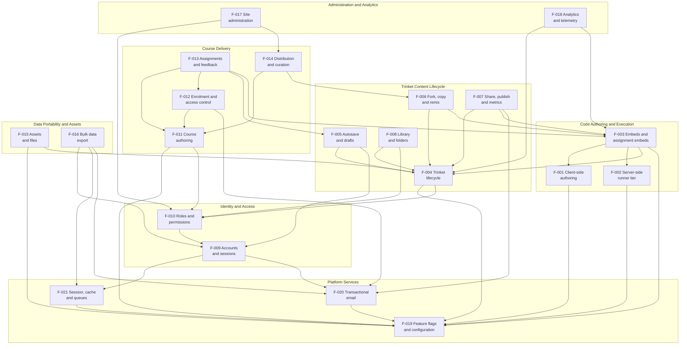

Three properties of this graph are worth stating explicitly.

**F-019 is the root.** Nothing depends on nothing: every other feature reaches `lib/util/features.js` or the layered configuration behind it, which is why a configuration mistake presents as a missing feature rather than an error.

**F-001 and F-003 are mutually presentational.** The arrow runs from F-003 to F-001 because an embed needs an execution engine, but the relationship is reciprocal in the templates: the language landing pages of F-001 are rendered from the same `lib/views/embed/` family and receive the same `trinket.config` payload, so a change to the embed contract changes both.

**F-017 and F-014 share the featured list.** Curation is exposed through the administration console (`addFeaturedCourse`, `removeFeaturedCourse`, `moveFeaturedCourse`) while the resulting list is read by the course feature (`GET /api/featured-courses`) and by the per-language landing pages through `helpers.findFeaturedTrinkets`; the single arrow shown reflects who writes, not who reads.

### 2.3.2 Integration Points

#### 2.3.2.1 Internal Integration Points

| Integration point | Implementation | Features joined |
|---|---|---|
| Declarative route adapter | `lib/util/routeParser.js` expands `'METHOD /path controller.action'` declarations, negotiates HTML versus JSON, applies reply whitelists and resolves `pre` handler expressions | All features — it is the only path from a route table to a handler |
| Pre-handler contract | `lib/util/helpers.js` server methods (`user`, `course`, `folder`, `trinket`, `file`, `lesson`, `material`, `invitation`, `canEdit`, `isAdmin`, `hasLesson`, `hasMaterial`, `populate`) | F-004, F-008, F-010, F-011, F-012, F-013, F-015, F-017 |
| Session authentication scheme | The custom `session` strategy in `app.js`, default for every route in `mode: 'try'` | F-009, F-010 and every authenticated feature |
| Internal request replay | `folders.trinkets` issues `request.server.inject` to `/api/trinkets` carrying the caller's session credentials | F-008 → F-004 |
| Browser runtime handshake | `lib/views/embed/base.html` serialises `trinket.config` (prefixes, component versions, runner URLs, debounce values, telemetry switches, `assetsEnabled`) | F-001, F-002, F-003, F-005, F-015, F-018, F-019 |
| Share-token handoff | The embed mints a JWT signed with `app.mail.secret + shortCode` and caches it in the session; `helpers.verifyEmailToken` consumes it | F-003 → F-007 |
| Metric write-through | `Trinket.findByIdAndUpdateMetrics` performs the `$inc`, refreshes `lastView` and creates an `Interaction` in the same call | F-007 → F-018 |
| Job queue boundary | `users.requestExport` enqueues on the `exports` queue; `lib/workers/exports.js` consumes it | F-016 → F-021 |
| Submission-as-trinket linkage | `course.submitAssignment` and `course.sendFeedback` create `Snippet` documents carrying `courseId`, `materialId`, `_parent` and `submissionState` | F-013 → F-004 |
| Assignment-to-trinket reference | `Material.trinket` stores `trinketId`, `shortCode` and `lang`, which the assignment embeds resolve | F-011 → F-003, F-004 |
| Asset usage accounting | The trinket pre-save hook calls `File.findByIdAndUpdateMetric(..., 'trinkets', 1)` for newly attached assets | F-004 → F-015 |
| Feature gate at the HTTP layer | `helpers.trinketTypeEnabled` and `helpers.coursesEnabled` as declared `pre` handlers | F-019 → F-001, F-002, F-003, F-008, F-011, F-012, F-014 |
| Administrator impersonation | `lib/util/routeParser.js` swaps `request.user` for the `loginAs` target when the caller holds `admin` | F-017 → F-010 |
| WebSocket execution handoff | The embed opens a Socket.io connection to the runner URL injected by `setServersideApi()` | F-003 → F-002 |

#### 2.3.2.2 External Integration Points

| External system | Binding | Features affected when absent |
|---|---|---|
| MongoDB | `config/db.js` plus `lib/util/catbox-mongoose.js` for sessions | Mandatory — no feature operates without it |
| Redis | `config/redis.js`, `lib/util/queues.js`, `@hapi/catbox-redis` | F-016 falls back to in-process jobs; cache is per-instance and lost on restart |
| AWS S3 | `config/aws.js`, `lib/util/file.js`, `lib/workers/exports.js` | F-015 is disabled by flag; F-016 cannot store or serve an archive |
| AWS Lambda | Thumbnail callback authenticated by `aws.lambda.createThumbnail.secret` | F-015 stores no thumbnails |
| SMTP or AWS SES | `lib/util/mailer.js`, `app.mail.*`, `aws.mail` | F-009 recovery flows, F-007 email share, F-012 invitations, F-016 notifications, F-017 alerts |
| Google OAuth | `lib/controllers/auth.js` and `lib/auth/passport.js` | F-009 offers local login only |
| Google reCAPTCHA | `lib/util/recaptcha.js`; schema relaxation in `config/routes.js` | F-009 accepts forms without captcha verification |
| Language runner tier | `app.serverside.*.api.default` behind nginx on port 8080 | F-002 non-functional; the four server-side languages should stay disabled |
| Public CDNs | `app.assets.*` and `app.ngapps.*` | The browser applications of F-008, F-011 and F-013 lose their third-party modules |
| GitHub release asset | `Dockerfile` fetches `public-components.tgz` from release `v1.1.0` into `public/components/` | F-001 and F-003 cannot render an editor |
| Reverse proxy / TLS | Optional external nginx; `serverside/nginx/nginx-ssl.conf` | F-009 must keep `cookieOptions.isSecure` false; F-021 cannot emit `Secure` cookies |

### 2.3.3 Shared Components

| Shared component | Responsibility | Consuming features |
|---|---|---|
| `lib/util/routeParser.js` | Legacy-to-Hapi-20 route construction, HTML/JSON negotiation, reply projection, handler timing, impersonation, static-page auto-registration, `emailEnabled` advertisement | All |
| `lib/util/helpers.js` | Resource resolution, ownership and role gates, feature gates, slug canonicalisation, token verification, featured lists | F-004, F-007, F-008, F-010, F-011, F-012, F-013, F-015, F-017 |
| `lib/models/model.js` and `lib/models/plugins/` | Model factory plus the seven reusable plugins `ownable`, `slug`, `timestamps`, `paginate`, `roles`, `isChanged`, `orderedList`, and the public/private projection split | All persistence features |
| `lib/util/store.js` and `lib/util/store/*` | Keyed storage for slug aliases, the signup email blocklist, featured lists, trinket categories, username links, and reset and verification keys | F-004, F-008, F-009, F-011, F-014, F-017 |
| `lib/util/features.js` | The single arbiter of enabled capabilities | F-001, F-002, F-003, F-011, F-015 and their route gates |
| `lib/shared/trinket-markdown.js` | Markdown rendering shared between the server and the browser | F-011, F-013, F-008 |
| `lib/util/file.js` | Upload, download and avatar handling against object storage | F-015, F-014, F-016 |
| `lib/util/user.js` | Username generation, including the suffixed variant used when a name collides | F-009, F-017 |
| `lib/util/component.js`, `cachify.js`, `stringUtils.js` | Versioned component URLs, cache-prefixed asset paths, URL template interpolation | F-001, F-003, F-012 |
| `config/constants.js` and `config/reserved.yaml` | The eleven-language list shared by the route generator and the model enum; the ~50-entry reserved-name deny list | F-001, F-003, F-004, F-009, F-011 |
| `lib/views/includes/` and `lib/views/embed/base.html` | Shared layout, toolbar and the `trinket.config` payload | F-001, F-003, F-013, F-015, F-018 |
| `public/js/embed/embed.js` | Common embed driver behaviour shared by the per-language modules | F-001, F-002, F-003, F-005, F-018 |
| `Snippet` collection | The shared artefact behind trinkets, drafted work, forks, submissions and feedback revisions | F-004, F-005, F-006, F-007, F-008, F-013, F-016, F-018 |

### 2.3.4 Common Services

| Service | Provider | Behaviour relied upon |
|---|---|---|
| Authentication and session | `app.js` `session` scheme with `@hapi/yar` | Guest admission in `mode: 'try'`; automatic session clearing for unknown or disabled users; sliding 24-hour expiry |
| Session storage | `lib/util/catbox-mongoose.js` | Server-side session persistence with no state in the cookie |
| Cache and keyed storage | `lib/util/store.js`, `lib/util/cachify.js` | TTL support via `Store.expire`; alias pruning on dead links |
| Background jobs | `lib/util/queues.js` | Bull when Redis is enabled, in-memory otherwise, no-op for nine legacy queue names |
| Outbound mail | `lib/util/mailer.js` | One transport, template-rendered bodies, and a documented no-op when unconfigured |
| Abuse mitigation | `lib/util/recaptcha.js` | Verification only when configured; automatic pass in test mode |
| Feature gating | `lib/util/features.js` plus the two route pre-handlers | Fail-safe defaults and a 404 rather than a hidden control |
| Response policy | The two `onPreResponse` extensions in `app.js` | No-store cache headers, HTML versus JSON error handling, `404.html`/`50x.html`, browser 401 redirect to `/login`, conditional `X-Frame-Options`, session cookie normalisation |
| Logging | `config/log.js` with Winston, exposed as the global `log` | Level from `app.log.level`; optional debug channels for files, unauthenticated hits and route-handler timing |
| Telemetry sinks | `Interaction`, `ClientMetric`, `ErrorEvent` | Fire-and-forget writes that never fail a user-facing request |


## 2.4 Implementation Considerations

### 2.4.0 Cross-Cutting Constraints

These apply to every feature in §2.1 and are stated once rather than repeated in each table.

| Constraint | Evidence and consequence |
|---|---|
| Single Node process, CommonJS, Hapi 20 | `app.js` is the only application entry point and is started under `pm2-docker`. All features share one event loop, so any synchronous work in a handler affects every other feature |
| Declared runtime version disagreement | `README.md` and `docs/setup.md` require Node.js 18+ while the `Dockerfile` builds on `node:16-bullseye`. Feature work must be valid on both until this is reconciled |
| Deliberate compatibility debt | `app.js` polyfills `Promise.prototype.spread` and `.fail` "for Mongoose 6 compatibility", wraps `gleak` in a try/catch because it "is not compatible with Node 16+", and `config/app.config.js` loads routes before the database "because mongoose-schema-extend conflicts with Joi 17". Controllers mix callback, `Q`, `underscore`/`lodash` and `async` styles |
| Models exposed as implicit globals | `app.js` assigns `User`, `Course`, `Lesson`, `Material`, `File`, `Trinket`, `Interaction`, `Folder` and `CourseInvitation` to globals, and a 60-second `detectLeaks()` interval ignores known compatibility names. New code that shadows one of these names will break unrelated features |
| No automated quality gates | There is no `.github/` directory, no workflow files and no ESLint, Prettier, EditorConfig or coverage configuration. The only gates are `npm test` (mocha with `--reporter spec --recursive --check-leaks` over 25 files) and the manual `test/smoke-test.sh`; `CONTRIBUTING.md` states code style as prose |
| Frontend assets are not in the repository | `public/components/`, `public/vendor` and the generated `public/css/*.css` are gitignored; components arrive as `public-components.tgz` from GitHub release `v1.1.0` and CSS is produced by `npm run build:css`. Any UI change requires both to be present |
| Compose-only deployment topology | Only `docker-compose.yml` and `serverside/docker-compose.yml` exist. There are no Kubernetes, Helm or Terraform descriptors, so horizontal scaling is a deployer exercise |
| No database migration path is committed | `mongo-migrate` is a dependency and `.gitignore` reserves `config/migration.json` and `lib/migrations/backups`, but no migrations directory or runner exists. Schema changes must be backward-compatible or hand-migrated |
| Smoke-test drift | `test/smoke-test.sh` defaults to `http://localhost:3001` while Compose publishes 3000, and asserts `GET /api` = 200 although no bare `/api` route is declared. Treat its defaults as requiring a base-URL argument |

### 2.4.1 Code Authoring and Execution

| Feature | Technical constraints | Performance and scalability | Security and maintenance |
|---|---|---|---|
| F-001 | Execution depends on browser libraries that are not in the repository and are pinned in `app.components` (for example `ace-builds v1.2.6.1rc2`, `d3 3.4.11`, `video.js 5.20.4`); adding a language means touching `config/constants.js`, the capability matrices, a view, an embed driver and the language enum together | Execution cost is entirely client-side, so concurrency is bounded by the browser rather than the server; the route table grows by five routes per language; assets are cache-prefixed and served by Inert with public cache privacy | The iframe sandbox must never gain `allow-same-origin`; AngularJS 1.3.20 and jQuery 2.2.4 are loaded from CDNs at the versions pinned in `app.assets`, so upgrades are configuration changes with no lockfile protection. Maintenance burden is concentrated in the per-language matrices, which are data rather than code |
| F-002 | Each language needs its own manager, shell, Dockerfile and Compose profile; the shell timeout is hard-coded at 60,000 ms in `serverside/python/shell/trinket/server.js`; manager configuration lives in per-language `config/*.json` rather than the main application config | The default `shells` array holds one entry and the manager picks randomly, so capacity equals one interpreter per language; `/stats.json` reports `available: 1` and `mode: 'local'`; generated-file cleanup runs hourly and removes directories older than 24 hours; `serverside/README.md` states the autoscaling tier is "not yet included in the OSS release" | The shells "run untrusted user code"; the documented hardening (memory, CPU and PID limits, read-only root with `tmpfs`, `no-new-privileges`, `cap-drop=ALL`, internal-only network) is commented out in `serverside/docker-compose.yml` and must be enabled deliberately. `CORS_ORIGINS` must be set for any non-localhost deployment. Two documentation files still claim the runner tier is not included, which should be corrected before a release |
| F-003 | Embed behaviour is the intersection of eight configuration matrices, query parameters and ownership, all resolved in one long handler in `lib/controllers/trinket.js`; seventeen templates in `lib/views/embed/` must stay consistent with `base.html` | One document read per render plus an optional draft read; responses are `no-store`, so embeds are not CDN-cacheable; the email token is minted per render rather than cached | Embeds are intentionally frameable, which is why `app.xframeDeny` enumerates the pages that must not be; the share token's secret is `app.mail.secret + shortCode`, so leaving `app.mail.secret` empty weakens sharing. The three assignment variants differ only in persistence and are easy to confuse — the route comments in `config/routes.js` are the authoritative distinction |

### 2.4.2 Trinket Content Lifecycle

| Feature | Technical constraints | Performance and scalability | Security and maintenance |
|---|---|---|---|
| F-004 | `lib/models/trinket.js` is the largest model at 683 lines and carries authoring, folder, assignment and comment concerns in one schema; the collection is registered as `Snippet`, which differs from the exported `Trinket` name and is a recurring source of confusion in queries | `paginate` bounds every listing at 100 with a default of 20; indexes exist on `lastUpdated`, `hash`, `snapshot`, `modules`, `courseId` and `materialId`; the 10 MB payload ceiling bounds a single write; `shortCode` uniqueness is enforced by index | Ownership is checked declaratively before the handler; the `publicSpec` projection is the containment boundary for responses, so adding a sensitive field to the schema without reviewing `publicSpec` would expose it. Soft deletion means storage grows monotonically — no retention or purge job exists |
| F-005 | Two write paths with different authority rules (autosave is creator-only, drafting is not) must be kept distinct; the `zipCode` contract depends on an entry literally named `zipCode` | Debounces of 1,000 ms are the only rate control; one upsert per write; drafts are per user per trinket, so a popular assignment produces one draft document per learner | Failures are swallowed by design, which protects the editor but hides persistent problems — the only signal is the absence of a saved draft. Any change to the debounce values must be made in `config/default.yaml`, since the browser reads them from `trinket.config` |
| F-006 | Fork and remix are separate code paths with different lineage fields (`_parent` versus `_origin_id`) that are easy to conflate | One insert plus one atomic `$inc`; no depth limit on fork chains, so lineage can grow arbitrarily deep | Anyone who can read a trinket can fork it, which is the intended model; the copy carries the source's snapshot reference, so snapshot lifecycle is shared until one side changes |
| F-007 | Email sharing depends on both `app.mail.secret` and a configured transport; metric names are strings that must match the schema's counter names | Counter updates are single atomic operations with `upsert: true`; the accompanying `Interaction` insert is unawaited, so a burst of views produces a burst of un-batched inserts | The token design lets an anonymous user trigger outbound mail, bounded only by possession of a valid per-trinket token — a deployment exposed to abuse should front it with rate limiting, which the repository does not provide. `Interaction` retains IP address and referer indefinitely |
| F-008 | Folder membership is denormalised in both directions (`Folder.trinkets[]` and `Snippet.folder{}`), so a rename must update both; the create and rename name limits differ (140 versus 50) | `trinketCount` is derived from the embedded array without a query; rename fan-out is fire-and-forget and logs failures; listing inherits the paginate bounds | Session required throughout; `query.user` escalation is restricted to the `admin` role; the internal `server.inject` deliberately replays the caller's credentials rather than elevating. The denormalisation is the main correctness risk during maintenance |

### 2.4.3 Identity and Access

| Feature | Technical constraints | Performance and scalability | Security and maintenance |
|---|---|---|---|
| F-009 | Fifteen distinct flows share one 1,128-line controller; two superficially similar routes exist (`/verify-email` verifies an address, `/activate-account` sets a password on a provisioned account) and must not be conflated; Google OAuth is implemented twice — an explicit `request`-based exchange in `lib/controllers/auth.js` and a Passport strategy in `lib/auth/passport.js` | bcrypt at cost factor 10 is the dominant per-login cost; sessions are one MongoDB read per authenticated request plus a `touch()` write; reset and verification keys are single store entries | Reset keys expire in 86,400 s and are deleted on use, but verification keys are stored without a TTL and should be reviewed; passwords have a 3-character minimum, which is permissive and set in `config/routes.js` if a deployment wants to tighten it; `SameSite=None; Secure` is added only under `isSecure`, so production requires HTTPS first. The reserved-name list in `config/reserved.yaml` must be extended whenever a new top-level route is added |
| F-010 | The permission vocabulary is a static object in `lib/models/roles.js`; permissions are copied onto the user document at grant time, so changing the map does not retroactively update existing users; a `TODO: refactor to check roles` comment sits above `canEdit`, which compares owners rather than consulting roles | Permission checks read the already-loaded user document, so they add no I/O; the per-context array grows with course membership | Two enforcement layers reduce the chance of an unguarded handler, but the pattern must be followed for any new route — the declarative `pre` list is the reviewable surface. Impersonation is admin-only and preserves `_realUserId`, though no audit record is written. The five legacy plan roles remain in the map for data compatibility and should not be reused for new semantics |

### 2.4.4 Course Delivery

| Feature | Technical constraints | Performance and scalability | Security and maintenance |
|---|---|---|---|
| F-011 | `lib/controllers/course.js` is 1,615 lines covering authoring, roster and grading; the API accepts three `courseType` values while the schema defines four (`demo` is unreachable through the API); five-level pre-handler chains must be replicated exactly on every new material route | `populate(pre.course, query.with)` and the `outline` option limit payload size; ordering is maintained in-document by `orderedList`; a large course is fetched as one document tree, so material count drives response size | Every mutation re-checks `manage-course-content`; adding a route without that check is the principal regression risk. The controller's size makes targeted testing important — `test/lib/api/course.js` already covers create, rename, slug redirect, lesson and material CRUD, reorder, draft, copy, download and delete |
| F-012 | Access codes are six characters from a 54-character alphabet generated with `Math.random()` rather than a cryptographic source; invitations depend on mail being configured | `accessCode` is indexed for direct lookup; invitations are sent in one batch over the supplied list with no throttling | A six-character non-cryptographic code is guessable at scale; the mitigation available today is regeneration, which invalidates outstanding codes. All roster mutations are permission-checked, and `alreadyListed` prevents duplicate enrolment rows |
| F-013 | Submissions reuse the `Snippet` collection, so assignment state is spread across `submissionState`, `submittedOn`, `submissionOpts` and the `comments[]` array; the handler can produce `submittedLate`, which the schema comment does not list among `started`, `modified`, `submitted`, `completed` | `courseId` and `materialId` are indexed "for course overview queries"; dashboards use dedicated aggregations rather than per-learner queries; each submission and each feedback revision creates a new document, so storage grows with cohort size × attempts | Date windows are evaluated server-side against stored values, so a client cannot backdate a submission; feedback and submission reads are permission-checked per course. The `submittedLate` state should be added to the documented enumeration to avoid divergent client handling |
| F-014 | The ZIP export writes to `/tmp/<owner>/<course-slug>/` on the application container, so it needs writable local disk and is not safe to run concurrently for the same owner and course; `format` supports only `md` and `html` | The archive is streamed rather than buffered, but asset downloads are performed inline during the same request, so a course with many assets produces a long-running request on the shared event loop | Download authorisation is intentionally broader than edit authorisation (owner, public, open, or copy permission). Temporary directories are per owner and course, which limits collisions but does not clean up automatically |

### 2.4.5 Data Portability and Assets

| Feature | Technical constraints | Performance and scalability | Security and maintenance |
|---|---|---|---|
| F-015 | The feature requires both `features.assets: true` and configured S3 buckets; uploads are buffered to local disk before transfer (`output: 'file'`); the extension whitelist contains exactly one entry (`ipynb`) | 10 MB material and 5 MB avatar and asset ceilings; downloads stream with an explicit byte count; thumbnail generation is offloaded to AWS Lambda so no image processing happens in-process | The thumbnail callback trusts a shared secret and a caller-supplied `bucket` key, so `aws.lambda.createThumbnail.secret` must be set to a strong value and the endpoint should not be publicly reachable without it; `Content-Disposition: attachment` on non-images limits stored-XSS exposure. No virus or content scanning exists |
| F-016 | The worker references `config.aws.buckets.exports.name`, which `config/default.yaml` does not define — the bucket must be added before the feature completes; the worker uses `Q` promises and the legacy `.stream()` cursor API, so a Mongoose upgrade touches it | One in-flight export per user and a one-hour cooldown are the only rate controls; progress is written every ten documents; compression at zlib level 6; the archive is built on local disk before upload, so peak disk use equals the user's total content size | Download authorisation re-checks owner, status and expiry, and the URL is presigned for 3,600 s rather than made public; archives expire after three days on the record, but no job deletes the expired S3 object, so lifecycle rules on the bucket are advisable. Failure paths write `errorMessage` to the record and always unlink the temporary file |

### 2.4.6 Administration and Analytics

| Feature | Technical constraints | Performance and scalability | Security and maintenance |
|---|---|---|---|
| F-017 | The first administrator can only be created by running `scripts/make-admin.js` against the database; bulk upload expects an exact CSV header (`Email`, `Username`, `Name`, `Password`); `grantRole` still carries hosted-product logic for `trinket-teacher` | Bulk upload saves every row concurrently with `Promise.allSettled` and reports aggregate counts, so a large CSV creates a burst of bcrypt hashes on the shared event loop | A single `isAdmin` gate protects all administrative surface, and browser failures render `login.html` rather than console markup; impersonation is powerful and unaudited beyond `_realUserId`; `POST /api/ohnoes` accepts client-supplied log content and emails it to the administrator, so the payload should be treated as untrusted input |
| F-018 | Both intake endpoints are unauthenticated by design; client IP is derived from `x-forwarded-for`, which is only meaningful behind a trusted proxy; `ClientMetric` relies on a unique `timestamp_minute` key for bucketing | Writes are fire-and-forget with no batching on the `Interaction` path; `ClientMetric` collapses many events into one document per minute; `ErrorEvent` and `Interaction` grow without bound and have no retention policy | Unauthenticated intake is mitigated by strict Joi schemas and discarded results, but there is no rate limiting, so a deployment should consider one at the proxy. The collections retain IP address, user agent, referer and user id, which a deployer must reflect in its privacy policy. Disabling collection is a configuration change (`logClientCodeError`, `logClientMetric`) |

### 2.4.7 Platform Services

| Feature | Technical constraints | Performance and scalability | Security and maintenance |
|---|---|---|---|
| F-019 | Flags are read from a process-wide `config` object resolved at startup, so changing one requires a restart; `config/constants.js` and the model enum must stay aligned with the flag list; the build-time embed toggles described in `COMPONENTS.md` do not exist | Flag evaluation is an in-memory read with no I/O; disabled capabilities cost one pre-handler and a 404 rather than a rendered page | The 32-character session-secret check is a hard startup failure, which is the strongest guard in the codebase; secrets live only in gitignored overlays (`config/local.*`, `config/production.*`). The fail-safe default ("unknown types default to disabled") should be preserved in any refactor |
| F-020 | One transport is created per send with no pooling, retry or backoff; `app.mail.secret` is overloaded as both a mail setting and the share-token signing key | Sending is inline with the request for user-facing flows and inside the worker for exports; a slow SMTP server therefore delays the response on flows such as password reset | Every dependent feature must call `isConfigured()` before promising delivery — the pattern is established in `users.sendPassReset`, `users.sendEmailVerification` and `course.sendInvitations` and should be followed by new callers. Because `send()` resolves instead of throwing when unconfigured, a missing check produces a silent non-delivery |
| F-021 | MongoDB is a hard dependency because sessions run through `lib/util/catbox-mongoose.js`; nine legacy queue names are permanently no-ops; only queues listed in `db.redis.bullqueues` are instantiated | Sessions are one read plus a `touch()` write per authenticated request; without Redis the cache is per-process and lost on restart, and jobs run in-process on `setImmediate`; with Redis, Bull provides durability and cross-instance sharing | No session state is placed in the cookie; sessions are cleared automatically for missing or disabled users; secure cookie attributes are gated on `isSecure` so they are not advertised over plain HTTP. The in-memory queue silently drops handler-less jobs, which is acceptable for telemetry but would be a correctness problem for any new critical job — such work must run on a Bull queue with Redis enabled |


## 2.5 Traceability, Assumptions and Constraints

### 2.5.1 Requirement Traceability Matrix

Requirement identifiers are contiguous within each feature, so the range in the second column denotes every requirement defined for that feature in §2.2.

| Feature | Requirements | Primary implementation evidence |
|---|---|---|
| F-001 | F-001-RQ-001 … 006 | `config/routes.js` generated language routes, `config/default.yaml` capability matrices, `public/js/embed/`, `lib/views/embed/base.html` |
| F-002 | F-002-RQ-001 … 007 | `serverside/python/manager/manager.js`, `serverside/python/shell/trinket/server.js`, `serverside/docker-compose.yml`, `serverside/README.md` |
| F-003 | F-003-RQ-001 … 006 | `config/routes.js` embed and assignment-embed routes, `lib/controllers/trinket.js` `embed`/`assignment`/`assignmentFeedback`/`viewOnly`, `lib/util/helpers.js` |
| F-004 | F-004-RQ-001 … 009 | `config/api_routes.js` trinket routes, `lib/models/trinket.js`, `lib/models/plugins/paginate.js`, `lib/controllers/trinket.js` |
| F-005 | F-005-RQ-001 … 006 | `config/api_routes.js` draft and autosave routes, `lib/models/draft.js`, `lib/controllers/trinket.js` `autosave`/`draft`/`discardDraft` |
| F-006 | F-006-RQ-001 … 005 | `config/api_routes.js` forks route, `lib/models/trinket.js` `copy`/`createRemix`/`findRemix`, `lib/controllers/trinket.js` `createFork` |
| F-007 | F-007-RQ-001 … 006 | `lib/util/helpers.js` `verifyEmailToken`, `lib/models/trinket.js` `findAndUpdateMetrics`, `config/api_routes.js` email/metrics/published routes |
| F-008 | F-008-RQ-001 … 007 | `config/api_routes.js` folder and search routes, `lib/controllers/folders.js`, `lib/models/folder.js`, `config/routes.js` library routes |
| F-009 | F-009-RQ-001 … 015 | `config/routes.js` auth and account routes, `config/api_routes.js` user routes, `lib/controllers/users.js`, `lib/controllers/auth.js`, `lib/auth/passport.js`, `app.js` session scheme |
| F-010 | F-010-RQ-001 … 007 | `lib/models/roles.js`, `lib/models/plugins/roles.js`, `lib/util/helpers.js` server methods, `lib/util/routeParser.js` impersonation block |
| F-011 | F-011-RQ-001 … 007 | `config/api_routes.js` course/lesson/material routes, `lib/controllers/course.js`, `lib/models/course.js`/`lesson.js`/`material.js` |
| F-012 | F-012-RQ-001 … 006 | `lib/controllers/course.js` access-code, join, invitation and roster handlers, `lib/models/courseInvitation.js`, `lib/controllers/courses.js` `coursePage` |
| F-013 | F-013-RQ-001 … 008 | `lib/controllers/course.js` `startAssignment`/`submitAssignment`/`sendFeedback`/dashboards, `lib/models/material.js`, `lib/models/trinket.js` submission helpers |
| F-014 | F-014-RQ-001 … 005 | `lib/controllers/courses.js` `download`/`copy`, `config/routes.js` download route, `lib/models/featuredCourses.js`, `lib/controllers/admin.js` featured handlers |
| F-015 | F-015-RQ-001 … 008 | `lib/controllers/files.js`, `lib/util/file.js`, `config/routes.js` `/file` routes, `config/api_routes.js` asset routes, `config/default.yaml` `aws.buckets` |
| F-016 | F-016-RQ-001 … 009 | `lib/controllers/users.js` export handlers, `lib/workers/exports.js`, `lib/models/export.js`, `lib/util/queues.js` |
| F-017 | F-017-RQ-001 … 008 | `lib/controllers/admin.js`, `config/routes.js` admin routes, `config/api_routes.js` admin routes, `scripts/make-admin.js` |
| F-018 | F-018-RQ-001 … 007 | `config/api_routes.js` `codeerror`/`clientmetric` routes, `lib/controllers/trinket.js` `logError`/`logClientMetric`, `lib/models/errorEvent.js`/`clientMetric.js`/`interaction.js` |
| F-019 | F-019-RQ-001 … 007 | `lib/util/features.js`, `config/default.yaml`, `config/app.config.js`, `app.js` startup validation, `lib/util/routeParser.js` |
| F-020 | F-020-RQ-001 … 004 | `lib/util/mailer.js`, `lib/views/emails/`, the `isConfigured()` call sites in `users.js` and `course.js` |
| F-021 | F-021-RQ-001 … 006 | `app.js` Yar/cache registration and the two `onPreResponse` extensions, `lib/util/catbox-mongoose.js`, `lib/util/queues.js`, `lib/util/store.js` |

### 2.5.2 Verification Coverage

The repository verifies behaviour in three ways: the mocha suite, the shell smoke test, and inspection of configuration. The table records which requirements have an automated assertion today.

| Verification artefact | Requirements covered |
|---|---|
| `test/lib/api/registration.js` | F-009-RQ-001, F-009-RQ-002, F-014-RQ-001 (sample-course copy path) |
| `test/lib/api/login.js` | F-009-RQ-004, F-009-RQ-006 |
| `test/lib/api/logout.js` | F-009-RQ-006 |
| `test/lib/api/forgot_pass.js` | F-009-RQ-007, F-020-RQ-001 |
| `test/lib/api/profile.js` | F-009-RQ-015 |
| `test/lib/api/admin.js` | F-010-RQ-002, F-017-RQ-001 |
| `test/lib/api/trinket.js` | F-004-RQ-001, F-006-RQ-001, F-006-RQ-002, F-003-RQ-001, F-007-RQ-001, F-007-RQ-004, F-018-RQ-002 |
| `test/lib/api/course.js` | F-011-RQ-001 … 005, F-014-RQ-001, F-014-RQ-003, F-014-RQ-004 |
| `test/lib/api/files.js` | F-015-RQ-003, F-015-RQ-004, F-015-RQ-008 |
| `test/lib/models/` (`course`, `lesson`, `trinket`, `user`) and `test/lib/models/plugins/` (`paginate`, `roles`) | F-004-RQ-003, F-004-RQ-007, F-009-RQ-005, F-010-RQ-003, F-011-RQ-002 |
| `test/lib/util/user.js` | F-009-RQ-002 (username generation) |
| `test/smoke-test.sh` | F-001-RQ-001, F-008-RQ-004 (library page reachability), F-021-RQ-006 (404 rendering) |
| Configuration inspection only — no automated test | F-002 (all), F-005-RQ-005, F-013-RQ-002, F-013-RQ-005, F-016 (all), F-017-RQ-003, F-017-RQ-006, F-018-RQ-003 … 007, F-019 (all), F-021-RQ-001 … 005 |

Two gaps are worth naming. The entire server-side runner tier (F-002) has no automated test in this repository — `serverside/` ships no test suite — so its requirements are verified by inspection and manual exercise. The export pipeline (F-016) likewise has no test, although `test/helpers/queue.js` exists as a queue stub that a future test could use.

### 2.5.3 Feature-to-Workflow Mapping

The workflows are those enumerated in §1.3.1.2. This mapping shows which features must be operational for each to complete.

| Workflow | Features required |
|---|---|
| Register, verify email, sign in, reset password | F-009, F-019, F-020, F-021 |
| Write and run code anonymously, then claim it | F-001, F-003, F-004, F-019 |
| Iterate on a trinket | F-004, F-005, F-003 |
| Fork, share and embed | F-006, F-007, F-003, F-020 |
| Organise a personal library | F-008, F-004, F-009 |
| Author a course | F-011, F-010, F-019, F-009 |
| Enrol learners | F-012, F-011, F-010, F-020 (invitation path only) |
| Complete and submit an assignment | F-013, F-003, F-005, F-012 |
| Review, grade and give feedback | F-013, F-010, F-003 |
| Study a course as a learner | F-011, F-012, F-003, F-014 (download) |
| Copy or remix an existing course | F-014, F-011, F-006 |
| Manage the site | F-017, F-010, F-009, F-020 |
| Take data out | F-016, F-021, F-020, F-009 |
| Manage the account | F-009, F-015 (avatar), F-019 |
| Run a server-side language exercise | F-002, F-003, F-001 (shared embed shell), F-019 |

### 2.5.4 Process Flow References

The process flows relevant to these features are documented in the sections and artefacts named below rather than duplicated here.

| Flow | Where it is described |
|---|---|
| System component interaction and request path | §1.2.2.2 component diagram; `app.js` extension order (`onPreHandler` → route `pre` chain → handler → two `onPreResponse` extensions) |
| Route resolution and HTML/JSON negotiation | `lib/util/routeParser.js`; §1.2.2.3 |
| Server-side execution request path | `serverside/README.md` "Request flow" — eight steps from embed load to streamed output and generated-file publication |
| Assignment lifecycle states | `submissionState` transitions `started` → `modified` → `submitted` (or `submittedLate`) → `completed`, implemented in `lib/controllers/trinket.js` `autosave` and `lib/controllers/course.js` `submitAssignment`/`sendFeedback` |
| Export job lifecycle | `Export.status` transitions `pending` → `processing` → `completed` or `failed` in `lib/workers/exports.js` |
| Password reset and email verification token flows | `lib/controllers/users.js` with the store-key TTLs recorded in F-009-RQ-007 and F-009-RQ-008 |
| Deployment and bootstrap sequence | `GETTING_STARTED.md`, `docs/setup.md`, `docker-compose.yml`, `Dockerfile`, `scripts/make-admin.js` |

### 2.5.5 Assumptions

These are assumptions the implementation makes, each visible in the code or configuration rather than inferred.

| Assumption | Basis |
|---|---|
| MongoDB is always reachable | Sessions are stored through `lib/util/catbox-mongoose.js`, so authentication fails without it; no degraded mode exists |
| A single application instance is sufficient unless Redis is enabled | `GETTING_STARTED.md` describes Redis as being for "multiple app instances or better performance"; without it the cache is per-process |
| A trusted reverse proxy sets `x-forwarded-for` | `lib/controllers/trinket.js` `logClientMetric` and the manager's address logging take the client IP from that header |
| Browser component libraries are present at the pinned versions | `app.components` pins roughly 25 versions and `public/components/` is populated from a release tarball, not the repository |
| Generated CSS exists before first request | `public/css/base.css` and `embed.css` are gitignored build outputs of `npm run build:css` |
| The operator, not the application, terminates TLS | `cookieOptions.isSecure` must be set manually, and the optional nginx on 443 is external to the application container |
| The first administrator is created out of band | `/admin` is unreachable until `npm run make-admin` is run against the database |
| Enabling a language implies its runtime is deployed | `lib/util/features.js` never probes runner availability, so a flag is a statement of intent by the operator |
| Course dates are interpreted in the server's clock | `submitAssignment` compares `new Date()` with stored `dateValue`s; no timezone handling exists server-side, and `moment-timezone-with-data` is loaded only in the browser `main` bundle |
| The user interface is single-language | `lib/util/translate.js` returns its key unchanged — "Full Jed-based translation was removed for OSS release" |

### 2.5.6 Constraints

| Constraint | Source |
|---|---|
| Session cookie password of at least 32 characters | Hard startup gate in `app.js`; `process.exit(1)` otherwise |
| 10 MB maximum code payload; 10 MB material upload; 5 MB avatar and user asset | `payload.maxBytes` in `config/api_routes.js` and `config/routes.js` |
| Listing pagination capped at 100 with a default of 20 | `paginate` plugin configuration on the `Snippet` model |
| Export history listing capped at 50 | Joi `max(50)` on `GET /api/exports` |
| One in-flight export per user; one hour between exports; three-day archive retention; one-hour presigned URL | `lib/controllers/users.js` and `lib/workers/exports.js` |
| 60-second server-side program execution ceiling | `serverside/python/shell/trinket/server.js` |
| 24-hour generated-file retention in the runner tier | `manager.cleanup` defaults |
| 24-hour session lifetime with sliding renewal; 86,400-second password-reset key | `app.js` and `lib/controllers/users.js` |
| 1,000 ms autosave and draft debounce | `app.embed.autosaveDebounce`, `app.embed.draftDebounce` |
| 300-second external sandbox artefact lifetime | `sandbox.expiration` |
| Course name ≤140 characters, description ≤500; lesson and material names ≤140; folder name ≤140 on create and ≤50 on rename; profile name ≤140; `fullname` ≤50; username 3–20 characters | Joi schemas in `config/api_routes.js` and `config/routes.js` |
| Access codes are six characters from a 54-character alphabet | `generateAccessCode()` in `lib/controllers/course.js` |
| Eleven language types, fixed by `config/constants.js` and the `lang` enum | `config/constants.js`, `lib/models/trinket.js` |
| Only `ipynb` is extension-whitelisted for MIME preservation | `app.extensionWhitelist` |
| Nine queue names are permanently inert; only `exports` is live | `lib/util/queues.js` `disabledQueues` and `db.redis.bullqueues` |
| No usage quotas or plan limits exist | `Roles.getLimits()` returns `undefined` |
| `aws.buckets.exports` is referenced but undefined in the shipped configuration | `lib/workers/exports.js` and `lib/controllers/users.js` versus `config/default.yaml` |

### 2.5.7 Requirement Version Basis

Requirements in this section describe the repository at the commit documented here; the repository provides no requirement-management system of its own, so version anchors are the release artefacts it does provide.

| Anchor | Value |
|---|---|
| Release history | `CHANGELOG.md` contains a single entry: "[1.0.0] - Initial Open Source Release / First public release of Trinket." |
| Git tags | `v1.0.0` and `v1.1.0` |
| Frontend component version consumed at build time | `public-components.tgz` from release `v1.1.0`, per the `Dockerfile`; the most recent functional commit in the log is "Update to public-components v1.1.0 - Adds missing components for HTML and Blocks embed support" |
| Package manifest version | `package.json` declares `"version": "0.0.0"`, which does not track the tags |
| Lifecycle declaration | `catalog-info.yaml` registers the repository as a Backstage `Component` with `spec.type: service` and `lifecycle: production` |
| Licence statement | `LICENSE` is CC0 1.0 Universal and `README.md`/`docs/index.md` agree, while `package.json` records `"license": "MIT"` — an inconsistency to resolve before redistribution |

Requirement changes should therefore be tracked against `CHANGELOG.md` and the git tags. Because `package.json` is pinned at `0.0.0`, it cannot serve as the version of record for these requirements.


## 2.6 References

### 2.6.1 Application Entry Point and Configuration

- `app.js` - Hapi server construction, the 32-character session-secret startup gate, Yar registration with `maxCookieSize: 0` against the MongoDB session cache, the `onPreHandler` login/touch extension, the two `onPreResponse` extensions (cache headers, HTML versus JSON errors, `X-Frame-Options`, cookie normalisation), the custom `session` auth scheme in `mode: 'try'`, and the model globals
- `config/` - the configuration and route-definition directory
- `config/default.yaml` - feature flags, per-language capability matrices, `app.embed` debounce and telemetry switches, `app.serverside` langmap and endpoints, `app.assets`/`app.ngapps`/`app.components`, `app.xframeDeny`, `app.extensionWhitelist`, `aws.buckets` (seven buckets, no `exports`), `sandbox` modes and permissions, `db.redis` connections and `bullqueues`
- `config/routes.js` - 57 browser route declarations plus the five-per-language generated routes; registration, login, account, admin, file, library and embed route validation; the conditional reCAPTCHA schema; the reserved-username blocklist load
- `config/api_routes.js` - 116 API declarations with the Joi payload/query schemas, `maxBytes` ceilings, `pre` handler chains and reply whitelists cited throughout §2.2
- `config/app.config.js` - environment resolution, `config.url`/`config.sandboxUrl` assembly, and `config.routes = routeParser.parse(api_routes.concat(routes))`
- `config/constants.js` - the eleven-value `trinketLangs` list
- `config/reserved.yaml` - the reserved slug and username deny list
- `config/local.example.yaml` - the required and optional configuration blocks, including the "Redis is OPTIONAL" and "Without S3, the asset upload feature is disabled" notes
- `config/production.yaml.dist`, `config/test.yaml` - production template and test overrides

### 2.6.2 Application Layer

- `lib/controllers/trinket.js` - 33 actions including `embed`, the three assignment embeds, `create`, `createFork`, `autosave`, `draft`, `discardDraft`, `updateMetrics`, `logError`, `logClientMetric`, `snapshot`, `library`, and `setServersideApi()`
- `lib/controllers/course.js` - course metadata, lesson and material management, roster and access control, `generateAccessCode()`, `join`, `sendInvitations`, `submitAssignment`, `sendFeedback`, `acceptSubmission`, dashboards
- `lib/controllers/courses.js` - `coursePage` redirect logic, `download` (ZIP export authorisation and rendering), `copy`, `featuredCourses`
- `lib/controllers/classes.js` - learner-facing course view with `canEdit`/`canViewSubmissions` exposure
- `lib/controllers/users.js` - registration with blocklist and duplicate handling, login/logout, password reset and change, email verification and change, profile and settings, asset handlers, and the four export handlers
- `lib/controllers/auth.js` - Google OAuth authorize URL construction, token exchange, profile fetch and find-or-create, and the unconfigured-OAuth failure message
- `lib/controllers/admin.js` - console index with role search and impersonation entry points, `uploadUsers` CSV provisioning, `updateUser`, `grantRole`, featured-course handlers, `ohnoes`
- `lib/controllers/folders.js` - folder list (with admin scoping), `server.inject` content listing, create with `folder-owner` grant, rename fan-out, delete
- `lib/controllers/files.js` - `features.assets` enforcement, upload classification and extension whitelist handling, streaming download with `Content-Disposition`, secret-authenticated `setThumbnail`
- `lib/controllers/pages.js` - public page handlers
- `lib/util/helpers.js` - `findTrinket`, `validLang`, `trinketTypeEnabled`, `coursesEnabled`, `verifyEmailToken`, `canEdit`, `isAdmin`, the `findById` server methods with soft-delete semantics, slug canonicalisation helpers, `findFeaturedTrinkets`
- `lib/util/routeParser.js` - route construction, HTML/JSON negotiation, reply projection, admin `loginAs` impersonation with `_realUserId`, static-page auto-registration, `emailEnabled`
- `lib/util/features.js` - the five feature predicates and their fail-safe semantics
- `lib/util/mailer.js` - `isConfigured()` and the no-op `send()` path
- `lib/util/recaptcha.js` - verification short-circuit and `siteverify` call
- `lib/util/queues.js` - Bull/in-memory/no-op queue selection, `disabledQueues`, `bullqueues` export
- `lib/util/catbox-mongoose.js` - the MongoDB-backed session cache engine
- `lib/util/store.js`, `lib/util/store/` - keyed storage for slug aliases, the email blocklist, featured lists, trinket categories and the reset/verification keys
- `lib/util/file.js`, `lib/util/user.js`, `lib/util/stringUtils.js`, `lib/util/component.js`, `lib/util/cachify.js`, `lib/util/translate.js`, `lib/util/material-parser.js` - shared utilities cited in §2.3.3
- `lib/auth/passport.js` - local and Google strategies, disabled-account and empty-password rejection
- `lib/shared/trinket-markdown.js` - markdown rendering shared between server and browser
- `lib/workers/exports.js` - the bulk-export worker: `EXPORT_EXPIRY_DAYS`, `langExtensions`, progress accounting, archive construction, S3 upload, notification and cleanup
- `lib/workers/util/snapshot.js` - snapshot creation and best-effort removal

### 2.6.3 Data Model

- `lib/models/trinket.js` - the `Snippet` schema, `shortCode` generation, `copy`/`createRemix`/`findRemix`, `findAndUpdateMetrics` with `Interaction` write-through, `softDelete`, paginate configuration, `publicSpec` projection and the lifecycle hooks
- `lib/models/course.js`, `lesson.js`, `material.js` - the course hierarchy, `globalSettings`, `accessCode`, `archived`, assignment scheduling windows and `copy()` semantics
- `lib/models/user.js` - identity fields, bcrypt pre-save hook with `SALT_WORK_FACTOR = 10`, settings defaults, default `user` role assignment, `Course.userDeleted` cleanup on removal
- `lib/models/roles.js` - the full permission vocabulary, the legacy plan-role aliases, and `getLimits()` returning `undefined`
- `lib/models/draft.js` - per-user drafts with `findOneMoreRecent` and `discard`
- `lib/models/export.js` - status, progress, `expiresAt`, `findPendingOrProcessing`, `findRecentCompleted`
- `lib/models/file.js`, `lib/models/asset.js` - file documents with usage metrics and the embedded asset sub-schema
- `lib/models/folder.js` - folder ownership and membership with per-trinket `instructions`
- `lib/models/interaction.js`, `clientMetric.js`, `errorEvent.js` - the three telemetry collections, including the intended derived metrics named in the `ErrorEvent` header
- `lib/models/courseInvitation.js`, `featuredCourses.js` - invitation batch send and featured-list membership
- `lib/models/model.js`, `lib/models/plugins/` - the model factory and the seven reusable plugins (`ownable`, `slug`, `timestamps`, `paginate`, `roles`, `isChanged`, `orderedList`), with `paginate.js` supplying the 20/100 bounds and sort-key validation

### 2.6.4 Presentation Layer

- `lib/views/embed/base.html` - the `trinket.config` browser handshake and the `features.accessibilityToggle` screen-reader switch
- `lib/views/embed/` - one template per language plus `default-toolbar.html` and `left-menu.html`
- `lib/views/emails/`, `lib/views/admin/`, `lib/views/courses/`, `lib/views/classes/`, `lib/views/trinket/`, `lib/views/users/`, `lib/views/static/` - message bodies, console, course, class, library, account and static pages
- `public/js/embed/` - the per-language drivers, the shared `embed.js`, the `server.js` transport, and `analytics/`
- `public/js/embed/glowscript.js`, `glowscript-blocks.js`, `html.js` - iframe `sandbox` attribute application for local mode and the external-sandbox POST path
- `public/js/library/`, `public/js/courseEditor/`, `public/js/classPage/` - the three feature-specific AngularJS bundles
- `static/scss/` - source for the Vite-built `public/css/base.css` and `embed.css`

### 2.6.5 Server-Side Execution Tier

- `serverside/README.md` - architecture, request flow, shell timeout, scaling limits, the "Production Scaling (Not Yet Included)" section and the security-hardening guidance
- `serverside/docker-compose.yml` - nginx plus the per-language Compose profiles and the commented resource limits
- `serverside/python/manager/manager.js` - Socket.io relay, random shell selection with a 2-second connect timeout, `/health` and `/stats.json`, generated-file publication and the cleanup scheduler
- `serverside/python/manager/config/default.json`, `custom-environment-variables.json` - manager port, `corsOrigins`, `generatedDir`/`generatedUrl`, cleanup settings, and the `GENERATED_URL`/`CORS_ORIGINS` overrides
- `serverside/python/shell/trinket/server.js` - interpreter spawn with `uid`/`gid` privilege drop, the 60,000 ms timeout, `SIGKILL` fallback and the generated-file watcher
- `serverside/nginx/` - the reverse-proxy and TLS configurations

### 2.6.6 Tests, Tooling and Documentation

- `test/lib/api/` - `registration.js`, `login.js`, `logout.js`, `forgot_pass.js`, `profile.js`, `admin.js`, `trinket.js`, `course.js`, `files.js`, `index.js` — the acceptance assertions cited in §2.2 and §2.5.2
- `test/lib/models/`, `test/lib/models/plugins/`, `test/lib/util/user.js` - model, plugin and utility coverage
- `test/helpers/` - `flow.js`, `db.js`, `defaults.js`, `mail.js`, `queue.js`, `store.js`, `catbox-redis.js`
- `test/setup.js`, `test/mocha.opts` - test environment forcing `NODE_ENV=test` with a redis-mock stub, and the `--reporter spec --recursive --check-leaks` flags
- `test/smoke-test.sh` - the executable post-deployment endpoint checks and their PASS/FAIL accounting
- `test/data/test.ipynb`, `test/data/transparent.gif` - fixtures for the notebook and image upload paths
- `scripts/make-admin.js` - the administrator bootstrap CLI
- `package.json` - the five npm scripts, the dependency set, and the `"version": "0.0.0"` / `"license": "MIT"` values
- `Dockerfile`, `docker-compose.yml` - the runtime image (including the `public-components.tgz` fetch from release v1.1.0) and the three-service local stack
- `vite.config.mjs` - the CSS-only build definition
- `README.md`, `GETTING_STARTED.md`, `docs/setup.md`, `docs/overview.md`, `docs/index.md` - prerequisites, the required and optional configuration, and the degradation statements quoted in §2.1 and §2.2
- `COMPONENTS.md` - the pinned browser component inventory and the unimplemented "Feature Flags (TODO)" list
- `CONTRIBUTING.md` - the prose code-style and `npm test` expectation
- `CHANGELOG.md`, `catalog-info.yaml`, `LICENSE` - the single release entry, the Backstage component declaration, and the CC0 licence text
- `.gitignore`, `.bowerrc`, `.dockerignore` - the excluded build outputs and vendor directories referenced in §2.4.0

### 2.6.7 Technical Specification Cross-References

- §1.2 System Overview - component diagram, capability inventory, integration table and the success criteria reused in §2.5.4
- §1.3 Scope - the in-scope capability list, the fifteen primary workflows mapped in §2.5.3, and the exclusions that bound this feature catalog


# 3. Technology Stack

## 3.1 Programming Languages

Trinket's language choices are best understood through a distinction the repository itself enforces: the languages the system is **written in**, and the 11 languages the system **executes on behalf of learners**. Only the former belong to the technology stack; the latter are product surface, enumerated in `config/constants.js` as `trinketLangs` and gated by `features.trinkets.*` in `config/default.yaml`. This sub-section documents the implementation languages.

The overall picture is a single-language backend. Of 520 tracked files, JavaScript accounts for 195 files and 49,556 lines — roughly 62% of all non-asset source lines — and it is the only language used for application logic on every tier: the Hapi web application, the four browser bundles, the runner managers and the runner shells.

### 3.1.1 Language Inventory by Component

| Language | Files / LOC (tracked) | Where it is used |
|---|---|---|
| JavaScript | 195 / 49,556 | `app.js`, `lib/` (controllers, models, util, workers, auth), `config/`, `public/js/`, `scripts/`, `test/`, all `serverside/*/manager` and `serverside/*/shell` processes |
| HTML (Nunjucks) | 133 / 9,422 | `lib/views/` server-rendered pages, 17 embed templates, email bodies, admin console |
| SCSS | 54 / 9,555 | `static/scss/` — compiled to `public/css/` by Vite |
| JSON | 25 / 8,480 | npm manifests, `serverside/*/manager/config/*.json`, test fixtures |
| Python | 6 / 615 | `public/js/skulpt/trinket/` (browser-side, run by Skulpt) and `serverside/python/shell/trinket/python3/` (CPython support code) |
| YAML | 8 / 808 | `config/*.yaml`, `docker-compose.yml`, `mkdocs.yml`, `catalog-info.yaml` |
| Bash | 1 / 103 | `test/smoke-test.sh` |
| R | 1 / 12 | `serverside/r/shell/install.r` — CRAN package installer |
| Jison grammar | 1 / 97 | `lib/grammars/musicNotation.jison` — music-notation parser for the `music` trinket type |

Two languages named in the product are absent from the implementation: there are **no `.java` source files anywhere** in the repository (the Java runner supplies a JVM via the `amazoncorretto:8` base image and drives it from JavaScript), and no TypeScript, Babel, or any other transpiler is configured.

### 3.1.2 JavaScript and the Node.js Runtime

#### 3.1.2.1 A Deliberate Module-System Split

The repository runs two different JavaScript module systems, and the boundary is exactly the tier boundary:

| Tier | Module system | Evidence |
|---|---|---|
| Root application | CommonJS | `package.json` declares no `type` field; every file in `app.js`, `lib/`, `config/`, `scripts/`, `test/` uses `require()` |
| Build tooling | ESM | `vite.config.mjs` is the only `.mjs` file in the root app |
| `serverside/` runners | ESM | All six `serverside` manifests declare `"type": "module"` |

This is not accidental drift. The root application is the 2014-era codebase carried forward — `app.js` opens with hand-written polyfills that add `Promise.prototype.spread` and alias `Promise.prototype.fail` to `.catch`, annotated "for Mongoose 6 compatibility" — while `serverside/` was written fresh and adopts modern ESM. The practical consequence is that no module can be shared across the boundary without conversion, which is why utilities such as `chokidar` and `underscore` are declared independently in both trees.

#### 3.1.2.2 Runtime Versions Are Pinned Per Image, Not Per Project

`package.json` contains **no `engines` field**, so npm enforces nothing. The effective Node version is whatever each container image provides, and the repository disagrees with itself about what that should be:

| Source | Declared Node version |
|---|---|
| `README.md:18` and `docs/setup.md:9` | "Node.js 18+ (for local development without Docker)" |
| `Dockerfile:1-2` | `node:16-bullseye`, commented "Use Node 16 LTS (compatible with updated packages)" |
| `package.json` | not specified |

Within the runner tier the spread is wider still, because each Dockerfile installs its own Node via `nvm` on top of a language base image:

| Runner component | Base image | Node runtime |
|---|---|---|
| `python/manager`, `java/manager`, `r/manager` | `node:18-alpine` | 18 (from image) |
| `pygame/manager` | `node:18-slim` | 18 (from image) |
| `python/shell` | `python:3.10-bullseye` | 14.21.1 via nvm 0.39.2 |
| `java/shell` | `amazoncorretto:8` | 14.21.1 via nvm 0.39.2 |
| `r/shell` | `r-base:4.4.2` | 18.20.5 via nvm 0.40.1 |
| `pygame/worker` | `ubuntu:22.04` | 18 via `deb.nodesource.com/setup_18.x` |

Five distinct Node runtimes therefore exist across one deployment: 14.21.1, 16, 18 (alpine), 18 (slim), and 18.20.5. Every one of them is past upstream end-of-life. <cite index="7-8,7-11">Node.js 16's end-of-life date was moved forward by seven months to September 11, 2023 to coincide with the end of support for OpenSSL 1.1.1, which Node 16 shipped with.</cite> <cite index="5-23">Node.js 18 reached end of life on April 30, 2025 and Node.js 16 on September 11, 2023; both are unpatched.</cite> <cite index="5-2">Node.js 14 reached end of life on April 30, 2023.</cite> <cite index="3-32">Node.js 24 is the Active LTS line (EOL April 30, 2028) and Node.js 22 is in Maintenance LTS (EOL April 30, 2027).</cite> <cite index="8-2,8-4">When a version reaches end-of-life it no longer receives updates including security patches, and vulnerabilities disclosed in newer lines will not be patched for EOL lines.</cite> Any hardening programme for this system begins here: the runtime itself, not only its dependencies, is unsupported.

#### 3.1.2.3 Native Compilation Requirement

JavaScript is not entirely interpreted here. `bcrypt` 5.1.1 is a native addon, which is why `Dockerfile:7-9` installs `python3` and `build-essential` before `npm install` runs. Node upgrades on this codebase are therefore gated on `node-gyp` rebuilding `bcrypt` successfully against the new ABI, not merely on JavaScript compatibility.

### 3.1.3 Templating, Styling and Markup

Server-rendered HTML uses **Nunjucks** templates (133 `.html` files under `lib/views/`), registered as the Vision view engine through `lib/util/nunjucks.js`. Nunjucks was chosen because its Jinja-compatible syntax coexists with AngularJS's `{{ }}` interpolation in the same document — the server renders the page shell and the client-side app hydrates inside it.

Styling is authored exclusively in **SCSS** under `static/scss/`, with two entry points (`base.scss` and `embed/embed.scss`) compiled by Vite. The generated `public/css/base.css`, `public/css/embed.css` and their source maps are all listed in `.gitignore`, which makes a CSS build a hard prerequisite for a working UI — `GETTING_STARTED.md:109-114` addresses exactly this under "CSS not loading?".

One domain-specific language appears: `lib/grammars/musicNotation.jison` defines a Jison grammar (97 lines) that parses music notation for the `music` trinket type.

### 3.1.4 Languages in the Server-Side Execution Tier

The `serverside/` tier exists to provide real interpreters for languages that cannot compile to JavaScript. In each case the *language runtime* is supplied by the base image while the *control plane* around it stays in JavaScript:

| Language | Runtime version | Package source |
|---|---|---|
| Python 3 | 3.10 (`python:3.10-bullseye`) | `serverside/python/shell/requirements.txt` — 33 exact `==` pins from PyPI |
| Python 3 + Pygame | 3.x on `ubuntu:22.04` | `serverside/pygame/worker/requirements.txt` — the same 33 pins plus `pygame==2.5.2` |
| Java | 8 (`amazoncorretto:8`) | none — JDK only, no libraries added |
| R | 4.4.2 (`r-base:4.4.2`) | `serverside/r/shell/packages.txt` — 16 **unversioned** CRAN packages |

The Python side is fully reproducible: every package is pinned with `==` (for example `numpy==1.23.2`, `matplotlib==3.5.3`, `pandas==1.4.3`, `scikit-learn==1.1.2`, `bokeh==2.4.3`), and `qiskit`/`qiskit-aqua` are commented out rather than removed. The R side is not: `serverside/r/shell/install.r` calls `install.packages(argv, lib.loc, repos)` against `repos <- "http://cran.rstudio.com"` with no version constraints, so two builds of the same Dockerfile on different days can produce different R library versions — and the repository URL is plain HTTP rather than HTTPS.

The in-repo Python source splits along the same client/server line as everything else: `public/js/skulpt/trinket/ast/__init__.py`, `.../tester/__init__.py` and `public/js/skulpt/turtletalk.py` are Python that Skulpt executes *in the browser*, while `serverside/python/shell/trinket/python3/{init.py, pygame.py, trinket_backend.py}` is CPython support code baked into the runner image — `trinket_backend.py` in particular is registered as a custom matplotlib backend via `ENV MPLBACKEND module://trinket_backend`.

### 3.1.5 Selection Criteria and Constraints

The repository does not document its language decisions as a rationale, but the constraints that produced them are directly observable:

**Why JavaScript everywhere.** The system's defining product commitment — "Write and run code without installing anything" — requires a Python implementation that runs in a browser, which is Skulpt, a JavaScript compiler. Once the execution engine is JavaScript, keeping the server, the SPA bundles, the embed drivers, the runner managers and the runner shells in the same language allows genuine code sharing. `lib/shared/trinket-markdown.js` is the clearest example: one module consumed by both the Nunjucks server render and the browser bundles.

**Why the runner tier is polyglot only at the interpreter layer.** Java and R cannot be compiled to JavaScript for classroom use, so they are containerised. But the manager/shell protocol is Socket.IO, so the *process* wrapping each interpreter stays in JavaScript and only the interpreter differs. This keeps the runner tier structurally identical across four languages, which is why adding one is a matter of copying a directory.

**Constraints that bind future language work:**

- **No transpilation step exists for browser code.** `vite.config.mjs` compiles SCSS only ("Build CSS assets only (Hapi serves the app)"); browser JavaScript is served verbatim from `public/js/`. Any syntax used there must be directly executable by the target browser — there is no build step in which to downlevel it.
- **The root app must remain valid on both Node 16 and Node 18** until the `Dockerfile`/`README.md` disagreement is resolved.
- **CommonJS is load-bearing in the root app.** `config/app.config.js` depends on a specific *require order* — routes before the database, because "mongoose-schema-extend conflicts with Joi 17" — and `app.js` assigns models to implicit globals. An ESM migration would have to reproduce both behaviours.
- **Language additions are data-driven, not code-driven.** Adding an executable language means editing `config/constants.js`, the capability matrices in `config/default.yaml` (`autorun`, `outputOnly`, `toggleCode`, `downloadable`, `configurable`, `runOption`, and others), a view in `lib/views/embed/`, and a driver in `public/js/embed/` — all JavaScript and YAML, none of it requiring a new implementation language.


## 3.2 Frameworks & Libraries

The framework stack divides into three independently-versioned layers, and the divide matters: the application tier's dependencies are locked in `package-lock.json`, the browser tier's are pinned as *strings in YAML configuration* and fetched from public CDNs at runtime, and the runner tier's are declared in six separate manifests with their own resolution. All versions below are the **resolved** versions from `package-lock.json` (lockfileVersion 3) rather than the semver ranges in `package.json`.

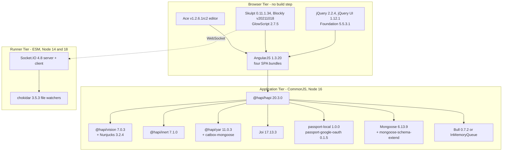

### 3.2.1 Core Server Framework — Hapi 20

The application is built on the Hapi ecosystem rather than Express, and the choice is visible in how much of the request pipeline is delegated to the framework: configuration-driven routes, declarative validation, plugin-based static and view serving, and a pluggable cache abstraction.

| Package | Version | Role in the system |
|---|---|---|
| `@hapi/hapi` | 20.3.0 | HTTP server, route table, `onPreHandler`/`onPreResponse` extensions, custom `session` auth scheme |
| `@hapi/boom` | 10.0.1 | HTTP error objects — required in 13 modules, the most-used framework package after Hapi itself |
| `@hapi/inert` | 7.1.0 | Static file and directory handlers for `public/` |
| `@hapi/vision` | 7.0.3 | View-engine integration; renders Nunjucks from `config.app.templates` |
| `@hapi/yar` | 11.0.3 | Session plugin, configured with `maxCookieSize: 0` to force server-side storage |
| `@hapi/catbox` | 11.1.1 | Cache interface implemented by the in-repo `lib/util/catbox-mongoose.js` engine |
| `@hapi/hoek` | 11.0.7 | Hapi utility library (peer requirement; not directly required by application code) |

**Why Hapi 20 specifically.** Hapi 20 is the last major line that runs on Node 16, and it is also the line whose `route.config`-era conventions the legacy route declarations can be adapted to. The pairing is deliberate: `lib/util/routeParser.js` translates compact declaration strings of the form `'METHOD /path controller.action'` — together with Hapi 4-era pre-handlers — into Hapi 20 route objects. This adapter is what allows a 2014-vintage route table to run on a 2020-vintage framework without rewriting either.

Route assembly happens once at startup in `config/app.config.js`:

```js
config.routes = routeParser.parse(api_routes.concat(routes));
```

### 3.2.2 Validation and Templating

**Joi 17.13.3** provides request validation, and its presence creates one of the repository's most consequential constraints. `config/app.config.js` requires modules in a fixed order with the inline explanation "Load routes BEFORE db because mongoose-schema-extend conflicts with Joi 17" — a load-order workaround, not a resolved incompatibility. Joi is required directly in four modules and used pervasively through the route declarations, where it also serves as the feature-flag-sensitive validation layer (for example, the captcha field degrades from required to optional when reCAPTCHA is unconfigured).

**Nunjucks 3.2.4** is the view engine, wired into Vision through `lib/util/nunjucks.js` (which is also where `numeral` 1.5.6 is registered as a formatting filter). Nunjucks is required in five modules — the view engine setup, the material parser, and the email and export renderers — because templates are rendered both inside and outside the HTTP request path.

Markdown rendering is handled by a pairing worth noting: `lib/shared/trinket-markdown.js` combines **`marked`** with **`highlight.js` 9.18.5**. The `marked` dependency is not the public package — `package.json` line 38 declares `"marked": "git+https://github.com/trinketapp/marked.git"`, and `package-lock.json` resolves it from `git+ssh://git@github.com` at version 0.3.2. It is the only dependency in the tree not sourced from the npm registry.

### 3.2.3 Data Access Framework — Mongoose 6

| Package | Version | Role |
|---|---|---|
| `mongoose` | 6.13.9 | ODM for all 18 models in `lib/models/`; required in 23 modules |
| `mongoose-schema-extend` | 0.2.2 | Schema inheritance used by `lib/models/model.js` |
| `mongo-migrate` | 0.1.0 | Declared but never required; no migrations directory exists |

Mongoose is the framework the codebase leans on hardest — it is the second-most-required package in the tree (23 call sites, behind only `config`) and it underpins three distinct concerns: domain persistence, the session store (`lib/util/catbox-mongoose.js` defines its own `Session` model on the shared connection), and a set of seven reusable schema plugins in `lib/models/plugins/` (`isChanged`, `orderedList`, `ownable`, `paginate`, `roles`, `slug`, `timestamps`) that supply cross-cutting model behaviour.

Two compatibility artefacts sit around it. `config/db.js` carries the comment "mongoose-schema-extend is deprecated but still used by lib/models/model.js / TODO: Migrate to native mongoose discriminators", and `app.js` lines 3-16 polyfill `Promise.prototype.spread` and `Promise.prototype.fail` because Mongoose 6 returns native promises where the surrounding code expects Q-style ones. Both are stable workarounds, but both must be preserved by any Mongoose upgrade.

### 3.2.4 Authentication and Cryptography

| Package | Version | Role |
|---|---|---|
| `passport-local` | 1.0.0 | Email/password strategy (`usernameField: 'email'`) |
| `passport-google-oauth` | 0.1.5 | `OAuth2Strategy` for Google sign-in |
| `bcrypt` | 5.1.1 | Native password hashing addon |
| `jsonwebtoken` | 5.7.0 | Share-link and email-token signing |
| `node-cryptojs-aes` | 0.4.0 | AES helper, paired with the browser-side `crypto-js` 3.1.2 |

The integration pattern here is unusual and worth recording: the `passport` package itself is a declared dependency but is **never required** anywhere in tracked source. `lib/auth/passport.js` imports the two strategies directly and exports `configurePassport(Passport)`, receiving the Passport instance as a parameter. `serializeUser`/`deserializeUser` resolve against the global `User` model and reject accounts holding the `disabled` role. Session establishment is then handled by Hapi's own custom `session` auth scheme in `app.js` rather than by Passport middleware — Passport supplies the credential-verification strategies only.

`jsonwebtoken` 5.7.0 is a notably old major line (the current line is 9.x), and it is used for tokens that reach end users through email and share links.

### 3.2.5 Background Processing, Archiving and Utility Libraries

| Package | Version | Role |
|---|---|---|
| `bull` | 0.7.2 | Redis-backed job queue; required only in `lib/util/queues.js` |
| `archiver` | 2.1.1 | Streaming ZIP construction for course and bulk exports |
| `jszip` / `adm-zip` | 3.6.0 / 0.4.16 | In-memory ZIP read/write for trinket uploads and downloads |
| `q` | 1.0.1 | Legacy promise library, still used by `lib/workers/exports.js` |
| `underscore` / `lodash` | 1.13.8 / 4.17.23 | Both present — `underscore` in 23 modules, `lodash` in 2 |
| `request` | 2.88.2 | HTTP client for reCAPTCHA verification and the Google OAuth token exchange |
| `winston` | 3.19.0 | Logging, exposed as the implicit global `log` |
| `config` | 0.4.37 | YAML configuration layering; the single most-required package (38 modules) |

`bull` 0.7.2 deserves emphasis because of how thinly it is used. `lib/util/queues.js` selects between Bull and a hand-written `InMemoryQueue` based on `config.db.redis.enabled !== false`. The fallback implements `process()`/`add()` with `setImmediate` dispatch and explicitly documents that handler-less jobs are discarded: "No handlers registered, job is essentially dropped / This is fine for optional features like analytics/events". Bull 0.7.2 is roughly eight major lines behind the current `bull`/`bullmq` releases, which is tolerable precisely because the abstraction surface consumed is two methods wide.

The simultaneous presence of `underscore` and `lodash`, and of `q` alongside native promises, is the library-level expression of the compatibility debt described in §2.4 — not a design choice to replicate in new code.

### 3.2.6 Browser Framework Stack — AngularJS 1.3.20

The client is an **AngularJS 1.3.20** application organised as four bundles, defined declaratively in `config/default.yaml` under `app.ngapps`:

| Bundle | Scripts | Purpose |
|---|---|---|
| `main` | 8 | Marketing/landing pages and shared services |
| `library` | ~28 | Personal trinket library, folders, copy/detail/list views |
| `courseEditor` | ~32 | Course authoring, materials, assignments, dashboards |
| `classPage` | 10 | Learner-facing course view |

Each bundle is an ordered list of URLs that `lib/views/` renders into `<script>` tags. There is **no bundler, minifier, or transpiler** for browser JavaScript — Vite compiles SCSS only. Supporting libraries are loaded from public CDNs at the versions written into `app.assets`:

| Library | Pinned version | Delivery |
|---|---|---|
| AngularJS (core, route, aria, animate) | 1.3.20 | `cdnjs.cloudflare.com`, `ajax.googleapis.com` |
| jQuery / jQuery UI | 2.2.4 / 1.12.1 | `cdnjs.cloudflare.com` |
| Foundation | 5.5.3.1 | `public/components/` |
| Ace editor (`ace-builds`) | v1.2.6.1rc2 | `public/components/` |
| Restangular | 1.3.1 | `cdnjs.cloudflare.com` |
| Modernizr | 2.8.3 | `cdnjs.cloudflare.com` |
| MathJax | 2.7.7 | `cdnjs.cloudflare.com` (courseEditor, classPage) |
| Font Awesome / video.js | 4.7.0 / 5.20.4 | `cdnjs.cloudflare.com` |

Three properties of this arrangement are architecturally significant. First, the framework is unsupported: <cite index="18-30,18-31">AngularJS reached its End of Life on December 31, 2021, when Google and the Angular team ceased active development and security support.</cite> <cite index="13-21">Known XSS vectors exist in its template compiler and it has no Trusted Types support.</cite> Commercial extended support exists but <cite index="15-4">covers AngularJS 1.5.x, 1.6.x and 1.8.x</cite> — not the 1.3.20 pinned here. Second, all CDN URLs are protocol-relative (`//cdnjs.cloudflare.com/...`) and carry **no Subresource Integrity attributes**, so the browser tier trusts two third-party origins for executable code on every page load. Third, because these versions live in YAML rather than a lockfile, a frontend library upgrade is a configuration change with no dependency-resolution safety net.

### 3.2.7 Code Execution Engines

The libraries that make Trinket what it is are not npm packages at all. They live in the gitignored `public/components/` directory, arrive as a prebuilt `public-components.tgz` release asset, and are catalogued in `COMPONENTS.md` as GitHub repositories — mostly Trinket forks:

| Engine | Version | Function |
|---|---|---|
| Skulpt (`trinketapp/skulpt-dist`) | 0.11.1.34 | Python-to-JavaScript compiler; powers the default `python` trinket |
| Blockly (`trinketapp/blockly`) | v20211018 | Visual block editor for `blocks` and `glowscript-blocks` |
| GlowScript (`trinketapp/glowscript`) | 2.7.5 | 3D/VPython graphics, with `vpython-glowscript` 3.2.2 |
| `glowscript-blocks` | 0.1.11 | Block editor for GlowScript (third-party, `txst-per-group`) |
| jq-console (`trinketapp/jq-console`) | v2.13.2.1 | Console/REPL UI for the `console` trinket |
| closure-library (`google/closure-library`) | v20180204 | Blockly dependency |
| MIDI.js (`trinketapp/MIDI.js`) | master | Audio playback for the `music` trinket |
| systemjs / webrtc-adapter | 0.21.3 / 6.2.1 | Module loading and WebRTC compatibility for `pygame` |

Skulpt is additionally extended with six Python modules compiled for it — `json.sk`, `xml.sk`, `processing.sk`, `pygame.sk`, `skulpt_numpy`, `skulpt_matplotlib` — which is how a browser-resident Python gains partial NumPy and Matplotlib support.

Two caveats apply to this inventory. `COMPONENTS.md:5` instructs the reader to run `npm run setup-vendor`, **a script `package.json` does not define**, so the documented acquisition path is broken; the working path is the `Dockerfile`'s tarball fetch. And `COMPONENTS.md:74` records the history — "Original bower.json preserved for reference but bower is deprecated" — which explains the otherwise inexplicable `.bowerrc` at the repository root, still pointing `directory` at `public/components` with seven `ignoredDependencies`, despite no `bower.json` being committed.

### 3.2.8 Runner Tier Framework — Socket.IO 4

The `serverside/` tier uses a deliberately minimal framework set. There is no HTTP framework at all; **Socket.IO** is both the transport and the application framework.

| Component | Dependencies |
|---|---|
| `python`/`java`/`r` managers | `config` ^3.3.12, `file-type` ^18.0.0, `socket.io` ^4.8.0, `socket.io-client` ^4.8.0 (+ `is-svg` ^4.3.2 for python) |
| `pygame` manager | `config` ^3.3.9, `file-type` ^19.0.0, `is-svg` ^5.0.0, `socket.io` ^4.7.4, `socket.io-client` ^4.7.4 |
| `python`/`java`/`r` shells | `chokidar` ^3.5.3, `socket.io` ^4.8.0, `underscore` ^1.13.7 |
| `pygame` worker | `chokidar` ^3.5.3, `config` ^3.3.9, `socket.io` ^4.7.4 |

Each manager is simultaneously a Socket.IO **server** (facing the browser through nginx) and a Socket.IO **client** (facing its shells) — hence both packages in every manager manifest. `chokidar` watches each shell's generated-output directory so that files a learner's program writes (plots, images) are detected and published. `file-type` and `is-svg` gate what those generated files are allowed to be before they are served.

Notably, the managers use **`config` 3.3.x** while the root application uses **`config` 0.4.37** — the same library three major lines apart in one deployment, with no shared configuration between the tiers.

### 3.2.9 Compatibility Requirements and Known Constraints

| Constraint | Source | Consequence |
|---|---|---|
| Routes must load before the database | `config/app.config.js` | `mongoose-schema-extend` conflicts with Joi 17; reordering breaks startup |
| Q-style promise methods must exist on `Promise` | `app.js:3-16` | Required "for Mongoose 6 compatibility"; removing the polyfill breaks controllers |
| `gleak` must be optional | `app.js:28-35` | "gleak is not compatible with Node 16+ (uses GLOBAL which was removed)"; loaded in try/catch with a no-op fallback |
| npm peer dependencies must be bypassed | `Dockerfile:31` | `npm install --legacy-peer-deps` — peer conflicts are tolerated, not resolved |
| `bcrypt` must compile | `Dockerfile:7-9` | `python3` + `build-essential` in the image; Node upgrades require a successful native rebuild |
| Frontend components must be present | `.gitignore`, `Dockerfile:26-29` | `public/components/` is gitignored; the editor cannot render without the release tarball |
| CSS must be built | `.gitignore`, `vite.config.mjs` | `public/css/base.css` is generated, never committed |

Twelve of the 58 declared runtime dependencies are never `require()`d in tracked JavaScript: `@hapi/catbox-redis`, `@hapi/hoek`, `chokidar`, `debug`, `file-type`, `is-svg`, `minimist`, `moment-timezone`, `mongo-migrate`, `passport`, `passport-strategy` and `sha1`. Some are legitimate peer/transitive requirements (`@hapi/hoek`, `passport-strategy`), but others mark abandoned or unfinished paths — `@hapi/catbox-redis` was superseded by the in-repo Mongoose cache engine, and `mongo-migrate` has neither a runner nor a migrations directory even though `.gitignore` still reserves `config/migration.json` and `lib/migrations/backups`.

Finally, four libraries exist at different versions on different tiers, which is a maintenance hazard whenever a shared behaviour changes:

| Library | Application tier | Browser tier |
|---|---|---|
| `highlight.js` | 9.18.5 | 8.0 (CDN) |
| `lodash` | 4.17.23 | 2.4.1 (`app.components`) |
| `jszip` | 3.6.0 | 3.1.4 (`app.components`) |
| `moment` | 2.30.1 | 2.18.1 (`main`, `library`) and 2.7.0 (`classPage`) |


## 3.3 Open Source Dependencies

Trinket is open-source software built almost entirely from open-source components, and its dependency surface is unusually wide for a single application because it spans six distinct acquisition channels — only one of which is protected by a lockfile.

### 3.3.1 Package Registries and Acquisition Channels

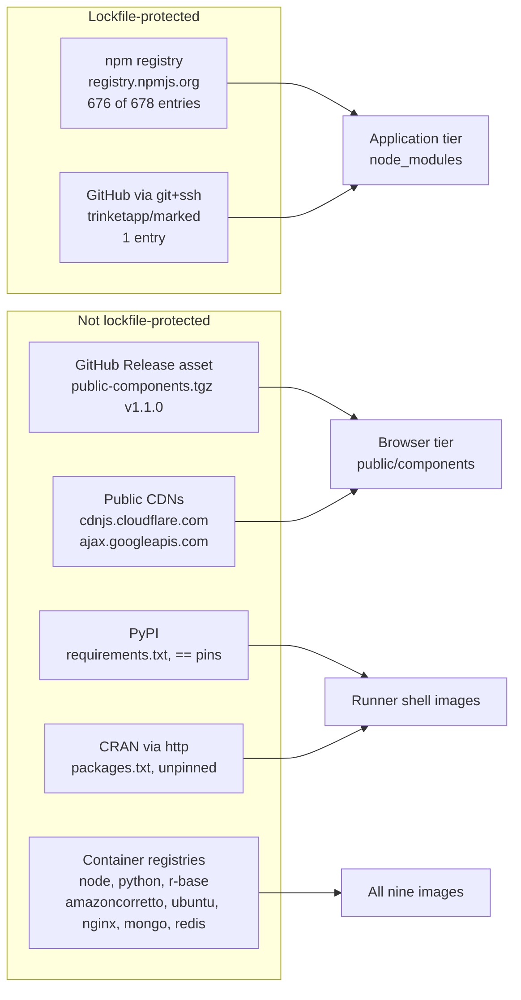

| Channel | What it supplies | Version control |
|---|---|---|
| npm — `registry.npmjs.org` | 676 of 678 resolved packages | `package-lock.json` (lockfileVersion 3) |
| GitHub via `git+ssh` | `marked` (trinketapp fork, resolved 0.3.2) | Lockfile records the commit; the range is a bare branch |
| GitHub Release asset | `public-components.tgz` from release `v1.1.0` | Tag-pinned in `Dockerfile:27`; contents not enumerated in-repo |
| Public CDNs | ~20 browser libraries | Version strings in `config/default.yaml`; no SRI, no lockfile |
| PyPI | 33 (or 34 with pygame) Python packages | Exact `==` pins, no hashes |
| CRAN over HTTP | 16 R packages | **Unpinned** |
| Container registries | 8 distinct base images | Tag-pinned except `redis:latest` |

The npm tree is the healthiest part of this picture: `lockfileVersion: 3` gives a fully resolved, integrity-checked graph of 678 packages from a single registry. Everything below the dividing line in the diagram is resolved at build time from a mutable source.

### 3.3.2 Application-Tier Runtime Dependencies

All 58 runtime dependencies from `package.json`, with the declared range and the version `package-lock.json` resolves.

**Web framework and HTTP**

| Package | Declared | Resolved | Purpose |
|---|---|---|---|
| `@hapi/hapi` | `^20.0.0` | 20.3.0 | HTTP server and routing |
| `@hapi/boom` | `^10.0.0` | 10.0.1 | HTTP error objects |
| `@hapi/inert` | `^7.0.0` | 7.1.0 | Static file serving |
| `@hapi/vision` | `^7.0.0` | 7.0.3 | View-engine integration |
| `@hapi/yar` | `^11.0.0` | 11.0.3 | Session management |
| `@hapi/hoek` | `^11.0.0` | 11.0.7 | Hapi utilities (indirect use) |
| `@hapi/catbox-redis` | `^7.0.0` | 7.0.2 | Declared; superseded by `catbox-mongoose` |
| `accepts` | `~1.1.0` | 1.1.4 | Content negotiation in `routeParser` |
| `request` | `^2.51.0` | 2.88.2 | Outbound HTTP (reCAPTCHA, OAuth); package is deprecated upstream |
| `joi` | `^17.0.0` | 17.13.3 | Request payload and query validation |

**Data, cache and queue**

| Package | Declared | Resolved | Purpose |
|---|---|---|---|
| `mongoose` | `^6.0.0` | 6.13.9 | MongoDB ODM |
| `mongoose-schema-extend` | `~0.2.2` | 0.2.2 | Schema inheritance; deprecated |
| `mongo-migrate` | `^0.1.0` | 0.1.0 | Declared only; no migrations exist |
| `redis` | `^4.0.0` | 4.7.1 | node-redis v4 client |
| `bull` | `^0.7.0` | 0.7.2 | Redis job queue for exports |
| `config` | `~0.4.35` | 0.4.37 | YAML configuration layering |
| `js-yaml` | `~3.0.1` | 3.0.2 | YAML parsing in the material parser |

**Security and identity**

| Package | Declared | Resolved | Purpose |
|---|---|---|---|
| `bcrypt` | `^5.1.0` | 5.1.1 | Password hashing (native addon) |
| `jsonwebtoken` | `^5.0.5` | 5.7.0 | Share/email token signing |
| `passport` | `~0.2.0` | 0.2.2 | Declared; never required directly |
| `passport-local` | `~1.0.0` | 1.0.0 | Email/password strategy |
| `passport-google-oauth` | `^0.1.5` | 0.1.5 | Google OAuth2 strategy |
| `passport-strategy` | `~1.0.0` | 1.0.0 | Strategy base class (transitive) |
| `node-cryptojs-aes` | `^0.4.0` | 0.4.0 | AES helper |
| `sha1` | `~1.1.0` | 1.1.1 | Declared; never required |
| `validator` | `^5.6.0` | 5.7.0 | String validation in models |
| `escape-string-regexp` | `~1.0.5` | 1.0.5 | Regex-safe search input |

**Cloud, mail and logging**

| Package | Declared | Resolved | Purpose |
|---|---|---|---|
| `aws-sdk` | `^2.1.20` | 2.1693.0 | S3 operations and presigned URLs (SDK v2) |
| `nodemailer` | `^2.5.0` | 2.7.2 | SMTP transport |
| `winston` | `^3.8.0` | 3.19.0 | Application logging |
| `debug` | `^4.3.0` | 4.4.3 | Declared; never required |

**Content, archiving and files**

| Package | Declared | Resolved | Purpose |
|---|---|---|---|
| `marked` | `git+https://github.com/trinketapp/marked.git` | 0.3.2 | Markdown rendering (Trinket fork) |
| `highlight.js` | `^9.6.0` | 9.18.5 | Server-side syntax highlighting |
| `archiver` | `^2.0.0` | 2.1.1 | Streaming ZIP for exports |
| `jszip` | `~3.6.0` | 3.6.0 | ZIP read/write |
| `adm-zip` | `~0.4.4` | 0.4.16 | ZIP handling for uploads |
| `csv` | `~1.2.1` | 1.2.1 | Bulk user CSV upload |
| `diff` | `~1.0.8` | 1.0.8 | Code diffs (paired with browser `jsdiff`) |
| `file-type` | `^3.8.0` | 3.9.0 | Declared; never required |
| `is-svg` | `^2.1.0` | 2.1.0 | Declared; never required |
| `mime` | `~1.2.11` | 1.2.11 | Content-type resolution |
| `chokidar` | `^3.5.3` | 3.6.0 | Declared; used in the runner tier only |
| `mkdirp` | `~0.3.5` | 0.3.5 | Directory creation for export staging |
| `rimraf` | `~2.2.6` | 2.2.8 | Temp-directory cleanup |
| `tmp` | `0.0.25` (exact) | 0.0.25 | Temp file allocation |

**Utility and formatting**

| Package | Declared | Resolved | Purpose |
|---|---|---|---|
| `underscore` | `^1.8.3` | 1.13.8 | Primary utility library (23 modules) |
| `lodash` | `^4.17.21` | 4.17.23 | Secondary utility library (2 modules) |
| `q` | `~1.0.0` | 1.0.1 | Legacy promises in the export worker |
| `moment` | `^2.18.1` | 2.30.1 | Date handling |
| `moment-timezone` | `~0.5.21` | 0.5.48 | Declared; never required |
| `numeral` | `^1.5.3` | 1.5.6 | Nunjucks number-format filter |
| `limax` | `~1.4.0` | 1.4.1 | Slug generation (3 modules) |
| `transliteration` | `^0.1.1` | 0.1.1 | Slug transliteration |
| `node-uuid` | `^1.4.3` | 1.4.8 | Identifier generation; package is deprecated upstream |
| `minimist` | `^1.1.1` | 1.2.8 | Declared; never required |
| `optimist` | `~0.6.0` | 0.6.1 | CLI argument parsing; deprecated upstream |
| `tab` | `~0.1.0` | 0.1.0 | Tabular console output |

Several of these are unmaintained lines that remain because the code around them has not changed: `request` and `node-uuid` are formally deprecated by their authors, `optimist` was superseded by `yargs`, and `q` predates native promises entirely. None is a security finding on its own, but each is a dead end for upgrades.

### 3.3.3 Development Dependencies

| Package | Declared | Resolved | Purpose |
|---|---|---|---|
| `mocha` | `^3.4.1` | 3.5.3 | Test runner (`npm test`) |
| `chai` | `^3.5.0` | 3.5.0 | Assertions (16 test modules) |
| `chai-as-promised` | `^6.0.0` | 6.0.0 | Promise assertions |
| `sinon` | `~1.7.3` | 1.7.3 | Stubs and spies (16 test modules) |
| `sinon-chai` | `^2.5.0` | 2.x | Sinon assertion integration |
| `should` | `~3.0.0` | 3.0.1 | Alternative assertion style |
| `supertest` | `~0.8.3` | 0.8.3 | HTTP assertions |
| `cheerio` | `~0.22.0` | 0.22.0 | HTML parsing in tests |
| `redis-mock` | `~0.2.0` | 0.2.0 | Redis double, stubbed in `test/setup.js` |
| `sass` | `^1.57.0` | 1.98.0 | SCSS compiler consumed by Vite |
| `vite` | `^4.5.14` | 4.5.14 | CSS build orchestration |

Only two of these are modern: `sass` 1.98.0 and `vite` 4.5.14 — the CSS toolchain, which was replaced during the open-sourcing effort. The test toolchain is frozen at its original versions, and `test/setup.js` demonstrates why the `sinon` pin is load-bearing: it calls `sinon.stub(redis, 'createClient', redismock.createClient)`, the three-argument form removed in Sinon 3. `supertest`, `should` and `cheerio` are declared but do not appear among the require counts in the committed specs.

### 3.3.4 Runner-Tier Dependencies

The `serverside/` tree declares its dependencies in six independent manifests with no lockfiles — each image resolves `^` ranges freshly at `docker build` time, so runner images are not byte-reproducible.

| Manifest | Dependencies |
|---|---|
| `python/manager`, `java/manager`, `r/manager` | `config` ^3.3.12, `file-type` ^18.0.0, `socket.io` ^4.8.0, `socket.io-client` ^4.8.0; `python` adds `is-svg` ^4.3.2 |
| `pygame/manager` | `config` ^3.3.9, `file-type` ^19.0.0, `is-svg` ^5.0.0, `socket.io` ^4.7.4, `socket.io-client` ^4.7.4 |
| `python/shell`, `java/shell`, `r/shell` | `chokidar` ^3.5.3, `socket.io` ^4.8.0, `underscore` ^1.13.7 |
| `pygame/worker` | `chokidar` ^3.5.3, `config` ^3.3.9, `socket.io` ^4.7.4 |

Every runner manifest is ESM (`"type": "module"`), and the version sets of `config`, `file-type` and `is-svg` diverge between the pygame tier and the other three — a sign the pygame runner was added later against a slightly different baseline.

### 3.3.5 Python and R Package Sets

`serverside/python/shell/requirements.txt` installs 33 PyPI packages, all with exact `==` pins, forming a scientific-Python teaching environment:

| Domain | Packages |
|---|---|
| Numeric / scientific | `numpy==1.23.2`, `scipy==1.9.0`, `sympy==1.10.1`, `Cython==0.29.32`, `statsmodels==0.13.2`, `patsy==0.5.2` |
| Data and ML | `pandas==1.4.3`, `scikit-learn==1.1.2`, `networkx==2.6.3` |
| Plotting | `matplotlib==3.5.3`, `seaborn==0.11.2`, `bokeh==2.4.3`, `pygal==3.0.0` + three `pygal_maps_*`, `basemap==1.3.6`, `cairosvg==2.5.2`, `pycolors==0.1.2` |
| Web / parsing | `beautifulsoup4==4.11.1`, `lxml==4.9.1`, `cssselect==1.1.0`, `tinycss==0.4`, `requests-oauthlib==1.3.0` |
| Domain-specific | `biopython==1.79`, `ete3==3.1.2`, `pronouncing==0.2.0`, `names==0.3.0`, `pycep-correios==5.0.0`, `exifread==3.0.0`, `mysql-connector-python==8.0.26` |
| Testing | `pytest==7.1.2` |

`serverside/pygame/worker/requirements.txt` reproduces this list verbatim (header comment: "Same as python3 shell") and adds `pygame==2.5.2`; `pgzero==1.2.1` is present but commented out with "Requires additional integration work to function". `qiskit` and `qiskit-aqua` are likewise commented out in both files.

The R set in `serverside/r/shell/packages.txt` is 16 packages oriented toward statistics teaching — `ggplot2`, `dplyr`, `tidyr`, `stringr`, `lubridate`, `readr`, `zoo`, `jsonlite`, `qtl`, `mosaic`, `infer`, `moderndive`, `gapminder`, `ISLR`, `nycflights13`, `ggplot2movies` — installed by `serverside/r/shell/install.r` with no version constraints from `http://cran.rstudio.com`. This is the single least reproducible dependency set in the repository: unpinned versions fetched over plaintext HTTP.

### 3.3.6 The Unmanaged Dependency Surface

Four categories of dependency exist entirely outside npm's resolution and auditing:

| Surface | Risk characteristics |
|---|---|
| CDN-loaded browser libraries | ~20 libraries from `cdnjs.cloudflare.com` and `ajax.googleapis.com`, protocol-relative, **no Subresource Integrity**; executable code trusted from third-party origins on every page load |
| `public-components.tgz` | A single opaque release artefact containing Skulpt, Blockly, GlowScript, Ace, Foundation and the `.sk` modules; `Dockerfile:26-29` fetches it over HTTPS with no checksum verification |
| CRAN packages | Unpinned, plaintext HTTP |
| Base images | Eight images, seven tag-pinned; `docker-compose.yml:18` uses `redis:latest`, which is unpinned by definition |

There is no dependency-scanning or SBOM tooling anywhere in the repository: no `.github/dependabot.yml` (there is no `.github/` directory at all), no `npm audit` step, no license scanner, and no `renovate.json`. Dependency freshness is therefore entirely a manual activity.

### 3.3.7 Licensing Posture

The project's own license is ambiguous and should be resolved by the maintainers rather than assumed: `LICENSE` is a CC0 1.0 Universal public-domain dedication, while `package.json:99` declares `"license": "MIT"`. The two are compatible in the permissive direction but describe materially different obligations for downstream consumers.

For dependencies, no license inventory or compliance artefact exists in the repository. The one structural licensing observation that can be made from the evidence is that `COMPONENTS.md` catalogues the execution engines by GitHub repository rather than by license, and several are Trinket forks of projects with their own terms (Skulpt, Blockly, GlowScript, Closure Library, MIDI.js) — meaning any redistribution review must be performed against the tarball contents, not against `package-lock.json`.


## 3.4 Third-Party Services

Every external service Trinket touches is optional except MongoDB, and each is reached through configuration rather than code. `config/local.example.yaml` is effectively the integration contract: it lists two REQUIRED items (the app URL and the session password) and five commented-out OPTIONAL blocks, each annotated with what degrades if it is left unconfigured. This "degrade, don't fail" posture is the defining property of the integration layer and is what makes a zero-credential `docker-compose up` produce a working system.

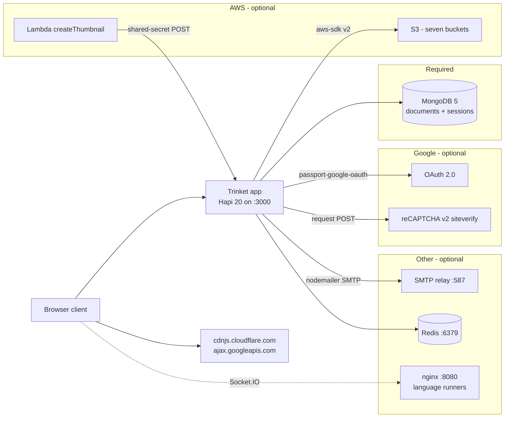

### 3.4.1 Integration Surface Summary

| Service | Configuration key | Behaviour when unconfigured |
|---|---|---|
| MongoDB | `db.mongo`, `db.mongoread` | **Required** — holds documents and sessions |
| Redis | `db.redis.*`, `bullqueues` | In-memory cache and queue fallback |
| AWS S3 | `aws.keyId`, `aws.key`, `aws.buckets.*` | `features.assets` stays `false`; uploads disabled |
| AWS Lambda | `aws.lambda.createThumbnail.secret` | No server-side thumbnail generation |
| Google OAuth | `app.auth.google.{clientID,clientSecret,callbackURL}` | Local email/password login only |
| Google reCAPTCHA | `app.recaptcha.{sitekey,secretkey}` | Verification **fails open** (see §3.4.4) |
| SMTP | `app.mail.{from,host,port,user,pass,secure}` | `send()` resolves `{skipped: true}`; password reset unavailable |
| Language runners | `app.serverside.*.api.default` | Server-side languages remain disabled by feature flag |
| Public CDNs | `app.assets.*`, `app.ngapps.*` | Not optional in practice — the UI depends on them |

### 3.4.2 Amazon Web Services

AWS is integrated through a single shared client. `config/aws.js` is 232 bytes in total: it updates the global `aws-sdk` configuration with `accessKeyId`, `secretAccessKey` and `region`, then exports the namespace.

```js
AWS.config.update({ accessKeyId: config.aws.keyId,
  secretAccessKey: config.aws.key, region: config.aws.region });
```

The security implication is explicit in that snippet: **only static long-lived credentials are supported**. There is no code path for IAM instance roles, IRSA, or STS assume-role, so a self-host on EC2 or EKS still needs a key pair in a gitignored YAML overlay. `GETTING_STARTED.md:202-203` reinforces this by illustrating configuration with literal `AKIA…` key material.

#### 3.4.2.1 S3 Object Storage

`config/default.yaml` declares seven buckets, each with a `name` and a public `host`:

| Bucket key | Stores | Notes |
|---|---|---|
| `userassets` | Learner-uploaded images and files | Also carries `thumbnail: 'thumb-%{s}'`, `thumbnailHost`, `thumbnailBucket` |
| `snapshots` | Rendered trinket snapshots | — |
| `materials` | Course material attachments | — |
| `useravatars` | Profile images | — |
| `cdn` | Application CDN origin | — |
| `appassets` | Built application assets | — |
| `vendorassets` | Vendor browser components | Alternative to `public/components/` |

Clients are constructed per operation (`new aws.S3()` at four sites in `lib/util/file.js` and two in `lib/workers/exports.js`). Uploads go through `client.putObject` with the object key derived from a content hash, and downloads for bulk exports are issued as presigned URLs (`lib/controllers/users.js:1095`). One gap is recorded in the code itself: `lib/workers/exports.js:378` reads `config.aws.buckets.exports.host`, but no `exports` bucket is declared in `config/default.yaml` — an operator enabling bulk export must add it.

S3-compatible alternatives are supported without code changes. `GETTING_STARTED.md:211-216` documents adding `aws.endpoint` to target MinIO or DigitalOcean Spaces, which means the "cloud platform" dependency is S3-API-shaped rather than AWS-specific.

#### 3.4.2.2 AWS Lambda

Lambda participates in one narrow flow and in the reverse direction from the usual pattern: the application does not invoke Lambda through the SDK — Lambda calls **back into** the application. `lib/controllers/files.js:109` guards the thumbnail-completion endpoint with a shared secret:

```js
if (request.payload.secret !== config.aws.lambda.createThumbnail.secret) { ... }
```

Because `aws.lambda.createThumbnail.secret` defaults to an empty string, an unconfigured deployment that still exposes this route compares against `''`. Setting a strong secret is a prerequisite for enabling asset thumbnails, and the endpoint should not be reachable from the public internet without it.

#### 3.4.2.3 AWS SES — Declared but Unimplemented

`config/default.yaml` defines `aws.mail.{keyId, key}`, and `lib/util/routeParser.js:733` carries the comment "need either AWS SES or Mailgun credentials". Neither service is actually integrated: `lib/util/mailer.js` constructs only nodemailer SMTP transports, and no SES or Mailgun client appears anywhere in tracked source. These keys are residue from the hosted predecessor and should be treated as inert. SES remains reachable in practice — but only as an SMTP endpoint through `app.mail.host`.

### 3.4.3 Google OAuth 2.0

Federated identity is provided by Google alone. `lib/auth/passport.js` registers `passport-google-oauth`'s `OAuth2Strategy` against `app.auth.google.{clientID, clientSecret, callbackURL}`, all empty by default. `GETTING_STARTED.md:244-258` documents the setup: create credentials in the Google Cloud Console and register `https://your-domain.com/auth/google/callback` as the authorised redirect URI.

Two observations about this integration. First, it is the **only** third-party identity provider — there is no SAML, OIDC-generic, LDAP, or Auth0 integration in the codebase, so an institution requiring SSO beyond Google would need new strategy code. Second, §2.4.3 records that the Google exchange is implemented twice (an explicit `request`-based exchange in `lib/controllers/auth.js` alongside the Passport strategy), so any change to Google identity handling must be applied in both places.

### 3.4.4 Google reCAPTCHA

`lib/util/recaptcha.js` POSTs to `https://www.google.com/recaptcha/api/siteverify` using the `request` client, with the configured `secretkey` and the client-supplied response token. The design decision that matters here is at the top of the function:

```js
if (config.isTest || !config.app.recaptcha || !config.app.recaptcha.secretkey)
  return cb({ success : true });
```

Verification **fails open** when the secret is absent or when running under `NODE_ENV=test`. This is what allows registration to work out of the box, and it is consistent with the project's degrade-don't-fail posture — but it means an operator who exposes a public signup form without setting `app.recaptcha.secretkey` has no bot protection at all rather than a broken form. A secondary defect is worth noting for anyone consuming the callback: the non-200 branch returns `{ status: false }` while the success branch returns `{ success: true }`, so the two paths use different keys.

### 3.4.5 Email Delivery

`lib/util/mailer.js` is deliberately provider-agnostic: any SMTP relay works, and `GETTING_STARTED.md:167-189` gives worked examples for Mailgun (`smtp.mailgun.org:587`) and SendGrid (`smtp.sendgrid.net:587` with user `apikey`). Configuration is `app.mail.{from, host, port, user, pass, secure}`, with port 587 as the default and the in-file comment noting 465 for SSL and 25 for unencrypted.

Three characteristics have operational consequences:

- **A new transport is created per send.** `createTransport()` is called inside `send()`, so there is no connection pooling, retry, or backoff. A slow relay directly delays the HTTP response for user-facing flows such as password reset.
- **`isConfigured()` is advisory, not enforcing.** It checks only that `from` and `host` are truthy. `send()` *resolves* `{ skipped: true, reason: 'Email not configured' }` rather than rejecting, so a caller that omits the `isConfigured()` check produces a silent non-delivery.
- **`app.mail.secret` is overloaded.** Per §2.4.7, the same value signs trinket share tokens, so leaving it empty weakens sharing security even in deployments that never send mail.

### 3.4.6 Content Delivery Networks

Two public CDNs are load-bearing runtime dependencies of the browser tier — `cdnjs.cloudflare.com` and `ajax.googleapis.com` — supplying AngularJS 1.3.20, jQuery 2.2.4, jQuery UI, Restangular, Modernizr, MathJax 2.7.7, crypto-js, Notify, Sortable, Font Awesome 4.7.0, video.js 5.20.4 and highlight.js 8.0. Unlike every other integration in this section, these are **not optional**: without them the SPA bundles do not boot.

The security characteristics follow directly from `config/default.yaml`: all URLs are protocol-relative, and none carries an `integrity` attribute. Two third-party origins therefore have script-execution authority on every authenticated page. For an air-gapped or high-assurance deployment the `vendorassets` bucket and the `app.assets`/`app.ngapps` lists provide the mechanism to self-host these files instead, but no configuration in the repository does so by default.

### 3.4.7 The Language Runner Tier as an Internal Service

The `serverside/` runners are a first-party service but are integrated exactly like a third party — over HTTP/WebSocket at a configured base URL, behind a feature flag. `config/default.yaml` maps the browser's language parameter to a config key and then to an endpoint:

| Trinket language | Config key | Endpoint (`api.default`) |
|---|---|---|
| `python3` | `python3` | `http://localhost:8080/python3` |
| `java` | `java8` | `http://localhost:8080/java` |
| `R` | `r3` | `http://localhost:8080/r` |
| `pygame` | `pygame` | `http://localhost:8080/pygame` |

All four share one nginx entry point on port 8080 — the configuration comment states "All server-side types go through nginx reverse proxy on port 8080". The runners accept cross-origin traffic from an explicit allowlist: `serverside/README.md:117` documents `CORS_ORIGINS` as a JSON array, and `GENERATED_URL` as the public base URL under which learner-produced files (plots, images) are served. Neither has a safe default, so a non-localhost deployment must set both.

### 3.4.8 Monitoring and Observability

There is no third-party monitoring service, and this is worth stating plainly because it is a gap rather than a choice of vendor. The repository contains **no APM, tracing, error-reporting, or metrics-export dependency of any kind** — no Sentry, Datadog, New Relic, OpenTelemetry, `prom-client`, or StatsD client appears in `package.json` or anywhere in the dependency tree.

What exists instead is two-layered:

| Layer | Implementation |
|---|---|
| Operational logging | Winston 3.19.0 via `config/log.js` — a Console transport at `app.log.level` (default `info`) plus an optional File transport at `debug` level when `app.log.debug.filename` is set (default `/tmp/debug.txt`). Exposed as the implicit global `log` |
| Product analytics | Persisted to MongoDB through `lib/models/clientMetric.js`, `errorEvent.js` and `interaction.js`, fed by unauthenticated intake endpoints and toggled by `app.embed.logClientMetric` / `logClientCodeError` |

The only health endpoint in the repository belongs to the runner tier: `serverside/nginx/nginx.conf` defines `location /health { return 200 'OK'; }`. The application tier has no dedicated health or readiness route, and `docker-compose.yml` declares no `healthcheck` for any service — post-deployment verification is the manual `test/smoke-test.sh`. Route-handler timing is logged rather than measured: `app.log.debug.routehandlertiming: true` writes durations to Winston with no aggregation.

### 3.4.9 Cloud Platform Posture

The repository is **cloud-agnostic by construction and cloud-unprovisioned in practice**. Its only hard infrastructure requirements are a container runtime, MongoDB, and — for asset features — an S3-compatible object store. There is no Terraform, CloudFormation, CDK, Pulumi, Kubernetes manifest, or Helm chart anywhere in the tree, so cloud provisioning is entirely a deployer exercise. Consistent with that, `serverside/README.md:489-499` records that the elastic capacity layer the hosted product used — "scaler, stats server, worker images and phone-home scripts" — "is not yet included in the OSS release. Contributions welcome."

Relative to the default enterprise stack this specification starts from, the divergence is therefore substantial and deliberate: AWS appears only as optional S3 (and an S3-compatible abstraction at that), identity is Google rather than Auth0, and there is no infrastructure-as-code layer to document.


## 3.5 Databases & Storage

Trinket's storage architecture has one hard dependency and three optional tiers. MongoDB is unavoidable because it holds both domain documents and server-side sessions; Redis, S3 and the runner volumes are each substitutable or omissible. `README.md:19-20` states the baseline plainly: "MongoDB 5.0+" and "Redis (optional - falls back to in-memory)".

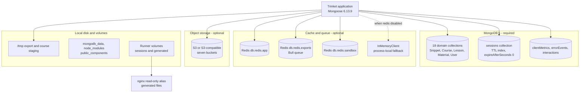

### 3.5.1 Primary Database — MongoDB

**Engine and driver.** MongoDB 5 (`docker-compose.yml` pins `mongo:5`) accessed through **Mongoose 6.13.9**, with `mongoose-schema-extend` 0.2.2 layered on for schema inheritance. Mongoose is the second-most-required package in the codebase, appearing in 23 modules.

**Connection strategy.** `config/db.js` assembles the connection string by hand rather than accepting a URI, and it connects as a *side effect of being required*:

| Behaviour | Detail |
|---|---|
| Primary host | `mongodb://[user:pass@]{db.mongo.host}:{port}/{database}` |
| Optional second host | When `db.mongoread.host` is set, a comma-separated second host is appended with its own credentials |
| Read-host options | `db.mongoread.opts` defaults to `connectTimeoutMS=300000&socketTimeoutMS=300000` — 5-minute timeouts |
| Invocation | `connect()` runs at module load; the module exports `{ connect }` for reconnection |

The `mongoread` mechanism is the codebase's only concession to read scaling, and it is a blunt one: adding a second host to a comma-separated seed list makes the driver treat the pair as a replica set, which requires that the two hosts actually *be* a replica set. There is no separate read connection, no `readPreference` setting, and no query routing — so the intent is replica-set awareness rather than genuine read/write splitting.

**Domain model inventory.** `lib/models/` contains 18 modules covering the full domain:

| Group | Models |
|---|---|
| Content | `trinket.js` (registered as the `Snippet` collection), `draft.js`, `folder.js`, `asset.js`, `file.js` |
| Courses | `course.js`, `lesson.js`, `material.js`, `courseInvitation.js`, `featuredCourses.js` |
| Identity | `user.js`, `roles.js` |
| Analytics | `interaction.js`, `clientMetric.js`, `errorEvent.js` |
| Jobs | `export.js` |
| Infrastructure | `model.js` (base/extend helper) |

**Reusable schema behaviour.** Seven Mongoose plugins in `lib/models/plugins/` supply cross-cutting persistence concerns, which is how the models stay consistent without inheritance:

| Plugin | Concern |
|---|---|
| `ownable.js` | Owner reference and ownership assertions |
| `paginate.js` | Bounded listing (default 20, maximum 100 per §2.4.2) |
| `slug.js` | URL-safe slug generation and uniqueness |
| `timestamps.js` | Created/updated tracking |
| `roles.js` | Role and permission storage on documents |
| `orderedList.js` | In-document ordering for lessons and materials |
| `isChanged.js` | Change detection for conditional writes |

### 3.5.2 Session Persistence — A Custom Catbox Engine on MongoDB

The most consequential storage decision in the system is that sessions live in MongoDB, not Redis. `app.js` registers `@hapi/yar` with `maxCookieSize: 0`, which forces all session state server-side, and points its cache at the in-repo engine `lib/util/catbox-mongoose.js` — described in its own header as a "Catbox-compatible cache engine using Mongoose/MongoDB / Stores sessions in MongoDB for persistence across server restarts".

The implementation is compact and has three notable properties:

| Property | Detail |
|---|---|
| Schema | `_id` String ("segment:id composite key"), `value` Mixed, `stored` Number, `ttl` Number; `collection: 'sessions'` |
| Expiry | A MongoDB TTL index — `{ stored: 1 }` with `expireAfterSeconds: 0` and `partialFilterExpression: { ttl: { $exists: true } }` — so the database, not the application, reaps expired sessions |
| Connection | Reuses the live Mongoose connection (`readyState === 1`) or awaits `mongoose.connection.once('open')`; never opens its own |

Two consequences follow. First, MongoDB becomes a hard runtime dependency even in the minimal profile — a deployment cannot trade it for Redis. Second, every authenticated request costs one MongoDB read plus a `touch()` write for sliding expiration, so session traffic scales with request volume against the same cluster that serves domain queries.

The declared `@hapi/catbox-redis` 7.0.2 dependency is the vestige of the alternative that was not taken: it remains in `package.json` but is never required.

### 3.5.3 Caching — Redis with a Full In-Memory Substitute

Redis is genuinely optional, and the substitution is implemented rather than merely documented. Both `config/redis.js` and `lib/util/store.js` gate on the same predicate:

```js
var redisEnabled = config.db && config.db.redis && config.db.redis.enabled !== false;
```

**Client.** `config/redis.js` uses the node-redis **v4** API explicitly — `redis.createClient({ socket: { host, port }, password? })` followed by `await client.connect()`. It exports an async `getClient()`, a `clientPromise`, an `isEnabled()` predicate, and a synchronous `createClient()` retained "for backwards compatibility" that throws if the connection is not open. Connection errors are logged, never thrown.

**Three logical connections** are declared in `config/default.yaml`, all defaulting to `localhost:6379`:

| Connection | Purpose |
|---|---|
| `db.redis.app` | General application cache (the only one `config/redis.js` connects) |
| `db.redis.exports` | Bull queue backing store, listed in `bullqueues: [exports]` |
| `db.redis.sandbox` | Sandbox-mode storage |

**Fallback.** `lib/util/store.js` defines an `InMemoryClient` that implements the Redis v4 method names against plain JavaScript objects — `get`/`set`/`del`/`incr` over `memoryCache`, and `sIsMember`/`sAdd`/`sRem` over `memorySets`. Expiry is emulated with `setTimeout`, so it is process-local and lost on restart. `GETTING_STARTED.md:331` states the trade-off exactly: "Without Redis, cache data is lost on restart and not shared between instances."

**Domain cache consumers.** Five focused modules sit on this abstraction — `lib/util/store/{courseStore, emailStore, featuredStore, trinketStore, userStore}.js` — plus `lib/util/cachify.js`, which applies the cache-busting prefixes declared in `app.prefixes` (`components`, `js`, `css`, `img`, `fonts`, `partials`, `skulpt`, `models`, all empty by default) and the `app.cachePrefix` value `cache-prefix-`.

The architectural point is that Redis is a **performance and multi-instance-coordination** dependency, not a correctness one — with the single exception of durable job execution described next.

### 3.5.4 Job Queue Persistence

`lib/util/queues.js` selects between **Bull 0.7.2** (Redis-backed, durable, shared across instances) and the hand-written `InMemoryQueue` (process-local, `setImmediate` dispatch, no persistence). Only queue names listed in `db.redis.bullqueues` are instantiated as Bull queues; the shipped default lists one, `exports`.

The fallback's documented behaviour sets a hard design boundary for future work:

> "No handlers registered, job is essentially dropped / This is fine for optional features like analytics/events"

Any new job that must not be lost therefore has to run on a Bull queue with Redis enabled. Job state itself is dual-tracked: Bull holds the execution record in Redis while `lib/models/export.js` persists the user-visible record — status, `progress.{total, processed, failed}`, `errorMessage` — in MongoDB, so progress survives a Redis flush even though the job does not.

### 3.5.5 Object Storage — S3 and S3-Compatible

Binary content does not live in MongoDB. `lib/util/file.js` streams uploads to S3 with `client.putObject({ Bucket, Key, Body, ContentType })`, using a **content hash as the object key** (optionally suffixed with a `fileId` and the original file extension). Content type is taken from the upload header unless overridden by `config.app.extensionWhitelist`, which contains exactly one entry: `ipynb: 'text/plain'`.

| Concern | Implementation |
|---|---|
| Addressing | Content-hash keys — identical uploads deduplicate naturally |
| Buckets | Seven declared keys, each with `name` + public `host` (see §3.4.2.1) |
| Thumbnails | Generated out-of-process by AWS Lambda; `userassets` carries `thumbnail: 'thumb-%{s}'` and a separate `thumbnailBucket` |
| Private access | Presigned `getObject` URLs for bulk exports (`lib/controllers/users.js:1095`) |
| Portability | `aws.endpoint` redirects the SDK at MinIO or DigitalOcean Spaces |
| Gating | Requires `features.assets: true` **and** configured buckets |

One implementation note from the code: `lib/util/file.js` re-opens the uploaded temp file with `fs.createReadStream` before transfer, with the candid comment "have not been able to find a reliable way to reuse stream from above" — so every upload is buffered to local disk first and then read a second time.

### 3.5.6 Local Filesystem and Volume Storage

Local disk is a real storage tier here, not an implementation detail:

| Path / volume | Purpose | Declared in |
|---|---|---|
| `workers.trinkets.outputDir` = `/tmp/` | Rendered trinket output, "should be readable by nginx" | `config/default.yaml` |
| `/tmp/<owner>/<course-slug>/` | ZIP staging for course download | §2.4.4 (`lib/controllers/course.js`) |
| `/tmp/debug.txt` | Winston debug file transport | `config/default.yaml` |
| `mongodb_data` | MongoDB data directory at `/data/db` | `docker-compose.yml` |
| `node_modules`, `public_components` | Overlay volumes that survive the repo bind-mount | `docker-compose.yml` |
| `{python,java,r,pygame}-sessions` | Per-runner shell session working state | `serverside/docker-compose.yml` |
| `{python,java,r,pygame}-generated` | Learner-produced files (plots, images) | `serverside/docker-compose.yml` |

The `*-generated` volumes implement a deliberate one-way data path: each manager mounts its volume read-write at `/tmp/<lang>-generated`, while nginx mounts all four **read-only** at `/var/www/generated/*` and serves them with `expires 1h; add_header Cache-Control "public, immutable"`. Learner output thus becomes web-addressable without the web tier ever gaining write access to it. `serverside/README.md` further documents that generated-file cleanup runs hourly and removes directories older than 24 hours.

Two volume declarations are worth flagging: `docker-compose.yml` declares a `shared-cache` volume that no service mounts, and the whole-repository bind mount (`.:/usr/local/node/trinket`) is a development convenience that a production deployment should remove, since it overlays the image's built content — including the extracted component tarball — with the host checkout.

### 3.5.7 Data Persistence Strategies

The patterns below are consistent across the storage layer and are the ones a maintainer must respect:

**Server-side everything.** No session or application state is placed in the client cookie (`maxCookieSize: 0`). The cookie carries an identifier only.

**Database-enforced expiry where possible.** Sessions expire through a MongoDB TTL index rather than an application sweep. Short-lived artefacts use explicit TTLs instead: `sandbox.expiration` = 300 s, password-reset keys 86,400 s, `EXPORT_EXPIRY_DAYS` = 3, presigned URLs 3,600 s.

**Soft deletion and unbounded growth.** Per §2.4.2 and §2.4.6, trinket deletion is soft, and the `Interaction`, `ClientMetric` and `ErrorEvent` collections grow without bound. No retention job, purge task, or S3 lifecycle configuration exists in the repository, and the expired-export records are not accompanied by any process that deletes the corresponding S3 objects. Storage planning and lifecycle rules are therefore deployer responsibilities.

**Denormalisation for read performance.** Folder membership is stored in both directions (`Folder.trinkets[]` and `Snippet.folder{}`), and `ClientMetric` collapses many events into one document per minute keyed on `timestamp_minute`. Both trade write-time complexity for read-time cost.

**No committed migration path.** `mongo-migrate` is a declared dependency and `.gitignore` reserves `config/migration.json`, `config/migrationDb.json` and `lib/migrations/backups` — but no migrations directory, runner, or npm script exists. Schema evolution must therefore be backward-compatible or hand-migrated, which is a significant constraint given that `lib/models/trinket.js` is the largest model in the tree.

**Test isolation by destruction.** `test/helpers/db.js` calls `mongoose.connection.db.dropDatabase()` in its `reset()` routine against the `test` database configured in `config/test.yaml`. The test suite therefore requires a real MongoDB instance and will destroy whatever database the active configuration names — a footgun worth knowing before running `npm test` against a shared host.


## 3.6 Development & Deployment

The build and deployment story is Docker Compose from end to end, with a deliberately minimal tool surface: five npm scripts, one build tool, one test runner, and no automation layer above them. `GETTING_STARTED.md:7-10` compresses the prerequisites to "Docker and Docker Compose, Git" followed by "That's it! Everything else runs inside Docker."

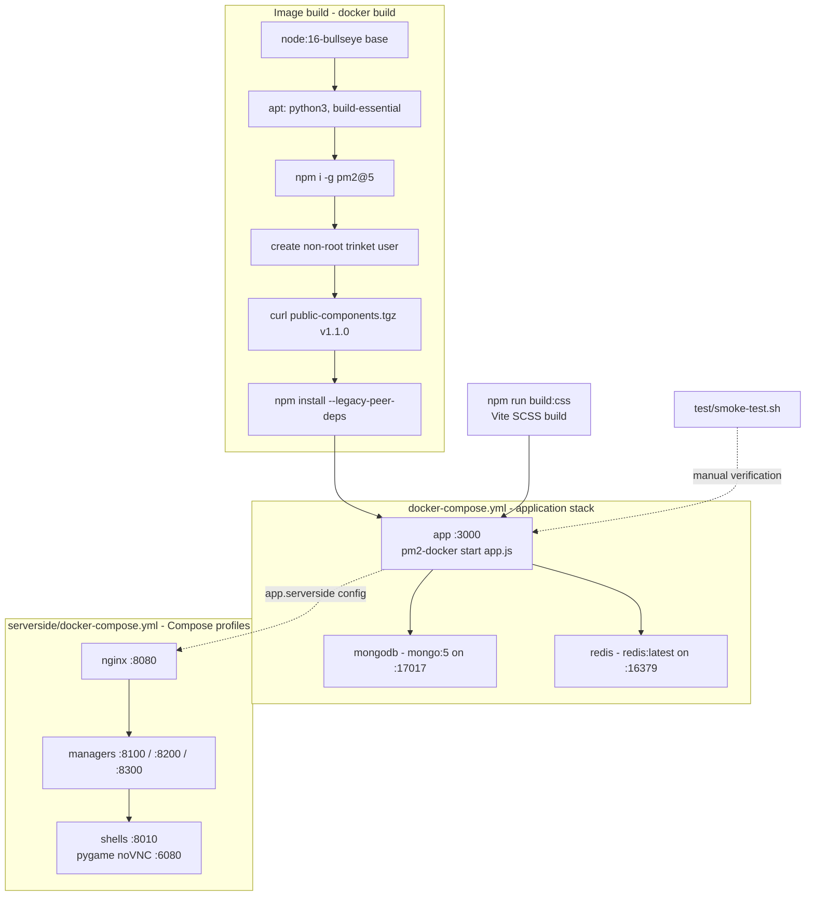

### 3.6.1 Development Tooling

The entire task surface is five npm scripts:

| Script | Command | Purpose |
|---|---|---|
| `test` | `mocha` | Runs the suite with options from `test/mocha.opts` |
| `build:css` | `vite build` | Compiles SCSS to `public/css/` |
| `watch:css` | `vite build --watch` | Continuous SCSS rebuild |
| `build` | `npm run build:css` | Alias — the *only* build is the CSS build |
| `make-admin` | `node scripts/make-admin.js` | Grants the `admin` role to an existing user |

There is no `start` script; the process is launched by the container (`CMD ["pm2-docker", "start", "app.js"]`). `COMPONENTS.md:5` references a sixth script, `npm run setup-vendor`, which does not exist.

**Configuration layering** is the primary development affordance. `config` (node-config) 0.4.37 merges `config/default.yaml` with an environment overlay selected by `NODE_ENV`:

| File | Status | Role |
|---|---|---|
| `config/default.yaml` | Committed | Base configuration, 14 KB |
| `config/local.example.yaml` | Committed | Template to copy — "IMPORTANT: Never commit local.yaml" |
| `config/local.yaml` | Gitignored | Developer overrides, including the session secret |
| `config/test.yaml` | Committed | `app.start: false`, `log.level: error`, `db.mongo` → `test` database |
| `config/production.yaml.dist` | Committed | 4-key skeleton: `app.analytics.secret`, `app.url.*`, `db.mongo.*` |
| `config/production.yaml` | Gitignored | Production overrides |

`config/test.yaml` setting `app.start: false` is what lets the test suite `require('../app.js')` without binding a port. `config/production.yaml.dist` is partly stale — `app.analytics.secret` has no consumer in `config/default.yaml`.

**Code quality tooling is absent.** There is no ESLint, Prettier, EditorConfig, husky, lint-staged, or coverage configuration (`nyc`/`istanbul`/`c8`) anywhere in the repository. `CONTRIBUTING.md:60-67` expresses style as prose instead — two-space indentation, single quotes, semicolons, lines under 120 characters, descriptive variable names — and `CONTRIBUTING.md:50-53` gives `npm test` as the sole verification step before opening a pull request. Style conformance is therefore a review activity, not a mechanical one.

### 3.6.2 Build System

**Vite 4.5.14 is a CSS compiler here, nothing more.** `vite.config.mjs` states it in a comment — "Build CSS assets only (Hapi serves the app)" — and the configuration confirms it:

| Setting | Value | Effect |
|---|---|---|
| `build.outDir` | `public` | Emits into Hapi's static root |
| `build.emptyOutDir` | `false` | Will not wipe the existing `public/` tree |
| `rollupOptions.input` | `static/scss/base.scss`, `static/scss/embed/embed.scss` | Two entry points |
| `assetFileNames` | `css/[name].css` for CSS, else `assets/[name].[ext]` | Produces `public/css/base.css` and `public/css/embed.css` |
| `cssCodeSplit` / `sourcemap` | `true` / `true` | Separate bundles plus `.map` files |

`sass` 1.98.0 performs the actual SCSS compilation through Vite's preprocessor hook; `css.preprocessorOptions.scss` is declared but empty.

**There is no JavaScript build.** Browser code in `public/js/` is served verbatim — no bundling, minification, tree-shaking, or transpilation — and the four SPA "bundles" are ordered script lists in `config/default.yaml` rather than build artefacts. This is the single most significant build-system characteristic of the system: it removes an entire class of tooling complexity and simultaneously removes any opportunity to downlevel syntax or apply integrity hashes.

**The third build input is an out-of-band artefact.** `Dockerfile:26-29` fetches and extracts the frontend components:

```dockerfile
RUN curl -L --silent -o ./public-components.tgz \
    https://github.com/.../releases/download/v1.1.0/public-components.tgz \
    && tar xzf public-components.tgz && rm public-components.tgz
```

The build therefore has three distinct outputs that are not in version control — `node_modules/`, `public/css/*.css`, and `public/components/` — all three listed in `.gitignore`. Two of them are produced inside the image build; the CSS build is **not** invoked by the `Dockerfile` at all, which is why `GETTING_STARTED.md` documents running `npm run build:css` inside the container as a separate step and lists "CSS not loading?" as the first troubleshooting entry.

### 3.6.3 Testing Toolchain

`npm test` invokes bare `mocha`, whose behaviour comes from the legacy `test/mocha.opts` mechanism:

```
--reporter spec
--recursive
--check-leaks
```

`--check-leaks` is significant given that `app.js` intentionally assigns models to implicit globals — it is the mechanism by which unintended global creation is caught, complementing the `gleak` detector.

| Layer | Files | Coverage |
|---|---|---|
| `test/lib/api/` | 10 | `admin`, `course`, `files`, `forgot_pass`, `index`, `login`, `logout`, `profile`, `registration`, `trinket` |
| `test/lib/models/` | 6 | `course`, `lesson`, `trinket`, `user`, `plugins/paginate`, `plugins/roles` |
| `test/lib/util/` | 1 | `user` |
| `test/helpers/` | 7 | Doubles for `catbox-redis`, `db`, `defaults`, `flow`, `mail`, `queue`, `store` |
| `test/data/` | 2 | `test.ipynb`, `transparent.gif` fixtures |

`test/setup.js` establishes the harness: it forces `NODE_ENV=test` and `NODE_CONFIG_PERSIST_ON_CHANGE=N`, registers `chai.should()` with `chai-as-promised` and `sinon-chai`, stubs `redis.createClient` with `redis-mock`, then boots the real application via `require('../app.js')`. These are therefore integration tests against a live Hapi server and a **live MongoDB** — `test/helpers/db.js` drops the database between runs. Seven purpose-built helpers substitute for the cache, queue and mail integrations, which is how the suite runs without Redis, S3 or SMTP.

`test/smoke-test.sh` is the post-deployment check: 11 curl-based assertions covering the homepage (status plus `<html` in the body), `/css/base.css`, `/js/embed/embed.js`, `/api`, `/login`, `/signup`, `/python`, `/html`, `/library`, and a 404 for an unknown path, exiting non-zero on any failure. Two defects limit its usefulness as-shipped: it defaults to `http://localhost:3001` while Compose publishes 3000, and it asserts `GET /api` returns 200 although no bare `/api` route is declared. Pass a base URL explicitly and expect the `/api` assertion to fail.

### 3.6.4 Containerisation

#### 3.6.4.1 Application Image

`Dockerfile` is a single-stage build on `node:16-bullseye` with several properties worth recording:

| Step | Detail |
|---|---|
| Base | `node:16-bullseye`, `SHELL ["/bin/bash", "-c"]` |
| Build deps | `python3` + `build-essential` — required to compile the native `bcrypt` addon |
| Process manager | `npm install -g pm2@5`; runtime entrypoint `pm2-docker start app.js` |
| Security | Creates system group/user `trinket`, `chown`s the app directory, and switches `USER trinket` **before** `COPY` — the application never runs as root |
| Components | Fetches `public-components.tgz` from release `v1.1.0` |
| Install | `npm install --legacy-peer-deps` |
| Build args | `COMMIT_ID` (declared, unused in the image) and `NODE_ENV` (exported as an env var) |
| Port | `EXPOSE 3000` |

Two gaps are visible against container best practice: the build is single-stage, so `build-essential` and the full npm cache remain in the shipped image; and `npm install` is used rather than `npm ci`, so the lockfile is not strictly enforced at build time despite being present. `.dockerignore` contains a single entry, `**/.git`, meaning `node_modules` from a host checkout would be copied into the build context if present.

#### 3.6.4.2 Application Stack Topology

`docker-compose.yml` defines three services on a bridge network named `trinket`:

| Service | Image | Host port | Storage |
|---|---|---|---|
| `app` | built locally, tagged `trinket/app:latest` | 3000 → 3000 | repo bind mount + `node_modules` and `public_components` overlay volumes |
| `mongodb` | `mongo:5` | 17017 → 27017 | `mongodb_data` → `/data/db` |
| `redis` | `redis:latest` | 16379 → 6379 | none (ephemeral) |

The topology is explicitly development-shaped. It uses the legacy `links` directive rather than relying on network DNS; it declares `container_name` for all three services, which prevents `docker compose up --scale`; it defines no `healthcheck`, no `restart` policy, and no resource limits; `redis:latest` is an unpinned tag; and the `shared-cache` volume is declared but mounted nowhere. `GETTING_STARTED.md:100-105` additionally lists an nginx HTTPS proxy on 443 as an optional service — it is not present in this file, so TLS termination is something a deployer must add.

#### 3.6.4.3 Runner Stack Topology

`serverside/docker-compose.yml` takes a different and more disciplined shape: nine services, of which only nginx publishes a host port (8080 → 80), organised by **Compose profiles** so that a deployer opts into exactly the languages they intend to enable:

```bash
docker compose --profile python3 up --build
```

| Profile | Services | Internal ports |
|---|---|---|
| `python3` | `python3-shell`, `python3-manager` | 8010, 8100 |
| `java` | `java-shell`, `java-manager` | 8010, 8200 |
| `r` | `r-shell`, `r-manager` | 8010, 8300 |
| `pygame` | `pygame-worker`, `pygame-manager` | 8010 + 6080 (noVNC), 8100 |

Every shell uses `expose` rather than `ports`, so no interpreter is reachable from the host. nginx mounts all four `*-generated` volumes **read-only**, and every manager carries `NODE_ENV=production`.

The critical operational caveat is that **the security limits are commented out in every shell and worker service**, under the header "Production security options (uncomment for hardened deployment)":

| Limit | Shells (python3/java/r) | pygame worker |
|---|---|---|
| `mem_limit` / `mem_reservation` | 500m / 375m | 1g / 750m |
| `cpus` / `cpu_shares` | 1.0 / 512 | 2.0 / — |
| `pids_limit` | 50 (fork-bomb protection) | — |
| `read_only` + `tmpfs` | `true` + `/tmp:size=100m` | — |

`serverside/README.md:179-181` explains why this matters — "The shell containers run untrusted user code" — and supplies both the Compose settings and an equivalent `docker run` form adding `--security-opt=no-new-privileges` and `--cap-drop=ALL`, plus a network-isolation pattern using an `internal: true` network. A production deployment that does not perform these edits runs untrusted learner code with unbounded memory, CPU and process budgets. Some hardening is nonetheless baked in: `serverside/python/shell/Dockerfile` purges `build-essential` after installation and restricts the mode of `fallocate`, `git*`, `pip*`, `gcc*` and `curl` to 744, under the comment "cleanup, try to safeguard against certain exploits".

#### 3.6.4.4 Runner Gateway

`serverside/nginx/nginx.conf` is the single ingress for the runner tier and the only place in the repository where a health endpoint exists (`location /health { return 200 'OK'; }`). Its configuration is shaped entirely around long-lived WebSocket sessions: a `map $http_upgrade $connection_upgrade` block, `proxy_http_version 1.1` with `Upgrade`/`Connection` headers on all five proxy locations, `proxy_read_timeout`/`proxy_send_timeout` of 86,400 seconds, and Docker's internal resolver (`127.0.0.11 valid=10s ipv6=off`) so upstreams resolve dynamically as profiles start and stop. Generated-file locations are served from the read-only volumes with `expires 1h` and `Cache-Control: public, immutable`. A companion `serverside/nginx/nginx-ssl.conf` provides the TLS variant; the 8443 port mapping is present but commented out.

### 3.6.5 CI/CD — Current State and Requirements

**There is no CI/CD in this repository.** The verification was exhaustive: no `.github/` directory exists at all (hence no GitHub Actions workflows, no `dependabot.yml`, no `CODEOWNERS`, no issue or PR templates), and no `Jenkinsfile`, `.gitlab-ci.yml`, `.circleci/`, or `azure-pipelines.yml` is present. There is likewise no infrastructure-as-code of any kind — no Terraform, CloudFormation, CDK, Kubernetes manifest, or Helm chart.

The complete quality gate is therefore:

| Gate | Mechanism | Automated? |
|---|---|---|
| Unit and API regression | `npm test` → mocha over 17 spec files | Only if a human runs it |
| Post-deployment verification | `test/smoke-test.sh` | No — manual |
| Code style | `CONTRIBUTING.md` prose | No |
| Dependency vulnerabilities | none | No |
| Container image scanning | none | No |

Everything the repository *does* provide, however, is pipeline-ready, and the requirements a pipeline would have to satisfy are fully determined by the artefacts examined above:

- **Build** requires network access to `registry.npmjs.org`, to `github.com` for both the `marked` git dependency and the `public-components.tgz` release asset, and a toolchain capable of compiling `bcrypt` (`python3`, `build-essential`) — already present in the base image.
- **Test** requires a live MongoDB service container reachable at `localhost:27017` with a disposable `test` database, and nothing else: Redis, mail and the cache are substituted by `test/helpers/`.
- **CSS** must be built explicitly (`npm run build:css`), because the `Dockerfile` does not do it.
- **Deploy verification** should invoke `test/smoke-test.sh` with an explicit base URL rather than its 3001 default.
- **Reproducibility** would improve materially from three one-line changes: `npm ci` instead of `npm install`, a pinned `redis` image tag, and a checksum on the component tarball fetch.

### 3.6.6 Documentation and Catalog Tooling

Documentation is built with **MkDocs** through Backstage TechDocs. `mkdocs.yml` sets `docs_dir: docs`, enables the single `techdocs-core` plugin, and defines a three-page navigation (`index.md`, `setup.md`, `overview.md`) — which is the entirety of `docs/`. The substantive documentation lives at the repository root instead: `README.md`, `GETTING_STARTED.md` (340 lines, the operator's manual), `COMPONENTS.md`, `CONTRIBUTING.md`, `CODE_OF_CONDUCT.md`, `CHANGELOG.md`, and `serverside/README.md`.

`catalog-info.yaml` registers the repository in Backstage as a `Component` of `spec.type: service` with `lifecycle: production`, owner `blitzy-sandbox`, system `blitzy-sandbox-projects`, tags `audit`, `documentation`, `javascript`, `security`, `web-app`, and `backstage.io/techdocs-ref: dir:.` pointing TechDocs at the repository root. Both files therefore describe a *service catalog and documentation* integration, not a delivery pipeline.

### 3.6.7 Operational Tooling

Day-two operations are covered by exactly one script. `scripts/make-admin.js` grants the `admin` role to an existing account, documented in its own header as "This script grants the 'admin' role to an existing user. The user must already have an account." It requires `config/db` (which connects as a side effect), resolves the account with `User.findByLogin(email.toLowerCase(), …)` so either an email or a username works, and exits non-zero on a missing argument or a database error. `GETTING_STARTED.md:73` gives the container form:

```bash
docker-compose exec app npm run make-admin user@example.com
```

This is the only path to administrative access — `/admin` is unreachable until an operator runs it — and there is no corresponding tooling for backup, restore, data migration, log rotation, or key rotation. The `Production Checklist` in `GETTING_STARTED.md:333-339` is correspondingly short and entirely manual: set a strong 32+ character session password, configure email for password reset, set up HTTPS (required before secure cookies can be enabled), align `app.url` with the deployed domain, and review the feature flags.


## 3.7 References

Every file, folder and external source cited as evidence for Section 3.

### 3.7.1 Dependency Manifests and Lockfiles

- `package.json` - Established the package identity (`trinket`, version 0.0.0, `license: "MIT"`, `main: "app/app.js"`), the absence of an `engines` field and of a `type` field (CommonJS), the 58 runtime and 11 development dependency ranges, and the five npm scripts
- `package-lock.json` - Established `lockfileVersion: 3`, 678 resolved packages, 676 from `registry.npmjs.org` plus one from `git+ssh://git@github.com`, and every resolved version quoted in §3.2 and §3.3
- `.bowerrc` - Established the orphaned Bower configuration pointing `directory` at `public/components` with seven `ignoredDependencies`
- `serverside/python/manager/package.json`, `serverside/java/manager/package.json`, `serverside/r/manager/package.json`, `serverside/pygame/manager/package.json` - Established the manager dependency sets (`config` 3.3.x, `file-type`, `socket.io`, `socket.io-client`, `is-svg`) and `"type": "module"`
- `serverside/python/shell/trinket/package.json`, `serverside/java/shell/trinket/package.json`, `serverside/r/shell/trinket/package.json`, `serverside/pygame/worker/trinket/package.json` - Established the shell/worker dependency sets (`chokidar`, `socket.io`, `underscore`, `config`)
- `serverside/python/shell/requirements.txt` - Established the 33 exact-pinned PyPI packages
- `serverside/pygame/worker/requirements.txt` - Established the same set plus `pygame==2.5.2` and the commented-out `pgzero`
- `serverside/r/shell/packages.txt` - Established the 16 unversioned CRAN packages
- `serverside/r/shell/install.r` - Established CRAN installation from `http://cran.rstudio.com` into `/usr/local/lib/R/site-library` with no version pinning

### 3.7.2 Application Source and Configuration

- `app.js` - Established the Hapi/Inert/Vision/Yar bootstrap, the Mongoose 6 Promise polyfills, the `gleak` Node 16 try/catch fallback, the 32-character session-secret startup gate, and the `log` implicit global
- `config/app.config.js` - Established the routes-before-database load order ("mongoose-schema-extend conflicts with Joi 17") and the `routeParser.parse()` route assembly
- `config/default.yaml` - Established the feature flags, `app.assets` CDN pins, the 30 `app.components` vendor versions, the four `app.ngapps` bundles, `app.mail`, `app.recaptcha`, `app.log`, `app.serverside` endpoints, `workers.trinkets`, the `db.mongo`/`db.mongoread`/`db.redis` blocks, the seven `aws.buckets`, and the `sandbox` settings
- `config/local.example.yaml` - Established the required-versus-optional integration contract and each unconfigured-degradation note
- `config/test.yaml` - Established `app.start: false`, `log.level: error` and the `test` database
- `config/production.yaml.dist` - Established the production overlay skeleton and the unconsumed `app.analytics.secret`
- `config/constants.js` - Established the 11-entry `trinketLangs` list
- `config/db.js` - Established the hand-assembled MongoDB connection string, the `mongoread` second host with 300-second timeouts, connect-on-require, and the `mongoose-schema-extend` deprecation comment
- `config/redis.js` - Established the node-redis v4 client construction, the `enabled !== false` gate, and the sync/async accessor pair
- `config/aws.js` - Established the single shared `aws-sdk` v2 client with static credentials and `us-east-1` default
- `config/log.js` - Established the Winston 3 console transport and conditional file transport
- `lib/auth/passport.js` - Established direct use of `passport-local`.Strategy and `passport-google-oauth`.OAuth2Strategy and the `disabled`-role rejection
- `lib/util/queues.js` - Established the Bull-or-`InMemoryQueue` selection and the documented job-drop behaviour
- `lib/util/store.js` - Established the `InMemoryClient` Redis-v4-shaped fallback with `setTimeout` expiry
- `lib/util/catbox-mongoose.js` - Established the custom Catbox engine, the `sessions` collection schema, and the MongoDB TTL index
- `lib/util/mailer.js` - Established nodemailer-only SMTP, per-send transport creation, and the resolve-on-unconfigured behaviour
- `lib/util/recaptcha.js` - Established the `siteverify` POST and the fail-open behaviour
- `lib/util/file.js` - Established `new aws.S3()` construction, `putObject` with content-hash keys, and the `extensionWhitelist` override
- `lib/util/nunjucks.js` - Established the Vision view-engine registration and the `numeral` filter
- `lib/shared/trinket-markdown.js` - Established the `marked` + `highlight.js` pairing shared by server and browser
- `lib/workers/exports.js` - Established `q`-based promises, two `new aws.S3()` sites, and the reference to the undeclared `aws.buckets.exports.host`
- `lib/controllers/files.js` - Established the Lambda shared-secret thumbnail callback comparison
- `lib/controllers/users.js` - Established presigned `getObject` URL generation for export download
- `lib/util/` - Contained the 20 utility modules including `cachify.js`, `features.js`, `helpers.js`, `routeParser.js`, `component.js` and `translate.js`
- `lib/util/store/` - Contained the five domain cache modules (`courseStore`, `emailStore`, `featuredStore`, `trinketStore`, `userStore`)
- `lib/models/` - Contained the 18 model modules enumerated in §3.5.1
- `lib/models/plugins/` - Contained the seven reusable schema plugins
- `lib/grammars/musicNotation.jison` - Established the only domain-specific language in the tree
- `public/js/skulpt/` - Contained the browser-side Python modules (`trinket/ast/__init__.py`, `trinket/tester/__init__.py`, `turtletalk.py`)
- `serverside/python/shell/trinket/python3/` - Contained the CPython support modules (`init.py`, `pygame.py`, `trinket_backend.py`)
- `scripts/make-admin.js` - Established the only operational CLI and its prerequisite that the user already exists

### 3.7.3 Build, Container and Deployment Files

- `Dockerfile` - Established `node:16-bullseye`, the `python3`/`build-essential` install for `bcrypt`, `pm2@5`, the non-root `trinket` user, the `public-components.tgz` v1.1.0 fetch, `npm install --legacy-peer-deps`, `EXPOSE 3000` and the `pm2-docker` entrypoint
- `.dockerignore` - Established the single `**/.git` exclusion
- `docker-compose.yml` - Established the three-service application stack, the `mongo:5` and `redis:latest` images, the port mappings, the four named volumes, the legacy `links`, and the absence of healthchecks and resource limits
- `serverside/docker-compose.yml` - Established the nine runner services, the four Compose profiles, the internal-only `expose` ports, the eight named volumes, and the commented-out security limits
- `vite.config.mjs` - Established Vite as an SCSS-only compiler with two entry points and `emptyOutDir: false`
- `.gitignore` - Established that `node_modules`, `public/components`, `public/vendor`, the generated `public/css/*.css` files, and the `config/{local,development,production}.*` overlays are excluded, and that `config/migration.json` and `lib/migrations/backups` are reserved
- `serverside/python/manager/Dockerfile`, `serverside/java/manager/Dockerfile`, `serverside/r/manager/Dockerfile`, `serverside/pygame/manager/Dockerfile` - Established the `node:18-alpine` / `node:18-slim` bases and manager ports
- `serverside/python/shell/Dockerfile` - Established `python:3.10-bullseye`, Node 14.21.1 via nvm, the matplotlib backend environment, and the post-install hardening steps
- `serverside/java/shell/Dockerfile` - Established `amazoncorretto:8` with Node 14.21.1 via nvm
- `serverside/r/shell/Dockerfile` - Established `r-base:4.4.2` with Node 18.20.5 via nvm and the R graphics environment
- `serverside/pygame/worker/Dockerfile` - Established `ubuntu:22.04`, the X11/VNC/noVNC/PulseAudio/supervisor stack, and Node 18 from NodeSource
- `serverside/nginx/Dockerfile` - Established the `nginx:alpine` base and the generated-file directories
- `serverside/nginx/nginx.conf` - Established the WebSocket upgrade map, Docker resolver, `/health` endpoint, five proxy locations with 86,400-second timeouts, and the immutable generated-file aliases
- `serverside/nginx/nginx-ssl.conf` - Established that a TLS variant of the gateway configuration is provided

### 3.7.4 Test Infrastructure

- `test/mocha.opts` - Established `--reporter spec --recursive --check-leaks`
- `test/setup.js` - Established the chai/chai-as-promised/sinon-chai harness, the `redis-mock` stub using Sinon's three-argument form, and the live-application boot
- `test/helpers/db.js` - Established the polling connection wait and the `dropDatabase()` reset
- `test/helpers/` - Contained the seven integration doubles (`catbox-redis`, `db`, `defaults`, `flow`, `mail`, `queue`, `store`)
- `test/lib/api/`, `test/lib/models/`, `test/lib/util/` - Contained the 17 spec files enumerated in §3.6.3
- `test/data/` - Contained the `test.ipynb` and `transparent.gif` fixtures
- `test/smoke-test.sh` - Established the 11 post-deployment assertions, the 3001 default base URL, and the `/api` assertion defect

### 3.7.5 Documentation and Catalog

- `README.md` - Established the "Node.js 18+", "MongoDB 5.0+" and "Redis (optional)" prerequisites and the backend/frontend architecture summary
- `GETTING_STARTED.md` - Established the Docker-only prerequisites, the quick-start and CSS-build workflows, the services table, the configuration overlay table, the SMTP/S3/OAuth/reCAPTCHA/Redis integration guides, the `aws.endpoint` S3-compatible note, and the five-item production checklist
- `COMPONENTS.md` - Established the code-execution engine inventory (Skulpt 0.11.1.34, Blockly v20211018, GlowScript 2.7.5, jq-console v2.13.2.1, Foundation 5.5.3.1, closure-library v20180204, MIDI.js, systemjs 0.21.3, webrtc-adapter 6.2.1, viewerjs v0.2.1), the six `.sk` Skulpt modules, the non-existent `setup-vendor` script, and the Bower deprecation note
- `CONTRIBUTING.md` - Established that code style is prose-only and `npm test` is the sole pre-PR gate
- `serverside/README.md` - Established the manager `node-config` file layering, the `GENERATED_URL`/`CORS_ORIGINS` environment variables, the manual shell-scaling model, the security-hardening guidance, the 60-second Python shell timeout, and the "Production Scaling (Not Yet Included)" gap
- `LICENSE` - Established the CC0 1.0 Universal dedication that conflicts with `package.json`'s MIT declaration
- `mkdocs.yml` - Established MkDocs with the `techdocs-core` plugin and the three-page navigation
- `catalog-info.yaml` - Established the Backstage `Component` registration (`spec.type: service`, `lifecycle: production`, TechDocs reference)
- `docs/` - Contained `index.md`, `overview.md` and `setup.md`, the source of the "Node.js 18+" claim in `docs/setup.md`

### 3.7.6 Cross-Referenced Specification Sections

- `1.1 Executive Summary` - Confirmed the project identity, the Hapi/MongoDB/AngularJS stack summary and the license discrepancy
- `1.2 System Overview` - Confirmed the component inventory, the integration surface, the session and sandbox design, and the compatibility-debt narrative
- `2.4 Implementation Considerations` - Confirmed the cross-cutting constraints (single Node process, Node version disagreement, absent quality gates, Compose-only topology, missing migration path, smoke-test drift) and the per-feature technical constraints referenced in §3.5.7

### 3.7.7 External Sources

- [web] nodejs.org — "Bringing forward the End-of-Life Date for Node.js 16" - Confirmed that Node 16's EOL was moved to September 11, 2023 to coincide with the end of support for OpenSSL 1.1.1
- [web] nodejs.org — End-Of-Life page - Confirmed that EOL versions receive no further updates, including security patches
- [web] endoflife.ai — Node.js end-of-life article - Confirmed the EOL dates for Node.js 14 (April 30, 2023), 16 (September 11, 2023), 18 (April 30, 2025) and 20 (April 30, 2026)
- [web] herodevs.com — Node.js version support and EOL dates - Confirmed that Node.js 24 is Active LTS (EOL April 30, 2028) and Node.js 22 is Maintenance LTS (EOL April 30, 2027)
- [web] herodevs.com — "Post-Mortem on AngularJS: Three Years After End of Life" - Confirmed that AngularJS reached end of life on December 31, 2021 and that active development and security support ceased
- [web] frontendminds.com — Angular end-of-life overview - Confirmed the unpatched XSS exposure in the AngularJS template compiler and the absence of Trusted Types support
- [web] openlogic.com — AngularJS long-term support - Confirmed that commercial extended support covers AngularJS 1.5.x, 1.6.x and 1.8.x
- [web] versionlog.com — Node.js 16 release history - Confirmed that `npm install --legacy-peer-deps` exists to work around the npm 7+ peer-dependency resolution algorithm
- [web] aws.amazon.com developer blog - Confirmed that the AWS SDK for JavaScript v3 ended Node.js 16.x support on January 6, 2025 (this repository uses the v2 line)


# 4. Process Flowchart

## 4.1 System Workflows

Every workflow in this section was reconstructed from the code that executes it. Process steps cite the file and, where the step is a specific decision or constant, the line that establishes it. The repository declares no latency or throughput targets anywhere; the timing values shown are configured constants (debounce intervals, TTLs, timeouts, cleanup periods) and nothing more. Where a workflow has no server-side component — client-side code execution is the significant case — that is stated rather than invented.

Two structural facts shape all of the diagrams below:

- **One process, one pipeline.** Every HTTP request passes through the same ordered stages established in `app.js` and `lib/util/routeParser.js`. Feature-specific logic occupies a single stage of that pipeline (the controller call), so the workflows differ from one another mainly in their pre-handler chains, their validation schemas and their persistence effects.
- **No distributed transaction exists.** A repository-wide search for `startSession`, `withTransaction` and `.transaction(` across `app.js`, `lib/`, `config/` and `scripts/` returns no matches. The atomic unit throughout is a single MongoDB document operation, which is why several workflows below show ordered, individually-committed steps rather than an all-or-nothing boundary.

### 4.1.1 High-Level System Workflow

#### 4.1.1.1 System Context and Actor Boundaries

The system has four execution boundaries: the browser (editor, embeds, four AngularJS bundles), the Hapi application process, the optional containerised language-runner tier behind its own nginx, and external services. Only MongoDB is mandatory; each remaining dependency has an observable degraded mode documented in §4.3.2.

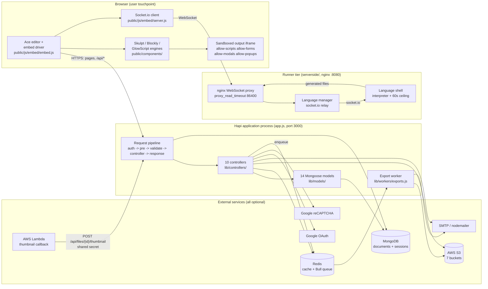

#### 4.1.1.2 Process Startup Sequence

Startup is a single asynchronous initialiser in `app.js` that either produces a listening server or terminates the process. There is exactly one hard precondition.

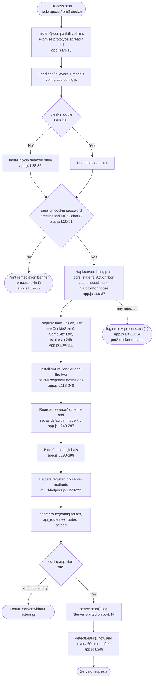

The startup gate implements **F-019-RQ-003**: the process refuses to run with a weak session secret instead of warning, because sessions are the only identity mechanism. `config/test.yaml` sets `app.start: false`, which is how the mocha suite loads `app.js` and injects requests without binding a port.

#### 4.1.1.3 Universal Request Lifecycle

This is the workflow every other workflow sits inside. Stages 1–4 and 10–12 are framework-level; stages 5–9 belong to `lib/util/routeParser.js`.

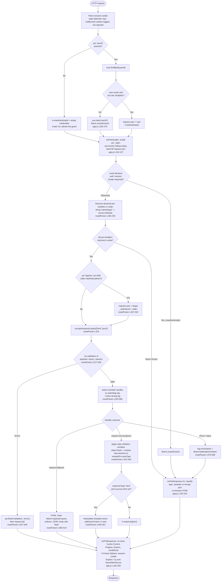

Two details in this pipeline are load-bearing for the rest of the section. First, the content-negotiation decision at stage 6 is what makes every subsequent workflow dual-mode: the same controller serves a Nunjucks page to a browser and a JSON envelope to the AngularJS bundles, and the same failure produces a flash-and-redirect for one and a JSON body for the other. Second, `mode: 'try'` means an unauthenticated request reaches the controller; authorisation is therefore the responsibility of declared pre-handlers and imperative permission checks, never of the absence of a session (**F-010-RQ-001**).

### 4.1.2 Core Business Processes

#### 4.1.2.1 Account Registration, Login and Recovery

Registration, login and password recovery are the three journeys that establish identity. All three are browser-form journeys that redirect on both success and failure, with JSON equivalents under `/api/`.

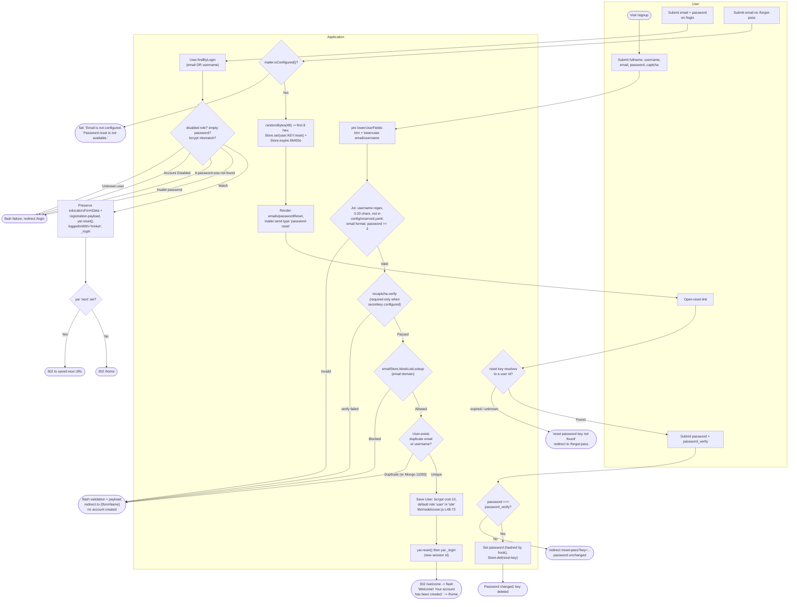

Decision points worth naming: the captcha branch is *conditional on deployment configuration* — `config/routes.js` lines 10-13 make `g-recaptcha-response` required only when `app.recaptcha.secretkey` is set, and `lib/util/recaptcha.js` short-circuits to `{success: true}` when unset or in test mode (**F-009-RQ-014**). The `yar.reset()` before `_logIn` on both the registration and login success paths is an explicit session-fixation defence ("Generate a new session id for security", `lib/controllers/users.js` L53-54 of the login handler). The four login failure branches each emit a distinct message (`lib/controllers/users.js` login L20-46), which the browser surfaces as a flash and the API returns as JSON (**F-009-RQ-005**).

The Google path is a separate journey with the same endpoint: `lib/controllers/auth.js` `google` refuses with "Google OAuth is not configured. Please set up Google OAuth credentials." when `clientID` is empty (**F-009-RQ-012**), otherwise returns a `redirectTo` for `accounts.google.com` with `response_type=code` and scope `profile email`; `googleCallback` exchanges the code, reads `userinfo`, then find-or-creates on email, generated username or `profiles.google.id`, sets `loggedInWith='google'` and redirects to `next` or `/home`.

#### 4.1.2.2 Author, Run and Persist Code (Client-Side Languages)

This is the highest-volume journey in the system and most of it never reaches the server. Skulpt compiles and runs Python in the browser; the application's role is to serve the page, accept debounced writes and count a run.

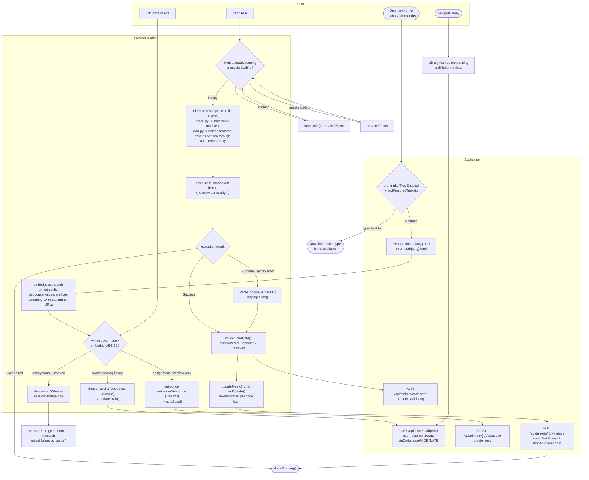

The two persistence endpoints differ in authority and semantics, which is why the mode decision matters: `autosave` compares `request.user.id` with `trinket._creator` and returns `Boom.forbidden()` otherwise (**F-005-RQ-001**), and it forces `submissionState = "modified"` (**F-005-RQ-002**, `lib/controllers/trinket.js` L1069). `draft` upserts one document per `{user, trinket}` pair and deliberately swallows failures into `request.success()` (**F-005-RQ-006**) so a transient write error never interrupts typing. Draft payloads are compressed in the browser — `JSZip` with DEFLATE level 9 into a `zipCode` field, with a fallback to raw `code` if compression rejects (`public/js/embed/embed.js` L960-991).

#### 4.1.2.3 Server-Side Language Execution

For `python3`, `java`, `R` and `pygame` the browser opens a WebSocket to the runner tier rather than executing locally. The application's only involvement is injecting the endpoint at render time.

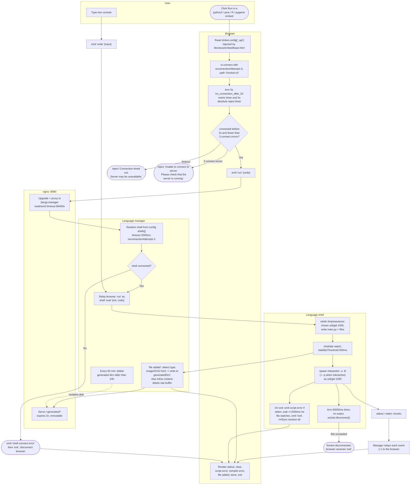

Three properties of this workflow are worth stating because they are unusual. The execution ceiling is enforced by *disconnecting the socket* rather than killing the process directly (`serverside/python/shell/trinket/server.js` L226-230); a SIGKILL fallback exists for children blocked on stdin (**F-002-RQ-003**). Shell selection is uniformly random across `config.shells` with no health awareness and no retry (`manager.js` L139-148), so a dead shell in a multi-shell deployment yields a failed run rather than a failover (**F-002-RQ-007**). And the manager always deletes `data.buffer` before relaying a generated file, so raw bytes are never forwarded to the browser — only a URL, an inline string, or a `binary` flag (**F-002-RQ-004**).

#### 4.1.2.4 Fork, Share and Publish

Sharing is the mechanism by which anonymous work becomes durable and discoverable. The token design lets an unauthenticated user email a trinket without ever holding a session credential for it.

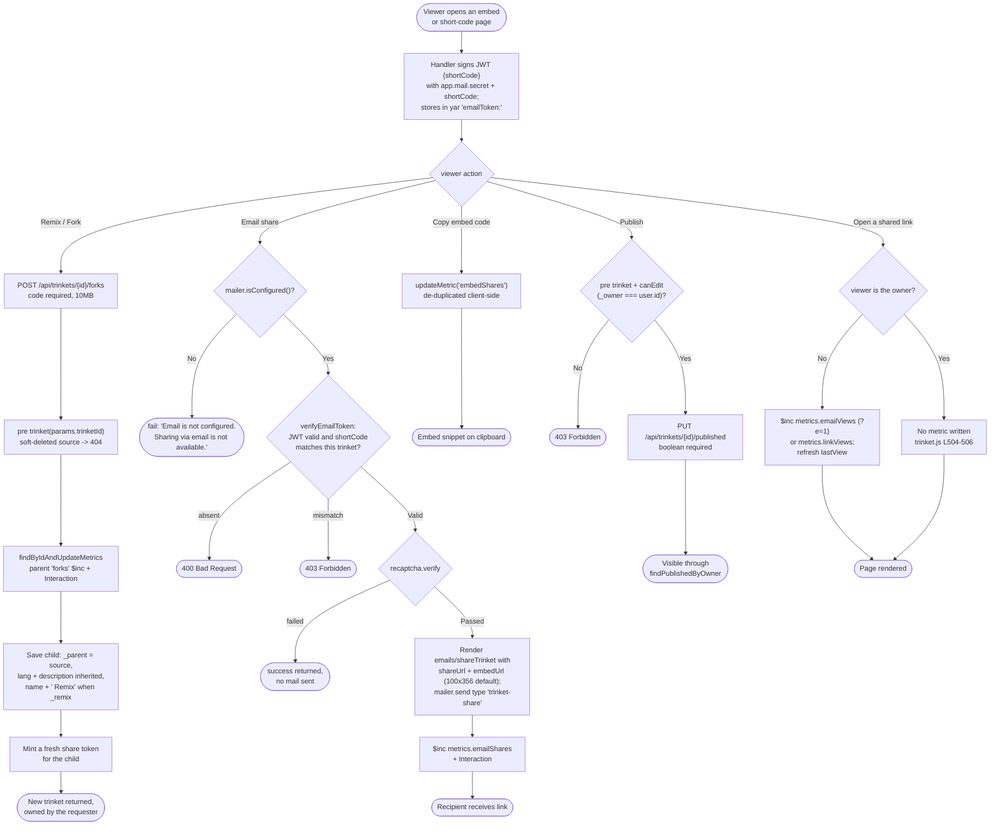

The share secret is derived per trinket (`app.mail.secret + shortCode`), so a captured token cannot be replayed against a different trinket (**F-007-RQ-002**). Counter writes are deliberately narrow: `PUT /api/trinkets/{id}/metrics` accepts only the three booleans `runs`, `linkShares`, `embedShares` and replies with the `metrics` sub-document alone (**F-007-RQ-004**), while view counters are written server-side from the request context so a client cannot forge provenance.

#### 4.1.2.5 Course Authoring, Enrolment and Distribution

The course subsystem is gated as a whole by `helpers.coursesEnabled` (**F-011-RQ-007**) and per-operation by course-scoped permissions.

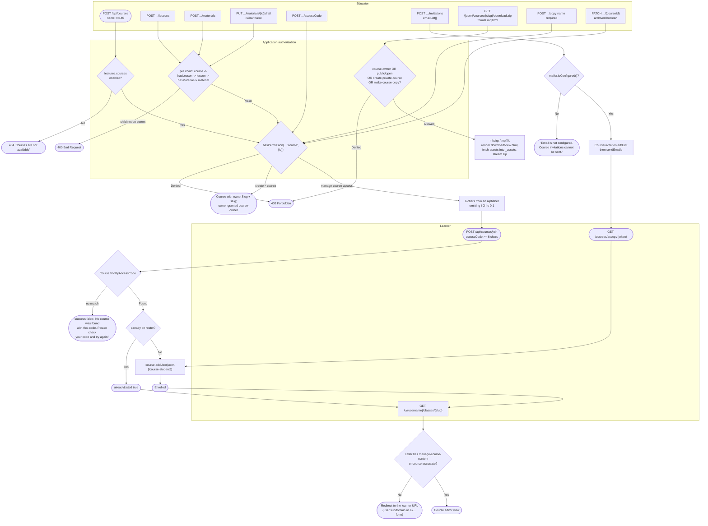

#### 4.1.2.6 Assignment Lifecycle: Start, Submit, Feedback

This is the only workflow in the repository with a genuine multi-state lifecycle, and it is the one where scheduling rules are enforced. A submission is itself a `Snippet` document linked to its parent trinket, the material and the course (**F-013-RQ-003**).

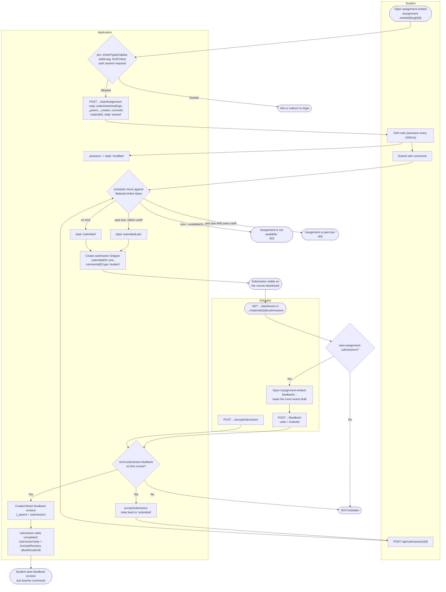

Scheduling is evaluated exclusively against stored `dateValue`s on the server, never against a client-supplied time (**F-013-RQ-002**). One known gap is visible in the code: `lib/controllers/course.js` L908 carries the comment "TODO: double check that user doesn't already have a 'started' one", so `startAssignment` has no idempotency guard and a repeated call creates a second working copy.

#### 4.1.2.7 Bulk Account Data Export

This is the only asynchronous user-facing journey. It is the clearest example of the acknowledge-then-process pattern in the system.

```mermaid
flowchart TD
    Request(["POST /api/exports<br/>session required"]) --> InFlight{"Export.findPendingOrProcessing<br/>for this user?"}
    InFlight -->|Found| Busy(["fail: 'Export already in progress'<br/>+ exportId"])
    InFlight -->|None| Cooldown{"Export.findRecentCompleted<br/>within 1 hour?"}
    Cooldown -->|Found| Wait(["fail: 'Please wait 1 hour<br/>between exports' + lastExport"])
    Cooldown -->|None| Create["Create Export {status:'pending'}"]
    Create --> Enqueue["exportsQueue.add<br/>{action:'bulk-export', exportId, userId}"]
    Enqueue --> Ack(["200: exportId, status pending,<br/>'Export started. You will<br/>receive an email when ready.'"])

    Enqueue --> Which{"Redis enabled?"}
    Which -->|Yes| Bull["Bull queue over Redis"]
    Which -->|No| InMem["InMemoryQueue: setImmediate<br/>in the web process"]
    Bull --> Worker
    InMem --> Worker

    Worker["Worker claims the job<br/>lib/workers/exports.js"] --> Action{"action ===<br/>'bulk-export'?"}
    Action -->|No| Unknown(["reject 'Unknown action: X'"])
    Action -->|Yes| Processing["status -> 'processing'"]
    Processing --> LoadUser{"User.findById<br/>found?"}
    LoadUser -->|No| FailUser["throw 'User not found'"]
    LoadUser -->|Yes| Count["count Snippet by _owner -><br/>progress.total + trinketCount"]
    Count --> Stream["Stream trinkets with pause/resume;<br/>archiver zip level 6"]
    Stream --> PerItem["Per trinket: metadata.json,<br/>code files by langExtensions,<br/>assets/ from the userassets bucket"]
    PerItem --> AssetFail{"asset download<br/>failed?"}
    AssetFail -->|Yes| LogOnly["Log and continue<br/>(one asset never fails a trinket)"]
    AssetFail -->|No| Progress["Every 10 trinkets:<br/>write progress.processed/.failed"]
    LogOnly --> Progress
    Progress --> More{"more trinkets?"}
    More -->|Yes| Stream
    More -->|No| Manifest["Append manifest.json<br/>{exportedAt, trinkets[], totals}<br/>then finalize"]
    Manifest --> Upload["putObject to exports bucket<br/>key exports/{userId}/trinket-export-{12 hex}.zip"]
    Upload --> Finish["status 'completed', downloadUrl,<br/>s3Key, expiresAt = +3 days, fileSize"]
    Finish --> MailOk["Send emails/export-ready<br/>with size + expiry date"]
    MailOk --> Unlink["fs.unlink the /tmp archive"]
    Unlink --> Ready(["User notified"])

    FailUser --> FailPath["Unlink temp file; status 'failed'<br/>+ errorMessage"]
    Upload -.->|"S3 error"| FailPath
    Manifest -.->|"stream / archive error"| FailPath
    FailPath --> MailFail["Send emails/export-failed"]
    MailFail --> Rethrow["Re-reject so the queue<br/>'failed' handler also records it"]
    Rethrow --> FailedEnd(["Terminal failure -<br/>no automatic retry"])

    Ready --> Download(["GET /api/exports/{id}/download"])
    Download --> Ladder{"record exists? owner matches?<br/>status completed? not expired?"}
    Ladder -->|"missing"| E404(["404"])
    Ladder -->|"not owner"| E403(["403 'Access denied'"])
    Ladder -->|"not completed"| E400a(["400 'Export not ready'"])
    Ladder -->|"past expiresAt"| E400b(["400 'Export has expired'"])
    Ladder -->|"all pass"| Presign["Mint presigned GET, Expires 3600s"] --> Redirect302(["302 to S3"])
```

Note the configuration gap this workflow depends on: `lib/workers/exports.js` L367 and L378 reference `config.aws.buckets.exports`, which `config/default.yaml` does not define. An operator must add that bucket entry for the feature to complete (**F-016**, compliance note in §2.2.5.2).

#### 4.1.2.8 Site Administration and Impersonation

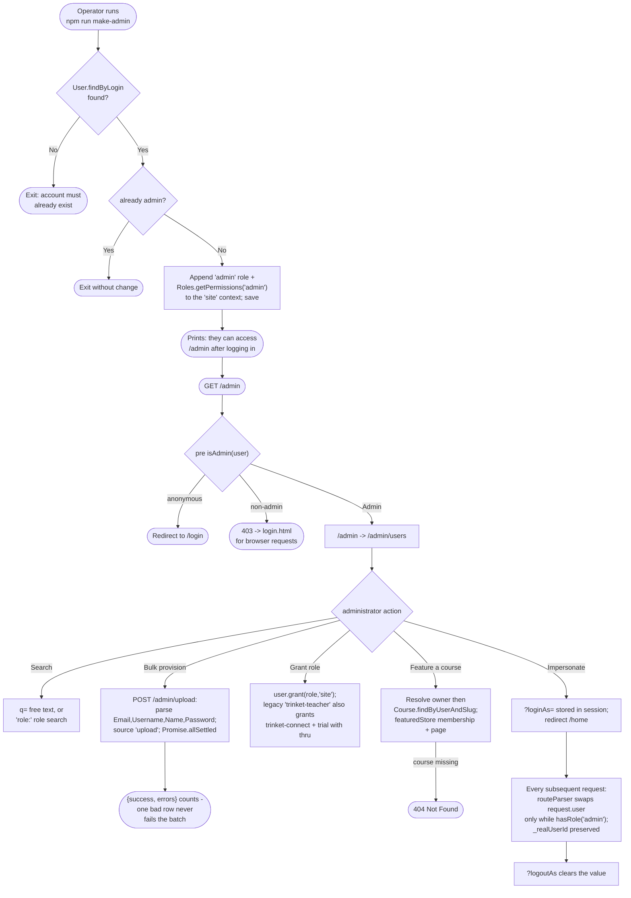

`scripts/make-admin.js` is the only privilege-escalation path in the repository; there is no self-service route to the `admin` role (**F-017-RQ-006**).

### 4.1.3 Integration Workflows

#### 4.1.3.1 Data Flow Between Systems

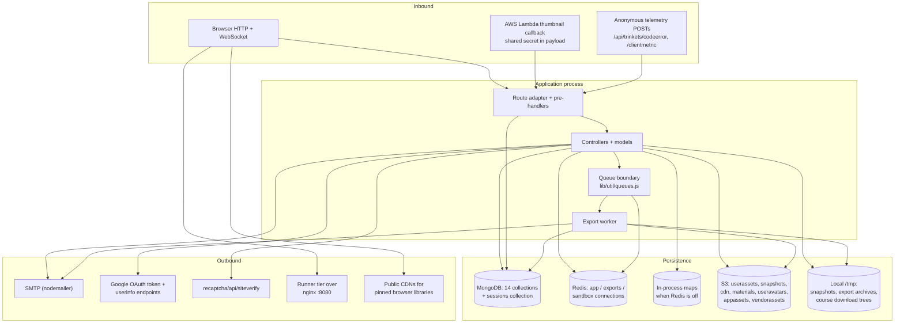

The dashed distinction that matters operationally: `RedisKV` and `MemKV` are alternatives, not layers. `lib/util/store.js` L140-142 returns an in-process object when `db.redis.enabled === false`, and `lib/util/queues.js` L124-128 substitutes an in-process queue, so a deployment without Redis loses durability and cross-instance sharing but keeps every code path (**F-021-RQ-003**).

#### 4.1.3.2 API Interaction Sequences

**Embed render and first run (client-side language).**

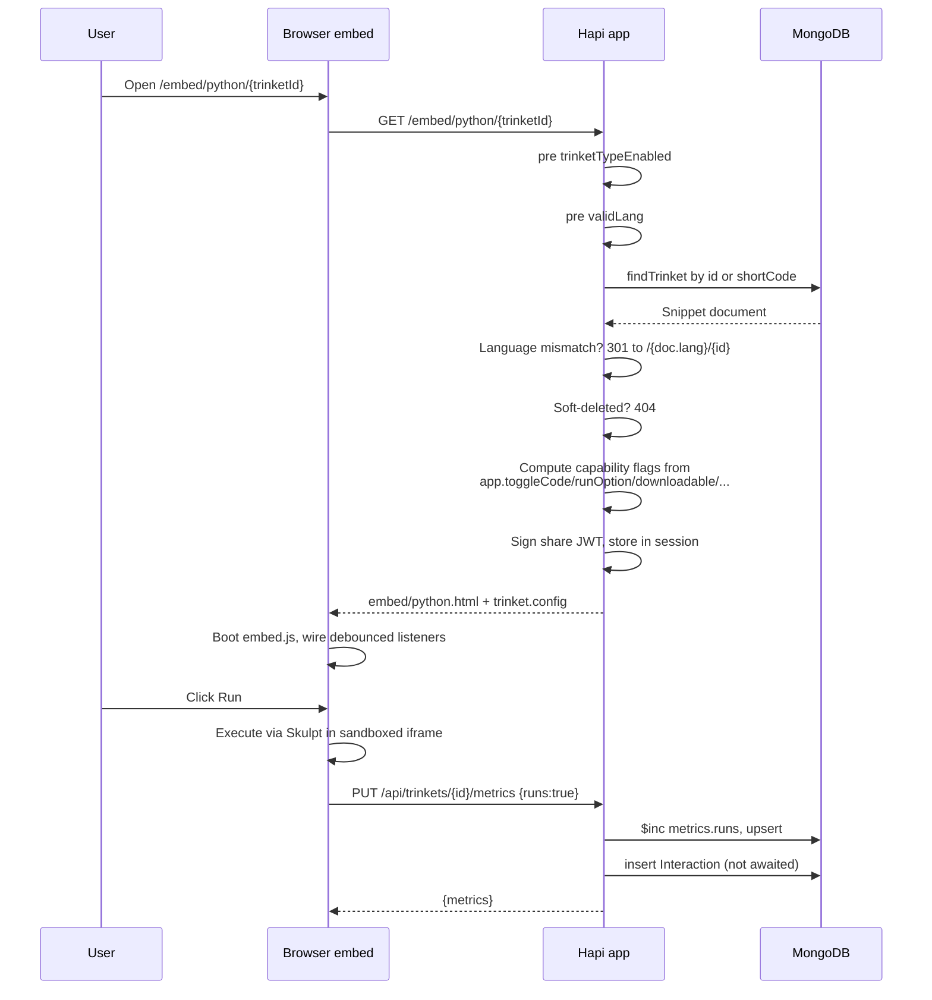

**Asset upload with external thumbnail callback.**

```mermaid
sequenceDiagram
    participant U as User
    participant A as Hapi app
    participant S as S3
    participant L as AWS Lambda
    participant M as MongoDB
    U->>A: POST /file (multipart, <=10MB, output 'file')
    A->>A: features.assets false -> 501 'File uploads are not enabled'
    A->>A: Resolve contentType via extensionWhitelist
    A->>A: hashcontents -> sha1 digest becomes the key
    A->>S: putObject {Bucket, Key: digest[-fileId][.ext]}
    S-->>A: ok
    A->>A: fs.unlink the temp upload
    A->>M: save File {hash, url, type, mime, size}
    A-->>U: /api/files/{id}/{slug}.{ext}
    S->>L: bucket event (deployment-provided)
    L->>A: POST /api/files/{fileId}/thumbnail {secret}
    A->>A: secret !== aws.lambda.createThumbnail.secret -> reject
    A->>M: set thumb from pattern thumb-%{s} + host
    A-->>L: success
```

**Google OAuth authorisation code exchange.**

```mermaid
sequenceDiagram
    participant U as User
    participant A as Hapi app
    participant G as Google
    participant M as MongoDB
    U->>A: GET /auth/google
    A->>A: clientID empty -> 'Google OAuth is not configured...'
    A->>A: Stash query.next in the session
    A-->>U: redirectTo accounts.google.com<br/>(response_type=code, scope profile email)
    U->>G: Authorise
    G-->>U: Redirect to /auth/google/callback?code=...
    U->>A: GET /auth/google/callback
    A->>G: POST oauth2.googleapis.com/token
    G-->>A: access_token
    A->>G: GET oauth2/v2/userinfo
    G-->>A: profile {id, email, name}
    A->>M: findByMultiple(email, generated username, profiles.google.id)
    alt Account found
        A->>M: Back-fill avatar + profiles.google
    else No account
        A->>M: Create user source 'google'
    end
    A->>A: yar.reset(), loggedInWith 'google', set userId
    A-->>U: 302 to session 'next' or /home
```

#### 4.1.3.3 Event Processing Flows

The system has no message bus. "Events" are three fire-and-forget write paths whose defining property is that a failure is invisible to the caller, and one relay of socket events in the runner tier.

```mermaid
flowchart TD
    subgraph ClientEvents["Browser-generated events"]
        RunEv["Run completed"]
        ErrEv["Skulpt error: encountered /<br/>repeated / resolved"]
        PerfEv["Connection + console timing:<br/>connection, connect_error,<br/>connect_timeout, connect_failed,<br/>no_connection_after_5s"]
        ShareEv["Share / embed focus"]
        SessionEv["Client session log"]
    end

    subgraph Intake["Intake endpoints"]
        MetricsEp["PUT /api/trinkets/{id}/metrics<br/>3 booleans only"]
        CodeErrEp["POST /api/trinkets/codeerror<br/>no auth, validLang, strict Joi"]
        CmEp["POST /api/trinkets/clientmetric<br/>lang + event_type + duration"]
        OhnoesEp["POST /api/ohnoes<br/>admin only"]
    end

    subgraph Sinks["Sinks"]
        Counters[("Snippet.metrics $inc<br/>+ lastView refresh")]
        Inter[("Interaction document<br/>per counted action,<br/>saved without await")]
        Errs[("ErrorEvent document<br/>state/group/attempt/delta")]
        Buckets[("ClientMetric: one document<br/>per minute, $push values[]")]
        AdminMail["Email to app.adminEmail<br/>'User Session Alert'"]
    end

    RunEv --> MetricsEp --> Counters
    MetricsEp --> Inter
    ShareEv --> MetricsEp
    ErrEv --> CodeErrEp --> Errs
    PerfEv --> CmEp --> Buckets
    SessionEv --> OhnoesEp --> AdminMail

    CodeErrEp -.->|"save result ignored,<br/>success always returned"| Errs
    CmEp -.->|"then and catch both<br/>return success"| Buckets

    Gate1{"app.embed.logClientCodeError"} -.->|"false suppresses"| ErrEv
    Gate2{"app.embed.logClientMetric"} -.->|"false suppresses"| PerfEv
    Gate3{"body data-no-metrics"} -.->|"present suppresses"| RunEv
```

Three operator switches control emission at the source rather than at the sink: `app.embed.logClientCodeError`, `app.embed.logClientMetric` (both published into `trinket.config`) and the per-page `data-no-metrics` attribute (**F-018-RQ-007**). Client metrics are enriched server-side with `x-forwarded-for`, `referer` and `user-agent`, which presumes a trusted reverse proxy, and aggregated into per-minute buckets by a single upsert (**F-018-RQ-003**, **F-018-RQ-004**).

#### 4.1.3.4 Batch Processing Sequences

Two batch processes exist. The first is the export job detailed in §4.1.2.7. The second is the runner tier's disk reclamation, which is the only periodic job outside the application process.

```mermaid
sequenceDiagram
    participant T as Interval timer
    participant C as Cleanup routine
    participant FS as Generated volume
    participant N as nginx
    Note over T: startCleanupScheduler runs once at startup,<br/>then every manager.cleanup.intervalMinutes (60)
    T->>C: cleanupOldFiles()
    C->>C: cleanup.enabled === false -> return
    C->>FS: readdir(generatedDir, withFileTypes)
    loop Each directory
        C->>FS: stat -> mtimeMs
        C->>C: age > maxAgeHours (24) ?
        C->>FS: rm recursive force
    end
    C->>C: Log deleted + error counts
    C->>C: ENOENT -> 'directory does not exist yet, skipping'
    N->>FS: Serves surviving files read-only<br/>expires 1h, Cache-Control immutable
```

Beyond these, the repository schedules only the 60-second global-leak sweep in `app.js` L348 and relies on MongoDB's own TTL index for session reaping (`lib/util/catbox-mongoose.js` L19-22). There is no cron, no scheduler library and no periodic reconciliation job in the application tier; `mongo-migrate` is a declared dependency with no migrations directory and no runner script.


## 4.2 Flowchart Requirements

This sub-section states the conventions used by every diagram in Section 4, then gives the four workflows whose step-level detail — decision thresholds, boundary crossings, error states and configured timings — is operationally significant. It closes with the validation rules that apply at each step, which are the same rules the code enforces and no others.

### 4.2.1 Diagram Conventions and Required Elements

| Required element | Representation in this section | Source of truth |
|---|---|---|
| Start and end points | Stadium nodes `(["..."])`; every flow begins at a user action, a timer, or an inbound request and ends at a response, a persisted state, or a terminal failure | Route declarations in `config/routes.js` and `config/api_routes.js` |
| Process steps | Rectangles naming the operation and, where useful, the file and line that performs it | `lib/controllers/`, `lib/models/`, `lib/util/`, `lib/workers/` |
| Decision diamonds | `{"..."}` nodes; each carries the actual predicate, not a paraphrase | Joi schemas, pre-handler predicates, `if` guards in handlers |
| System boundaries | `subgraph` swim lanes: User, Browser runtime, Application, Runner tier, External services | The four deployment units in `docker-compose.yml` and `serverside/docker-compose.yml` |
| User touchpoints | Nodes inside the User lane; all are browser interactions except `npm run make-admin` | `lib/views/` templates and `scripts/make-admin.js` |
| Error states | Terminal nodes carrying the exact HTTP status or message string the code emits | Boom calls, `request.fail` messages, `Error` messages |
| Recovery paths | Edges returning to an earlier step (retry timers, redirect-with-flash, draft restore, resubmission) | §4.3.2 |
| Timing constraints | Annotated on the step that arms the timer; consolidated in §4.2.6 | `config/default.yaml` and inline constants |

Two conventions follow from the code rather than from diagramming preference. Error terminals are labelled with the emitted string because the repository's failure contract *is* the message — `request.fail({message})` is flashed to a browser and returned as JSON to an API client, so the string is the observable behaviour. And no diagram carries a latency budget on a step, because none exists: the repository declares no service-level objective, and the only wall-clock assertions it makes are the timers enumerated in §4.2.6.

### 4.2.2 Detailed Process Flow: Session Establishment and Authorisation Checkpoints

Authorisation is layered, and the layers fire in a fixed order. A request can be rejected at four distinct points before a controller runs, and each point produces a different status.

```mermaid
flowchart TD
    Entry(["Inbound request with<br/>or without a session cookie"]) --> Scheme["'session' scheme authenticate()<br/>app.js L243-281"]

    Scheme --> HasId{"yar 'userId'?"}
    HasId -->|No| GuestCreds["h.unauthenticated with<br/>empty credentials<br/>(mode 'try' continues)"]
    HasId -->|Yes| Load["User.findById"]
    Load --> Exists{"document found?"}
    Exists -->|No| ClearA["yar.clear('userId');<br/>Boom.unauthorized('User not found')"]
    Exists -->|Yes| Disabled{"hasRole('disabled')?"}
    Disabled -->|Yes| ClearB["yar.clear('userId');<br/>Boom.unauthorized('Account disabled')"]
    Disabled -->|No| Authed["request.user set;<br/>h.authenticated"]
    Load -.->|"driver error"| AuthErr["log.error('Auth error:');<br/>Boom.unauthorized('Auth error')"]

    GuestCreds --> Touch
    ClearA --> Touch
    ClearB --> Touch
    AuthErr --> Touch
    Authed --> Touch

    Touch["onPreHandler: install yar._logIn;<br/>yar.touch() when a userId exists<br/>-> sliding 24h window"]
    Touch --> Gate1{"CHECKPOINT 1<br/>route auth mode 'required'<br/>and caller unauthenticated?"}
    Gate1 -->|Yes| C1{"browser request or<br/>/api/ + JSON?"}
    C1 -->|Browser| RedirLogin(["302 /login<br/>app.js L170-172"])
    C1 -->|API| Json401(["401 JSON envelope"])
    Gate1 -->|No| Gate2

    Gate2{"CHECKPOINT 2<br/>feature gates:<br/>trinketTypeEnabled /<br/>coursesEnabled"}
    Gate2 -->|"flag not true"| NF404(["404 'This trinket type is<br/>not available' / 'Courses<br/>are not available'"])
    Gate2 -->|Pass| Gate3

    Gate3{"CHECKPOINT 3<br/>resource resolution:<br/>findById family"}
    Gate3 -->|"no id supplied"| BR400(["400 Bad Request"])
    Gate3 -->|"absent or deletedAt set"| RN404(["404 Not Found"])
    Gate3 -->|"containment broken<br/>(hasLesson / hasMaterial)"| CB400(["400 Bad Request"])
    Gate3 -->|Resolved| Gate4

    Gate4{"CHECKPOINT 4<br/>authority:<br/>isAdmin / canEdit"}
    Gate4 -->|"not admin"| F403a(["403 Forbidden<br/>(browser: login.html)"])
    Gate4 -->|"_owner !== user.id"| F403b(["403 Forbidden"])
    Gate4 -->|Pass| Imp{"yar 'loginAs' set?"}

    Imp -->|"set, caller is admin"| DoSwap["request.user = target;<br/>_realUserId = real caller"]
    Imp -->|"set, caller not admin"| Ignore["Value ignored;<br/>identity unchanged"]
    Imp -->|"not set"| Handler
    DoSwap --> Handler
    Ignore --> Handler

    Handler["Controller runs"] --> Gate5{"CHECKPOINT 5 (imperative)<br/>hasPermission(perm,'course',{id})<br/>or hasRole('folder-owner',...)"}
    Gate5 -->|Denied| F403c(["403 Forbidden"])
    Gate5 -->|Granted| Effect(["Handler effect + response"])

    RedirLogin --> Recover["User authenticates; yar 'next'<br/>returns them to the original URL"]
    Recover --> Entry
```

Checkpoint 5 is the layer that cannot be read off the route table: `lib/controllers/course.js` contains 41 Boom constructions and calls `request.user.hasPermission(permission, 'course', {id: course.id})` before every mutating action (**F-010-RQ-003**), so course authority is enforced inside handlers in addition to the declarative gates. `lib/controllers/users.js` (18) and `lib/controllers/trinket.js` (11) are the next densest; `auth.js`, `classes.js` and `pages.js` construct none and rely entirely on `request.fail` with redirects.

### 4.2.3 Detailed Process Flow: The Editor Write Path

Three different write paths exist for the same keystroke, selected once at boot. The selection determines which endpoint is called, what authority is required, and whether the work survives a browser restart.

```mermaid
flowchart TD
    Key(["User types in the editor"]) --> Emit["embed.js emits<br/>'trinket.code.change'"]
    Emit --> Which{"which listener was wired<br/>at boot? embed.js L496-520"}

    Which -->|"updateDraft mode"| D1["Wait draftDebounce (1000ms)"]
    Which -->|"assignment / partner"| A1["Wait autosaveDebounce (1000ms)"]
    Which -->|"neither"| S1["Wait 500ms"]

    D1 --> D2["Banner: 'Saving Draft'"]
    D2 --> D3["JSZip: DEFLATE level 9 of<br/>JSON.stringify(code) -> base64 zipCode"]
    D3 --> D4{"compression<br/>resolved?"}
    D4 -->|No| D5["Fallback: POST raw code"]
    D4 -->|Yes| D6["POST /api/trinkets/{id}/draft<br/>{assets, settings, zipCode}"]
    D5 --> D7
    D6 --> D7{"server response"}
    D7 -->|"success true"| D8(["Banner: 'Draft saved';<br/>_viewingDraft = true"])
    D7 -->|"failure (swallowed)"| D9(["Banner unchanged;<br/>no error surfaced"])

    A1 --> A2["Banner: 'Saving ...'"]
    A2 --> A3["POST /api/trinkets/{id}/autosave"]
    A3 --> A4{"request.user.id ===<br/>trinket._creator?"}
    A4 -->|No| A5(["403 Forbidden;<br/>banner: 'Error Saving'"])
    A4 -->|Yes| A6["Apply code/assets/settings;<br/>expand zipCode via JSZip if present;<br/>submissionState = 'modified'"]
    A6 --> A7["trinket.save()"]
    A7 --> A8{"saved?"}
    A8 -->|Yes| A9(["Banner: 'Saved' (held >=750ms);<br/>postMessage 'trinket.code.autosave'"])
    A8 -->|No| A5

    S1 --> S2["sessionStorage.setItem +<br/>storage.set inside try/catch"]
    S2 --> S3(["Silent success or silent failure -<br/>survives reload, not restart"])

    D8 --> Restore["On next load: Draft.findOneMoreRecent<br/>compares draft.lastUpdated with<br/>trinket.codeLastUpdated"]
    Restore --> Stale{"trinket saved more<br/>recently than the draft?"}
    Stale -->|Yes| Ignore(["Draft withheld -<br/>saved code wins"])
    Stale -->|No| Offer["Offer restore / keep / undo<br/>in the status bar"]
    Offer --> Discard{"user discards?"}
    Discard -->|Yes| Del["DELETE /api/drafts/{id}<br/>-> Draft.discard deleteMany"]
    Discard -->|No| Keep(["Draft content loaded<br/>into the editor"])
```

| Write path | Endpoint and authority | Durability and conflict rule |
|---|---|---|
| Draft (`updateDraft`) | `POST /api/trinkets/{id}/draft`, session required, 10 MB, `.unknown(true)` payload | One document per `{user, trinket}`; upsert with `lastUpdated`; never served if the trinket was saved later (**F-005-RQ-004**); failures swallowed |
| Autosave (`autoSave`) | `POST /api/trinkets/{id}/autosave`, session required, creator-only, 10 MB | Writes the trinket itself and sets `submissionState = "modified"`; a non-creator receives 403 (**F-005-RQ-001**) |
| Session cache | No endpoint — `sessionStorage` plus the in-page storage shim | Per-tab only; `try/catch` makes quota failures silent by design |

### 4.2.4 Detailed Process Flow: Server-Side Execution Timing Budget

Every timing constraint in the server-side execution path is shown on the step that arms it. This is the only workflow in the system with a hard execution ceiling.

```mermaid
flowchart TD
    Click(["User clicks Run"]) --> T0["t=0: performance.now() recorded"]
    T0 --> Arm1["Arm 5000ms metric timer<br/>('no_connection_after_5s')"]
    Arm1 --> Arm2["Arm 5000ms absolute reject timer"]
    Arm2 --> Conn["io.connect: reconnectionAttempts 6,<br/>path /<lang>/socket.io/"]

    Conn --> Race{"first outcome"}
    Race -->|"'connect'"| Ok["Clear both timers;<br/>log clientMetric {connection, duration}"]
    Race -->|"'connect_error' x3"| Rej1(["Reject: 'Unable to connect to server.<br/>Please check that the<br/>server is running.'"])
    Race -->|"5000ms elapsed"| Rej2(["Reject: 'Connection timed out.<br/>Server may be unavailable.'"])
    Race -->|"'reconnect_failed'"| Rej3(["Reject: 'Connection failed after<br/>multiple attempts'"])

    Ok --> Send["emit 'run' {code}"]
    Send --> Nginx["nginx proxy:<br/>read/send timeout 86400s<br/>(will not cut the session)"]
    Nginx --> Pick["Manager: random shell,<br/>connect timeout 2000ms,<br/>reconnectionAttempts 0"]
    Pick --> PickOk{"shell reached<br/>within 2000ms?"}
    PickOk -->|No| ShellFail(["'shell connect error' + 'exit';<br/>browser socket closed"])
    PickOk -->|Yes| Workspace["Shell: create /tmp/sessions/<id>,<br/>chown 1000:1000, write files"]
    Workspace --> Watcher["chokidar watcher ready<br/>(awaitWriteFinish 500ms)"]
    Watcher --> Spawn["spawn interpreter as uid/gid 1000;<br/>arm 60000ms ceiling"]

    Spawn --> Life{"program lifetime"}
    Life -->|"writes stdout"| Streamed["Relayed chunk by chunk;<br/>ANSI clear sequence -> 'clear'"]
    Life -->|"creates a file"| Materialise["Manager writes image/SVG/HTML to<br/>generatedDir/<random8>/ and returns a URL<br/>(served with expires 1h, immutable)"]
    Life -->|"writes stderr"| ScriptErr["emit 'script error' {type, error}"]
    Life -->|"exits normally"| Settle
    Life -->|"still running at 60000ms"| Ceiling(["socket.disconnect();<br/>elapsed seconds logged;<br/>browser sees 'exit'"])

    Settle["Wait for in-flight file watches:<br/>up to 2000ms in 250ms steps"]
    Settle --> Teardown["emit 'exit'; close watcher;<br/>rmSync the session directory"]
    Teardown --> End(["Run complete"])
    Streamed --> Life
    Materialise --> Life
    ScriptErr --> Settle
    Ceiling --> Reclaim["Generated files reclaimed by the<br/>cleanup scheduler after 24h"]
```

### 4.2.5 Detailed Process Flow: Export Request to Download

The export journey spans two processes and four persisted state transitions, and it is the workflow where the difference between the Redis and no-Redis deployments is most visible.

```mermaid
flowchart TD
    subgraph UserSide["User"]
        Ask(["Request export"])
        Poll["Poll GET /api/exports/{id}"]
        Click(["Click the emailed link"])
    end

    subgraph WebProc["Web process"]
        Guard1{"pending or processing<br/>export exists?"}
        Guard2{"completed export within<br/>the last 1 hour?"}
        Create["Insert Export {status:'pending'}"]
        Enq["exportsQueue.add"]
        Ack["Respond immediately"]
        Status["Return status + progress"]
        Ladder{"owner? completed?<br/>not past expiresAt?"}
        Sign["Presign getObject, Expires 3600s"]
    end

    subgraph QueueLayer["Queue boundary"]
        Route{"db.redis.enabled !== false?"}
        BullQ["Bull job in Redis<br/>(separate consumer)"]
        MemQ["InMemoryQueue: setImmediate<br/>in this same process"]
    end

    subgraph WorkerProc["Worker"]
        Proc["status -> processing"]
        Build["Stream + archive with<br/>pause/resume backpressure"]
        Prog["progress.processed written<br/>every 10 trinkets"]
        Up["Upload zip to S3"]
        Fin["status -> completed,<br/>expiresAt = +3 days"]
        Fail["status -> failed + errorMessage"]
        MailOk["emails/export-ready"]
        MailBad["emails/export-failed"]
    end

    Ask --> Guard1
    Guard1 -->|Yes| Busy(["'Export already in progress'"])
    Guard1 -->|No| Guard2
    Guard2 -->|Yes| Cool(["'Please wait 1 hour<br/>between exports'"])
    Guard2 -->|No| Create --> Enq --> Ack
    Enq --> Route
    Route -->|Yes| BullQ --> Proc
    Route -->|No| MemQ --> Proc
    Proc --> Build --> Prog --> Up --> Fin --> MailOk
    Build -.->|"stream or archive error"| Fail
    Up -.->|"S3 error"| Fail
    Proc -.->|"user missing"| Fail
    Fail --> MailBad --> Terminal(["Terminal: no retry<br/>configured anywhere"])

    Ack --> Poll --> Status
    Fin --> Click --> Ladder
    Ladder -->|"record missing"| N404(["404"])
    Ladder -->|"not owner"| N403(["403 'Access denied'"])
    Ladder -->|"status not completed"| N400a(["400 'Export not ready'"])
    Ladder -->|"expiresAt passed"| N400b(["400 'Export has expired'"])
    Ladder -->|"all checks pass"| Sign --> Got(["302 to S3; archive<br/>downloaded within 1 hour"])
```

### 4.2.6 Timing and SLA Considerations

The repository states no service-level objective, no latency target and no throughput target; §2.2 records the same finding for every feature. What follows is the complete inventory of wall-clock values the code actually enforces, each of which functions as an operational constraint rather than a promise.

| Constant | Value | Enforced at |
|---|---|---|
| Session lifetime (sliding) | 24 h, renewed by `yar.touch()` on every authenticated request | `app.js` L107, L127-129 |
| Session cookie `Expires` | now + 1 year (the server-side record governs validity) | `app.js` L217-225 |
| Password-reset key TTL | 86,400 s, single use, deleted after success | `lib/controllers/users.js` L247 |
| Email-verification / change / activation keys | No TTL set | `lib/util/store.js` L239-252 |
| Draft and autosave debounce | 1,000 ms each; anonymous session cache 500 ms | `config/default.yaml`; `public/js/embed/embed.js` L519 |
| Save-status message hold | 750 ms minimum visible | `public/js/embed/embed.js` L1110 |
| Runner connection budget | 5,000 ms absolute; 3 connect errors; socket.io `reconnectionAttempts` 6 | `public/js/embed/server.js` L68-176 |
| Manager to shell connect | 2,000 ms timeout, `reconnectionAttempts: 0` | `serverside/python/manager/manager.js` L144-148 |
| Program execution ceiling | 60,000 ms, then socket disconnect (SIGKILL fallback) | `serverside/python/shell/trinket/server.js` L226-230 |
| File-watch settle window | up to 2,000 ms in 250 ms steps; chokidar stability 500 ms | `serverside/python/shell/trinket/server.js` L49-54, L319-323 |
| Generated-file reclamation | files older than 24 h, swept every 60 min | `serverside/python/manager/manager.js` L30, L80 |
| nginx WebSocket proxy | `proxy_read_timeout` / `proxy_send_timeout` 86,400 s | `serverside/nginx/nginx.conf` |
| Generated-file HTTP cache | `expires 1h`, `Cache-Control: public, immutable` | `serverside/nginx/nginx.conf` |
| Export cooldown | 1 h between completed exports per user | `lib/controllers/users.js` L944-950 |
| Export retention | `EXPORT_EXPIRY_DAYS = 3`, re-checked at download | `lib/workers/exports.js` L21; `users.js` L1068-1102 |
| Presigned download URL | `Expires: 3600` s | `lib/controllers/users.js` L1098 |
| Export progress granularity | every 10 trinkets | `lib/workers/exports.js` L228-233 |
| Client-metric aggregation | 60,000 ms buckets (one document per minute) | `lib/models/clientMetric.js` L22-27 |
| Slow-handler diagnostics | watchdog log at 1,000 ms; timing log when > 10 ms | `lib/util/routeParser.js` L545-562 |
| Global-leak sweep | every 60 s | `app.js` L348 |
| Secondary-read timeouts | `connectTimeoutMS` / `socketTimeoutMS` 300,000 ms | `config/default.yaml` `db.mongoread.opts` |
| External sandbox artefact life | 300 s | `config/default.yaml` `sandbox.external.expiration` |
| Dynamic-response caching | `no-cache, no-store, must-revalidate` on every app response | `app.js` L45, L182-198 |

Payload ceilings act as the throughput constraint in the absence of rate limits: 10 MB on trinket create, fork, snapshot, draft, autosave and `POST /api/trinkets/download`; 10 MB on `POST /file`; 5 MB on `POST /file/avatar` and the `/api/users/assets` endpoints; list pagination defaults to 20 with a hard maximum of 100. No request-rate limiting, throttling or circuit breaker exists anywhere in the repository — the export cooldown is the only rate control, and the client-side metric de-duplication (one `runs` increment per distinct code hash) is the only write-amplification control.

### 4.2.7 Validation Rules

#### 4.2.7.1 Business Rules by Workflow Step

| Workflow step | Business rule enforced | Consequence of violation |
|---|---|---|
| Process start | Session secret must be ≥ 32 characters (**F-019-RQ-003**) | `process.exit(1)` with a remediation banner |
| Any language route | A trinket type is available only when its flag is strictly `true`; unknown types default to disabled (**F-019-RQ-002**) | 404 "This trinket type is not available" |
| Any course route | `features.courses` must be enabled (**F-011-RQ-007**) | 404 "Courses are not available" |
| Embed render | Capability matrices, not the query string, decide the toolbar; `configurable` additionally requires a signed-in user (**F-001-RQ-004**) | The requested affordance is simply not rendered |
| Embed render | URL language must match the stored document, else canonicalise (**F-003-RQ-002**) | 301 to `/{doc.lang}/{trinketId}` |
| Trinket view | The owner's own views are not counted | `metrics` unchanged for owner traffic |
| Autosave | Only the `_creator` may autosave (**F-005-RQ-001**) | 403 Forbidden |
| Draft load | A draft older than the trinket's last save is never presented (**F-005-RQ-004**) | Draft withheld; saved code wins |
| Fork | Any viewer may fork; the fork is owned by the requester and retains `_parent` lineage (**F-006-RQ-003**) | n/a — this is the intended sharing model |
| Email share | Mail must be configured and the share token must match this trinket (**F-007-RQ-001/002**) | Explanatory failure, 400 or 403 |
| Metric write | Only `runs`, `linkShares`, `embedShares` may be set, as booleans (**F-007-RQ-004**) | Joi rejection; arbitrary counters impossible |
| Folder create | Folder names are unique per owner | MongoDB 11000 translated to "You already have a folder with this name. Please choose another." |
| Folder listing | `query.user` honoured only for callers holding `admin` | Parameter ignored |
| Course create | `courseType` limited to `public`, `private`, `open` by the API although the schema also allows `demo` | Joi rejection |
| Access code | Six characters from an alphabet omitting `I`, `O`, `l`, `o`, `0`, `1`; regenerable to revoke (**F-012-RQ-001**) | Unknown code returns `success: false` with a user-facing message |
| Course join | Enrolment always yields `course-student` and is idempotent (**F-012-RQ-002**) | Repeat join returns `alreadyListed: true` |
| Assignment submit | `availableOn`, `submissionsDue` and `submissionsCutoff` evaluated server-side against stored dates (**F-013-RQ-002**) | "Assignment is not available." / "Assignment is past due." (403), or acceptance as `submittedLate` |
| Feedback | Requires `send-submission-feedback`; creates a revision and completes the submission (**F-013-RQ-005**) | 403 Forbidden |
| Asset upload | Requires both `features.assets` and object storage (**F-015-RQ-001**) | 501 "File uploads are not enabled" / "Avatar uploads are not enabled" |
| Avatar upload | Content type must be `image/png`, `image/jpg` or `image/jpeg` | "unsupported image type, must be png or jpg" |
| Export request | One in-flight export per user; one hour between completed exports (**F-016-RQ-001/002**) | Explanatory failure carrying `exportId` or `lastExport` |
| Export download | Owner-only, completed-only, unexpired-only (**F-016-RQ-007**) | 403 / 400 with the specific reason |
| Admin role | Grantable only out of band via `npm run make-admin` (**F-017-RQ-006**) | No web path exists |
| Any resource read | A soft-deleted document is treated as absent (**F-004-RQ-005**) | 404 Not Found |

#### 4.2.7.2 Data Validation Requirements

Validation happens in one place per request — `lib/util/routeParser.js` L517-541 — and always before the controller. Schemas are declared per route as `validate.payload`, `validate.query` or `validate.params`; plain objects are wrapped in `Joi.object()`; validation runs with `abortEarly: false` so every field error is collected; each error is mapped through the route's optional `language` map so a regex failure can carry a human sentence (the username rule supplies "Usernames must begin with a letter and must only contain alphanumeric characters and hyphens (-).").

| Validation class | Rule as implemented | Representative site |
|---|---|---|
| Identity fields | Username `/^[a-z][a-z0-9\-\_]*$/i`, 3–20 characters, `.invalid(...reservedUsernames)` from `config/reserved.yaml`; email `Joi.string().email()`; password minimum 3 with a printable-character regex | `config/routes.js` POST `/users`, PUT `/api/users/{userId}` |
| Normalisation before validation | `helpers.lowerUserFields` trims and lowercases `email` and `username` | `lib/util/helpers.js` L111-116 |
| Config-adaptive fields | `g-recaptcha-response` is `required()` only when `app.recaptcha.secretkey` is set, otherwise `allow('').optional()` (**F-019-RQ-004**) | `config/routes.js` L10-13 |
| Code payloads | `code` required (empty string allowed on create, non-empty on fork); `maxBytes` 10 MB; `zipCode` accepted as base64 and expanded server-side | `config/api_routes.js` L897, L923 |
| Typed telemetry | `group`, `attempt`, `duration`, `elapsed`, `totalElapsed` must be integers; `state`, `session`, `error`, `type`, `message`, `code`, `lang` required | `config/api_routes.js` L1172, L1198 |
| Identifier shape | `parent` on material move must match `/[0-9a-f]/` and be exactly 24 characters | `config/api_routes.js` L231 |
| Enumerations | `lang` constrained to the eleven values of `config/constants.js`; `type` to `embed`/`download`; `format` to `md`/`html`; `courseType` and `contentDefault` as above | model schemas and route validators |
| Bounded queries | Export `limit` `Joi.number().max(50)`; pagination rejects a limit above `maxLimit` with "The limit must be less than the max limit of N" and rejects unknown sort keys | `config/api_routes.js` L1510; `lib/models/plugins/paginate.js` |
| Content typing | Upload content type resolved from `app.extensionWhitelist` first (`ipynb` → `text/plain`), the request header second; runner file types from `fileTypeFromBuffer`/`isSvg`, never from a client-supplied name | `lib/util/file.js` L22-30; `manager.js` L209-214 |
| Response projection | Responses are produced from a 24-field `publicSpec` and then narrowed again by per-route `reply` whitelists; `lastView` is reduced to `viewedOn` and `viewType`, dropping IP and referer | `lib/models/trinket.js` L656-681; `routeParser.js` L429-444 |
| Failure handling | Errors are flashed as `validation` plus the original `payload` and `query`, then the request follows the declared fail path (redirect for HTML, JSON body otherwise) | `routeParser.js` L537-540, L482-514 |

#### 4.2.7.3 Authorisation Checkpoints

| Checkpoint | Mechanism | Failure mode |
|---|---|---|
| Authentication | `session` scheme; default `mode: 'try'` so guests proceed | Browser 401 → 302 `/login`; API 401 JSON (**F-010-RQ-001**) |
| Route-level identity | Per-route `auth: 'session'` | Same as above, applied before pre-handlers |
| Feature availability | `helpers.trinketTypeEnabled`, `helpers.coursesEnabled` | 404 rather than a hidden control (**F-019-RQ-001**) |
| Resource existence | `findById` server methods for user, course, folder, invitation, file, lesson, parent, material, trinket | 400 without an id; 404 when absent or soft-deleted |
| Hierarchy containment | `hasLesson(pre.course, params.lessonId)`, `hasMaterial(pre.lesson, params.materialId)` | 400 Bad Request (**F-010-RQ-005**) |
| Ownership | `canEdit(pre.<resource>, user)` comparing `_owner` to `user.id` | 400 without a resource, 403 for a non-owner (**F-010-RQ-004**) |
| Administrative authority | `isAdmin(user)` on all `/admin` and `/api/admin` routes | 403; browsers receive `login.html` (**F-017-RQ-001**) |
| Course authority | `hasPermission(perm, 'course', {id})` inside handlers for nine distinct course permissions | `Boom.forbidden()` (**F-010-RQ-003**) |
| Folder authority | `hasRole('folder-owner', 'folder', {id})` plus `update-folder-details` | `Boom.forbidden()` |
| Language entitlement | `hasPermission('create-<lang>-trinket')` consulted at embed render | Upgrade prompt rather than refusal — all eleven are granted to the `user` role |
| Token authority | `helpers.verifyEmailToken` — JWT signed with `app.mail.secret + shortCode` and matched to the trinket | 400 when absent, 403 on mismatch |
| Machine-to-machine | `POST /api/files/{fileId}/thumbnail` compares `payload.secret` with `aws.lambda.createThumbnail.secret` | Rejection; no session is involved (**F-015-RQ-007**) |
| Impersonation | `loginAs` honoured only for `admin`, real identity retained as `_realUserId` | Value silently ignored for non-admins (**F-010-RQ-006**) |
| Account state | `hasRole('disabled')` blocks both the auth scheme and Passport's local strategy | Session cleared; "Account Disabled" |
| Quotas | None — `Roles.getLimits()` resolves to `undefined` ("No limits in open-source version") | n/a (**F-010-RQ-007**) |

Two checkpoints are deliberately absent and should be read as design decisions rather than gaps. Telemetry intake (`POST /api/trinkets/codeerror`, `POST /api/trinkets/clientmetric`) has no authentication because anonymous embeds must be able to report; the mitigation is a strict schema plus a discarded return value (**F-018-RQ-001**). Trinket creation also permits anonymous callers, producing a document with a `_creator` but no `_owner` unless `?library` is supplied.

#### 4.2.7.4 Regulatory and Compliance Checks

The repository implements no regulatory control: there is no consent capture, no age gate, no data-processing agreement surface, no audit-log collection, no retention policy engine and no jurisdiction-aware routing. `lib/util/translate.js` is a four-line stub returning the key unchanged, and no timezone or locale logic exists server-side, so there is no region-specific behaviour to comply with in the first place. Section 2 records the same finding per feature ("None declared").

What the workflows above *do* create is a set of compliance-relevant facts an adopter must handle in policy, because the code will not:

| Fact established by the code | Where it originates | Adopter consequence |
|---|---|---|
| Learner identity, timestamps and code are retained on every submission | `course.submitAssignment` writes a `Snippet` with `_creator`, `courseId`, `materialId`, `submittedOn` | Student-data policy applies to the `Snippet` collection, not only to `User` |
| Telemetry stores IP address, user agent, referer and, when signed in, the user id | `trinket.logClientMetric` header enrichment; `Interaction` `address`/`referer`; `ErrorEvent.code` retains the learner's source | Privacy notice and retention decisions are required; no purge job exists |
| Client IP is taken from `x-forwarded-for` | `lib/controllers/trinket.js` L957-976 | A trusted reverse proxy is presumed; without one the field is spoofable |
| Deletion is soft by default | `Trinket.softDelete` sets `deletedAt`; content remains in the database | An erasure request needs an out-of-band hard delete |
| Data portability exists as a user-triggered export | `POST /api/exports` → archive with `manifest.json` (**F-016**) | This is the mechanism to point a subject-access request at |
| Account deletion cascades only to course rosters | `User` post-remove → `Course.userDeleted` | Trinkets, drafts, submissions and telemetry are not cascaded |
| Email is optional infrastructure | `mailer.isConfigured()` gates every recovery flow | Without SMTP there is no password-reset path for a locked-out user |
| Licence metadata is inconsistent | `LICENSE` is CC0 1.0 while `package.json` records `MIT` | Resolve before redistribution |


## 4.3 Technical Implementation

### 4.3.1 State Management

#### 4.3.1.1 State Transitions

Four entities carry an explicit lifecycle. Two are schema-enumerated (`Export.status`, `ErrorEvent.state`), one is a free-form string documented by a comment (`Snippet.submissionState`), and one is framework-managed (the session record).

**Assignment submission lifecycle.** `lib/models/trinket.js` L33 declares `submissionState: {type: String}` with the comment `// started, modified, submitted, completed`. Because it is not an enum, `lib/controllers/course.js` is able to write a fifth value, `submittedLate`, which the schema accepts without complaint.

```mermaid
stateDiagram-v2
    [*] --> started: POST startAssignment creates a copy
    started --> modified: autosave by the creator
    modified --> modified: further autosaves
    started --> submitted: submit on time
    modified --> submitted: submit on time
    started --> submittedLate: submit past due but within cutoff
    modified --> submittedLate: submit past due but within cutoff
    submitted --> completed: teacher sends feedback
    submittedLate --> completed: teacher sends feedback
    completed --> submitted: acceptSubmission reopens
    completed --> completed: feedback revision refreshed
    submitted --> submitted: learner updates own submission
    submittedLate --> submitted: learner resubmits on time
    completed --> [*]
    note right of started
        Blocked before availableOn
        Rejected once past an elapsed cutoff
    end note
```

**Export lifecycle.** `lib/models/export.js` L6 enumerates the four states; the guards that prevent concurrent entry are `findPendingOrProcessing` and `findRecentCompleted`.

```mermaid
stateDiagram-v2
    [*] --> pending: request accepted and job enqueued
    pending --> processing: worker claims the job
    processing --> completed: archive uploaded, expiresAt set
    processing --> failed: user missing, stream, archive or S3 error
    pending --> failed: queue failed handler records the error
    completed --> expired: expiresAt passes
    expired --> [*]
    failed --> [*]
    note right of pending
        A second request while pending or
        processing is refused outright
    end note
    note right of completed
        Download re-validates owner
        status and expiry each time
    end note
```

`expired` is not a stored value — it is the condition `expiresAt < now`, evaluated at download time in `lib/controllers/users.js` L1068-1102. The record remains `completed` in the database, so the S3 object and the document both outlive the usable window until an operator removes them; no purge job exists.

**Client error-resolution lifecycle.** This state machine lives in the browser (`public/js/embed/python.js` L1060-1128) and is persisted one event at a time through `POST /api/trinkets/codeerror`.

```mermaid
stateDiagram-v2
    [*] --> encountered: first failure in a new error group
    encountered --> repeated: re-run fails with the same message
    repeated --> repeated: another attempt, attempt counter increments
    encountered --> resolved: re-run produces a different or no error
    repeated --> resolved: re-run produces a different or no error
    resolved --> encountered: a newly introduced error opens a group
    resolved --> [*]
    note right of repeated
        Each event carries a JsDiff patch as delta
        plus elapsed and totalElapsed timings
    end note
```

**Session lifecycle.** The session is a MongoDB document keyed `segment:id`, not a cookie payload.

```mermaid
stateDiagram-v2
    [*] --> anonymous: request with no session id
    anonymous --> authenticated: yar.reset then _logIn sets userId
    authenticated --> authenticated: yar.touch rewrites stored, sliding 24h
    authenticated --> cleared: user not found or role disabled
    authenticated --> cleared: logout clears userId and resets
    authenticated --> expired: 24h elapse without a touch
    expired --> anonymous: TTL index reaps the document
    cleared --> anonymous
    anonymous --> [*]
    note right of authenticated
        loginAs may overlay an impersonated
        identity for admin callers only
    end note
```

Secondary flags complete the picture without needing diagrams: `Trinket.published` (default `false`, owner-toggled), `Trinket.deletedAt` (null → timestamp, one-way in the API), `Course.archived`, `Material.isDraft`, `User.verified`, and `File.hidden` with a restore endpoint.

#### 4.3.1.2 Data Persistence Points

| Persistence point | Written by | Timing and durability |
|---|---|---|
| `Snippet` document | `trinket.create`, `createFork`, `autosave`, `updateSlug`, `snapshot`, `course.submitAssignment`, `sendFeedback` | Synchronous single-document save in the request; pre-save hooks compute `hash` and increment `File.metrics.trinkets` for new assets |
| `Draft` document | `trinket.draft` upsert per `{user, trinket}` | Synchronous; failures swallowed into success (**F-005-RQ-006**) |
| `Session` document | Yar via `lib/util/catbox-mongoose.js` | Written on every mutation and on every `touch`; reaped by the TTL index on `stored` |
| `Interaction` document | `Trinket.findAndUpdateMetrics` | Created and saved **without await** — fire-and-forget, invisible failure |
| `ClientMetric` document | `ClientMetric.addMetric` | One `$push` upsert per minute bucket; unique `timestamp_minute` |
| `ErrorEvent` document | `trinket.logError` | `save()` with a callback that responds success regardless of outcome |
| `Export` document | `users.requestExport`, then the worker at four points | `pending` in-request; `processing`, per-10-item progress, and the terminal state from the worker |
| `File` document | `files.upload`, `users.assetUpload`, `setThumbnail` | Written after the S3 `putObject` succeeds; the local temp file is unlinked in the same callback |
| S3 objects | `lib/util/file.js` `_upload`, `lib/workers/exports.js` `uploadToS3` | Keys are content hashes (SHA-1) for assets and `exports/{userId}/trinket-export-{12 hex}.zip` for archives |
| Local `/tmp` staging | Snapshot PNGs, export archives, course download trees | Ephemeral; snapshots and archives are removed after upload, download trees are left in place |
| Runner session directory | Shell `eval` handler | `/tmp/sessions/{sha256[0:16]}` created per run, `rmSync` on exit |
| Runner generated files | Manager `file added` handler | Written to a random 8-character directory under `generatedDir`; reclaimed after 24 h |
| Keyed store entries | `Store` and the five domain stores | Redis when enabled, otherwise in-process maps that vanish on restart |
| Browser `sessionStorage` | `updateSessionCache` | Per-tab, `try/catch` so quota failures are silent |

The ordering constraint worth noting is in `createFork`: the parent's `metrics.forks` is incremented **before** the child is saved (`lib/controllers/trinket.js` L415-418). If the child save then fails, the parent retains an incremented counter. This is the general shape of multi-document effects in this codebase, and §4.3.1.4 explains why.

#### 4.3.1.3 Caching Requirements

Four independent caching layers exist, each with a distinct fallback.

```mermaid
flowchart TD
    subgraph HTTP["HTTP layer"]
        Dyn["Dynamic responses:<br/>no-cache, no-store,<br/>must-revalidate, proxy-revalidate<br/>app.js L45"]
        StaticP["Static assets via Inert with<br/>cache-prefix path stripping<br/>/{cachePrefix}{timestamp}/{type}/{path*}"]
        GenFiles["Runner generated files:<br/>expires 1h, public, immutable"]
    end

    subgraph AppCache["Application keyed store"]
        Decide{"db.redis.enabled<br/>!== false?"}
        RedisC["node-redis v4 client,<br/>memoised promise,<br/>errors logged only"]
        MemC["In-process maps;<br/>expire emulated with setTimeout<br/>-> lost on restart"]
        Domains["trinketStore, courseStore,<br/>featuredStore, emailStore,<br/>userStore"]
    end

    subgraph Session["Session cache"]
        Catbox["Named cache 'sessions'<br/>= CatboxMongoose.Engine"]
        Mongo[("MongoDB sessions collection<br/>TTL index on stored")]
    end

    subgraph ViewCache["View and bundle cache"]
        Vision["Vision isCached only when<br/>config.isProd"]
        Cachify["cachify.js emits one CDN script<br/>when app.minified[key] is set,<br/>else one tag per source"]
    end

    Dyn --> Client(["Browser"])
    StaticP --> Client
    GenFiles --> Client
    Decide -->|Yes| RedisC --> Domains
    Decide -->|No| MemC --> Domains
    Catbox --> Mongo
    Vision --> Client
    Cachify --> Client
```

Consequences that matter for deployment: because dynamic responses are marked `no-store`, there is no server-side response cache and no CDN caching of authenticated pages to reason about. Because the keyed store degrades to process-local maps, a multi-instance deployment without Redis will disagree about slug aliases, featured lists and the signup blocklist, and every `Store.expire` becomes a per-process `setTimeout`. And because sessions live in MongoDB regardless of Redis, session state is the one cached thing that always survives a restart.

#### 4.3.1.4 Transaction Boundaries and Consistency Model

There are no transactions. The consistency model is therefore document-atomic with sequential, individually-committed effects, and the code compensates in three observable ways.

| Boundary | What is atomic | What is not, and how the code copes |
|---|---|---|
| Single document save | The whole document, including embedded arrays (`assets[]`, `comments[]`, `metrics{}`, `folder{}`) | Nothing — this is the only true atomic unit |
| Counter update | `$inc` on `metrics.<name>` with `upsert: true`, plus the `lastView` refresh in the same call | The paired `Interaction` insert is not awaited and may be lost silently |
| Fork | Parent `$inc` and child insert | Ordered parent-then-child; a failed child leaves the counter advanced |
| Submission | Submission `Snippet` insert; later `Material` read for scheduling | Schedule is read before the insert; no lock prevents a concurrent due-date change |
| Feedback | Revision `Snippet` write and submission state change | Two saves in sequence; a failure between them leaves a revision with a still-`submitted` parent |
| Folder rename | The `Folder` document | Fan-out to each member trinket's embedded `folder.name`/`folderSlug` is fire-and-forget and logged rather than retried |
| Export | Each `findByIdAndUpdate` on the `Export` record | The S3 object and the record are updated separately; the temp file is unlinked on both paths |
| Asset upload | `putObject` then the `File` insert | A failed insert after a successful upload orphans the S3 object; no reconciliation job exists |
| Session | One `findByIdAndUpdate` upsert per mutation | Concurrent requests for the same session last-write-win |
| User deletion | `user.remove()` | Cascade is limited to `Course.userDeleted`; trinkets, drafts, submissions and telemetry are retained |

The mitigations the code does apply are idempotency and tolerance rather than rollback: `Draft` writes are upserts keyed on `{user, trinket}`; `ClientMetric` writes are upserts keyed on the minute; course join reports `alreadyListed` instead of duplicating a roster entry; the export archive tolerates individual asset failures and records `progress.failed` rather than aborting; and the folder-name fan-out treats propagation as best-effort. The one place a stronger guarantee would be visible to a user — `startAssignment` creating a duplicate working copy — is explicitly flagged in the source as unfinished.

### 4.3.2 Error Handling

#### 4.3.2.1 Error Classification and Propagation

Errors travel through five layers, and the layer that catches an error determines both the status code and the representation.

```mermaid
flowchart TD
    subgraph L1["Layer 1 - validation"]
        V1["Joi schema failure per<br/>payload / query / params"]
    end
    subgraph L2["Layer 2 - pre-handlers"]
        P1["Boom.badRequest - missing id<br/>or broken containment"]
        P2["Boom.notFound - absent or<br/>soft-deleted, or feature disabled"]
        P3["Boom.forbidden - not owner,<br/>not admin, bad share token"]
        P4["Boom.internal - named<br/>server method not found"]
    end
    subgraph L3["Layer 3 - handler"]
        H1["Explicit Boom<br/>(41 in course.js, 18 in users.js,<br/>11 in trinket.js)"]
        H2["request.fail with a<br/>human-readable message"]
        H3["Swallowed failure returning<br/>success - drafts, telemetry"]
    end
    subgraph L4["Layer 4 - route adapter"]
        A1["catch: log.error(stack) then<br/>Boom.badImplementation<br/>routeParser L578-589"]
    end
    subgraph L5["Layer 5 - server response policy"]
        R1{"isApiRequest or<br/>Accept application/json?"}
        R2["Browser: 401 -> 302 /login;<br/>404 -> 404.html;<br/>403 and 5xx -> 50x.html"]
        R3["API: Boom JSON envelope<br/>passes through unchanged"]
        R4["All: no-store headers +<br/>conditional X-Frame-Options"]
    end

    V1 --> FailPath["request.fail: flash validation,<br/>payload and query, then<br/>redirect or JSON body"]
    P1 --> R1
    P2 --> R1
    P3 --> R1
    P4 --> R1
    H1 --> R1
    H2 --> FailPath
    H3 --> Silent(["Caller sees success;<br/>failure only in the log"])
    A1 --> R1
    R1 -->|No| R2 --> R4
    R1 -->|Yes| R3 --> R4
    FailPath --> R4
    R4 --> Out(["Response to caller"])
```

The deliberate asymmetry in Layer 3 is worth spelling out: three classes of write are designed to fail silently — draft upserts, error-event inserts and client-metric aggregation — because none of them is worth interrupting a learner's typing or a program's run for. Everything else surfaces either a Boom status or a message string.

#### 4.3.2.2 Retry Mechanisms

The repository implements three retries, all of them client-side or intra-tier. No server-side retry, backoff, dead-letter queue or circuit breaker exists.

| Retry | Policy | Terminal behaviour |
|---|---|---|
| Browser to runner socket | socket.io `reconnectionAttempts: 6`, but the application rejects after 3 `connect_error` events or a 5,000 ms absolute timeout, whichever comes first | A specific message is shown: "Unable to connect to server. Please check that the server is running." or "Connection timed out. Server may be unavailable." Each attempt emits a `clientMetric` |
| Skulpt run gating | `runCode()` calls `stopCode()` and retries in 250 ms while an execution is in flight, or retries in 500 ms while assets load | Loops until ready; there is no attempt cap |
| Manager to shell | `reconnectionAttempts: 0`, `timeout: 2000` — a single attempt against a randomly chosen shell | Emits `shell connect error` then `exit` and disconnects the browser (**F-002-RQ-007**) |
| Export job | **No retry.** Bull is constructed without `attempts` or `backoff`, so the default single attempt applies; the in-memory queue never retries | `status: 'failed'` plus `errorMessage`, a failure email, and the job removed from the queue |
| Outbound mail | **No retry.** A new transport per send, no pooling, no queue | Promise rejection propagates to the caller; the export worker turns it into a failed job |
| Telemetry writes | **No retry.** Handler errors are logged, never rethrown | Event lost |

#### 4.3.2.3 Fallback and Degradation Paths

Each optional dependency has a coded fallback rather than a failure. This is the mechanism behind the "MongoDB is the only hard dependency" property.

```mermaid
flowchart TD
    subgraph Deps["Dependency present?"]
        Mongo{"MongoDB"}
        Redis{"Redis"}
        S3d{"S3 credentials +<br/>features.assets"}
        Mail{"app.mail.from<br/>and host"}
        OAuth{"app.auth.google<br/>clientID"}
        Cap{"app.recaptcha<br/>secretkey"}
        Runner{"runner tier<br/>reachable"}
        Gleak{"gleak loadable"}
        SandboxExt{"sandbox mode<br/>'external'"}
    end

    Mongo -->|No| Hard(["HARD FAILURE - sessions throw<br/>'Cache not ready'; no feature works"])
    Mongo -->|Yes| Continue["Application serves requests"]

    Redis -->|No| RFall["Store -> in-process maps;<br/>queues -> InMemoryQueue on setImmediate;<br/>cache lost on restart, not shared"]
    Redis -->|Yes| RUse["node-redis v4 + Bull"]

    S3d -->|No| SFall["files.upload and uploadAvatar return<br/>501 'File uploads are not enabled';<br/>export cannot store an archive"]
    S3d -->|Yes| SUse["Content-addressed uploads<br/>across 7 buckets"]

    Mail -->|No| MFall["mailer.send resolves {skipped:true};<br/>callers refuse with explicit messages<br/>for reset, verification, invitations, share"]
    Mail -->|Yes| MUse["SMTP via nodemailer"]

    OAuth -->|No| OFall["'Google OAuth is not configured.'<br/>strategy not registered;<br/>local login still works"]
    OAuth -->|Yes| OUse["Authorisation-code exchange"]

    Cap -->|No| CFall["FAIL-OPEN: verify returns<br/>{success:true}; captcha field optional"]
    Cap -->|Yes| CUse["siteverify called;<br/>non-200 returns {status:false}"]

    Runner -->|No| RunFall["Client rejects after 3 errors or 5s;<br/>server-side languages should stay<br/>flag-disabled - availability is never probed"]
    Runner -->|Yes| RunUse["WebSocket relay"]

    Gleak -->|No| GFall["No-op detector shim;<br/>60s sweep does nothing"]
    Gleak -->|Yes| GUse["Global-leak reporting"]

    SandboxExt -->|"not configured"| SbFall["mode 'local': srcdoc iframe with<br/>allow-scripts allow-forms<br/>allow-modals allow-popups"]
    SandboxExt -->|Configured| SbUse["External sandbox host,<br/>artefacts expire after 300s"]
```

The reCAPTCHA fallback deserves explicit emphasis because it is the one fallback that weakens a control rather than a feature: with no `secretkey`, `lib/util/recaptcha.js` returns `{success: true}` and the route schema makes the token optional, so signup and share forms accept unverified submissions. An operator relying on captcha for abuse control must configure it.

#### 4.3.2.4 Error Notification Flows

```mermaid
flowchart LR
    subgraph Sources["Error sources"]
        Startup["Bootstrap failure"]
        Handler["Handler exception"]
        Validation["Validation failure"]
        Job["Export job failure"]
        ClientErr["Learner code error"]
        ClientSession["Client session anomaly"]
        Runner["Runner connection failure"]
    end

    subgraph Channels["Notification channels"]
        Console["Winston console transport<br/>at app.log.level"]
        DebugFile["Winston file transport at debug<br/>when app.log.debug.filename set"]
        Flash["Session flash: failure,<br/>validation, payload, query,<br/>siteMessage"]
        UserMail["Transactional email to the user"]
        AdminMail["Email to app.adminEmail<br/>'User Session Alert'"]
        Telemetry["ErrorEvent + ClientMetric<br/>collections"]
        Banner["In-editor banner<br/>'Error Saving' / status bar"]
        Exit["Process exit code 1"]
    end

    Startup --> Console
    Startup --> Exit
    Handler --> Console
    Handler --> DebugFile
    Validation --> Flash
    Job --> Console
    Job --> UserMail
    ClientErr --> Telemetry
    ClientSession --> AdminMail
    Runner --> Telemetry
    Runner --> Banner
    Handler --> Flash
```

There is no pager, webhook, APM agent or error-aggregation SDK anywhere in the dependency tree — §3 records the absence of Sentry, Datadog, New Relic, OpenTelemetry and `prom-client`. Operational awareness therefore comes from three places: the Winston stream (console plus an optional `/tmp/debug.txt` debug file), the analytics collections, and `POST /api/ohnoes`, which acknowledges the client first and then emails a formatted digest of `time`, `path`, `referrer`, `user`, `userAgent` and `sesh` rows to the configured admin address. The only liveness endpoints in the repository belong to the runner tier: nginx `/health`, and each manager's `/health` and `/stats.json`. The application process exposes none, which is why `docker-compose.yml` declares no healthcheck.

#### 4.3.2.5 Recovery Procedures

```mermaid
flowchart TD
    Fault(["Fault detected"]) --> Kind{"fault class"}

    Kind -->|"Bootstrap misconfiguration"| B1["Process exits 1 with a<br/>remediation banner naming the<br/>config path to fix"]
    B1 --> B2["Operator edits config/local.yaml"] --> B3(["pm2-docker restarts;<br/>sessions survive in MongoDB"])

    Kind -->|"Unhandled handler error"| H1["500 via Boom.badImplementation;<br/>stack in the log"]
    H1 --> H2["Browser sees 50x.html;<br/>API sees a JSON envelope"]
    H2 --> H3(["Retry is the caller's<br/>decision - no server retry"])

    Kind -->|"Session invalidated"| S1["Scheme clears yar 'userId'"]
    S1 --> S2["Browser 401 -> 302 /login,<br/>original URL kept in yar 'next'"]
    S2 --> S3(["Re-authenticate and land<br/>back on the target page"])

    Kind -->|"Unsaved editor work"| D1{"draft newer than<br/>the saved trinket?"}
    D1 -->|Yes| D2["Status bar offers<br/>restore / keep / undo"]
    D1 -->|No| D3(["Saved code wins;<br/>stale draft withheld"])
    D2 --> D4(["Learner chooses; DELETE<br/>/api/drafts/{id} discards"])

    Kind -->|"Accidental deletion"| X1{"what was deleted?"}
    X1 -->|"Trinket"| X2(["deletedAt set - recoverable<br/>only by direct database edit"])
    X1 -->|"Asset"| X3(["POST /api/users/assets/restore<br/>with fileId"])
    X1 -->|"Course"| X4(["Archive was the intended path;<br/>delete is not reversible in-app"])

    Kind -->|"Export failed"| E1["Record carries status 'failed'<br/>and errorMessage; failure email sent"]
    E1 --> E2["Temp file unlinked;<br/>cooldown does not apply to<br/>a failed export"]
    E2 --> E3(["User requests a new export"])

    Kind -->|"Runner unavailable"| R1["Client shows the connection message;<br/>each attempt recorded as a clientMetric"]
    R1 --> R2["Operator restarts the profile:<br/>docker compose --profile <lang> up"]
    R2 --> R3(["Learner clicks Run again;<br/>a fresh socket is opened"])

    Kind -->|"Runaway program"| P1["60s ceiling disconnects the socket;<br/>SIGKILL fallback for stdin blocks"]
    P1 --> P2["Session directory removed on exit;<br/>generated files reclaimed after 24h"]
    P2 --> P3(["Shell is reusable immediately"])

    Kind -->|"Redis outage"| Z1["Client 'error' events logged only"]
    Z1 --> Z2(["Cache reads miss and queues fall back;<br/>requests continue to be served"])

    Kind -->|"MongoDB outage"| M1["Catbox engine throws<br/>'Cache not ready'"]
    M1 --> M2(["No recovery path in-app -<br/>restore the database"])
```

Recovery is manual by design at the infrastructure level: the container platform restarts a crashed process (`CMD ["pm2-docker","start","app.js"]`), `docker-compose.yml` declares no restart policy or healthcheck, and the runner profiles are brought up per language. Within the application, the recoverable states are the ones the data model preserves deliberately — server-side sessions that outlive a restart, drafts that outlive a lost tab, soft-deleted trinkets that outlive a mistaken delete, and restorable assets.


## 4.4 References

Every file below was read during the preparation of this section; the note states what it established for the workflows documented here.

### 4.4.1 Application Bootstrap and Request Pipeline

- `app.js` — the startup sequence, the 32-character session-secret gate, Hapi server and `sessions` cache construction, Inert/Vision/Yar registration with `maxCookieSize: 0` and the 24-hour TTL, the `onPreHandler` sliding-expiry extension, both `onPreResponse` extensions (error mapping and session-cookie normalisation), the custom `session` auth scheme with its three rejection branches, the model globals, route registration and the 60-second leak sweep
- `lib/util/routeParser.js` — the per-request pipeline: legacy declaration parsing, `convertPreHandlers` argument resolution, admin impersonation, content negotiation via `accepts`, the `request.success`/`request.fail` contract and its reply whitelisting and `lastView` reduction, Joi validation with custom `language` messages, the handler watchdog and timing logs, the catch-all `Boom.badImplementation`, static-route and static-page registration, and absolute-URL redirect construction
- `lib/util/helpers.js` — the fifteen registered server methods and the semantics of `isAdmin`, `findById` (soft-delete as 404), `canEdit`, `contains` (`hasLesson`/`hasMaterial`), `lowerUserFields`, `populate`, plus the feature gates, slug canonicalisation and share-token verification used as route pre-handlers
- `config/app.config.js` — route assembly order (`api_routes` concatenated with `routes`, parsed before the database is required) and derived `config.url`/`isDev`/`isProd`/`isTest`
- `config/routes.js` — browser route declarations with their `pre` chains, success/fail redirect targets, cookie flags, the conditional reCAPTCHA schema, the embed and assignment-embed pre-handler chains, and the five generated routes per language
- `config/api_routes.js` — the JSON API surface, per-route Joi payload and query schemas, `maxBytes` ceilings, `reply` whitelists and pre-handler chains for trinkets, courses, assignments, folders, users, assets and exports

### 4.4.2 Controllers

- `lib/controllers/users.js` — login's four distinct failure branches and session-fixation reset, registration, password reset key minting with its 86,400-second TTL, email verification and change, account deletion, and the full export request/list/status/download ladder with the 3,600-second presigned URL
- `lib/controllers/auth.js` — the Google authorisation-code flow, the unconfigured-OAuth message, and the find-or-create branch on callback
- `lib/controllers/trinket.js` — `create`, `createFork` (metric increment before child save), `getByShortCode` (owner views not counted), the embed render contract, `email` share with its mail and token gates, `snapshot`, `draft`, `discardDraft`, `autosave` (creator-only, `submissionState = "modified"`), `logError` and `logClientMetric`
- `lib/controllers/course.js` — `startAssignment`, `submitAssignment` and `updateMySubmission` schedule enforcement, `sendFeedback`, `acceptSubmission`, `join`, `generateAccessCode`, `sendInvitations`, and the concentration of course-scoped permission checks
- `lib/controllers/courses.js`, `lib/controllers/classes.js` — editor-versus-learner URL redirection and the course download authorisation alternatives
- `lib/controllers/folders.js`, `lib/controllers/files.js` — folder create/rename/delete authority, the admin-only `query.user`, the internal `server.inject` listing, the `features.assets` `notImplemented` guards, upload classification and the Lambda thumbnail shared-secret comparison
- `lib/controllers/admin.js` — the `isAdmin`-gated console, role search, CSV bulk provisioning with `Promise.allSettled`, role granting, featured-course curation, impersonation entry/exit, and the `ohnoes` admin-email alert
- `lib/controllers/pages.js` — the landing, login, signup, welcome and home redirect logic

### 4.4.3 Models and Persistence

- `lib/models/trinket.js` — `submissionState` values and comment, `shortCode` generation, `deletedAt` soft delete, `findAndUpdateMetrics` (`$inc` + `lastView` + un-awaited `Interaction`), the pre/post hooks, the 24-field public projection and the paginate configuration
- `lib/models/user.js` — the pre-save hooks (name normalisation, bcrypt at cost 10, default `user` role in the `site` context, username aliasing) and the post-remove `Course.userDeleted` cascade
- `lib/models/course.js` — course type and content-default enums, roster structure and access-code field
- `lib/models/draft.js` — one-document-per-`{user, trinket}` upsert, `findOneMoreRecent` staleness rule, `discard` and positional asset patching
- `lib/models/export.js` — the four-state status enum, the `progress` sub-document and the `findPendingOrProcessing` / `findRecentCompleted` guards
- `lib/models/errorEvent.js` — the three-state enum with its in-file semantics, the `group`/`attempt`/`delta` fields and the compound index
- `lib/models/clientMetric.js` — minute-bucketed `$push` upsert keyed on a unique `timestamp_minute`
- `lib/models/model.js` — the generic pre/post hook wiring and the public/private projection split
- `lib/models/roles.js` — the permission map and `getLimits()` returning `undefined` ("No limits in open-source version")
- `lib/models/plugins/paginate.js` — default and maximum limits, the sort-key allowlist and the over-limit error message
- `lib/util/catbox-mongoose.js` — the session schema, the TTL index with its partial filter, the in-line expiry check, `set()` rewriting `stored` to implement sliding expiry, and the "Cache not ready" hard failure

### 4.4.4 Platform Utilities and Workers

- `lib/util/queues.js` — the Bull/`InMemoryQueue`/`NoOpQueue` selection, the dropped-job semantics with no handler, the nine disabled queue names and the absence of any retry or backoff configuration
- `lib/workers/exports.js` — the seven ordered export stages, streamed archiving with pause/resume backpressure, progress every ten trinkets, per-asset failure tolerance, `EXPORT_EXPIRY_DAYS = 3`, the S3 key format, the completion and failure emails, and the re-reject that also triggers the queue `failed` handler
- `lib/util/store.js` — the Redis-or-in-memory client decision, `setTimeout`-emulated expiry, the five domain stores and the four token key families
- `lib/util/cachify.js` — the minified-bundle CDN switch
- `lib/util/mailer.js` — `isConfigured()`, the per-send transport, and the `{skipped: true}` non-delivery contract
- `lib/util/recaptcha.js` — the fail-open short circuit when unconfigured or in test mode
- `lib/util/file.js` — SHA-1 content-addressed S3 keys, whitelist-driven content typing, temp-file unlinking and streamed material downloads
- `lib/util/features.js` — strict `=== true` flag evaluation and disabled-by-default handling of unknown types
- `lib/util/translate.js` — the i18n stub establishing that no localisation exists
- `lib/workers/util/snapshot.js` — the best-effort snapshot removal invoked by the trinket post-remove hook
- `lib/auth/passport.js` — local and Google strategy registration and the refusal of disabled or password-less accounts
- `scripts/make-admin.js` — the only privilege-escalation path and its preconditions
- `lib/views/embed/base.html` — the server-to-browser `trinket.config` handshake carrying runner URLs, debounce values and telemetry switches
- `lib/views/` — the Nunjucks template tree including `404.html`, `50x.html`, the per-language embed templates and the `emails/` bodies referenced by the notification flows

### 4.4.5 Browser Runtime

- `public/js/embed/embed.js` — the three debounced save-mode listeners and their intervals, the JSZip draft payload with its raw-code fallback, draft restore/keep/undo prompts, the de-duplicated `updateMetric` call, and the gated `logClientMetric` and `logError` posts
- `public/js/embed/python.js` — Skulpt file preparation and asset proxying, the busy/asset retry timers, the three run callbacks with line highlighting, and `collectErrorData` implementing the encountered/repeated/resolved machine with JsDiff deltas
- `public/js/embed/server.js` — the runner transport: endpoint resolution from `trinket.config`, the two 5-second timers, `reconnectionAttempts: 6` with a 3-error application cap, the `run`/`console`/`write`/`stop` emit contract and the nine relayed event handlers
- `public/js/embed/` — the per-language driver modules confirming that each language has its own client entry point over the shared embed driver
- `COMPONENTS.md` — the browser execution engines delivered through `public/components/` and their pinned versions

### 4.4.6 Runner Tier

- `serverside/python/manager/manager.js` — the cleanup scheduler (24-hour age, 60-minute interval, ENOENT tolerance), `/stats.json` and `/health`, random shell selection with a 2,000 ms timeout and zero retries, the complete bidirectional event relay, generated-file materialisation with buffer deletion, and the failure path emitting `shell connect error` then `exit`
- `serverside/python/shell/trinket/server.js` — per-run session directory creation and chown to uid/gid 1000, interpreter arguments, the 60,000 ms disconnect ceiling, chokidar file emission with its stability threshold, stderr-to-`script error` mapping, the file-watch settle window and workspace teardown
- `serverside/nginx/nginx.conf` — WebSocket upgrade mapping, per-language proxy prefixes, the 86,400-second proxy timeouts, `/health`, and the immutable one-hour caching of generated files
- `serverside/docker-compose.yml` — the per-language profiles, internal-only `expose` ports and the commented-out resource limits
- `serverside/README.md` — the documented request flow, shell-timeout guidance, hardening recommendations and the "Production Scaling (Not Yet Included)" statement

### 4.4.7 Configuration, Deployment and Tests

- `config/default.yaml` — feature flags, `app.embed` debounce and telemetry switches, per-language capability matrices, `app.serverside` endpoints and language map, `app.xframeDeny`, session cache settings, the sandbox modes and permissions, `db.redis` connections and `bullqueues`, the seven S3 buckets and `workers.trinkets` staging paths
- `config/local.example.yaml` — the operator-facing required/optional split and the degradation notes for each optional integration
- `config/test.yaml`, `test/setup.js` — `app.start: false` and the test bootstrap that loads `app.js` without binding a port
- `config/constants.js`, `config/reserved.yaml` — the eleven-language list and the reserved-name deny list used in validation
- `config/db.js`, `config/redis.js`, `config/aws.js`, `config/log.js` — the MongoDB connection string assembly with secondary-read timeouts, the gated node-redis v4 client, the single shared AWS SDK client and the Winston transports exposed as the global `log`
- `docker-compose.yml`, `Dockerfile` — the application, MongoDB and Redis deployment units, the absence of healthchecks and restart policies, and the `pm2-docker start app.js` entrypoint that restarts the process after a fatal bootstrap error
- `package.json` — the five npm scripts (including `make-admin`) and the presence of `mongo-migrate` without a migrations directory or runner
- `GETTING_STARTED.md` — the operator recipes referenced in the recovery procedures, including bringing up a runner profile and the optional-Redis statement
- `test/lib/api/` — the acceptance assertions that pin the registration, login, logout, admin-access, password-reset, trinket create/fork/embed/share/run and course lifecycle behaviours described in these workflows

### 4.4.8 Cross-Referenced Specification Sections

- `2.2 Functional Requirements` — the `F-NNN-RQ-NNN` requirement identifiers cited throughout this section, and the finding that no latency or throughput target is declared anywhere in the repository
- `2.3 Feature Relationships` — the `F-001`–`F-021` feature identifiers, the internal and external integration point names, and the shared-component vocabulary reused here


# 5. System Architecture

## 5.1 High-Level Architecture

### 5.1.1 System Overview

#### 5.1.1.1 Architecture Style and Rationale

Trinket is a **modular monolith with two satellite execution tiers**. One CommonJS Node.js process — bootstrapped by the single 356-line `app.js` and started in the container as `pm2-docker start app.js` — owns routing, authentication, templating, the full domain model and all database access. Code execution, the one workload that is genuinely untrusted, is deliberately pushed *out* of that process in two directions: into the learner's browser for languages that can be compiled to JavaScript, and into disposable per-language containers in `serverside/` for languages that need a real interpreter.

Four pieces of repository evidence establish the style rather than merely suggesting it:

- **One process, no internal RPC.** There is a single entry point (`app.js`), a single `server.route(config.routes)` call, and controllers invoke models by direct function call (`lib/controllers/*.js` require `../models` seven times and `../util` twenty-five times). No message bus, service registry, HTTP client or gRPC stub connects one domain to another. The only intra-application indirection is `folders.trinkets`, which re-enters the same process through `request.server.inject('/api/trinkets?…')`.
- **One hard dependency.** `config/db.js` connects to MongoDB as a side effect of `require`, and `lib/util/catbox-mongoose.js` puts session state in the same database, so MongoDB is mandatory. Redis, S3, SMTP, Google OAuth, reCAPTCHA and the entire runner tier are optional and each has an in-repository fallback or an explicit refusal path.
- **Execution is tiered by isolation need, not by convenience.** `config/default.yaml` divides `features.trinkets` with the comments "Client-side languages - work out of the box" and "Server-side languages - require additional backend services"; only `python` (Skulpt) is enabled by default. `serverside/README.md` states plainly that "The shell containers run untrusted user code."
- **Legacy is adapted, not rewritten.** `lib/util/routeParser.js` (775 lines) translates Hapi 4-era declarations of the form `'METHOD /path controller.action'` — plus their pre-handler, reply, success and fail metadata — into Hapi 20 routes at boot. `app.js` polyfills `Promise.prototype.spread`/`fail` "for Mongoose 6 compatibility", `config/app.config.js` documents that routes must load before the database "because mongoose-schema-extend conflicts with Joi 17", and `gleak` is wrapped in a try/catch because it "is not compatible with Node 16+".

The rationale that follows from these facts is containment of change. A single process with a layered interior keeps the deployment surface to three Compose services; an adapter layer let a large legacy route table survive a framework major-version jump without touching 228 declarations; and pushing interpretation to the browser removes per-learner server cost and the largest class of server-side risk for the default language set.

#### 5.1.1.2 Architectural Principles and Patterns

| Principle | Pattern used | Where it is implemented |
|---|---|---|
| Routes are data | Declarative route table expanded by an adapter | `config/routes.js`, `config/api_routes.js`, `lib/util/routeParser.js` |
| Requests pass a chain of named gates | Chain of responsibility over server methods | `lib/util/helpers.js` registers 15 server methods; `pre` arrays in both route files |
| Domain code never sees the raw ODM | Facade over Mongoose with a public/private split | `lib/models/model.js` returns `{publicModel, privateModel}`; modules export `publicModel` |
| Cross-cutting persistence behaviour is mixed in | Schema plugins | `lib/models/plugins/` — `ownable`, `slug`, `timestamps`, `paginate`, `roles`, `isChanged`, `orderedList` |
| Nothing leaves the process unfiltered | Whitelist projection | `publicSpec`/`serialize()` in `lib/models/model.js`; `pull()` in `lib/util/objectUtils.js` |
| Capability is configuration | Feature gating at the HTTP boundary, fail-safe closed | `lib/util/features.js` ("Unknown types default to disabled for safety") behind `helpers.trinketTypeEnabled` / `helpers.coursesEnabled` |
| One route, two representations | Content negotiation on a single handler | `lib/util/routeParser.js` uses `accepts` to pick `html` or `json`, then `h.view()` or `h.response()` |
| Degrade rather than fail | In-process substitutes and explicit refusals | `InMemoryQueue` (`lib/util/queues.js`), `InMemoryClient` (`lib/util/store.js`), `{skipped:true}` (`lib/util/mailer.js`), `Boom.notImplemented` (`lib/controllers/files.js`) |
| Deletions are reversible | Soft delete enforced at the gate | `deletedAt` on the trinket schema; `helpers.findById` treats a soft-deleted document as `Boom.notFound` |
| Untrusted code is confined | Sandbox by default | `sandbox.mode: 'local'` iframe permissions "do NOT add 'allow-same-origin' for security"; runner shells execute as uid/gid 1000 under a 60-second ceiling |
| Analytics never breaks a request | Fire-and-forget writes | `trinket.logError` / `logClientMetric` always answer `request.success()`; `Interaction` is saved un-awaited inside `findAndUpdateMetrics` |
| Layers point one way | Acyclic module graph | Models never require controllers; the sole upward edge is `routeParser` → `lib/controllers/*` (it is the dispatcher) |

Two consequences of this set are worth naming because they shape everything in §5.2 onwards. First, **the route table is the architecture's public contract**: validation, authentication, authorisation, feature gating, response shaping and HTML/JSON selection are all declared there and executed by one adapter, so a reader who understands `routeParser.js` understands every request. Second, **configuration is a first-class architectural element**: `config/default.yaml` (14 KB) does not merely tune the system, it determines which languages exist, which routes answer, which integrations are live, and — through `app.ngapps` — which JavaScript the browser loads.

#### 5.1.1.3 System Boundaries and Major Interfaces

The system has five boundaries. The most architecturally significant is the fourth: **the application process never speaks to the language runner tier.** `lib/controllers/trinket.js` `setServersideApi()` resolves a runner URL from `config.app.serverside.<langkey>.api.default` and injects it into the rendered page as `trinket.config.<lang>_api`; the browser then opens its own Socket.io connection to nginx. There is no server-to-runner call anywhere in `lib/`, which is why the runner tier ships as a separate Compose project with its own network and why disabling it is a pure configuration act.

```mermaid
flowchart LR
    subgraph UserZone["Browser - untrusted learner code executes here"]
        NgBundles["AngularJS bundles<br/>main, library, courseEditor, classPage"]
        EmbedDriver["Embed drivers<br/>public/js/embed"]
        SkulptVM["Skulpt / GlowScript / Blockly<br/>in-page interpreters"]
        SandboxFrame["Sandboxed output iframe<br/>no allow-same-origin"]
    end

    subgraph AppZone["Application process - Hapi 20 on port 3000"]
        HttpIn["Route table<br/>approx. 228 declarations"]
        Adapter["routeParser dispatch<br/>validate, pre, negotiate, project"]
        Domain["Controllers and models"]
        StaticSrv["Inert static files<br/>Vision + Nunjucks views"]
    end

    subgraph DataZone["Stateful backing services"]
        MongoStore[("MongoDB<br/>documents + sessions collection")]
        RedisSvc[("Redis - optional<br/>cache + exports queue")]
    end

    subgraph RunnerZone["serverside tier - optional, separate Compose project"]
        Gateway["nginx 8080 / 443<br/>WebSocket proxy + generated files"]
        Manager["Language managers<br/>8100 / 8200 / 8300"]
        Shell["Shell containers<br/>uid 1000, 60 s ceiling"]
    end

    subgraph ExtZone["External services - all optional"]
        S3Svc["AWS S3<br/>seven buckets"]
        LambdaSvc["AWS Lambda<br/>thumbnailer"]
        MailSvc["SMTP relay"]
        GoogleSvc["Google OAuth 2<br/>and reCAPTCHA"]
        CdnSvc["Public CDNs"]
    end

    NgBundles -->|"HTTP: HTML and JSON"| HttpIn
    EmbedDriver -->|"HTTP: JSON"| HttpIn
    EmbedDriver --> SkulptVM
    SkulptVM --> SandboxFrame
    EmbedDriver -->|"WebSocket via Socket.io"| Gateway
    NgBundles -.->|"script and stylesheet"| CdnSvc
    HttpIn --> Adapter
    Adapter --> Domain
    Adapter --> StaticSrv
    Domain --> MongoStore
    Domain --> RedisSvc
    Domain --> S3Svc
    Domain --> MailSvc
    Domain --> GoogleSvc
    LambdaSvc -->|"shared-secret callback"| HttpIn
    Gateway --> Manager
    Manager --> Shell
```

| Boundary | Interface | Contract |
|---|---|---|
| Browser ↔ application | HTTP on port 3000 | ~228 declared routes; HTML pages and `/partials/` fragments via Nunjucks, JSON under `/api/`, static assets via Inert with a cache-busting prefix route and a `GET /{path*}` catch-all onto `./public` |
| Browser ↔ browser | `iframe[sandbox]` and `postMessage` | Output of client-side languages renders into an iframe whose permissions come from `sandbox.local.permissions`; the embed posts run-state messages to `window.parent` |
| Browser ↔ runner tier | Socket.io over WebSocket to nginx 8080 | Events `run`, `console`, `write`, `stop` outbound; `child ready`, `stdout`, `clear`, `script error`, `compile error`, `done`, `exit`, `file added`, `shell connect error` inbound |
| Application ↔ data tier | MongoDB wire protocol; Redis RESP | Mongoose 6 models plus a `sessions` collection with a TTL index; three logical Redis connections (`app`, `exports`, `sandbox`) and `bullqueues: [exports]` |
| Application ↔ external services | HTTPS (S3, OAuth, reCAPTCHA), SMTP | AWS SDK v2 `putObject`/`getObject`/`getSignedUrl`; OAuth 2 authorisation-code exchange; `siteverify` form POST; nodemailer transport per send |
| Operator ↔ system | YAML overlays and CLI | `config/{default,local,production,test}.yaml` layered by `node-config`; `npm run make-admin <email>`; `test/smoke-test.sh` for post-deploy verification |

### 5.1.2 Core Components

The component matrix exceeds the four-column limit, so it is split in two halves; rows appear in the same order in both.

**Responsibilities and dependencies**

| Component | Primary responsibility | Key dependencies |
|---|---|---|
| Application bootstrap — `app.js` | Validate the session secret, construct the Hapi 20 server, register Inert/Vision/Yar, install request and response extensions, define the `session` auth scheme, load models as globals, mount `config.routes`, start listening | `@hapi/hapi` 20.3.0, `@hapi/inert`, `@hapi/vision`, `@hapi/yar`, `config/app.config.js`, `lib/util/catbox-mongoose.js`, `lib/util/helpers.js` |
| Configuration and route assembly — `config/` | Layer YAML overlays, derive `isDev`/`isProd`/`isTest`, build `config.url` and `config.sandboxUrl`, and produce `config.routes = routeParser.parse(api_routes.concat(routes))` | `config` (node-config) 0.4.37, `js-yaml`, `config/constants.js`, `config/reserved.yaml` |
| Declarative route adapter — `lib/util/routeParser.js` | Expand legacy declarations into Hapi 20 routes; run Joi validation, pre-handler chains, content negotiation, reply projection, impersonation, handler timing, static-page and static-asset registration | `joi` 17, `accepts`, `@hapi/boom`, `lib/util/objectUtils.js`, `lib/controllers/*` |
| Pre-handler library — `lib/util/helpers.js` | Register 15 server methods that resolve resources, enforce ownership, roles, containment and feature flags, canonicalise slugs and verify share tokens | `@hapi/boom`, `lib/util/features.js`, `lib/util/store/*`, `jsonwebtoken`, all models |
| Domain controllers — `lib/controllers/` | Implement the behaviour and authorisation of ten domains in 5,718 lines, concentrated in `course.js` (1,615) and `trinket.js` (1,590) | `lib/models/*`, `lib/util/{mailer,file,store,recaptcha,objectUtils,stringUtils,user,queues,nunjucks,roles}.js` |
| Persistence facade — `lib/models/` | Define 14 collections plus an embedded asset schema; supply the model factory, seven schema plugins, `publicSpec` projections, `alternateIds` lookups and lifecycle hooks | `mongoose` 6.13.9, `mongoose-schema-extend`, `bcrypt`, `limax`, `transliteration`, `moment` |
| Session cache engine — `lib/util/catbox-mongoose.js` | Persist Hapi sessions in MongoDB behind the Catbox interface with a server-side TTL index | `mongoose`, the live `config/db.js` connection |
| Keyed store layer — `lib/util/store.js`, `lib/util/store/` | Provide slug aliases, the signup blocklist, featured lists, trinket categories and the four token families, over Redis or an in-process map | `redis` 4.7.1 or the built-in `InMemoryClient` |
| Queue abstraction — `lib/util/queues.js` | Select Bull-on-Redis, an in-memory queue, or a no-op for nine legacy queue names; expose only the queues named in `db.redis.bullqueues` | `bull` 0.7.2, `config/redis.js` |
| Export worker — `lib/workers/exports.js` | Consume `bulk-export` jobs: stream a user's trinkets into a zip with a manifest, upload to S3, stamp expiry, and notify by email | `archiver`, `aws-sdk`, `q`, `nunjucks`, `lib/util/{mailer,file}.js`, `Export`/`User`/`Trinket` models |
| View layer — `lib/views/`, `lib/util/nunjucks.js` | Render 79 Nunjucks templates including 17 per-embed templates, email bodies and the `trinket.config` browser handshake | `nunjucks` 3.2.4, `@hapi/vision`, `lib/util/{component,cachify,stringUtils}.js`, `lib/shared/trinket-markdown.js` |
| Browser client tier — `public/js/` | Run four AngularJS 1.3.20 bundles and one embed driver per language over a shared `embed.js`; host Skulpt, GlowScript and Blockly execution | Vendor components from `public/components/`, public CDNs, `socket.io-client`, JSZip, JsDiff |
| Integration adapters — `lib/util/{mailer,recaptcha,file}.js`, `config/{aws,redis,db,log}.js` | Encapsulate every external protocol behind a single module each, including the configured/unconfigured decision | `nodemailer`, `request`, `aws-sdk` 2.1693.0, `redis`, `mongoose`, `winston` |
| Runner gateway — `serverside/nginx/` | Terminate TLS, upgrade WebSockets, route by language prefix, and serve generated files read-only | `nginx:alpine`, Docker DNS resolver, the four `*-generated` volumes |
| Language managers — `serverside/*/manager/` | Accept browser Socket.io connections, pick a shell, relay events both ways, materialise generated files, expose `/health` and `/stats.json`, and prune old output | Node 18 ESM, `socket.io` 4.x, `socket.io-client`, `file-type`, `is-svg`, `config` 3.x |
| Language shells and workers — `serverside/*/shell/`, `serverside/pygame/worker/` | Create a per-session workspace, drop privileges, spawn the interpreter, stream stdout/stderr, watch for created files, and enforce the execution ceiling | Per-language base images, `chokidar`, `socket.io`; pygame adds Xvfb, TightVNC, noVNC and Supervisor |
| Asset build — `vite.config.mjs`, `static/scss/` | Compile SCSS into `public/css/base.css` and `public/css/embed.css` with sourcemaps; no JavaScript bundling step exists | `vite` 4.5.14, `sass` |
| Operations tooling — `scripts/make-admin.js`, `test/smoke-test.sh` | Grant the first administrator out of band; verify ten endpoints after deployment | `config/db.js`, `lib/models/{user,roles}.js`; bash and curl |

**Integration points and critical considerations**

| Component | Integration points | Critical considerations |
|---|---|---|
| Application bootstrap | Hapi plugin and extension points; the `sessions` cache provider; `Helpers.register(server)`; `server.route()` | Refuses to start unless the session password is ≥ 32 characters; any bootstrap rejection calls `process.exit(1)`; models are published as implicit globals, and a `gleak` sweep runs every 60 s to watch for new ones |
| Configuration and route assembly | Consumed by every module via `require('config')` (38 sites) | `require` order is load-bearing — routes must precede the database; `production.yaml` and `local.yaml` are gitignored, so a deployment's real configuration is never in the repository |
| Declarative route adapter | The only path from route table to handler; single upward edge to controllers | Handler errors become `Boom.badImplementation`; `enable: false` drops a route in production only; a `.json` twin is generated for routes declaring `ext`; a 1-second watchdog logs slow handlers |
| Pre-handler library | Referenced by name from route declarations as strings such as `canEdit(pre.trinket,user)` | Pre-handler names are resolved at request time — a typo surfaces as `Boom.internal('Pre-handler method not found')`, not as a boot failure |
| Domain controllers | Models, integration adapters, the queue, and `request.success`/`request.fail` | `Boom` density is uneven (41 uses in `course.js`, none in `auth.js`, `classes.js` or `pages.js`); the two largest files concentrate most business rules |
| Persistence facade | Mongoose connection; `lib/util/store/*` for aliases; `workers/util/snapshot.js` | No multi-document transactions exist anywhere; the trinket collection is registered as `Snippet`, so submissions, drafts, forks and feedback revisions all share one collection |
| Session cache engine | Hapi cache provider consumed by `@hapi/yar` | `get`/`set` throw `Cache not ready` if MongoDB is not connected, so a database outage is an immediate session outage; MongoDB reaps expired documents itself |
| Keyed store layer | Slug resolution, signup blocklist, featured content, password-reset and verification keys | Without Redis, TTLs are `setTimeout` timers — process-local and lost on restart; only the password-reset key is given an explicit expiry (86,400 s) |
| Queue abstraction | Producer side in `users.requestExport`; consumer side in the export worker | With no handler registered the in-memory queue silently drops jobs; no Bull retry or backoff options are configured anywhere |
| Export worker | The `exports` queue, S3, SMTP and the `Export` document | The module registers `exportsQueue.process(...)` at load but nothing in the repository requires or launches it — neither `package.json`, the `Dockerfile` (`pm2-docker start app.js`) nor `docker-compose.yml` — so an operator must run it as a second process; it also references `aws.buckets.exports`, which `config/default.yaml` does not define |
| View layer | Vision engine registration; the `trinket.config` payload in `lib/views/embed/base.html` | Views are cached only in production; the `404.html`, `50x.html` and `maintenance.html` files under `public/` are gitignored while the rendered ones live in `lib/views/` |
| Browser client tier | The JSON API, the runner tier over WebSocket, CDNs, and `public/components/` | `public/components/` is gitignored and supplied as the `public-components.tgz` release asset; CDN scripts carry no Subresource Integrity attributes; the four bundles each pin their own vendor versions |
| Integration adapters | S3, SMTP, reCAPTCHA, Redis, MongoDB, Winston | Each adapter decides on its own whether it is configured; `mailer.send()` resolves `{skipped:true}` when it is not and `recaptcha.verify()` fails open — callers cannot distinguish a skip from a success unless they check |
| Runner gateway | The browser's WebSocket; the manager containers; the read-only generated-file volumes | The only HTTP health endpoint in the repository is nginx's `/health`; `proxy_read_timeout`/`proxy_send_timeout` are 86,400 s so long sessions survive; upstreams use variables plus the Docker resolver so a missing Compose profile does not prevent startup |
| Language managers | Browser Socket.io in, shell Socket.io out, generated-file volume | Shell selection is `shells[random]` with `reconnectionAttempts: 0` and a 2,000 ms timeout — no health awareness and no retry; pygame targets a single fixed `workerUrl` and sets `corsOrigins: true` in production |
| Language shells and workers | Manager Socket.io; a per-session directory under `/tmp/sessions`; the file watcher | They run untrusted code: memory, CPU, PID, read-only-rootfs and tmpfs limits exist only as commented-out lines in `serverside/docker-compose.yml`; the session directory is destroyed after each run |
| Asset build | `public/css/` output consumed by `app.assets.css` | Generated CSS is gitignored, so a deployment that skips `npm run build:css` serves an unstyled application |
| Operations tooling | MongoDB directly; the running HTTP endpoint | `/admin` is unreachable until an operator runs the CLI; the smoke test defaults to port 3001 while Compose publishes 3000, and it asserts `GET /api` = 200 although no bare `/api` route is declared |

### 5.1.3 Data Flow Description

#### 5.1.3.1 Primary Data Flows

Six flows carry essentially all data in the system.

**Page and API traffic.** Every request enters the Hapi listener, is touched by the `onPreHandler` extension that renews the session, and reaches the handler wrapper built by `routeParser`. There the same ordered sequence always runs: impersonation resolution, content negotiation with `accepts`, Joi validation, the pre-handler chain, then the controller. The controller never writes a response directly — it calls `request.success(json)` or `request.fail(json, err)`, and the wrapper decides between `h.view()` and `h.response()` based on the negotiated type and the route's `html` metadata. Both `onPreResponse` extensions then stamp no-store cache headers, map Boom failures to `404.html`/`50x.html` or a `/login` redirect for browsers while leaving `/api/` and `/partials/` responses as JSON, and normalise the session cookie.

**Authoring and saving.** The browser holds the authoritative copy of in-progress code. `public/js/embed/embed.js` selects exactly one of three debounced write paths per embed: draft mode (`POST /api/trinkets/{id}/draft`, 1,000 ms), assignment autosave (`POST /api/trinkets/{id}/autosave`, 1,000 ms), or anonymous `sessionStorage` caching (500 ms). Saved work lands in the `Snippet` collection; drafts land in a single `Draft` document per user-and-trinket pair.

**Client-side execution.** For `python`, `blocks`, `glowscript`, `html`, `console` and `music`, nothing leaves the browser. `public/js/embed/python.js` assembles the editor's files into Skulpt's virtual filesystem, runs the program, and renders output into the sandboxed iframe. Only two derived signals travel back: a deduplicated `runs` metric and, when enabled, error and timing telemetry.

**Server-side execution.** For `python3`, `java`, `R` and `pygame` the browser opens Socket.io to nginx on 8080, which proxies by path prefix to the language manager. The manager picks a shell at random, relays `run`/`console`/`write` inbound and `stdout`/`clear`/`script error`/`done`/`exit` outbound, and materialises any file the program creates onto a shared volume so nginx can serve it by URL. The application process is not in this path at all.

**Binary assets.** Uploads arrive as multipart payloads capped at 10 MB (`POST /file`) or 5 MB (avatars and `/api/users/assets`), are written to a temp file, hashed with SHA-1, and stored in S3 under that hash as the object key. Downloads stream back through a `PassThrough` so nothing is buffered in memory. A separate AWS Lambda thumbnailer calls back into `POST /api/files/{fileId}/thumbnail` authenticated by a shared secret.

**Batch export.** `POST /api/exports` writes a `pending` `Export` document, enqueues one job and answers immediately. The worker streams `Trinket.find({_owner}).stream()` with explicit pause/resume backpressure into an `archiver` zip, updates `progress.processed` every tenth trinket, appends a manifest, uploads to S3, sets `expiresAt` three days out, and emails the owner. Download is authorised on ownership, status and expiry, then answered with a 302 to a freshly minted presigned URL valid for 3,600 s.

#### 5.1.3.2 Integration Patterns and Protocols

| Pattern | Protocol and payload | Where it appears |
|---|---|---|
| Server-rendered page | HTTP, `text/html` from Nunjucks | Landing, account, course, library and embed pages |
| JSON resource API | HTTP, `application/json`, Joi-validated in and whitelist-projected out | All `/api/` routes |
| Fragment fetch | HTTP, HTML under `/partials/` | AngularJS bundles; treated as an API request for error purposes |
| Long-lived bidirectional stream | WebSocket via Socket.io 4.x, JSON event frames | Browser ↔ nginx ↔ manager ↔ shell |
| Remote framebuffer over WebSocket | noVNC/websockify on 6080 behind `/pygame-vnc/` | The pygame worker's virtual X display |
| Fire-and-forget ingestion | HTTP POST answered `success` regardless of the write result | `codeerror`, `clientmetric`, `Interaction` |
| Producer/consumer queue | Bull on Redis, or an in-process substitute | The `exports` queue only |
| Internal request replay | `server.inject` carrying the caller's credentials | `folders.trinkets` → `/api/trinkets` |
| Redirect-to-presigned-URL | HTTP 302 to a time-limited S3 URL | Export download |
| Shared-secret callback | HTTP POST with a secret in the body | Lambda thumbnail completion |
| Authorisation-code exchange | HTTPS POST to Google's token endpoint, then a userinfo GET | `lib/controllers/auth.js` |
| Verification call-out | HTTPS form POST to `siteverify` | `lib/util/recaptcha.js` |
| Object storage | HTTPS via AWS SDK v2 `putObject`/`getObject`/`getSignedUrl` | `lib/util/file.js`, `lib/workers/exports.js` |
| Transactional mail | SMTP, one nodemailer transport per send, Nunjucks-rendered HTML bodies | `lib/util/mailer.js` |
| Signed capability token | JWT signed with `app.mail.secret + shortCode`, cached in the session | Email sharing of a trinket |

#### 5.1.3.3 Data Transformation Points

Data changes shape at a small number of well-defined places, and each is a useful debugging landmark:

- **Route declaration → Hapi route.** `routeParser.parse()` converts strings and legacy metadata into route objects, including `config` → `options`, `html`/`redirect`/`cookie` → `success` behaviour, and string pre-handler expressions into server-method calls whose arguments are resolved by dot-path against the live request.
- **Domain document → response body.** `objectUtils.pull()` applies the route's reply whitelist, or `serialize()` applies the model's `publicSpec` — 24 fields for a trinket. The wrapper additionally reduces `lastView` to `{viewedOn, viewType}`, stripping IP address and referer from every response.
- **Response body → HTML.** Vision renders a Nunjucks template chosen by the route, with `addUserContext()` injecting the user, avatar and an `emailEnabled` capability flag; `lib/views/embed/base.html` serialises the whole browser runtime contract into `trinket.config`.
- **Editor state → wire format.** The browser compresses the code file array with JSZip into a base64 `zipCode` field for draft and autosave writes, falling back to raw `code` if compression fails. `trinket.code` is itself a JSON-encoded array of files, which the export worker parses back into real files using a per-language extension map.
- **Upload → object key.** `lib/util/file.js` derives the content type from the upload header with a one-entry override table (`ipynb` → `text/plain`) and computes a SHA-1 digest that becomes the S3 key, optionally suffixed with the file id.
- **Program output → served URL.** The manager inspects each created file with `file-type` and `is-svg`, writes images, SVG and HTML into a random 8-character directory on the shared volume, rewrites the event to carry a URL, and deletes the raw buffer before relaying — bytes never reach the browser through the socket.
- **Metric event → bucketed document.** `ClientMetric.addMetric()` rounds the clock to the minute and `$push`es into one upsert document per minute, so raw events become append-only minute buckets.
- **Role set → opaque blob.** `lib/util/roles.js` AES-encrypts the role array with a random 16-byte token and returns `token+ciphertext` for the API login response.
- **Name → slug.** The `slug` plugin re-slugs with `limax`, falls back to transliteration and finally to a random 8-character string, while old slugs are preserved as store aliases so historical URLs keep resolving by permanent redirect.

#### 5.1.3.4 Key Data Stores and Caches

| Store | Contents | Lifetime and eviction |
|---|---|---|
| MongoDB — domain collections | 14 collections: `User`, `Snippet`, `Course`, `Lesson`, `Material`, `File`, `Folder`, `Draft`, `Interaction`, `ClientMetric`, `ErrorEvent`, `Export`, `FeaturedCourses`, `CourseInvitation` | Durable; deletion is normally a `deletedAt` stamp rather than a removal |
| MongoDB — `sessions` collection | Hapi/Yar session payloads keyed `segment:id` | 24-hour TTL renewed on every authenticated request; expired by a MongoDB TTL index and re-checked on read |
| Redis (optional) | Three logical connections — `app` for keyed storage, `exports` for the Bull queue, `sandbox` | Per-key TTLs where set; the password-reset key is the only controller-set expiry, at 86,400 s |
| In-process maps (fallback) | The same keyed data when Redis is disabled, in `memoryCache`, `memorySets`, `memoryLists` | `setTimeout`-emulated expiry; lost on restart and never shared between instances |
| Browser `sessionStorage` | Unsaved anonymous editor state | Tab lifetime |
| AWS S3 | Seven declared buckets — `userassets`, `snapshots`, `cdn`, `materials`, `useravatars`, `appassets`, `vendorassets` — plus the undeclared `exports` bucket the worker expects | Export objects carry a three-day `expiresAt` in the database; no lifecycle policy is defined in the repository |
| Local `/tmp` on the app container | Snapshot and export staging; the Winston debug file | Deleted immediately after upload; the export temp file is unlinked on both success and failure |
| Runner `*-generated` volumes | Files created by learner programs, served read-only by nginx | Pruned by the manager's scheduler at `maxAgeHours: 24`, checked every 60 minutes; served with `expires 1h; Cache-Control public, immutable` |
| Runner `*-sessions` volumes | One working directory per execution | Created per run and `rmSync`'d when the child exits |
| HTTP response cache | None by design | Every application response carries `private, no-cache, no-store, must-revalidate` plus `Pragma: no-cache` and `Expires: 0` |

### 5.1.4 External Integration Points

No availability target, latency objective or contractual service level is declared anywhere in this repository — not in configuration, documentation or code. The final column therefore reports the **timeouts, TTLs and retry settings the repository actually configures**, which are the only quantitative commitments that exist, and says so plainly where none exists. Rows are split across two tables to respect the four-column limit.

**Integration type and exchange pattern**

| System | Integration type | Data exchange pattern |
|---|---|---|
| MongoDB 5.x | Mandatory primary datastore and session store | Request-scoped reads and writes through Mongoose; an optional secondary read host appended to the connection string |
| Redis | Optional cache and queue broker | Key/value and set operations; Bull job enqueue and consume |
| AWS S3 | Optional object storage | Content-hash-keyed `putObject`; streamed `getObject`; presigned GET for exports |
| AWS Lambda | Optional inbound callback | Lambda POSTs thumbnail completion to the application |
| SMTP relay | Optional outbound notification | One transport per message, HTML body rendered from a Nunjucks template |
| Google OAuth 2 | Optional federated identity | Authorisation-code redirect, token exchange, userinfo fetch, find-or-create user |
| Google reCAPTCHA | Optional abuse mitigation | Server-side `siteverify` form POST during registration, reset and share |
| Language runner tier | Optional execution capacity | Browser-initiated Socket.io session proxied to a manager and a shell |
| Public CDNs | Runtime asset delivery | Protocol-relative `<script>`/`<link>` loads for jQuery, AngularJS 1.3.20, MathJax, Restangular, Font Awesome, Video.js and peers |
| GitHub release asset | Build-time dependency | The `Dockerfile` fetches `public-components.tgz` from release `v1.1.0` into `public/components/` |
| Google Analytics | Optional client-side telemetry | `window.gtag('event','embedded_trinket', …)` from the embed when a tag is present |

**Protocol, format and configured limits**

| System | Protocol / format | Configured timeouts, TTLs and retries (no SLA is declared) |
|---|---|---|
| MongoDB 5.x | MongoDB wire protocol; BSON documents | Secondary read host defaults to `connectTimeoutMS=300000&socketTimeoutMS=300000`; session documents expire after 24 hours; no client-side retry policy is configured |
| Redis | RESP over TCP; JSON-encoded values | Password-reset key 86,400 s; no connect timeout, retry limit or circuit breaker is set; client errors are logged only |
| AWS S3 | HTTPS, AWS SDK v2; `application/zip`, images, notebooks | Presigned export URL `Expires: 3600` s; export retention `EXPORT_EXPIRY_DAYS = 3`; upload ceilings 10 MB general and 5 MB avatars and assets; SDK defaults otherwise |
| AWS Lambda | HTTPS POST; JSON with a shared secret | None — a mismatched secret is rejected outright and there is no replay or retry path |
| SMTP relay | SMTP, port 587 with `secure: false` by default | No timeout, retry or queue; an unconfigured mailer resolves `{skipped:true}` instead of sending |
| Google OAuth 2 | HTTPS OAuth 2 authorisation-code flow | No explicit timeout; failures surface to the user as "Authentication failed. Please try again." |
| Google reCAPTCHA | HTTPS form POST; JSON verdict | No timeout; verification passes automatically when unconfigured or in test mode (fail-open) |
| Language runner tier | WebSocket via Socket.io 4.x; JSON events | Browser connect timeout 5,000 ms, `reconnectionAttempts: 6` with a 3-error application cap; manager-to-shell timeout 2,000 ms with `reconnectionAttempts: 0`; shell execution ceiling 60,000 ms; nginx `proxy_read_timeout` 86,400 s; generated files pruned after 24 h |
| Public CDNs | HTTP(S) protocol-relative URLs | No integrity attribute, no fallback and no lockfile coverage — a CDN outage degrades the affected bundle |
| GitHub release asset | HTTPS tarball over `curl` | Build-time only; a failed fetch fails the image build |
| Google Analytics | HTTPS via the `gtag` snippet | Client-side and best-effort; wrapped so that a failure cannot affect the embed |


## 5.2 Component Details

### 5.2.1 Component Interaction Model

Inside the application process the components form a strict pipeline from the Hapi edge through a dispatch layer into the domain layer, with support services reachable only from the domain and view layers. The diagram below shows the module-level edges that actually exist in the repository — every arrow corresponds to a `require` or a registered Hapi extension.

```mermaid
flowchart TB
    subgraph Edge["Hapi edge - app.js"]
        Listener["HTTP listener on 3000"]
        AuthScheme["session auth scheme<br/>default mode try"]
        PreExt["onPreHandler<br/>session touch and user backfill"]
        PostExt["two onPreResponse extensions<br/>error views, headers, cookie patch"]
    end

    subgraph Dispatch["Dispatch layer"]
        RouteTable["config.routes<br/>routes.js + api_routes.js"]
        Wrapper["routeParser handler wrapper<br/>validate, pre, negotiate, project"]
        Methods["helpers.js<br/>15 registered server methods"]
        FeatureGate["features.js<br/>flag arbiter"]
    end

    subgraph DomainL["Domain layer"]
        Ctl["10 controllers<br/>5,718 lines"]
        Factory["model.js factory<br/>publicModel / privateModel"]
        Plugins["7 schema plugins"]
        Docs[("14 collections<br/>in MongoDB")]
    end

    subgraph Support["Support services"]
        StoreL["store.js + 5 domain stores"]
        QueueL["queues.js"]
        MailL["mailer.js"]
        FileL["file.js + config/aws.js"]
        CaptchaL["recaptcha.js"]
        ViewL["nunjucks.js + lib/views"]
        LogL["config/log.js - winston"]
    end

    Listener --> AuthScheme
    AuthScheme --> PreExt
    PreExt --> Wrapper
    RouteTable --> Wrapper
    Wrapper --> Methods
    Methods --> FeatureGate
    Methods --> Docs
    Wrapper --> Ctl
    Ctl --> Factory
    Factory --> Plugins
    Factory --> Docs
    Ctl --> StoreL
    Ctl --> QueueL
    Ctl --> MailL
    Ctl --> FileL
    Ctl --> CaptchaL
    Wrapper --> ViewL
    Wrapper --> PostExt
    Ctl --> LogL
    AuthScheme --> Docs
```

### 5.2.2 Application Host — `app.js` and the Hapi Server

**Purpose and responsibilities.** `app.js` is the only process entry point and the only place where framework-level policy is set. It validates the session secret, constructs the server, registers the three Hapi plugins, installs one request extension and two response extensions, defines and registers the `session` authentication scheme, publishes the domain models as globals, registers helper server methods, mounts the assembled route table, and starts listening. It also owns two operational behaviours: a `gleak` global-leak sweep every 60 seconds and a fatal-error contract in which any bootstrap rejection logs and calls `process.exit(1)`.

**Technologies and frameworks.** `@hapi/hapi` 20.3.0 with `@hapi/inert` 7.1.0 for static files, `@hapi/vision` 7.0.3 for templates and `@hapi/yar` 11.0.3 for sessions; `@hapi/boom` 10.0.1 for errors; the in-repository `lib/util/catbox-mongoose.js` as the named `sessions` cache provider; `winston` 3.19.0 exposed as the implicit global `log`.

**Key interfaces and APIs.** The externally visible interface is the HTTP listener on `config.app.hostname` (default `0.0.0.0`) and `config.app.port` (default 3000). Internally it exposes four extension points that the rest of the system depends on: `request.yar._logIn(user, cb)` added in `onPreHandler`; `request.user`, set by the auth scheme and back-filled from `request.auth.credentials` so that `server.inject()` calls behave like real requests; the `sessions` cache name consumed by Yar; and `module.exports = serverPromise`, which is what lets the mocha suites `require('../app.js')` and drive the server without a network listener (`config/test.yaml` sets `app.start: false`).

**Data persistence requirements.** None of its own beyond session state, which it delegates to the `sessions` cache with a 24-hour `expiresIn`. Its configuration contract is strict in one place: the process will not start unless `app.plugins.session.cookieOptions.password` exists and is at least 32 characters.

**Scaling considerations.** The process is single-threaded and is started as `pm2-docker start app.js` with no cluster flag, so one container serves requests on one event loop; CPU-bound work in-process (zip creation, SHA-1 hashing, Nunjucks rendering) competes with request handling. Because sessions live in MongoDB rather than in memory, multiple instances *can* share user state without sticky routing — but `docker-compose.yml` pins `container_name: trinket` and uses legacy `links`, which prevents `docker compose up --scale`, and it declares no health check, restart policy or resource limit. Static assets are served by the same event loop through Inert and a `GET /{path*}` catch-all, so a CDN or reverse proxy in front is the only way to remove that load.

### 5.2.3 Dispatch Layer — Route Adapter and Pre-Handler Library

**Purpose and responsibilities.** This layer converts a declarative route table into executable request handling. `lib/util/routeParser.js` parses every declaration once at boot and wraps each handler in an ordered pipeline: impersonation resolution, content negotiation, Joi validation, pre-handler execution, handler invocation with a one-second slow watchdog, response projection, and a catch-all that converts any unhandled throw into `Boom.badImplementation`. `lib/util/helpers.js` supplies the named gates that route declarations reference by string.

**Technologies and frameworks.** `joi` 17.13.3 for validation, `accepts` 1.1.4 for negotiation, `@hapi/boom` for failure signalling, `lib/util/objectUtils.js` for projection, and Hapi's `server.methods` registry as the resolution table for pre-handler names. The `tab` module backs an operator introspection mode: running the parser with `-R` prints the full method/path/controller/success/fail routing table.

**Key interfaces and APIs.** Three contracts matter to every other component:

| Contract | Shape | Consumer |
|---|---|---|
| Route declaration | `'METHOD /path controller.action'` plus `html`, `redirect`, `cookie`, `success`, `fail`, `reply`, `ext`, `enable` and `config: {auth, pre, validate}` | `config/routes.js`, `config/api_routes.js` |
| Handler reply contract | `request.success(json)` / `request.fail(json, err)`; handlers may also return a value or a Boom error | All ten controllers |
| Pre-handler expression | `'methodName(arg1,arg2)'` with arguments resolved by dot-path against the live request (`user`, `params.x`, `query.x`, `pre.x`) | Both route files |

The 15 registered server methods are `isAdmin`, `user`, `course`, `folder`, `invitation`, `canEdit`, `file`, `lesson`, `parent`, `material`, `trinket`, `hasLesson`, `hasMaterial`, `populate` and `namedTrinketList`. Four gate categories are built from them — existence (`findById`, which treats `deletedAt` as `Boom.notFound`), ownership (`canEdit` comparing `resource._owner` to `user.id`), containment (`hasLesson`/`hasMaterial`, so a material must genuinely belong to the lesson named in the URL) and role (`isAdmin`).

**Data persistence requirements.** The layer is stateless between requests; the parsed route array is built once and held in `config.routes`. Its only writes are to the session flash store (`validation`, `failure`, `payload`, `query` keys) so that a redirected HTML form can be re-rendered with its errors and prior input.

**Scaling considerations.** Parsing cost is paid once at boot for roughly 228 declarations. Per-request overhead is deterministic but non-trivial: Joi validation with `abortEarly: false`, string parsing and dot-path resolution for each pre-handler argument, and a whitelist walk over the response. Two behaviours are worth knowing under load: pre-handler names are resolved at request time, so a mistyped name fails as a 500 rather than at boot; and `config.app.log.debug.routehandlertiming` adds a timing log for any handler exceeding 10 ms, which is useful for diagnosis but is log volume rather than a metric.

The sequence below is the canonical authenticated write path and shows where each gate sits.

```mermaid
sequenceDiagram
    participant B as Browser
    participant H as Hapi server (app.js)
    participant A as routeParser wrapper
    participant P as helpers server methods
    participant C as trinket controller
    participant M as Snippet model
    participant D as MongoDB

    B->>H: PUT /api/trinkets/{id}/code
    H->>D: session scheme reads userId then loads User
    H->>H: onPreHandler touches session, sets request.user
    H->>A: invoke wrapped handler
    A->>A: negotiate html or json, then Joi validate payload
    A->>P: trinket(params.trinketId)
    P->>M: findById honouring alternateIds
    M->>D: findOne by _id or shortCode
    D-->>M: document
    M-->>P: document, or notFound when deletedAt is set
    P-->>A: request.pre.trinket
    A->>P: canEdit(pre.trinket, user)
    P-->>A: pass, or Boom.forbidden
    A->>C: handler(request, reply)
    C->>M: save
    M->>D: update
    D-->>M: acknowledged
    C-->>A: request.success(json)
    A->>A: apply reply whitelist, reduce lastView
    A-->>H: h.response(json)
    H->>H: onPreResponse adds no-store headers
    H-->>B: 200 application/json
```

### 5.2.4 Domain Controller Layer

**Purpose and responsibilities.** Ten controllers hold all business rules and every authorisation decision that is not expressible as a declarative gate. The distribution of weight is itself architectural information: `course.js` (1,615 lines) and `trinket.js` (1,590) carry the two richest domains, `users.js` (1,128) the identity domain, and `pages.js` (73) almost nothing. `trinket.js` alone exposes 33 actions covering creation, forking, drafts, autosave, snapshots, embeds, downloads, search and telemetry intake.

**Technologies and frameworks.** Plain CommonJS modules whose exported functions are resolved by name from the route declaration. They rely on `@hapi/boom` for refusals, the `publicModel` facades for data access, `jsonwebtoken` for share tokens, `jszip`/`adm-zip` for archive payloads, `nunjucks` for email bodies, and the integration adapters in `lib/util/`.

**Key interfaces and APIs.** Each exported function receives `(request, reply)` and answers through `request.success`/`request.fail`, a returned Boom error, or `reply(...)`. Authorisation inside the handler uses two idioms: `request.user.hasPermission(<permission>, 'course', {id: course.id})` for contextual permissions, and direct identity comparisons such as the autosave rule that `request.user.id` must equal `trinket._creator`. Several handlers also enforce feature flags a second time inside the body — `files.upload` and `files.uploadAvatar` return `Boom.notImplemented` when `features.assets` is false — so a misconfigured route cannot bypass the gate.

**Data persistence requirements.** Controllers write through the model facades only. Three properties govern correctness here: there are **no multi-document transactions anywhere in the codebase** (a repository-wide search for `startSession`, `withTransaction` and `.transaction(` returns no matches), so the atomic unit is one document; multi-document effects such as "fork = increment parent metric, then insert child" are sequential and are not rolled back on partial failure; and several writes are deliberately best-effort — drafts swallow failures into a success reply, and `Interaction` documents are saved without being awaited.

**Scaling considerations.** Handlers are I/O bound on MongoDB and occasionally CPU bound (zip assembly in `downloadPostedZip`, course download rendering, SHA-1 hashing on upload) in the same event loop that serves requests. Read amplification is bounded by the `paginate` plugin, which caps the trinket list at `maxLimit: 100` with a default of 20 and rejects unknown sort keys. Two hot paths write on read: `getByShortCode` increments a view metric — deliberately skipped when the viewer is the owner — and `findAndUpdateMetrics` performs an upsert plus an un-awaited `Interaction` insert, so view-heavy embeds generate one write per view.

### 5.2.5 Persistence Facade and Model Layer

**Purpose and responsibilities.** `lib/models/model.js` is a factory that turns a schema declaration into a pair of objects: a `publicModel` that controllers use and a `privateModel` that stays inside the module. It applies the declared plugin list, adds `timestamps` unless suppressed, wires hooks generically from a `{pre|post}[hookName][...]` map, attaches object and class methods, builds `publicSpec()`/`serialize()` from the declared projection, and creates indexes. It also synthesises three class methods when a model does not define them — `findByIds`, `findById` and `findByIdAndUpdate` — and `findById` is where `alternateIds` becomes a `$or` query, which is precisely why a trinket resolves by either `_id` or `shortCode` and a `File` by hash.

**Technologies and frameworks.** `mongoose` 6.13.9 with `mongoose-schema-extend` 0.2.2 for the `Model.extend()` inheritance path (`config/db.js` records that it "is deprecated but still used… TODO: Migrate to native mongoose discriminators"); `bcrypt` 5.1.1 at `SALT_WORK_FACTOR = 10`; `limax` and `transliteration` for slugs; `moment` for role expiry comparisons; `node-cryptojs-aes` for the AES role blob in `lib/util/roles.js`.

**Key interfaces and APIs.** Fourteen collections — `User`, `Snippet`, `Course`, `Lesson`, `Material`, `File`, `Folder`, `Draft`, `Interaction`, `ClientMetric`, `ErrorEvent`, `Export`, `FeaturedCourses`, `CourseInvitation` — plus the embedded `AssetSchema`. Seven plugins provide the cross-cutting vocabulary:

| Plugin | Contract it adds |
|---|---|
| `ownable` | `_owner` (indexed, `ref: 'User'`) and `_creator`, `setOwner()`, and a pre-save that defaults the creator to the owner — the convention `canEdit` compares against |
| `slug` | A `slug` field re-derived on every change of the source path, with transliteration and then a random 8-character fallback |
| `timestamps` | `created` and `lastUpdated`, stamped on save only when the document is modified |
| `roles` | `roles: [{context, roles, permissions, thru, limits}]` plus `grant`, `revoke`, `hasRole`, `hasPermission`, `mergeRoles` and `limitReached`; contexts are keyed `site`, `course:<id>` or `folder:<id>` |
| `paginate` | Bounded listing with a validated sort key, `defaultLimit` and `maxLimit` |
| `isChanged` | Change detection used by trinket save logic |
| `orderedList` | Index-based reordering for lessons and materials |

**Data persistence requirements.** MongoDB 5.x is mandatory. Indexes observed in the schemas include `_owner` (via `ownable`), `Snippet.shortCode` unique, `Snippet.deletedAt`, `Snippet.lastUpdated`, `Course.accessCode`, `ClientMetric.timestamp_minute` unique, a compound `{lang, state, type, session}` on `ErrorEvent`, and `_owner` plus `expiresAt` on `Export`. `mongo-migrate` is a declared dependency but there is no migrations directory and no migration runner, so schema evolution is handled by Mongoose's lenient reads rather than by versioned migrations.

**Scaling considerations.** The layer supports a read-replica split: when `db.mongoread.host` is set, `config/db.js` appends a second host with its own credentials and `connectTimeoutMS=300000&socketTimeoutMS=300000`. Because one collection (`Snippet`) stores authored trinkets, forks, assignment submissions and feedback revisions, it will dominate growth in any teaching deployment, and the telemetry collections grow monotonically — `ClientMetric` at one document per minute of activity and `Interaction`/`ErrorEvent` at one document per event — with no retention, rollup or archival job anywhere in the repository.

### 5.2.6 Session, Cache and Keyed Store Layer

**Purpose and responsibilities.** Three related components keep short-lived state. `lib/util/catbox-mongoose.js` implements the Catbox interface over a Mongoose `sessions` collection. `lib/util/store.js` exposes a Redis-shaped client that is either the real `node-redis` v4 client or an in-process `InMemoryClient`. The five modules in `lib/util/store/` build domain semantics on top: slug aliases, the signup email blocklist, featured lists, trinket categories, username links, and the four token families (`user:<key>:reset`, `:email`, `:verifyemail`, `:activate`).

**Technologies and frameworks.** `@hapi/yar` 11.0.3 over the custom Catbox engine; `redis` 4.7.1 used through its v4 API (`createClient({socket:{host,port}, password})` then `await connect()`); `redis-mock` in tests. `@hapi/catbox-redis` 7.0.2 is declared in `package.json` but no tracked source requires it — sessions use the MongoDB engine instead.

**Key interfaces and APIs.** The session document is `{_id: 'segment:id', value: Mixed, stored: Number, ttl: Number}` in collection `sessions`, with a TTL index `{stored: 1}, {expireAfterSeconds: 0, partialFilterExpression: {ttl: {$exists: true}}}`. The store client exposes `get`, `set`, `del`, `incr`, `expire` and Redis-v4-named set and hash operations so that callers do not branch on which implementation is active.

**Data persistence requirements.** Sessions are durable and survive restarts, which is the reason the login path can safely call `request.yar.reset()` to rotate the session id against fixation. Keyed store data is durable only when Redis is enabled; in the fallback, `expire` is emulated with `setTimeout`, so TTLs are process-local and lost on restart.

**Scaling considerations.** Session storage is shared and therefore multi-instance safe; the keyed cache is not. `GETTING_STARTED.md` states the consequence directly: "Without Redis, cache data is lost on restart and not shared between instances." A second consequence is coupling: because `get`/`set` throw `Cache not ready` unless `mongoose.connection.readyState === 1`, a MongoDB outage is immediately a session outage rather than a degraded read. Session lifecycle is small enough to state exhaustively:

```mermaid
stateDiagram-v2
    [*] --> NoSession
    NoSession --> Guest: request arrives with no session userId
    Guest --> Authenticated: yar._logIn stores userId after credential check
    Authenticated --> Authenticated: yar.touch renews the 24 hour TTL
    Authenticated --> Guest: logout clears userId and resets the session
    Authenticated --> Revoked: User.findById misses or user hasRole disabled
    Revoked --> Guest: session cleared, Boom.unauthorized with empty credentials
    Authenticated --> Expired: MongoDB TTL index removes the document
    Expired --> Guest: next request finds no session
    Guest --> [*]
```

### 5.2.7 Queue Abstraction and Background Worker Tier

**Purpose and responsibilities.** `lib/util/queues.js` decides, per queue name, between three implementations: a Bull queue on Redis, an in-process `InMemoryQueue`, or a `NoOpQueue` for nine legacy names (`receipts`, `reports`, `containers`, `notifier`, `events`, `snapshots`, `courses`, `trinkets`, `folders`) that are deliberately inert in the open-source build. Only names listed in `db.redis.bullqueues` — `['exports']` by default — are exported as factories, so `exports` is the single live queue. `lib/workers/exports.js` is its consumer: it archives a user's trinkets, uploads to S3, stamps a three-day expiry and emails the result.

**Technologies and frameworks.** `bull` 0.7.2 over `redis` 4.7.1; `archiver` 2.1.1 at zlib level 6; `aws-sdk` 2.1693.0; `q` 1.0.1 for `allSettled` over asset downloads; `nunjucks` for the notification bodies.

**Key interfaces and APIs.** Producers call `require('../util/queues').exports().add({action: 'bulk-export', exportId, userId})`. The consumer dispatches only on `action === 'bulk-export'` and rejects anything else with `Unknown action`. Progress and outcome are observable exclusively through the `Export` document (`status`, `progress.{total,processed,failed}`, `downloadUrl`, `expiresAt`, `fileSize`, `errorMessage`) surfaced by `GET /api/exports/{exportId}`.

**Data persistence requirements.** Job state lives in Redis when Bull is active; durable state lives in the `Export` collection and in the S3 object under `exports/<userId>/trinket-export-<hash>.zip`. The archive is staged on local `/tmp` and unlinked on both success and failure.

**Scaling considerations.** This is the least elastic component in the system and has three specific constraints. First, **no consumer is started by default**: `lib/workers/exports.js` registers `exportsQueue.process(...)` at module load, but nothing in the repository requires it — not `app.js`, not a `package.json` script, and neither the `Dockerfile` (`CMD ["pm2-docker", "start", "app.js"]`) nor `docker-compose.yml` — so an operator must run it as a separate process or exports will sit unconsumed (and will be dropped outright in the in-memory mode, where a queue with no handler discards the job). Second, no Bull `attempts`, `backoff` or `defaultJobOptions` are configured anywhere, so a failed job is terminal and its only trace is `status: 'failed'` plus `errorMessage`. Third, the worker expects `config.aws.buckets.exports`, which `config/default.yaml` does not define — a deployment must add it. Back-pressure within a job is handled properly: the trinket cursor is paused and resumed per document, progress is persisted every tenth trinket, and a single failed trinket or missing asset is counted rather than fatal.

### 5.2.8 Presentation Tier — Views, Browser Bundles and Asset Build

**Purpose and responsibilities.** The presentation tier spans three artefacts that must agree with each other. `lib/views/` holds 79 Nunjucks templates, including 17 per-embed templates and the email bodies; `public/js/` holds four AngularJS application bundles and one embed driver per language over a shared `embed.js`; `static/scss/` is compiled to `public/css/` by Vite. The contract that binds server and browser is `lib/views/embed/base.html`, which serialises `trinket.config` — asset prefixes, component versions, per-language runner URLs, `draftDebounce`, `autosaveDebounce`, `logClientMetric`, `logClientCodeError` and `assetsEnabled` — into the page.

**Technologies and frameworks.** `nunjucks` 3.2.4 through `@hapi/vision`; AngularJS 1.3.20 with `angular-route`, `angular-animate`, `angular-ui-router`, `angular-ui-tree`, `angular-xeditable`, `Restangular`, `ngInfiniteScroll` and MathJax across the four bundles; Ace as the editor; Skulpt, Blockly and GlowScript as in-browser execution engines; `socket.io-client` for the runner transport; JSZip for draft compression; `vite` 4.5.14 with `sass` for stylesheets. `lib/shared/trinket-markdown.js` is rendered by both server and browser so that markdown looks identical in either.

**Key interfaces and APIs.** `lib/util/component.js` resolves a vendor component to a `<script>` or `<link>` tag from one of three sources — an absolute URL in `app.components[name]`, the `vendorassets` CDN host plus the pinned version, or the local `/components/` fallback. `lib/util/cachify.js` emits either one CDN bundle tag or one tag per source file depending on whether `app.minified` is configured. `app.prefixes` supplies cache-busting path prefixes that `routeParser`'s static-asset routes strip back off.

**Data persistence requirements.** The browser persists only transient state: `sessionStorage` for unsaved anonymous editor content and an MD5-keyed map used to deduplicate run metrics. Everything durable goes through the JSON API.

**Scaling considerations.** There is no JavaScript bundling, minification or transpilation step — `vite.config.mjs` is explicit that it builds "CSS assets only (Hapi serves the app)" — so browser JavaScript is delivered as individual files listed in `app.assets` and `app.ngapps`, with third-party libraries pulled from `cdnjs.cloudflare.com` and `ajax.googleapis.com` at runtime and no Subresource Integrity attributes. This shifts asset scaling onto the CDN and the in-process Inert handler rather than onto a build pipeline, and it makes the four bundles independently versioned: `moment` appears at three different versions across the bundles and the server. Generated CSS is gitignored, so `npm run build:css` is a required deployment step.

### 5.2.9 Language Runner Tier

**Purpose and responsibilities.** `serverside/` is a self-contained execution service for the four languages that cannot run in a browser. Three roles compose it: an nginx gateway that terminates TLS, upgrades WebSockets, routes by language prefix and serves generated files; a per-language manager that accepts browser connections, selects a shell, relays events in both directions, materialises created files and prunes old output; and a per-language shell (or, for pygame, a worker) that creates a per-session workspace, drops privileges, spawns the real interpreter and streams its output.

**Technologies and frameworks.** `nginx:alpine` for the gateway. Managers are Node 18 ESM services (`"type": "module"`) using `socket.io` 4.x, `socket.io-client`, `file-type`, `is-svg` and `config` 3.x. Shells are language-native images with a Node sidecar: `python:3.10-bullseye` with Node 14.21.1, `amazoncorretto:8` with Node 14.21.1, `r-base:4.4.2` with Node 18.20.5, and `ubuntu:22.04` for the pygame worker with Xvfb, TightVNC, noVNC/websockify and Supervisor. The Python image carries 33 pinned scientific packages and a custom matplotlib backend (`MPLBACKEND=module://trinket_backend`); the R image installs 16 unversioned CRAN packages at build time.

**Key interfaces and APIs.**

| Interface | Endpoint | Purpose |
|---|---|---|
| Browser execution socket | `ws://<gateway>/python3/`, `/java/`, `/r/`, `/pygame/` | Socket.io session; the embed sets `socket_options.path` from the URL prefix so nginx can route it |
| Remote framebuffer | `/pygame-vnc/` → `pygame-worker:6080` | noVNC stream of the virtual X display |
| Generated files | `/python3-generated/`, `/java-generated/`, `/r-generated/`, `/pygame-generated/` | Read-only static serving with `expires 1h` and `Cache-Control: public, immutable` |
| Gateway health | `GET /health` → `200 OK` | The only HTTP health endpoint in the repository |
| Manager status | `GET /stats.json` → `{active, available, mode}`; `GET /health` → `{status:'ok'}` | Per-manager liveness and connection count |
| Configuration | `manager.port`, `manager.corsOrigins`, `manager.generatedDir`, `manager.generatedUrl`, `manager.cleanup`, `shells[]`; env `GENERATED_URL`, `CORS_ORIGINS` | node-config layering per language |

**Data persistence requirements.** Deliberately ephemeral. Each execution gets a directory under `/tmp/sessions/<sha256-derived id>`, owned by uid/gid 1000, which is `rmSync`'d when the child exits. Files a program creates are written into a random 8-character directory on the language's `*-generated` volume and pruned by the manager at `maxAgeHours: 24` on a 60-minute interval. Nothing in this tier touches MongoDB, Redis or the application's data.

**Scaling considerations.** Capacity is configured, not discovered. Each manager holds a `shells` array — one entry by default (`http://localhost:8110`, `:8210`, `:8310`) — and `serverside/README.md` states that "The manager randomly selects a shell for each connection"; selection uses `shells[Math.floor(Math.random()*shells.length)]` with `reconnectionAttempts: 0` and a 2,000 ms timeout, so there is no health awareness, no queueing and no draining, and a failed shell connection surfaces to the learner as `shell connect error` followed by `exit`. Pygame is narrower still: its manager addresses a single fixed `workerUrl` with no pool, and `serverside/README.md` describes the arrangement as "suitable for development and small deployments" while recording that the hosted product's dynamic scaler, stats server and phone-home scripts are "not yet included in the OSS release." Resource containment is documented but not enabled: `mem_limit 500m`, `cpus 1.0`, `pids_limit 50`, `read_only` and `tmpfs /tmp:size=100m` appear only as commented-out lines in `serverside/docker-compose.yml`, under the heading "Production security options (uncomment for hardened deployment)". The one hard limit that *is* active is the 60-second execution ceiling, implemented as a timer that disconnects the socket.

```mermaid
sequenceDiagram
    participant B as Embed driver (browser)
    participant X as nginx on 8080
    participant G as Language manager
    participant S as Shell container
    participant V as Generated volume

    B->>X: WebSocket upgrade to /python3/socket.io
    X->>G: proxy_pass to python3-manager:8100
    G-->>B: connected
    B->>G: run with code payload
    G->>S: connect to shells[random], timeout 2000 ms
    G->>S: eval with init true and code
    S->>S: create session dir, chown uid 1000
    S->>S: spawn interpreter, arm 60 second timer
    S-->>G: child ready
    G-->>B: child ready
    S-->>G: stdout chunks
    G-->>B: stdout chunks
    S-->>G: file added with raw buffer
    G->>V: write into a random directory
    G-->>B: file added with URL, buffer removed
    S-->>G: exit after the file watcher settles
    G-->>B: exit
    B->>X: GET /python3-generated/dir/file
    X-->>B: 200 with one hour immutable cache
```

Execution sessions move through a small, fully observable set of states:

```mermaid
stateDiagram-v2
    [*] --> Connecting
    Connecting --> Connected: socket.io connect within 5000 ms
    Connecting --> Unavailable: timeout or three connect errors
    Connected --> ShellBound: manager selects a shell at random
    Connected --> ShellFailed: shell connect error, no retry configured
    ShellBound --> Running: shell emits child ready
    Running --> Streaming: stdout, clear or file added
    Streaming --> Running: write feeds stdin
    Running --> Finished: child exits, then the watcher settles
    Running --> TimedOut: 60 second ceiling disconnects the socket
    Finished --> [*]
    TimedOut --> [*]
    ShellFailed --> [*]
    Unavailable --> [*]
```


## 5.3 Technical Decisions

The repository contains no architecture-decision-record directory and no design document. Every decision below is therefore **reconstructed from what the code, configuration and in-repository comments actually do**, and each row or record cites the artefact that evidences it. Where a rationale is stated in the repository itself — in a code comment, a `config/default.yaml` note or `serverside/README.md` — that wording is quoted; where it is not, the consequence is described rather than a motive being invented.

### 5.3.1 Architecture Style Decisions and Tradeoffs

| Decision | Alternative not taken | Tradeoff accepted | Evidence |
|---|---|---|---|
| One Node.js process owning routing, domain and data access | Service decomposition per domain (courses, trinkets, identity) | No independent scaling or deployment of the heavy course and trinket domains; in exchange, no network hop, no distributed transaction problem and a three-service Compose file | `app.js`; controllers call models directly; no HTTP/RPC client between domains |
| Execution split across three tiers by isolation need | Run every language server-side, or every language in-browser | Two very different execution code paths and two different failure vocabularies to support | `config/default.yaml` comments separating client-side from server-side languages; `public/js/embed/` per-language drivers; `serverside/` |
| Runner tier reached directly by the browser | Proxy execution through the application process | The application cannot authenticate, meter or audit executions; in exchange, execution traffic never touches the app event loop and the tier is optional by configuration alone | `setServersideApi()` injects a URL into the page; no server-to-runner call exists in `lib/` |
| Legacy route declarations preserved behind an adapter | Rewrite ~228 declarations as native Hapi routes | A 775-line adapter becomes the single most load-bearing file in the system | `lib/util/routeParser.js`; legacy `pre`, `reply`, `success`/`fail` shapes throughout both route files |
| Server-rendered pages plus several independent AngularJS bundles | One single-page application, or pure server rendering | Four bundles with independently pinned vendor versions and no shared build | `config/default.yaml` `app.ngapps` (`main`, `courseEditor`, `classPage`, `library`); `lib/views/` |
| Optional-by-default integrations with in-repository fallbacks | Require Redis, S3 and SMTP for a supported deployment | Every integration needs a "configured?" branch, and some failures are silent rather than loud | `lib/util/{queues,store,mailer,recaptcha}.js`; `config/local.example.yaml` degradation notes |
| CSS compiled by Vite; browser JavaScript shipped unbundled | Bundle, minify and fingerprint all front-end assets | No tree-shaking, many requests per page, runtime dependence on public CDNs | `vite.config.mjs`: "Build CSS assets only (Hapi serves the app)"; `app.assets` CDN URLs |
| Vendor components distributed as a release tarball | Commit them, or install them from npm at build time | The build depends on a GitHub release asset and `public/components/` is absent from a fresh clone | `Dockerfile` fetches `public-components.tgz` from release `v1.1.0`; `.gitignore`; `COMPONENTS.md` |

Two tradeoffs deserve emphasis because they set the ceiling on what this architecture can do without structural change. First, **the adapter is a single point of behavioural coupling**: validation semantics, flash-message conventions, HTML/JSON negotiation, response projection and impersonation all live in one file, so changing any of them changes every route at once — powerful for consistency, unforgiving for isolated change. Second, **the execution split is also an observability split**: client-side runs are visible only through voluntary telemetry, and server-side runs are visible only to the runner tier's own logs, so no single component can report "how much code was executed" for a deployment.

### 5.3.2 Communication Pattern Choices

| Interaction | Pattern chosen | Why it fits the workload | Cost of the choice |
|---|---|---|---|
| Browser to application, page load | Synchronous HTTP with server-side rendering | Pages are SEO-relevant and must work before any script runs; templates already existed | Every page re-renders server-side; no HTTP caching is possible because responses are `no-store` |
| Browser to application, data operations | Synchronous JSON over the same route table | One handler serves both representations, so business rules cannot drift between web and API | `Accept`-header-driven behaviour makes a route's response shape context-dependent |
| Browser to runner tier | Persistent WebSocket via Socket.io with a 1:1 event relay | Interpreters are interactive: stdin, incremental stdout, and a terminating `exit` cannot be modelled as request/response | Connection state becomes user-visible; three timeout/retry regimes must be tuned in concert |
| Runner manager to shell | Fresh Socket.io client per browser connection, random shell selection | Keeps a shell dedicated to one session and makes the shell disposable | `reconnectionAttempts: 0` and a 2,000 ms timeout mean any shell hiccup is a failed run |
| Application to background work | Producer/consumer queue with an immediate acknowledgement | An export may take minutes; the request must not block | Progress is only visible by polling the `Export` document; a failed job is terminal |
| Telemetry ingestion | Fire-and-forget POST, always answered `success` | Analytics must never degrade the learner's session | Write failures are invisible to both client and operator |
| Thumbnail completion | Inbound shared-secret callback | The generator is an external Lambda with no session | A single static secret authenticates a mutating endpoint |
| Cross-domain internal reuse | `server.inject` replay of the caller's request | Folder listing reuses the trinket list contract, including its whitelist, without duplicating it | A second full request pipeline runs inside the first |
| Outbound notification | Direct SMTP send at the point of need | Keeps mail out of the queue, which may have no consumer | No retry, no pooling, and an unconfigured mailer resolves as if it had succeeded |

The choice of where a given run executes — and therefore which communication pattern applies — is fully determined by configuration and language, as follows.

```mermaid
flowchart TB
    Start{{"Learner presses Run"}}
    Start --> TypeGate{{"Is features.trinkets for<br/>this language explicitly true?"}}
    TypeGate -->|"no or unknown type"| Rejected["404 from<br/>helpers.trinketTypeEnabled"]
    TypeGate -->|"yes"| Compilable{{"Can the language execute<br/>in-page as JavaScript?"}}
    Compilable -->|"python, blocks, glowscript,<br/>html, console, music"| InBrowser["Execute in the page with<br/>Skulpt, GlowScript or Blockly"]
    InBrowser --> OutputKind{{"Does the program render<br/>arbitrary HTML or script?"}}
    OutputKind -->|"yes"| LocalSandbox["srcdoc iframe using<br/>sandbox.local.permissions,<br/>never allow-same-origin"]
    OutputKind -->|"no"| DirectRender["Render into the<br/>output pane directly"]
    Compilable -->|"python3, java, R, pygame"| RunnerConfigured{{"Is a runner URL configured<br/>for this language?"}}
    RunnerConfigured -->|"no"| ConnectFail["Socket rejects after three<br/>connect errors or 5000 ms"]
    RunnerConfigured -->|"yes"| Offload["Socket.io to nginx,<br/>manager, then a<br/>disposable shell"]
```

### 5.3.3 Data Storage Solution Rationale

MongoDB is not merely the database; it is the consistency boundary, the session store and the analytics sink. The rationale visible in the repository is uniformity: one engine, one driver, one connection, and a document model that matches how the domain is actually shaped — a trinket is a bag of files plus metrics, a course is a nested outline, a client metric is an append-only bucket. None of those benefit from relational normalisation, and all three are read as whole documents.

| Data class | Store chosen | Rationale visible in the repository | Constraint it imposes |
|---|---|---|---|
| Domain documents (14 collections) | MongoDB via Mongoose 6 | Nested, whole-document reads; schema plugins supply ownership, slugs and timestamps uniformly | No transactions, so multi-document effects are sequential and not rolled back |
| Trinkets, drafts, forks, submissions, feedback revisions | One `Snippet` collection, differentiated by `_parent`, `materialId`, `courseId` and `submissionState` | A submission *is* a trinket and must be runnable and embeddable with the same code path | One collection dominates growth; queries must always qualify by ownership and state |
| Sessions | MongoDB through a custom Catbox engine | Survive restarts without Redis, keeping Redis genuinely optional; the engine reuses the existing connection | A MongoDB outage is instantly a session outage — `get`/`set` throw `Cache not ready` |
| Binary assets, snapshots and export archives | AWS S3 with content-hash object keys | Binaries do not belong in documents; hashing deduplicates identical uploads | `features.assets` is `false` by default; the worker expects an `exports` bucket that `config/default.yaml` does not declare |
| Learner program output (images, HTML) | Shared Docker volume served by nginx | Output is disposable and must be served by URL to the sandbox; no credentials are needed | Runner-local, pruned after 24 hours, and not durable |
| Short-lived tokens and slug aliases | Redis when enabled, in-process maps otherwise | Token lookup and alias resolution are pure key/value with TTLs | Only the password-reset key sets an explicit 86,400 s expiry; other token families are stored without one |
| Job state | Redis via Bull when enabled | Durable hand-off between the request and a worker process | Without Redis a job with no registered handler is dropped silently |
| Read scaling | Optional secondary MongoDB host in the connection string | Reporting and dashboard reads can be aimed at a replica | Configured as a connection-string suffix with 300-second timeouts, not as a routed read preference per query |

One decision that is visible but incomplete deserves recording: `mongo-migrate` is a declared dependency, yet there is no migrations directory and no migration runner. Schema evolution therefore relies on Mongoose reading older documents leniently rather than on versioned migrations — acceptable while fields are only added, and a risk the first time a field must change meaning.

### 5.3.4 Caching Strategy Justification

The caching strategy is best described as *deliberately minimal at the HTTP layer and opportunistic below it*. Every application response carries `private, s-maxage=0, max-age=0, no-cache, no-store, must-revalidate, proxy-revalidate` plus `Pragma: no-cache` and `Expires: 0`. That is a conscious choice given the product: most pages are personalised, embed pages are parameterised by dozens of query flags, and a stale embed would show a learner someone else's code. The cost is that no reverse proxy or browser cache can absorb read load for pages; only static assets and runner-generated files are cacheable.

| Cache | Implementation | Justification | Limitation |
|---|---|---|---|
| HTTP responses | Suppressed by policy in both `onPreResponse` extensions | Personalised, query-flag-parameterised pages must not be shared or replayed | No proxy or browser caching of pages; every hit is a full render |
| Static assets | Cache-busting prefix routes plus Inert directory serving | `app.prefixes` lets a deployment version asset paths without renaming files | Served by the application event loop unless a CDN or proxy is added |
| Vendor components | `lib/util/component.js` resolves to the `vendorassets` CDN host and pinned version, or falls back to `/components/` | Pinned versions can be pushed to a CDN without touching templates | Falls back to local serving whenever the host is unset or still `example.com`; no integrity attribute is emitted |
| Bundle assembly | `lib/util/cachify.js` emits one CDN bundle tag when `app.minified` is configured, otherwise one tag per source | Allows a minified deployment without a build step | Unconfigured by default, so pages ship many individual script tags |
| Keyed data (aliases, tokens, featured lists) | Redis when enabled, `InMemoryClient` otherwise | Keeps Redis optional without changing call sites — the fallback mirrors the Redis v4 method names | In-memory TTLs are `setTimeout` timers: process-local and lost on restart |
| Sessions | MongoDB-backed Catbox cache, 24-hour sliding TTL | Durability and multi-instance sharing without requiring Redis | Every authenticated request performs a session write to renew `stored` |
| Runner-generated files | nginx `expires 1h; Cache-Control: public, immutable` | Output files are immutable once written and are addressed by a random directory name | Pruned after 24 hours, so a cached URL can outlive its file |
| Anonymous editor state | Browser `sessionStorage` with a 500 ms debounce | Unsaved guest work survives a reload without any server cost or account | Tab-scoped and invisible to the server |

Selecting an implementation for a queue or keyed store is mechanical, and the decision path also shows where work can be lost:

```mermaid
flowchart TB
    Need{{"A component needs a queue<br/>or a keyed store"}}
    Need --> LegacyName{{"Is the queue one of the nine<br/>disabled legacy names?"}}
    LegacyName -->|"yes"| NoOp["NoOpQueue<br/>add resolves with id noop"]
    LegacyName -->|"no"| RedisOn{{"Is db.redis.enabled<br/>anything other than false?"}}
    RedisOn -->|"yes"| Bull["Bull queue on Redis, or the<br/>node-redis v4 client for stores"]
    RedisOn -->|"no"| InMem["InMemoryQueue or InMemoryClient<br/>setImmediate dispatch, setTimeout TTLs"]
    InMem --> HandlerHere{{"Is a handler registered<br/>inside this process?"}}
    HandlerHere -->|"yes"| Processed["Job runs inline;<br/>errors are logged only"]
    HandlerHere -->|"no"| Dropped["Job is silently dropped"]
    Bull --> WorkerRunning{{"Is a consumer process<br/>actually running?"}}
    WorkerRunning -->|"yes"| Consumed["Job is processed;<br/>no retry is configured"]
    WorkerRunning -->|"no"| Backlog["Job waits in Redis<br/>indefinitely"]
```

### 5.3.5 Security Mechanism Selection

#### 5.3.5.1 Mechanisms Selected

| Concern | Mechanism selected | Implementation site | Note or residual risk |
|---|---|---|---|
| Credential storage | bcrypt with `SALT_WORK_FACTOR = 10`, hashed in a pre-save hook only when the password changed | `lib/models/user.js` | Accounts created through Google OAuth have no password; the local strategy refuses them with an explicit message |
| Session confidentiality | Server-side sessions with `maxCookieSize: 0`, `isSameSite: 'Lax'`, `isSecure` from configuration, and a 32-character minimum secret enforced at startup | `app.js`, `lib/util/catbox-mongoose.js` | The second `onPreResponse` extension adds `SameSite=None; Secure` only when `isSecure` is on, and stamps a one-year cookie `Expires` regardless |
| Session fixation | `request.yar.reset()` on login, with a comment naming the threat, preserving only two allow-listed keys | `lib/controllers/users.js` | Applies to local login and to the Google callback |
| Authentication | Custom Hapi scheme resolving `userId` to a live `User`, clearing the session when the user is missing or holds the `disabled` role | `app.js` | Registered as the default strategy in `mode: 'try'`, so authorisation is a per-route and per-handler responsibility |
| Federated identity | `passport-google-oauth` strategy registered only when a client ID exists, plus a direct authorisation-code exchange in the controller | `lib/auth/passport.js`, `lib/controllers/auth.js` | Two independent implementations of the same flow coexist |
| Authorisation | Context-keyed roles and permissions (`site`, `course:<id>`, `folder:<id>`) checked by pre-handler gates and by `hasPermission` inside handlers | `lib/models/plugins/roles.js`, `lib/util/helpers.js` | Ownership (`canEdit`), containment (`hasLesson`/`hasMaterial`) and role (`isAdmin`) are separate gate families |
| Privilege escalation control | Administrator granted only by an out-of-band CLI; impersonation honoured only for holders of `admin`, preserving the real id as `_realUserId` | `scripts/make-admin.js`, `lib/util/routeParser.js` | There is no self-service path to `admin` |
| Untrusted client-side code | `srcdoc` iframe whose permissions come from `sandbox.local.permissions`, with the in-file instruction not to add `allow-same-origin` | `config/default.yaml`, `public/js/embed/{html,glowscript,glowscript-blocks}.js` | The optional `external` sandbox mode ships a very permissive CSP including `'unsafe-inline'` and `'unsafe-eval'` |
| Untrusted server-side code | Disposable per-session workspace, execution as uid/gid 1000, a 60-second ceiling enforced by socket disconnect, and a hardened Python image with build tools purged and sensitive binaries `chmod 744` | `serverside/*/shell/`, `serverside/python/shell/Dockerfile` | Memory, CPU, PID, read-only-rootfs and tmpfs limits exist only as commented-out Compose lines |
| Capability tokens | JWT signed with `app.mail.secret + shortCode` and cached in the session; verified by `helpers.verifyEmailToken` | `lib/controllers/trinket.js`, `lib/util/helpers.js` | Sharing without a token returns HTTP 400, which the test suite asserts |
| Recovery tokens | Password reset key is 8 hex characters with an explicit 86,400 s TTL and is deleted on use | `lib/controllers/users.js` | The email-verification, email-change and activation keys are stored without a TTL |
| Input validation | Joi 17 schemas declared per route for `payload`, `query` and `params`, validated with `abortEarly: false`, plus a reserved-username deny list of roughly 50 entries | Both route files, `config/reserved.yaml` | A captcha field is `required()` only when `app.recaptcha.secretkey` is configured |
| Abuse mitigation | Google reCAPTCHA verification on registration, password reset and trinket email share | `lib/util/recaptcha.js` | Fails **open**: returns success when unconfigured or in test mode |
| Clickjacking | `X-Frame-Options: deny` applied to the five paths in `app.xframeDeny` | `app.js`, `config/default.yaml` | Deliberately narrow — embeds must remain framable, which is the product's purpose |
| Cross-origin access | CORS disabled globally (`config.app.cors` is undefined, so `cors: false`) and re-asserted per route unless a route opts in | `app.js`, `lib/util/routeParser.js` | Only explicitly opted-in routes such as trinket create and fork allow cross-origin calls |
| Data minimisation in responses | Whitelist projection on every reply, plus unconditional reduction of `lastView` to `{viewedOn, viewType}` so IP address and referer never leave the server | `lib/util/routeParser.js`, `lib/util/objectUtils.js` | Telemetry still stores the address and referer server-side |
| Transport security | Optional nginx TLS termination with TLSv1.2/1.3, an explicit ECDHE-GCM cipher list and an 80→443 redirect | `serverside/nginx/nginx-ssl.conf` | The application itself never terminates TLS; `GETTING_STARTED.md` makes HTTPS a prerequisite for secure cookies |
| Container posture | Non-root `trinket` user created in the image and used for both copy and runtime | `Dockerfile` | The default Compose file bind-mounts the whole repository over the image, so a dev deployment runs the working tree |

#### 5.3.5.2 Mechanisms Deliberately Absent

The following were searched for across `app.js`, `lib/`, `config/` and `package.json` and are **not present**; documenting the gap matters more than assuming a control exists:

- **No CSRF protection.** There is no `crumb` plugin, token field or origin check on state-changing form posts; the session cookie is `SameSite=Lax`, which is the only structural mitigation in place.
- **No rate limiting or throttling** of any kind — including on login, password reset, registration and the anonymous telemetry endpoints. The only quantitative guards are the one-hour export cooldown and payload size ceilings.
- **No security-header middleware.** Beyond the hand-rolled no-store headers and the five-path `X-Frame-Options` list, the application sends no Content-Security-Policy, `Strict-Transport-Security`, `X-Content-Type-Options` or `Referrer-Policy`.
- **No Subresource Integrity** on the CDN-delivered jQuery, AngularJS, MathJax, Restangular, Font Awesome and Video.js tags, which are loaded with protocol-relative URLs.
- **No dependency or image scanning, and no CI at all** — there is no `.github/` directory, no lint or formatting configuration, and no coverage tooling; `npm test` plus the manual `test/smoke-test.sh` are the complete automated gate.
- **No secrets management integration.** Credentials live in gitignored `config/local.yaml` / `config/production.yaml` and in AWS static keys (`aws.keyId`/`aws.key`); there is no IAM-role or STS code path.

### 5.3.6 Architecture Decision Records

Each record states the context, the decision as implemented, and the consequences that are observable in the repository. Status is given as **Implemented** where the code fully realises it and **Implemented with gaps** where the repository itself records an unfinished edge.

#### 5.3.6.1 ADR-001 — Single-process modular monolith on Hapi 20

**Status:** Implemented. **Context:** A teaching platform with ten domains, ~228 routes and a small maintainer community. **Decision:** Keep one Node.js process (`app.js`) that owns HTTP, views, domain logic and data access, with an internally layered and acyclic module graph — models never require controllers, and the only upward edge is the dispatcher. **Consequences:** Simple deployment (three Compose services) and no distributed-transaction problem; but the heaviest domains cannot be scaled or deployed independently, CPU-bound work shares the request event loop, and `pm2-docker start app.js` runs without cluster mode so a container uses one core for request handling.

#### 5.3.6.2 ADR-002 — Preserve legacy route declarations behind an adapter

**Status:** Implemented. **Context:** A large route table written for Hapi 4 had to run on Hapi 20. **Decision:** Keep the `'METHOD /path controller.action'` declaration style with its `pre`, `reply`, `success` and `fail` metadata, and translate it at boot in `lib/util/routeParser.js`. **Consequences:** No route rewrite was needed and behaviour stayed uniform; the adapter became the most load-bearing file in the system, pre-handler names resolve at request time so typos fail as 500s, and unhandled handler errors are normalised to `Boom.badImplementation`.

#### 5.3.6.3 ADR-003 — MongoDB is the only mandatory dependency, and also stores sessions

**Status:** Implemented. **Context:** Self-hosters should be able to run the platform with as little infrastructure as possible. **Decision:** Use MongoDB for all documents and implement a custom Catbox engine (`lib/util/catbox-mongoose.js`) so sessions persist there too, with a TTL index for expiry. **Consequences:** A working deployment needs one datastore and sessions survive restarts; but MongoDB becomes a hard availability dependency for authentication — the engine throws `Cache not ready` when the connection is down — and every authenticated request performs a session write to slide the TTL.

#### 5.3.6.4 ADR-004 — Redis is optional, with in-process substitutes

**Status:** Implemented. **Context:** Redis adds operational burden for small deployments. **Decision:** Gate on `db.redis.enabled !== false` and supply `InMemoryClient` and `InMemoryQueue` that mirror the Redis-shaped API so call sites never branch. **Consequences:** `docker-compose up` works without Redis; but cache TTLs become `setTimeout` timers that are process-local and lost on restart — `GETTING_STARTED.md` states the data "is lost on restart and not shared between instances" — and a queued job with no registered handler is dropped silently.

#### 5.3.6.5 ADR-005 — Execute browser-capable languages in the browser

**Status:** Implemented. **Context:** Running an interpreter per learner is the dominant cost and risk in an education platform. **Decision:** Compile and run `python`, `blocks`, `glowscript`, `html`, `console` and `music` in the page using Skulpt, Blockly and GlowScript, and enable only `python` by default. **Consequences:** Zero server cost and no server-side untrusted execution for the default configuration; but execution fidelity is limited to what Skulpt implements, the engines are Trinket forks maintained outside this repository, and the platform depends on a release tarball to populate `public/components/`.

#### 5.3.6.6 ADR-006 — The browser talks to runners directly; the application never does

**Status:** Implemented. **Context:** Real interpreters need containers, and streaming stdout needs a persistent connection. **Decision:** Have the application inject a runner URL into the page and let the browser open its own Socket.io session to nginx, which proxies to a manager and then a disposable shell. **Consequences:** Execution traffic never touches the application's event loop and the tier is switched on purely by configuration; but the application cannot authenticate, meter or audit an execution, and CORS origins must be configured on each manager — the pygame manager sets `corsOrigins: true` in production.

#### 5.3.6.7 ADR-007 — Server-side sessions with an empty cookie payload

**Status:** Implemented. **Context:** Session contents include user identity, flash messages and share tokens. **Decision:** Configure `@hapi/yar` with `maxCookieSize: 0` so the cookie carries only an identifier, keep the payload server-side, and renew a 24-hour TTL with `yar.touch()` on every authenticated request. **Consequences:** No session data is exposed to or tamperable by the client and revocation is immediate; but the cookie is stamped with a one-year `Expires` in a separate response extension, so the cookie outlives the server-side record and a returning user simply presents a stale identifier.

#### 5.3.6.8 ADR-008 — Guests are admitted by default; authorisation is explicit

**Status:** Implemented. **Context:** Anonymous learners must be able to open an embed, run code and share a link. **Decision:** Register the `session` strategy as the server default in `mode: 'try'`, so unauthenticated requests reach handlers with empty credentials, and require each protected route to declare `auth: 'session'` or a gate. **Consequences:** Anonymous use works end to end, including trinket creation without an owner; but "no authentication error" is the default outcome, so a route that forgets to declare a gate is open by construction — which is why ownership, role and containment gates are declared so densely in the route tables.

#### 5.3.6.9 ADR-009 — Configuration and feature flags are the product surface

**Status:** Implemented. **Context:** One codebase must serve deployments that enable very different language sets and integrations. **Decision:** Layer YAML through `node-config` (`default` → environment → `local`), make `lib/util/features.js` the single arbiter — a language is enabled only when explicitly `=== true` and "Unknown types default to disabled for safety" — and enforce flags with route pre-handlers that return 404. **Consequences:** A deployment's capabilities are auditable in one file and disabled features are invisible rather than broken; but `require` order is load-bearing (`config/app.config.js` notes that routes must load before the database), the real configuration of any deployment is gitignored, and per-embed build-time flags remain a documented TODO in `COMPONENTS.md`.

#### 5.3.6.10 ADR-010 — Every outbound payload passes a whitelist

**Status:** Implemented. **Context:** Domain documents carry private fields — password hashes, viewer IP addresses, internal role structures. **Decision:** Give models a `publicSpec` projection with a generated `serialize()`, let routes declare a `reply` whitelist applied by `objectUtils.pull()`, and unconditionally reduce `lastView` to `{viewedOn, viewType}` in the adapter. **Consequences:** Field leakage requires an explicit mistake in a declaration rather than an omission, and the trinket API exposes exactly 24 fields; but adding a field to a response requires touching both the model projection and any route whitelist, and mismatches present as silently missing data.

#### 5.3.6.11 ADR-011 — Deletion is a soft delete enforced at the gate

**Status:** Implemented. **Context:** Learners and teachers delete work they later want back, and shared URLs must not resurrect deleted content. **Decision:** Stamp `deletedAt` instead of removing documents, filter it in model finders, and have `helpers.findById` translate a soft-deleted document into `Boom.notFound` so every route inherits the behaviour. **Consequences:** Recovery is possible (assets even have an explicit `restore` endpoint) and links to deleted work 404 correctly; but storage grows monotonically and there is no purge, retention or anonymisation job anywhere in the repository.

#### 5.3.6.12 ADR-012 — Single-document consistency; no transactions

**Status:** Implemented with gaps. **Context:** Several operations touch more than one document — a fork increments the parent's metrics and inserts a child; a submission inserts a trinket after reading a material's schedule. **Decision:** Use no MongoDB sessions or transactions at all; make each document write atomic on its own, prefer `$inc` with `upsert` for counters, and treat secondary writes such as `Interaction` as fire-and-forget. **Consequences:** Simplicity and no dependency on replica-set transactions; but a partial failure leaves inconsistent state with no rollback — an incremented fork counter with no child, for example — and `lib/controllers/course.js` carries an in-code `TODO` acknowledging that `startAssignment` has no idempotency guard.

#### 5.3.6.13 ADR-013 — Simplify roles for the open-source build

**Status:** Implemented. **Context:** The hosted predecessor sold plan tiers with per-plan quotas. **Decision:** Collapse every legacy plan role (`trinket-code`, `trinket-connect`, `trinket-connect-trial`, `trinket-codeplus`, `trinket-teacher`) onto the single `user` permission set, keep the role-extension and `thru` expiry machinery in the schema plugin for backwards compatibility with existing data, and return `undefined` from `getLimits()` — "No limits in open-source version". **Consequences:** Existing user documents keep working and no billing or quota code ships; but the permission model retains unused sophistication — `limits`, `thru` and role extensions — and `setServersideApi()` still contains per-plan endpoint overrides that now all resolve to the same URL.


## 5.4 Cross-Cutting Concerns

### 5.4.1 Monitoring and Observability Approach

Observability in this system is **application-level and product-shaped rather than infrastructure-shaped**. There is no metrics exporter, no APM agent and no tracing library anywhere in the dependency tree — a search of `package.json` and all tracked source finds no `prom-client`, OpenTelemetry, Sentry, Datadog or New Relic. What exists instead is a Winston log stream plus three MongoDB collections that were designed to answer teaching questions, and two health endpoints in the runner tier.

| Signal | Mechanism | Destination | Gap |
|---|---|---|---|
| Application events and errors | Winston logger exposed as the implicit global `log` | Container stdout; optionally a debug file at `app.log.debug.filename` (`/tmp/debug.txt`) | Plain text, not structured; no aggregation or shipping configuration |
| Route handler latency | `app.log.debug.routehandlertiming` logs `<label>: <ms>ms` for handlers over 10 ms, and a watchdog logs anything still running after 1 s | The same log stream | Log lines, not a histogram; no percentile or alerting path |
| Learner run and share activity | `Snippet.metrics` counters incremented by `findAndUpdateMetrics`, with an `Interaction` document per counted action | MongoDB | Queryable only by writing queries; `GET /api/trinkets/popular` and `/active` are the only built-in views |
| Client-side timing and connection health | `ClientMetric` documents in per-minute buckets, fed by `POST /api/trinkets/clientmetric`; the embed emits `connection`, `no_connection_after_5s`, `connect_error`, `connect_timeout`, `reconnect_failed` and `no_console_response_after_5s` | MongoDB | Gated by `app.embed.logClientMetric`; no dashboard or rollup ships with the repository |
| Learner error resolution | `ErrorEvent` documents with states `encountered`/`repeated`/`resolved`, `attempt`, `delta`, `elapsed` and `totalElapsed` | MongoDB | The model header names intended derived metrics such as "time to resolve", but nothing computes them |
| Background job progress | `Export.status` and `Export.progress.{total,processed,failed}` | MongoDB, read via `GET /api/exports/{exportId}` | Per-job only; no queue depth or worker liveness signal |
| Runner liveness | nginx `GET /health` → `200 OK`; each manager exposes `GET /health` → `{status:'ok'}` and `GET /stats.json` → `{active, available, mode}` | HTTP | The **application process itself has no health endpoint**; `test/smoke-test.sh` probes `GET /` instead |
| Memory-leak surveillance | `gleak` sweep on a 60-second interval reporting newly created globals | Log stream via `console.log('leaked!', …)` | Wrapped in a try/catch with a no-op fallback because "gleak is not compatible with Node 16+" |
| Push alerting | `POST /api/ohnoes` accepts a client-side session log and emails a digest to `app.adminEmail` with the subject "User Session Alert" | SMTP | The only push notification to an operator in the entire codebase; requires mail to be configured |

The practical consequence is that **operational monitoring must be supplied by the deployment environment.** Container restarts, CPU and memory, MongoDB health, Redis health and queue depth are all invisible to the application; the repository provides the log stream, the runner `/health` endpoints and the smoke test as its complete contribution.

### 5.4.2 Logging and Tracing Strategy

`config/log.js` creates a Winston 3 logger with a Console transport formatted `combine(colorize(), simple())` at `app.log.level` (default `info`), and adds a File transport at level `debug` only when `app.log.debug.filename` is set. The logger is assigned to an **implicit global** in `app.js` (`log = require('./config/log')`), which is why 5,700 lines of controllers can call `log.error(...)` without importing anything — convenient, and one of the globals the `gleak` ignore list has to whitelist.

Four debug channels are switched independently in `config/default.yaml`: `app.log.debug.files` (per-file download timing), `app.log.debug.unauth` (unauthenticated hits on routes that require identity, via `helpers.logUnauth`), `app.log.debug.routehandlertiming` (handler timing), and `app.log.debug.filename` (the file transport). `config/test.yaml` lowers the level to `error` so test runs stay quiet.

**Tracing, in the distributed sense, does not exist.** There is no request-id header, no trace context and no propagation of any correlation value across the boundary between the application and the runner tier. The closest artefact is the label `routeParser` builds for timing logs — the session id, plus the request path with slashes replaced by dashes, plus the user id when authenticated — which allows a human to group one user's requests within a single log stream but is emitted only on the timing channel. Across the runner boundary the only correlating field is `x-forwarded-for`, which the language manager logs alongside relayed `stdout`.

The runner tier logs separately and by different means: managers and shells write to `console.log` (including cleanup summaries such as "[Cleanup] Complete. Deleted N directories, M errors."), and nginx writes access and error logs under `/var/log/nginx` using a custom `main` format that includes `$http_x_forwarded_for`. Two properties of this arrangement are worth flagging for anyone planning log handling: logs are human-readable text rather than JSON, so aggregation requires parsing; and the manager's relay logging means learner program output can appear in infrastructure logs next to client IP addresses.

### 5.4.3 Error Handling Patterns

#### 5.4.3.1 Layered Propagation

Failures are classified by *where* they are detected, and each layer has one idiom. This is what makes error behaviour uniform across roughly 228 routes without any per-route error code.

| Layer | Detection point | Idiom | Client-visible result |
|---|---|---|---|
| 1 — Validation | Joi schemas per route, `abortEarly: false` | Field errors flashed as `validation`, then `request.fail(request.payload, …)` | HTML: redirect back with payload and query re-populated. JSON: error body |
| 2 — Pre-handler gate | `lib/util/helpers.js` server methods | `Boom.badRequest`, `Boom.notFound`, `Boom.forbidden`, `Boom.unauthorized` | Mapped by the server extension (below) |
| 3 — Domain handler | Explicit checks inside controllers | `Boom` for authorisation and precondition failures; `request.fail` with a human sentence for user-facing refusals | Specific message, e.g. "Assignment is past due." or "Email is not configured. Password reset is not available." |
| 4 — Adapter catch-all | `try/catch` around the whole wrapped handler | Logs `err.stack`, returns `Boom.badImplementation(err.message)` | HTTP 500, details withheld from the client |
| 5 — Server extension | `onPreResponse` in `app.js` | Distinguishes API/JSON from browser HTML, then maps the status code | Browser: 401 → redirect `/login`, 404 → `404.html`, 403 and 5xx → `50x.html`. API: raw Boom JSON |

```mermaid
flowchart TB
    Incoming["Request reaches the wrapped handler"]
    ValidStep{{"Joi validation passes?"}}
    FlashValidation["Flash validation errors,<br/>then request.fail"]
    PreStep{{"Pre-handler gates pass?"}}
    BoomGate["Boom from helpers:<br/>badRequest, notFound,<br/>forbidden, unauthorized"]
    HandlerStep{{"Handler outcome"}}
    ThrowPath["Adapter catch logs the stack,<br/>returns Boom.badImplementation"]
    DomainFail["request.fail with a<br/>human-readable message"]
    Projected["request.success projects<br/>and negotiates the response"]
    FailRoute{{"HTML requested and<br/>fail.redirect declared?"}}
    RedirectBack["Redirect carrying flash<br/>payload and query"]
    FailBody["Render fail.html,<br/>or return the JSON body"]
    Surface{{"Is this an API or JSON request?"}}
    JsonError["Boom JSON passes through<br/>with no-store headers"]
    HtmlError{{"Status code"}}
    LoginRedirect["Redirect to /login<br/>and take over"]
    NotFoundView["Render 404.html"]
    ErrorView["Render 50x.html"]
    Success["2xx response with<br/>no-store headers"]

    Incoming --> ValidStep
    ValidStep -->|"no"| FlashValidation
    ValidStep -->|"yes"| PreStep
    PreStep -->|"no"| BoomGate
    PreStep -->|"yes"| HandlerStep
    HandlerStep -->|"throws"| ThrowPath
    HandlerStep -->|"explicit refusal"| DomainFail
    HandlerStep -->|"success"| Projected
    Projected --> Success
    FlashValidation --> FailRoute
    DomainFail --> FailRoute
    FailRoute -->|"yes"| RedirectBack
    FailRoute -->|"no"| FailBody
    BoomGate --> Surface
    ThrowPath --> Surface
    Surface -->|"yes"| JsonError
    Surface -->|"no"| HtmlError
    HtmlError -->|"401"| LoginRedirect
    HtmlError -->|"404"| NotFoundView
    HtmlError -->|"403 or 5xx"| ErrorView
```

#### 5.4.3.2 Degradation, Retry and Notification

The system's distinguishing error-handling property is that **most integration failures degrade instead of propagating**. That is a deliberate design for self-hosted deployments with partial infrastructure, and it has one systemic cost: several failures are silent.

| Condition | Behaviour | Where | Visibility to the operator |
|---|---|---|---|
| Redis unavailable or disabled | `InMemoryClient` and `InMemoryQueue` substitute transparently | `lib/util/store.js`, `lib/util/queues.js` | One log line naming the chosen implementation |
| Queue job with no handler | Job is discarded — "This is fine for optional features like analytics/events" | `lib/util/queues.js` | None |
| Mail not configured | `send()` resolves `{skipped:true, reason:'Email not configured'}` | `lib/util/mailer.js` | A log line; callers that do not inspect the result treat it as sent |
| reCAPTCHA not configured or test mode | Verification returns success (fail-open) | `lib/util/recaptcha.js` | None |
| Asset feature disabled | `Boom.notImplemented('File uploads are not enabled')` | `lib/controllers/files.js` | Explicit HTTP error |
| Runner tier absent | Browser socket rejects after three connect errors or 5,000 ms with "Unable to connect to server. Please check that the server is running." | `public/js/embed/server.js` | Client metric events only |
| Shell connect failure | Manager emits `shell connect error` then `exit` and disconnects the browser | `serverside/*/manager/manager.js` | Manager console log |
| Learner program exceeds 60 s | Socket is disconnected by a timer | `serverside/*/shell/trinket/server.js` | Shell console log |
| MongoDB unavailable | Session cache throws `Cache not ready`; model operations reject | `lib/util/catbox-mongoose.js` | Errors surface as HTTP 500 |
| Fatal bootstrap error | `log.error` then `process.exit(1)`, after which `pm2-docker` restarts the container | `app.js` | Container restart |

Retries exist in exactly three places, all on the execution path: the browser's Socket.io client uses `reconnectionAttempts: 6` with an application-level cap of three connect errors; `public/js/embed/python.js` re-attempts `runCode()` after 250 ms if Skulpt is still running and after 500 ms while assets load; and the manager-to-shell client is configured with `reconnectionAttempts: 0`, i.e. explicitly **no** retry. The export worker has no retry at all — no Bull `attempts` or `backoff` is configured anywhere — so a failed job is terminal and its only record is `status: 'failed'` with an `errorMessage`. There is no dead-letter queue.

Notification is equally narrow: export completion and failure emails to the owner, the admin "User Session Alert" digest, session flash messages for browser users, and the log stream. No pager, webhook or chat integration exists.

### 5.4.4 Authentication and Authorization Framework

**Identity.** Three sources create users, distinguished by the `User.source` field: local registration (`source: 'trinket'`, password hashed with bcrypt at cost 10 by a pre-save hook), Google OAuth (`source: 'google'`, with `profiles.google.{id,token}` stored and no password set), and administrator CSV bulk upload (`source: 'upload'`). Usernames and emails are lower-cased and trimmed by a pre-handler before validation, and a username collision is resolved by `userUtil.generate_username_with_suffix`. Accounts holding the `disabled` role are refused by both the local strategy and the session scheme.

**Authentication.** A single custom Hapi scheme named `session` reads `userId` from the Yar session, loads the `User`, clears the session when the user is missing or disabled, and exposes the document as `request.auth.credentials` and `request.user`. It is registered as the server default in `mode: 'try'`, so unauthenticated requests are admitted and authorisation is always an explicit act. Routes needing identity declare `auth: 'session'`; `helpers.logUnauth` exists precisely to log the cases where an identity-requiring route is reached without one.

**Authorization.** Permissions are stored on the user document by the `roles` schema plugin as an array of `{context, roles, permissions, thru, limits}` entries, where the context key is `site`, `course:<courseId>` or `folder:<folderId>`. Five gate families enforce them:

| Gate family | Question answered | Mechanism |
|---|---|---|
| Existence and visibility | Does this resource exist and is it not soft-deleted? | `helpers.findById` per model, returning `Boom.notFound` when `deletedAt` is set |
| Ownership | Is the caller the owner of this resource? | `helpers.canEdit` comparing `resource._owner` to `user.id` |
| Containment | Does the child genuinely belong to the parent named in the URL? | `helpers.hasLesson`, `helpers.hasMaterial` |
| Contextual permission | Does the caller hold this permission in this course or folder? | `user.hasPermission(<permission>, 'course', {id})` inside controllers; observed permissions include `manage-course-content`, `manage-course-access`, `view-assignment-submissions`, `send-submission-feedback`, `delete-course` |
| Site role | Is the caller an administrator? | `helpers.isAdmin` and `user.hasRole('admin')` |

Two framework details complete the picture. Administrator **impersonation** is supported: `query.loginAs` sets a session key that `routeParser` honours only when the caller holds `admin`, substituting the target user while preserving the real identity as `request.user._realUserId`. And the administrator role itself is obtainable only out of band, through `npm run make-admin <email>`, which appends the role and its permissions to the user's `site` context.

Not present, and worth stating: there is no multi-factor authentication, no SSO beyond Google, no API key or bearer-token mechanism for third-party callers (every `/api/` route is session-authenticated or anonymous), and no OAuth scope model. The single non-session authentication path in the system is the shared secret on the Lambda thumbnail callback.

### 5.4.5 Performance Requirements and Configured Limits

**No performance requirement is declared anywhere in this repository.** There is no latency objective, throughput target, concurrency target, availability percentage or error-budget statement in any configuration file, document or comment — a finding already recorded in §1.2.3 and re-verified here. What the repository does define is a set of **configured limits, timeouts and debounce intervals**, and those are the only quantitative behaviour a reader can rely on. They are consolidated below by category.

| Category | Setting | Value | Source |
|---|---|---|---|
| Session | Cache `expiresIn`; sliding renewal; cookie `Expires` | 24 hours; renewed per authenticated request; +1 year on the cookie | `app.js` |
| Session secret | Minimum length enforced at startup | 32 characters | `app.js` |
| Editor writes | `draftDebounce`; `autosaveDebounce`; anonymous cache debounce; minimum save-message display | 1,000 ms; 1,000 ms; 500 ms; 750 ms | `config/default.yaml`, `public/js/embed/embed.js` |
| Payload ceilings | Trinket create/fork/snapshot/draft/autosave/download and `POST /file`; avatars and `/api/users/assets` | 10 MB; 5 MB | `config/api_routes.js`, `config/routes.js` |
| Listing bounds | Trinket `defaultLimit` / `maxLimit`; export list default / max | 20 / 100; 10 / 50 | `lib/models/trinket.js`, `lib/controllers/users.js` |
| Tokens | Password-reset key TTL; presigned export URL; export retention; export cooldown | 86,400 s; 3,600 s; 3 days; 1 hour | `lib/controllers/users.js`, `lib/workers/exports.js` |
| Runner connection | Browser connect timeout; reconnection attempts; connect-error cap; manager-to-shell timeout and attempts | 5,000 ms; 6; 3; 2,000 ms and 0 | `public/js/embed/server.js`, `serverside/*/manager/manager.js` |
| Runner execution | Hard execution ceiling; file-watch settle window and step; chokidar stability threshold | 60,000 ms; 2,000 ms in 250 ms steps; 500 ms | `serverside/*/shell/trinket/server.js` |
| Runner housekeeping | Generated-file `maxAgeHours` and `intervalMinutes`; nginx proxy read/send timeout; generated-file cache | 24 h and 60 min; 86,400 s; 1 hour immutable | manager `config/default.json`, `serverside/nginx/nginx.conf` |
| Database | Secondary read host connect and socket timeouts | 300,000 ms each | `config/default.yaml` |
| Platform | Slow-handler watchdog; timing log threshold; leak sweep; client-metric bucket | 1,000 ms; 10 ms; 60 s; 60,000 ms | `lib/util/routeParser.js`, `app.js`, `lib/models/clientMetric.js` |
| Runner containment (recommended, not enabled) | Memory, CPU, PIDs, read-only root, tmpfs; pygame variant | 500m, 1.0, 50, `read_only`, `/tmp:size=100m`; 1g and 2.0 CPUs | `serverside/docker-compose.yml` (commented out), `serverside/README.md` |

Three structural facts govern achievable performance regardless of those numbers. The application runs on **one event loop per container** with no cluster mode, and it serves static assets from that same loop. **No HTTP response is cacheable** — every response is `no-store` — so read load cannot be absorbed by a proxy. And **popular content writes on read**: `getByShortCode` increments a view metric and inserts an `Interaction` document on each non-owner view, so a widely embedded trinket generates write traffic proportional to its popularity.

### 5.4.6 Availability, Backup and Disaster Recovery Posture

The repository ships resilience *properties* rather than disaster-recovery *procedures*. It is important to be precise about which is which, because the gap is large.

**What the repository provides.**

| Capability | Mechanism | Effect |
|---|---|---|
| Process recovery | `CMD ["pm2-docker", "start", "app.js"]`; any fatal bootstrap error exits with status 1 | pm2 restarts the process; a misconfiguration produces a restart loop with an actionable log message |
| Session survival | Sessions persisted in MongoDB with a TTL index, not in process memory | Users stay logged in across restarts and redeploys |
| Data volume persistence | Named volume `mongodb_data:/data/db` in `docker-compose.yml` | Database survives container recreation |
| Recoverable deletion | `deletedAt` soft delete throughout, plus `POST /api/users/assets/restore` | Accidental deletion is reversible without a backup |
| Disposable execution state | Per-run session directories removed on exit; generated files pruned after 24 h | The runner tier self-heals and needs no restore |
| Bounded artefact retention | Export objects carry a three-day `expiresAt`; download requires `status: 'completed'` and an unexpired record | Stale artefacts cannot be served indefinitely |
| Post-recovery verification | `test/smoke-test.sh` asserts ten endpoints and exits non-zero on any failure | A single command confirms a restored deployment serves pages, CSS, embed JavaScript and 404s correctly |
| Administrator re-bootstrapping | `npm run make-admin <email>` | Console access can be restored from the database alone |

**What the repository does not provide.** There is no backup or restore script, no `mongodump` invocation, no snapshot schedule and no point-in-time-recovery configuration; no replica-set definition (the only multi-host feature is an optional secondary read host appended to the connection string); no RPO or RTO statement; no health checks, restart policies, resource limits or `depends_on` conditions in either Compose file; no multi-zone or multi-region topology, no load balancer definition and no failover mechanism for the runner tier — `serverside/README.md` records that the hosted product's dynamic scaler, stats server and phone-home scripts are "not yet included in the OSS release"; no dead-letter queue or replay path for failed jobs; and no incident runbook beyond the troubleshooting notes in `GETTING_STARTED.md`.

**Recovery behaviour by scenario**, as it follows from the code:

| Scenario | Observed system behaviour | Operator action the repository implies |
|---|---|---|
| Application container dies | pm2 restarts it; sessions and data are intact | None beyond watching the log; re-run the smoke test |
| MongoDB unavailable | Session `get`/`set` throw `Cache not ready`; requests fail as 500 and browsers receive `50x.html` | Restore MongoDB; no application-side backup exists to restore from |
| Redis unavailable | Store and queue silently fall back to in-process implementations; cached aliases and unexpired tokens are lost | Re-enable Redis; expect cache re-warm and any in-flight queued job to be gone |
| Runner tier down | Embeds for `python3`, `java`, `R` and `pygame` fail to connect and report an explicit message; client-side languages are unaffected | Bring the Compose profile back up, or disable those `features.trinkets` flags |
| Export worker not running | Jobs accumulate in Redis, or are dropped in in-memory mode; `Export` documents stay `pending` | Start the worker process explicitly — nothing in the repository starts it |
| Frontend components missing | Pages render without an editor because `public/components/` is empty | Re-run the Docker build so `public-components.tgz` is fetched, or unpack it manually |
| CSS not built | Application serves unstyled pages because `public/css/base.css` is gitignored | Run `npm run build:css` |
| Session secret changed or lost | All existing sessions become unusable; the process refuses to start if the replacement is under 32 characters | Set a compliant secret in `config/local.yaml`; expect a full re-login |


## 5.5 References

### 5.5.1 Application Entry Point and Configuration

- `app.js` - Established the single-process bootstrap: startup gate on the 32-character session secret, Hapi 20 server options (host, port, `cors: config.app.cors || false`, `state.failAction: 'log'`, the named `sessions` cache), Inert/Vision/Yar registration with `maxCookieSize: 0` and a 24-hour session TTL, the `onPreHandler` session-touch and `request.user` back-fill, both `onPreResponse` extensions (error views, no-store headers, `X-Frame-Options`, session-cookie patch), the custom `session` auth scheme registered in `mode: 'try'`, model globals, `Helpers.register`, `server.route(config.routes)`, the 60-second `gleak` sweep, and `process.exit(1)` on bootstrap failure.
- `config/app.config.js` - Established the deliberate `require` order ("Load routes BEFORE db because mongoose-schema-extend conflicts with Joi 17"), the `isDev`/`isProd`/`isTest` derivation, `config.url`/`config.sandboxUrl` construction, and `config.routes = routeParser.parse(api_routes.concat(routes))`.
- `config/default.yaml` - Established shipped feature-flag defaults, session and cache settings, `app.xframeDeny` (five paths), asset and `app.ngapps` bundle definitions, `app.components` version pins, per-language capability matrices, `app.embed` debounce and telemetry switches, `app.serverside` runner endpoints and `langmap`, the `sandbox` block (local iframe permissions, external CSP, 300 s expiration), `workers.trinkets` output paths, `db.mongo`/`db.mongoread`/`db.redis` (three logical connections and `bullqueues`), and the seven `aws.buckets` entries.
- `config/local.example.yaml` - Established the operator-facing required/optional configuration split and the per-integration degradation notes.
- `config/production.yaml.dist`, `config/test.yaml` - Established the environment overlay pattern, including `app.start: false` for tests.
- `config/constants.js`, `config/reserved.yaml` - Established the eleven-language list shared by route generation and the model enum, and the reserved-name deny list.
- `config/db.js` - Established MongoDB as a `require`-time connection, the optional secondary read host with 300-second timeouts, and the recorded intent to migrate off `mongoose-schema-extend`.
- `config/redis.js` - Established node-redis v4 client construction, the `enabled !== false` gate, and error-logging-only semantics.
- `config/aws.js` - Established the single shared AWS SDK v2 client configured from static credentials.
- `config/log.js` - Established the Winston console transport at `app.log.level` and the conditional debug file transport.
- `config/routes.js`, `config/api_routes.js` - Established the declarative route surface (57 explicit plus 55 generated web routes; 116 API routes), pre-handler gate usage, payload ceilings, Joi schemas, and the conditional captcha field.

### 5.5.2 Dispatch, Helper and Utility Layer

- `lib/util/routeParser.js` - Established the ordered per-request pipeline (impersonation, negotiation, validation, pre-handlers, handler with a 1-second watchdog, projection, catch-all), the `request.success`/`request.fail` contract, reply whitelisting, flash conventions, `enable: false` production filtering, `.json` route twins, static-page and static-asset registration, `addUserContext` with `emailEnabled`, and the `-R` routing-table introspection mode.
- `lib/util/helpers.js` - Established the 15 registered server methods and the five gate families (existence with soft-delete handling, ownership, containment, contextual permission, site role), plus slug canonicalisation, share-token verification and `logUnauth`.
- `lib/util/features.js` - Established the single flag arbiter and its fail-safe default.
- `lib/util/objectUtils.js` - Established `pull()` whitelist projection and recursive `serialize()` as the only response-shaping mechanism.
- `lib/util/catbox-mongoose.js` - Established the MongoDB session schema, the TTL index with `partialFilterExpression`, connection reuse, and the `Cache not ready` failure mode.
- `lib/util/store.js`, `lib/util/store/` - Established the Redis-or-in-memory client, `setTimeout`-emulated TTLs, and the five domain stores including the four token key families.
- `lib/util/queues.js` - Established the three-way implementation choice, the nine disabled legacy queue names, the drop-on-no-handler behaviour, and that only `bullqueues` names are exported.
- `lib/util/mailer.js` - Established `isConfigured()`, the per-send transport, and the `{skipped:true}` resolution when unconfigured.
- `lib/util/recaptcha.js` - Established fail-open verification behaviour.
- `lib/util/file.js` - Established content-hash S3 object keys, the `extensionWhitelist` override, streamed downloads, and the avatar type restriction.
- `lib/util/roles.js` - Established AES encryption of the role array for the API login response.
- `lib/util/component.js`, `lib/util/cachify.js` - Established three-branch vendor component URL resolution without SRI, and the minified-bundle switch.
- `lib/util/nunjucks.js`, `lib/util/user.js`, `lib/util/stringUtils.js`, `lib/util/translate.js` - Established the view engine wiring, username generation, URL interpolation, and the i18n stub.

### 5.5.3 Domain, Model and Worker Layer

- `lib/controllers/` - Established the ten-domain controller layer (5,718 lines), its weight distribution, the 33 trinket actions, in-handler permission checks, second-line feature-flag enforcement, and the absence of transactions.
- `lib/models/model.js` - Established the model factory, the `publicModel`/`privateModel` split, generic hook and plugin wiring, `publicSpec`/`serialize()`, the `alternateIds` `$or` lookup, `Model.extend()`, and the test-only `expose` seam.
- `lib/models/plugins/` - Established the seven cross-cutting schema plugins; `roles.js` (500 lines) established context-keyed permissions (`site`, `course:<id>`, `folder:<id>`), `thru` expiry and the vestigial `limits`; `ownable.js`, `slug.js` and `timestamps.js` established the ownership, slug and timestamp conventions.
- `lib/models/trinket.js`, `user.js`, `course.js`, `export.js`, `draft.js`, `clientMetric.js`, `errorEvent.js`, `interaction.js`, `roles.js` - Established the 14 collections, the `Snippet` registration, indexes, lifecycle hooks, metric write-through with un-awaited `Interaction` inserts, bcrypt cost 10, the minute-bucket metric pattern, the error-event state set, and the open-source role simplification.
- `lib/workers/exports.js` - Established the batch pipeline (status transitions, streamed cursor with pause/resume, progress every tenth trinket, manifest, zlib level 6, S3 key layout, three-day expiry, completion and failure mail), the absence of retry, the expectation of an `aws.buckets.exports` entry, and — with a repository-wide search — that nothing requires or launches the module.
- `lib/workers/util/snapshot.js` - Established snapshot removal guarded by a shared-use check, and the only model-to-worker edge.
- `lib/auth/passport.js` - Established the local and conditional Google strategies and the refusal of disabled and password-less accounts.
- `lib/shared/trinket-markdown.js` - Established markdown rendering shared between server and browser.

### 5.5.4 Presentation Tier

- `lib/views/` - Established the 79 Nunjucks templates, including `404.html`, `50x.html` and the 17 per-embed templates.
- `lib/views/embed/base.html` - Established the `trinket.config` server-to-browser handshake (prefixes, component versions, per-language runner URLs, debounce values, telemetry switches, `assetsEnabled`) and the accessibility toggle condition.
- `public/js/embed/embed.js` - Established the three mutually exclusive debounced write paths, JSZip draft compression with a raw-code fallback, metric deduplication by code hash, and the telemetry call sites.
- `public/js/embed/python.js` - Established Skulpt file assembly, the run and error callbacks, the self-retry intervals, and the client-side error state machine feeding `codeerror`.
- `public/js/embed/server.js` - Established the runner transport: URL source, connection timers and metric event types, socket options, path-prefix routing, the event set, and reconnection behaviour.
- `public/js/embed/html.js`, `glowscript.js`, `glowscript-blocks.js` - Established the sandbox attribute application in local mode and the POST-and-load flow in external mode.
- `public/js/`, `static/scss/`, `vite.config.mjs` - Established the four AngularJS bundles, the per-language driver set, and that Vite compiles CSS only ("Hapi serves the app") with no JavaScript bundling step.

### 5.5.5 Runner Tier

- `serverside/README.md` - Established the tier's architecture and request flow, the `shells` scaling mechanism with random selection, the documented 60-second Python timeout, the security-hardening guidance ("The shell containers run untrusted user code"), the documented env vars, and the "Production Scaling (Not Yet Included)" statement.
- `serverside/docker-compose.yml` - Established the nine services, the per-language Compose profiles, internal-only `expose` ports, the eight named volumes, and the commented-out memory, CPU, PID, read-only and tmpfs limits.
- `serverside/nginx/nginx.conf` - Established the WebSocket upgrade map, the Docker resolver, `/health`, the five proxy locations with 86,400-second timeouts, and the generated-file locations with one-hour immutable caching.
- `serverside/nginx/nginx-ssl.conf` - Established TLS termination: the 80→443 redirect, TLSv1.2/1.3, the explicit ECDHE-GCM cipher list, session cache settings, and variable upstreams.
- `serverside/python/manager/manager.js` - Established the relay event mapping, random shell selection with `reconnectionAttempts: 0` and a 2,000 ms timeout, `/health` and `/stats.json`, generated-file materialisation with buffer deletion, and the cleanup scheduler.
- `serverside/{python,java,r,pygame}/manager/config/*.json` - Established manager ports 8100/8200/8300, CORS origin lists, generated directories and URLs, cleanup parameters, the single-entry `shells` arrays, and the pygame manager's fixed `workerUrl` with `corsOrigins: true` in production.
- `serverside/python/shell/trinket/server.js` - Established the per-session workspace, uid/gid 1000 privilege drop, interpreter arguments, the 60-second ceiling implemented by socket disconnect, watcher tuning, and workspace destruction on exit.
- `serverside/python/shell/Dockerfile`, `serverside/pygame/worker/` - Established base images and Node sidecar versions, the build-tool purge and `chmod 744` hardening, the matplotlib backend, and the Xvfb/VNC/noVNC/Supervisor stack.

### 5.5.6 Build, Deployment, Test and Documentation Artefacts

- `package.json`, `package-lock.json` - Established the resolved framework and library versions cited throughout (`@hapi/hapi` 20.3.0, `joi` 17.13.3, `mongoose` 6.13.9, `nunjucks` 3.2.4, `redis` 4.7.1, `bull` 0.7.2, `winston` 3.19.0, `aws-sdk` 2.1693.0, `bcrypt` 5.1.1, `vite` 4.5.14), the five npm scripts, the declared-but-unused `@hapi/catbox-redis`, and `mongo-migrate` with no migrations directory.
- `Dockerfile` - Established the Node 16 base image, the non-root `trinket` user, the `public-components.tgz` release fetch, `npm install --legacy-peer-deps`, `EXPOSE 3000` and `CMD ["pm2-docker", "start", "app.js"]`.
- `docker-compose.yml` - Established the three-service topology, the `container_name` pins and legacy `links` that prevent scaling, the bind mount over the image, the `mongodb_data` volume, and the absence of health checks, restart policies and resource limits.
- `test/smoke-test.sh`, `test/mocha.opts`, `test/setup.js`, `test/helpers/` - Established the ten-endpoint post-deployment verification (and its port-3001 and `GET /api` caveats), the mocha options, and the in-repository doubles for cache, database, mail and queue.
- `README.md`, `GETTING_STARTED.md`, `docs/overview.md`, `docs/setup.md` - Established the declared stack, prerequisites, the Redis-optional statement ("lost on restart and not shared between instances"), the services table including the optional nginx on 443, the production checklist, and the CSS-build troubleshooting note.
- `COMPONENTS.md` - Established the vendor component matrix and versions, the `public/components/` distribution model, the unimplemented per-embed feature-flag TODO, and the deprecated-Bower note.
- `catalog-info.yaml`, `mkdocs.yml` - Established the Backstage `Component` registration (`spec.type: service`, `lifecycle: production`) and the TechDocs documentation toolchain.
- `.gitignore`, `.dockerignore`, `.bowerrc` - Established which artefacts are generated rather than committed: `public/components/`, `public/css/base.css` and `embed.css`, the `config/{local,production,development}` overlays, and the error-page files under `public/`.

### 5.5.7 Cross-Referenced Specification Sections

- `1.2 System Overview` - Provided the published component inventory, the four characterising technical decisions, the integration-consequence matrix, and the authoritative statement that no SLA, availability target or KPI threshold is declared anywhere in the repository.
- `2.3 Feature Relationships` - Provided the F-001 to F-021 feature identifiers, the internal and external integration-point tables, the shared-component inventory, and the common-services list that §5.1 and §5.2 refine into structural detail.


# 6. SYSTEM COMPONENTS DESIGN

## 6.1 Core Services Architecture

### 6.1.1 Applicability and Service Topology

Core Services Architecture **is applicable to this system, with one important qualification**: the application itself is a single-process monolith, but the deployed system is a multi-container topology that contains genuinely distinct service components — most significantly a separate, independently deployed language execution tier under `serverside/` that runs untrusted learner code out of process.

The qualification matters because the two statements are frequently conflated. There is no microservice decomposition of the application domain: one Hapi 20 server in `app.js` serves every route for authoring, courses, assignments, identity, administration and telemetry, and the modules inside it communicate by direct `require` rather than over a network. At the same time, code execution for Python 3, Java, R and Pygame is *not* in that process at all — it is an nginx-fronted set of per-language manager and shell containers with its own Compose project, its own configuration system, its own module format and its own failure modes. Any accurate account of this system's service architecture has to describe both facts, so this section documents the service components that exist and states explicitly, with evidence, where a conventional distributed-systems pattern is absent.

#### 6.1.1.1 Applicability Determination

| Architectural question | Evidence in the repository | Determination |
|---|---|---|
| Is the application decomposed into microservices? | One entry point `app.js`; `config/routes.js` plus `config/api_routes.js` assemble approximately 228 declarations into a single `server.route(config.routes)` call; ten controllers in one process | No — monolithic application tier |
| Are there distinct deployable service components? | `docker-compose.yml` (3 services) and `serverside/docker-compose.yml` (9 services under Compose profiles); 9 Dockerfiles with distinct `EXPOSE`/`CMD` | Yes — up to 12 containers across two Compose projects |
| Is there inter-service network communication? | Browser-to-gateway and gateway-to-manager WebSockets, manager-to-shell Socket.io, Mongoose wire protocol, optional RESP to Redis, HTTPS to S3/Google, SMTP | Yes, but see §6.1.2.2 — the application never calls the runner tier |
| Is there a service registry or mesh? | Bounded search of `config/`, `serverside/`, `docs/` and root manifests finds no Consul, etcd, Eureka, Kubernetes, Helm, Istio, Envoy, Traefik or HAProxy reference | No — static configuration and Docker DNS only |
| Is there an API gateway for the application? | `serverside/nginx/` fronts only the runner tier; `docker-compose.yml` publishes `3000:3000` directly and contains no proxy service | No application gateway ships |
| Are circuit breakers implemented? | No breaker library in `package.json`, `package-lock.json` or any of the 8 `serverside` manifests; no failure counter or ejection logic in manager code | No — see §6.1.2.5 |
| Is auto-scaling implemented? | No orchestrator manifests; `serverside/README.md` records the hosted scaler as "not yet included in the OSS release" | No — see §6.1.3.2 |

#### 6.1.1.2 Deployable Unit Inventory

Two independent Compose projects exist. Neither references the other; the only coupling between them is a URL string in `config/default.yaml` (`app.serverside.*.api.default`) that the application hands to the browser.

**Application project — `docker-compose.yml`**

| Service | Image or build | Ports (host:container) | Notes |
|---|---|---|---|
| `app` | `build: .` → `trinket/app:latest` | `3000:3000` | `container_name: trinket`; bind-mounts the whole repository plus `node_modules` and `public/components` volumes; legacy `links: [redis, mongodb]` |
| `mongodb` | `mongo:5` | `17017:27017` | Named volume `mongodb_data:/data/db` |
| `redis` | `redis:latest` | `16379:6379` | Optional; **no volume declared**, so cache and queue state is non-durable |

**Runner project — `serverside/docker-compose.yml`** (each language behind a Compose profile; only nginx publishes a host port)

| Service | Profile | Port exposure | Role |
|---|---|---|---|
| `nginx` | always | `8080:80` (`8443:443` commented out) | WebSocket gateway; serves the four read-only `*-generated` volumes |
| `python3-manager` / `python3-shell` | `python3` | `expose 8100` / `expose 8010` | Connection router / CPython 3.10 executor |
| `java-manager` / `java-shell` | `java` | `expose 8200` / `expose 8010` | Connection router / Corretto 8 executor |
| `r-manager` / `r-shell` | `r` | `expose 8300` / `expose 8010` | Connection router / R 4.4.2 executor |
| `pygame-manager` / `pygame-worker` | `pygame` | `expose 8100` / `expose 8010` and `6080` | Connection router / Xvfb + VNC executor |

Two further process classes exist that no manifest starts:

- **Export worker** — `lib/workers/exports.js` registers a Bull consumer at module load, but nothing requires it: not `app.js`, not any `package.json` script, and neither `Dockerfile` (`CMD ["pm2-docker", "start", "app.js"]`) nor either Compose file. It is a latent service that an operator must launch explicitly; see §5.2.7.
- **External sandbox server** — `config/default.yaml` defines a full `sandbox` block for `mode: 'external'` (host `0.0.0.0`, port 3030, CORS origins, a 300-second token expiration and a content-security policy), but no such server exists in the repository. The shipped default is `mode: 'local'`, which uses an in-page `srcdoc` iframe and therefore no service at all.

Neither Compose file declares a `restart:` policy, a `healthcheck:`, a `deploy:`/`replicas:` block, or any resource limit — verified by direct search across both files. `docker-compose.yml` also declares a `shared-cache` volume that no service mounts.

#### 6.1.1.3 Service Interaction

**Diagram 6.1-1 — Service interaction across both deployment projects.** Solid edges are connections that exist in the shipped configuration; the dashed edge is the configuration-only coupling by which the application tells the browser where the runner gateway is.

```mermaid
flowchart LR
    subgraph ClientZone["Browser - untrusted zone"]
        SPA["AngularJS bundles<br/>and per-language embed drivers"]
        Engines["In-browser engines<br/>Skulpt, Blockly, GlowScript"]
        SockCli["socket.io-client transport<br/>public/js/embed/server.js"]
    end

    subgraph AppProject["Application Compose project"]
        App["app - Hapi 20 on 3000<br/>single Node process under pm2-docker"]
        Mongo[("mongodb - mongo:5<br/>sessions and 14 collections")]
        Redis[("redis - optional<br/>cache and Bull queue")]
        Worker["exports worker<br/>no launcher ships"]
    end

    subgraph RunnerProject["Runner Compose project - profiles"]
        GW["nginx gateway<br/>80 published as 8080"]
        MgrP["python3-manager 8100"]
        MgrJ["java-manager 8200"]
        MgrR["r-manager 8300"]
        MgrG["pygame-manager 8100"]
        ShP["python3-shell 8010"]
        ShJ["java-shell 8010"]
        ShR["r-shell 8010"]
        ShG["pygame-worker 8010 and 6080"]
        Vols[("four generated volumes<br/>mounted read-only by nginx")]
    end

    subgraph ExternalZone["External services"]
        S3["AWS S3 - seven buckets"]
        SMTP["SMTP relay on 587"]
        Google["Google OAuth and reCAPTCHA"]
        CDN["Public CDNs for vendor assets"]
    end

    Engines --> SPA
    SPA -->|"HTTPS - HTML and JSON"| App
    SPA -->|"script and style fetches"| CDN
    App -.->|"injects runner URL into the page"| SockCli
    SockCli -->|"WebSocket upgrade"| GW
    GW -->|"generated files, 1 hour immutable"| SPA
    App -->|"Mongoose wire protocol"| Mongo
    App -->|"RESP when enabled"| Redis
    App -->|"HTTPS via aws-sdk v2"| S3
    App -->|"SMTP"| SMTP
    App -->|"HTTPS"| Google
    Redis -->|"bull job dispatch"| Worker
    Worker --> Mongo
    Worker --> S3
    Worker --> SMTP
    GW -->|"proxy /python3/"| MgrP
    GW -->|"proxy /java/"| MgrJ
    GW -->|"proxy /r/"| MgrR
    GW -->|"proxy /pygame/"| MgrG
    GW -->|"proxy /pygame-vnc/"| ShG
    MgrP -->|"socket.io - random shell"| ShP
    MgrJ -->|"socket.io - random shell"| ShJ
    MgrR -->|"socket.io - random shell"| ShR
    MgrG -->|"socket.io - fixed workerUrl"| ShG
    MgrP --> Vols
    MgrJ --> Vols
    MgrR --> Vols
    MgrG --> Vols
```

The single most consequential property visible in this diagram is that **the application container has no edge into the runner project**. Execution is composed in the browser: the application renders a page containing the gateway URL, and the browser opens its own WebSocket. Section 6.1.2.2 develops the implications, and §5.2.9 documents the runner tier's internals.


### 6.1.2 Service Components

#### 6.1.2.1 Service Boundaries and Responsibilities

Boundaries in this system are drawn along one axis: **trust in the code being executed**. Everything that handles trusted application logic lives in one process; everything that executes learner-authored code runs either in the browser's sandbox or in a disposable container that holds no application state. Domain boundaries (courses versus trinkets versus identity) are module boundaries inside the monolith, not service boundaries.

| Service component | Primary responsibility | State it owns |
|---|---|---|
| Application (`app.js` + `lib/`) | All HTTP routing, validation, authorisation, domain logic, template rendering and telemetry intake | None in memory; delegates to MongoDB, S3 and the keyed store |
| MongoDB | System of record for 14 collections plus the `sessions` collection | All durable application data |
| Redis (optional) | Keyed cache, token store and Bull job transport | Ephemeral; no volume is declared, so restart loses everything |
| Runner gateway (`serverside/nginx`) | WebSocket upgrade and prefix routing per language; static serving of generated files; TLS termination via `nginx-ssl.conf` | None |
| Language manager (per language) | Accept a browser connection, bind it to a shell, relay events both ways, materialise created files, prune old output | Connection count and generated-file directories on its volume |
| Language shell / pygame worker | Create a per-run workspace, drop privileges to uid/gid 1000, spawn the interpreter, stream stdout/stderr and emit created files | Per-run session directory, deleted on exit |
| Export worker (unlaunched) | Consume `bulk-export` jobs, archive trinkets, upload to S3, email the owner | Progress recorded on the `Export` document |

Three boundary properties follow directly from the code and are worth stating because they determine everything in §6.1.3 and §6.1.4:

- **The runner tier is stateless with respect to the application.** Nothing in `serverside/` connects to MongoDB, Redis or S3; `serverside/python/manager/manager.js` and the shell servers depend only on `config`, `socket.io`, `socket.io-client`, `file-type`, `is-svg`, `chokidar` and `underscore`. A shell can therefore be destroyed and recreated at any time with no data consequence.
- **The application tier is stateless between requests.** Session state lives in MongoDB through the custom Catbox engine in `lib/util/catbox-mongoose.js` with `maxCookieSize: 0`, so no request affinity is required (see §5.2.6).
- **Language enablement is a configuration decision, not a deployment discovery.** `config/default.yaml` ships `features.trinkets.python3`, `java`, `pygame` and `R` as `false`, and `lib/util/features.js` plus the `helpers.trinketTypeEnabled` pre-handler return `Boom.notFound` at the HTTP boundary for a disabled language. An operator who has not deployed the runner tier serves a clean 404 rather than a broken embed.

#### 6.1.2.2 Inter-Service Communication Patterns

| Hop | Protocol and format | Initiator | Pattern |
|---|---|---|---|
| Browser → application | HTTPS; HTML or JSON negotiated by `accepts` | Browser | Request/response |
| Application → browser (runner address) | Rendered page; `trinket.config` object in `lib/views/embed/base.html` | Application | Configuration handoff |
| Browser → runner gateway | WebSocket upgrade over HTTP; Socket.io framing | Browser | Long-lived bidirectional stream |
| Gateway → manager | HTTP/1.1 proxy with `Upgrade`/`Connection`, 86 400 s read and send timeouts | Gateway | Transparent proxy |
| Manager → shell | Socket.io client, `forceNew: true`, `timeout: 2000`, `reconnectionAttempts: 0` | Manager | Event relay, one shell socket per browser connection |
| Browser → gateway (generated files) | HTTP GET on `/{lang}-generated/`, `expires 1h`, `Cache-Control: public, immutable` | Browser | Static read |
| Application → MongoDB | Mongoose 6 over the MongoDB wire protocol | Application | Synchronous query/write |
| Application → Redis | RESP via `node-redis` v4 (`config/redis.js`) and Bull | Application | Cache read/write and job enqueue |
| Application → export worker | `bull` job `{action:'bulk-export', exportId, userId}` through Redis | Application | Asynchronous, fire-and-observe via the `Export` document |
| Application → S3 / SMTP / Google | HTTPS via `aws-sdk` v2; SMTP on 587 via `nodemailer`; HTTPS for OAuth and reCAPTCHA | Application | Synchronous outbound calls |

**The application performs no server-to-server call into the execution tier.** `lib/controllers/trinket.js` `setServersideApi()` resolves a language through `config.app.serverside.langmap` to an endpoint string, and `lib/views/embed/base.html` injects it into the page as `python3_api`, `java_api`, `R_api` or `pygame_api`; the browser's `public/js/embed/server.js` then dials it directly. The same function retains a per-tier routing hook from the hosted product — `api.connect` and `api.codeplus` variants selected by `user.hasRole('trinket-connect')` or `hasRole('trinket-codeplus')` — which would allow different user cohorts to be pointed at different runner pools. Those roles alias the ordinary `user` permission set in this build (`lib/models/roles.js`), and the variants are undefined in `config/default.yaml`, so every user receives `api.default`.

This browser-mediated composition has four consequences that shape the rest of this section: the runner tier's availability does not affect application availability and vice versa; no server-side timeout, retry or breaker can exist on the execution path because the application is not on it; the runner endpoint must be reachable from the *learner's* network, not merely from the application container; and CORS on the manager (`manager.corsOrigins`) is a real security boundary rather than an internal detail.

The manager-to-shell relay is a fixed one-to-one event mapping rather than a request/response API. Browser `run` becomes shell `eval` with `{init, code}`; browser `console` becomes `eval` with `{interactive, init, files}` followed by `write`; browser `write` becomes shell `write`. In the reverse direction the shell's `child ready`, `stdout`, `clear`, `script error`, `compile error`, `done` and `exit` events are relayed verbatim. The one transformation is `file added`: the manager inspects the buffer with `file-type` and `is-svg`, writes images, SVG and HTML into a random eight-character directory on the language's generated volume, replaces the payload with a URL, and always deletes the raw buffer before relaying — so file bytes never traverse the browser socket. Section 4.1.3 covers these sequences end to end.

#### 6.1.2.3 Service Discovery Mechanisms

There is no service registry. Discovery is static configuration plus Docker's embedded DNS, in four distinct forms:

| Mechanism | Where it is defined | What it resolves |
|---|---|---|
| Compose DNS with legacy `links` | `docker-compose.yml`; `config/local.example.yaml` sets `db.mongo.host: mongodb` | `mongodb` and `redis` from the application container |
| nginx lazy DNS | `resolver 127.0.0.11 valid=10s ipv6=off` plus `set $<name>_upstream` before `proxy_pass` | Manager and worker hostnames, resolved per request |
| Static endpoint configuration | `config/default.yaml` `app.serverside.*.api.default`; manager `shells[]` and `manager.workerUrl`; `db.*` and `aws.buckets.*` hosts | Everything else |
| Compose profiles | `--profile python3 \| java \| r \| pygame` | Which runner services exist at all |

The nginx idiom is a deliberate resilience choice worth naming: because each upstream is assigned to a variable before `proxy_pass`, nginx resolves the name at request time rather than at configuration load, so the gateway starts successfully when only some language profiles are running. A request for an absent language fails at that request rather than preventing the gateway from booting.

**A discovery defect exists in the shipped runner configuration for Python 3, Java and R.** Three independently verifiable facts combine:

| Fact | Evidence |
|---|---|
| The managers are told the shells are on `localhost` at ports 8110 / 8210 / 8310 | `serverside/{python,java,r}/manager/config/default.json` → `"shells": ["http://localhost:8110"]` and equivalents |
| The shells actually listen on 8010 inside their own containers | `httpServer.listen(8010)` in each shell `server.js`; `EXPOSE 8010` in each shell Dockerfile; `expose: ["8010"]` in Compose |
| No production override or environment variable can correct it | Those three managers ship only `default.json` and a `custom-environment-variables.json` that maps *only* `GENERATED_URL` and `CORS_ORIGINS`, yet Compose sets `NODE_ENV=production` for them |

The consequence is that a `docker compose --profile python3 up` deployment starts a manager whose shell target is its own loopback on an unused port. `serverside/README.md` itself documents the correct form — its scaling example lists `http://python3-shell-1:8010` — so the fix is an operator-supplied `production.json` (or a Compose override mounting one) naming the shell service and port. Pygame is unaffected: `serverside/pygame/manager/config/production.json` correctly overrides `manager.workerUrl` to `http://pygame-worker:8010`. Related documentation drift: the README's internal-ports table lists `pygame-manager` on 8400 while the Compose file and its configuration both use 8100, and the Compose comments describe shell ports 8110/8210/8310 that no container binds.

#### 6.1.2.4 Load Balancing Strategy

| Tier | Strategy as shipped | Mechanism |
|---|---|---|
| Application | None | One container publishing `3000:3000`; no proxy service in `docker-compose.yml` |
| Runner gateway → manager | None (fixed single target per language) | `proxy_pass http://$<lang>_upstream` with no `upstream {}` block |
| Manager → shell | Uniform random selection per browser connection | `shells[Math.floor(Math.random() * shells.length)]` |
| Manager → pygame worker | None (single fixed target) | `manager.workerUrl`; the file header states it "Proxies browser connections directly to a single worker container" |

`serverside/nginx/nginx.conf` contains no `upstream` block anywhere, which means the gateway has none of the capabilities that block would provide: no round-robin or least-connections pool, no `max_fails`/`fail_timeout` passive health checking, no `proxy_next_upstream` retry onto a second manager, no sticky sessions, and no `limit_req`/`limit_conn` rate limiting. It is a routing and upgrade layer, not a balancer.

The only dispatch decision in the system is the manager's random shell pick. It is genuinely load-*spreading* rather than load-*balancing*: the choice ignores how many sessions each shell already holds, whether it is reachable, and how much memory it is using. `serverside/README.md` states the mechanism plainly — "The manager randomly selects a shell for each connection" — and the selected socket is then memoised for the lifetime of that browser connection, so a single learner's whole session is pinned to one shell.

A capacity signal exists but is inert. Each manager serves `GET /stats.json`, and in `serverside/{python,java,r}/manager/manager.js` the response is `{active: connections, available: 1, mode: 'local'}` — `available` is a literal `1` and `mode` a literal `'local'`, regardless of how many shells are configured. The pygame manager's variant adds `totalConnections` and `totalRuns` from an in-process counter. Nothing in the repository reads either endpoint, so these are operator-facing diagnostics rather than inputs to any routing or scaling decision (consistent with §5.4.1).

#### 6.1.2.5 Circuit Breaker Patterns

**No circuit breaker exists anywhere in this system.** The finding was established two ways:

- **Library sweep.** Neither `package.json` nor `package-lock.json` contains `opossum`, `cockatiel`, `brakes`, a Hystrix port, `p-retry`, `async-retry`, `retry`, `bottleneck`, `limiter` or any backoff package — not even transitively. The eight manifests under `serverside/` depend only on `config`, `file-type`, `is-svg`, `socket.io`, `socket.io-client`, `chokidar` and `underscore`.
- **Code inspection.** `getShellSocket()` in the language managers has no failure counter, no cooldown window, no shell quarantine or ejection list and no half-open probe. `config/redis.js` and `lib/util/store.js` attach `error` listeners that only log. `lib/util/mailer.js` builds a new SMTP transport per send and tracks nothing across sends.

What happens instead of tripping a breaker is a *terminal per-connection failure*. Every browser-to-shell relay branch in the manager is wrapped in `try/catch`, and each catch emits `shell connect error`, then `exit`, then disconnects the browser. The learner sees an error; the manager forgets the event. Two practical implications should be understood by anyone operating a multi-shell deployment: a shell that is down retains exactly the same selection probability on the next connection attempt, so with N shells and one failed shell roughly one in N sessions fails until an operator intervenes; and there is no backpressure signal at all, so an overloaded shell continues to receive its full share of new sessions. The nearest thing to a protective bulkhead is not a breaker but the 60-second execution ceiling in the shells and the pygame manager's ten-minute inactivity release, both described in §6.1.4.1.

#### 6.1.2.6 Retry and Fallback Mechanisms

Retry policy is configured per hop, and the two hops on the execution path have deliberately opposite settings — generous on the browser side, none on the server side.

| Hop | Retry and timeout configuration | Source |
|---|---|---|
| Browser → manager | `reconnectionAttempts: 6`; application cap of 3 connect errors; 5 000 ms absolute connect timeout; separate 5 s metric timers for `no_connection_after_5s` and `no_console_response_after_5s` | `public/js/embed/server.js` |
| Manager → shell | `reconnectionAttempts: 0`, `timeout: 2000`, `forceNew: true` | `serverside/*/manager/manager.js` |
| In-browser re-run | `runCode()` re-invokes itself after 250 ms while Skulpt is still running, 500 ms while assets load | `public/js/embed/python.js` |
| Background jobs | None — no Bull `attempts`, `backoff` or `defaultJobOptions` exists anywhere; `InMemoryQueue` logs handler errors and never retries | `lib/util/queues.js`, `lib/workers/exports.js` |
| Outbound mail | None — a fresh transport per send, no pooling or queueing | `lib/util/mailer.js` |
| MongoDB and Redis | Driver defaults only; `mongoose.connect()` is called with no options object and `redis.createClient` with no `reconnectStrategy` | `config/db.js`, `config/redis.js` |

Fallbacks are the system's dominant resilience idiom, and they are implemented as *substitution* rather than retry — an unavailable or unconfigured dependency is replaced by a degraded implementation or an explicit refusal, never by a stalled request.

| Unavailable dependency | Substituted behaviour | Implementation |
|---|---|---|
| Redis | `InMemoryClient` for the keyed store and `InMemoryQueue` for jobs, selected once at module load | `lib/util/store.js`, `lib/util/queues.js` |
| Legacy queues | `NoOpQueue` whose `add()` resolves `{id:'noop'}` for nine retired queue names | `lib/util/queues.js` |
| SMTP | `send()` resolves `{skipped:true, reason:'Email not configured'}`; callers emit explicit refusals such as "Password reset is not available." | `lib/util/mailer.js` |
| reCAPTCHA | Fail-open `{success:true}` when no secret key is set or under `NODE_ENV=test` | `lib/util/recaptcha.js` |
| External sandbox service | `sandbox.mode: 'local'` renders an in-page `srcdoc` iframe instead | `config/default.yaml` |
| Vendor CDN | `lib/util/component.js` falls back to local `/components/<path>`; `lib/util/cachify.js` emits per-file `<script>` tags when no minified bundle is configured | `lib/util/component.js`, `lib/util/cachify.js` |
| Runner tier | Client-side rejection with "Unable to connect to server. Please check that the server is running." after three connect errors, or "Connection timed out. Server may be unavailable." after 5 s | `public/js/embed/server.js` |
| Language or feature disabled | `Boom.notFound` from the route pre-handler; `Boom.notImplemented` from the asset handlers | `lib/util/helpers.js`, `lib/controllers/files.js` |

One nuance affects deployments that rely on the Redis fallback. `config/default.yaml` does **not** define a `db.redis.enabled` key, and the gate in both `lib/util/store.js` and `lib/util/queues.js` is `enabled !== false` — so with only the committed defaults the application treats Redis as enabled and attempts `localhost:6379`. It is `config/local.example.yaml` that ships `redis: enabled: false` with the comment that Redis is optional. Deployments intending to run without Redis must therefore set that flag explicitly in an overlay; §5.4.3.2 documents the runtime behaviour of each path.


### 6.1.3 Scalability Design

#### 6.1.3.1 Horizontal and Vertical Scaling Approach

Scaling in this system is **manual and per-unit**. No unit scales itself, and the two tiers scale by different means: the application tier by adding instances behind an operator-supplied load balancer (which the repository does not provide), and the runner tier by adding shell containers and listing them in the relevant manager's configuration.

| Unit | Scaling approach available | Constraint that must be removed first |
|---|---|---|
| `app` container | Horizontal (multiple instances) — sessions are shared through MongoDB, so no request affinity is needed | `container_name: trinket` and the whole-repository bind mount in `docker-compose.yml`; Redis must be enabled for shared token/cache state |
| Node process within a container | Not available as shipped | `CMD ["pm2-docker", "start", "app.js"]` carries no cluster flag and no pm2 ecosystem file exists, so one event loop serves one container |
| Language shell | Horizontal — add containers and list their URLs in the manager's `shells` array | The array must be supplied by an operator override (see §6.1.2.3) |
| Language manager | Not available — the gateway targets one hostname per language with no upstream pool | An `upstream {}` block and a second manager instance would both have to be introduced |
| `pygame-worker` | Not available — the manager addresses one fixed `workerUrl` | `serverside/README.md` records the dynamic scaler as "not yet included in the OSS release" |
| MongoDB | Vertical only as shipped; an optional secondary read host can be appended to the connection string | `db.mongoread.host` is empty by default, and no `readPreference` exists anywhere, so the secondary is never targeted |
| Redis | Vertical only; single container, no volume, no cluster or sentinel configuration | — |

The decisive enabler for application-tier scale-out is that session state is not in process memory: `@hapi/yar` is registered with `maxCookieSize: 0` against the custom Catbox engine in `lib/util/catbox-mongoose.js`, so every session document lives in MongoDB with a TTL index and any instance can serve any authenticated request (see §5.2.6).

The corresponding blocker is subtler and worth stating precisely. The keyed store in `lib/util/store.js` falls back to an in-process `InMemoryClient` whose `expire` is emulated with `setTimeout` when Redis is disabled, and the four token families — `user:<key>:reset`, `:email`, `:verifyemail`, `:activate` — are written through that store. A password-reset link minted by one instance is therefore unresolvable on any other instance in a Redis-less multi-instance deployment. `GETTING_STARTED.md` reaches the same operational conclusion from the cache angle: the in-memory store "works fine for development and small deployments", Redis should be enabled "For production with multiple app instances or better performance", and "Without Redis, cache data is lost on restart and not shared between instances."

**Diagram 6.1-2 — Scalability architecture: scaling units, the knobs that change them, and the shared state that makes replication possible.**

```mermaid
flowchart TB
    subgraph EdgeTier["Edge - not provided by the repository"]
        ExtLB["Load balancer or TLS proxy<br/>operator-supplied"]
    end

    subgraph AppTier["Application tier - manual scale-out"]
        A1["app instance 1<br/>one event loop"]
        A2["app instance N<br/>requires removing container_name<br/>and enabling Redis"]
        WK["export worker process<br/>launched manually"]
    end

    subgraph SharedState["Shared state enabling replication"]
        Sess[("sessions collection<br/>TTL index in MongoDB")]
        Tok[("keyed token and cache store<br/>Redis when enabled<br/>process-local otherwise")]
        Obj[("S3 buckets<br/>content-addressed keys")]
    end

    subgraph DataTier["Data tier - vertical only as shipped"]
        Prim[("MongoDB primary")]
        Sec[("optional mongoread host<br/>declared, never targeted")]
        Cache[("Redis - single node, no volume")]
    end

    subgraph RunnerTier["Runner tier - manual shell fan-out"]
        GWx["nginx gateway<br/>worker_processes auto<br/>worker_connections 1024"]
        Mgr["language manager<br/>uniform random dispatch"]
        S1["shell 1 - 60 s ceiling"]
        S2["shell 2 - 60 s ceiling"]
        SN["shell N<br/>added to the shells array"]
    end

    ExtLB -.-> A1
    ExtLB -.-> A2
    A1 --> Sess
    A2 --> Sess
    A1 --> Tok
    A2 --> Tok
    A1 --> Obj
    WK --> Obj
    Sess --> Prim
    Tok --> Cache
    Cache --> WK
    Prim -.-> Sec
    GWx --> Mgr
    Mgr --> S1
    Mgr --> S2
    Mgr --> SN
    A1 -.->|"runner URL only, no traffic"| GWx
```

#### 6.1.3.2 Auto-Scaling Triggers and Rules

**No auto-scaling exists.** There is no Kubernetes or Helm manifest, no HorizontalPodAutoscaler, no Terraform, no ECS or Fargate task definition, no serverless configuration and no cloud autoscaling group anywhere in the repository; neither Compose file declares `deploy:` or `replicas:`. No component emits a load metric that any other component consumes — the managers' `/stats.json` hard-codes `available: 1` and has no reader (§6.1.2.4).

The only load-elastic behaviour the repository describes is explicitly excluded from it. `serverside/README.md` records that for production with many concurrent users the hosted product used a dynamic scaling system that spun up AWS EC2 or GCP instances on demand, coordinated instance state in Redis, had workers "phone home" on startup to register with the scaler, and automatically scaled down idle instances — and then states that "This infrastructure (scaler, stats server, worker images, phone-home scripts) is not yet included in the OSS release."

What does run automatically are three **time-based housekeeping schedules**, which should not be mistaken for scaling triggers. They bound resource growth rather than capacity:

| Schedule | Trigger and rule | Effect |
|---|---|---|
| Generated-file cleanup | Runs once at manager startup, then every `cleanup.intervalMinutes` (60); deletes directories whose mtime exceeds `cleanup.maxAgeHours` (24) | Bounds disk use on each `*-generated` volume; logs "[Cleanup] Complete. Deleted N directories, M errors." |
| Execution ceiling | 60 000 ms timer armed when the interpreter is spawned | Releases a shell slot by disconnecting the socket |
| Pygame inactivity release | 600 000 ms `releaseTimer` per browser connection, cleared on normal disconnect | Emits `exit` and disconnects, logging "Releasing connection after timeout" |

#### 6.1.3.3 Resource Allocation Strategy

| Scope | Allocation as shipped | Source |
|---|---|---|
| Application container | No CPU or memory limit; one Node process; no `ulimit`, `pids_limit` or `read_only` | `docker-compose.yml`, `Dockerfile` |
| Per-request in the application | Hapi payload ceilings of 10 MB (trinket create, fork, snapshot, draft, autosave, download and `POST /file`) and 5 MB (avatars and `/api/users/assets`) | `config/api_routes.js`, `config/routes.js` |
| Language shells | **All limits commented out** — `mem_limit: 500m`, `mem_reservation: 375m`, `cpus: 1.0`, `cpu_shares: 512`, `pids_limit: 50`, plus `read_only: true` and `tmpfs /tmp:size=100m` on `python3-shell` | `serverside/docker-compose.yml` |
| Pygame worker | **Commented out** — `mem_limit: 1g`, `mem_reservation: 750m`, `cpus: 2.0` | `serverside/docker-compose.yml` |
| Executed process | uid/gid 1000, per-run session directory, hard 60-second wall clock, SIGKILL on disconnect | `serverside/*/shell/trinket/server.js` |
| Gateway | `worker_processes auto`, `worker_connections 1024`, `keepalive_timeout 65`, 86 400 s proxy read/send timeouts | `serverside/nginx/nginx.conf` |

The runner limits are documented as intentional recommendations rather than oversights. `serverside/README.md` introduces them with "The shell containers run untrusted user code", annotates each value with its purpose — `mem_limit` as the hard memory limit, `mem_reservation` as the soft scheduling limit, `pids_limit: 50` to "Prevent fork bombs", `read_only` for a read-only root filesystem — and supplies the equivalent `docker run` invocation adding `--restart unless-stopped`, `--security-opt=no-new-privileges` and `--cap-drop=ALL`, plus an optional `internal: true` network so shells have no external connectivity. Enabling them is an operator action: as shipped, a learner program is bounded only by the 60-second ceiling and whatever the host provides.

#### 6.1.3.4 Performance Optimization Techniques

The techniques actually implemented cluster into four groups. Section 5.4.5 lists every configured limit and the three structural facts that bound achievable performance; the emphasis here is on what each mechanism is *for*.

**Keeping work out of the request path.** Template compilation is cached only in production (`isCached: config.isProd`). Vendor assets are loaded from public CDNs via `app.assets` and `app.ngapps`, and `lib/util/component.js` prefers a `vendorassets` CDN host when one is configured. `lib/util/cachify.js` will collapse a bundle into a single CDN `<script>` when `app.minified` is set — it is not set in `config/default.yaml`, so per-file tags are the shipped behaviour. Runner-generated files are served directly by nginx with `expires 1h; Cache-Control: public, immutable`, entirely outside the application process.

**Bounding database work.** `lib/models/plugins/paginate.js` enforces a validated sort key, a `defaultLimit` and a `maxLimit`, throwing rather than honouring an oversized request; the `Snippet` model is configured at 20/100. Reply whitelists in `lib/util/objectUtils.js` restrict every response to declared fields. Index coverage is broad and query-shaped rather than incidental: `Snippet` indexes `hash`, `shortCode` (unique), `modules`, `snapshot`, `courseId` (commented "for course overview queries"), `materialId`, `_parent`, `_origin_id`, `_owner`, `_creator`, `lastView.viewedOn`, `deletedAt` and `lastUpdated`; `Course` indexes `accessCode` and a unique compound `{_owner, slug}`; `Folder` the same compound; `Export` indexes `_owner` and `expiresAt`; `ErrorEvent` a compound `{lang, state, type, session}`; `Interaction` indexes `_trinket` and `_owner`; and the session collection carries a `{stored: 1}` TTL index so MongoDB, not the application, reaps expired sessions.

**Amortising writes.** Draft and autosave writes are debounced at 1 000 ms each and anonymous editor state is cached in `sessionStorage` on a 500 ms debounce. Run metrics are de-duplicated in the browser against an MD5 of the submitted code, so repeatedly running unchanged code counts once. `ClientMetric.addMetric` buckets telemetry to the current minute and appends with a single `$push` upsert, producing one document per active minute rather than one per event. `Interaction` inserts are issued without `await`.

**Streaming instead of buffering.** The export worker drives a Mongoose cursor with `pause()`/`resume()` per document, archives at zlib level 6, and persists progress every tenth trinket; `lib/util/file.js` pipes S3 objects through a `PassThrough` so downloads are never held in memory. The counterweight to all of this is deliberate and global: every application response carries `no-store` cache headers, so none of it can be absorbed by an HTTP cache.

#### 6.1.3.5 Capacity Planning Guidelines

The repository states no concurrency target, request-rate figure, sizing table, throughput objective or latency budget — consistent with §1.2.3's finding that no SLA or KPI exists anywhere in the codebase or documentation. What follows is therefore the complete set of planning inputs the repository actually provides, plus the fixed limits that any capacity model must respect.

| Planning input | Value or guidance | Source |
|---|---|---|
| Runner capacity lever | "To handle more concurrent users, run multiple shell containers and list them in the manager's `shells` array" | `serverside/README.md` |
| Shell resource envelope | 500 MB memory, 1.0 CPU, 50 PIDs per text-language shell | `serverside/README.md`, `serverside/docker-compose.yml` |
| Pygame envelope | 1 GB memory, 2.0 CPUs, "due to the graphical environment" | `serverside/README.md` |
| Pygame ceiling | A single worker container, "suitable for development and small deployments" | `serverside/README.md` |
| Application cache tier | In-memory store suits "development and small deployments"; enable Redis for "multiple app instances or better performance" | `GETTING_STARTED.md` |
| Platform baseline | Node.js 18+, MongoDB 5.0+, Redis optional | `README.md` |

Four hard parameters constrain any sizing exercise and are not configurable without code or configuration changes:

- **One event loop per application container.** Static assets, Nunjucks rendering, SHA-1 hashing and zip assembly share it with request handling, so vertical CPU scaling of a single container yields nothing beyond one core.
- **60 seconds of wall clock per execution.** A shell slot is held for at most that long, which makes shell-pool sizing a function of concurrent *sessions*, not of request rate; `serverside/README.md` documents raising it as a code change in `shell/trinket/server.js`.
- **1 024 gateway connections per nginx worker,** with each execution session consuming a long-lived upgraded connection held open by 86 400-second proxy timeouts.
- **24 hours of generated-file retention per language volume,** which sets the disk requirement as roughly one day of plot and image output multiplied by expected daily runs.

Two growth curves also warrant monitoring because nothing in the repository bounds them: the `Snippet` collection accumulates authored trinkets, forks, assignment submissions *and* feedback revisions in one collection, and the telemetry collections (`ClientMetric`, `Interaction`, `ErrorEvent`) grow monotonically with no retention, rollup or archival job (§5.2.5).


### 6.1.4 Resilience Patterns

#### 6.1.4.1 Fault Tolerance Mechanisms

Fault tolerance here is built from three layers: process supervision that restarts what dies, containment that stops a single execution from consuming a service, and substitution that keeps the application serving when an optional dependency is missing. There is no redundancy layer — nothing is duplicated for availability.

**Process supervision differs per service**, and the differences are consequential:

| Service | Supervision | Behaviour on crash |
|---|---|---|
| `app` container | `CMD ["pm2-docker", "start", "app.js"]` | pm2 restarts the Node process inside the container; a fatal bootstrap error calls `process.exit(1)` and produces a restart loop with an actionable log message |
| `{python,java,r}-shell` | `CMD ["pm2-runtime", "start", "server.js"]` | Supervised and restarted in place |
| `pygame-worker` | `supervisord` with three programs — `xvnc` (priority 100), `novnc` (200) and `shell` (300) — all `autostart=true autorestart=true` | Each of the X server, the WebSocket-to-VNC bridge and the Node shell is restarted independently |
| `{python3,java,r,pygame}-manager` | `CMD ["node", "manager.js"]` — no supervisor | The container exits and stays down; neither Compose file declares a `restart:` policy, so that language is offline until an operator intervenes |
| `nginx` | Container default | Restarts only if the operator adds a policy |

`serverside/README.md` recommends `--restart unless-stopped` for production `docker run` deployments, so the gap between the recommended and shipped posture is a documented one.

**Containment mechanisms** bound the damage a single execution or connection can do: a fresh `/tmp/sessions/<derived id>` workspace per run, owned by uid/gid 1000 and removed with `rmSync` when the child exits; a 60 000 ms timer that disconnects the socket, logging that the pid is "still running after" the elapsed seconds; on disconnect, `child.stdin.end()` followed by `child.kill('SIGKILL')` in a `try/catch` annotated "sometimes kill won't work if child is waiting on stdin"; a file-watcher settle window of up to 2 000 ms in 250 ms steps before `exit` is emitted so created files are not lost; the pygame manager's 600 000 ms inactivity release; and the per-manager cleanup scheduler that keeps generated-file volumes from filling.

**In-process tolerance** is achieved by refusing to let infrastructure faults escalate. `config/redis.js`, `lib/util/store.js`, `lib/util/queues.js` and `lib/workers/exports.js` each attach `error` listeners that only log. Telemetry writes are fire-and-forget: `POST /api/trinkets/codeerror` and `/clientmetric` return success regardless of whether the document persisted, and `Interaction` inserts are never awaited. The deliberate exception is the startup gate: the process refuses to run at all unless `app.plugins.session.cookieOptions.password` is at least 32 characters, so a misconfigured deployment fails loudly instead of serving insecure sessions.

**Diagram 6.1-3 — Resilience pattern implementation on the server-side execution path.** Each decision shows the real predicate and the real outcome; note that every failure terminus leads to the same place — a user-initiated retry — because no automatic retry, breaker or failover exists between the manager and its shells.

```mermaid
flowchart TB
    Start["Learner runs a server-side language embed"]
    Gate{{"features.trinkets flag for<br/>this language is true?"}}
    Gate404["helpers.trinketTypeEnabled returns<br/>Boom.notFound - page never<br/>reaches the runner tier"]
    Route{{"Gateway resolves the manager<br/>hostname at request time?"}}
    RouteErr["Proxy error for this request only;<br/>gateway stays up for other profiles"]
    Budget{{"socket.io connects within 5000 ms<br/>and under 3 connect errors?"}}
    BudgetFail["Client shows: Unable to connect<br/>to server, or Connection timed out"]
    Pick["Manager selects shells at random<br/>timeout 2000 ms, reconnectionAttempts 0"]
    ShellOk{{"Shell accepted the connection?"}}
    ShellErr["Manager emits shell connect error,<br/>then exit, then disconnects.<br/>No failure is recorded"]
    Exec["Shell creates a session directory,<br/>drops to uid and gid 1000,<br/>spawns the interpreter, arms a 60 s timer"]
    Ceiling{{"Program finished before<br/>60 000 ms elapsed?"}}
    Killed["Timer disconnects the socket;<br/>stdin closed, SIGKILL sent"]
    Settle["File watcher settles for up to 2000 ms,<br/>created files materialised on the volume"]
    Cleanup["Session directory removed;<br/>generated files pruned after 24 hours"]
    Done["exit relayed to the browser"]
    Manual["Recovery is user-initiated:<br/>the next run re-randomises the shell"]

    subgraph Supervision["Supervisory layer"]
        SupShell["pm2-runtime restarts a crashed shell"]
        SupWorker["supervisord restarts xvnc, novnc<br/>and the pygame shell"]
        SupMgr["Managers run bare node with<br/>no supervisor and no restart policy"]
    end

    Start --> Gate
    Gate -->|"no"| Gate404
    Gate -->|"yes"| Route
    Route -->|"no"| RouteErr
    Route -->|"yes"| Budget
    Budget -->|"no"| BudgetFail
    Budget -->|"yes"| Pick
    Pick --> ShellOk
    ShellOk -->|"no"| ShellErr
    ShellOk -->|"yes"| Exec
    Exec --> Ceiling
    Ceiling -->|"no"| Killed
    Ceiling -->|"yes"| Settle
    Killed --> Cleanup
    Settle --> Cleanup
    Cleanup --> Done
    RouteErr --> Manual
    BudgetFail --> Manual
    ShellErr --> Manual
    Killed --> Manual
    SupShell --> Pick
    SupWorker --> Exec
    SupMgr --> RouteErr
```

#### 6.1.4.2 Disaster Recovery Procedures

The repository ships recovery *properties* but not recovery *procedures*. Section 5.4.6 tabulates the posture in full — what is provided, what is absent, and the observed behaviour per failure scenario. At the service level, three points complete that picture:

- **No backup or restore tooling exists.** A targeted search across `config/`, `serverside/`, `docs/`, `scripts/`, `test/`, `lib/models/`, `lib/util/` and the root manifests finds no `mongodump`, `mongorestore`, snapshot schedule, volume-backup script or point-in-time-recovery configuration; the only matches for "restore" are the asset soft-delete endpoint `POST /api/users/assets/restore` and `sinon` stub teardown in test helpers. `mongo-migrate` is a declared dependency with no migrations directory and no runner. Recovery of application data therefore depends entirely on infrastructure-level backup of the `mongodb_data` volume, which the operator must arrange.
- **No RPO, RTO or availability objective is stated** anywhere in the repository.
- **Recovery verification is provided.** `test/smoke-test.sh` asserts ten endpoints (splash page contains `<html`, `/css/base.css`, `/js/embed/embed.js`, `/login`, `/signup`, `/python`, `/html`, `/library`, and a 404 for an unknown path) and exits non-zero on any failure, giving a single post-restore confidence check. Two caveats: it defaults to `http://localhost:3001` while Compose publishes 3000, and it asserts `GET /api == 200` although no bare `/api` route is declared. Administrator access is independently recoverable from the database alone via `npm run make-admin <email>`.

The runner tier needs no disaster recovery by design: it holds no durable state, its session directories are deleted per run, and its generated files are pruned after 24 hours. Rebuilding it is `docker compose --profile <language> up --build`.

#### 6.1.4.3 Data Redundancy Approach

| Data class | Redundancy as shipped | Evidence |
|---|---|---|
| Application documents (14 collections) | None — one `mongo:5` container; durability comes from the `mongodb_data` named volume | `docker-compose.yml` |
| Secondary read copy | Declarable but never used — `config/db.js` appends `db.mongoread.host` to the connection string with `connectTimeoutMS=300000&socketTimeoutMS=300000`, yet `db.mongoread.host` is empty by default, no `replicaSet` is named, and no `readPreference` appears anywhere in the codebase | `config/db.js`, `config/default.yaml` |
| Sessions | Single MongoDB collection with a TTL index; durable across application restarts | `lib/util/catbox-mongoose.js` |
| Cache, tokens and job state | **None** — the `redis` service declares no volume at all, so a restart loses every cached alias, unexpired token and queued job | `docker-compose.yml` |
| Uploaded assets, snapshots, materials, avatars, exports | Provider-side durability across seven declared S3 buckets; keys are the SHA-1 digest of the content, making re-upload idempotent | `config/default.yaml`, `lib/util/file.js` |
| Runner session and generated files | Intentionally non-redundant and ephemeral | `serverside/docker-compose.yml`, manager `config/default.json` |

`mongoose.connect()` is invoked with no options object, so there is no replica-set awareness, no server-selection timeout and no connection-pool tuning; the multi-host string the code builds also repeats the database name after each host rather than using the standard `host1,host2/db` seed-list form, so an operator enabling `db.mongoread.host` should verify the resulting URI against their driver version.

#### 6.1.4.4 Failover Configuration

**No infrastructure failover is configured.** There is no load balancer, standby instance, DNS failover, leader election, replica promotion or multi-zone topology in either Compose file, and no health check that any supervisor or balancer could act on — the application tier has no health endpoint at all, and nothing consumes the gateway's `/health` or the managers' `/health` and `/stats.json` (§5.4.1).

What exists instead are two narrow, useful properties:

- **Partial-topology tolerance at the gateway.** Because each language upstream is assigned to a variable and resolved through Docker's DNS at request time (`resolver 127.0.0.11 valid=10s`), the gateway starts and serves the languages that are present even when other profiles are absent or their containers have been replaced with new IP addresses.
- **Per-connection, user-initiated reselection.** A failed shell connection ends that session with `shell connect error` and `exit`; the learner's next run performs a fresh random selection, which may land on a healthy shell. This is the only "try another instance" behaviour in the system, and because it requires a user action and carries no memory of the previous failure, it is not failover in the conventional sense.

The single point of failure for authenticated traffic is MongoDB. `lib/util/catbox-mongoose.js` gates `get()` and `set()` on `mongoose.connection.readyState === 1` and throws `Cache not ready` otherwise, and the only connection-lifecycle handling in the codebase is `once('open')` and `once('error')` inside that engine — there are no `disconnected` or `reconnected` handlers and no read-only or anonymous-degraded mode. A MongoDB outage is immediately a full outage for signed-in users.

#### 6.1.4.5 Service Degradation Policies

Degradation is the system's most deliberately engineered resilience characteristic, and it is expressed as **policy in configuration** rather than as runtime adaptation. Three mechanisms implement it.

**Feature flags as the primary control.** `config/default.yaml` ships `features.courses: true`, `features.assets: false`, `features.accessibilityToggle: false`, `features.trinkets.python: true` and the other ten languages `false`, with the comments dividing them into "Client-side languages - work out of the box" and "Server-side languages - require additional backend services". `lib/util/features.js` is the single arbiter — a type is enabled only when explicitly `true`, and "Unknown types default to disabled for safety" — and enforcement happens at the HTTP boundary through the `trinketTypeEnabled` and `coursesEnabled` pre-handlers. The policy consequence is that **a deployment is expected to be partial**: an operator without a runner tier turns those languages off and the product degrades to a coherent client-side-only offering rather than to broken embeds.

**Explicit refusal over silent failure for user-visible features.** Where a capability depends on an unconfigured integration, the handler answers with a sentence the user can act on: "Email is not configured. Password reset is not available.", "Course invitations cannot be sent.", "Sharing via email is not available.", "Google OAuth is not configured. Please set up Google OAuth credentials.", and `Boom.notImplemented('File uploads are not enabled')`. `lib/util/routeParser.js` even publishes the capability to the client, computing `json.emailEnabled` so templates can hide what cannot work.

**Transparent substitution for platform services.** Redis, the external sandbox, the vendor CDN and the minified bundle each have an in-repository fallback selected at module load, so the application runs with none of them (§6.1.2.6). This is where the cost of the policy sits: substitution is silent apart from one log line, and two paths lose data rather than reporting it — a job added to `InMemoryQueue` with no registered handler is discarded (the code comments that this "is fine for optional features like analytics/events"), and `mailer.send()` resolves `{skipped: true}`, which a caller that does not inspect the result treats as a successful send.

Against those losses the system provides several **data-loss-avoidance affordances** that function as degradation cushions: soft delete via `deletedAt` throughout with an asset restore endpoint; one `Draft` document per user and trinket whose `findOneMoreRecent` refuses to serve a draft older than the saved trinket; browser `sessionStorage` caching for anonymous work; and MongoDB-resident sessions that survive restarts so a redeploy does not log everyone out.


### 6.1.5 References

#### 6.1.5.1 Deployment and Service Definition

- `docker-compose.yml` - Established the application project's three services, published ports, `container_name` pins, whole-repository bind mount, legacy `links`, the unused `shared-cache` volume, and the absence of `restart`, `healthcheck`, `deploy` and resource limits
- `serverside/docker-compose.yml` - Established the nine runner services, Compose profiles, `expose`-only internal ports, `depends_on` relationships, the eight named volumes, and the commented-out `mem_limit`/`mem_reservation`/`cpus`/`cpu_shares`/`pids_limit`/`read_only`/`tmpfs` blocks
- `Dockerfile` - Established the single-process application launch (`pm2-docker start app.js` with no cluster flag), non-root `trinket` user and `EXPOSE 3000`
- `serverside/python/shell/Dockerfile`, `serverside/java/shell/Dockerfile`, `serverside/r/shell/Dockerfile` - Established `EXPOSE 8010` and `pm2-runtime` supervision for the shells
- `serverside/pygame/worker/Dockerfile` - Established `EXPOSE 8010 6080` and the `supervisord` entrypoint
- `serverside/python/manager/Dockerfile`, `serverside/java/manager/Dockerfile`, `serverside/r/manager/Dockerfile`, `serverside/pygame/manager/Dockerfile` - Established manager ports and the unsupervised `node manager.js` entrypoint
- `serverside/nginx/Dockerfile` - Established `EXPOSE 80 443` for the gateway image
- `serverside/pygame/worker/supervisor/xvnc.conf`, `novnc.conf`, `shell.conf` - Established the three supervised programs with `autostart`/`autorestart` and their priorities
- `package.json` - Established the five npm scripts, the absence of a `start` or worker script, and the absence of any circuit-breaker or retry dependency
- `package-lock.json` - Confirmed no resilience library is present even transitively

#### 6.1.5.2 Gateway, Routing and Runner Configuration

- `serverside/nginx/nginx.conf` - Established `worker_processes auto`, `worker_connections 1024`, the Docker `resolver`, the WebSocket upgrade map, `/health`, the five variable-based `proxy_pass` locations with 86 400 s timeouts, the four immutable-cache generated-file locations, and the absence of any `upstream` block or rate limiting
- `serverside/nginx/nginx-ssl.conf` - Established the TLS termination variant of the gateway
- `serverside/python/manager/config/default.json`, `serverside/java/manager/config/default.json`, `serverside/r/manager/config/default.json` - Established manager ports, CORS origins, generated directories and URLs, cleanup schedule, and the `shells` array defaulting to `localhost:8110`/`:8210`/`:8310`
- `serverside/pygame/manager/config/default.json` and `production.json` - Established the single `workerUrl`, the correct Docker override to `http://pygame-worker:8010`, and `corsOrigins: true` in production
- `serverside/{python,java,r,pygame}/manager/config/custom-environment-variables.json` - Established that only `GENERATED_URL` and `CORS_ORIGINS` are environment-overridable
- `serverside/python/manager/manager.js` - Established the random shell selection, `forceNew`/`reconnectionAttempts: 0`/`timeout: 2000`, the `/stats.json` and `/health` endpoints with hard-coded `available: 1`, the event relay map, the `file added` materialisation, and the terminal `shell connect error` path
- `serverside/java/manager/manager.js`, `serverside/r/manager/manager.js` - Confirmed equivalent dispatch and endpoint behaviour
- `serverside/pygame/manager/manager.js` - Established the single-worker proxy model, the connection/stats counters and the 600 000 ms inactivity release timer
- `serverside/python/shell/trinket/server.js` - Established `listen(8010)`, uid/gid 1000, the 60 000 ms ceiling, the SIGKILL fallback and the session-directory teardown
- `serverside/java/shell/trinket/server.js`, `serverside/r/shell/trinket/server.js`, `serverside/pygame/worker/trinket/server.js` - Confirmed shell listen ports and the configured pygame shell port
- `serverside/{python,java,r}/manager/package.json`, `serverside/pygame/manager/package.json`, `serverside/{python,java,r}/shell/trinket/package.json`, `serverside/pygame/worker/trinket/package.json` - Established the ESM module format and the minimal dependency sets containing no resilience library

#### 6.1.5.3 Application Configuration

- `config/default.yaml` - Established the feature-flag defaults, `app.serverside` langmap and endpoint URLs, `app.cachePrefix`/`app.prefixes`, the absence of an `app.minified` key, the `sandbox` local/external blocks, `db.mongo`/`db.mongoread`/`db.redis` defaults including the absent `enabled` key and `bullqueues: [exports]`, the seven `aws.buckets` entries, and the `workers.trinkets` output settings
- `config/local.example.yaml` - Established the Docker hostname guidance (`db.mongo.host: mongodb`), `db.redis.enabled: false`, and the per-integration degradation notes
- `config/db.js` - Established the optionless `mongoose.connect`, the multi-host string construction when `db.mongoread.host` is set, and the connect-on-require side effect
- `config/redis.js` - Established the `enabled !== false` gate, the node-redis v4 client construction, the log-only `error` listener and the throwing synchronous getter
- `config/app.config.js` - Established `config.isDev`/`isProd`/`isTest` and the assembled route table
- `config/routes.js`, `config/api_routes.js` - Established the route surface, payload ceilings and the absence of any health or readiness route

#### 6.1.5.4 Application Runtime and Platform Services

- `app.js` - Established the Hapi server construction, the 32-character session-secret startup gate, the `sessions` cache provider, Yar registration with `maxCookieSize: 0` and a 24-hour TTL, the production-only view cache, the no-store response policy and the `process.exit(1)` bootstrap contract
- `lib/util/catbox-mongoose.js` - Established the MongoDB-backed session engine, the `{stored: 1}` TTL index and the `Cache not ready` hard failure when MongoDB is unavailable
- `lib/util/store.js` - Established the Redis-or-`InMemoryClient` selection, the `setTimeout`-emulated TTLs and the four token-key families
- `lib/util/queues.js` - Established the Bull/`InMemoryQueue`/`NoOpQueue` selection, the nine disabled queue names, the single live `exports` queue and the absence of any Bull job options
- `lib/workers/exports.js` - Established the unlaunched consumer, the terminal failure handling and the cursor-based streaming with periodic progress persistence
- `lib/util/mailer.js` - Established `isConfigured()`, the per-send transport and the `{skipped: true}` resolution
- `lib/util/recaptcha.js` - Established the fail-open verification path
- `lib/util/helpers.js` - Established the `trinketTypeEnabled` and `coursesEnabled` feature gates at the HTTP boundary
- `lib/util/features.js` - Established the single flag arbiter and the safe default for unknown types
- `lib/util/routeParser.js` - Established the static-asset and cache-prefix routes, the `emailEnabled` capability handshake and the absence of a health route
- `lib/util/component.js`, `lib/util/cachify.js` - Established the CDN-or-local asset fallbacks
- `lib/util/file.js` - Established content-addressed S3 keys and streamed downloads
- `lib/controllers/trinket.js` - Established `setServersideApi()` and the legacy `api.connect`/`api.codeplus` tier-routing hook
- `lib/controllers/files.js` - Established `Boom.notImplemented` when the assets feature is disabled
- `lib/models/roles.js` - Established that the legacy plan roles alias the ordinary `user` permission set
- `lib/models/plugins/paginate.js` - Established the enforced listing bounds and sort-key allow-list
- `lib/models/` - Established the index declarations cited in §6.1.3.4 across `trinket.js`, `course.js`, `folder.js`, `export.js`, `errorEvent.js`, `interaction.js`, `clientMetric.js`, `user.js`, `courseInvitation.js` and `featuredCourses.js`
- `lib/views/embed/base.html` - Established the browser runtime handshake that injects the per-language runner URLs
- `public/js/embed/server.js` - Established the browser-side connection budget, reconnection settings and the client-visible failure messages
- `public/js/embed/python.js` - Established the client-side re-run self-retry intervals

#### 6.1.5.5 Documentation

- `serverside/README.md` - Established the runner architecture and request flow, the manager configuration layering, the "Scaling Shells" mechanism and random selection statement, the internal ports table, the generated-file cleanup behaviour, the 60-second shell timeout, the security-hardening recommendations and `docker run` flags, the network-isolation suggestion, the pygame resource requirements, and the "Production Scaling (Not Yet Included)" statement
- `GETTING_STARTED.md` - Established the optional-Redis guidance for multiple application instances, the services table including the optional nginx proxy that is absent from Compose, and the production checklist
- `README.md` - Established the platform prerequisites (Node 18+, MongoDB 5.0+, Redis optional)
- `docs/overview.md`, `docs/setup.md` - Established the published architecture summary and the per-integration degradation statements
- `test/smoke-test.sh` - Established the post-deployment verification assertions and its port and `/api` caveats
- `scripts/make-admin.js` - Established the out-of-band administrator recovery path

#### 6.1.5.6 Cross-Referenced Specification Sections

- Section 1.2.3 - Confirmed that no service-level agreement, availability target or numeric KPI exists anywhere in the codebase or documentation
- Section 4.1.3 - Integration and event-processing workflows, including the runner relay and batch export sequences referenced rather than restated here
- Section 5.2 - Component-level purpose, interfaces, persistence and scaling notes for each component named in §6.1.2.1, in particular §5.2.6 (session and keyed store), §5.2.7 (queue and worker tier) and §5.2.9 (language runner tier)
- Section 5.3 - Architecture decision records covering execution placement, queue and store selection, and security mechanism choices
- Section 5.4 - Observability inventory (§5.4.1), logging and tracing posture (§5.4.2), layered error propagation and the degradation/retry/notification tables (§5.4.3), the consolidated configured-limits table (§5.4.5) and the availability, backup and disaster-recovery posture (§5.4.6)


## 6.2 Database Design

### 6.2.1 Schema Design

Database Design **is applicable** to this system. MongoDB is a hard runtime dependency: `docker-compose.yml` provisions a `mongo:5` service with the named volume `mongodb_data:/data/db`, `config/db.js` opens a Mongoose connection as a side effect of `require`, `lib/models/` defines fourteen persistent document models through a shared factory, and `lib/util/catbox-mongoose.js` stores HTTP sessions in MongoDB rather than in cookies or Redis. Persistence is therefore load-bearing for both domain data and authenticated request handling. Redis (cache, keyed token stores, job queues) and Amazon S3 (binary assets) are secondary, optional stores; their technology selection and optionality are documented in §3.5 Databases & Storage and their component placement in §5.2 Component Details, so this section concentrates on structure, indexes, constraints, data-management procedure, compliance posture and query behaviour.

The persistence layer resolves to **mongoose 6.13.9** over the **mongodb 4.17.2** Node driver (versions resolved from `package-lock.json`; `node_modules` is not installed in the checkout). All schemas are declared in code — there is no DDL, no SQL, and no external schema artefact of any kind in the repository.

#### 6.2.1.1 Persistence Model and Collection Inventory

Every domain schema is built by the factory `createModel(name, config)` in `lib/models/model.js`. The factory accepts a fixed configuration vocabulary — `schema`, `hooks`, `objectMethods`, `classMethods`, `publicSpec`, `plugins`, `index`, `alternateIds`, `fields`, `timestamps` — compiles the schema with `strict: true` when a plain object is supplied (`lib/models/model.js:9`), applies plugins, auto-applies the `timestamps` plugin unless disabled, declares any configured compound indexes, and calls `mongoose.model(modelName, schema)` at `lib/models/model.js:101`. It returns a **two-faced handle**: a `publicModel` (a callable constructor wrapper carrying the class methods, the schema, `extend`, `getName` and `isInstance`) and a `privateModel` (the raw Mongoose model), with an `expose` escape hatch available only when `NODE_ENV` is `test` or `migration` (`lib/models/model.js:103`, `:180-201`). Controllers receive the public model; the private model is reserved for writes that must bypass the public surface.

Collection names are Mongoose defaults (lower-cased plural of the model name) except `sessions`, which is pinned explicitly at `lib/util/catbox-mongoose.js:14`. The system uses **15 collections**: 14 domain collections plus `sessions`.

| Collection | Mongoose model | Role |
|---|---|---|
| `users` | `User` | Accounts, credentials, editor settings, role grants |
| `snippets` | `Snippet` (the Trinket model) | Code documents: authored trinkets, forks, assignment submissions |
| `courses` | `Course` | Course container, denormalised roster, global settings |
| `lessons` | `Lesson` | Ordered lesson within a course |
| `materials` | `Material` | Page or assignment inside a lesson |
| `folders` | `Folder` | User-owned trinket collection with denormalised membership |
| `files` | `File` | Content-hash-addressed metadata for S3 objects |
| `drafts` | `Draft` | Per-user unsaved editor state |
| `courseinvitations` | `CourseInvitation` | Email invitation + token per course |
| `featuredcourses` | `FeaturedCourses` | Single curated-list document (`key: 'featured'`) |
| `exports` | `Export` | Asynchronous bulk-export job records |
| `interactions` | `Interaction` | One document per counted metric event |
| `clientmetrics` | `ClientMetric` | Minute-bucketed client telemetry time series |
| `errorevents` | `ErrorEvent` | Learner error/attempt telemetry |
| `sessions` | `Session` | Server-side session and cache records |

Three modules in `lib/models/` are **not** collections and must not be counted as such: `model.js` is the factory; `roles.js` (102 lines) is a static permission catalogue consumed by the roles plugin; and `asset.js` (19 lines) is an **embedded sub-schema** declared with `{_id: false}` and reused inside `snippets.assets[]` and `drafts.assets[]`. §3.5 quotes "18 domain collections", which is the `lib/models/` file count; the verified collection count is 15 as tabulated above.

#### 6.2.1.2 Entity Relationships

All inter-collection relationships are **application-enforced**. MongoDB performs no referential integrity, and the code performs no multi-document transaction (`startSession`/`withTransaction` are absent repo-wide), so the atomic unit of consistency is a single document. Three distinct relationship mechanisms are in use:

| Mechanism | Where it appears | Consistency behaviour |
|---|---|---|
| `ObjectId` reference | `_owner`, `_creator`, `courseId`, `materialId`, `_parent`, `_origin_id`, `drafts.user`, `drafts.trinket`, `assets[].id` | Resolved on demand; dangling references possible after hard deletes |
| Ordered reference array | `courses.lessons[]`, `lessons.materials[]` | Array order *is* the presentation order; maintained by the `orderedList` plugin |
| Denormalised embedded copy | `snippets.folder{}`, `courses.users[]`, `folders.trinkets[]`, `materials.trinket{}`, `snippets.comments[]` | Read-optimised duplicate; drifts from the source unless explicitly re-synced |

**Diagram 6.2-1 — Identity, authoring and course-delivery entities**

```mermaid
erDiagram
    USERS {
        ObjectId _id PK
        String username "unique, required"
        String email "unique, required"
        String password "bcrypt, cost 10"
        Array roles "context-scoped grants"
        Object settings "editor preferences"
    }
    SNIPPETS {
        ObjectId _id PK
        String shortCode "unique"
        String lang "enum of 11 languages"
        ObjectId _owner FK
        ObjectId _creator FK
        ObjectId _parent FK
        ObjectId courseId FK
        ObjectId materialId FK
        Object folder "denormalised copy"
        Array assets "embedded AssetSchema"
        Object metrics "eight counters"
        Date deletedAt "soft-delete marker"
    }
    COURSES {
        ObjectId _id PK
        ObjectId _owner FK
        String slug "unique with owner"
        Array lessons "ordered references"
        Array users "denormalised roster"
        Object globalSettings "course type, defaults"
        Boolean archived
    }
    LESSONS {
        ObjectId _id PK
        ObjectId _owner FK
        String name "required"
        Array materials "ordered references"
        Boolean isDraft
    }
    MATERIALS {
        ObjectId _id PK
        ObjectId _owner FK
        String name "required"
        String type "page or assignment"
        Object trinket "embedded copy and date gates"
    }
    FOLDERS {
        ObjectId _id PK
        ObjectId _owner FK
        String slug "unique with owner"
        Array trinkets "denormalised membership"
    }
    FILES {
        ObjectId _id PK
        String hash "alternate identifier"
        String url
        String type "enum embed or download"
        Boolean hidden "reversible removal"
    }
    DRAFTS {
        ObjectId _id PK
        ObjectId user FK
        ObjectId trinket FK
        String code
        Array assets "embedded AssetSchema"
    }
    COURSEINVITATIONS {
        ObjectId _id PK
        ObjectId courseId FK
        String email "unique with courseId"
        String token "indexed"
        String status "free-form"
    }
    FEATUREDCOURSES {
        ObjectId _id PK
        String key "unique, always featured"
        Array courses "courseId strings and page"
    }

    USERS ||--o{ SNIPPETS : "_owner"
    USERS ||--o{ COURSES : "_owner"
    USERS ||--o{ FOLDERS : "_owner"
    USERS ||--o{ LESSONS : "_owner"
    USERS ||--o{ MATERIALS : "_owner"
    USERS ||--o{ FILES : "_owner"
    USERS ||--o{ DRAFTS : "user"
    COURSES ||--o{ LESSONS : "lessons array"
    LESSONS ||--o{ MATERIALS : "materials array"
    COURSES ||--o{ SNIPPETS : "courseId submissions"
    MATERIALS ||--o{ SNIPPETS : "materialId submissions"
    MATERIALS }o..|| SNIPPETS : "trinket.trinketId source"
    FOLDERS ||--o{ SNIPPETS : "trinkets array"
    SNIPPETS }o--o{ FILES : "assets array id"
    DRAFTS }o--|| SNIPPETS : "trinket"
    COURSES ||--o{ COURSEINVITATIONS : "courseId"
    FEATUREDCOURSES }o..o{ COURSES : "courses array courseId"
```

Fork lineage is a self-relationship on `snippets`: `_parent` records the document a trinket was forked from and `_origin_id` the root of the lineage (both indexed, `lib/models/trinket.js`). Because the relationship is intra-collection it is omitted from the diagram above and documented here.

**Diagram 6.2-2 — Telemetry, session and operational entities**

```mermaid
erDiagram
    USERS {
        ObjectId _id PK
    }
    SNIPPETS {
        ObjectId _id PK
        String shortCode "unique"
    }
    INTERACTIONS {
        ObjectId _id PK
        ObjectId _trinket FK
        ObjectId _owner FK
        ObjectId _actor FK
        String action
        String address "X-Forwarded-For"
        Object info "free-form"
    }
    EXPORTS {
        ObjectId _id PK
        ObjectId _owner FK
        String status "enum of four states"
        Object progress "total, processed, failed"
        String s3Key
        Date expiresAt "indexed, no reaper"
    }
    SESSIONS {
        String _id PK
        Mixed value "yar payload incl. userId"
        Number stored "epoch milliseconds"
        Number ttl "milliseconds"
    }
    CLIENTMETRICS {
        ObjectId _id PK
        Date timestamp_minute "unique, required"
        Array values "appended event records"
    }
    ERROREVENTS {
        ObjectId _id PK
        String session "required"
        String group "required"
        String state "enum of three states"
        String type "indexed"
        String lang "enum"
        Number attempt "required"
        String delta "git patch body"
    }

    USERS ||--o{ INTERACTIONS : "_owner and _actor"
    SNIPPETS ||--o{ INTERACTIONS : "_trinket"
    USERS ||--o{ EXPORTS : "_owner"
    USERS }o..o{ SESSIONS : "value.userId, not a reference"
```

`clientmetrics` and `errorevents` carry no `ObjectId` references at all — they correlate to domain data only through denormalised string fields (`shortCode`, `session`, `user`, `trinket`), which is why they appear as unrelated entities above.

#### 6.2.1.3 Data Models and Structures

**Universal structure.** Because `createModel` applies the `timestamps` plugin unless a model opts out, almost every document carries `created` and `lastUpdated` (`Date`, default `Date.now`), stamped in a pre-save hook that returns early when nothing is modified (`lib/models/plugins/timestamps.js`). No schema disables Mongoose's version key, so `__v` is present on every collection. `Interaction` and `ClientMetric` pass `timestamps: false` and therefore have **no time field whatsoever** — `interactions` documents are orderable only by `ObjectId`.

| Plugin | Fields / behaviour injected | Applied to |
|---|---|---|
| `timestamps` | `created`, `lastUpdated` | All models except `Interaction`, `ClientMetric` |
| `ownable` | `_owner` (ref `User`, required, indexed by default), `_creator`, `setOwner()` | `Snippet`, `Course`, `Lesson`, `Material`, `File`, `Folder` |
| `slug` | `slug` (plus a stray `index` path — see §6.2.1.4), re-slug on source change via `limax` | `Course`, `Folder`, `Lesson`, `Material` |
| `roles` | `roles[{context, roles[], permissions[], thru, limits}]` (500 lines of grant/revoke logic) | `User` only |
| `paginate` | `statics.paginate` keyset pager with sort allow-list and limit ceilings | `Snippet` only |
| `orderedList` | Embedded-array insert/move/remove helpers with range checks | Course lesson and lesson material ordering |
| `isChanged` | Captures `_modifiedPaths` in pre-save, exposes `isChanged(field)` | Models needing change detection |

**`snippets` — the central and largest schema** (`lib/models/trinket.js:15-86`). It serves three roles simultaneously: an authored trinket, a fork, and an assignment submission.

| Field group | Members | Notes |
|---|---|---|
| Content | `code`, `hash`, `snapshot`, `modules[]`, `displayOnly`, `codeLastUpdated` | `snapshot` and `modules[]` indexed |
| Identity | `shortCode`, `name`, `description`, `lang`, `slug`, `published`, `template`, `partnerToken` | `shortCode` unique; `lang` enum of 11 |
| Ownership / lineage | `_owner`, `_creator`, `_parent`, `_origin_id` | All four indexed |
| Course context | `courseId`, `materialId`, `submissionState`, `startedOn`, `submittedOn`, `submissionOpts{}` | `courseId`/`materialId` indexed |
| Embedded copies | `folder{folderId, name, folderSlug, ownerSlug}`, `assets[AssetSchema]`, `comments[]` | `{_id: false}` sub-documents |
| Telemetry | `metrics{runs, forks, emailShares, emailViews, embedShares, embedViews, linkShares, linkViews}`, `lastView{viewedOn, referer, viewType, address}` | `lastView.viewedOn` indexed |
| Lifecycle | `deletedAt` (default `null`, indexed), `settings{autofocusEnabled, testsEnabled}` | Soft-delete marker |

A custom setter on `assets` (`lib/models/trinket.js:88-96`) diffs incoming against existing asset ids into `this._newAssets` / `this._oldAssets` so a save hook can adjust `files.metrics.trinkets` — an example of the schema itself carrying change-detection logic.

**Remaining collections, by structural character:**

| Collection | Defining structure | Distinctive detail |
|---|---|---|
| `users` | Credentials + `settings{}` + `roles[]` + free-form `profiles{}` | `alternateIds: ['username','email']`; `profiles.google.{id,token}` written by OAuth |
| `courses` | `lessons[]` refs + `users[]` roster + `globalSettings{}` | `globalSettings.copyable` defaults to the **string** `'false'`, which is truthy |
| `lessons` | `name`, `isDraft`, `materials[]` refs | Thinnest schema (63 lines) |
| `materials` | `content` (setter prunes empties), `type`, embedded `trinket{}` with four date gates | `isVisible()` enforces `availableOn`/`hideAfter` for assignments |
| `folders` | `trinkets[]` denormalised membership maintained with `$addToSet` | Compound unique `{_owner, slug}` |
| `files` | `hash`, `url`, `mime`, `size`, `thumb`, `hidden`, `metrics.trinkets` | `alternateIds: ['hash']` makes storage content-addressable |
| `drafts` | One upserted document per `(user, trinket)` | `findOneAndUpdate` sets `lastUpdated` manually because the hook does not fire |
| `interactions` | Event record with `address`, `referer`, free-form `info{}` | No timestamps at all |
| `clientmetrics` | `timestamp_minute` bucket + appended `values[]` | Append-only minute-resolution time series |
| `errorevents` | `session`/`group`/`attempt` learner trace plus `delta` git patch | `label` supports A/B tagging |
| `exports` | Job record with `status`, `progress{}`, `s3Key`, `expiresAt` | Read with `.lean()` to avoid circular references in `serialize` |
| `featuredcourses` | Singleton keyed `'featured'` with `courses[{courseId, page}]` | `courseId` stored as **String**, not `ObjectId` |
| `courseinvitations` | `courseId` + `email` + `token` + `status` | Upserted per address by `addList()` |
| `sessions` | `_id` is the composite `segment:id` string; `value` is `Mixed` | Only schema declared outside `lib/models/` |

Outbound shape is controlled by `publicSpec`, converted by the factory into `publicSpec()`/`serialize()` instance methods (`lib/models/model.js:59-93`). The `users` spec exposes exactly `id, name, username, fullname, email, avatar, settings` — `password`, `roles[]` and `profiles{}` are structurally excluded from serialisation.

#### 6.2.1.4 Indexing Strategy

Indexes are declared in two places: single-field indexes inline on the schema path, and compound or optioned indexes through the factory's `index` array, which is expanded as `schema.index(index[0], index[1])` at `lib/models/model.js:95-99`. In total the system declares **35 secondary indexes** (24 inline single-field declaration sites yielding 25 index instances, 5 indexes implied by `unique: true` on a single field, 5 factory-declared indexes, and 1 TTL index), on top of the implicit `_id` index of each of the 15 collections.

| Collection | Index key(s) | Kind | Declared in |
|---|---|---|---|
| `snippets` | `shortCode` | Unique (single) | `lib/models/trinket.js:18` |
| `snippets` | `hash`, `snapshot`, `modules` | Single; `modules` is a multikey array index | `lib/models/trinket.js` |
| `snippets` | `courseId`, `materialId` | Single — course overview and submission lookup | `lib/models/trinket.js` |
| `snippets` | `_owner`, `_creator`, `_parent`, `_origin_id` | Single — ownership and fork lineage | `lib/models/trinket.js` |
| `snippets` | `lastView.viewedOn`, `deletedAt` | Single — recency sort and soft-delete filter | `lib/models/trinket.js` |
| `snippets` | `assets.id` | Single on embedded `AssetSchema` path | `lib/models/asset.js` |
| `snippets` | `{lastUpdated: 1}` | Factory-declared (single-key) | `lib/models/trinket.js:596-598` |
| `courses` | `{_owner: 1, slug: 1}` | Unique compound | `lib/models/course.js:430-432` |
| `courses` | `accessCode`, `externalLink.sourceId` | Single — join-by-code and LMS linkage | `lib/models/course.js` |
| `folders` | `{_owner: 1, slug: 1}` | Unique compound | `lib/models/folder.js:164-166` |
| `courseinvitations` | `{courseId: 1, email: 1}` | Unique compound | `lib/models/courseInvitation.js:131-133` |
| `courseinvitations` | `token` | Single — invitation redemption | `lib/models/courseInvitation.js` |
| `lessons`, `materials`, `files` | `_owner` | Single, via `ownable` defaults | `lib/models/plugins/ownable.js:12` |
| `drafts` | `user` | Single (also `required`) | `lib/models/draft.js` |
| `drafts` | `assets.id` | Single on embedded `AssetSchema` path | `lib/models/asset.js` |
| `exports` | `_owner`, `expiresAt` | Single — per-owner listing and expiry checks | `lib/models/export.js` |
| `interactions` | `_trinket`, `_owner` | Single | `lib/models/interaction.js` |
| `errorevents` | `type` | Single | `lib/models/errorEvent.js` |
| `errorevents` | `{lang: 1, state: 1, type: 1, session: 1}` | Factory-declared compound | `lib/models/errorEvent.js:59-61` |
| `users` | `username`, `email` | Unique (single) | `lib/models/user.js:12-13` |
| `clientmetrics` | `timestamp_minute` | Unique (single) — the bucket key | `lib/models/clientMetric.js:5` |
| `featuredcourses` | `key` | Unique (single) — enforces the singleton | `lib/models/featuredCourses.js:5` |
| `sessions` | `{stored: 1}` | TTL, `expireAfterSeconds: 0`, `partialFilterExpression {ttl: {$exists: true}}` | `lib/util/catbox-mongoose.js:19-22` |

**Index creation and management.** There is no index-management code anywhere: a repository-wide sweep of `app.js`, `lib/`, `config/`, `scripts/` and `test/` for `autoIndex`, `createIndex`, `ensureIndex`, `syncIndexes`, `readPreference`, `writeConcern`, `maxPoolSize` and `poolSize` returns zero hits. Index creation therefore relies entirely on Mongoose's default `autoIndex` behaviour, which issues index builds when each model is compiled and the connection opens. Consequences worth recording: index changes take effect implicitly on deploy, obsolete indexes are never dropped, and the build cost is paid by the application process at start-up.

**TTL index behaviour on `sessions`.** The index is declared with `expireAfterSeconds: 0` over `stored`, but `stored` is typed `{type: Number, default: Date.now}` (`lib/util/catbox-mongoose.js:8-16`) and holds epoch milliseconds. MongoDB's TTL monitor acts only on fields containing BSON `Date` values, so as declared this index does not expire documents. What actually enforces session expiry is the lazy check inside `get()` (`lib/util/catbox-mongoose.js:87-90`): when `record.ttl` is set and `Date.now() - record.stored > record.ttl`, the record is deleted and reported as a cache miss. Expiry is thus *read-triggered* — a session never read again is retained until the collection is cleaned by other means. §3.5 describes this index as database-driven reaping; the precise mechanism is the application-side check above.

**Slug indexing defect.** `lib/models/plugins/slug.js:15` calls `schema.add({ slug: { type: String }, index: options.index })`, which places `index` as a *sibling key* of `slug` — declaring a stray schema path literally named `index` instead of setting an index option on the slug path. All four consumers pass `index: false` regardless (`Course` and `Folder` with `{path: 'name', index: false}`, `Lesson` and `Material` with `{index: false}`), so **no standalone slug index exists in any collection**. Slug resolution is served either by the compound `{_owner: 1, slug: 1}` unique indexes (`courses`, `folders`) or by the Redis slug-to-id alias lists described in §6.2.2.5.

#### 6.2.1.5 Constraints and Validation

**Unique constraints (8, complete):**

| Collection | Key | Purpose |
|---|---|---|
| `users` | `username` | Login identifier; also `required` |
| `users` | `email` | Login identifier and alternate id; also `required` |
| `snippets` | `shortCode` | Public URL identifier |
| `clientmetrics` | `timestamp_minute` | One document per minute bucket |
| `featuredcourses` | `key` (default `'featured'`) | Enforces the singleton curated list |
| `courses` | `{_owner, slug}` | One slug per owner |
| `folders` | `{_owner, slug}` | One folder name per owner |
| `courseinvitations` | `{courseId, email}` | One invitation per address per course |

Duplicate-key violations are surfaced, not swallowed: `lib/controllers/users.js` translates `E11000` on user creation into a username-taken message, and folder creation reports "You already have a folder with this name".

**Enumerated constraints (7):** `snippets.lang` (the 11 languages in `config/constants.js`, default `python`); `exports.status` (`pending`, `processing`, `completed`, `failed`, default `pending`); `files.type` (`embed`, `download`, default `download`); `errorevents.state` (`encountered`, `repeated`, `resolved`); `errorevents.lang` (same language list, default `python`); `courses.globalSettings.courseType` (`private`, `public`, `open`, `demo`, default `public`); `courses.globalSettings.contentDefault` (`publish`, `draft`, default `publish`).

Two status fields are deliberately **not** enumerated and rely on comment-documented conventions: `snippets.submissionState` is a free-form `String` annotated `// started, modified, submitted, completed` (`lib/models/trinket.js:33`) — which is why the additional value `submittedLate` written by the course controller is accepted — and `courseinvitations.status` is a free-form `String` defaulting to `'pending'` with the comment set `pending, sent, invalid, resend, accepted`.

**Required constraints (22 declarations plus plugin-injected):** `users.fullname`, `users.username`, `users.email`; `drafts.user`; `materials.name`; `lessons.name`; `courses.name`, `courses.ownerSlug`; `folders.name`, `folders.ownerSlug`; `exports._owner`; `courseinvitations.email`, `.token`, `.status`; `clientmetrics.timestamp_minute`; `featuredcourses.courses[].courseId`; and `errorevents.session`, `.group`, `.error`, `.message`, `.code` (with default `''`), `.attempt`. The `ownable` plugin additionally makes `_owner` required on `Lesson`, `Material` and `File` (`lib/models/plugins/ownable.js:12`, defaults `{index: true, required: true}`).

**Structural constraints** worth noting alongside the declared ones: `strict: true` (`lib/models/model.js:9`) discards unknown keys on write; embedded sub-documents are declared `{_id: false}` (`asset.js`, `courses.users[]`, `folders.trinkets[]`, `snippets.folder`, `materials.trinket`, `clientmetrics.values[]`) so they carry no identity of their own; and the remaining invariants — ownership, course membership, visibility windows, submission cutoffs — are enforced in route pre-handlers and model methods rather than by the database (see §5.4.4 and §6.2.3.5).

#### 6.2.1.6 Partitioning Approach

**No database-level partitioning exists.** There is no sharding configuration, no shard key, no `sh.` administrative call, no zone or tag declaration, and no per-tenant database or collection split anywhere in the repository: all 15 collections live in a single logical database whose name comes from `db.mongo.database` (`trinket` by default, `test` under `config/test.yaml`). Every model resolves against the single default Mongoose connection opened in `config/db.js`.

Two application-level bucketing patterns do partition data *within* collections and are the natural starting points should sharding ever be introduced:

| Pattern | Key | Where implemented |
|---|---|---|
| Minute bucketing of telemetry | `timestamp_minute` rounded to a 60 000 ms boundary, then `$push` into `values[]` | `lib/models/clientMetric.js:41` |
| Owner scoping | `_owner` / `_creator` on `snippets`, `courses`, `folders`, `files`, `exports`, and `user` on `drafts` | `lib/models/plugins/ownable.js`, model class methods |

The minute-bucket pattern bounds document count at 1 440 per day for `clientmetrics` but grows each document's `values[]` array unboundedly within its minute, which is the relevant document-size consideration for that collection.

#### 6.2.1.7 Replication Configuration

Replication is **declared in configuration but not realised in either the shipped topology or the application code**. `config/db.js:13-33` builds a connection string from `db.mongo.{host,port,database}`, prefixing credentials only when both `user` and `pass` are set, and — if `db.mongoread.host` is truthy — appends a second host together with `db.mongoread.opts`. `mongoose.connect(connectStr)` is then called with **no options object**: no `replicaSet`, no `readPreference`, no `serverSelectionTimeoutMS`, no `retryWrites`, and no `authSource`. `connect()` executes at module load (`config/db.js:35`).

| Aspect | Shipped state | Evidence |
|---|---|---|
| Secondary host | `db.mongoread.host` is empty → single-host string | `config/default.yaml:363-389` |
| Read routing | `db.mongoread` has no consumer outside `config/db.js`; no `readPreference` anywhere | Repository-wide grep |
| Seed-list syntax | Malformed: builds `mongodb://h1:27017/trinket,h2:27017/trinket?opts`, repeating the database name inside the host list | `config/db.js:13-33` |
| Timeouts for the read host | `connectTimeoutMS=300000&socketTimeoutMS=300000` — applied to the whole string only when a read host is set | `config/default.yaml` `db.mongoread.opts` |
| Container topology | One `mongo:5` container, volume `mongodb_data`, no `--replSet`, no initiation script | `docker-compose.yml` |
| Production template | Prompts only for `db.mongo.{host,user,pass}`; declares no replica set and no read host | `config/production.yaml.dist` |

**Diagram 6.2-3 — Replication architecture: declared versus shipped**

```mermaid
flowchart LR
    subgraph AppTier["Application Tier - single Node process"]
        Models["lib/models/* and<br/>catbox-mongoose sessions"]
        ConnStr["config/db.js<br/>connection-string builder"]
        Models --> ConnStr
    end

    subgraph Shipped["Shipped Topology - config/default.yaml"]
        Primary[("mongo:5 standalone<br/>localhost:27017/trinket<br/>volume mongodb_data")]
    end

    subgraph Declared["Declared, Never Routed - db.mongoread"]
        ReadHost[("db.mongoread.host<br/>EMPTY by default<br/>connectTimeoutMS=300000<br/>socketTimeoutMS=300000")]
    end

    ConnStr -->|"mongoose.connect, no options object<br/>all reads and writes"| Primary
    ConnStr -.->|"host appended only if configured;<br/>malformed seed list, no replicaSet"| ReadHost
    Primary -.->|"no replica set initiated;<br/>no oplog replication configured"| ReadHost
```

The practical consequences are recorded in §6.1.4.3 and §5.4.6: MongoDB is a single point of failure for authenticated traffic, because `lib/util/catbox-mongoose.js` throws `Cache not ready` for session `get`/`set`/`drop` whenever `mongoose.connection.readyState !== 1`, and the application ships no read-only or anonymous-degraded mode. Making replication real would require, at minimum: initiating a replica set on the server side, correcting the seed-list construction in `config/db.js`, supplying `replicaSet` and `readPreference` options to `mongoose.connect()`, and choosing which read paths tolerate secondary staleness.

#### 6.2.1.8 Backup Architecture

**No backup architecture is implemented in this repository.** A bounded search across `config/`, `scripts/`, `serverside/`, `docs/`, `test/` and the root manifests finds no `mongodump`/`mongorestore` invocation, no backup or restore script, no snapshot schedule, no volume-backup tooling, and no cron or scheduler entry that touches the database. The only matches for "restore" are the asset soft-delete restore endpoint (`POST /api/users/assets/restore`) and Sinon `.restore()` calls in test helpers.

What the repository does provide is **durable storage placement**, which is the substrate an operator-supplied backup regime would act on:

| Store | Durability provision | Gap |
|---|---|---|
| MongoDB | Named Docker volume `mongodb_data:/data/db` | No snapshot, dump or point-in-time recovery tooling |
| Redis | `redis:latest` with **no volume at all** | Non-durable by construction; cache/queue/token state is lost on restart |
| S3 | Seven declared buckets with content-addressed keys (SHA-1 of body, `lib/util/file.js`) | No lifecycle or versioning policy in the repository; expired export objects are never reclaimed |
| Sessions | Persisted in MongoDB, so they survive application restarts | Shares MongoDB's backup gap |

Two vestiges show that the upstream hosted deployment kept this concern outside version control: `.gitignore:27-28` reserve `config/migration.json` and `config/migrationDb.json`, and `.gitignore:45` reserves `lib/migrations/backups`. Neither path exists in the checkout. Operators adopting this codebase must supply their own MongoDB backup, S3 lifecycle and restore-verification procedures; §5.4.6 records the resulting recovery posture by failure scenario.


### 6.2.2 Data Management

#### 6.2.2.1 Migration Procedures

**No migration procedure is implemented.** `package.json:44` declares `"mongo-migrate": "^0.1.0"` (resolved to 0.1.0 in `package-lock.json`), but a repository-wide search finds no `require` of it, no migrations directory, no npm script and no CLI wrapper; a `find` for any path matching `*migrat*` outside `node_modules` returns zero results.

| Artefact | State | Evidence |
|---|---|---|
| `mongo-migrate` dependency | Declared, never imported or invoked | `package.json:44` |
| Migrations directory | Absent | `find` for `*migrat*` → no results |
| Migration config files | Reserved in `.gitignore`, not present | `.gitignore:27-28` (`config/migration.json`, `config/migrationDb.json`) |
| Migration backups directory | Reserved in `.gitignore`, not present | `.gitignore:45` (`lib/migrations/backups`) |
| Migration-aware application code | One seam only | `lib/models/model.js:103` |

The single migration-aware line in the codebase is the factory's expose seam: when `NODE_ENV` is `migration` (or `test`), `createModel` attaches the raw Mongoose model to its `expose` object, giving migration code a handle that bypasses the public model wrapper and its `publicSpec` projection. That consumer does not exist in this repository — the `.gitignore` reservations indicate the upstream hosted deployment kept both its migration configuration and its migration backups outside version control.

**Schema evolution is therefore implicit.** Because schemas are compiled with `strict: true` (`lib/models/model.js:9`) and most new paths carry defaults, adding a field means it materialises on the next write of each document and reads return the schema default until then; removing a field from the schema leaves the data in place but makes it invisible to Mongoose. The codebase carries visible evidence of this style of evolution: `snippets.comments[].author` is annotated as deprecated in favour of the `userId`/`username`/`displayName` triple, and `config/db.js:2-3` documents that `mongoose-schema-extend` "is deprecated but still used by `lib/models/model.js`" with a TODO to migrate to native discriminators. No backfill script, no data-repair job and no schema-version field exists anywhere.

The only automated database lifecycle code is for tests: `test/helpers/db.js` (66 lines) requires `config/db` (which connects on load), polls `mongoose.connection.readyState`, calls `mongoose.connection.db.dropDatabase()` once on first connect behind an `initializing` flag, exposes `reset()` for per-suite teardown, and on `readyState === 0` logs "mongoose connection died, reconnecting..." and re-invokes `db.connect()`. Because `config/test.yaml` points at `localhost:27017/test`, `npm test` requires a real MongoDB instance and **destroys** that database. The one operational data-mutating script is `scripts/make-admin.js`, which loads `config/db`, finds the user by login, fetches the admin permission set from `lib/models/roles.js` and appends the `admin` role to the user's `site` role context.

#### 6.2.2.2 Versioning Strategy

There is no application-level schema or document versioning. No schema passes `versionKey: false`, so Mongoose's default `__v` key is present on every collection, but nothing in the codebase reads it, sets it, or handles a `VersionError` — it exists only as the driver-level guard Mongoose applies to positional array updates. The following table records what does and does not constitute versioning in this system:

| Versioning concern | Implementation |
|---|---|
| Schema version marker | None — no `schemaVersion`, `version` or migration-state field on any collection |
| Document revision history | None as such; `snippets.submissionOpts.includeRevision` controls whether a submission carries a revision copy, and forks preserve lineage through `_parent` / `_origin_id` |
| Optimistic concurrency | Mongoose `__v` default only; no explicit conflict detection or retry |
| Last-write-wins reconciliation | `Draft.findOneMoreRecent` compares draft `lastUpdated` against the saved trinket and resolves in favour of the saved document |
| Content addressing | `files.hash` (SHA-1 of the object body, `lib/util/file.js`) with `alternateIds: ['hash']` makes identical uploads converge on one document rather than creating versions |
| Code-level compatibility | Deprecated fields retained and annotated in the schema (for example `snippets.comments[].author`) |

#### 6.2.2.3 Archival and Deletion Policies

No archival tier exists — there is no cold-storage collection, no export-then-purge job and no data-ageing process. What the system implements instead are **three distinct deletion behaviours plus one flag-based cascade**, each observable in code:

| Behaviour | Scope | Mechanism |
|---|---|---|
| Soft delete | `snippets` only | `deletedAt` (default `null`, indexed) stamped by `softDelete()` (`lib/models/trinket.js:407-408`) from `DELETE /api/trinkets/{id}` (`lib/controllers/trinket.js:474`) |
| Reversible hide | `files` (user assets) | `files.hidden` set by `file.hide()` in `removeAsset` (`lib/controllers/users.js:549-565`) and cleared by `restoreAsset` (`:566`); the S3 object is never deleted |
| Hard delete | `courses`, `folders`, `lessons`, `materials`, `courseinvitations`, `drafts`, `sessions` | `Course.deleteCourse()` revokes every roster member's course role context then `deleteOne()` (`lib/models/course.js:178-204`); `Folder.deleteFolder()` deletes then revokes the owner's folder role fire-and-forget (`lib/models/folder.js:92-107`); lesson and material documents are removed directly by the course controller (`lib/controllers/course.js:301`, `:508`); `Draft.discard()` is `deleteMany({user, trinket})` (`lib/models/draft.js:49`) |
| Flag cascade | `courses.users[]` roster entries | The `User` post-remove hook `markAsDeleted` calls `Course.userDeleted(user)` (`lib/models/course.js:244-270`), which for each `course:*` role context issues `updateOne({_id, users.$elemMatch.userId}, {$set: {"users.$.deleted": true}})` |

Three consequences follow directly from this design and are material to capacity planning and to the compliance posture in §6.2.3. First, **soft-deleted trinkets are retained indefinitely**: every read path filters `deletedAt: null` (`lib/models/trinket.js:244`, `:261`, `:273`, `:295`, `:581`; `lib/controllers/trinket.js:158`) and the universal pre-handler in `lib/util/helpers.js:51` converts a soft-deleted document into `Boom.notFound`, but no purge job exists. Second, **hidden assets never reclaim storage**, because only the flag changes. Third, **deleting a user does not delete that user's content**: the cascade flags roster membership only, leaving the user's own `snippets`, `files`, `drafts` and `interactions` in place; account deletion is reachable solely through `DELETE /api/users` with a `query.username` confirmation (`lib/controllers/users.js:202-215`).

`courses.archived` (default `false`) is a presentation flag on the course document, not an archival mechanism — archived courses remain in the `courses` collection with all their lessons, materials and submissions intact.

#### 6.2.2.4 Data Storage and Retrieval Mechanisms

Data enters and leaves MongoDB exclusively through the model layer; no controller opens a driver connection of its own, and the only raw-driver usage is the aggregation path described in §6.2.4.1. The retrieval surface is the set of class methods the factory installs on every public model, plus per-model additions:

| Retrieval mechanism | Behaviour | Location |
|---|---|---|
| `findById` with alternate ids | Builds `$or` over `{_id}` — included only when the value matches `/^[0-9a-fA-F]{24}$/` — plus one clause per configured alternate key | `lib/models/model.js:115-150` |
| `findByIds` | Batched fetch by id list | `lib/models/model.js:107-113` |
| `findByIdAndUpdate` | Applies the model's `fields` (default field list) as a projection | `lib/models/model.js:152-165` |
| `findForUser` | `find({_owner: userId})` | `lib/models/model.js:166-172` |
| Route pre-handlers | Resolve path parameters to documents, enforce soft-delete invisibility and ownership before the handler runs | `lib/util/helpers.js:51`, `:162`, `:423` |
| Outbound projection | `publicSpec()` / `serialize()` from the factory, plus per-route `objectUtils.pull` whitelists | `lib/models/model.js:59-93`, `lib/util/objectUtils.js` |

`alternateIds` is what makes human-readable identifiers work without extra indexes or lookups: `users` declares `['username','email']`, so one `findById` call resolves an ObjectId, a username *or* an email address; `files` declares `['hash']`, making the collection content-addressable. Slug-based lookups that are not covered by a compound index fall back to the Redis alias lists in §6.2.2.5.

Binary content is never stored in MongoDB. `lib/util/file.js` hashes the body (`hashcontents`), uploads to the bucket selected from `config/default.yaml`'s seven-bucket declaration (`userassets` with its thumbnail pattern `thumb-%{s}`, `snapshots`, `cdn`, `materials`, `useravatars`, `appassets`, `vendorassets`), and records only metadata — `hash`, `url`, `mime`, `size`, `thumb` — in `files`. The `Export` worker is the one path that writes a derived object: it streams a user's trinkets into an archive, uploads it under `s3Key`, and hands out a one-hour presigned URL on download. Note that `config.aws.buckets.exports` is referenced by `lib/workers/exports.js` and `users.downloadExport` but is **not** declared in `config/default.yaml` (also recorded in §5.2).

**Diagram 6.2-4 — Data flow across the persistence layer**

```mermaid
flowchart TB
    Browser["Browser client"]

    subgraph AppProcess["Hapi application process - single Node runtime"]
        Route["Declarative route adapter<br/>config/routes.js, config/api_routes.js"]
        Pre["Pre-handlers<br/>lib/util/helpers.js<br/>findById, findTrinket, canEdit"]
        Ctrl["Controllers<br/>lib/controllers/*"]
        PubM["publicModel<br/>class methods, publicSpec"]
        PrivM["privateModel<br/>bypass writes: ClientMetric.addMetric,<br/>Course.userDeleted"]
        Out["Outbound projection<br/>serialize + objectUtils.pull<br/>+ routeParser lastView stripping"]
    end

    subgraph Stores["Persistence stores"]
        Mongo[("MongoDB<br/>15 collections")]
        Redis[("Redis or InMemoryClient<br/>alias lists, counters, tokens")]
        S3[("S3 buckets<br/>assets, snapshots, avatars, exports")]
    end

    Worker["Export worker<br/>lib/workers/exports.js"]
    Session["Session engine<br/>lib/util/catbox-mongoose.js"]

    Browser -->|"HTTP request"| Route
    Route --> Pre
    Pre -->|"resolve id, slug or alternate id"| PubM
    Pre -.->|"slug to id alias lookup"| Redis
    Pre --> Ctrl
    Ctrl --> PubM
    Ctrl --> PrivM
    Ctrl -->|"upload or fetch binary"| S3
    Ctrl -->|"counters, token keys, featured lists"| Redis
    PubM <-->|"documents"| Mongo
    PrivM -->|"upsert and positional writes"| Mongo
    PubM --> Out
    Out -->|"JSON or rendered view"| Browser
    Route -->|"session get and set"| Session
    Session <-->|"sessions collection"| Mongo
    Ctrl -->|"enqueue export job"| Worker
    Worker -->|"cursor stream over snippets"| Mongo
    Worker -->|"archive object, presigned URL"| S3
```

#### 6.2.2.5 Caching Policies

Caching is a **first-class but optional** layer. `lib/util/store.js:5` and `config/redis.js:4` gate Redis on `config.db.redis.enabled !== false`; `config/default.yaml` declares no `enabled` key at all, so Redis is on unless an overlay disables it (`config/local.example.yaml` sets `db.redis.enabled: false`). When disabled, `getRedisClient()` returns an `InMemoryClient` (`lib/util/store.js:12-142`) that reimplements the used subset of the Redis command surface — `get/set/del/expire/incr`, set operations (`sIsMember`, `sAdd`, `sRem`, `sMembers`), list operations (`lIndex`, `lPush`, `lRem`, `lRange`, `rPush`), `exists`/`keys` with glob-to-regex translation, and hash operations — over three plain objects. Its `expire()` is a `setTimeout` delete, so **TTLs are process-local and lost on restart**, and no state is shared between application instances.

The complete cached key-space, all declared in `lib/util/store/`:

| Key pattern | Contents | TTL |
|---|---|---|
| `snippets:<language>:<category>` | Featured/category trinket id lists (`rPush`/`lPush`/`lRange`/`lRem`; `random()` picks an element then loads by id) | None |
| `snippets:<slug>:<userId>:ids` | Slug-to-id alias list; `lIndex 0` is the current id | None |
| `users:<username>:ids` | Username-to-id alias list — how renamed users keep resolving | None |
| `courses:<slug>:ids` | Course slug-to-id alias list | None |
| `email:<type>:<YYYY-MM-DD-HH>` | Hourly send counters (`incr`) | None |
| `email-threshold:<type>:<hour>:<address>` | Per-address abuse-throttle counters (`incr`, dots in the address replaced by dashes) | None |
| `email:blocklist` | Set of blocked domains (`sIsMember`) | None |
| `user:<key>:reset` | Password-reset token | **86 400 s** (`lib/controllers/users.js:247`) |
| `user:<key>:email`, `:verifyemail`, `:activate` | Email-change, email-verification and activation tokens | None |

Two policy facts follow. First, the token key builders in `lib/util/store.js:194-249` are the only TTL-bearing keys and only one of the four families actually receives a TTL — `Store.expire` has exactly one consumer call site in the whole codebase (`lib/controllers/users.js:247`). Second, the alias lists and counters are **unbounded**: nothing expires or trims them, so in Redis mode they persist until the instance is flushed, and in in-memory mode they vanish with the process.

`lib/util/store/featuredStore.js` is the one store deliberately **migrated off** the key-value layer: its header comment reads "Featured courses store - uses MongoDB instead of Redis", and its `getList`/`addCourse`/`removeCourse`/`moveCourse` methods read-modify-write the `FeaturedCourses` singleton document instead of a Redis list.

Session caching is separate from the keyed store. `app.js:80-83` provisions a named Hapi cache called `sessions` whose engine is `CatboxMongoose.Engine`, and `app.js:94-107` registers Yar against it with `maxCookieSize: 0` (forcing server-side storage — the cookie carries only the session identifier) and `cache.expiresIn` of 24 hours. Keys are the composite `segment:id` string used as `_id`; each `set()` rewrites `stored` with `Date.now()`, so the `yar.touch()` call on every authenticated request (`app.js:126-128`) produces a **sliding 24-hour window**. Expiry enforcement is the lazy read-time check documented in §6.2.1.4.

For completeness: `lib/util/cachify.js` (20 lines) is a view-layer asset-bundling helper exposed to Nunjucks as `cachify_js` — it emits CDN-hosted `<script>` tags when `config.app.minified[key]` is set and raw source tags otherwise. It caches nothing at the data tier. HTTP-response caching is absent from the application surface (recorded in §5.4.5), so every dynamic response is produced from MongoDB, Redis or S3 on each request.


### 6.2.3 Compliance Considerations

This sub-section documents the compliance-relevant properties that are **observable in the code and configuration**. No compliance framework is named anywhere in the repository: a search of the tracked Markdown, YAML, JavaScript and HTML sources for `GDPR`, `FERPA`, `COPPA`, "data protection", "privacy policy" and "retention policy" returns no matches, and `config/routes.js` declares no privacy or terms route. The statements below therefore describe an implemented posture, not adherence to any external standard.

#### 6.2.3.1 Data Retention Rules

| Data | Retention rule | Enforcement point |
|---|---|---|
| Sessions | 24 hours, sliding (renewed by `yar.touch()` on each authenticated request) | `app.js:107`, `app.js:126-128`; expiry applied lazily on read (`lib/util/catbox-mongoose.js:87-90`) |
| Password-reset tokens | 86 400 s (24 h) | `lib/controllers/users.js:247` — the only `Store.expire` consumer call |
| Email-change, verification and activation tokens | **No TTL** — retained until the store is flushed | `lib/util/store.js:194-249` key builders |
| Export job records | `expiresAt` = creation + 3 days (`EXPORT_EXPIRY_DAYS`, `lib/workers/exports.js:21`); download refused past that instant; presigned URL valid 1 hour | `lib/models/export.js`, `lib/controllers/users.js` download handler |
| Export archive objects in S3 | No lifecycle rule and no deletion path — the object outlives the record's expiry | `lib/workers/exports.js` |
| Email counters (`email:*`, `email-threshold:*`) | Written with `incr` and no expiry | `lib/util/store/emailStore.js` |
| Runner-tier generated files | Directories older than 24 h removed hourly; per-run session directories removed after each run | Language-manager housekeeping (see §6.1.3.2) |
| Soft-deleted trinkets | Retained indefinitely — filtered from reads, never purged | `lib/models/trinket.js:85`, `lib/util/helpers.js:51` |
| Hidden user assets | Retained indefinitely in `files` and in S3 | `lib/controllers/users.js:549-566` |
| `interactions`, `clientmetrics`, `errorevents` | **No retention rule of any kind** | Verified by inspecting every consumer of these models |
| `drafts`, `courseinvitations` | No time-based rule; drafts removed only by `Draft.discard()` | `lib/models/draft.js:49` |

Three collections grow without bound by design: `interactions` (one document per counted metric event), `clientmetrics` (one document per minute with an unbounded `values[]` array) and `errorevents` (one document per learner error attempt). Their only writers are `Trinket.findAndUpdateMetrics`, `ClientMetric.addMetric` and the `logError` path; the only reader of any of them is `GET /api/trinkets/{id}/interactions`. Expired `Export` documents are likewise never reclaimed. Operators must supply their own purge policy — the schema provides the fields it would need (`expiresAt` is indexed; `interactions` documents can only be aged by `ObjectId`, since the model sets `timestamps: false`).

#### 6.2.3.2 Backup and Fault Tolerance Policies

The backup position is stated in full in §6.2.1.8: no backup, restore, dump or snapshot tooling exists in the repository, and durability rests on the `mongodb_data` Docker volume plus S3's provider-side durability. Redis has **no volume at all**, so every cached alias list, counter and token is non-durable by construction.

Fault tolerance at the data tier, as implemented:

| Property | Behaviour |
|---|---|
| Transactional integrity | None — no `startSession` or `withTransaction` anywhere; the atomic unit is a single document. Multi-document operations (course deletion with role revocation, user-deletion cascade, invitation batches) can therefore partially apply |
| Connection resilience | `config/db.js` calls `mongoose.connect()` once at module load with no options; the only connection-state handling in the application is `lib/util/catbox-mongoose.js:34-63` (`readyState === 1`, `once('open')`, `once('error')`, `isReady()`). No `disconnected`/`reconnected` handlers and no degraded mode |
| Failure mode when MongoDB is unavailable | Session `get`/`set`/`drop` throw `Cache not ready` (`lib/util/catbox-mongoose.js:72-75`, `:102-105`, `:125-129`), so authenticated request handling fails hard; Mongoose command buffering is left at its default for model operations |
| Failure mode when Redis is unavailable | Graceful: `config/redis.js` swallows client-initialisation failure and `lib/util/store.js:139-142` substitutes `InMemoryClient`, with the process-local TTL caveat from §6.2.2.5 |
| Failure mode when S3 is unconfigured | Asset routes answer `Boom.notImplemented` rather than erroring (see §5.4.3.2) |
| Write-loss exposure | `Interaction` documents are saved without awaiting the promise (`lib/models/trinket.js:180-225`), so a failed telemetry write is silently lost and never surfaces to the caller |
| Data-loss avoidance affordances | Soft delete with an asset restore endpoint, per-user drafts with last-write-wins reconciliation, and MongoDB-resident sessions that survive application restarts |

#### 6.2.3.3 Privacy Controls

Personal data is concentrated in `users` but is **denormalised into several other collections**, which is the single most consequential privacy property of the schema: a copy of a member's username, display name, avatar and email address lives in each `courses.users[]` roster entry and in each `snippets.comments[]` entry, and those copies are not touched by account deletion.

| Collection | Personal data held | Control applied |
|---|---|---|
| `users` | `fullname`, `username`, `email`, `avatar`, bcrypt `password`, free-form `profiles{}` (holds `profiles.google.{id, token}`), `settings`, `roles[]` | `publicSpec` limits serialisation to `id, name, username, fullname, email, avatar, settings` — `password`, `roles[]` and `profiles{}` are structurally excluded |
| `courses.users[]` | Denormalised roster: `username`, `displayName`, `avatar`, `email`, plus `hideFrom[]` and `deleted` | Route-level reply whitelists (`objectUtils.pull`); roster visible to course staff |
| `courseinvitations` | Invitee email addresses and invitation tokens | `token` indexed for redemption; unique per `{courseId, email}` |
| `snippets.comments[]` | `userId`, `username`, `displayName`, `avatar`, `email`, comment text | Embedded in the trinket document; no separate projection |
| `snippets.lastView` | `address` (IP), `referer`, `viewedOn`, `viewType` | `lib/util/routeParser.js:429-443` rewrites `lastView` to `{viewedOn, viewType}` on both single and array responses, so IP and referer never leave through the API |
| `interactions` | `address` (X-Forwarded-For), `referer`, `_actor`, `_owner`, free-form `info{}` | No projection layer; exposed only through `GET /api/trinkets/{id}/interactions` |
| `clientmetrics.values[]` | `address`, `referer`, `user_agent`, `session`, `user` | Append-only; no reader in the application |
| `errorevents` | `session`, `group`, learner `code` and a `delta` git patch of the learner's source | Append-only; no reader in the application |
| `sessions.value` | Yar payload including `userId` and the `loginAs` impersonation target | Server-side only (`maxCookieSize: 0`); composite `segment:id` key |
| S3 buckets | User-uploaded binaries, avatars (`useravatars`), full-content export archives | Content-addressed keys; export downloads are time-limited presigned URLs |
| Redis / in-memory store | `email-threshold:<type>:<hour>:<address>` keys embed email addresses (dots replaced by dashes); `email:blocklist` holds blocked domains | No TTL; see §6.2.2.5 |

Additional controls and gaps, all verified:

- **Credential protection.** Passwords are hashed with `bcrypt` at `SALT_WORK_FACTOR = 10` (`lib/models/user.js:3`, `:8`) in a pre-save hook that re-hashes only when `isModified('password')` (`:51-58`); verification goes through the `comparePassword` instance method (`:91-92`, exposed at `:307`). The plaintext password is never persisted and never serialised.
- **No encryption at rest or in transit at the data tier.** There is no client-side field-level encryption, no `ssl`/`tls` option in the connection string, and no `authSource`; IP addresses and user agents are stored verbatim with no hashing, truncation or anonymisation.
- **Role-blob obfuscation, not confidentiality.** `lib/util/roles.js` (15 lines) exposes only `encrypt()`: it generates a random 16-byte token, AES-encrypts the role object with it, and returns `token + '+' + ciphertext`. Because the key travels with the ciphertext this is obfuscation; it is used for the role payload handed to templates (`lib/util/nunjucks.js:50`) and to a user response (`lib/controllers/users.js:188`).
- **Account deletion is partial by design** (§6.2.2.3): the user document is removed and roster entries are flagged `deleted`, but the user's trinkets, files, drafts, interactions, comment copies and S3 objects remain. There is no erasure job and no data-subject export other than the general bulk export feature.

#### 6.2.3.4 Audit Mechanisms

The system records **telemetry**, not an audit trail. Three collections capture activity, and each has a specific shape and limitation:

| Mechanism | What is recorded | Limitation |
|---|---|---|
| `interactions` | One document per counted metric event: `_trinket`, `_owner`, `_actor`, `lang`, `action`, `referer`, `address`, free-form `info{}` | `timestamps: false` → **no time field at all**; ordering is possible only by `ObjectId`. Written un-awaited, so failures are silent |
| `snippets.lastView` | Most recent view only: `viewedOn`, `referer`, `viewType`, `address` | **Overwritten**, not appended — no view history |
| `clientmetrics` | Minute-bucketed client events with `event_type`, `lang`, `duration`, `user`, `trinket`, `message`, `address`, `referer`, `user_agent`, `session` | Append-only with no reader; written through the private model, bypassing the public surface |
| `errorevents` | Per-attempt learner error trace: `session`, `group`, `attempt`, `state`, `type`, `lang`, `message`, `line`, `code`, `delta`, `elapsed`, `totalElapsed`, optional `label` | Analytics-oriented; no linkage to a user id |

What is **not** audited is equally important for the compliance picture. Role grants and revocations are stored only as current state on the user document (`roles[]` with `thru` dates) — there is no record of who granted a role or when. Administrative actions have no audit record, including **impersonation**: `lib/controllers/admin.js:38-39` sets `loginAs` in the session from a query parameter and `lib/util/routeParser.js:324-338` swaps the effective user by `User.findById(loginAs)` when the real user holds the `admin` role, with the only trace being the session value itself (cleared at `lib/controllers/admin.js:20`). Logins, logouts, failed authentications, account deletions, soft deletes and data exports likewise produce no persisted audit record; Winston console/file logging (§5.4.2) is the only trace, and it carries no request or correlation identifier.

#### 6.2.3.5 Access Controls

Access control at the data tier is layered, but the two innermost layers are **empty as shipped**:

| Layer | Shipped state |
|---|---|
| Network | `docker-compose.yml` publishes MongoDB on `17017:27017` and Redis on `16379:6379` to the host; both are also reachable on the `trinket` bridge network |
| Datastore authentication | **None.** The `mongo` and `redis` services declare no `environment` block, no `MONGO_*` variables, no `--auth` and no `requirepass`; `config/default.yaml` ships `db.mongo.user` and `db.mongo.pass` empty, and `config/db.js:7-11` adds a credential prefix only when both are set |
| Transport security | No `ssl`/`tls` connection option anywhere |
| Database roles / views | No MongoDB user creation, no role definition, no read-only user, no view or `$redact`-based restriction |
| Application authorisation | The `roles` plugin (`lib/models/plugins/roles.js`, 500 lines) stores context-scoped grants on the user document with keys of the form `context` or `context:<id>` — `site`, `course:<courseId>`, `folder:<folderId>` — enforced by route pre-handlers and model methods (§5.4.4) |
| Authentication surface | The custom `'session'` scheme (`app.js:242-284`) reads `userId` from Yar, re-loads the user with `User.findById(userId)` on **every** authenticated request, clears the session when the user is missing or `hasRole('disabled')`, and is registered with `server.auth.default({strategy: 'session', mode: 'try'})` so authorisation is opt-in per route |
| Field-level protection | `publicSpec`/`serialize` projections, per-route `objectUtils.pull` whitelists, the `lastView` stripping at `lib/util/routeParser.js:429-443`, and the public/private model split that keeps bypass writes out of controller reach |
| Data-scoping enforcement | Ownership checks in pre-handlers (`canEdit`), `_owner`-scoped class methods (`findForUser`, `findByOwner`, `searchForOwner`), and the universal soft-delete filter that makes deleted trinkets return `Boom.notFound` |

`config/production.yaml.dist` is the only place operators are prompted for `db.mongo.{host, user, pass}` — it declares no replica set, no read host and no Redis configuration. Two operational implications follow from the table above and should be treated as deployment prerequisites rather than code defects to be documented elsewhere: the default Compose topology must not be exposed beyond a trusted host, and enabling MongoDB authentication requires supplying `db.mongo.user`/`pass` *and* accepting that `config/db.js` adds no `authSource`, so the credential must be valid against the application database itself.


### 6.2.4 Performance Optimization

#### 6.2.4.1 Query Optimization Patterns

A census of query constructs across `lib/` establishes the shape of the data access layer: `aggregate(` appears 4 times, `populate(` 5 times, `lean()` at 2 call sites, `countDocuments` once, `.stream()` once, `upsert` 6 times, `$inc` 4, `$push` 6, `$addToSet` 2, `$pull` 4, `.limit(` 4, `.skip(` 2, `RegExp` 10, and `distinct(` never. The optimisation strategy that emerges is **narrow projections, keyset pagination, single-round-trip atomic writes, and deliberate avoidance of hydration and counting** — with one significant unindexed path.

**Projection-first reads.** The Trinket model's finder methods all project a four-field subset — `{name, lang, shortCode, snapshot}` — rather than returning whole documents: `findRecentByOwner` (`{_owner, deletedAt: null}`, sort `{lastUpdated: -1}`, limit **3**), `findByOwner` (with optional `lang` narrowing), `searchForOwner` (limit **20**) and `findPublishedByOwner` (`{_owner, published: true, deletedAt: null}`, sort `{name: 1}`) at `lib/models/trinket.js:230-300`. The factory reinforces the pattern: `findByIdAndUpdate` applies the model's configured `fields` list as a `select` (`lib/models/model.js:152-165`), and the export worker selects exactly eight fields for its cursor.

**Keyset pagination.** The `paginate` plugin (`lib/models/plugins/paginate.js`, 97 lines) is applied to `Snippet` only. It validates the requested sort key against the allow-list `['_id', 'lastView.viewedOn', 'lastUpdated', 'metrics.embedViews', 'name']`, clamps the page size to `defaultLimit` 20 / `maxLimit` 100, then adds `where[sortBy] = {$exists: true}` together with a `$gt`/`$lt` (or `$gte`/`$lte` when a `from` cursor is supplied) boundary condition before `.find(where).sort(sort).select(fields).limit(limit)`. Cursor pagination avoids both a total-count query and deep `skip`. The library listing in `lib/controllers/trinket.js:185-250` implements the same idea by hand inside an aggregation pipeline, casting the `from` cursor according to the sort key (`Date` for `/last/` sorts, `parseInt` for `/views/i` sorts, lower-cased string otherwise) — but it retains an optional `$skip` from `query.offset`, which is the one offset-based path in the system.

**Aggregation on the raw driver collection.** All four pipelines execute against `mongoose.model('Snippet').collection`, bypassing Mongoose hydration, casting and the public/private model split:

| Pipeline | Stages | Location |
|---|---|---|
| `courseDashboard(courseId)` | `$match {courseId}` → `$group {_id: {user, material}, states: $addToSet}` | `lib/models/trinket.js:437-455` |
| `findSubmissionsByMaterial(materialId)` | `$match {materialId}` → `$group {_id: '$_creator', submissions: $push}` | `lib/models/trinket.js:458-488` |
| `findSubmissionsByUserAndCourse` | `$match {_creator, courseId}` → `$group {_id: '$materialId', submissions: $push}` | `lib/models/trinket.js:491-522` |
| Library listing | `$match` → `$project` ×3 → cursor `$match` → `$sort` → optional `$skip` → `$limit` (default 20) | `lib/controllers/trinket.js:185-250` |

The benefit is that grouped dashboard results never become Mongoose documents; the cost is that `$match` values are **not cast** by the schema, so callers must pass values of the exact BSON type, and the public-model projection does not apply to the results.

**Atomic single-round-trip writes.** `Trinket.findAndUpdateMetrics(id, metric, meta)` (`lib/models/trinket.js:180-225`) performs one `findByIdAndUpdate` with `$inc: {'metrics.<name>': 1}` — plus a `lastView` overwrite for any metric matching `/views/` — under `{new: true, upsert: true}`, then constructs and saves an `Interaction` **without awaiting it**. `ClientMetric.addMetric` rounds the clock to a 60 000 ms bucket and issues `updateOne({timestamp_minute}, {$push: {values}}, {upsert: true})` on the private model (`lib/models/clientMetric.js:41`). `Trinket.updateAsset` (`lib/models/trinket.js:525-541`) uses `$elemMatch` with a positional `$set` on `assets.$.url/name/thumbnail`, and folder membership is maintained with `$addToSet`. Drafts are a single upsert per `(user, trinket)` pair (`lib/models/draft.js:19`), which is why the model sets `lastUpdated` by hand — `findOneAndUpdate` does not fire the pre-save hook.

**Deliberate omissions.** `lean()` is used at exactly two sites — the session read (`lib/util/catbox-mongoose.js:80`) and `Export.findByOwner`, where an in-file comment records that it avoids circular-reference problems in `serialize` (`lib/models/export.js:22-24`). `countDocuments` appears once, in `isSnapshotUsed()` (`lib/workers/util/snapshot.js:11`), the guard that prevents deleting a snapshot object still referenced by another trinket; no pagination path issues a count. `populate` is confined to five lesson/material graph-expansion sites (`lib/util/helpers.js:129`, `lib/controllers/course.js:90`, `:93`, `:1163`, `:1169`), so reference arrays are resolved only where the view needs them.

**Index coverage of the observed query shapes:**

| Query shape | Site | Supporting index | Assessment |
|---|---|---|---|
| `{_owner, deletedAt: null}` sort `lastUpdated` | `trinket.js` finders | Separate single-field `_owner`, `deletedAt`, `{lastUpdated: 1}` | No compound index matches filter + sort; one index is chosen and the remainder filtered |
| Regex over `name` / `description` | `trinket.js:269` `searchForOwner` | `_owner` only | Unanchored case-insensitive `RegExp` with **no text index anywhere**; the `_owner` index bounds the scan, the regex is evaluated per document |
| `{_owner, published: true}` sort `name` | `findPublishedByOwner` | `_owner` only | `published` and `name` unindexed → filter and sort applied after the index scan |
| Keyset sort on `name` or `metrics.embedViews` | `paginate` allow-list | None for these two keys | Two of five sortable keys have no index; `_id`, `lastUpdated` and `lastView.viewedOn` do |
| `$match {courseId}` / `{materialId}` | Dashboard and submission pipelines | `courseId`, `materialId` | Covered |
| `{_owner, status: {$in: [...]}}`, `{_owner, status, created: {$gte}}` | `export.js:27-41` | `_owner` | `status` and `created` unindexed; scoped by owner so cardinality is low |
| `{user, trinket}` upsert | `draft.js:19` | `user` | `trinket` unindexed; per-user cardinality is low |
| Session `findById` / `findByIdAndUpdate` | `catbox-mongoose.js:80`, `:110-119` | `_id` | Covered by the primary key |
| `hash`, `token`, `shortCode`, `{_owner, slug}` lookups | File, invitation, trinket, course/folder | Dedicated single or compound unique indexes | Covered |

#### 6.2.4.2 Caching Strategy

The cache key-space, TTLs and fallback behaviour are documented in §6.2.2.5; what follows is the performance rationale each layer serves.

| Layer | Performance role |
|---|---|
| Redis alias lists (`users:<username>:ids`, `courses:<slug>:ids`, `snippets:<slug>:<userId>:ids`) | Convert a human-readable identifier into an `ObjectId` without a query on an unindexed `slug` path — recall from §6.2.1.4 that **no standalone slug index exists** |
| Redis category lists (`snippets:<language>:<category>`) | Serve featured and per-language listings from a list plus one `findById`, instead of scanning and sorting `snippets` |
| `FeaturedCourses` singleton | Replaces the Redis featured list with one document read-modify-write, removing the cache/durability trade-off for curated content |
| Email counters and blocklist | Keep abuse throttling out of the database entirely |
| MongoDB-backed sessions | Trade a per-request database round trip for restart survival and multi-instance session sharing (§6.1.3.4) |
| `InMemoryClient` fallback | Removes Redis from the critical path in single-instance deployments, at the cost of process-local TTLs |

Two structural costs are worth stating precisely. First, **every authenticated request performs at least two reads and one write against MongoDB**: the session `get` (`findById().lean()` on `sessions`), the `'session'` scheme's `User.findById(userId)` (`app.js:252-260`), and the `yar.touch()`-driven `set` that rewrites `stored` (`lib/util/catbox-mongoose.js:110-119`). Second, viewing content is itself a write — `findAndUpdateMetrics` upserts counters and overwrites `lastView` on the trinket document — so read-heavy traffic produces write load on `snippets`. Write pressure is amortised rather than eliminated: metric increments are single atomic operations, client telemetry is appended into minute buckets, and the browser debounces before it posts (see §5.4.5 for the consolidated limit table).

#### 6.2.4.3 Connection Pooling

Pooling is entirely at driver defaults — there is no pool configuration anywhere in the repository.

| Aspect | Configured value | Source |
|---|---|---|
| Connections opened | One Mongoose default connection, created at module load | `config/db.js:35` |
| Options passed to `mongoose.connect()` | **None** — no second argument | `config/db.js:13-33` |
| Pool sizing | Driver defaults apply: `maxPoolSize` 100, `minPoolSize` 0 | mongodb driver 4.17.2 via mongoose 6.13.9 (`package-lock.json`) |
| Server selection | Driver default 30 000 ms | Not overridden anywhere |
| Socket / connect timeouts | `connectTimeoutMS=300000&socketTimeoutMS=300000` — appended to the URI **only when `db.mongoread.host` is set**, therefore not applied in the shipped single-host configuration | `config/default.yaml` `db.mongoread.opts` |
| Command buffering | Mongoose default (`bufferCommands` never set), so model operations issued before the connection opens are queued rather than rejected — relevant because `connect()` is not awaited | Repository-wide grep returns no `bufferCommands` |
| Redis connections | One memoised client shared process-wide (`clientPromise`), built from `db.redis.app` only; the `exports` and `sandbox` blocks are consumed solely by the queue factory | `config/redis.js:10-47`, `lib/util/queues.js` |

Because the application tier runs a single Node process per container (§6.1.3.3), the effective ceiling is one pool of up to 100 sockets per application instance; horizontal scaling multiplies that figure directly against the server's connection limit. The 300 000 ms socket timeout is the only timeout the repository would ever set, and only in the read-host configuration — a value that, if activated, keeps a stalled socket alive for five minutes.

#### 6.2.4.4 Read/Write Splitting

Read/write splitting is **declared in configuration and never routed**. `db.mongoread` appears in exactly two places — `config/default.yaml:370` and `config/db.js:10-28` — and has no consumer anywhere in `lib/`; `readPreference` does not appear in the repository at all. The shipped default has an empty `db.mongoread.host`, so the connection string is single-host, and when a host *is* supplied the generated string is malformed (the database name is repeated inside the host list). The topology and its consequences are diagrammed in §6.2.1.7 (Diagram 6.2-3).

All traffic therefore lands on one server: domain reads and writes, the per-request session read/write pair, the telemetry write path, and the export worker's cursor scan. Making a split effective would require four changes, none of which exist today: initiating a replica set on the server, correcting the seed-list construction in `config/db.js`, passing `replicaSet` and `readPreference` (or opening a second Mongoose connection for read-only models) to `mongoose.connect()`, and classifying read paths by staleness tolerance — the export worker scan, dashboard aggregations and library listings being the obvious candidates, while the session engine and the metric upsert path must remain on the primary.

#### 6.2.4.5 Batch Processing Approach

There is **no database-level bulk write anywhere**: `insertMany`, `bulkWrite` and `initializeUnorderedBulkOp`/`initializeOrderedBulkOp` are absent from `lib/` entirely. Batch behaviour is implemented in two other ways.

**Application-level fan-out.** Multi-document operations issue individual model calls concurrently with `Promise.all` — course copy and deletion (`lib/models/course.js:200`, `:241`, `:273`, `:333`, `:339`, `:393`), invitation batches (`lib/models/courseInvitation.js:36`, `:97`), lesson and folder maintenance (`lib/models/lesson.js:32`, `:38`, `lib/models/folder.js:144`), role grant/revoke sweeps (`lib/models/plugins/roles.js:91`, `:237`), queue dispatch (`lib/util/queues.js:153`) and helper expansion (`lib/util/helpers.js:132`). The CSV user upload in `lib/controllers/admin.js:136` is the one site that uses `Promise.allSettled`, so a single bad row does not abort the batch. Because there is no transaction, each fan-out is a set of independent writes that can partially succeed (§6.2.3.2).

**Cursor streaming with backpressure** is the one true batch pipeline, in the export worker:

```javascript
TrinketModel.find({_owner}).select('shortCode name lang code assets settings created lastUpdated').stream()
// stream.pause() per document, S3 work, then stream.resume()
```

**Diagram 6.2-5 — Export batch pipeline**

```mermaid
flowchart TB
    Req["Export request<br/>lib/controllers/users.js"]
    Guard{"Admission checks:<br/>one in-flight export per owner<br/>plus 1-hour cooldown"}
    Rec["Create Export document<br/>status pending"]
    Cursor["find({_owner}).select(8 fields).stream()"]
    Pause["stream.pause() for the current document"]
    Work["Fetch snapshot and assets from S3<br/>append to archive"]
    Resume["stream.resume()"]
    Prog["Every 10 trinkets:<br/>findByIdAndUpdate progress.processed / failed"]
    Fail["fail(): increment progress.failed<br/>job continues"]
    Upload["Upload archive to S3, record s3Key"]
    Done["status completed<br/>expiresAt = now + 3 days"]

    Req --> Guard
    Guard -->|"rejected"| Req
    Guard -->|"admitted"| Rec
    Rec --> Cursor
    Cursor --> Pause
    Pause --> Work
    Work -->|"success"| Resume
    Work -->|"error"| Fail
    Fail --> Resume
    Resume --> Prog
    Prog -->|"more documents"| Pause
    Prog -->|"cursor exhausted"| Upload
    Upload --> Done
```

The design keeps memory bounded (one trinket in flight), bounds database write traffic (progress is persisted every ten documents rather than every document, via `findByIdAndUpdate` on `progress.processed`/`progress.failed`), and makes the job fault-isolating rather than fault-propagating (per-trinket failures increment `progress.failed` and the stream continues). Admission control is enforced by two queries — `Export.findPendingOrProcessing(ownerId)` for the single in-flight rule and `Export.findRecentCompleted(ownerId, 1)` for the one-hour cooldown — which together cap the concurrent scan load one user can place on `snippets`. Job-queue placement and the fact that no Bull consumer is started are documented in §5.2; the third batch-shaped write path is `ClientMetric.addMetric`, which batches at the *document* level by `$push`-ing into a minute bucket instead of inserting one document per event.


### 6.2.5 References

#### 6.2.5.1 Schema and Model Definitions

- `lib/models/` - The fourteen domain models plus the factory, the permission catalogue and the embedded asset sub-schema
- `lib/models/model.js` - `createModel` factory (exported as `create`): `strict: true` compilation, plugin application, compound-index declaration, `publicSpec`/`serialize`, `alternateIds` resolution, `findByIds`/`findByIdAndUpdate`/`findForUser`, public/private model split, and the `NODE_ENV === 'migration'` expose seam
- `lib/models/trinket.js` - The `snippets` schema (largest in the system), its eleven inline indexes, the `{lastUpdated: 1}` factory index, soft delete, the asset diffing setter, the four finder methods, `findAndUpdateMetrics`, `updateAsset` and three raw-collection aggregation pipelines
- `lib/models/user.js` - Unique `username`/`email`, bcrypt hashing at `SALT_WORK_FACTOR` 10 with the `isModified` guard, `comparePassword`, `alternateIds`, and the restrictive `publicSpec`
- `lib/models/course.js` - Ordered `lessons[]`, denormalised `users[]` roster, `globalSettings`, the `{_owner, slug}` unique compound index, `deleteCourse` and the `userDeleted` flag cascade
- `lib/models/folder.js` - Denormalised `trinkets[]` membership, `{_owner, slug}` unique compound index, `deleteFolder`
- `lib/models/lesson.js`, `lib/models/material.js` - Reference arrays, `isDraft`, embedded `trinket{}` with visibility date gates
- `lib/models/file.js` - Content-hash addressing (`alternateIds: ['hash']`), `type` enum, `hidden` flag, metric upsert
- `lib/models/draft.js` - Per-`(user, trinket)` upsert, manual `lastUpdated`, `discard()` hard delete
- `lib/models/interaction.js` - Event schema with `timestamps: false` (no time field)
- `lib/models/clientMetric.js` - Unique `timestamp_minute` bucket and the `$push` append on the private model
- `lib/models/errorEvent.js` - Learner telemetry fields and the four-key compound index
- `lib/models/export.js` - Job schema, indexed `_owner`/`expiresAt`, `.lean()` read, and the two admission-control queries
- `lib/models/featuredCourses.js` - Singleton document keyed `'featured'` with String `courseId` entries
- `lib/models/courseInvitation.js` - `{courseId, email}` unique compound index, indexed `token`, free-form `status`
- `lib/models/asset.js` - Embedded `{_id: false}` sub-schema with the indexed `assets.id` path, shared by `snippets` and `drafts`
- `lib/models/roles.js` - Static permission catalogue (not a collection)
- `lib/models/plugins/` - The seven schema plugins
- `lib/models/plugins/timestamps.js` - `created`/`lastUpdated` injection and the early-return pre-save hook
- `lib/models/plugins/ownable.js` - `_owner`/`_creator` with the `{index: true, required: true}` defaults
- `lib/models/plugins/slug.js` - The slug path and the `schema.add` sibling-key defect that leaves no slug index
- `lib/models/plugins/roles.js` - Context-scoped `roles[]` structure and grant/revoke fan-out
- `lib/models/plugins/paginate.js` - Keyset pager: sort allow-list, limit ceilings, `{$exists: true}` plus `$gt`/`$lt` boundary
- `lib/models/plugins/orderedList.js`, `lib/models/plugins/isChanged.js` - Embedded-array ordering helpers and modified-path capture

#### 6.2.5.2 Persistence Infrastructure and Configuration

- `config/db.js` - Connection-string construction, conditional credentials, the `db.mongoread` append, the malformed multi-host form, and `mongoose.connect()` with no options at module load
- `config/default.yaml` - `db.mongo`, `db.mongoread` (empty host, 300 000 ms opts), `db.redis.{app,exports,sandbox}`, `bullqueues`, and the seven-bucket `aws.buckets` block
- `config/redis.js` - Redis enable gate, memoised single client from `db.redis.app`, swallowed initialisation failure
- `config/local.example.yaml` - The overlay that sets `db.redis.enabled: false` and points MongoDB at the Compose host
- `config/production.yaml.dist` - The only operator-facing credential template (`db.mongo.{host,user,pass}`); declares no replica set, read host or Redis
- `config/test.yaml` - Test database target consumed by the drop-database helper
- `config/constants.js` - The eleven-language list backing the `lang` enums
- `config/routes.js`, `config/api_routes.js` - Route surface referenced by the data-flow diagram; confirmed absence of privacy/terms routes
- `lib/util/catbox-mongoose.js` - The `sessions` schema and collection name, the `{stored: 1}` TTL index with its partial filter, the `Number`-typed `stored` field, lazy read-time expiry, `lean()` reads, upsert writes, and the `Cache not ready` guards
- `docker-compose.yml` - `mongo:5` with `mongodb_data`, `redis:latest` with no volume, published ports `17017:27017` and `16379:6379`, and the absence of any authentication configuration
- `package.json`, `package-lock.json` - Declared `mongo-migrate ^0.1.0`; resolved mongoose 6.13.9, mongodb 4.17.2, bson 4.7.2, bull 0.7.2, redis 4.7.1, @hapi/catbox 11.1.1
- `.gitignore` - Reservations for `config/migration.json`, `config/migrationDb.json` and `lib/migrations/backups`

#### 6.2.5.3 Data Access, Caching and Worker Code

- `app.js` - Named `sessions` cache backed by `CatboxMongoose.Engine`, Yar registration with `maxCookieSize: 0` and 24-hour `expiresIn`, `yar._logIn`/`touch()` sliding renewal, the custom `'session'` auth scheme with per-request `User.findById` and `hasRole('disabled')` eviction, and the model globals
- `lib/util/store.js` - Redis gate, the `InMemoryClient` command emulation with `setTimeout`-based TTLs, `getRedisClient()` fallback, and the token key builders
- `lib/util/store/` - The five domain stores defining the complete key-space
- `lib/util/store/trinketStore.js`, `userStore.js`, `courseStore.js` - Category lists and the slug/username alias lists
- `lib/util/store/emailStore.js` - Hourly counters, per-address throttle keys and the blocklist set
- `lib/util/store/featuredStore.js` - The store migrated from Redis onto the `FeaturedCourses` document
- `lib/util/helpers.js` - Pre-handlers that resolve documents, apply the universal soft-delete filter and expand references
- `lib/util/routeParser.js` - Outbound `lastView` stripping to `{viewedOn, viewType}` and the `loginAs` impersonation swap
- `lib/util/roles.js` - `encrypt()` returning `token + '+' + ciphertext` (obfuscation, not confidentiality)
- `lib/util/objectUtils.js` - Reply whitelisting used for field-level projection
- `lib/util/file.js` - Content hashing that makes S3 keys and `files.hash` deterministic
- `lib/util/cachify.js`, `lib/util/nunjucks.js` - View-layer asset bundling (`cachify_js`), confirming it is not a data cache
- `lib/util/queues.js` - Queue construction from the `exports`/`sandbox` Redis blocks and the fan-out dispatch site
- `lib/controllers/users.js` - The single `Store.expire` call (86 400 s reset token), `E11000` translation, asset hide/restore, account deletion confirmation, export download with presigned URL, and the encrypted role payload
- `lib/controllers/trinket.js` - The hand-built keyset aggregation pipeline, soft-delete invocation and the `deletedAt` read filter
- `lib/controllers/course.js` - `populate` sites and direct lesson/material document removal
- `lib/controllers/admin.js` - `loginAs` session write/clear and the `Promise.allSettled` CSV user upload
- `lib/workers/exports.js` - `EXPORT_EXPIRY_DAYS = 3`, the projected cursor stream with `pause()`/`resume()`, progress persistence every ten documents, and per-trinket failure counting
- `lib/workers/util/snapshot.js` - The sole `countDocuments` guard against deleting a shared snapshot

#### 6.2.5.4 Deployment, Test and Tooling Evidence

- `test/helpers/db.js` - The only automated database lifecycle code: `dropDatabase()` on first connect, `reset()` teardown, reconnect on `readyState === 0`
- `scripts/make-admin.js` - The one operational data-mutating script (admin role grant into the `site` role context)
- `scripts/`, `test/helpers/` - Searched for backup, restore, migration and provisioning tooling; none found beyond the two entries above

#### 6.2.5.5 External Sources

- [web] MongoDB Node.js Driver v4 upgrade notes - Confirmed that the default `maxPoolSize` became 100 in driver 4.x, the version resolved here
- [web] Mongoose connections documentation - Confirmed the default `maxPoolSize` of 100, `minPoolSize` semantics, the 30 000 ms `serverSelectionTimeoutMS` default, and that Mongoose builds schema indexes automatically on connect unless `autoIndex` is disabled

#### 6.2.5.6 Cross-Referenced Specification Sections

- §3.5 Databases & Storage - Technology selection, store optionality and placement; its "18 domain collections" figure is a `lib/models/` file count, corrected to 15 collections in §6.2.1.1
- §5.2 Component Details - Per-component persistence responsibilities, the queue/worker boundary and the missing `aws.buckets.exports` declaration
- §5.4.2, §5.4.3.2 - Logging without correlation identifiers; degradation and fallback behaviour for Redis, S3 and mail
- §5.4.4 - Authentication and authorisation framework and gate families
- §5.4.5 - Consolidated configured-limit table, including client debounces and the absence of cacheable responses
- §5.4.6 - Availability, backup and disaster-recovery posture by failure scenario
- §6.1.3.2, §6.1.3.3, §6.1.3.4, §6.1.4.3 - Time-based housekeeping schedules, single-process resource allocation, scaling enablers and data-redundancy posture


## 6.3 Integration Architecture

### 6.3.1 API Design

Integration Architecture is applicable to this system. Trinket integrates across three distinct surfaces: an inbound HTTP API of roughly 228 declared routes that serves both HTML and JSON, a browser-initiated WebSocket channel into the `serverside/` language runner tier behind an nginx gateway, and a set of outbound third-party services (Google OAuth, Google reCAPTCHA, AWS S3, an AWS Lambda callback, SMTP relays, public CDNs) every one of which is optional and degrades explicitly when unconfigured.

This sub-section documents the contract-level design of the inbound API. §5.1.1.3 establishes the system boundaries and §5.1.3.2 the catalogue of integration patterns; the material below goes deeper into the protocol, credential, authorization, throttling, versioning and documentation properties that a client integrator needs.

#### 6.3.1.1 Protocol Specifications

The application tier speaks plain HTTP/1.1 only. `app.js` constructs the listener with `Hapi.server({ host: config.app.hostname || 'localhost', port: config.app.port || 3000, … })` and no TLS, HTTP/2, gRPC or GraphQL option appears anywhere in the file; TLS termination exists only in the runner gateway (`serverside/nginx/nginx-ssl.conf`). Real-time traffic uses a second, independent transport: Socket.io 4.x from the browser to the runner tier, never from the application process.

| Transport | Endpoint | Payload |
|---|---|---|
| HTTP/1.1 | Hapi listener on port 3000 | `text/html` (Nunjucks), `application/json`, multipart uploads, streamed binaries |
| Socket.io / WebSocket | nginx `:8080` → language manager → shell | JSON event frames (`run`, `eval`, `stdout`, `file added`, …) |
| noVNC / websockify | nginx `/pygame-vnc/` → `pygame-worker:6080` | Remote framebuffer frames for the pygame virtual display |
| SMTP | Configured relay, port 587 by default | Nunjucks-rendered HTML mail bodies |

**Route surface.** The route table is data, assembled at boot by `config/app.config.js` as `routeParser.parse(api_routes.concat(routes))`. Its measured shape:

| Source | Declarations | Notes |
|---|---|---|
| `config/api_routes.js` | 116 (52 POST, 32 GET, 18 PUT, 13 DELETE, 1 PATCH) | 114 of them under `/api/`; JSON-first |
| `config/routes.js` | 62 (50 GET, 11 POST, 1 PUT) | Browser pages, auth flows, embeds; only 3 under `/api/` |
| `config/routes.js` generated | 55 | Five routes per language × the 11 entries in `config.constants.trinketLangs` |
| `lib/util/routeParser.js` synthesised | Variable | Static pages from `lib/views/static`, the cache-prefix asset route, one directory route per non-empty `config.app.prefixes` entry, a silent `GET /.well-known/{path*}` 404, and a `GET /{path*}` catch-all onto `./public` |

The generated block at `config/routes.js:550-607` pushes `GET /{lang}`, `GET /{lang}/`, `GET /{lang}/{shortCode}`, `GET /{lang}/{shortCode}/` and `GET /{lang}/{shortCode}/{path*}` for every configured language, which is why the URL space grows with the language list rather than with hand-written declarations.

**Representation negotiation.** One handler answers both representations. `lib/util/routeParser.js` requires the `accepts` module and computes `responseType = accepts(request).types(['html', 'json'])` once per request; `request.success()` renders the route's declared template through `h.view()` only when the negotiated type is `html`, the route declares `success.html`, and the path does not match `JSON_EXT = /\.json$/` — otherwise it returns `h.response(json)`. The adapter also contains a mechanism to publish an explicit JSON twin of an HTML route (a route declaring `ext` is duplicated with `.json` appended to its path), but **no route in either table declares `ext`**, so no `.json` twin routes exist in the shipped surface and the `JSON_EXT` guard is latent.

**Response envelope.** Every declarative response is shaped by the same code path, so the JSON contract is uniform:

- The payload is filtered by the route's `reply` whitelist through `ObjectUtils.pull()` when one is declared — five routes do, for example `GET /api/trinkets` which whitelists sixteen fields under `data[]` — otherwise by `ObjectUtils.serialize()`, which invokes each document's `publicSpec`-derived `serialize()` (24 fields for a trinket).
- `json.flash` (drained session flash messages) and `json.context` are appended to every success body.
- `lastView` is unconditionally reduced to `{ viewedOn, viewType }` on both array and single payloads, so the stored referer and IP address never leave the process through the API.
- A controller may redirect instead by returning `json.redirectTo`, which overrides the route's declared `success.redirect`; all redirects are normalised to absolute URLs against `config.url`.

**Error contract.** Failures are Boom objects, and the first `onPreResponse` extension in `app.js` decides their representation: a request is treated as an API request when its path starts with `/api/` or `/partials/`, or when `Accept` includes `application/json`, and in that case the Boom JSON body passes through untouched. Browser requests are mapped instead — 401 to a `/login` redirect, 404 to `404.html`, 403 and any 5xx to `50x.html`. Validation failures take a third path: the adapter collects every Joi detail, maps it through the route's optional `language` message table, flashes it as `validation`, and then calls `request.fail()` — so an API client receives the validation payload as JSON while a browser is redirected back to the form with its payload and query flashed for re-population. Unhandled handler exceptions become `Boom.badImplementation` after the adapter logs the stack.

**Cross-origin surface.** CORS is off by default and off per route: `app.js` sets `routes.cors = config.app.cors || false` (and `config/default.yaml` declares no `app.cors` key), while `lib/util/routeParser.js:287-289` re-asserts `route.options.cors = false` for any route that has not explicitly opted in, with the comment "set cors to true only for routes that should allow it". Exactly **one** route opts in — `POST /api/trinkets` (`config/api_routes.js:897-900`), which also carries a 10 MB payload ceiling. The practical consequence for integrators is that Trinket is embedded by **iframe**, not by cross-origin XHR: third-party pages host `/embed/{lang}/{trinketId}` documents, and the single CORS exception exists so that an external page can create a trinket.

```mermaid
flowchart TB
    subgraph Clients["API consumers"]
        NG["AngularJS bundles<br/>main, library, courseEditor, classPage"]
        EMB["Embed documents in third-party pages<br/>iframe, one CORS-enabled POST"]
        LAM["AWS Lambda thumbnailer<br/>shared-secret callback"]
        OPS["Operator tooling<br/>curl, test/smoke-test.sh"]
    end

    subgraph Edge["Hapi 20 listener on port 3000"]
        PRE["ext onPreHandler<br/>session touch, request.user backfill"]
        AUTH["auth scheme 'session'<br/>default mode 'try'"]
        DISPATCH["routeParser handler wrapper"]
        POST1["ext onPreResponse 1<br/>Boom mapping, no-store headers, X-Frame-Options"]
        POST2["ext onPreResponse 2<br/>session cookie rewrite"]
    end

    subgraph Pipeline["Ordered per-request pipeline"]
        IMP["Impersonation resolution<br/>yar loginAs, admins only"]
        NEG["Content negotiation<br/>accepts html or json"]
        VAL["Joi validation<br/>payload, query, params"]
        GATES["Pre-handler chain<br/>15 named server methods"]
        CTRL["Controller action"]
        PROJ["Reply projection<br/>replySpec or publicSpec serialize"]
    end

    NG --> PRE
    EMB --> PRE
    LAM --> PRE
    OPS --> PRE
    PRE --> AUTH
    AUTH --> DISPATCH
    DISPATCH --> IMP
    IMP --> NEG
    NEG --> VAL
    VAL --> GATES
    GATES --> CTRL
    CTRL --> PROJ
    PROJ --> POST1
    POST1 --> POST2
```

*Diagram 6.3-1 — API architecture: consumers, edge extensions and the ordered dispatch pipeline every request traverses.*

#### 6.3.1.2 Authentication Methods

Four distinct credential types are accepted, each on a disjoint part of the surface.

| Mechanism | Where it applies | Credential |
|---|---|---|
| Session cookie + custom Hapi scheme | 88 of 116 `/api` routes and 17 of 62 web routes declare `auth: 'session'` | Opaque cookie; all state server-side in MongoDB |
| Google OAuth 2.0 authorization code | `GET /auth/google`, `GET /auth/google/callback` | Google-issued code exchanged for an access token |
| Signed capability token (JWT) | `POST /api/trinkets/{trinketId}/email` | JWT over `{shortCode}` signed with `app.mail.secret + shortCode` |
| Shared secret in body | `POST /api/files/{fileId}/thumbnail` | `payload.secret` compared to `aws.lambda.createThumbnail.secret` |

**Session scheme.** `app.js:243-287` registers a hand-written Hapi auth scheme named `session`. It reads `userId` from the `@hapi/yar` session, re-loads the user with `User.findById` on **every** authenticated request, and returns `h.unauthenticated(Boom.unauthorized(...), { credentials: {} })` in three cases: no `userId` ("Not logged in"), the user no longer exists ("User not found"), or the user holds the `disabled` role ("Account disabled"). The latter two also clear `userId` from the session. On success it attaches `request.user` and calls `h.authenticated({ credentials: user })`. The strategy is registered and then made the server default in **`mode: 'try'`**, which is the single most important fact for an integrator: unauthenticated requests are not rejected at the edge — they reach handlers with no `request.user`, and only routes that explicitly declare `auth: 'session'` require identity.

Session transport is deliberately opaque. `@hapi/yar` is registered with `maxCookieSize: 0`, so the cookie carries no session data at all and every read/write goes to the `sessions` collection through `lib/util/catbox-mongoose.js` with a 24-hour `expiresIn`; the `onPreHandler` extension calls `request.yar.touch()` whenever a `userId` is present, making the window sliding. Cookie options are `isSecure: cookieOptions.isSecure !== false`, `isSameSite: 'Lax'` and `storeBlank: false`, and a second `onPreResponse` extension rewrites the outgoing `Set-Cookie` to add a one-year `Expires` and, when the cookie is secure, `SameSite=None; Secure` so that the cookie survives inside third-party iframes.

**Google OAuth.** The flow is implemented by hand in `lib/controllers/auth.js` on top of the `request` HTTP client: `google()` refuses with "Google OAuth is not configured. Please set up Google OAuth credentials." when `clientID` is empty, then returns `{ redirectTo }` for `https://accounts.google.com/o/oauth2/v2/auth` built from `URLSearchParams` with `response_type=code`, `scope='profile email'` and `access_type='online'`; `googleCallback()` exchanges the code at `https://oauth2.googleapis.com/token`, reads `https://www.googleapis.com/oauth2/v2/userinfo`, finds or creates the user by email / generated username / `profiles.google.id`, resets the session (session-fixation defence) and records `loggedInWith = 'google'`. Because `access_type` is `online`, no refresh token is requested or stored, and no `state` or PKCE parameter is sent.

A clarification worth recording for anyone changing identity handling: `app.js:28` requires `./lib/auth/passport.js` into a constant named `Authentication`, and that constant is never referenced again — `configurePassport()` is never called. The `passport`, `passport-local`, `passport-google-oauth` and `passport-strategy` dependencies are therefore **unwired**, and the `LocalStrategy` / `GoogleStrategy` definitions in `lib/auth/passport.js` are dead code. The live credential paths are the custom `session` scheme and the explicit exchange in `lib/controllers/auth.js`. In the same vein, `config/default.yaml:48-56` retains an `app.plugins.travelogue` block (`failureRedirect`, `successRedirect`, `excludePaths`) whose only consumer — the old hapi-passport bridge — no longer exists.

```mermaid
sequenceDiagram
    participant B as Browser
    participant H as Hapi listener
    participant R as routeParser wrapper
    participant M as helpers server methods
    participant C as trinket controller
    participant D as MongoDB

    B->>H: PUT /api/trinkets/{id}/code with session cookie
    H->>D: scheme 'session': read yar userId, User.findById
    D-->>H: user document
    H->>R: authenticated, request.user attached
    R->>R: accepts resolves json, Joi validates payload
    R->>M: pre trinket(params.trinketId)
    M->>D: findById, treat deletedAt as notFound
    D-->>M: trinket document
    M->>M: canEdit(pre.trinket, user) compares _owner
    M-->>R: pre.trinket assigned
    R->>C: handler(request, reply)
    C->>D: document save
    D-->>C: saved document
    C-->>R: request.success(data)
    R->>R: project fields, append flash and context, reduce lastView
    R-->>B: 200 application/json
```

*Diagram 6.3-2 — Authenticated JSON write: the credential check, validation, gate chain and projection steps a mutating API call passes through.*

#### 6.3.1.3 Authorization Framework

Authorization is declarative and lives in the route table rather than in handler bodies. `lib/util/helpers.js` registers fifteen Hapi server methods — `isAdmin`, `user`, `course`, `folder`, `invitation`, `canEdit`, `file`, `lesson`, `parent`, `material`, `trinket`, `hasLesson`, `hasMaterial`, `populate`, `namedTrinketList` — and route declarations reference them as strings such as `'canEdit(pre.trinket,user)'` or `'hasMaterial(pre.lesson,params.materialId)'`. `lib/util/routeParser.js:71-237` parses those expressions at request time, resolving each argument by dot-path against the live request (`user` is special-cased to `request.user`; `params.*`, `query.*` and `pre.*` are supported) and invoking the server method; a name that does not resolve raises `Boom.internal('Pre-handler method not found: <name>')` at request time rather than at boot.

| Gate family | Implementation | Failure |
|---|---|---|
| Identity | `auth: 'session'` on the route | `Boom.unauthorized` → JSON, or `/login` redirect for browsers |
| Existence and soft delete | `helpers.findById(model)` server methods | `Boom.notFound` when missing or `deletedAt` is set |
| Ownership | `canEdit(resource, user)` compares `resource._owner` to `user.id` | `Boom.forbidden` (or `badRequest` with no resource) |
| Containment | `hasLesson` / `hasMaterial` membership tests | `Boom.badRequest` — a material must belong to its lesson |
| Site role | `isAdmin(user)` → `user.hasRole('admin')` | `Boom.forbidden`; browser fallback renders `login.html` |
| Contextual permission | `user.hasPermission(perm, 'course', { id })` inside controllers | `Boom.forbidden`, e.g. `manage-course-content`, `view-assignment-submissions` |
| Capability flag | `trinketTypeEnabled` / `coursesEnabled` | `Boom.notFound` — a disabled language or courses feature is invisible |
| Capability token | `verifyEmailToken` JWT check | `Boom.forbidden` on mismatch, `Boom.badRequest` when absent |
| Machine secret | `payload.secret` equality in `files.setThumbnail` | Rejected outright |

Two framework properties deserve emphasis. First, **the role model is context-scoped**: the `roles` schema plugin (`lib/models/plugins/roles.js`, 500 lines) stores roles under a context key of the form `context` or `context:<id>` — `site`, `course:<courseId>`, `folder:<folderId>` — so `hasPermission('manage-course-access', 'course', { id })` is a per-resource check rather than a global one. Second, **authorization also governs egress**: the `reply` whitelist and the model `publicSpec` projection decide which fields may leave, and the adapter strips `lastView.referer` and `lastView.address` from every response regardless of the route.

Administrative impersonation is part of the framework and is enforced in the adapter, not the controller: `lib/util/routeParser.js:337-352` honours the session key `loginAs` **only** when `request.user.hasRole('admin')`, substitutes the impersonated user as `request.user`, and preserves the real identity as `request.user._realUserId`.

#### 6.3.1.4 Rate Limiting Strategy

**No rate limiting is implemented.** There is no rate-limiting or throttling plugin in `package.json` or `package-lock.json`, no such plugin is registered in `app.js`, and no handler counts requests per client, per user or per IP address.

One vestige of a throttle survives from the hosted predecessor and is worth documenting precisely so it is not mistaken for a live control. `lib/util/store/emailStore.js` defines `incrementType(type)` (increments `email:<type>:<YYYY-MM-DD-HH>`) and `thresholdExceeded({ type, address })` (increments `email-threshold:<type>:<YYYY-MM-DD-HH>:<address>`), but **neither function is called anywhere in the repository** — only `blockListLookup(domain)` is used, by `lib/controllers/users.js:55`, to refuse registration from blocklisted email domains. `lib/util/mailer.js` receives the `type` and `address` metadata that callers pass and ignores it entirely, performing no counting. Consequently the `err === "threshold exceeded"` branch in `lib/controllers/trinket.js:881`, which would answer a share request with `Boom.forbidden`, is unreachable in the shipped code.

What does bound request cost is a set of per-request and per-operation limits:

| Control | Value | Source |
|---|---|---|
| Payload ceiling — trinket create/fork/snapshot/draft/autosave/download, `POST /file` | 10 MB | `payload.maxBytes` in the route declarations |
| Payload ceiling — avatar and `/api/users/assets` | 5 MB | `payload.maxBytes` in the route declarations |
| Listing bounds — trinkets | `defaultLimit` 20, `maxLimit` 100, validated sort key | `lib/models/plugins/paginate.js` + `lib/models/trinket.js` |
| Listing bounds — exports | `Joi.number().max(50)`, default 10 | `config/api_routes.js`, `lib/controllers/users.js` |
| Bulk export concurrency | One in-flight per owner, 1-hour cooldown | `Export.findPendingOrProcessing`, `findRecentCompleted(userId, 1)` |
| Write amortisation | Draft and autosave debounced 1,000 ms; anonymous cache 500 ms; per-metric MD5 de-duplication | `config/default.yaml app.embed.*`, `public/js/embed/embed.js` |
| Execution ceiling | 60,000 ms enforced by socket disconnect | `serverside/python/shell/trinket/server.js` |

The absence of a request-rate limiter is a material integration consideration for the unauthenticated write endpoints described in §6.3.1.6 — `POST /api/trinkets/codeerror`, `POST /api/trinkets/clientmetric`, `POST /api/ohnoes` and `POST /api/interest` all accept anonymous traffic, and `POST /api/trinkets` is additionally CORS-enabled.

#### 6.3.1.5 Versioning Approach

The API is **unversioned**. No path prefix (`/v1`, `/v2`), no `Accept-version` or custom version header, and no version negotiation code exists in `config/routes.js`, `config/api_routes.js` or `lib/util/routeParser.js`. Two paths merely look versioned:

- `GET /tools/{version}/jekyll/embed/{lang}` (`config/routes.js:438-443`) — a compatibility route for the Jekyll embed plugin. The `{version}` segment is captured by Hapi and never read: no handler in `lib/` or `public/js` references `params.version`.
- `GET /embed/beta/{type}` (`config/routes.js:386`) — a parallel "beta" embed entry point handled by `trinket.beta`.

Compatibility is preserved by other means, and an integrator should rely on these rather than on a version token:

| Mechanism | Effect |
|---|---|
| Additive routes | New capability arrives as a new declaration; existing paths keep their contract (the legacy `/skulpt`, `/vpython`, `/webvpython` and `/r` redirects are retained for this reason) |
| Alias resolution | `alternateIds` lets a trinket resolve by `_id` **or** `shortCode`, a file by `hash`, a user by `username` or `email` |
| Slug aliasing | Renamed courses, folders, trinkets and users keep resolving through store alias lists, answered with a permanent redirect to the canonical URL |
| Whitelist projections | Adding a document field does not change a response until it is added to a `reply` spec or `publicSpec` |
| `enable: false` | A route declared disabled is dropped in production only (`lib/util/routeParser.js:249-250`), allowing staged retirement |

Versioning that *is* pinned belongs to assets rather than APIs: `config/default.yaml` `app.components` pins roughly thirty browser component versions, `app.glowscript.defaultVersion` is `'3.2'` with `blocksVersion` `'2.7'`, `app.cachePrefix` plus `app.prefixes` provide cache-busting URL prefixes, and the `Dockerfile` fetches `public-components.tgz` from release `v1.1.0`.

#### 6.3.1.6 Documentation Standards

There is **no machine-readable API description** in the repository: no OpenAPI or Swagger document, no `hapi-swagger` plugin, no apiDoc or JSDoc `@api` annotations, and no Postman collection. Six artefacts serve as the de-facto contract instead.

| Artefact | What it specifies |
|---|---|
| Joi schemas inline in `config/routes.js` and `config/api_routes.js` | Executable request contracts — required/optional fields, types, formats, string patterns, reserved-name blocklists, and custom `language` error messages |
| `reply` whitelists and model `publicSpec` projections | Executable response contracts — the exact field set a route may emit |
| `node lib/util/routeParser.js -R` | Prints the full routing table (METHOD, PATH, CONTROLLER, SUCCESS, FAIL) through the `tab` module, sorted by controller then path — the only route-introspection tool |
| `serverside/README.md` (499 lines) | The runner-tier contract: WebSocket event flow, internal port table, `GENERATED_URL` and `CORS_ORIGINS` environment variables, hardening guidance, the documented 60-second shell timeout |
| `README.md`, `GETTING_STARTED.md`, `docs/{index,overview,setup}.md` | Operator-facing integration configuration, published via `mkdocs.yml` (`techdocs-core`) and catalogued by `catalog-info.yaml` |
| `test/smoke-test.sh` and the ten suites in `test/lib/api/` | Behavioural documentation — status codes, redirect targets, and end-to-end flows for registration, login, logout, admin access, password reset, trinkets, courses, files and profiles |

Because validation lives in the route table, the schemas are also the most reliable documentation available: a client integrator reads the `validate` block for request shape and the `reply` block (or the model's `publicSpec`) for response shape. Two caveats apply to the executable documentation: validation can be configuration-dependent — `config/routes.js:10-12` makes the `g-recaptcha-response` field `required()` only when `app.recaptcha.secretkey` is set — and `test/smoke-test.sh` asserts `GET /api` returns 200 although no bare `/api` route is declared, and defaults to port 3001 while `docker-compose.yml` publishes 3000.

Finally, a small set of endpoints is intended for non-browser or anonymous callers and forms the API's "integration edge"; they are undocumented outside the route table and carry no credential except where noted:

| Endpoint | Purpose | Authentication |
|---|---|---|
| `POST /api/files/{fileId}/thumbnail` | AWS Lambda thumbnail completion callback | Shared secret in the payload |
| `POST /api/trinkets/codeerror` | Learner error telemetry from embeds | None; `validLang` pre-handler only |
| `POST /api/trinkets/clientmetric` | Client timing/event telemetry | None |
| `POST /api/ohnoes` | Client-side session log forwarded to the admin mailbox | None; no validation declared |
| `POST /api/interest` | Interest capture from marketing pages | None |
| `POST /api/trinkets` | Trinket creation, the only CORS-enabled route | Optional session (`mode: 'try'`) |

### 6.3.2 Message Processing

Trinket has no message broker in the conventional sense — no Kafka, RabbitMQ, SQS, NATS or MQTT client appears in any manifest. Message processing is nonetheless a real and load-bearing part of the architecture, and it takes three quite different forms: a **connection-scoped Socket.io event relay** that carries every server-side code execution, a **single job queue** for bulk export that can be backed by Bull-on-Redis or by an in-process substitute, and a set of **fire-and-forget ingestion endpoints** whose HTTP result is deliberately decoupled from their persistence outcome.

#### 6.3.2.1 Event Processing Patterns

The Socket.io relay between browser, language manager and shell is the system's de-facto event bus. It is strictly connection-scoped: one browser socket produces one memoised shell socket (`getSocket()` in the manager lazily creates and caches it for the life of the browser connection), there is no shared topic space, no subscription registry and no persistence of events.

The manager's role is **protocol translation**, not routing: browser verbs are rewritten into shell verbs, while shell notifications pass through unchanged.

| Browser emits | Manager forwards to shell as | Effect |
|---|---|---|
| `run` | `eval` with `{ init: true, code }` | Write the file set into a fresh session directory and spawn the interpreter |
| `console` | `eval` with `{ interactive: true, init: true, files }`, then `write` | Start an interactive REPL and deliver the first input |
| `write` | `write` with `{ input }` | Feed the running child's stdin |
| `stop` | `stop` (pygame) / socket teardown | Terminate the current execution |
| `connections` | — | Manager answers `current connections` from its own counter |

| Shell emits | Relayed to browser | Meaning |
|---|---|---|
| `child ready` | `child ready` | The interpreter process has been spawned |
| `stdout` | `stdout` | A chunk of program output |
| `clear` | `clear` | Program emitted the ANSI clear-screen sequence |
| `script error` | `script error` | Accumulated stderr, parsed into `{ type, error }` |
| `compile error` | `compile error` | Pre-execution failure |
| `done` | `done` | Interactive turn complete, prompt detected |
| `exit` | `exit` | Program finished and the workspace has been reclaimed |
| `file added` | `file added` | A file the program created, rewritten to carry a URL |
| — | `shell connect error` | Manager-originated: the shell could not be reached |

The browser driver (`public/js/embed/server.js`) additionally consumes the transport's own lifecycle events — `connect`, `connect_error`, `connect_timeout`, `reconnect_failed` — and converts each into a client metric, so connection health is observable as product telemetry rather than as infrastructure metrics.

Pygame follows the same contract with two additions: the manager emits `instance ready` and honours `stop`, and graphical output leaves by an entirely separate channel (noVNC/websockify on port 6080 behind the gateway's `/pygame-vnc/` location) rather than as relay events.

Three further event patterns operate inside the application process and are worth distinguishing from the relay because none of them crosses a network boundary:

- **Persistence lifecycle events.** `lib/models/model.js:43-51` wires each model's declared hooks generically onto its schema (`pre`/`post` × `save`/`init`/`remove`). These produce the system's implicit event chains: password hashing, slug re-generation and aliasing, asset-usage metric increments, snapshot cleanup, and the `Course.userDeleted` cascade that fires from the `User` post-remove hook.
- **Fire-and-forget telemetry.** `Trinket.findAndUpdateMetrics()` performs a `$inc` with `upsert`, refreshes `lastView` for any view metric, and then constructs and saves an `Interaction` document **without awaiting it**. Similarly `trinket.logError` and `trinket.logClientMetric` answer `request.success()` regardless of whether the write succeeded. Analytics loss is an accepted trade for never failing a learner's request.
- **Browser event bus.** `public/js/embed/embed.js:496-520` subscribes three mutually exclusive debounced listeners to the local `trinket.code.change` event, selecting draft mode, assignment autosave, or anonymous `sessionStorage` caching for the life of the embed.

```mermaid
flowchart LR
    subgraph BrowserTier["Browser"]
        DRIVER["Embed transport<br/>public/js/embed/server.js"]
    end

    subgraph GatewayTier["nginx gateway on 8080"]
        PROXY["Prefix routing plus<br/>WebSocket upgrade map"]
    end

    subgraph ManagerTier["Language manager"]
        RELAY["Protocol translator<br/>connection-scoped"]
        MATER["Generated-file materialiser<br/>file-type plus is-svg"]
    end

    subgraph ShellTier["Shell container"]
        PROC["Interpreter child process<br/>uid/gid 1000, 60 s ceiling"]
        WATCH["chokidar session watcher"]
    end

    VOL[("Shared *-generated volume")]

    DRIVER -->|"run, console, write, stop"| PROXY
    PROXY --> RELAY
    RELAY -->|"eval, write"| PROC
    PROC -->|"stdout, clear, script error, done, exit"| RELAY
    WATCH -->|"file added with buffer"| MATER
    MATER -->|"file added with url, buffer deleted"| RELAY
    RELAY -->|"relayed events plus shell connect error"| PROXY
    PROXY --> DRIVER
    MATER -->|"write random 8-char directory"| VOL
    VOL -->|"HTTP GET, 1 h immutable"| DRIVER
```

*Diagram 6.3-3 — Message flow for a server-side execution session: verb translation inbound, notification relay outbound, and the out-of-band artefact path through the shared volume.*

#### 6.3.2.2 Message Queue Architecture

`lib/util/queues.js` (154 lines) is a factory that returns one of three implementations behind a single interface, selected by configuration rather than by code:

| Implementation | Selected when | Semantics |
|---|---|---|
| `Bull` on Redis | `config.db.redis.enabled !== false` | Real queue; connection from `config.db.redis[name]` falling back to `db.redis.app`; logs "Queue [name] using Bull with Redis" |
| `InMemoryQueue` | Redis disabled | `add()` dispatches on `setImmediate` in the same process; with no handler registered the job is dropped; `on()` is a no-op so queue events never fire |
| `NoOpQueue` | Queue name is in `disabledQueues` | `add()` resolves `{ id: 'noop' }`; nothing is stored or executed |

Three properties define the architecture:

- **One live queue.** Only the names listed in `config.db.redis.bullqueues` are exported as factory functions, and the shipped value is `['exports']`. Bulk data export is therefore the only queue-mediated workflow in the system.
- **Nine names are deliberately inert.** `disabledQueues = ['receipts', 'reports', 'containers', 'notifier', 'events', 'snapshots', 'courses', 'trinkets', 'folders']` — the hosted predecessor's integration queues — always resolve to `NoOpQueue`, so code that still enqueues to them silently succeeds with no side effect.
- **No job options are configured anywhere.** No `attempts`, `backoff`, `defaultJobOptions`, `delay`, `priority`, `repeat` or `removeOnFail` is passed at any call site, so Bull's defaults apply: one attempt, no backoff, and no dead-letter queue. There is also no scheduler dependency (no cron, node-cron, agenda, or Bull repeatable job) anywhere in the repository.

The producer/consumer split has an important operational consequence. `lib/controllers/users.js:17` obtains the queue and line 968 enqueues `{ action: 'bulk-export', exportId, userId }` before answering immediately with `{ exportId, status: 'pending', message: 'Export started. You will receive an email when ready.' }`. The consumer lives in `lib/workers/exports.js`, which registers its handlers at module load — but **nothing in the repository requires or launches that module**: it is absent from `app.js`, from `package.json` scripts, from the `Dockerfile` (`pm2-docker start app.js`) and from both Compose files. In the shipped configuration, therefore, enqueued export jobs accumulate in Bull when Redis is enabled, and are dropped by `InMemoryQueue` when it is not; running the worker requires an operator-launched second process. §6.1.1.2 records the same module as an unlaunched process class.

```mermaid
sequenceDiagram
    participant U as Browser
    participant A as Hapi application
    participant DB as MongoDB
    participant Q as exports queue
    participant W as Export worker, not launched by default
    participant S as AWS S3
    participant MX as SMTP relay

    U->>A: POST /api/exports
    A->>DB: findPendingOrProcessing and findRecentCompleted
    DB-->>A: none in flight, one-hour cooldown satisfied
    A->>DB: insert Export with status pending
    A->>Q: add job bulk-export with exportId and userId
    A-->>U: 200 with exportId and status pending
    Note over Q,W: Bull when Redis is enabled, otherwise in-process InMemoryQueue
    W->>Q: process job
    W->>DB: set status processing and progress.total
    W->>DB: cursor stream of Snippet documents with pause and resume
    W->>S: putObject of the zip under exports by user
    W->>DB: set status completed, expiresAt plus three days, fileSize
    W->>MX: send export-ready notification
```

*Diagram 6.3-4 — Batch export message flow: immediate acknowledgement at enqueue time, then the worker's staged progression recorded on the `Export` document.*

#### 6.3.2.3 Stream Processing Design

Execution output is streamed, never batched into a response. Four stream mechanisms exist, each at a different boundary:

- **Program output.** The shell pipes the child process's stdout/stderr over Socket.io frame by frame. Two translations happen in flight: output matching the ANSI clear sequence `/\x1b\[H\x1b\[2J/` becomes a `clear` event instead of `stdout`, and interactive prompt detection emits `done` so the browser knows to accept keyboard input. Standard input flows the other way as discrete `write` events.
- **Generated artefacts.** A `chokidar` watcher on the per-run session directory (configured with `awaitWriteFinish` and a 500 ms stability threshold) emits `file added` carrying the file buffer. The manager inspects it with `file-type` and `is-svg`, writes images, SVG and HTML into a random eight-character directory under the shared volume, rewrites the event to carry `url` and a type flag, marks other recognised types as binary, decodes anything else as UTF-8 `content` — and **always deletes the raw buffer before relaying**, so program bytes never traverse the socket to the browser. Watch settling is bounded: on child exit a self-scheduling function waits up to 2,000 ms in 250 ms steps for in-flight watches before emitting `exit`.
- **Object storage.** `lib/util/file.js` pipes S3 `getObject` through a `PassThrough` for material downloads so nothing is buffered in memory; uploads stream a re-opened temp file into `putObject`.
- **Database cursor with backpressure.** `lib/workers/exports.js` streams `Trinket.find({_owner}).select(...).stream()` and calls `stream.pause()` / `stream.resume()` around each document while it is written into an `archiver('zip', { zlib: { level: 6 } })` pipeline — the only explicit backpressure control in the codebase.

One stream runs in the opposite direction, in the browser: `public/js/embed/embed.js` builds a JSZip archive client-side (`zip.file("zipCode", JSON.stringify(code))` then `generateAsync({ type: 'base64', compression: 'DEFLATE', level: 9 })`) and POSTs it as a `zipCode` field for draft and autosave writes, falling back to the raw `code` field if compression fails; the server decompresses with JSZip in `trinket.draft` and `trinket.autosave`.

#### 6.3.2.4 Batch Processing Flows

Four batch workflows exist. Only the first is queue-mediated; the rest run inside a request.

| Flow | Trigger | Batch semantics |
|---|---|---|
| Bulk data export | `POST /api/exports` → `exports` queue | `pending` → `processing` → `completed`/`failed`; `progress.processed` and `progress.failed` persisted every tenth trinket; per-trinket and per-asset failures counted and logged but never abort the run |
| Admin user provisioning | `POST /admin/upload` behind `isAdmin(user)` | CSV parsed with `{ columns: true, skip_empty_lines: true }` expecting `Email, Username, Name, Password`; all saves run through `Promise.allSettled`; the response is `{ success, errors }` counts only |
| Course export to zip | `GET /{userSlug}/courses/{courseSlug}/download.zip` | Every lesson and material rendered through Nunjucks into a `/tmp` tree, assets downloaded into `_assets`, streamed back as a zip; `format` must be `md` or `html` |
| Telemetry aggregation | `POST /api/trinkets/clientmetric` | `ClientMetric.addMetric()` rounds the clock to a 60,000 ms bucket and `$push`es into one upsert document per minute — continuous ingest, batched storage |

The export pipeline's ordered stages are worth stating because the `Export` document is the only place progress is observable: derive the filename `trinket-export-<sha1(userId+timestamp)[0:12]>.zip` and the S3 key `exports/<userId>/<filename>`; set `processing`; resolve the user (a missing user throws); count the owner's `Snippet` documents into `progress.total` and `trinketCount`; stream trinkets into the archive with a per-trinket `metadata.json`, code files named by a per-language extension map and an `assets/` folder; append a `manifest.json` of `{ exportedAt, trinkets[], totalTrinkets, failedTrinkets }`; upload the zip; set `completed` with `downloadUrl`, `s3Key`, `fileSize` and `expiresAt = now + 3 days`; send the completion mail; unlink the temp file. Download is a separate authorisation ladder — 404 when absent, `Boom.forbidden` for a non-owner, `Boom.badRequest` unless `completed`, `Boom.badRequest` when past `expiresAt` — answered with a 302 to a freshly minted presigned URL valid for 3,600 s.

Scheduled work exists only in the runner tier and the platform layer, and always as an interval rather than a cron expression: each manager runs `cleanupOldFiles()` once at startup and then on `setInterval` every `cleanup.intervalMinutes` (60 by default), deleting generated directories older than `cleanup.maxAgeHours` (24) by directory mtime and logging "[Cleanup] Complete. Deleted N directories, M errors."; the pygame manager holds a 600,000 ms inactivity release timer; and `app.js` runs a 60-second global-leak sweep.

#### 6.3.2.5 Error Handling Strategy

Error handling in the messaging layer is intentionally asymmetric: execution failures are surfaced to the learner immediately and terminally, while telemetry and background failures are absorbed.

| Tier | On failure | Retry / recovery |
|---|---|---|
| Queue (Bull) | `'failed'` handler writes `status: 'failed'` and `errorMessage` onto the `Export` document; the worker's own catch also emails a failure notice and re-rejects so both paths fire; `'completed'` removes the job | None — one attempt, no backoff, no dead-letter queue |
| Queue (in-memory) | Handler errors are `console.log`'d; a job with no registered handler returns immediately and is lost | None; `on()` is a no-op so `'failed'` never fires |
| Manager → shell | Every relay branch catches, emits `shell connect error`, then `exit`, then disconnects the browser | None — `reconnectionAttempts: 0`, 2,000 ms connect budget, no alternative shell is tried |
| Browser → manager | Rejects with "Unable to connect to server. Please check that the server is running." after 3 connect errors, or "Connection timed out. Server may be unavailable." after 5,000 ms | Socket.io `reconnectionAttempts: 6`; a new user-initiated run re-selects a shell |
| Execution | 60,000 ms ceiling enforced by disconnecting the socket; on disconnect the shell ends stdin, `SIGKILL`s the child, closes the watcher and `rmSync`s the session directory | Workspace is rebuilt from scratch on the next run |
| Telemetry ingest | `ErrorEvent`, `ClientMetric` and `Interaction` writes never affect the HTTP result | None by design — loss is accepted |
| Outbound mail | `mailer.send()` resolves `{ skipped: true }` when unconfigured; a transport error rejects to the caller | None — no pooling, retry or queueing |

Two observations follow from this table and matter for anyone operating the system. First, **a failed background job is terminal and only visible in the database**: the `Export` document's `status` and `errorMessage` are the sole record, since there is no dead-letter queue, no retry and no alerting channel beyond the owner's failure email. Second, **connection-level failures in the relay are not retried across shells** — the absence of a circuit breaker or shell ejection means a dead shell keeps its share of random selection, which §6.1.2.5 analyses in full.


### 6.3.3 External Systems

Every external system Trinket touches is optional except MongoDB, and each is reached through a single adapter module plus a block of YAML configuration. §3.4 documents the selection of those services and what degrades when each is unconfigured; this sub-section documents the **integration mechanics** — who initiates, over what protocol, with which credential, what the contract is, and which interfaces exist only as residue from the hosted predecessor.

#### 6.3.3.1 Third-Party Integration Patterns

Six distinct patterns are in use, and the pattern chosen for each service is as architecturally significant as the service itself.

| Pattern | Instances | Initiator |
|---|---|---|
| SDK-mediated call | AWS S3 via `aws-sdk` v2 (`putObject`, `getObject`, `getSignedUrl`) | Application |
| Direct HTTPS call | Google OAuth token/userinfo, reCAPTCHA `siteverify` — both through the `request` client | Application |
| Protocol client | SMTP through nodemailer, one transport per message | Application |
| Inbound shared-secret webhook | `POST /api/files/{fileId}/thumbnail` from the AWS Lambda thumbnailer | External service |
| Browser-mediated composition | Public CDNs, third-party iframes, the runner tier, the image proxy, Google Analytics | Browser |
| Build-time artefact fetch | `public-components.tgz` from a GitHub release; the `marked` fork from a git URL | Docker build / npm |

**One adapter per protocol.** `config/aws.js` is the whole AWS wiring — a single `AWS.config.update({ accessKeyId, secretAccessKey, region })` and an export of the namespace, which means **only static long-lived credentials are supported** (no instance role, IRSA or STS path exists). `lib/util/mailer.js`, `lib/util/recaptcha.js`, `lib/util/file.js` and `config/{redis,db,log}.js` follow the same convention: each module owns its protocol *and* the decision about whether it is configured. That decision is the mechanism behind the project's "degrade, don't fail" posture — `mailer.send()` resolves `{ skipped: true, reason: 'Email not configured' }` instead of throwing, and `recaptcha.verify()` short-circuits to `{ success: true }` when `secretkey` is unset or `NODE_ENV=test`.

Two defects in the outbound adapters are worth flagging for integrators. `lib/util/recaptcha.js` returns `{ status: false }` on a non-200 response while the success path returns `{ success: true }` — callers test `result.success`, so a transport failure is indistinguishable from a failed captcha. And `lib/util/mailer.js` accepts but ignores the `type` and `address` metadata that callers pass (they are merged into the nodemailer options object), which is why the abuse-counting described in §6.3.1.4 never happens.

**Browser-mediated composition is the dominant pattern**, and it has two consequences that shape the whole integration architecture. First, the application process never calls the runner tier: `lib/controllers/trinket.js setServersideApi()` resolves a URL from `config.app.serverside.<langkey>.api.default` and `lib/views/embed/base.html` serialises it into the page as part of the browser runtime handshake:

```js
python3_api : '{{ serverside.python3.api }}
  {{ config.app.serverside.python3.api.default }}',
```

That same `trinket.config` object carries `apphostname`, `usersubdomains`, `protocol`, `cachePrefix`, `prefixes`, `components`, `vendorHost` (the `vendorassets` bucket host), the four per-language runner URLs, `logClientCodeError`, `logClientMetric`, `draftDebounce`, `autosaveDebounce` and `assetsEnabled` — so the browser's entire integration behaviour is negotiated server-side once per page render. Second, third-party origins execute in the same document as the application: `config/default.yaml` `app.assets` and `app.ngapps` load AngularJS, jQuery, MathJax, Restangular, Font Awesome, Video.js and highlight.js from `cdnjs.cloudflare.com` and `ajax.googleapis.com` over protocol-relative URLs with **no Subresource Integrity attribute**, and `lib/views/embed/base.html` hardcodes further CDN loads including the Socket.io client. `lib/util/component.js` will resolve components from the `vendorassets` bucket when a real host is configured (it explicitly rejects `example.com` placeholders) and otherwise falls back to the local `/components/` path; neither branch emits an `integrity` attribute.

**Third-party content embedding is a first-class integration surface**, implemented entirely in `lib/shared/trinket-markdown.js` (478 lines, shared between server and browser) and used when rendering course materials and instructions. Three mechanisms operate there:

| Mechanism | Behaviour |
|---|---|
| Auto-embed (`EMBED_URLS`) | A bare link or image URL matching one of eight patterns is converted into a sized `<iframe>`: YouTube → `//www.youtube.com/embed/<id>`, Vimeo → `//player.vimeo.com/video/<id>`, the local ViewerJS document viewer, the app's own `/embed/<type>` URLs for ten trinket types, SlideShare `embed_code`, Google Maps `embed`, `phet.colorado.edu/sims/`, `parsons.herokuapp.com/puzzle/` |
| Sanitiser allow-list (`HTML_WHITELIST`) | Registered as `marked.setOptions({ sanitize: fn })`; ~35 permitted tags with per-attribute regex rules. `a[href]` is limited to http(s)/mailto, `img[src]` to `docs.google.com` drawings, and `iframe[src]` to an 18-entry allow-list — YouTube, Vimeo, Google Maps, SlideShare, GeoGebra, PythonTutor, Screencast-O-Matic, Plot.ly, Google Docs/Sheets/Slides/Forms, two `highpoint.edu` hosts, PhET, Parsons, Loom, Microsoft Forms, Quizizz, Kahoot, and the application's own `/embed/` path. Non-matching attributes are stripped; a non-whitelisted tag is HTML-escaped; an `<iframe>` left without a `src` is escaped |
| Rewriters | A fenced block tagged `<lang>.run`, `.trinket` or `.console` becomes a self-contained `<iframe>` at `<appUrl>/embed/<lang>?start=result#code=<urlencoded>`; an image with alt text `plotly` becomes a `plot.ly/~user/id/.embed` iframe; a link to a local `.ipynb` path is rewritten to `http://nbviewer.org/urls/<apphostname><path>`; all other links gain `target="_blank"` |

This allow-list is the security boundary for user-authored course content, and it is the only place in the system where rendering is delegated to third-party origins.

Two further browser-mediated integrations complete the picture. An **image proxy** is referenced but not supplied: `config/default.yaml` sets `app.embed.proxy: 'http://127.0.0.1/proxy'`, the browser prefixes non-`data:` asset URLs with it (`addProxy()` in `public/js/embed/python.js`) so cross-origin images do not taint the Skulpt canvas, and `lib/controllers/trinket.js` strips the same prefix when assembling download payloads — the proxy endpoint itself must be provided by the operator. And **Google Analytics is latent**: `lib/views/base.html` and `public/js/embed/embed.js` call `gtag('event', …)` only when `window.gtag` exists, but no `gtag.js` or Tag Manager loader appears anywhere in the repository, so no analytics traffic leaves unless an operator injects the tag. Relatedly, `config/production.yaml.dist` prompts for `app.analytics.secret`, which has no consumer in any source file.

```mermaid
flowchart TB
    subgraph BrowserZone["Browser"]
        PAGE["Application pages and embeds"]
    end

    subgraph AppZone["Trinket application process"]
        CTRLS["Controllers"]
        AWSAD["config/aws.js plus lib/util/file.js"]
        MAILAD["lib/util/mailer.js"]
        CAPAD["lib/util/recaptcha.js"]
        OAUTHAD["lib/controllers/auth.js"]
        MDAD["lib/shared/trinket-markdown.js"]
        HOOKIN["POST /api/files/id/thumbnail"]
    end

    subgraph OutZone["Outbound external services"]
        S3SVC["AWS S3 - seven buckets"]
        SMTPSVC["SMTP relay on 587"]
        CAPSVC["Google reCAPTCHA siteverify"]
        OAUTHSVC["Google OAuth 2.0 token and userinfo"]
    end

    subgraph BrowserOutZone["Browser-reached external systems"]
        CDNSVC["cdnjs and ajax.googleapis.com<br/>no SRI"]
        IFRSVC["Allow-listed embed providers<br/>YouTube, Vimeo, Plot.ly, Kahoot and peers"]
        NBV["nbviewer.org for ipynb links"]
        PROXYSVC["Image proxy - operator supplied"]
        GASVC["Google Analytics - only if a tag is injected"]
    end

    RUNNER["Runner tier via nginx 8080"]
    LAMBDA["AWS Lambda thumbnailer"]

    PAGE --> CTRLS
    CTRLS --> AWSAD
    CTRLS --> MAILAD
    CTRLS --> CAPAD
    CTRLS --> OAUTHAD
    CTRLS --> MDAD
    AWSAD -->|"aws-sdk v2 HTTPS"| S3SVC
    MAILAD -->|"SMTP per message"| SMTPSVC
    CAPAD -->|"form POST"| CAPSVC
    OAUTHAD -->|"code exchange then userinfo"| OAUTHSVC
    MDAD -->|"renders allow-listed iframe markup"| PAGE
    LAMBDA -->|"shared-secret POST"| HOOKIN
    PAGE -.->|"script and stylesheet"| CDNSVC
    PAGE -.->|"iframe"| IFRSVC
    PAGE -.->|"link"| NBV
    PAGE -.->|"asset rewrite"| PROXYSVC
    PAGE -.->|"gtag event"| GASVC
    PAGE -.->|"Socket.io"| RUNNER
```

*Diagram 6.3-5 — Integration flow: adapter-mediated outbound calls, one inbound webhook, and the browser-mediated systems the application only ever hands a URL to.*

```mermaid
sequenceDiagram
    participant B as Browser
    participant A as Trinket application
    participant G as Google OAuth endpoints
    participant DB as MongoDB

    B->>A: GET /auth/google
    A->>A: refuse with a message when clientID is empty
    A-->>B: redirect to the Google authorize URL, scope profile email
    B->>G: user consents
    G-->>B: redirect to /auth/google/callback carrying code
    B->>A: GET /auth/google/callback with code
    A->>G: POST to the token endpoint with code and client secret
    G-->>A: access token
    A->>G: GET userinfo with the access token
    G-->>A: profile id, email, name, picture
    A->>DB: find by email, generated username or profiles.google.id
    DB-->>A: existing user or none
    A->>DB: create or backfill the user with source google
    A->>A: reset session, record loggedInWith google, set userId
    A-->>B: redirect to the stored next path or /home
```

*Diagram 6.3-6 — Federated identity sequence: the hand-rolled authorization-code exchange in `lib/controllers/auth.js`, including its unconfigured-refusal path.*

#### 6.3.3.2 Legacy System Interfaces

The repository is a public extraction of a hosted product, and several integration interfaces survive in a partially connected state. Documenting them precisely matters because each looks like a live integration in a casual reading.

| Interface | What remains | What is missing |
|---|---|---|
| Partner / white-label API | `partnerToken` on the trinket schema, `generatePartnerToken()` (16 random bytes, hex), and a browser autosave mode that POSTs to `/api/partner-trinkets/<id>/<t>/autosave` | The route itself — no `partner` declaration exists in either route table, so the client path 404s |
| Jekyll embed plugin | `GET /tools/{version}/jekyll/embed/{lang}` with the standard embed pre-handlers | Any use of `{version}` — no handler reads it |
| External course linkage | `Course.externalLink { source, sourceId }` with `sourceId` indexed, plus the `findByExternalId` class method | Any route, controller or test that calls it — a dormant hook for importing courses from an external system |
| Plan-tiered runner endpoints | `setServersideApi()` overrides `api.default` with `api.connect` or `api.codeplus` when the user holds the legacy `trinket-connect` / `trinket-codeplus` roles | The overrides themselves — `config/default.yaml` declares only `api.default`, and `lib/models/roles.js` aliases both legacy roles to the same `user` permission set |
| Hosted integration queues | Nine names still resolve through the queue factory (`receipts`, `reports`, `containers`, `notifier`, `events`, `snapshots`, `courses`, `trinkets`, `folders`) | Their implementations — all are hard-wired to `NoOpQueue` |
| Passport-based auth bridge | `lib/auth/passport.js` with Local and Google strategies, plus an `app.plugins.travelogue` config block | The wiring — `configurePassport()` is never called (§6.3.1.2) and nothing reads `travelogue` |
| AWS SES / Mailgun | `aws.mail.{keyId, key}` in configuration and an `emailEnabled = hasFrom && (hasAWS || hasMailgun)` capability flag computed in `lib/util/routeParser.js` and handed to templates | Any SES or Mailgun client — `lib/util/mailer.js` is SMTP-only |
| Bower component management | `.bowerrc` (`directory: public/components`, seven `ignoredDependencies`) | `bower.json`; components now arrive as a release tarball, and `COMPONENTS.md` records that "bower is deprecated" |

Two build-time interfaces are live rather than vestigial and belong in any dependency inventory: the `Dockerfile` fetches `https://github.com/trinketapp/trinket-oss/releases/download/v1.1.0/public-components.tgz` and untars it into `public/components/`, and `package.json` sources `marked` from `git+https://github.com/trinketapp/marked.git` (resolved in `package-lock.json` as a git source rather than an npm registry entry). Both are single points of failure for an image build.

#### 6.3.3.3 API Gateway Configuration

There is **no gateway in front of the application tier**. `docker-compose.yml` publishes the app container's port 3000 directly, `app.js` binds plain HTTP, and the optional "nginx | 443 | HTTPS proxy" row in `GETTING_STARTED.md`'s services table has no corresponding Compose service. TLS, host routing and any edge rate limiting for the application are therefore deployer responsibilities.

The one gateway that ships belongs to the runner tier: `serverside/nginx/nginx.conf` (147 lines). Its global block sets `worker_processes auto`, `worker_connections 1024`, `keepalive_timeout 65`, `sendfile on`, a `main` log format that records `$http_x_forwarded_for`, `resolver 127.0.0.11 valid=10s ipv6=off` (Docker's embedded DNS) and the WebSocket upgrade map `map $http_upgrade $connection_upgrade { default upgrade; '' close; }`. The server block listens on port 80 with `server_name _`.

| Location | Upstream | Purpose |
|---|---|---|
| `/health` | — | Returns `200 'OK'` with `Content-Type: text/plain` |
| `/python3/` | `python3-manager:8100` | WebSocket proxy; prefix stripped by `rewrite ^/python3/(.*) /$1 break` |
| `/java/` | `java-manager:8200` | WebSocket proxy |
| `/r/` | `r-manager:8300` | WebSocket proxy |
| `/pygame/` | `pygame-manager:8100` | WebSocket proxy; uses `Host $http_host` where the others use `Host $host` |
| `/pygame-vnc/` | `pygame-worker:6080` | noVNC/websockify proxy; omits `X-Forwarded-Proto` |
| `/python3-generated/`, `/java-generated/`, `/r-generated/`, `/pygame-generated/` | read-only volume aliases under `/var/www/generated/` | Serve learner-produced files with `expires 1h; Cache-Control "public, immutable"` |

Every proxy location sets `proxy_http_version 1.1`, `Upgrade`/`Connection` from the upgrade map, `X-Real-IP`, `X-Forwarded-For`, and `proxy_read_timeout`/`proxy_send_timeout 86400` — a 24-hour window so a long-lived execution session is never cut by the proxy. Upstreams are addressed through `set $<lang>_upstream …` variables rather than literals, which combined with the resolver defers DNS to request time and lets nginx start even when a language Compose profile is not running.

Three properties are absent from the gateway and should not be assumed: there is **no `upstream {}` block** (hence no round-robin, `least_conn`, `max_fails` passive health checking or `proxy_next_upstream` retry — one fixed target per language, analysed in §6.1.2.4), **no `limit_req`/`limit_conn`**, and **no `auth_request`, `proxy_cache` or CORS header emission**. TLS lives in a separate file, `serverside/nginx/nginx-ssl.conf`, which redirects port 80 to HTTPS and serves `:443 ssl http2` with `TLSv1.2 TLSv1.3`, an explicit ECDHE-AES-GCM cipher list, `ssl_session_cache shared:SSL:10m` and `ssl_session_timeout 1d`.

Behind the gateway, each language manager publishes a small HTTP contract on the same port as its Socket.io server:

| Manager endpoint | Response | Notes |
|---|---|---|
| `GET /health` | `{"status":"ok"}` | Not consumed by anything in the repository |
| `GET /stats.json` | `{"active":<connections>,"available":1,"mode":"local"}` | `available` is hard-coded to 1; pygame adds `totalConnections` and `totalRuns` |
| `OPTIONS *` | `204` | CORS preflight |

The manager's HTTP handler echoes the request `Origin` into `Access-Control-Allow-Origin` (falling back to `*`) and allows `GET, OPTIONS` with `Content-Type`, while its Socket.io server is constructed with `cors.origin = config.get('manager.corsOrigins')`. The environment contract is deliberately narrow: `serverside/*/manager/config/custom-environment-variables.json` maps only `GENERATED_URL` → `manager.generatedUrl` (`manager.genUrl` for pygame) and `CORS_ORIGINS` → `manager.corsOrigins`. Notably the `shells` array is **not** environment-overridable, which is the root of the discovery defect documented in §6.1.2.3.

#### 6.3.3.4 External Service Contracts

The contract for each external system is expressed as configuration. `config/local.example.yaml` is effectively the integration agreement: two required items and five commented-out optional blocks, each annotated with the consequence of leaving it unset.

| System | Required configuration | Contract and degradation |
|---|---|---|
| MongoDB | `db.mongo.{host,port,database,user,pass}` | **Mandatory.** Holds documents and sessions; `lib/util/catbox-mongoose.js` throws `Cache not ready` when the connection is not open, so an outage is an immediate session outage |
| Redis | `db.redis.{app,exports,sandbox}`, `bullqueues` | Optional. Absent → in-process keyed store with `setTimeout` TTLs and `InMemoryQueue`; tokens minted on one instance become unresolvable on another |
| AWS S3 | `aws.{keyId,key,region[,endpoint]}`, `aws.buckets.*`, `features.assets: true` | Optional. Absent → `Boom.notImplemented` on upload routes. Bulk export additionally requires an `aws.buckets.exports` entry that `config/default.yaml` does not declare |
| AWS Lambda | `aws.lambda.createThumbnail.secret` | Optional, inbound. An empty secret means the callback compares against `''`; the endpoint should not be publicly reachable unconfigured |
| SMTP | `app.mail.{from,host,port,user,pass,secure}` | Optional. Absent → `{ skipped: true }` and explicit refusals for password reset, email verification, course invitations and trinket email sharing. `app.mail.secret` additionally signs share tokens |
| Google OAuth | `app.auth.google.{clientID,clientSecret,callbackURL}` | Optional. Callback path `/auth/google/callback`; absent → "Google OAuth is not configured" on `/auth/google`, local login unaffected |
| Google reCAPTCHA | `app.recaptcha.{sitekey,secretkey}` | Optional. Absent → verification **fails open** and the `g-recaptcha-response` Joi rule relaxes to optional |
| Runner tier | `app.serverside.langmap`, `app.serverside.<key>.api.default`, `features.trinkets.<lang>: true` | Optional. Flag off → `Boom.notFound` at the HTTP boundary; flag on but tier down → browser-side connection error after three attempts or five seconds |
| Runner managers (operator side) | `GENERATED_URL`, `CORS_ORIGINS` | Neither has a safe default; a non-localhost deployment must set both |
| Sandbox service | `sandbox.{hostname,port,cors.origin,expiration,contentSecurityPolicy,url.*}` | Only for `sandbox.mode: 'external'`; the default `'local'` mode needs no external service |
| Image proxy | `app.embed.proxy` | Operator-supplied endpoint; used by the browser to avoid canvas tainting |
| Public CDNs | `app.assets.*`, `app.ngapps.*` | Not optional in practice — the SPA bundles do not boot without them |

The complete outbound endpoint inventory, verified by a repository-wide URL sweep over `app.js`, `config/`, `lib/` and `serverside/`:

| Endpoint | Caller | Trigger |
|---|---|---|
| `https://accounts.google.com/o/oauth2/v2/auth` | Browser (redirect built by `lib/controllers/auth.js`) | `GET /auth/google` |
| `https://oauth2.googleapis.com/token` | `lib/controllers/auth.js` | OAuth callback |
| `https://www.googleapis.com/oauth2/v2/userinfo` | `lib/controllers/auth.js` | OAuth callback |
| `https://www.google.com/recaptcha/api/siteverify` | `lib/util/recaptcha.js` | Registration, password reset, email share |
| `https://www.google.com/recaptcha/api.js` | Browser | Pages rendering the captcha widget |
| Configured S3 bucket hosts | `lib/util/file.js`, `lib/workers/exports.js` | Asset upload/download, snapshots, export |
| Configured SMTP host, port 587 | `lib/util/mailer.js` | Every transactional mail |
| `http://nbviewer.org/urls/<apphostname><path>` | Browser (link rewritten by `lib/shared/trinket-markdown.js`) | A material links a local `.ipynb` file |
| `https://plot.ly/~<user>/<id>/.embed` | Browser | A material uses the `plotly` image shorthand |
| `cdnjs.cloudflare.com`, `ajax.googleapis.com` | Browser | Every page and embed |
| Allow-listed embed providers (18 `iframe` patterns) | Browser | Author-supplied material content |
| `http://localhost:8080/{python3,java,r,pygame}` (default) | Browser | Server-side execution |
| `https://github.com/.../public-components.tgz` | `Dockerfile` | Image build |
| `git+https://github.com/trinketapp/marked.git` | npm | Dependency install |

Inbound, the surface is smaller: the AWS Lambda thumbnail callback is the only machine-to-machine contract, and the four anonymous telemetry/interest endpoints listed in §6.3.1.6 are the only other non-browser-authenticated entry points. No webhook registration, callback subscription, signature verification (HMAC or otherwise), or outbound webhook dispatch exists anywhere in the repository — an integrator who needs event notification must poll the API.

Finally, as established in §1.2.3 and §5.1.4, **no availability target, latency objective or contractual service level is declared for any of these systems** anywhere in the repository. The quantitative commitments that do exist are the configured timeouts and TTLs: a 5,000 ms browser connect budget and 2,000 ms manager-to-shell budget, a 60,000 ms execution ceiling, 86,400 s nginx proxy timeouts, a 3,600 s presigned-URL lifetime, a three-day export retention, a 24-hour generated-file retention, and the 300,000 ms connect/socket timeouts applied to the optional MongoDB read host.


### 6.3.4 References

Every file and folder below was inspected directly while preparing this sub-section. No external web sources were used: all claims are grounded in repository evidence.

#### 6.3.4.1 Route Tables and Configuration

- `config/api_routes.js` - the 116 JSON API declarations; established the method distribution, `auth: 'session'` coverage, the single `cors: true` route, payload ceilings, Joi request contracts, `reply` whitelists, and the unauthenticated telemetry/webhook endpoints
- `config/routes.js` - the 62 browser/auth/embed declarations, the conditional reCAPTCHA validation rule, the `/tools/{version}/jekyll/embed/{lang}` and `/embed/beta/{type}` paths, the legacy redirects, and the per-language generated route block at lines 550-607
- `config/app.config.js` - route assembly order (`routeParser.parse(api_routes.concat(routes))`) and the derivation of `config.url` / `config.sandboxUrl`
- `config/default.yaml` - the shipped integration configuration: `app.serverside.langmap` and per-language `api.default`, `app.embed.proxy`, `app.assets` / `app.ngapps` CDN lists, `app.components` version pins, `app.plugins.session`, the orphaned `app.plugins.travelogue` block, `app.mail`, `app.recaptcha`, `app.auth.google`, `aws.buckets`, `aws.lambda.createThumbnail.secret`, `aws.mail`, `db.redis` connections and `bullqueues`, `features.*`, and the `sandbox` block
- `config/local.example.yaml` - the operator-facing integration contract: two required settings and five annotated optional blocks with their degradation notes
- `config/production.yaml.dist` - the production overlay skeleton, including the consumerless `app.analytics.secret`
- `config/constants.js` - the eleven-language list that drives the generated route block
- `config/aws.js` - the entire AWS wiring; established static-credentials-only integration
- `config/db.js`, `config/redis.js`, `config/log.js` - the one-adapter-per-protocol convention for the data and logging tiers
- `config/reserved.yaml` - the reserved-username blocklist referenced by the registration Joi schema

#### 6.3.4.2 Request Pipeline, Adapters and Domain Code

- `app.js` - Hapi server options (global CORS default, `state.failAction`, the `sessions` cache provider), `@hapi/yar` registration with `maxCookieSize: 0` and a 24-hour sliding TTL, the two `onPreResponse` extensions and their Boom-to-representation mapping, the custom `session` auth scheme with `mode: 'try'`, and the unused `Authentication` require
- `lib/util/routeParser.js` - the declarative adapter: `accepts`-based negotiation, `JSON_EXT`, the unused `ext` twin mechanism, Joi validation and flashing, string pre-handler resolution, the response envelope and `lastView` reduction, per-route CORS suppression, impersonation enforcement, static-route and static-page registration, the `emailEnabled` capability flag, and the `-R` route-table printer
- `lib/util/helpers.js` - the fifteen registered server methods that constitute the authorization gate families
- `lib/util/features.js` - the feature-flag arbiter behind the `trinketTypeEnabled` / `coursesEnabled` gates
- `lib/util/objectUtils.js` - `pull()` and `serialize()`, the only response-shaping mechanism
- `lib/util/mailer.js` - SMTP integration, `isConfigured()`, per-send transport, the silent `{ skipped: true }` path, and the ignored `type` / `address` metadata
- `lib/util/recaptcha.js` - the fail-open verification path and the `status` versus `success` key inconsistency
- `lib/util/file.js` - S3 upload/download, content-hash keys, the `PassThrough` download stream, and the extension whitelist
- `lib/util/queues.js` - the three-implementation queue factory, the nine disabled legacy queue names, and the absence of Bull job options
- `lib/util/store.js`, `lib/util/store/emailStore.js` - the keyed store layer and the vestigial, never-called email counters
- `lib/util/catbox-mongoose.js` - server-side session persistence and its hard MongoDB dependency
- `lib/util/component.js`, `lib/util/cachify.js` - vendor-component and bundle URL resolution, including the local fallback and the absence of integrity attributes
- `lib/auth/passport.js` - the Local and Google strategies that are never registered
- `lib/shared/trinket-markdown.js` - the third-party content integration surface: eight auto-embed providers, the ~35-tag sanitiser with its 18-entry iframe allow-list, the inline-trinket code-fence rewriter, the plotly shorthand, and the nbviewer link rewriting
- `lib/controllers/auth.js` - the hand-rolled Google OAuth authorize/token/userinfo flow and its unconfigured refusals
- `lib/controllers/users.js` - the export producer, the email-domain blocklist call, and the export download authorisation ladder
- `lib/controllers/trinket.js` - `setServersideApi()` with its legacy plan-tier overrides, the email-share flow with the unreachable threshold branch, and the proxy-prefix handling in download assembly
- `lib/controllers/admin.js` - the CSV bulk-provisioning batch and the `ohnoes` client-log mail path
- `lib/controllers/files.js` - the shared-secret Lambda thumbnail callback and the `features.assets` refusals
- `lib/controllers/courses.js` - the course `download.zip` batch export
- `lib/models/model.js` - generic hook wiring and the `publicSpec` / `alternateIds` projection and lookup contracts
- `lib/models/plugins/roles.js`, `lib/models/roles.js` - context-scoped permissions (`site`, `course:<id>`, `folder:<id>`) and the legacy role aliases
- `lib/models/plugins/paginate.js` - listing bounds and sort-key validation
- `lib/models/trinket.js` - `partnerToken` / `generatePartnerToken()`, `findAndUpdateMetrics` with its un-awaited `Interaction` write, and the soft-delete field
- `lib/models/course.js` - the dormant `externalLink` fields and `findByExternalId`
- `lib/models/export.js`, `lib/models/clientMetric.js` - export state and concurrency helpers; minute-bucketed metric aggregation
- `lib/workers/exports.js` - the queue consumer, its event handlers, the staged batch pipeline, and the absence of any launcher

#### 6.3.4.3 Views and Browser Tier

- `lib/views/embed/base.html` - the browser runtime handshake (`trinket.config`), including the four per-language runner API URLs and the telemetry switches
- `lib/views/base.html` - the `window.gtag` event calls with no tag loader present
- `lib/views/includes/recaptcha.html` - the browser captcha widget load
- `lib/views/embed/` - per-language embed templates; established the Socket.io client version split (4.5.4 for server-side languages, 1.7.4 in `python.html`)
- `lib/views/static/` - the templates auto-registered as routes with `cors: false`
- `public/js/embed/server.js` - the runner transport: host resolution from `trinket.config`, socket path derivation for nginx prefix routing, the connect budget and error caps, and the full inbound/outbound event set
- `public/js/embed/embed.js` - the three debounced write modes, JSZip draft compression, per-metric MD5 de-duplication, the partner autosave path, and the analytics guard
- `public/js/embed/python.js` - `addProxy()` and the image-proxy rewriting behaviour
- `public/components/` - the gitignored vendor component directory that `component.js` falls back to

#### 6.3.4.4 Runner Tier and Gateway

- `serverside/nginx/nginx.conf` - the complete gateway configuration: resolver, upgrade map, `/health`, five proxy locations with prefix rewrites and 24-hour timeouts, four immutable generated-file aliases, and the absence of upstream pools, rate limiting, auth and caching
- `serverside/nginx/nginx-ssl.conf` - the TLS variant (80 to 443 redirect, TLSv1.2/1.3, cipher list, session cache)
- `serverside/python/manager/manager.js` - the protocol translator, the `/health` and `/stats.json` HTTP contract, Origin-echoing CORS headers, random shell selection with a 2,000 ms budget, generated-file materialisation with buffer deletion, and the cleanup scheduler
- `serverside/python/shell/trinket/server.js` - session workspace creation, privilege drop, interpreter spawn, stdout/stderr framing with ANSI-clear translation, the chokidar watcher, the 60-second ceiling, and workspace teardown
- `serverside/pygame/manager/manager.js`, `serverside/pygame/worker/trinket/server.js` - the single-worker variant, the `instance ready` and `stop` events, the inactivity release timer, and the separate VNC output channel
- `serverside/python/manager/config/` (and the java, r and pygame equivalents) - the `GENERATED_URL` / `CORS_ORIGINS` environment contract and the `shells` / `workerUrl` targets
- `serverside/docker-compose.yml` - profile-gated runner services, internal `expose` ports, and the read-only generated-file mounts
- `serverside/README.md` - the documented runner architecture, request flow, internal port table, environment variables, scaling guidance and the 60-second timeout

#### 6.3.4.5 Deployment, Manifests and Documentation

- `Dockerfile` - the single-process `pm2-docker start app.js` entrypoint and the build-time `public-components.tgz` fetch from a GitHub release
- `docker-compose.yml` - the three-service application topology with app port 3000 published directly and no fronting proxy
- `package.json` - the integration-bearing dependency set, the git-sourced `marked` fork, the absence of any API-documentation or rate-limiting tooling, and the absence of a worker script
- `package-lock.json` - confirmed no rate-limiting, circuit-breaker or retry library is present even transitively
- `README.md`, `GETTING_STARTED.md` - the optional-integration tables, the S3-compatible endpoint guidance, the SMTP examples, and the services table that lists an nginx proxy absent from Compose
- `COMPONENTS.md` - vendor component provenance and the note that bower is deprecated
- `docs/index.md`, `docs/overview.md`, `docs/setup.md`, `mkdocs.yml`, `catalog-info.yaml` - the published documentation set and its TechDocs/Backstage packaging
- `.bowerrc` - the orphaned component-management configuration
- `test/smoke-test.sh` - the post-deployment endpoint assertions, including the `GET /api` expectation and the port 3001 default
- `test/lib/api/` - the ten HTTP suites that serve as behavioural documentation of the API surface

#### 6.3.4.6 Cross-Referenced Specification Sections

- **1.2.3 Success Criteria** - the repository-wide finding that no SLA, availability target or numeric KPI is declared anywhere
- **3.4 Third-Party Services** - external service selection, the per-service configuration and degradation table, the S3 bucket inventory, and the absence of any monitoring vendor
- **5.1 High-Level Architecture** - system boundaries and contracts (5.1.1.3), the integration pattern and protocol catalogue (5.1.3.2), and the external integration point tables with configured limits (5.1.4)
- **6.1 Core Services Architecture** - the unlaunched process classes (6.1.1.2), the manager `shells` discovery defect (6.1.2.3), load balancing and the absence of an nginx upstream pool (6.1.2.4), and the proven absence of circuit breakers (6.1.2.5)


## 6.4 Security Architecture

### 6.4.1 Authentication Framework

**Detailed Security Architecture is applicable for this system.** The application authenticates named user accounts with passwords, stores learner personal data, implements a context-scoped role and permission model, and — uniquely for a platform of this size — *executes untrusted code submitted by its users*, both in the learner's browser and in server-side interpreter containers. Each of those facts introduces security machinery that is specific to this repository rather than generic, so the sections below document what the code actually enforces, including the places where a control that a reader would expect is verifiably absent.

§5.4.4 already summarises the authentication and authorization framework at architecture level. This section goes one level deeper: mechanics, entropy, lifetimes, enforcement counts, and the observed defects in each.

#### 6.4.1.1 Identity Management

There is a single identity store — the `users` collection defined by `lib/models/user.js` — and three ways an identity enters it, distinguished by the `source` field.

| Identity source | Entry point | Credential state |
|---|---|---|
| Local registration (`trinket`) | `POST /users`, `POST /api/users` → `users.create` | bcrypt hash stored; reCAPTCHA and email-domain blocklist checked first |
| Google OAuth (`google`) | `GET /auth/google` → `GET /auth/google/callback` → `auth.googleCallback` | No password is set; `profiles.google.{id,token}` persisted |
| Administrator CSV upload (`upload`) | `POST /admin/upload` → `admin.uploadUsers` | Plaintext password supplied in the request body, hashed by the pre-save hook |

The schema carries `fullname` (required), `username` (required, unique), `email` (required, unique), `verified`, `password` (optional), `avatar`, `source`, a free-form `profiles` object and an editor `settings` sub-document. Three pre-save hooks govern identity integrity: `ensureName` lower-cases the username and email and normalises the avatar, `encryptPassword` re-hashes only when the password path is modified, and `checkPermissions` grants the `user` role in the `site` context to any document saved with an empty `roles` array — that hook is the system's only automatic role assignment.

Four identity-management properties are worth stating precisely because they are easy to assume incorrectly:

- **Username namespace protection.** `config/routes.js` validates `username` with Joi `.invalid(...reservedUsernames)` against the ~50 names in `config/reserved.yaml` (`admin`, `api`, `login`, `library`, language slugs, and so on) on registration and on profile update. The OAuth path does **not** apply that rule — it derives a username from the email local part through `userUtil.generate_username`.
- **`verified` is informational.** No route, pre-handler or controller was found that requires `verified === true`; email verification changes a flag and unlocks nothing.
- **Account disablement is a role, not a field.** `disabled` appears nowhere in the permission catalogue; it is a bare role name checked in exactly two places — the session scheme in `app.js` and the login handler in `lib/controllers/users.js` — and there is no HTTP route that sets it (an administrator must grant it through `POST /api/admin/user/{userId}/grant`).
- **The account-activation flow is unreachable.** `GET /activate-account` and `POST /activate-account` read `Store.user.activate_account_key(...)`, but a repository-wide search finds only the key-name helper in `lib/util/store.js` and those two *reads* — nothing ever writes an activation key, so the flow can only report `invalid`.

Local login accepts either the email address or the username (`User.findByLogin` builds an `$or` query over both) after the `helpers.lowerUserFields` pre-handler trims and lower-cases them.

#### 6.4.1.2 Multi-Factor Authentication

**Multi-factor authentication is not implemented.** A case-insensitive repository-wide search for `mfa`, `2fa`, `two-factor`, `totp`, `otp`, `authenticator`, `webauthn`, `u2f`, `fido`, `sms code` and `one-time password` across `app.js`, `lib/`, `config/`, `scripts/`, `serverside/`, `test/`, `docs/` and the root Markdown files returns no matches, and no dependency in `package.json` provides a second-factor primitive. Single-factor authentication — a password, or a Google account — is the only option, and Google OAuth is the only way to delegate authentication strength to an external identity provider.

The nearest adjacent control is Google reCAPTCHA v2, which is a bot control rather than a second factor. It guards three endpoints — registration, password-reset request and email-verification send — and `lib/util/recaptcha.js` short-circuits to `{success:true}` whenever `config.isTest` is set or `app.recaptcha.secretkey` is empty, which is the shipped default. Notably, **the login endpoint itself is not reCAPTCHA-protected**, and there is no account lockout or failed-attempt counter anywhere in the codebase, so nothing in the application slows credential-stuffing against `POST /login`.

#### 6.4.1.3 Session Management

Sessions are opaque server-side records. `@hapi/yar` 11.0.3 is registered in `app.js` with `maxCookieSize: 0`, which forces every byte of session state into the server cache and leaves the cookie carrying only an identifier; the cache is a named Hapi cache called `sessions` backed by `lib/util/catbox-mongoose.js`, so sessions live in MongoDB and survive process restarts. The session payload is deliberately minimal — `yar._logIn` stores **only** `userId`, never roles or permissions, which is why every authenticated request re-reads the user document.

```javascript
// app.js — session state is a single identifier
request.yar.set('userId', user._id ? user._id.toString() : user.id);
```

| Session property | Configured value | Source |
|---|---|---|
| Server-side record TTL | 24 hours, renewed on every authenticated request via `yar.touch()` | `app.js` |
| Cookie contents | Identifier only (`maxCookieSize: 0`) | `app.js` |
| `Secure` flag | `cookieOptions.isSecure !== false`; `config/default.yaml` ships `isSecure: false` | `app.js`, `config/default.yaml` |
| `SameSite` at registration | `Lax` | `app.js` |
| Cookie `Expires` | Patched to now + 1 year on routes flagged `cookie: true` | `app.js` |
| Cookie password | Rejected at startup unless present and ≥ 32 characters | `app.js` |
| Session id rotation | `yar.reset()` before login on the local and Google paths | `lib/controllers/users.js`, `lib/controllers/auth.js` |
| Logout | `yar.clear('userId')` followed by `yar.reset()` | `lib/controllers/users.js` |

The startup guard deserves emphasis: the session cookie password is the **only** configuration value whose absence prevents the process from starting. `app.js` prints a bordered, copy-pasteable YAML fragment and exits with status 1 when it is missing or shorter than 32 characters.

Three session behaviours are non-obvious and each has a security consequence.

**Session fixation is addressed, once.** Both interactive login paths call `request.yar.reset()` before storing the identity — the local handler carries the comment "Generate a new session id for security (prevents session fixation)" — preserving only `educatorsFormData`, `registration-payload` and `next` across the rotation. The account-activation handler is the exception: it calls `_logIn` without a preceding reset, which is moot only because that flow is unreachable (§6.4.1.1).

**The cookie outlives its record, and its `SameSite` protection is inverted in production.** A second `onPreResponse` extension in `app.js` rewrites the session `Set-Cookie` header on any route declaring `cookie: true`: it appends a one-year `Expires` when none is present, and — when `isSecure` is enabled — appends `; SameSite=None; Secure`. The practical results are that the browser retains a cookie for a year whose server-side record expires after 24 idle hours (producing an apparently-logged-in client that is silently anonymous), and that the deployment configuration the documentation recommends for production (`isSecure: true` behind HTTPS) is the one in which a second, conflicting `SameSite=None` attribute is emitted for a cookie Yar declared as `Lax`. Because the repository contains **no CSRF tokens at all** — verified by searching for `crumb`, `csrf` and `xsrf`, which match only the word "breadcrumbs" in templates, and by the absence of `@hapi/crumb` from the dependency tree — `SameSite` is the only cross-site request defence the session has.

**Every authenticated request costs a user read, and revocation is immediate because of it.** The custom scheme in `app.js` re-loads the user with `User.findById` on each request and clears the session when the document is missing or holds the `disabled` role. That is the mechanism by which a deletion or a disablement takes effect instantly — there is no cached credential to invalidate — at the cost of one database read per request. There is no concurrent-session limit, no device or session list, no administrative "revoke all sessions" action, and no absolute session lifetime; the sliding 24-hour window can be extended indefinitely by activity.

```mermaid
flowchart TB
    subgraph Login["Credential verification - POST /login"]
        L1["lowerUserFields pre-handler:<br/>trim and lowercase email"]
        L2["User.findByLogin:<br/>email OR username"]
        L3{{"Account exists?"}}
        L4["fail: 'Unknown user &lt;input&gt;'"]
        L5{{"hasRole('disabled')?"}}
        L6["fail: 'Account Disabled'"]
        L7{{"Password hash present?"}}
        L8["fail: 'A password was not<br/>found for this account'"]
        L9["bcrypt.compare<br/>candidate vs stored hash"]
        L10{{"Match?"}}
        L11["fail: 'Invalid password'"]
        L12["yar.reset:<br/>new session id"]
        L13["yar._logIn stores userId only;<br/>loggedInWith = 'trinket'"]
        L1 --> L2
        L2 --> L3
        L3 -->|"no"| L4
        L3 -->|"yes"| L5
        L5 -->|"yes"| L6
        L5 -->|"no"| L7
        L7 -->|"no"| L8
        L7 -->|"yes"| L9
        L9 --> L10
        L10 -->|"no"| L11
        L10 -->|"yes"| L12
        L12 --> L13
    end
    subgraph Scheme["Per-request evaluation - custom 'session' scheme"]
        S1{{"yar 'userId' present?"}}
        S2["unauthenticated<br/>credentials = empty"]
        S3["User.findById on<br/>every request"]
        S4{{"Found and not disabled?"}}
        S5["yar.clear('userId')<br/>then unauthenticated"]
        S6["authenticated:<br/>request.user = user"]
        S1 -->|"no"| S2
        S1 -->|"yes"| S3
        S3 --> S4
        S4 -->|"no"| S5
        S4 -->|"yes"| S6
    end
    subgraph Admission["Route admission"]
        G1{{"Route declares<br/>auth 'session'?"}}
        G2["Guest reaches handler<br/>server default mode 'try'"]
        G3{{"Authenticated?"}}
        G4["401: browser redirect to /login,<br/>Boom JSON under /api/"]
        G5["Handler runs with<br/>request.user"]
        G1 -->|"no"| G2
        G1 -->|"yes"| G3
        G3 -->|"no"| G4
        G3 -->|"yes"| G5
    end
    L13 --> S1
    S2 --> G1
    S6 --> G1
```

*Diagram 6.4-1: Authentication flow — credential verification, per-request session evaluation, and route admission under the default `try` mode.*

#### 6.4.1.4 Token Handling

Six distinct token types exist. Only the first is a general-purpose credential; the rest are single-purpose capability tokens, and their generation and lifetime properties differ substantially.

| Token | Generation and lifetime | Verification and notes |
|---|---|---|
| Session identifier | `@hapi/yar`; 24 h sliding server record; 1-year cookie `Expires` | Opaque; state in MongoDB `sessions`; no absolute lifetime |
| Email-share JWT | `jwt.sign({shortCode}, app.mail.secret + shortCode)`; **no `expiresIn`**; stashed in the session under `emailToken:<shortCode>` | `helpers.verifyEmailToken` compares the decoded `shortCode`; gates exactly one route (`POST /api/trinkets/{id}/email`) |
| Password-reset key | `crypto.randomBytes(48)` truncated to **8 hex characters**; Store key `user:<key>:reset`; `expire(…, 86400)` | Resolved to a user id, deleted after use; the only TTL applied to any Store key |
| Email-change key | `randomBytes(48)` truncated to 8 hex characters; Store key `user:<userId>:email`; **no TTL** | Compared case-insensitively; success also sets `verified = true` |
| Email-verification key | `randomBytes(48)` truncated to 16 hex characters; Store key `user:<userId>:verifyemail`; **no TTL** | Exact-match comparison; reCAPTCHA-gated on issue |
| Course-invitation token | `MD5(email + course.id)` truncated to 8 hex characters | Deterministic for a known invitee and course, therefore computable rather than guessed |

Two further credential-shaped artefacts are not tokens in the authentication sense but travel to clients. `lib/util/roles.js` returns `randomBytes(16).toString('hex') + '+' + CryptoJS.AES.encrypt(roles, thatKey)` — the AES key is prefixed to its own ciphertext, so the roles blob delivered by `POST /api/users/login` and exposed as a Nunjucks template global is **obfuscated, not encrypted**. And `lib/models/trinket.js` mints a `partnerToken` from `randomBytes(16)` for a white-label integration whose server routes no longer exist (§6.3.3.2).

The JWT implementation carries two verified defects that matter more than the others on this list:

- **The signing key is derived from public data.** The secret is `config.app.mail.secret + doc.shortCode`, and `app.mail.secret` is declared in no configuration file and mentioned in no document — `config/default.yaml`'s `app.mail` block defines only `from`, `host`, `port`, `user`, `pass` and `secure`. In a default deployment the key therefore evaluates to the literal string `undefined` concatenated with the trinket's `shortCode`, which is the public URL segment of the trinket being shared.
- **No algorithm is pinned and no expiry is set.** `jwt.verify(token, secret)` is called with no `algorithms` option, inside a pre-handler with no surrounding `try/catch`, so a malformed token throws rather than producing a 4xx. The resolved dependency is `jsonwebtoken` 5.7.0; per the December 2022 advisory batch, <cite index="3-13,3-14,3-15">version 9.0.0 fixed CVE-2022-23529, CVE-2022-23539, CVE-2022-23540 and CVE-2022-23541, with all versions at or below 8.5.1 affected and upgrading to 9.0.0 or later the remedy</cite>, and <cite index="4-1,4-2">CVE-2022-23540 specifically concerns `jwt.verify()` defaulting to the `none` algorithm when the caller does not specify `algorithms`</cite>. The advisory's additional precondition is a falsy key; the concatenated key here is a non-empty string, so the accurate characterisation is an unpatched major line with no algorithm allow-list rather than a demonstrated bypass.

OAuth token handling is minimal by design: `lib/controllers/auth.js` requests `access_type: 'online'`, so no refresh token is issued, and the access token is written to `profiles.google.token` in plaintext on the user document and never read again anywhere in the repository. The authorize request includes no `state` parameter and no PKCE challenge.

#### 6.4.1.5 Password Policies

Passwords are hashed with `bcrypt` 5.1.1 at a work factor of 10, applied by a pre-save hook that fires only when the password path is modified, and verified through a `comparePassword` instance method. That is the complete storage-side policy. The validation-side policy is set entirely by the Joi schemas on the individual routes, and it differs per surface — including between the two paths that *set* a password.

| Surface | Rule as declared | Source |
|---|---|---|
| Registration (web and API) | `Joi.string().min(3)` plus a permitted-character regex, required | `config/routes.js`, `config/api_routes.js` |
| Login | `Joi.string()` — not even required | `config/routes.js`, `config/api_routes.js` |
| Password reset (`POST /save-pass`) | `password` and `password_verify` both `Joi.string().required()` — **no minimum length** | `config/routes.js` |
| Account activation | `Joi.string().required()` | `config/routes.js` |
| Authenticated change | No schema-level strength rule; handler requires the current password and a matching confirmation | `lib/controllers/users.js` |

The effective minimum credential strength is therefore **three characters** at registration and unbounded-downwards on the reset path. The following controls that a password policy would normally include were each verified absent by reading the entire user schema and every password handler: complexity or entropy requirements, maximum length, breach or dictionary screening, expiry and rotation, reuse history, failed-attempt lockout or throttling, and any password-age field on the document.

Two operational details compound this. First, authentication responses are **distinguishable**: login answers `Unknown user <input>` for a missing account versus `Invalid password` for a wrong credential, and the password-reset request answers `user not found`, so account existence is directly observable. Second, `lib/controllers/users.js` emits nine `console.log` lines during login — including the submitted email address and the resolved account's email — so authentication activity involving personal data reaches stdout at every log level, with no redaction layer (see §5.4.2 for the logging configuration).

Finally, the Passport configuration in `lib/auth/passport.js` — a `LocalStrategy` with its own password-comparison logic and a `GoogleStrategy` — is **never installed**: `app.js` requires the module as `Authentication` and never calls `Authentication.configure()`. The live implementations are the handlers in `lib/controllers/users.js` and `lib/controllers/auth.js`, and the `passport`, `passport-local`, `passport-google-oauth` and `passport-strategy` dependencies are unwired, as is the orphaned `app.plugins.travelogue` configuration block. Anyone hardening authentication in this codebase must therefore change the controllers, not the Passport strategies.


### 6.4.2 Authorization System

Authorization in this system is **declarative, opt-in and context-scoped**. Because `app.js` registers the session strategy as the server default in `mode: 'try'`, no route is protected unless its declaration says so; authorization is therefore always an explicit act, expressed as metadata in `config/routes.js` and `config/api_routes.js` and executed by the route adapter in `lib/util/routeParser.js`. Roles are not global: they are held *in a context*, which is either the site as a whole or one specific course or folder.

#### 6.4.2.1 Role-Based Access Control

The permission catalogue lives in `lib/models/roles.js`, whose opening comments state "Simplified roles for open-source version / All users get full access to all trinket types". Roles are stored on the user document by the `roles` schema plugin (`lib/models/plugins/roles.js`) as an array of entries shaped `{context, roles[], permissions[], thru, limits}`, where `context` is `site`, `course:<courseId>` or `folder:<folderId>`.

| Role | Context | Permissions granted |
|---|---|---|
| `user` | `site` | 10 × `create-<lang>-trinket`, `create-public-course`, `create-private-course`, `hide-trinket-files`, `enable-trinket-tests`, `add-trinket-inline-comments`, `course-assignments` |
| `admin` | `site` | An array **identical** to `user` — administrator capability comes from the role *name*, not from any permission |
| `disabled` | `site` | None; not in the catalogue at all, checked only by name |
| `course-owner` | `course:<id>` | `update-course-details`, `manage-course-access`, `change-course-owner`, `manage-course-content`, `view-course-content`, `delete-course`, `manage-course-assignments`, `view-assignment-submissions`, `send-submission-feedback` |
| `course-admin` | `course:<id>` | `course-owner` minus `change-course-owner` and `delete-course` |
| `course-collaborator` | `course:<id>` | `manage-course-content`, `view-course-content` |
| `course-student` | `course:<id>` | `view-course-content` |
| `course-associate` | `course:<id>` | `make-course-copy`, `view-course-content` |
| `folder-owner` | `folder:<id>` | `add-trinket`, `update-folder-details` |
| `trinket-code`, `trinket-connect`, `trinket-connect-trial`, `trinket-codeplus`, `trinket-teacher` | `site` | Legacy plan aliases, all mapped to the `user` permission list for backwards compatibility with existing user data |

Two structural consequences follow from the table. First, **the site-level model is effectively two-valued**: every registered account can create every trinket type and both course visibilities, and the only site-level distinction that changes behaviour is whether `hasRole('admin')` is true. Second, **the quota subsystem is inert**: `Roles.getLimits()` returns `undefined` with the comment "No limits in open-source version" and `Roles.getCheck()` returns `undefined`, so the `limitReached()` helper counts roles named `undefined`, arrives at zero, and can never report a limit as reached. The `thru` mechanism, by contrast, is live — `has()` evaluates expiry dates with `moment().isBefore(...)`, supporting a single date, an array of dates, or objects of dates per permission.

A single primitive backs the whole model. `has(from, name, context, options)` in `lib/models/plugins/roles.js` resolves the context (defaulting to `site`, with `:id` appended when an id is supplied), tests membership in either the `roles` or the `permissions` array of that context entry, then applies the limit and `thru` checks. `hasRole()` and `hasPermission()` are thin wrappers that differ only in which array they read.

```javascript
// lib/models/plugins/roles.js — one evaluation primitive, two public methods
schema.methods.hasRole       = function() { /* args.unshift('roles');       return has… */ };
schema.methods.hasPermission = function() { /* args.unshift('permissions'); return has… */ };
```

#### 6.4.2.2 Permission Management

`grant(role, context, options)` pushes the role name onto the context entry and then **materialises** `Roles.getPermissions(role)` into that entry's `permissions` array. This denormalisation is the most important operational property of the authorization system: a user's effective permissions are a *copy* captured at grant time, and no code re-materialises them. Editing `lib/models/roles.js` therefore changes what *future* grants confer and leaves every existing account exactly as it was. `revoke()` handles this by re-flattening the surviving roles and re-granting them, which rebuilds the permission arrays for that context; `revokeAll(context)` simply splices the context entry away.

| Operation | Mechanism | Where it is reachable |
|---|---|---|
| Default grant | `checkPermissions` pre-save hook grants `user` in `site` when `roles` is empty | Any first save of a user document |
| Administrator elevation | `scripts/make-admin.js` appends `admin` plus its permissions to the `site` context | CLI only (`npm run make-admin <email>`) |
| Arbitrary role grant | `user.grant(payload.role, 'site')` | `POST /api/admin/user/{userId}/grant`, behind `auth: 'session'` + `isAdmin(user)` |
| Bulk role write | `user.mergeRoles(payload.roles)` — union per context | `POST /api/admin/user/{userId}`, same gate |
| Course roles | Granted and revoked as course membership changes, in context `course:<id>` | Course roster operations in `lib/controllers/course.js` |
| Folder role | `folder-owner` in context `folder:<id>` | Folder creation in `lib/controllers/folders.js` |

There is **no self-service path to elevated privilege**: the administrator role can only originate from the CLI script or from an existing administrator. Three weaknesses in the administrative surface are nonetheless worth recording, all of them post-authentication and administrator-gated:

- `POST /api/admin/user/{userId}/grant` validates the role as `Joi.string().required()` with no `valid(...)` constraint against the catalogue, so any string can be granted (an unrecognised name materialises an empty permission list, but `admin` and `disabled` are both meaningful).
- `POST /api/admin/user/{userId}` declares **no Joi validation at all** and feeds the raw payload into `mergeRoles`, allowing arbitrary role contexts, role names and permission arrays to be written directly onto a user document.
- Both `admin.grantRole` and the `userSearch` helper build their response with `JSON.parse(JSON.stringify(user))`. Because the resulting plain object has no `serialize()` method, it **bypasses the `publicSpec` projection** described in §6.4.3.3, so the target user's complete document — bcrypt hash and roles included — is returned in the grant response and rendered into the administrator page by `lib/views/admin/includes/users.html`.

#### 6.4.2.3 Resource Authorization

Resource-level decisions are made by four distinct question types, each with its own mechanism and its own failure code. The pattern is consistent across roughly 228 route declarations because the questions are asked by shared server methods rather than by per-route code.

| Question | Mechanism | Denial |
|---|---|---|
| Does the resource exist and is it not soft-deleted? | `helpers.findById(Model)` — returns the document only when `!doc.deletedAt` | `Boom.notFound` (deleted and absent are indistinguishable) |
| Is the caller the owner? | `helpers.canEdit` — compares `resource._owner` to `user.id` | `Boom.forbidden` |
| Does the child belong to the parent named in the URL? | `helpers.hasLesson`, `helpers.hasMaterial` (`contains()` over an array property) | `Boom.badRequest` |
| Does the caller hold this permission *in this course or folder*? | `user.hasPermission(perm, 'course'|'folder', {id})` inside controllers | Handler-specific refusal or `Boom.forbidden` |

Contextual permission checks are concentrated where the domain is richest: `lib/controllers/course.js` performs 37 `hasPermission`/`hasRole` calls, `lib/controllers/trinket.js` 10, `lib/controllers/courses.js` 6, `lib/controllers/classes.js` 4, `lib/controllers/folders.js` 3, `lib/controllers/admin.js` 2 and `lib/controllers/users.js` 1. `lib/controllers/files.js` and `lib/controllers/pages.js` perform none — file authorization is delegated entirely to the `file(params.fileId)` and `canEdit` pre-handlers declared on their routes.

Two additional authorization layers apply to resources rather than to callers. **Feature gates** are enforced at the HTTP boundary: `helpers.trinketTypeEnabled` and `helpers.coursesEnabled` answer `Boom.notFound` when the corresponding `features.*` flag is off, and `lib/util/features.js` treats an unknown or unspecified trinket type as disabled "for safety" — so a language that an operator has not explicitly enabled is not merely hidden but unroutable. **Egress authorization** limits what leaves: the `reply` field whitelist on five routes, the per-model `publicSpec` projection, and `routeParser`'s unconditional reduction of `trinket.lastView` to `{viewedOn, viewType}` so a viewer's IP address and referer never cross the API boundary.

#### 6.4.2.4 Policy Enforcement Points

Six enforcement layers exist, and their measured distribution is the clearest statement of the system's posture.

| Layer | Enforcement point | Coverage (measured) |
|---|---|---|
| Strategy default | `server.auth.default({strategy:'session', mode:'try'})` | Applies to all routes; protects none |
| Identity | `auth: 'session'` in the route declaration | 88 of 116 API declarations; 17 of 62 web declarations |
| Administrator | `isAdmin(user)` pre-handler | 10 API declarations; 3 web declarations (`/admin`, `/admin/{adminPage*}`, `/admin/upload`) |
| Resource | `canEdit`, `findById`, `hasLesson`, `hasMaterial` pre-handlers | `canEdit` on 7 API declarations; `findById` variants throughout |
| Feature | `trinketTypeEnabled`, `coursesEnabled` pre-handlers | 12 and 10 uses in `config/routes.js` |
| Contract | Joi `validate` blocks; `payload.maxBytes` ceilings | 82 of 116 API and 15 of 62 web declarations; 9 and 2 `maxBytes` ceilings |

Pre-handlers are referenced as **strings** (`'isAdmin(user)'`, `'canEdit(pre.trinket, user)'`) and resolved against the registered server methods by `lib/util/routeParser.js`, which logs and throws `Boom.internal('Pre-handler method not found: …')` when a name does not resolve. That detail matters for security review: a mistyped gate fails closed with a 500 rather than silently admitting the request.

Twenty-eight API declarations carry no `auth` at all. Most are intentional — the embed surface must work for anonymous learners (`POST /api/trinkets`, `POST /api/trinkets/{id}/forks`, `PUT /api/trinkets/{id}/metrics`, `POST /api/trinkets/{id}/snapshot`, the `codeerror` and `clientmetric` telemetry sinks, public course and trinket reads, login and registration) — and some are load-bearing for integrations (`POST /api/files/{fileId}/thumbnail`, gated by a shared secret compared against `config.aws.lambda.createThumbnail.secret`). Two deserve attention. `GET /api/users/assets` has no `auth` declaration but the handler scopes its query to `request.user` and returns an empty list for guests, which is defence in depth rather than an exposure. `POST /api/ohnoes` has neither authentication nor validation, and its handler formats caller-supplied log entries into an email to `config.app.adminEmail` — an unauthenticated, unvalidated, unthrottled path into the administrator's inbox.

Administrator **impersonation** is the highest-privilege authorization path in the system. `GET /admin/users?loginAs=<userId>` stores the target id in the session; on every subsequent declarative route, `routeParser` loads that user and substitutes it into `request.user` while preserving the real identity as `request.user._realUserId`, but only after re-evaluating `hasRole('admin')` against the session-authenticated user. The check is therefore re-made per request and cannot outlive a revocation — but, as §6.4.2.5 records, nothing writes it down.

```mermaid
flowchart TB
    Req["Request enters the<br/>declarative route adapter"]
    Impersonate{{"Session 'loginAs' set AND<br/>real user hasRole('admin')?"}}
    Swap["Substitute request.user,<br/>retain _realUserId"]
    AuthGate{{"Route declares<br/>auth 'session'?"}}
    Anon["Guest context<br/>request.user undefined"]
    Identity{{"Session valid?"}}
    Deny401["Boom.unauthorized"]
    AdminGate{{"isAdmin pre-handler<br/>declared?"}}
    AdminCheck{{"hasRole('admin')?"}}
    Deny403A["Boom.forbidden"]
    Exists{{"findById pre-handler:<br/>document found and<br/>deletedAt null?"}}
    Deny404["Boom.notFound"]
    Owns{{"canEdit: resource._owner<br/>equals user.id?"}}
    Deny403B["Boom.forbidden"]
    Contains{{"hasLesson / hasMaterial:<br/>child belongs to parent?"}}
    Deny400["Boom.badRequest"]
    Feature{{"Feature flag enabled?"}}
    Deny404B["Boom.notFound"]
    Ctx{{"Controller: hasPermission<br/>in course or folder context?"}}
    Refuse["Handler-specific refusal<br/>or Boom.forbidden"]
    Execute["Handler executes"]
    Project["Egress projection:<br/>reply whitelist or publicSpec,<br/>lastView reduced"]
    Respond["Response returned"]

    Req --> Impersonate
    Impersonate -->|"yes"| Swap
    Impersonate -->|"no"| AuthGate
    Swap --> AuthGate
    AuthGate -->|"no"| Anon
    AuthGate -->|"yes"| Identity
    Identity -->|"no"| Deny401
    Identity -->|"yes"| AdminGate
    Anon --> AdminGate
    AdminGate -->|"yes"| AdminCheck
    AdminGate -->|"no"| Exists
    AdminCheck -->|"no"| Deny403A
    AdminCheck -->|"yes"| Exists
    Exists -->|"no"| Deny404
    Exists -->|"yes"| Owns
    Owns -->|"no"| Deny403B
    Owns -->|"yes"| Contains
    Contains -->|"no"| Deny400
    Contains -->|"yes"| Feature
    Feature -->|"no"| Deny404B
    Feature -->|"yes"| Ctx
    Ctx -->|"no"| Refuse
    Ctx -->|"yes"| Execute
    Execute --> Project
    Project --> Respond
```

*Diagram 6.4-2: Authorization flow — impersonation substitution, then the identity, administrator, resource, containment, feature and contextual-permission gates, ending at egress projection.*

#### 6.4.2.5 Audit Logging

**No audit trail exists.** There is no audit model, no audit collection and no security-event log channel. The complete set of `log.*` calls across `app.js`, `lib/` and `config/` is thirteen sites — server start and start failure, a generic `Auth error`, a `Login error`, a `Google OAuth error`, pre-handler parse and lookup failures, response-format and handler-timing diagnostics, and two error-stack sites — and none of them records an authentication success, an authorization denial, a role grant, an impersonation, an administrative mutation or a deletion.

| Security-relevant event | Recorded? | What exists instead |
|---|---|---|
| Successful login | No | Nine unstructured `console.log` lines including the email address |
| Failed login | No | The refusal message returned to the caller |
| Logout / session reset | No | Nothing |
| Role grant or revoke | No | Only the resulting state on the user document (`roles[]` with `thru` dates) |
| Administrator impersonation | No | Only the transient session key and `_realUserId` on the in-memory request |
| Administrative mutation (user update, CSV upload, featured courses) | No | Success/error counts returned to the administrator UI |
| Permission or ownership denial | No | The `Boom` response itself |
| Account or resource deletion | No | `deletedAt` on trinkets; `deleted` flags on course rosters |
| Password change or reset | No | Nothing |

A purpose-built helper for part of this exists but is dead code: `helpers.logUnauth` would log the route, auth state, session, headers, params, query and payload for unauthenticated hits on identity-requiring routes, but it is referenced by no route table and by no extension, which also means the `app.log.debug.unauth` flag shipped in `config/default.yaml` has no consumer (its siblings `debug.files` and `debug.routehandlertiming` are both consumed).

What the system *does* record is product telemetry, not security audit: `interactions` documents (which carry no timestamp field at all, being orderable only by `ObjectId`), minute-bucketed `clientmetrics` that include client IP, user agent, referer and session id, `errorevents` capturing learner error-resolution attempts, and `trinket.lastView` with the viewer's address and referer. Those collections are described in §6.2.2 and §6.2.3.4; they are useful for teaching analytics and for incident *reconstruction* of content activity, but they cannot answer "who granted this role", "who was impersonated", or "when did this account's password change".


### 6.4.3 Data Protection

Data protection in this repository is concentrated at two points — password hashing and response projection — and is deliberately thin everywhere else, because the deployment model assumes an operator-supplied perimeter. The subsections below state exactly which primitives exist, where the keys come from, what is masked on the way out, and what the code does and does not do about transport security.

#### 6.4.3.1 Encryption Standards

| Mechanism | Algorithm and strength | Purpose |
|---|---|---|
| `bcrypt` 5.1.1 | bcrypt, work factor 10 | Password storage and verification (`lib/models/user.js`) |
| `jsonwebtoken` 5.7.0 | HMAC (library default, no `algorithms` pinned) | Email-share capability token (`lib/controllers/trinket.js`, `lib/util/helpers.js`) |
| `node-cryptojs-aes` 0.4.0 | AES with a 16-byte random key | Roles blob handed to the browser (`lib/util/roles.js`) |
| `crypto.createHash('sha1')` | SHA-1 | Content-addressed S3 keys, trinket content hash, `shortCode` derivation, export object key |
| `crypto.createHash('md5')` | MD5, truncated to 8 hex characters | Course-invitation token (`lib/models/courseInvitation.js`) |
| `crypto.randomBytes` | 48 bytes truncated to 8 or 16 hex characters; 16 bytes for AES keys and `partnerToken` | Reset, email-change and verification keys; token generation |
| `createHash('sha256')` | SHA-256 | Runner-tier non-secret hashing in the language shells |

Three observations complete the picture. The AES use in `lib/util/roles.js` returns the key concatenated with its own ciphertext, so it provides obfuscation rather than confidentiality and should not be treated as an encryption control. SHA-1 and MD5 appear only in identifier derivation, where collision resistance is not the security property being relied upon — except for the invitation token, which *is* a capability and is fully determined by the invitee's email address and the course id.

**There is no encryption at rest anywhere in the system.** Verified absences: no field-level encryption or MongoDB client-side field-level encryption, no `ServerSideEncryption` parameter on any S3 `putObject` (`lib/util/file.js` passes only `Bucket`, `Key`, `Body` and `ContentType`), no KMS or envelope-encryption integration, and no encrypted volumes in either Compose file. The only ciphertext the system stores is the bcrypt password hash.

#### 6.4.3.2 Key Management

Secrets are supplied as **layered YAML files on disk**, resolved by the `config` package: `config/default.yaml` is committed with every secret blank, and `config/local.yaml`, `config/development.*` and `config/production.*` — all excluded by `.gitignore` — supply real values. `config/local.example.yaml` and `config/production.yaml.dist` are the committed templates.

| Secret | Configuration key | Handling |
|---|---|---|
| Session cookie password | `app.plugins.session.cookieOptions.password` | **Validated at startup**: process exits unless present and ≥ 32 characters |
| Email-share signing key | `app.mail.secret` | **Declared nowhere** — not in any YAML file, README or doc; see §6.4.1.4 |
| reCAPTCHA secret | `app.recaptcha.secretkey` | Absent ⇒ verification fails open |
| SMTP credentials | `app.mail.user`, `app.mail.pass` | Read per send; a new transport is constructed each time |
| AWS credentials | `aws.keyId`, `aws.key` | Static credentials via a single `AWS.config.update` in `config/aws.js` |
| Lambda thumbnail secret | `aws.lambda.createThumbnail.secret` | Compared against the request payload on `POST /api/files/{fileId}/thumbnail` |
| Datastore credentials | `db.mongo.pass`, `db.mongoread.pass`, `db.redis.*.pass` | Blank in defaults; only `production.yaml.dist` prompts for them |
| SES credentials | `aws.mail.keyId`, `aws.mail.key` | Declared with no client code in the repository |
| Analytics secret | `app.analytics.secret` | Declared in `production.yaml.dist` with no consumer |

Four properties of this arrangement should be understood before deployment. **There is no environment-variable path for application secrets** — the only `process.env` reads in `app.js`, `lib/`, `config/` and `scripts/` are `NODE_ENV` — so secrets necessarily exist as files inside the container, and `docker-compose.yml` bind-mounts the repository root, meaning the secrets file is shared with the host. **AWS access is static**: there is no IAM role, STS or web-identity code path, so a long-lived key pair is the only supported credential. **No rotation mechanism exists** for any secret; in particular the session cookie password is a single symmetric value with no rollover support, so changing it invalidates every existing session (a consequence §5.4.6 records as a recovery scenario). And **nothing scans for leaked secrets**: there is no CI configuration in the repository at all, hence no dependency audit, SAST, container scan or secret scan on any change, and no `SECURITY.md` or private vulnerability-reporting channel.

The one component that *is* environment-configured is the runner tier, and it holds no secrets: `serverside/*/manager/config/custom-environment-variables.json` maps only `GENERATED_URL` and `CORS_ORIGINS`.

#### 6.4.3.3 Data Masking Rules

Masking is implemented as **whitelist projection at the response boundary**, not as field-level redaction in the database. Each model declares a `publicSpec`, from which `lib/models/model.js` generates a `serialize()` method; `lib/util/objectUtils.js` applies it recursively; and `lib/util/routeParser.js` runs either the route's `reply` whitelist or that serializer *before* both the JSON response and the HTML view context are produced — so templates receive projected data too.

| Rule | Effect | Where |
|---|---|---|
| User `publicSpec` = `{id, name, username, fullname, email, avatar, settings}` | The bcrypt hash and the entire `roles` array are excluded from every response | `lib/models/user.js` |
| `reply` field whitelist | Restricts payloads to declared fields on five routes | `config/api_routes.js`, `config/routes.js` |
| `lastView` reduction | Viewer IP (`address`) and `referer` are stripped to `{viewedOn, viewType}` on single and array payloads | `lib/util/routeParser.js` |
| Presigned export URL | Export download is a 1-hour presigned S3 GET, issued only after ownership and `expiresAt` checks | `lib/controllers/users.js` |

Two verified bypasses exist, and both surface the same data. `lib/controllers/admin.js` builds its `userSearch` result and its `grantRole` response with `JSON.parse(JSON.stringify(user))`; the resulting plain object has no `serialize()` method, so the recursive serializer copies every key, and the target user's full document — bcrypt hash and roles included — is returned to the administrator client and rendered into the administrator page by `lib/views/admin/includes/users.html`.

There is **no log redaction**. `lib/controllers/users.js` prints submitted and stored email addresses during login and prints blocked signup addresses on a blocklist hit; `config/log.js` adds a debug file transport at `/tmp/debug.txt` whenever `app.log.debug.filename` is set, which it is by default. Because the runner-tier managers log relayed program output alongside `X-Forwarded-For` (see §5.4.2), learner code output and client IP addresses can appear together in infrastructure logs.

#### 6.4.3.4 Secure Communication

**The application tier serves plain HTTP.** `app.js` constructs the Hapi server with host and port only — there is no `tls` option anywhere in the application tier — and `docker-compose.yml` publishes `3000:3000` with no proxy service. TLS is expected from operator-supplied infrastructure: `GETTING_STARTED.md` lists "set up HTTPS (required for secure cookies)" on its production checklist, and `docs/setup.md` mentions an optional nginx service on 443 that the Compose file does not define.

| Channel | Transport posture | Source |
|---|---|---|
| Browser → application | Plain HTTP in the shipped configuration; TLS is external | `app.js`, `docker-compose.yml` |
| Session cookie | `Secure` only when `isSecure` is enabled (default `false`); `SameSite=Lax`, overridden to `None` by the cookie patch when `isSecure` is true | `app.js`, `config/default.yaml` |
| Browser → runner tier | Socket.io over plain HTTP through nginx :80; a TLS variant exists but is not the default | `serverside/nginx/nginx.conf`, `nginx-ssl.conf` |
| Application → Google, AWS | HTTPS endpoints (OAuth, token, userinfo, reCAPTCHA siteverify, S3 SDK) | `lib/controllers/auth.js`, `lib/util/recaptcha.js`, `config/aws.js` |
| Application → SMTP | Port 587 with `secure: false` by default — opportunistic upgrade at best | `config/default.yaml`, `lib/util/mailer.js` |
| Browser → CDNs | Protocol-relative `//cdnjs.cloudflare.com` and `//ajax.googleapis.com` script loads with **no Subresource Integrity** | `config/default.yaml`, `lib/views/embed/base.html` |
| Application ↔ MongoDB/Redis | No TLS option in the connection strings; no authentication configured in Compose | `config/db.js`, `docker-compose.yml` |

The only TLS configuration in the repository is `serverside/nginx/nginx-ssl.conf`, which belongs to the runner tier: port 80 redirects with a 301 to HTTPS, port 443 listens with `ssl http2`, `ssl_protocols TLSv1.2 TLSv1.3`, an ECDHE-only AES-GCM cipher list, `ssl_prefer_server_ciphers off`, `ssl_session_cache shared:SSL:10m` and `ssl_session_timeout 1d`. It sets no HSTS header.

Security response headers are similarly minimal. Every response receives `Cache-Control: private, s-maxage=0, max-age=0, no-cache, no-store, must-revalidate, proxy-revalidate` plus `Pragma: no-cache` and `Expires: 0`, which is a strong data-leak control for a shared-browser classroom context. Beyond that, the only security header is `X-Frame-Options: deny`, applied **only** to the five paths listed in `config.app.xframeDeny` (`/`, `/login`, `/signup`, `/contact`, `/educators`); the `/embed/*` surface is intentionally framable. No HSTS, Content-Security-Policy, `X-Content-Type-Options`, `Referrer-Policy` or `Permissions-Policy` header is emitted by the application, and `helmet` is not a dependency. The single CSP string in the repository belongs to the optional external sandbox service and is deliberately permissive so that learner code can execute.

#### 6.4.3.5 Input Validation and Content Sanitisation

Validation is the system's primary integrity control, and it doubles as the injection defence.

- **Schema validation.** Joi 17 schemas cover 82 of 116 API declarations and 15 of 62 web declarations, validating payload, query and params. Because Joi coerces and rejects non-string values, declarations such as login's `email: Joi.string().required()` are what prevent operator objects from reaching MongoDB queries like `User.findByLogin`'s `$or` — NoSQL injection is blocked by the contract layer, not by query construction. Routes without a `validate` block accept arbitrary payload shapes.
- **Server-rendered output.** Nunjucks is configured with `autoescape: true` in `lib/util/nunjucks.js`. Where domain objects must be injected into embed pages as JavaScript, `lib/views/embed/base.html` pipes them through an `escapeJSON` filter that runs `lodash.escape` over every string in the object graph before `| json | safe`.
- **Stored content.** Course material and instructions are rendered through `lib/shared/trinket-markdown.js`, which installs a hand-rolled sanitiser via `marked.setOptions({sanitize: fn})`: an approximately 35-tag allow-list with per-attribute regular expressions, `a.href` limited to http(s) and mailto, `img.src` limited to Google Drawings, and an 18-entry allow-list for `iframe.src`; non-conforming tags are HTML-escaped. This allow-list is the security boundary for teacher-authored content and is documented from the integration side in §6.3.3.1.
- **Search.** `Trinket.searchForOwner` wraps the caller's term with `escape-string-regexp` before constructing a case-insensitive `RegExp`, so the pattern is injection-safe.

Three input surfaces are comparatively weak and should be treated as known risks:

| Surface | Observed handling | Residual risk |
|---|---|---|
| Asset upload (`POST /api/users/assets`) | Content type taken from the client's multipart header and written as the S3 object's `ContentType`; no extension allow-list, no magic-byte sniffing, no AV scan; keys are SHA-1 + file id | Client-declared type is served back from the bucket host |
| URL-sourced upload (`users.assetUploadFromURL`) | Accepts any `payload.url` whose `url.parse` yields a protocol, then streams the response into the user's assets | Server-side request forgery; no scheme, host or IP-range restriction |
| Unauthenticated archive build (`POST /api/trinkets/download`) | Download filename is sanitised to `[A-Za-z0-9_\-\s]`, but archive **entry** names are used verbatim and each asset URL is reduced to `path.basename` and fetched from the user-assets bucket | Attacker-chosen entry paths in the produced zip; retrieval of any object whose key can be named |

Request cost is bounded only by `payload.maxBytes` ceilings (10 MB for trinket writes and `POST /file`, 5 MB for avatars and assets), pagination bounds and client-side debounces; §6.3.1.4 establishes that **no rate limiting exists** anywhere in the system, and §5.4.5 consolidates the configured limits.

#### 6.4.3.6 Compliance Controls

**No compliance framework is claimed or implemented.** A case-insensitive repository-wide search covering all JavaScript, YAML, HTML, Markdown and JSON — excluding `node_modules` and the lock file — for GDPR, FERPA, COPPA, CCPA, HIPAA, SOC 2, PCI-DSS, ISO 27001, NIST, OWASP, WCAG, Section 508, "data processing agreement", "privacy policy", "terms of service", "cookie consent", "age verification", "parental consent", "subject access" and "right to be forgotten returns **no matches**. `lib/views/static/` contains only `about.html` and `help.html`: there is no privacy policy, no terms of service, no cookie banner and no age gate.

What the repository provides instead is a set of *mechanisms* an operator can use to meet obligations that the software itself does not assert. The data-tier view of these controls — retention rules, the PII-by-collection inventory and data-tier access control — is owned by §6.2.3; the application-facing controls are:

| Control area | Implemented mechanism | Limitation |
|---|---|---|
| Data portability | `POST /api/exports` produces a full zip of a user's trinkets and assets, delivered as a 1-hour presigned link | Retained 3 days; the worker that fulfils the job is not started by any shipped launch path |
| Erasure | `DELETE /api/users` requires the caller's own username as confirmation, then cascades `Course.userDeleted` | Roster entries are flagged, not removed; trinkets, files, drafts and telemetry are untouched |
| Reversible deletion | Trinket soft delete (`deletedAt`) and asset `hidden` flag with a restore endpoint | Storage is never reclaimed; no purge job exists |
| Identity accuracy | Self-service email change with confirmation sent to the new address; self-service verification | `verified` gates no capability |
| Abuse prevention at signup | Email-domain blocklist (`email:blocklist`) plus reCAPTCHA | reCAPTCHA fails open when unconfigured |
| Data minimisation on egress | `publicSpec` projection and `lastView` IP/referer stripping | Two administrator paths bypass the projection (§6.4.3.3) |
| Accessibility | `features.accessibilityToggle` shows a screen-reader mode control in the embed toolbar | Default `false`; no WCAG conformance claim is made anywhere |

Because the platform's users are typically students, and because the telemetry collections retain client IP addresses, user agents and session identifiers with no expiry, **the compliance obligations of a deployment rest entirely with the operator**. §6.4.4.4 states the specific requirements this implies.


### 6.4.4 Security Zones and Control Matrix

The system's most distinctive security property is that it **runs code written by its users**, and its zone design exists mainly to contain that. §5.1.1.3 describes the system boundaries from an architectural standpoint; this subsection describes the same topology in terms of the control that enforces each crossing.

#### 6.4.4.1 Security Zones and Trust Boundaries

```mermaid
flowchart TB
    subgraph Untrusted["Untrusted zone - learner browser"]
        B1["Application pages and<br/>AngularJS bundles"]
        B2["Embed page:<br/>Skulpt executes Python<br/>in the page origin"]
        B3["srcdoc iframe:<br/>opaque origin, allow-scripts<br/>WITHOUT allow-same-origin"]
        B1 --> B2
        B2 --> B3
    end
    subgraph AppZone["Application zone - Hapi process, non-root container"]
        A1["Session auth scheme<br/>default mode 'try'"]
        A2["Declarative pre-handler gates<br/>and Joi contracts"]
        A3["Controllers, models,<br/>Nunjucks views"]
        A4["Egress projection:<br/>publicSpec and lastView"]
        A1 --> A2
        A2 --> A3
        A3 --> A4
    end
    subgraph DataZone["Data zone - same bridge network"]
        D1["MongoDB: domain data<br/>plus sessions collection"]
        D2["Redis: optional cache,<br/>tokens, export queue"]
    end
    subgraph RunnerZone["Runner zone - optional, disabled by default"]
        R1["nginx gateway :80<br/>sole ingress, no auth"]
        R2["Language manager:<br/>protocol translator"]
        R3["Shell container:<br/>interpreter as uid 1000,<br/>60s ceiling, per-run dir"]
        R1 --> R2
        R2 --> R3
    end
    subgraph External["External service zone"]
        E1["Google OAuth<br/>and reCAPTCHA"]
        E2["AWS S3 and the<br/>Lambda thumbnail callback"]
        E3["SMTP relay"]
        E4["Public CDNs, no SRI"]
    end

    B1 -->|"HTTP; session cookie<br/>opaque, HttpOnly, SameSite"| A1
    B2 -->|"Socket.io direct to runner;<br/>CORS origin list only"| R1
    A3 -->|"Unauthenticated, no TLS,<br/>host-published ports"| D1
    A3 -->|"Unauthenticated"| D2
    A3 -->|"HTTPS; static AWS keys,<br/>shared-secret callback"| E2
    A3 -->|"HTTPS; client id/secret"| E1
    A3 -->|"Port 587, secure false"| E3
    B1 -->|"Protocol-relative script loads"| E4
    A4 -->|"Projected JSON or HTML"| B1
```

*Diagram 6.4-3: Security zones and the control enforcing each boundary crossing.*

| Boundary | What crosses | Enforcing control |
|---|---|---|
| Browser → application | All API and page requests | Session cookie + custom `session` scheme; per-route `auth`, pre-handler gates and Joi contracts; `X-Frame-Options` on five paths |
| Page → sandboxed output | Learner HTML/GlowScript output | `sandbox` iframe attribute granting `allow-scripts allow-forms allow-modals allow-popups` and deliberately **not** `allow-same-origin`, so the document is an opaque origin |
| Browser → runner tier | Socket.io `run`/`console`/`write` frames | nginx prefix routing plus each manager's `corsOrigins` list — **no user authentication at all on this path** |
| Manager → shell | `eval`/`write` frames | Internal-only `expose` ports; `reconnectionAttempts: 0`; shell isolation below |
| Application → datastores | Every read and write | None: no credentials, no TLS, and both services publish host ports in `docker-compose.yml` |
| Application → external services | OAuth, reCAPTCHA, S3, SMTP | HTTPS endpoints with configured credentials; refusal messages when unconfigured |
| Lambda → application | Thumbnail callback | Shared secret compared against `aws.lambda.createThumbnail.secret`; the only inbound machine credential |
| Application → browser | Response bodies | `publicSpec`/`reply` projection, `lastView` reduction, `no-store` cache headers |

The decisive observation is that **the trust boundary around learner code is the browser origin model, not the network**. For the default configuration — `features.trinkets.python: true` and everything else `false` — no untrusted code runs on any server the operator owns.

#### 6.4.4.2 Untrusted Code Execution Controls

| Execution path | Isolation mechanism | Status in defaults |
|---|---|---|
| Python via Skulpt | Compiled to JavaScript and run in the learner's own browser | Enabled |
| HTML / GlowScript output | `srcdoc` iframe, opaque origin (`allow-same-origin` withheld, with an explicit warning comment in `config/default.yaml`) | Enabled; `sandbox.mode: 'local'` |
| Optional external sandbox | Separate origin on a `sandbox.` subdomain, 300-second expiry, permissive CSP so learner code can run | Not default; the sandbox service is not part of this repository |
| Python 3 / Java / R | Container shell spawning the interpreter as uid/gid 1000 in a per-run `/tmp/sessions/<id>` directory, 60-second timer then socket disconnect, `SIGKILL` and recursive directory removal on exit | Disabled by feature flag |
| Pygame | Same, plus a virtual X11 framebuffer streamed over noVNC/websockify | Disabled by feature flag |

Two hardening observations matter for anyone enabling the server-side languages. `serverside/README.md` states plainly that "The shell containers run untrusted user code" and prescribes `mem_limit`, `mem_reservation`, `cpus`, `cpu_shares`, `pids_limit`, `read_only` and a size-limited `tmpfs`, plus `--security-opt=no-new-privileges`, `--cap-drop=ALL` and an `internal: true` network with no external connectivity — and **every one of those options ships commented out** in `serverside/docker-compose.yml`, with the cap-drop and network-isolation advice living only in prose. Inside the Python shell image the `USER trinket` and `chmod 700` lines are also commented out (the process instead drops privilege per child via `options.uid`/`options.gid`), whereas the Java and R shell images do switch to a non-root user at image level. A comment in the Python shell reading "eventually chroot" marks filesystem confinement as unimplemented.

At the application tier the corresponding controls are the feature flags themselves: `lib/util/features.js` treats an unknown or unspecified trinket type as **disabled** "for safety", and the `trinketTypeEnabled` pre-handler answers `Boom.notFound`, so a language that has not been explicitly switched on is unroutable rather than merely hidden.

#### 6.4.4.3 Security Control Matrix

| Control | Implementation | Status | Enforcement point |
|---|---|---|---|
| Password storage | bcrypt, cost 10, hashed by pre-save hook | Implemented | `lib/models/user.js` |
| Password strength | Joi `min(3)` + charset at registration; none on reset | Partial | Route schemas |
| Account lockout / login throttling | None | Absent | — |
| Multi-factor authentication | None | Absent | — |
| Bot challenge | reCAPTCHA v2 on registration, reset request, verification send | Partial (fails open when unconfigured; not on login) | `lib/util/recaptcha.js` |
| Session confidentiality | Opaque id; server-side record in MongoDB; `maxCookieSize: 0` | Implemented | `app.js`, `lib/util/catbox-mongoose.js` |
| Session fixation defence | `yar.reset()` before login on both interactive paths | Implemented | `lib/controllers/users.js`, `auth.js` |
| Session expiry | 24 h sliding; lazily enforced on read | Partial (no absolute lifetime; 1-year cookie `Expires`) | `app.js` |
| Cookie transport flags | `Secure` when `isSecure`; `SameSite=Lax`, patched to `None` when `isSecure` | Partial | `app.js` |
| CSRF protection | None — no token, no `@hapi/crumb` | Absent | — |
| Immediate revocation | User re-read on every authenticated request; session cleared for missing/disabled | Implemented | `app.js` |
| Role-based access control | Context-scoped roles and permissions on the user document | Implemented | `lib/models/plugins/roles.js` |
| Route authorization | `auth: 'session'`, `isAdmin`, `canEdit`, containment pre-handlers | Implemented (opt-in per route) | Route tables + `lib/util/helpers.js` |
| Feature gating | `trinketTypeEnabled` / `coursesEnabled` → `Boom.notFound` | Implemented | `lib/util/features.js` |
| Privilege escalation path | CLI `make-admin` only; no self-service | Implemented | `scripts/make-admin.js` |
| Audit logging | None for auth, authz, grants, impersonation or admin actions | Absent | — |
| Input validation | Joi on 82/116 API and 15/62 web declarations | Partial | Route tables |
| Output encoding | Nunjucks `autoescape: true` plus `escapeJSON` for embedded objects | Implemented | `lib/util/nunjucks.js` |
| Stored-content sanitisation | Allow-list HTML sanitiser with an 18-entry iframe allow-list | Implemented | `lib/shared/trinket-markdown.js` |
| Upload content validation | Client-declared content type trusted; no extension allow-list or sniffing | Absent | `lib/util/file.js` |
| SSRF protection | Protocol presence check only on URL-sourced uploads | Absent | `lib/controllers/users.js` |
| Rate limiting | None (vestigial counters never invoked) | Absent | — |
| Payload size ceilings | `payload.maxBytes` 10 MB / 5 MB | Implemented | Route tables |
| Egress data minimisation | `publicSpec` projection, `reply` whitelists, `lastView` stripping | Partial (two admin paths bypass it) | `lib/util/routeParser.js` |
| Encryption in transit | Application tier is plain HTTP; TLS only in the runner-tier variant config | Absent in app tier | `app.js`, `nginx-ssl.conf` |
| Encryption at rest | None anywhere | Absent | — |
| Secret management | Layered gitignored YAML; startup validation of the session password only | Partial | `config/`, `app.js` |
| Secret rotation | No mechanism for any secret | Absent | — |
| Untrusted code containment | Browser opaque-origin sandbox; container shells with uid drop and a 60-second ceiling | Implemented (resource limits commented out) | `config/default.yaml`, `serverside/` |
| Datastore access control | No authentication, no TLS, host-published ports | Absent | `docker-compose.yml` |
| Security response headers | `X-Frame-Options` on five paths; universal `no-store` cache headers | Partial | `app.js` |
| Supply-chain controls | Pinned component versions; CDN loads without SRI; no CI scanning | Partial | `config/default.yaml`, `package-lock.json` |
| Vulnerability disclosure | No `SECURITY.md`, no private channel | Absent | — |

The threat-oriented view of the same evidence:

| Threat | Mitigation present | Residual gap |
|---|---|---|
| Credential stuffing / brute force | bcrypt cost 10 slows verification | No lockout, no throttle, no CAPTCHA on login |
| Account enumeration | — | Login and reset responses distinguish unknown accounts from wrong passwords |
| Session hijacking | Opaque server-side session; `HttpOnly`; immediate revocation on re-read | Plain HTTP by default; `Secure` off by default; 1-year cookie lifetime |
| Cross-site request forgery | `SameSite=Lax` at registration | Patched to `SameSite=None` when `isSecure` is on; no CSRF tokens anywhere |
| Stored XSS via course content | Allow-list sanitiser; Nunjucks autoescape; `escapeJSON` | Hand-rolled sanitiser on a forked `marked` 0.3.2; no CSP as a backstop |
| XSS via uploaded files | Content-addressed keys on a separate bucket host | Client-declared `ContentType` is stored and served |
| Untrusted code escaping the browser | Opaque-origin `srcdoc` sandbox without `allow-same-origin` | Skulpt itself executes in the page origin |
| Untrusted code escaping a container | uid/gid drop, per-run directory, 60-second ceiling, `SIGKILL`, directory removal | Resource limits, read-only rootfs, cap-drop and network isolation all shipped disabled |
| Privilege escalation to administrator | Admin role only from the CLI; `isAdmin` on every admin route | `grantRole` accepts any role string; `updateUser` has no payload validation |
| Insider / administrator misuse | Impersonation re-checks the admin role per request | No audit record of impersonation or any administrative mutation |
| Token forgery (email share) | Token bound to the trinket `shortCode` and stashed in the session | Signing key derives from public data; no `expiresIn`; no `algorithms` pinned; `jsonwebtoken` 5.x |
| Guessable capability links | 48-byte random source for reset/verify keys | Truncated to 8 or 16 hex characters; invitation token is deterministic MD5 |
| Server-side request forgery | Feature flag keeps asset upload off by default | No scheme, host or IP-range filtering on URL-sourced uploads |
| Datastore compromise | Repository-root secrets are gitignored | Datastores unauthenticated and host-published; no encryption at rest |
| Denial of service | Payload ceilings, pagination bounds, 60-second execution ceiling | No rate limiting; unauthenticated write and email-triggering endpoints |
| Supply-chain compromise | Pinned versions in `package-lock.json` and `app.components` | CDN scripts without SRI; no dependency auditing in CI |

#### 6.4.4.4 Compliance Requirements

Because the repository asserts no framework (§6.4.3.6), the compliance requirements stated here are those that the **code itself implies for an operator**, derived strictly from what the software collects, stores and transmits.

| Requirement area | What the repository provides | Operator responsibility |
|---|---|---|
| Lawful basis and notice | No privacy policy, terms of service or consent surface | Author and publish these; the platform collects learner name, email, avatar, IP address, user agent and session id |
| Minors' data | No age gate, no parental-consent flow, no guardian relationship in the schema | Determine applicability of student- and child-data rules and implement the controls outside the application |
| Data subject access and portability | `POST /api/exports` produces a complete per-user archive | Start the export worker — no shipped launch path does — and configure S3 and SMTP for delivery |
| Erasure | Self-service account deletion with a roster-flag cascade | Purge the learner's trinkets, files, drafts and telemetry separately; nothing in the repository does |
| Retention limitation | Retention exists only for sessions (24 h), the reset key (24 h) and exports (3 days) | Impose retention on `interactions`, `clientmetrics` and `errorevents`, which grow without bound (§6.2.3.1) |
| Encryption in transit | Runner-tier TLS template only | Terminate TLS in front of the application, then set `isSecure: true` and re-evaluate the resulting `SameSite=None` cookie |
| Encryption at rest | None | Enable storage-level or database-level encryption in the hosting environment |
| Access control at the data tier | None | Enable MongoDB authentication and Redis `requirepass`, and stop publishing 17017/16379 to the host |
| Audit and accountability | No audit trail for authentication, authorization or administrative actions | Add audit capture before relying on the platform in a regulated setting; today only Winston stdout exists |
| Vulnerability management | No CI, no dependency audit, no `SECURITY.md` | Establish scanning and a disclosure channel; note `jsonwebtoken` 5.7.0 and `marked` 0.3.2 as aged direct dependencies |
| Accessibility | `features.accessibilityToggle` (default off) | Verify conformance independently; no WCAG claim exists in the repository |

The repository's own production guidance is narrower than the table above but consistent with it. `GETTING_STARTED.md` lists a five-item checklist — set a session password of at least 32 characters, configure email so password reset works, set up HTTPS because secure cookies require it, set `app.url` to match the deployment domain, and review the feature flags — and `serverside/README.md` adds the container-hardening and network-isolation recommendations quoted in §6.4.4.2. Everything else in this section is an inference from observed defaults, not a claim the project makes.


### 6.4.5 References

#### 6.4.5.1 Application Bootstrap and Configuration

- `app.js` - startup validation of the session cookie password (≥ 32 characters, `process.exit(1)`), Hapi server options including global CORS off and `state.failAction: 'log'`, `@hapi/yar` registration with `maxCookieSize: 0` / `isSameSite: 'Lax'` / 24-hour cache, the `onPreHandler` that stores only `userId` and calls `yar.touch()`, the `onPreResponse` cache and `X-Frame-Options` handling, the `Set-Cookie` patch adding a one-year `Expires` and `SameSite=None; Secure`, the custom `session` auth scheme, and `server.auth.default({strategy:'session', mode:'try'})`
- `config/default.yaml` - session cookie defaults (`password: ''`, `isSecure: false`, `domain: .trinket.dev`, `maxCookieSize: 0`), the `app.mail` block that omits `secret`, blank reCAPTCHA/AWS/SMTP/datastore secrets, `app.log` levels and debug channels, `app.xframeDeny` (five paths), `app.extensionWhitelist`, the `sandbox` block (mode `local`, iframe permissions with the no-`allow-same-origin` warning, CSP string, 300-second expiry), and the `features.*` flags including `accessibilityToggle`
- `config/routes.js` - Joi contracts for login, registration, password reset and account activation (the `min(3)` registration rule and the unconstrained reset rule), reserved-username `invalid(...)` enforcement, conditional reCAPTCHA validation, and the three `isAdmin(user)`-gated `/admin` declarations
- `config/api_routes.js` - the 116 API declarations measured for `auth: 'session'` (88), `isAdmin` (10), `canEdit` (7), Joi `validate` (82) and `payload.maxBytes` (9); the hard-wired `encryptRoles` pre-handler on API login; the unvalidated `POST /api/admin/user/{userId}`; the shared-secret thumbnail callback; and the bare `POST /api/ohnoes` declaration
- `config/reserved.yaml` - the reserved slug and username list protecting the route namespace
- `config/log.js` - Winston console transport at `app.log.level` plus a debug file transport at `/tmp/debug.txt`
- `config/aws.js` - static AWS credentials applied through a single `AWS.config.update`
- `config/app.config.js` - the only `process.env` read in the application tier (`NODE_ENV`)
- `config/db.js` - MongoDB connection string assembly with no TLS or credential options in the defaults
- `config/local.example.yaml`, `config/production.yaml.dist` - the committed secret templates, and the source of `app.analytics.secret`
- `.gitignore` - exclusion of `config/local.*`, `config/production.*`, `config/development.*`, `config/runtime.json` and the migration configuration files

#### 6.4.5.2 Authentication and Authorization Implementation

- `lib/controllers/users.js` - login (enumeration-distinguishing messages, `yar.reset()` for fixation, nine `console.log` lines including the email address), logout, registration with reCAPTCHA and email-domain blocklist, the password-reset flow (`randomBytes(48)` truncated to 8 hex characters, 24-hour `expire`), email-change and email-verification keys with no TTL, the unreachable activation handlers, `changePassword`, the asset endpoints (including URL-sourced upload) and the presigned export download
- `lib/controllers/auth.js` - the live Google OAuth implementation (authorize URL with `access_type: 'online'` and no `state`/PKCE, token exchange, userinfo fetch, find-or-create, `yar.reset()` then `loggedInWith`), plaintext `profiles.google.token` persistence, and the undeclared `opts` reference on the new-user branch
- `lib/auth/passport.js` - the Passport `LocalStrategy`/`GoogleStrategy` configuration that `app.js` requires but never installs
- `lib/models/user.js` - the identity schema, `SALT_WORK_FACTOR = 10`, the `encryptPassword`/`ensureName`/`checkPermissions` pre-save hooks, `comparePassword`, `findByLogin`, `alternateIds` and the `publicSpec` projection
- `lib/models/roles.js` - the permission catalogue: identical `user` and `admin` arrays, five course roles, `folder-owner`, the five legacy plan aliases, and the inert `getLimits`/`getCheck` stubs
- `lib/models/plugins/roles.js` - the context-scoped `roles[]` sub-document, `grant`/`revoke`/`revokeAll`/`setRoles`/`mergeRoles`, permission materialisation at grant time, the `has()` primitive with `thru` expiry, and `loggedInAs()`
- `lib/util/helpers.js` - the 15 registered server methods, `isAdmin`, `findById` treating `deletedAt` as not-found, `canEdit` owner comparison, `contains()` containment gates, `verifyEmailToken` (`jwt.verify` with no `algorithms` and no `try/catch`), `lowerUserFields`, and the dead `logUnauth`
- `lib/util/routeParser.js` - string pre-handler resolution failing closed with `Boom.internal`, the `loginAs` impersonation substitution with `_realUserId`, the `cookie: true` flag, `enable: false` route skipping in production, and the `request.success` projection/`lastView` reduction applied before both JSON and HTML responses
- `lib/util/catbox-mongoose.js` - the `sessions` collection schema, lazy expiry on read, and the TTL index predicated on a numeric `stored` field
- `lib/util/roles.js` - `encrypt()` returning a random key concatenated with its own AES ciphertext
- `lib/util/store.js` - the Store key namespaces (`user:<key>:reset|email|verifyemail|activate`), the single `expire()` implementation, and the in-memory fallback client
- `lib/controllers/admin.js` - `isAdmin`-gated administration: `index` with the `loginAs`/`logoutAs` session handling, `grantRole` (unconstrained role string, full-document response), `updateUser` via `mergeRoles`, `uploadUsers` CSV provisioning with plaintext passwords, `ohnoes` emailing caller-supplied text, and `userSearch` bypassing the projection
- `lib/controllers/course.js`, `courses.js`, `classes.js`, `folders.js`, `trinket.js`, `files.js`, `pages.js` - the measured distribution of contextual `hasPermission`/`hasRole` checks and the JWT email-share signing sites
- `lib/models/trinket.js` - SHA-1 content hash and `shortCode` derivation, `partnerToken`, `deletedAt` soft delete, and the regex-escaped owner search
- `lib/models/courseInvitation.js` - the deterministic `MD5(email + course.id)` invitation token
- `lib/models/model.js` - `publicSpec`-derived `serialize()` generation, generic hook wiring, and `strict: true` schemas
- `scripts/make-admin.js` - the only privilege-elevation path, appending the `admin` role and its permissions to the `site` context

#### 6.4.5.3 Data Protection, Rendering and Content Handling

- `lib/util/objectUtils.js` - `pull()` field whitelisting and the recursive `serialize()` that both enforces and (for plain objects) bypasses the `publicSpec` projection
- `lib/util/nunjucks.js` - `autoescape: true`, the `escapeJSON` filter built on `lodash.escape`, and the `encrypt` template global
- `lib/shared/trinket-markdown.js` - the allow-list HTML sanitiser installed through `marked.setOptions({sanitize: fn})`, including the 18-entry `iframe` source allow-list
- `lib/util/file.js` - SHA-1 content hashing, S3 `putObject` without encryption or ACL parameters, client-supplied `ContentType` trust, and `downloadUserAsset` keyed by an arbitrary object name
- `lib/util/recaptcha.js` - the fail-open short-circuit when unconfigured or in test mode, and the `status`/`success` key mismatch on transport failure
- `lib/util/features.js` - unknown or unspecified trinket types defaulting to disabled "for safety"
- `lib/util/mailer.js` - per-send transport construction, `isConfigured()` gating, and port 587 with `secure: false`
- `lib/workers/exports.js` - the SHA-1 export object key, three-day `expiresAt` and failure notification path
- `lib/views/admin/includes/users.html` - the `loginAs` impersonation link and the `{{ data | json("pretty") | safe }}` dump of the unprojected user document
- `lib/views/embed/base.html` - the `escapeJSON | json | safe` injection of trinket, draft and user-settings objects, and the runner-endpoint handshake object
- `lib/views/embed/html.html` - the conditional `sandbox="…"` iframe attribute in local sandbox mode
- `public/js/embed/html.js`, `public/js/embed/glowscript-blocks.js` - `srcdoc` assignment for local execution and the external sandbox POST path
- `public/js/embed/server.js` - the browser-originated Socket.io connection to the runner tier
- `lib/views/emails/` - the eight notification templates that constitute the user-facing security communication surface
- `lib/views/static/` - contains only `about.html` and `help.html`, confirming the absence of privacy-policy and terms pages

#### 6.4.5.4 Deployment, Gateway and Runner Tier

- `Dockerfile` - creation of the non-root `trinket` user and `USER trinket` before source copy, `pm2-docker` startup, and the HTTPS build-time component fetch
- `docker-compose.yml` - the flat `trinket` bridge network, `3000:3000`, and MongoDB/Redis published on 17017/16379 with no authentication, TLS or credentials
- `serverside/README.md` - "The shell containers run untrusted user code", the recommended `mem_limit`/`cpus`/`pids_limit`/`read_only`/`tmpfs` settings, `--security-opt=no-new-privileges`, `--cap-drop=ALL`, and the `internal: true` network isolation advice
- `serverside/docker-compose.yml` - per-language profiles with internal-only `expose` ports and every production security option commented out
- `serverside/nginx/nginx.conf` - the single-ingress routing table, WebSocket upgrade headers, `X-Forwarded-*` propagation, 86,400-second proxy timeouts, read-only generated-file aliases, and the absence of rate limiting, authentication and TLS
- `serverside/nginx/nginx-ssl.conf` - the only TLS configuration in the repository: 301 redirect, `listen 443 ssl http2`, TLSv1.2/1.3, ECDHE AES-GCM cipher list, session cache and timeout, and no HSTS header
- `serverside/python/shell/trinket/server.js` - uid/gid 1000 child spawn, per-run `/tmp/sessions/<id>` directory with `chownSync`, the 60,000 ms disconnect timer, `SIGKILL` and recursive directory removal, and the "eventually chroot" comment
- `serverside/python/shell/Dockerfile`, `serverside/java/shell/Dockerfile`, `serverside/r/shell/Dockerfile` - the commented-out `USER trinket`/`chmod 700` lines in the Python image versus the image-level non-root switch in the Java and R images
- `serverside/python/manager/config/default.json`, `serverside/python/manager/config/custom-environment-variables.json` - the `corsOrigins` allow-list, generated-file cleanup settings, and the `GENERATED_URL`/`CORS_ORIGINS`-only environment contract

#### 6.4.5.5 Manifests, Documentation and Governance

- `package.json` - the declared security-relevant dependencies (`bcrypt`, `jsonwebtoken`, `node-cryptojs-aes`, `@hapi/yar`, `joi`, `passport*`, `request`, `csv`, `validator`, `escape-string-regexp`) and the `"license": "MIT"` field
- `package-lock.json` - resolved versions used throughout this section: bcrypt 5.1.1, jsonwebtoken 5.7.0, node-cryptojs-aes 0.4.0, @hapi/yar 11.0.3, @hapi/hapi 20.3.0, joi 17.13.3, passport 0.2.2, request 2.88.2, marked 0.3.2; and the verified absence of `helmet`, `crypto-js`, any rate-limit plugin and any CSRF package
- `GETTING_STARTED.md` - the five-item production checklist (32-character session password, email for password reset, HTTPS for secure cookies, matching `app.url`, feature-flag review)
- `docs/setup.md` - the configuration-file table, the required session password, and the optional nginx:443 HTTPS proxy that the Compose file does not define
- `README.md` - the configuration and optional-integration tables used to confirm that `app.mail.secret` is documented nowhere
- `CONTRIBUTING.md`, `CODE_OF_CONDUCT.md` - the absence of any private security-reporting or vulnerability-disclosure channel
- `catalog-info.yaml` - the `security` tag that is the only occurrence of the word in the governance metadata
- `LICENSE` - CC0 1.0 Universal, against the `MIT` field in `package.json`

#### 6.4.5.6 External Sources

- [web] GitHub Security Advisory GHSA-qwph-4952-7xr6 / CVE-2022-23540 (NVD, Tenable, Auth0 security bulletin) - confirmed that `jsonwebtoken` versions at or below 8.5.1 are affected by the December 2022 advisory batch (CVE-2022-23529, CVE-2022-23539, CVE-2022-23540, CVE-2022-23541), that 9.0.0 is the fixed release, and that CVE-2022-23540 concerns `jwt.verify()` defaulting to the `none` algorithm when no `algorithms` option is supplied

#### 6.4.5.7 Cross-Referenced Sections

- §5.1.1.3 - system boundaries and the architectural trust-zone diagram that Diagram 6.4-3 re-expresses in control terms
- §5.4.2 - the Winston logging and tracing strategy underlying the audit-logging findings
- §5.4.4 - the architecture-level summary of the authentication and authorization framework that this section elaborates
- §5.4.5 - the consolidated table of configured limits, timeouts and TTLs
- §5.4.6 - availability, backup and disaster-recovery posture, including the session-secret rotation consequence
- §6.2.2, §6.2.3 - data-tier storage, retention, PII inventory, audit mechanisms and datastore access control
- §6.3.1.4 - the proof that no rate limiting exists, and the enumeration of the controls that do bound request cost
- §6.3.3.1, §6.3.3.2 - third-party integration contracts, the markdown embed allow-list, and the vestigial partner-API remnants


## 6.5 Monitoring and Observability

### 6.5.1 Monitoring Infrastructure

**Detailed Monitoring Architecture is not applicable for this system** in the sense the phrase conventionally carries. The repository ships no metrics collection agent, no time-series database, no log shipping pipeline, no tracing backend and no alert manager — and it contains no dependency capable of providing any of them. A keyword sweep of all tracked source for `prometheus`, `statsd`, `opentelemetry`, `datadog`, `newrelic`, `sentry`, `jaeger`, `zipkin`, `grafana`, `healthz`, `readiness`, `liveness` and `apm` returns exactly five matches in the entire repository, and every one of them is the string `/health` in a language-manager request handler or in `serverside/README.md`. `package.json` declares 55 runtime dependencies; the only two with any observability purpose are `winston` (`^3.8.0`, resolved to 3.19.0) and `debug` (`^4.3.0`), and `debug` is never required by any first-party module.

What the system follows instead is a set of **basic monitoring practices**, all of which are implemented and verifiable:

1. **Stdout logging as the single telemetry bus.** Both tiers write human-readable lines to standard output, where the container runtime collects them; `GETTING_STARTED.md` lines 52-60 document `docker-compose logs -f` and `docker logs -f trinket` as the retrieval mechanism.
2. **Two HTTP liveness endpoints in the runner tier only** — `/health` on the nginx gateway and `/health` on each language manager.
3. **One in-product status dashboard**, `lib/views/admin/includes/serverside.html`, which polls each manager's `/stats.json` every 30 seconds and renders per-language Online/Offline state to administrators.
4. **A manual synthetic check**, `test/smoke-test.sh`, asserting twelve HTTP outcomes and exiting non-zero on any failure.
5. **Application-level telemetry persisted to MongoDB** — `ClientMetric`, `ErrorEvent`, `Interaction` and the eight `Snippet.metrics` counters — designed to answer product and teaching questions rather than operational ones.
6. **Two periodic self-checks inside the processes themselves** — a 60-second global-leak sweep in the application and a 60-minute generated-file cleanup in each manager, both reporting through the log stream.

The remainder of this section documents those mechanisms precisely, states which of the five conventional infrastructure layers is absent, and — because the service is declared `lifecycle: production` in `catalog-info.yaml` — records the thresholds and signals an operator would have to supply externally.

#### 6.5.1.1 Applicability Determination

| Monitoring capability | Evidence examined | Determination |
|---|---|---|
| Metrics exporter or scrape endpoint | `package.json`, `package-lock.json`, all tracked `*.js`/`*.json`/`*.yaml` | Absent — no exporter, no `/metrics` route |
| Time-series store for operational metrics | `docker-compose.yml`, `serverside/docker-compose.yml` | Absent — services are `app`, `mongodb`, `redis`, `nginx`, managers, shells only |
| Log aggregation or shipping | `config/log.js`, both Compose files, `serverside/nginx/*.conf` | Absent — Winston Console transport plus the Docker log driver |
| Distributed tracing | Repository-wide sweep for tracing SDKs and propagation headers | Absent — no trace or request id exists |
| Alert manager or notification integration | `lib/util/mailer.js`, `config/api_routes.js`, absence of CI configuration | Absent — one unused SMTP path, no pager, webhook or chat sink |
| Dashboards | `lib/views/admin/`, `mkdocs.yml`, `docs/` | Present in one form — the admin server-side status table |
| Health endpoints | `serverside/nginx/nginx.conf`, `serverside/*/manager/manager.js`, `config/routes.js`, `config/api_routes.js` | Partial — runner tier only; the application tier has no health route among its 178 route declarations |
| Application-level telemetry | `lib/models/clientMetric.js`, `errorEvent.js`, `interaction.js`, `lib/models/trinket.js` | Present and substantial — write paths only |
| CI-driven failure notification | Repository root and hidden directories | Absent — no `.github/`, `.circleci/`, `.gitlab-ci.yml` or `Jenkinsfile` exists |

#### 6.5.1.2 Metrics Collection

There is no metrics *collection* system; there are three independent **metric-producing** mechanisms, each terminating in a different store and none of them queryable through a common interface.

**Mechanism 1 — in-process counters exposed over HTTP.** Each language manager serves `GET /stats.json`. In `serverside/python/manager/manager.js` lines 111-119, `serverside/java/manager/manager.js` lines 110-119 and `serverside/r/manager/manager.js` lines 110-119 the response body is `{active, available, mode}`, where `active` is a plain integer incremented on each Socket.io connection (python manager lines 136 and 163-166), `available` is the literal `1` and `mode` is the literal `'local'`. `serverside/pygame/manager/manager.js` lines 28-31 and 51-67 maintain a slightly richer set — `totalConnections` and `totalRuns` alongside `active` computed from `Object.keys(connections).length` — and returns an `averages` object whose `active` and `available` arrays are always empty in local mode. All of these counters are process-local, unpersisted and reset to zero on container restart.

**Mechanism 2 — telemetry documents written to MongoDB.** Four collections receive application-level measurements. `lib/models/clientMetric.js` is the only one shaped as a time series: `addMetric` rounds the current time to a 60 000 ms bucket (lines 22-27) and performs `updateOne` with `$push` and `upsert: true` against a unique `timestamp_minute` key (lines 29-44), so an active minute produces exactly one document holding an array of event objects.

**Mechanism 3 — timing lines emitted into the log stream.** `lib/util/routeParser.js` and `lib/controllers/files.js` measure elapsed time and write the result as text (detailed in §6.5.2.2). These are measurements without a metric type — no counter, gauge or histogram is maintained, so percentiles and rates cannot be derived without parsing logs.

| Metric | Produced by | Shape | Destination |
|---|---|---|---|
| `active` connections per language | `serverside/*/manager/manager.js` | Integer gauge, process-local | HTTP response body |
| `available` workers per language | Same handler | Literal `1`, not measured | HTTP response body |
| `totalConnections`, `totalRuns` | `serverside/pygame/manager/manager.js` | Monotonic counters, process-local | HTTP response body |
| Cleanup outcome per sweep | `serverside/*/manager/manager.js` lines 37-61 | `deletedCount` and `errorCount` per run | Stdout text line |
| Client event duration | `public/js/embed/server.js`, `pygame.js` | Milliseconds via `performance.now()` | `ClientMetric.values[]` in MongoDB |
| Learner error lifecycle | `public/js/embed/python.js`, `embed.js` lines 2011-2019 | `attempt`, `elapsed`, `totalElapsed` | `ErrorEvent` documents |
| Trinket engagement counters | `lib/models/trinket.js` lines 184-215 | Eight `$inc` counters plus `lastView` | `Snippet.metrics` sub-document |
| Interaction records | Same function, lines 206-213 | One document per counted action | `Interaction` collection |
| Route handler latency | `lib/util/routeParser.js` lines 556-562 | Milliseconds, logged when over 10 ms | Winston log stream |
| Export job progress | `lib/workers/exports.js` lines 127, 230-231, 256-257 | `total`, `processed`, `failed` | `Export.progress` in MongoDB |

Two consequences follow. First, **no component reads any of these metrics server-side** — the only automated consumer anywhere is the admin dashboard's browser-side poller reading `/stats.json` (§6.5.1.6); nothing reads `/health`, and no aggregation or rollup job exists over the MongoDB telemetry collections. Second, the two read endpoints that were intended to surface engagement metrics are **declared but unimplemented**: `config/api_routes.js` lines 713-742 declare `GET /api/trinkets/popular trinket.mostActive` and `GET /api/trinkets/active trinket.risingActive` behind `isAdmin(user)`, yet a repository-wide search for `mostActive` and `risingActive` finds only those two route strings — neither handler exists in `lib/controllers/trinket.js` or anywhere else.

#### 6.5.1.3 Log Aggregation

`config/log.js` is 28 lines and constitutes the whole logging configuration. It builds a Winston 3 logger with a transport array: an always-present Console transport at `config.app.log.level` formatted `combine(colorize(), simple())` (lines 6-14), and a File transport pinned to level `debug` added only when `config.app.log.debug.filename` is set (lines 16-23). The logger is assigned to an **undeclared global** at `app.js` lines 18-19, which is why every controller can call `log.error(...)` without importing anything — and why `log` appears in the `gleak` ignore list at `app.js` line 344.

Four independent debug channels are switched in `config/default.yaml` lines 126-132:

| Configuration key | Default | Effect when enabled |
|---|---|---|
| `app.log.level` | `info` | Console transport verbosity; `config/test.yaml` lowers it to `error` |
| `app.log.debug.filename` | `/tmp/debug.txt` | Adds the file transport at `debug` level |
| `app.log.debug.routehandlertiming` | `true` | Captures a per-request start timestamp for latency logging |
| `app.log.debug.files` | `true` | Emits `process.hrtime` timings around material-file downloads |
| `app.log.debug.unauth` | `true` | Consulted by `helpers.logUnauth` for unauthenticated hits on identity-required routes |

The practical shape of the log stream is dominated not by Winston but by raw `console.*` output. Across `app.js`, `config/`, `lib/`, `scripts/` and `serverside/` there are **232 `console.*` calls in 30 files** against **16 Winston calls** (9 `log.error`, 4 `log.info`, 2 `log.debug`, 1 `log.warn`) concentrated in seven files — `lib/util/routeParser.js` (8), `app.js` (3), and one each in `lib/util/helpers.js`, `lib/models/model.js`, `lib/controllers/users.js`, `lib/controllers/files.js` and `lib/controllers/auth.js`. The heaviest emitters are the runner-tier managers and shells (`serverside/r/manager/manager.js` 26, `serverside/java/manager/manager.js` 24, `serverside/java/shell/trinket/server.js` 22) and `lib/controllers/users.js` (19).

| Log stream | Producer and format | Collected by |
|---|---|---|
| Application Winston + `console.*` | Colorized plain text on stdout/stderr | `pm2-docker` then the Docker log driver |
| Application debug file | Winston File transport to `/tmp/debug.txt` | Nothing — inside the container, no volume, no rotation |
| Hapi request diagnostics | `debug: {request: ['error']}` only when `config.isDev` (`app.js` line 78) | Stdout in development; disabled in production |
| Cookie-state failures | `routes.state.failAction: 'log'` (`app.js` line 74) | Same stdout stream |
| Manager and shell output | `console.log`/`console.error`, including `[Cleanup]` summaries and relayed learner `stdout` | Docker log driver per container |
| nginx access log | `log_format main` with `$remote_addr`, `$status`, `$body_bytes_sent`, `$http_referer`, `$http_user_agent`, `$http_x_forwarded_for` (`nginx.conf` lines 13-17) | `/var/log/nginx/access.log` inside the gateway container |
| nginx error log | `error_log /var/log/nginx/error.log warn` (line 2) | Same, no volume mount |

Four properties of this arrangement matter for anyone planning log handling. Records are **plain text, not JSON** — `winston.format.simple()` with `colorize()` means the captured stream carries ANSI escape sequences, so any downstream parser must strip them. There is **no correlation field** on ordinary log lines. The **nginx logs and the Winston debug file are written to container-local paths with no volume and no rotation**, so both are lost on container replacement. And because `serverside/python/manager/manager.js` lines 182-185 log `shell stdout data` and the resolved address, **learner program output can appear in manager logs next to client IP addresses**, which is a data-handling consideration rather than a monitoring one.

#### 6.5.1.4 Distributed Tracing

**No distributed tracing exists.** There is no tracing SDK, no span creation, no trace or request identifier generated anywhere, and no propagation header on any hop. The architecture makes a conventional trace structurally impossible on the most interesting path: the application never calls the runner tier — it renders the gateway URL into the page and the browser opens its own WebSocket — so no server-side span could span that boundary even if a tracer were added.

Three partial correlation devices exist and are worth knowing because they are what an operator actually has:

| Correlation device | Composition | Scope and limitation |
|---|---|---|
| Timing label | `lib/util/routeParser.js` lines 312-317: Yar session id + request pathname with `/` replaced by `-`, plus `-<userId>` when authenticated | Emitted only on timing log lines, so it groups one user's slow requests within a single log stream |
| Editor session id | `session` field on `ClientMetric` (`clientMetric.js` line 17) and `ErrorEvent` (`errorEvent.js` line 20); `sesh` in `public/js/debug.js` lines 8 and 26 | Correlates browser-side telemetry documents to one editor session; never appears in server logs |
| Forwarded client address | `x-forwarded-for` copied to `ClientMetric.address` (`lib/controllers/trinket.js` lines 957-961) and logged by nginx and the managers | The only field common to application telemetry and runner-tier logs |

#### 6.5.1.5 Alert Management

**No alert manager, alert rule, threshold evaluation or notification integration exists.** There is no PagerDuty, Opsgenie, Slack, webhook or SNS client in the dependency tree, no CI pipeline that could notify on failure, and no scheduled evaluator of any kind.

One operator-directed notification path is implemented, and it is instructive precisely because it is inert:

- `config/api_routes.js` lines 1311-1313 declare `POST /api/ohnoes admin.ohnoes` with **no `config` block at all** — no authentication, no Joi validation and no payload ceiling.
- `lib/controllers/admin.js` lines 88-107 reply success immediately (line 91), return early when `payload.log` is empty (line 93), flatten each entry over the keys `time,path,referrer,user,userAgent,sesh` (lines 95-102), and call `mailer.send(config.app.adminEmail, 'User Session Alert', {text: msg})` (lines 104-106) without awaiting or handling errors. The accumulator `msg` is declared but never initialised, so the message body begins with the literal `undefined`.
- `config/default.yaml` line 24 sets `adminEmail: ''`, and `lib/util/mailer.js` lines 30-33 resolve `{skipped: true}` when SMTP is unconfigured — so on a default deployment this path sends nothing.
- **The client trigger is disabled.** `public/js/debug.js` lines 29-32 contain the session-mismatch branch that would `$.post('/api/ohnoes', loadInfo)`, and that line is commented out. The surrounding code still maintains a rolling client-side log of the ten most recent page loads (`time`, `user`, `requested`, `path`, `referrer`, `userAgent`, `sesh`) in the browser cache under the key `user-log` (lines 19-40).

The only other outbound notification in the system, the `emails/export-failed` message sent from `lib/workers/exports.js` lines 408-410, is addressed to the **affected end user**, not to an operator.

Three thresholds *are* evaluated in code — the 1 000 ms slow-handler watchdog and the 10 ms timing floor in `lib/util/routeParser.js`, and the two 5 000 ms client-side timers in `public/js/embed/server.js` — but each one's only action is to write a log line or persist a telemetry document. Nothing converts a crossed threshold into a notification.

#### 6.5.1.6 Dashboard Design

Exactly one dashboard ships: the **Server Side** panel of the administrative console, implemented in `lib/views/admin/includes/serverside.html` (132 lines) and reachable at `/admin/serverside`. It is gated by `config/routes.js` lines 207-232, which apply `auth: 'session'` and the `isAdmin(user)` pre-handler to `GET /admin` and `GET /admin/{adminPage*}`, and its navigation entry is rendered only when at least one server-side language feature flag is enabled (`lib/views/admin/index.html` lines 23-27).

The panel is a single table, `#serverside-stats`, with one row per enabled language (`python3`, `java`, `r`, `pygame`), each row carrying `data-lang` and `data-api` attributes populated from `config.app.serverside.<key>.api.default`:

| Table column | Value source |
|---|---|
| Language | Static label per feature-flagged row |
| Status | Derived — green `Online` on AJAX success, red `Offline` on failure |
| Active Connections | `data.active` from `/stats.json`, defaulting to `0` |
| Available Workers | `data.available`, defaulting to `1` |
| Mode | `data.mode`, defaulting to `unknown` |

Its refresh behaviour is defined entirely in the inline script at lines 84-131: the stats URL is `config.app.serverside.statsBase + '/' + lang + '/stats.json'` when a `statsBase` is configured, otherwise the row's own API URL plus `/stats.json` (lines 96-104); each request carries a **5 000 ms timeout** (line 108); success populates the three numeric cells and marks the row Online (lines 111-116) while any failure blanks them to `-` and marks it Offline (lines 117-122); and the poller runs once on load then every **30 000 ms** thereafter (lines 127-130). When no server-side language is enabled the panel renders an informational notice instead (lines 10-17), and it prints the `docker compose --profile …` command an operator needs to start the backends (lines 74-80).

Two design characteristics are worth stating plainly. The dashboard is **per-administrator and client-side** — each open browser tab polls the managers directly, so there is no server-side aggregation, no history and no state shared between viewers; a language is reported "Offline" on the basis of one 5-second AJAX attempt from that administrator's browser. And it is **the only visualisation in the product**: the MongoDB telemetry collections, the log stream and the export job progress have no UI at all.

#### 6.5.1.7 Consolidated Monitoring Architecture

**Diagram 6.5-1 — Monitoring architecture as implemented.** Solid edges are signal paths that exist in the shipped configuration; dashed edges mark where a signal stops for want of a consumer. The single box on the right names the layers that are absent.

```mermaid
flowchart TB
    subgraph BrowserTier["Browser - primary telemetry producer"]
        EmbedDrv["Embed drivers under public js embed"]
        ActLog["ActivityLog batcher<br/>30 s flush plus flush on blur"]
        GtagCli["Google Analytics gtag events<br/>auth_started, auth_complete, embedded_trinket"]
        AdminUI["Admin dashboard poller<br/>30 s interval, 5 s timeout"]
    end

    subgraph AppContainer["Application container - pm2-docker supervision"]
        HttpSurface["HTTP surface - 178 route declarations<br/>no health or metrics route"]
        WinLog["Winston logger in config log.js<br/>Console plus optional file transport"]
        ConsoleOut["Raw console output<br/>232 call sites across 30 files"]
        RouteTimer["Route timing instrumentation<br/>10 ms floor, 1 s watchdog"]
        GleakSweep["gleak global-leak sweep<br/>60 s interval"]
        Intake["Telemetry intake routes<br/>clientmetric and codeerror"]
        MetricWrite["findAndUpdateMetrics<br/>8 counters plus Interaction insert"]
        OhNoes["POST api ohnoes<br/>User Session Alert"]
    end

    subgraph Persistence["MongoDB - telemetry store, write-only"]
        CM[("ClientMetric<br/>one document per active minute")]
        EE[("ErrorEvent<br/>encountered, repeated, resolved")]
        IX[("Snippet.metrics and Interaction")]
        EXP[("Export.progress<br/>total, processed, failed")]
    end

    subgraph RunnerTier["Runner Compose project"]
        MgrStats["Manager stats.json<br/>active, available, mode"]
        MgrHealth["Manager health<br/>static status ok"]
        NgxHealth["nginx health<br/>static 200 OK"]
        MgrOut["Manager and shell console output<br/>cleanup summaries, relay lines"]
        NgxLog["nginx access and error logs<br/>container-local, no volume"]
    end

    subgraph OperatorSurfaces["Operator-facing surfaces"]
        DockerLogs["docker compose logs -f<br/>json-file driver, no shipper"]
        Smoke["smoke-test.sh<br/>12 assertions, exit 1 on failure"]
        MailOut["SMTP relay<br/>adminEmail empty by default"]
        NoConsumer["No automated consumer<br/>manual curl only"]
    end

    Absent["Absent layers:<br/>metrics exporter, time-series store,<br/>log shipper, trace collector,<br/>alert manager, scheduler"]

    EmbedDrv --> ActLog
    ActLog --> GtagCli
    EmbedDrv -->|"POST duration events"| Intake
    Intake --> CM
    Intake --> EE
    MetricWrite --> IX
    RouteTimer --> WinLog
    GleakSweep --> ConsoleOut
    WinLog --> DockerLogs
    ConsoleOut --> DockerLogs
    OhNoes -.->|"trigger commented out"| MailOut
    AdminUI -->|"AJAX per language"| MgrStats
    Smoke -->|"HTTP probes on 12 paths"| HttpSurface
    MgrOut --> DockerLogs
    NgxLog -.->|"not mounted, lost on restart"| DockerLogs
    MgrHealth -.-> NoConsumer
    NgxHealth -.-> NoConsumer
    DockerLogs -.->|"no aggregation configured"| Absent
    CM -.->|"no rollup, no dashboard"| Absent
    EE -.-> Absent
    IX -.-> Absent
    EXP -.-> Absent
```


### 6.5.2 Observability Patterns

The patterns below are the ones actually implemented. Two of the five areas the section template anticipates — SLA monitoring and capacity tracking — exist only as *inputs*: the repository defines the constants a monitor would evaluate but contains no evaluator, no history and no objective. Each sub-section therefore documents the mechanism, then states the boundary of what it can prove.

#### 6.5.2.1 Health Checks

Four distinct probe surfaces exist, and none of them is in the application tier.

| Probe | Implementation | Response | Automated consumer |
|---|---|---|---|
| Gateway liveness | `serverside/nginx/nginx.conf` lines 36-39; `nginx-ssl.conf` lines 52-53 | `return 200 'OK'` with `Content-Type: text/plain` | None |
| Manager liveness | `serverside/python/manager/manager.js` 122-126; `java` 121-125; `r` 121-125; `pygame` 70-73 | `200` with `{"status":"ok"}` | None |
| Manager status | `/stats.json` in the same handlers | `{active, available, mode}` | Admin dashboard poller only |
| Application | No route exists | — | — |

Both liveness endpoints are **static literals**. The nginx `location /health` block returns before any `proxy_pass`, so it succeeds while every upstream manager is down; the manager handler writes `{status:'ok'}` without touching its shell array, its generated-file volume or its connection state, so it succeeds while every shell is unreachable. Each therefore proves exactly one thing — that the HTTP listener in that container is accepting and answering requests. Nothing in the repository probes the dependency graph behind them.

The application tier has **no health, readiness or status route at all**: `config/routes.js` and `config/api_routes.js` together declare 178 routes and none is a health endpoint. Three substitutes are used instead:

- **A log line as the readiness signal.** `app.js` line 309 emits `log.info('Server started on port: ' + server.info.port)`, and `docs/setup.md` line 33 instructs the operator to "Wait until you see `Server started on port:` in the logs."
- **A startup validation gate.** `app.js` lines 52-65 print a bordered console error and call `process.exit(1)` when `app.plugins.session.cookieOptions.password` is missing or shorter than 32 characters; `app.js` lines 352-353 do the same for any other bootstrap failure. Under `pm2-docker` (`Dockerfile` line 39) this produces a visible restart loop rather than a silently broken instance.
- **A manual synthetic check.** `test/smoke-test.sh` is the only end-to-end availability assertion in the repository.

The smoke test's contract is worth recording precisely because it is the de facto liveness definition for the application tier:

| Check group | Assertions | Expected outcome |
|---|---|---|
| Basic connectivity | `GET /`; body contains `<html>` | 200 and non-empty markup |
| Static assets | `GET /css/base.css`; `GET /js/embed/embed.js` | 200 each — detects an unbuilt CSS bundle or missing components |
| API surface | `GET /api` | 200 |
| Authentication pages | `GET /login`; `GET /signup` | 200 each |
| Trinket pages | `GET /python`; `GET /html`; `GET /library` | 200 each |
| Error handling | `GET /this-page-does-not-exist-12345` | 404 — verifies the `onPreResponse` error mapping |

It takes an optional base URL and defaults to `http://localhost:3001` (line 10) while `docker-compose.yml` publishes `3000:3000`, so the default target does not match the default deployment; and the `GET /api` assertion has no matching route declaration — every `/api/...` route is more specific. Results are counted and the script exits `1` if any check fails (lines 99-103), which makes it usable as a cron or CI probe, though nothing in the repository schedules it.

**Diagram 6.5-2 — Health-check and probe topology, including what each probe does not verify.**

```mermaid
flowchart TB
    Operator["Operator or scheduler"]
    SmokeRun["smoke-test.sh against a base URL"]
    AppHttp["Application HTTP listener on 3000"]
    NoRoute{{"Health route declared<br/>among 178 routes?"}}
    LogSignal["Readiness inferred from the log line<br/>Server started on port"]
    PageProbe["12 page and asset assertions<br/>plus one 404 assertion"]
    StartGate{{"Session password<br/>at least 32 characters?"}}
    ExitOne["process.exit(1)<br/>pm2-docker restart loop"]
    Serving["Instance considered healthy"]

    AdminBrowser["Administrator browser<br/>slash admin slash serverside"]
    StatsFetch{{"stats.json answered<br/>within 5000 ms?"}}
    RowOnline["Row marked Online<br/>active, available, mode shown"]
    RowOffline["Row marked Offline<br/>values blanked"]

    NgxProbe["nginx health endpoint"]
    NgxTruth["Proves only that nginx is listening;<br/>no upstream is contacted"]
    MgrProbe["Manager health endpoint"]
    MgrTruth["Proves only that the manager is listening;<br/>shells and volumes are not checked"]
    ShellProbe["Shell reachability - manual only<br/>wget to the shell port"]
    Unchecked["Never probed: MongoDB, Redis,<br/>queue depth, export worker,<br/>disk usage, event loop"]

    Operator --> SmokeRun
    SmokeRun --> PageProbe
    PageProbe --> AppHttp
    AppHttp --> NoRoute
    NoRoute -->|"no"| LogSignal
    LogSignal --> StartGate
    StartGate -->|"no"| ExitOne
    StartGate -->|"yes"| Serving
    AdminBrowser --> StatsFetch
    StatsFetch -->|"yes"| RowOnline
    StatsFetch -->|"no"| RowOffline
    Operator --> NgxProbe
    NgxProbe --> NgxTruth
    Operator --> MgrProbe
    MgrProbe --> MgrTruth
    Operator --> ShellProbe
    Operator --> Unchecked
```

Neither Compose file declares a `healthcheck:` block and the root `Dockerfile` contains no `HEALTHCHECK` instruction, so no container-level health state is reported to the runtime; `serverside/README.md` lines 300-327 supply the equivalent manual commands (`docker compose --profile python3 ps`, `curl http://localhost:8080/health`, a WebSocket-upgrade `curl -v`, and `wget -qO- http://python3-shell:8010 || echo "Shell not responding"`).

#### 6.5.2.2 Performance Metrics

Performance is instrumented in three places, all of which emit text rather than maintain a metric.

**Route handler timing** in `lib/util/routeParser.js` wraps every legacy-declared route:

| Instrument | Location | Behaviour |
|---|---|---|
| Correlation label | lines 312-317 | Session id + dash-separated path, plus the user id when authenticated |
| Start timestamp | lines 319-322 | `Date.now()` captured only when `app.log.debug.routehandlertiming` is set |
| Slow-handler watchdog | lines 545-547 | `setTimeout` at **1 000 ms** logs `log.info(label, 'still going after 1s')` |
| Elapsed-time report | lines 556-562 | Logs `label + ': ' + endTime + 'ms'` only when elapsed exceeds **10 ms** |
| Failure capture | lines 578-588 | `log.error(err.stack)` or `log.error(String(err))`, then `Boom.badImplementation` |
| Per-request trace lines | lines 311, 544, 550 | Unconditional `console.log` of `ROUTE: Handler start`, `ROUTE: Calling handler for` and `ROUTE: Handler returned` |

Those last three lines are unconditional, so the request-rate floor on log volume is three lines per request before any handler output — relevant when sizing the log driver.

**File-download timing** in `lib/controllers/files.js` lines 84-95 brackets `FileUtil.downloadMaterialFile` with `process.hrtime()` and emits `log.debug("file download debug", {raw_diff, seconds, fileId, fileUrl})` when `app.log.debug.files` is set.

**Client-side real-user timing** is the richest performance signal in the system. `public/js/embed/embed.js` lines 1835-1848 define `logClientMetric`, gated on `trinket.config.logClientMetric` (surfaced to the browser at `lib/views/embed/base.html` line 37 from `config/default.yaml` line 319) and wrapped in `try/catch` so telemetry failures cannot break the editor. Every event carries a `duration` in milliseconds computed from `performance.now()` deltas and is validated by the Joi schema at `config/api_routes.js` lines 1197-1211:

| `event_type` | Emitted when | Threshold or trigger |
|---|---|---|
| `connection` | Socket.io `connect` fires | Measures time to connect |
| `no_connection_after_5s` | Timer set at connection attempt | **5 000 ms** elapsed without connecting |
| `connect_error` | `connect_error` event; carries `message` and `attempt` | Rejects the session at **3** errors |
| `connect_timeout` | `connect_timeout` event | Socket.io timeout |
| `connect_failed` | `reconnect_failed` after `reconnectionAttempts: 6` | Terminal connection failure |
| `no_console_response_after_5s` | Timer set on console submission | **5 000 ms** without a response |
| `trinket_loaded` | Pygame embed finishes loading | Measures time from page init |
| `trinket_1st_run` / `trinket_nth_run` | Pygame run click, selected on `runCount` | Measures time since the previous run |

**Memory surveillance** is the only process-level instrument: `app.js` lines 317-348 run `gleak.detectNew()` on a `setInterval` of 60 000 ms, serialise any newly created globals and `console.log('leaked!', leakData)`. The mechanism is degraded by design — lines 29-35 require `gleak` inside a `try/catch` with a no-op fallback `{detectNew: () => [], ignore: () => {}}` because, per the in-file comment, "gleak is not compatible with Node 16+ (uses GLOBAL which was removed)", and the base image is `node:16-bullseye`. The equivalent check in the test harness is real: `test/mocha.opts` passes `--check-leaks`.

What is **not** measured anywhere: event-loop lag, heap or GC statistics, CPU or RSS, status-code distribution, response size, request rate, MongoDB query latency, Redis latency, Bull queue depth or wait time, and S3 or SMTP call duration.

#### 6.5.2.3 Business Metrics

Business and learning telemetry is the one area where instrumentation is genuinely rich — it is the product's original purpose, and `lib/models/errorEvent.js` opens with a comment listing the metrics it was designed to yield.

**Engagement counters.** `lib/models/trinket.js` lines 65-74 define a `metrics` sub-document on every trinket with eight counters, and lines 75-80 a `lastView` record:

| Counter | Meaning | Incremented via |
|---|---|---|
| `runs` | Code executions | `findAndUpdateMetrics(id, 'runs', meta)` |
| `forks` | Copy or remix events | Same function |
| `emailShares`, `emailViews` | Shares and opens via the email channel | Same function |
| `embedShares`, `embedViews` | Shares and views of embedded trinkets | Same function |
| `linkShares`, `linkViews` | Shares and views via direct link | Same function |

`findAndUpdateMetrics` (lines 184-215) builds `$inc` on `'metrics.' + metric` with `upsert: true`, and for any metric name matching `/views/i` also overwrites `lastView` with `{viewType, viewedOn, referer, address}`. It then constructs an `Interaction` document — `{action, _trinket, _owner, lang}` merged with the request metadata — and calls `interaction.save()` **without awaiting**, so the audit insert is fire-and-forget relative to the response.

**Learner-error funnel.** `POST /api/trinkets/codeerror` (`config/api_routes.js` lines 1171-1196) validates thirteen fields and `lib/controllers/trinket.js` lines 942-947 persist them as an `ErrorEvent`, always replying success regardless of whether the save succeeded. The schema captures a resolution lifecycle rather than a snapshot: `state` is one of `encountered`, `repeated` or `resolved` (line 18), `group` ties all attempts at one error together, `attempt` counts them, `delta` stores the code change as a patch, and `elapsed` and `totalElapsed` measure time since the previous attempt and since the error first appeared. A compound index on `{lang, state, type, session}` (lines 59-61) supports exactly the funnel queries the header comment names: time to resolve, average resolution attempts, attempts per resolved and unresolved error, and resolutions per session.

**Client metric records.** `ClientMetric.values[]` entries carry `event_type`, `lang`, `duration`, `user`, `trinket`, `message`, `address`, `referer`, `user_agent` and `session` (`lib/models/clientMetric.js` lines 6-18), with `address`, `referer` and `user_agent` copied from request headers by `lib/controllers/trinket.js` lines 957-961.

**Interface analytics.** Client-side interaction counts are batched rather than streamed: `public/js/embed/analytics/activity-log.js` sets `POLL_INTERVAL = 30000`, increments a per-type counter on each `logEvent`, and flushes all non-zero counters through the injected analytics function after 30 seconds or immediately on `window` blur. Those flushes reach Google Analytics: `public/js/embed/embed.js` line 1823 emits `gtag('event', 'embedded_trinket', …)`, and `lib/views/base.html` lines 268-288 emit `auth_started` and `auth_complete`, each wrapped in `try/catch`.

Three limitations bound the value of all of this. **There is no read path.** The only query endpoint over the telemetry is `GET` trinket interactions (`lib/controllers/trinket.js` lines 920-928, `Interaction.findByTrinketId`); the two intended aggregate views are unimplemented (§6.5.1.2); and the pagination sort allow-list in `lib/models/trinket.js` line 590 admits only `metrics.embedViews`, so that single counter is the only one the product can rank by. **There is no retention policy.** `ClientMetric`, `ErrorEvent` and `Interaction` declare no TTL index and no archival job, so all three grow monotonically — in contrast to the session collection, which carries a TTL index, and `Export`, which carries `expiresAt`. And **writes are best-effort**: telemetry intake replies success before or independently of persistence, so a missing document is indistinguishable from a missing event.

#### 6.5.2.4 SLA Monitoring

**No service-level agreement, objective, indicator or error budget is defined anywhere in this repository.** There is no availability percentage, latency target, uptime commitment, throughput objective or error-rate ceiling in any configuration file, document, comment or test — a finding consistent with §1.2.3 and §5.4.5 and re-verified here against `config/*.yaml`, `docs/`, all root markdown files and `catalog-info.yaml`. The only statement in the repository that touches service commitment is its inverse: the CC0 1.0 dedication in `LICENSE` lines 106-108 records that the work is offered as-is with no warranties of any kind. `GETTING_STARTED.md` lines 333-339 supply a five-item production checklist covering session secret, email, HTTPS, `app.url` and feature flags — and no monitoring or availability item.

Consequently there is nothing to *monitor against* and no SLA monitoring implementation to document. What the repository does define is a set of **code-enforced timing contracts**, which are the only quantitative service behaviour a reader can rely on and the natural basis for objectives an operator chooses to adopt:

| Code-enforced contract | Value | Enforced by |
|---|---|---|
| Slow-handler attention threshold | 1 000 ms | `lib/util/routeParser.js` watchdog |
| Handler latency reporting floor | 10 ms | `lib/util/routeParser.js` elapsed check |
| Browser connect budget to a runner | 5 000 ms, 3 connect errors, 6 reconnection attempts | `public/js/embed/server.js` |
| Console-response expectation | 5 000 ms | `public/js/embed/server.js` |
| Dashboard status determination | 5 000 ms AJAX timeout, 30 s refresh | `lib/views/admin/includes/serverside.html` |
| Learner program wall clock | 60 000 ms | `serverside/python/shell/trinket/server.js` line 230 |
| Manager-to-shell connect | 2 000 ms, zero retries | `serverside/*/manager/manager.js` |
| Pygame connection release | 600 000 ms of inactivity | `serverside/pygame/manager/manager.js` lines 283-293 |
| Gateway upgrade lifetime | 86 400 s read and send timeout | `serverside/nginx/nginx.conf` |
| Session lifetime | 24-hour cache TTL with sliding renewal | `app.js` |
| Generated-file retention | 24 hours, swept hourly | manager `config/default.json` |

Candidate service-level indicators derived from those constants — **derived, not committed, and not implemented anywhere** — are tabulated in §6.5.4.4 alongside the instrumentation each would require.

#### 6.5.2.5 Capacity Tracking

Capacity is *managed* by three automatic mechanisms and *observable* almost nowhere.

| Capacity dimension | Automatic control | Signal produced |
|---|---|---|
| Generated-file disk per language | Cleanup sweep at startup then every `intervalMinutes` (60), deleting directories older than `maxAgeHours` (24) | `[Cleanup] Complete. Deleted N directories, M errors.` on stdout |
| Concurrent execution sessions | 60 000 ms hard ceiling per run; 600 000 ms pygame inactivity release | Shell log line naming the pid and elapsed seconds |
| Gateway connections | `worker_connections 1024` per nginx worker, `worker_processes auto` | nginx access log only |
| Runner fan-out | Manager `shells[]` array, uniform random selection | `shellUrl:` log line per connection |

The cleanup implementation is `serverside/python/manager/manager.js` lines 22-92 (replicated in the java and r managers): `cleanupOldFiles` counts `deletedCount` and `errorCount` across the sweep and reports both, while `startCleanupScheduler` runs one sweep immediately and then arms `setInterval` at `intervalMinutes * 60 * 1000`, logging the cadence at startup. `serverside/README.md` lines 340-395 documents the behaviour, the option table and the exact stdout lines, and supplies manual reclamation commands (`docker compose exec python3-manager rm -rf /tmp/python-generated/*`, `docker volume rm serverside_python-generated`).

Three capacity observations follow directly from the evidence:

- **The pygame manager has no cleanup at all.** Its configuration (`serverside/pygame/manager/config/default.json` and `production.json`) declares `genDir` but no `cleanup` block, and `serverside/pygame/manager/manager.js` contains no `cleanupOldFiles` or scheduler — the file reads `manager.genDir` at line 22 and never prunes it. The `pygame-generated` volume therefore grows without bound, and pygame output is the largest per-run output of the four languages.
- **Every resource limit is commented out.** `serverside/docker-compose.yml` carries `mem_limit: 500m`, `mem_reservation: 375m`, `cpus: 1.0`, `cpu_shares: 512`, `pids_limit: 50`, `read_only: true` and a 100 MB `/tmp` tmpfs for the text-language shells (lines 27-35, 58-63, 85-90) and `mem_limit: 1g` / `cpus: 2.0` for the pygame worker (lines 113-116) — all as commented "Production security options". The root `docker-compose.yml` declares no limits at all. Without them the host provides the only ceiling, and there is no per-container utilisation signal to watch.
- **Two collections grow monotonically with usage.** The telemetry collections (§6.5.2.3) and the `Snippet` collection accumulate without retention, so storage growth is a function of learner activity with no in-repository bound.

No capacity figure is recorded over time. The `active` counter is readable only at the instant of a `/stats.json` request, the cleanup counters only as text in a log line, and disk, memory and connection utilisation not at all — which is why the capacity planning inputs in §6.1.3.5 are expressed as fixed constants rather than as measured headroom.


### 6.5.3 Incident Response

**No incident response process is defined in this repository.** There is no on-call rotation, severity taxonomy, escalation policy, paging integration, runbook directory, post-mortem template or incident log — and, because there is no CI configuration and no alert manager, there is no automated path by which a production fault reaches a human at all. What exists is a defect-intake process for a community open-source project, a Backstage ownership record, and a set of troubleshooting recipes scattered across three documents that function as informal runbooks. This sub-section documents those honestly and marks the boundaries.

#### 6.5.3.1 Alert Routing

Every detection path in the system is **pull-based**: a human must tail a log, open the admin dashboard or run the smoke test. The table below traces each failure class from its in-repository signal to the point at which routing stops.

| Failure class | Signal the repository produces | Where routing stops |
|---|---|---|
| Application process crash or bad config | `log.error` then `process.exit(1)`; `pm2-docker` restart loop | Container log stream — no notification |
| Slow request | `log.info(label, 'still going after 1s')`; elapsed-ms line over 10 ms | Same stream, no aggregation |
| Unhandled handler error | `log.error(err.stack)` then HTTP 500 and `50x.html` | Same stream; no error counter |
| MongoDB unavailable | Session cache throws; requests fail 500 | No connection listener exists in `config/db.js` |
| Redis unavailable | `console.log('redis client error event:', …)` (`config/redis.js` lines 40-42) | Log line only; store and queue fall back silently |
| Queue job failure | `exportsQueue.on('failed')` logs jobId, data and error (`lib/workers/exports.js` lines 55-61) | Log line plus `status: 'failed'` on the document |
| Export failure | `emails/export-failed` message | Routed to the **end user**, never to an operator |
| Runner tier down | Client-visible connect message; `ClientMetric` events; dashboard row turns Offline | Requires an administrator to be watching the page |
| Shell unreachable | Manager emits `shell connect error` then `exit` | Manager log line; no failure is remembered |
| Disk pressure from generated files | `[Cleanup]` summary lines | Log line; pygame produces none at all |
| Session anomaly | `POST /api/ohnoes` → `User Session Alert` email | Client trigger commented out; `adminEmail` empty by default |

**Diagram 6.5-3 — Alert flow as implemented, showing every terminus.** The only two edges that leave the system are the user-facing export email and the inert administrator email.

```mermaid
flowchart TB
    subgraph Detection["Signals produced in code"]
        AppErr["log.error with stack trace"]
        SlowReq["1 s watchdog and 10 ms timing lines"]
        RedisErr["redis client error event"]
        QueueFail["Bull failed event with jobId"]
        MgrErr["shell connect error then exit"]
        CleanErr["Cleanup error count"]
        ClientEvt["Client metric events<br/>connect_error, connect_timeout, connect_failed"]
        ExitFatal["Fatal bootstrap error and exit 1"]
    end

    subgraph Transport["Available transports"]
        Stdout["Container stdout and stderr"]
        MongoTel["MongoDB telemetry collections"]
        SmtpPath["SMTP via nodemailer"]
    end

    subgraph Surfaces["Places a human can look"]
        LogTail["docker compose logs -f<br/>manual tail"]
        AdminPanel["Admin server-side panel<br/>30 s poll while the page is open"]
        SmokeRun["smoke-test.sh<br/>run on demand"]
        UserMail["End user inbox<br/>export-failed"]
        AdminMail["adminEmail inbox<br/>User Session Alert"]
    end

    Terminal["Routing terminus:<br/>no pager, chat, webhook or ticket<br/>is created automatically"]
    Intake["GitHub Issues<br/>manual report per CONTRIBUTING.md"]
    Owner["Backstage owner blitzy-sandbox<br/>declared in catalog-info.yaml"]

    AppErr --> Stdout
    SlowReq --> Stdout
    RedisErr --> Stdout
    QueueFail --> Stdout
    MgrErr --> Stdout
    CleanErr --> Stdout
    ExitFatal --> Stdout
    ClientEvt --> MongoTel
    Stdout --> LogTail
    MongoTel -.->|"no query or rollup ships"| Terminal
    LogTail --> Terminal
    AdminPanel --> Terminal
    SmokeRun --> Terminal
    QueueFail --> SmtpPath
    SmtpPath --> UserMail
    SmtpPath -.->|"trigger disabled, address empty"| AdminMail
    Terminal -->|"human decides to file"| Intake
    Intake --> Owner
```

#### 6.5.3.2 Escalation Procedures

No escalation procedure is defined. The repository contains **no `CODEOWNERS`, no `SECURITY.md`, no `.github/` directory, no severity definitions and no response-time expectations**. Two ownership facts are recorded, and they are the only routing targets available:

| Ownership record | Value | Source |
|---|---|---|
| Service catalog owner | `owner: blitzy-sandbox`, `system: blitzy-sandbox-projects`, `lifecycle: production`, `type: service` | `catalog-info.yaml` |
| Repository identity | `github.com/project-slug: Blitzy-Sandbox/blitzy-trinket-oss`; docs published from `dir:.` | `catalog-info.yaml` annotations |
| Defect intake | `https://github.com/trinketapp/trinket-oss/issues` | `package.json` `bugs.url`; `CONTRIBUTING.md` lines 5-13 |
| Administrator contact | `app.adminEmail`, empty by default | `config/default.yaml` line 24 |

The one privilege-escalation path that *is* implemented is administrative rather than operational: `scripts/make-admin.js`, exposed as `npm run make-admin <email>` and documented at `GETTING_STARTED.md` lines 68-76, promotes a registered user to `admin` so that console access can be restored from the database alone.

#### 6.5.3.3 Runbooks

No `runbooks/` directory exists and `mkdocs.yml` publishes only `index.md`, `setup.md` and `overview.md`. The operational recipes that do exist are embedded in three documents and are collected here as the repository's de facto runbook set — every command below is quoted from the source cited.

| Symptom or task | Documented procedure | Source |
|---|---|---|
| Inspect all service output | `docker-compose logs -f`; `docker logs -f trinket` | `GETTING_STARTED.md` 52-60 |
| Application not serving | `docker-compose logs app`; then `docker-compose build app` and `docker-compose up -d` | `GETTING_STARTED.md` 116-128 |
| Restart the application | `docker-compose restart app` | `GETTING_STARTED.md` 62-66 |
| Unstyled pages | `docker-compose exec app npm run build:css` | `GETTING_STARTED.md` 109-114 |
| Verify a deployment | `./test/smoke-test.sh [base_url]` | `test/smoke-test.sh` 1-10 |
| Confirm readiness | Wait for `Server started on port:` in the logs | `docs/setup.md` 33 |
| Restore admin access | `docker-compose exec app npm run make-admin user@example.com` | `GETTING_STARTED.md` 68-76 |
| Runner tier status | `docker compose --profile python3 ps`; `docker compose --profile python3 logs -f` | `serverside/README.md` 300-305 |
| Gateway reachability | `curl http://localhost:8080/health`; WebSocket upgrade probe with `curl -v` | `serverside/README.md` 307-316 |
| Manager or shell fault | `docker compose --profile python3 logs -f python3-manager`; `wget -qO- http://python3-shell:8010 \|\| echo "Shell not responding"` | `serverside/README.md` 318-327 |
| Generated files not loading | Verify the volume mount, the manager's `generatedUrl` against nginx routing, and the browser console for CORS errors | `serverside/README.md` 329-338 |
| Disk reclamation | `docker compose exec python3-manager rm -rf /tmp/python-generated/*`; or `docker volume rm serverside_<lang>-generated` followed by a container restart | `serverside/README.md` 381-395 |
| Long-running learner code | Raise the timeout in `shell/trinket/server.js`, split the code, or use async patterns | `serverside/README.md` 397-403 |
| Production hardening | Five-item checklist: 32-character session secret, email, HTTPS, `app.url`, feature-flag review | `GETTING_STARTED.md` 333-339 |

Three procedures a production operator would expect are **absent** and must be authored externally: no backup or restore procedure exists anywhere in the repository, no rollback or redeploy procedure beyond `docker-compose build`/`up -d`, and no documented recovery for a failed export job — `lib/util/queues.js` and `lib/workers/exports.js` configure no Bull `attempts` or `backoff` and no dead-letter queue, so a failed job is terminal.

#### 6.5.3.4 Post-Mortem Processes

No post-mortem process, template or incident record exists in the repository. What an investigator would actually have to work with is the following, and its limits are as important as its contents:

| Forensic source | What it preserves | Limitation |
|---|---|---|
| Container log stream | Winston and `console.*` lines, including stack traces and route timing | Plain text with ANSI colour codes; retained only per the Docker log driver; no correlation id |
| `ClientMetric` | Per-minute buckets of client durations with `session`, `address`, `referer`, `user_agent` | Only embed-originated events; nothing server-side |
| `ErrorEvent` | Full learner-error lifecycle with code, patch and elapsed times | Learner code errors, not system errors |
| `Export` document | `status`, `errorMessage` and `progress.{total,processed,failed}` | One job at a time; no queue history |
| `Interaction` | One document per counted engagement action | No system context |
| Browser session log | Ten most recent page loads per browser under cache key `user-log` (`public/js/debug.js` 19-40) | Client-side only; never transmitted because the POST is commented out |
| nginx access and error logs | Request line, status, bytes, referer, user agent, forwarded IP | Container-local, no volume, lost on replacement |

Four specific gaps make root-cause analysis hard in practice, and they follow from findings above rather than from speculation: there is **no request identifier** to join an application log line to a client report; **MongoDB connection events are entirely unobserved** because `config/db.js` attaches no listeners; **the Winston debug file and nginx logs are not persisted** outside the container; and **there is no metric history**, so "when did this start" cannot be answered from the system itself.

#### 6.5.3.5 Improvement Tracking

Improvement tracking is a GitHub-native, community process rather than an operational one:

| Mechanism | Definition | Source |
|---|---|---|
| Defect reports | Search existing issues, then file with title, reproduction steps, expected versus actual behaviour, browser/OS/Node version and screenshots | `CONTRIBUTING.md` 5-13 |
| Feature requests | Open an issue labelled `enhancement` stating problem, proposed solution and alternatives considered | `CONTRIBUTING.md` 15-20 |
| Change flow | Branch from `main`, follow the documented code style, run `npm test`, commit with a clear message, open a PR (large changes discussed in an issue first) | `CONTRIBUTING.md` 22-60 |
| Release record | `CHANGELOG.md` — one entry, `[1.0.0] Initial Open Source Release` | `CHANGELOG.md` |
| Community norms | Standard contributor covenant | `CODE_OF_CONDUCT.md` |
| Latent backlog in code | 17 `TODO`/`FIXME`/`XXX`/`HACK` markers across `config/`, `lib/` and `serverside/`, including `config/db.js` line 3 "TODO: Migrate to native mongoose discriminators" and `lib/util/helpers.js` line 68 "TODO: refactor to check roles" | Tracked source |
| Documented deferrals | `serverside/README.md` 489-499 records the scaler, stats server, worker images and phone-home scripts as "not yet included in the OSS release. Contributions welcome." | `serverside/README.md` |

There is no linkage between any operational signal and this process: no error-reporting integration creates issues, no CI job comments on failures, and `CHANGELOG.md` carries no incident or fix history. Improvement is therefore driven by human observation — which is consistent with the rest of this section's finding that **every step from detection to remediation in this system requires a person to initiate it**.


### 6.5.4 Monitoring Baseline, Thresholds and Dashboard Layouts

The preceding sub-sections document what the repository contains. Because `catalog-info.yaml` declares this service `lifecycle: production`, this sub-section closes the loop by registering the instrumentation gaps precisely, expressing the alert thresholds the repository's own constants imply, and laying out the dashboard an operator would need. **Everything in §6.5.4.2, §6.5.4.3 and §6.5.4.4 is derived from observed constants and is not implemented in the repository** — each entry names the constant and the file it comes from so the derivation can be checked.

#### 6.5.4.1 Instrumentation Gap Register

| Gap | Evidence | Operational consequence |
|---|---|---|
| No application health endpoint | No health route among the 178 declarations in `config/routes.js` and `config/api_routes.js` | No load balancer, orchestrator or Compose `healthcheck` can determine instance health; readiness is inferred from a log line |
| No container health state | No `HEALTHCHECK` in `Dockerfile`; no `healthcheck:` in either Compose file | The runtime cannot distinguish a hung process from a healthy one; `pm2-docker` restarts only on exit |
| MongoDB connectivity unobserved | `config/db.js` calls `mongoose.connect()` at line 32 with no options and attaches no `error`, `disconnected` or `reconnected` listener | The single point of failure for authenticated traffic emits no signal of its own |
| Health endpoints prove nothing about dependencies | Static literals in `nginx.conf` 36-39 and each manager's handler | A green probe coexists with a fully unreachable shell pool |
| `available` is not measured | Literal `1` in three managers regardless of `shells[]` length | Capacity headroom per language is unknowable from the stats endpoint |
| No queue observability without Redis | `InMemoryQueue.on` is a documented no-op (`lib/util/queues.js` 65-68); jobs with no handler are dropped (lines 38-42) | Queue depth, wait time and dropped jobs are invisible |
| Pygame generated files are never pruned | No `cleanup` block in either pygame manager config; no sweeper in `serverside/pygame/manager/manager.js` | Unbounded disk growth on the `pygame-generated` volume |
| Latency is text, not a metric | `lib/util/routeParser.js` 556-562 logs a formatted string | Percentiles, rates and trends require log parsing |
| Logs are unstructured and unshipped | `winston.format.simple()` with `colorize()`; `/tmp/debug.txt` and `/var/log/nginx` unmounted | Parsers must strip ANSI codes; both file sinks are lost on container replacement |
| No correlation identifier | No request or trace id anywhere; the timing label appears only on timing lines | Client reports cannot be joined to server log lines |
| No telemetry read path or retention | `mostActive`/`risingActive` unimplemented; no TTL on `ClientMetric`, `ErrorEvent`, `Interaction` | Collected product data is neither visible nor bounded |
| No automated alert delivery | Only `admin.ohnoes`, whose client trigger is commented out and whose `adminEmail` default is empty | Detection latency equals the interval at which a human looks |

#### 6.5.4.2 Alert Threshold Matrices

The repository already encodes eleven numeric thresholds. The first matrix lists them as they exist; the second proposes severity bands for the signals an external monitor would evaluate, anchored to those same numbers so no value is invented.

**Matrix A — thresholds present in the code today.**

| Condition evaluated in code | Threshold | Action taken today |
|---|---|---|
| Route handler still running | 1 000 ms | `log.info` watchdog line |
| Route handler elapsed time | > 10 ms | `log.info` elapsed-ms line |
| Runner connection not established | 5 000 ms | `ClientMetric` event `no_connection_after_5s` |
| Console response not received | 5 000 ms | `ClientMetric` event `no_console_response_after_5s` |
| Consecutive connect errors | 3 | Session rejected with a user-visible message |
| Socket.io reconnection attempts | 6 | `connect_failed` event |
| Manager-to-shell connect | 2 000 ms, 0 retries | `shell connect error` then browser disconnect |
| Learner program wall clock | 60 000 ms | Socket disconnected, `SIGKILL` sent |
| Pygame connection inactivity | 600 000 ms | Connection released, log line emitted |
| Dashboard stats request | 5 000 ms | Row rendered Offline |
| Generated-file age | 24 h, swept every 60 min | Directory deleted, counts logged |

**Matrix B — proposed severity bands (derived; no evaluator exists).**

| Signal | Warning | Critical |
|---|---|---|
| Application liveness (smoke-test assertion set, §6.5.2.1) | Any single assertion fails | Homepage or `<html>` body assertion fails |
| Container restarts (runtime-supplied) | More than 1 in 15 min | Restart loop — indicates the 32-character session-secret gate |
| Handler duration log lines | Watchdog line rate rising above baseline | Sustained watchdog lines at the 1 000 ms threshold |
| HTTP 5xx rate (nginx or app logs) | Any 5xx, since `50x.html` implies `Boom.badImplementation` | Sustained 5xx — MongoDB is the likeliest cause |
| MongoDB reachability (externally probed) | Connection latency degradation | Unreachable — all authenticated traffic fails |
| Redis error events (`config/redis.js` 40-42) | Any `redis client error event` line | Repeated errors — store and queue have silently fallen back |
| Runner language status | One language Offline in the admin panel | All enabled languages Offline |
| `active` connections per language | Approaching the configured `shells[]` count | At or beyond the shell count, since `available` is not measured |
| Client connect failure events | Rise in `connect_error` volume | `connect_failed` or `no_connection_after_5s` at the 5 000 ms threshold |
| Cleanup `errorCount` | Non-zero on any sweep | Non-zero on consecutive sweeps, or no `[Cleanup]` line within 60 min |
| Generated-volume disk usage | 70 % of the volume | 90 % — pygame has no sweeper at all |
| Gateway connection saturation | 70 % of `worker_connections 1024` per worker | At the limit, with 86 400 s proxy timeouts holding sessions open |
| Export job outcomes | Any `failed` event, since no retry is configured | Documents left `pending`, indicating the worker is not running |

#### 6.5.4.3 Dashboard Layouts

**Diagram 6.5-4 — Dashboard layouts: the panel that ships, and the baseline layout the signal inventory supports.** Each recommended panel names the data source it would read; panels drawing on absent instrumentation are marked accordingly.

```mermaid
flowchart TB
    subgraph Shipped["Layout as shipped - admin server-side panel"]
        SNote["Intro paragraph plus feature-flag notice"]
        STable["Single table: Language, Status,<br/>Active Connections, Available Workers, Mode"]
        SRows["One row per enabled language<br/>populated by a 30 s poller with a 5 s timeout"]
        SCmd["Footer: docker compose profile command"]
        SNote --- STable
        STable --- SRows
        SRows --- SCmd
    end

    subgraph RowAvail["Recommended row 1 - Availability"]
        P1["Smoke-test outcome and last run time<br/>source: smoke-test.sh exit code"]
        P2["Runner health matrix<br/>source: gateway and manager health endpoints"]
        P3["Container restarts and uptime<br/>source: container runtime - absent today"]
        P1 --- P2
        P2 --- P3
    end

    subgraph RowPerf["Recommended row 2 - Latency and errors"]
        Q1["Handler duration distribution<br/>source: parsed timing log lines"]
        Q2["Watchdog line rate at 1 s<br/>source: Winston stream"]
        Q3["Status-code mix and 404 rate<br/>source: nginx access log - unmounted today"]
        Q1 --- Q2
        Q2 --- Q3
    end

    subgraph RowCap["Recommended row 3 - Capacity"]
        R1["Active sessions per language<br/>source: stats.json active counter"]
        R2["Generated-volume usage and cleanup errors<br/>source: cleanup log lines plus host disk"]
        R3["Queue depth and export job states<br/>source: Redis plus Export documents"]
        R1 --- R2
        R2 --- R3
    end

    subgraph RowProduct["Recommended row 4 - Product and learning"]
        T1["Runs, forks and embed views<br/>source: Snippet.metrics counters"]
        T2["Error resolution funnel<br/>source: ErrorEvent state and attempt"]
        T3["Client connect failure and load timing<br/>source: ClientMetric per-minute buckets"]
        T1 --- T2
        T2 --- T3
    end
```

Two layout notes follow from the evidence. The shipped panel is **status-only** — it has no time axis, so an operator cannot see whether a language has been flapping; adding history requires a store the repository does not have. And row 4 is the only row that could be built today without new instrumentation, because the product telemetry is already persisted in MongoDB and needs queries rather than collection.

#### 6.5.4.4 SLA Requirement Documentation

Per §6.5.2.4 the repository declares **no SLA, SLO, SLI or error budget**, and `LICENSE` explicitly disclaims warranties. The table below therefore documents SLA *requirements* in the only defensible form: each candidate objective is tied to the repository constant that motivates it and to the instrumentation that would have to be added first. None of these is a commitment made by the system as it stands.

| Candidate service-level indicator | Anchored to | Instrumentation required first |
|---|---|---|
| Application availability | Smoke-test assertion set (§6.5.2.1) | A health endpoint plus a scheduler for the probe |
| Page latency | 1 000 ms watchdog and 10 ms reporting floor | Histogram aggregation over handler timings |
| Error rate | `Boom.badImplementation` path and `50x.html` rendering | 5xx counter, or log parsing with ANSI stripping |
| Execution-session start success | 5 000 ms connect budget, 3-error cap | Server-side ingestion of the existing `ClientMetric` events |
| Execution completion rate | 60 000 ms wall-clock ceiling | Shell-side outcome counters, none of which exist |
| Runner availability per language | Manager `/health` and `/stats.json` | An automated poller with retention; the dashboard poll is per-browser only |
| Session durability | 24-hour session TTL with sliding renewal | MongoDB connection and session-cache monitoring |
| Export turnaround | 1-hour cooldown, 3-day artefact retention, no job retry | Queue depth and job-duration metrics |
| Storage growth | 24-hour generated-file retention; no TTL on telemetry collections | Volume utilisation and per-collection size sampling |

The single most consequential requirement implied by this table is the first: **until an application health endpoint and a scheduled probe exist, no availability objective can be measured at all** — which is why §6.5.1 records the absence of the monitoring infrastructure layer as the system's defining observability characteristic, and why operational monitoring for this deployment must be supplied by the hosting environment.


### 6.5.5 References

#### 6.5.5.1 Logging, Configuration and Application Runtime

- `config/log.js` - Established the entire logging configuration: Winston 3 `createLogger`, the always-present colorized Console transport at `app.log.level`, and the conditional File transport pinned to `debug`
- `config/default.yaml` - Established `app.log.level: info`, `app.log.debug.filename: /tmp/debug.txt`, the `files`/`unauth`/`routehandlertiming` debug channels, `app.adminEmail: ''`, and `app.embed.logClientMetric` / `logClientCodeError`
- `config/test.yaml` - Established the `app.log.level: error` override for test runs
- `config/local.example.yaml`, `config/production.yaml.dist` - Established that neither the local template nor the production template carries any logging or monitoring setting
- `app.js` - Established the undeclared global `log` (lines 18-19), the 32-character session-secret startup gate and `process.exit(1)` (52-65), `routes.state.failAction: 'log'` and the development-only Hapi `debug` option (74, 78), the Boom-to-error-page mapping (152-201), the `Server started on port` readiness line (309), the `gleak` 60-second leak sweep with its no-op fallback and ignore list (29-35, 311, 317-348), and the fatal-startup log-and-exit path (352-353)
- `config/db.js` - Established that `mongoose.connect()` is invoked with no connection-event listeners, leaving MongoDB connectivity unobserved
- `config/redis.js` - Established the `redis client error event` log line, the connect/disabled/misconfigured log lines, and that error handling is log-only
- `config/routes.js` - Established the admin dashboard routes with `auth: 'session'` and `isAdmin(user)`, and the absence of any health route
- `config/api_routes.js` - Established the telemetry intake routes `POST /api/trinkets/clientmetric` (Joi payload with `duration` in milliseconds) and `POST /api/trinkets/codeerror`, the unauthenticated `POST /api/ohnoes` declaration, and the declared-but-unimplemented `GET /api/trinkets/popular` and `/active`
- `package.json` - Established that `winston` and `debug` are the only observability-related dependencies and that no exporter, APM, tracing or alerting client exists
- `package-lock.json` - Confirmed the resolved Winston version 3.19.0
- `Dockerfile` - Established `pm2-docker start app.js` supervision, `EXPOSE 3000` and the absence of any `HEALTHCHECK`
- `docker-compose.yml` - Established the three application services with no `healthcheck`, no `restart` policy and no monitoring sidecar
- `.gitignore` - Established that the generated `404.html`, `50x.html` and `maintenance.html` pages, `npm-debug.log` and `build.log` are untracked artefacts
- `catalog-info.yaml` - Established the Backstage service record: `type: service`, `lifecycle: production`, `owner: blitzy-sandbox`, `system: blitzy-sandbox-projects` and the GitHub project slug
- `mkdocs.yml` - Established that the published documentation set is limited to Home, Setup and Overview

#### 6.5.5.2 Instrumentation, Telemetry Models and Views

- `lib/util/routeParser.js` - Established the per-request trace lines, the correlation label composition, the `routehandlertiming` gate, the 1 000 ms watchdog, the 10 ms elapsed-time reporting floor and the catch-all `log.error(err.stack)` path
- `lib/util/helpers.js` - Established the `logUnauth` pre-handler that emits a `debug` record for unauthenticated hits on identity-required routes
- `lib/controllers/files.js` - Established the `process.hrtime` download timing gated on `app.log.debug.files`
- `lib/controllers/trinket.js` - Established the `logClientMetric` handler's field and header mapping, the `logError` handler, and `Interaction.findByTrinketId` as the only telemetry read path
- `lib/controllers/admin.js` - Established the `ohnoes` handler: immediate success reply, key flattening, the uninitialised message accumulator and the fire-and-forget `User Session Alert` email
- `lib/controllers/users.js`, `lib/controllers/auth.js`, `lib/models/model.js` - Established the remaining Winston `log.error` call sites and contributed to the call-site census
- `lib/models/clientMetric.js` - Established the minute-bucketed time-series schema, the unique `timestamp_minute` key and the `$push` upsert in `addMetric`
- `lib/models/errorEvent.js` - Established the header comment listing intended derived metrics, the `encountered`/`repeated`/`resolved` state enum, `attempt`/`elapsed`/`totalElapsed` and the `{lang, state, type, session}` compound index
- `lib/models/interaction.js` - Established the per-action audit schema and its indexes
- `lib/models/trinket.js` - Established the eight `metrics` counters, the `lastView` record, `findAndUpdateMetrics` semantics including the un-awaited `Interaction` insert, and the `metrics.embedViews` sort allow-list entry
- `lib/util/queues.js` - Established the Bull/in-memory/no-op selection, the silent job drop when no handler is registered, the no-op event emitter and the disabled-queue list
- `lib/workers/exports.js` - Established the queue `error`/`failed`/`completed` handlers, the DB-persisted `progress.{total,processed,failed}` fields and the user-directed `export-failed` email
- `lib/util/mailer.js` - Established `isConfigured()` and the `{skipped: true}` resolution that makes the administrator alert path inert when SMTP is unset
- `lib/views/admin/includes/serverside.html` - Established the only shipped dashboard: the five-column stats table, the `statsBase` URL construction, the 5 000 ms AJAX timeout, the Online/Offline rendering and the 30 000 ms refresh interval
- `lib/views/admin/index.html` - Established the feature-flag-gated navigation entry for the Server Side panel
- `lib/views/base.html` - Established the `auth_started` and `auth_complete` Google Analytics events
- `lib/views/embed/base.html` - Established the `logClientMetric` flag handed to the browser runtime
- `lib/views/maintenance.html` - Established the scheduled-maintenance page text
- `lib/views/emails/` - Contained the seven notification templates, of which only `export-failed` reports a failure and it is addressed to the end user

#### 6.5.5.3 Browser-Side Telemetry

- `public/js/embed/embed.js` - Established `logClientMetric` and `logError` transmission, the `try/catch` isolation of telemetry, and the `embedded_trinket` gtag event
- `public/js/embed/server.js` - Established the client event taxonomy and its thresholds: `connection`, `no_connection_after_5s`, `connect_error` with the 3-error cap, `connect_timeout`, `connect_failed` after 6 reconnection attempts, and `no_console_response_after_5s`
- `public/js/embed/pygame.js` - Established the `trinket_loaded`, `trinket_1st_run` and `trinket_nth_run` duration events
- `public/js/embed/python.js` - Established the client-side `logError` call sites feeding the `ErrorEvent` funnel
- `public/js/embed/analytics/activity-log.js` - Established the 30 000 ms `POLL_INTERVAL` batching, the per-type counters and the flush-on-blur behaviour
- `public/js/debug.js` - Established the rolling ten-entry client session log and the commented-out `POST /api/ohnoes` trigger

#### 6.5.5.4 Runner Tier Health, Stats and Housekeeping

- `serverside/python/manager/manager.js` - Established the `/stats.json` and `/health` handlers, the in-process `active` counter, the `cleanupOldFiles` sweep with `deletedCount`/`errorCount`, `startCleanupScheduler`, the 2 000 ms shell connect timeout and the relayed `shell stdout data` log lines
- `serverside/java/manager/manager.js`, `serverside/r/manager/manager.js` - Confirmed identical `/health` and `/stats.json` behaviour and contributed the highest `console.*` counts in the repository
- `serverside/pygame/manager/manager.js` - Established the richer `totalConnections`/`totalRuns` counters, the always-empty `averages` arrays, the 600 000 ms inactivity release timer and the complete absence of a cleanup sweeper
- `serverside/python/manager/config/default.json`, `serverside/java/manager/config/default.json`, `serverside/r/manager/config/default.json` - Established `cleanup.enabled: true`, `maxAgeHours: 24` and `intervalMinutes: 60`, plus the manager ports
- `serverside/pygame/manager/config/default.json`, `serverside/pygame/manager/config/production.json` - Established that pygame declares `genDir` but no `cleanup` block
- `serverside/python/shell/trinket/server.js` - Established the 60 000 ms execution ceiling and the log line naming the pid and elapsed seconds
- `serverside/nginx/nginx.conf` - Established the static `/health` return, `error_log … warn`, the `log_format main` access-log fields, `worker_connections 1024`, `keepalive_timeout 65` and the 86 400 s proxy read/send timeouts
- `serverside/nginx/nginx-ssl.conf` - Confirmed the same logging and `/health` configuration in the TLS variant
- `serverside/docker-compose.yml` - Established the absence of any `healthcheck:` and the commented-out `mem_limit`, `mem_reservation`, `cpus`, `cpu_shares`, `pids_limit`, `read_only` and `tmpfs` settings
- `serverside/README.md` - Established the troubleshooting command set, the health-check `curl` example, the generated-file cleanup behaviour and its documented stdout lines, the option table, the manual reclamation commands, the 60-second shell timeout guidance, the shell-scaling mechanism, the pygame resource requirements and the statement that the production scaler, stats server and phone-home scripts are not included in the OSS release

#### 6.5.5.5 Verification, Documentation and Process

- `test/smoke-test.sh` - Established the synthetic availability contract: the two probe helpers, the five assertion groups, the default `http://localhost:3001` base URL and the non-zero exit on failure
- `test/mocha.opts` - Established the `--check-leaks` harness setting that mirrors the runtime leak sweep
- `GETTING_STARTED.md` - Established the log-viewing and restart commands, the services and ports table, the three troubleshooting recipes, the admin-promotion command and the five-item production checklist with no monitoring entry
- `docs/setup.md` - Established the `Server started on port:` log line as the documented readiness signal
- `docs/` - Contained only `index.md`, `overview.md` and `setup.md`, confirming that no operational, monitoring or runbook documentation is published
- `CONTRIBUTING.md` - Established the defect-intake and `enhancement`-label processes that serve as the only improvement-tracking mechanism
- `CHANGELOG.md` - Established that the release record contains a single initial-release entry with no incident or fix history
- `CODE_OF_CONDUCT.md` - Established that community norms, not operational escalation, are the documented governance
- `LICENSE` - Established the CC0 1.0 as-is dedication with no warranties, the only service-commitment statement in the repository
- `scripts/make-admin.js` - Established the out-of-band administrator recovery path invoked as `npm run make-admin`

#### 6.5.5.6 Verified Absences

The following were searched for and confirmed not to exist; each absence supports a determination in §6.5.1.1 or §6.5.3:

- `.github/`, `.circleci/`, `.gitlab-ci.yml`, `Jenkinsfile` - No CI pipeline, therefore no build or test failure notification
- `CODEOWNERS`, `SECURITY.md` - No ownership routing or vulnerability-reporting path in the repository
- `.blitzyignore` - No path exclusions apply anywhere in this repository
- Any `runbooks/`, on-call, severity or post-mortem artefact - Confirmed absent across `docs/`, the repository root and `serverside/`

#### 6.5.5.7 Cross-Referenced Specification Sections

- Section 1.2.3 - Confirmed that no SLA, availability target or numeric KPI is declared anywhere in the codebase or documentation
- Section 3.4.8 - Confirmed the absence of any third-party monitoring, APM, tracing or error-reporting vendor
- Section 5.4.1 - Observability signal inventory reconciled with the mechanisms documented here
- Section 5.4.2 - Logging and tracing strategy, including the implicit global logger and the absence of trace context
- Section 5.4.3.2 - Degradation, retry and notification behaviour that determines which failures are silent
- Section 5.4.5 - Consolidated table of configured limits underlying the threshold matrices in §6.5.4.2
- Section 5.4.6 - Availability, backup and disaster-recovery posture, including the smoke test's role in post-recovery verification
- Section 6.1.2.4 - Load-balancing analysis of `/stats.json`, refined here by the browser-side admin-dashboard consumer
- Section 6.1.3.2 and 6.1.3.5 - Housekeeping schedules and capacity-planning inputs relied on in §6.5.2.5
- Section 6.1.4.1 and 6.1.4.4 - Per-service supervision and the absence of failover or any health-check consumer


## 6.6 Testing Strategy

### 6.6.1 Testing Approach

**Detailed Testing Strategy is applicable for this system.** Trinket is not a library or a single-purpose tool: it authenticates named accounts, persists learner data in MongoDB, enforces a context-scoped authorization model, accepts file uploads, renders server-side HTML, and exposes roughly 178 declared HTTP routes. It also ships a real, purpose-built automated suite — 17 spec files under `test/lib/`, seven reusable harness modules under `test/helpers/`, two binary fixtures under `test/data/`, and a shell-based smoke test — so there is a concrete strategy to document rather than one to propose.

Two framing facts govern everything in this section, and both are properties of the repository rather than recommendations:

1. **There is exactly one test command and one test process.** `package.json` declares `"test": "mocha"` and nothing else; `mocha` reads `test/mocha.opts` and recursively discovers every `.js` file beneath `test/`. The unit, model and API suites therefore run in a single Node process, against a single booted instance of the real Hapi application and a single live MongoDB database. The unit/integration/E2E distinction in the sub-sections below is a distinction of *style and dependency surface*, not of runner, configuration or invocation.
2. **Nothing above `npm test` is automated.** There is no CI configuration of any kind in the repository, no active Git hook, no coverage instrumentation, and no browser automation framework. Where this section reports an absence, that absence was verified by inspection and is recorded as a gap, not filled by assumption.

```mermaid
flowchart TB
    subgraph Invoke["Invocation - npm test"]
        I1["package.json scripts.test<br/>runs bare 'mocha'"]
        I2["mocha reads test/mocha.opts:<br/>--reporter spec, --recursive, --check-leaks"]
        I3["Recursive discovery of every<br/>.js file beneath test/"]
        I1 --> I2
        I2 --> I3
    end
    subgraph Boot["Bootstrap - test/setup.js side effects"]
        B1["NODE_ENV=test and<br/>NODE_CONFIG_PERSIST_ON_CHANGE=N"]
        B2["chai.should plus chai-as-promised<br/>and sinon-chai registered"]
        B3["sinon.stub swaps redis.createClient<br/>for redis-mock.createClient"]
        B4["require ../app.js:<br/>Hapi init, models published as globals"]
        B5["require helpers/db:<br/>mongoose connect, dropDatabase once"]
        B1 --> B2
        B2 --> B3
        B3 --> B4
        B4 --> B5
    end
    subgraph Register["Suite registration at module load"]
        S1["test/lib/util/user.js<br/>pure unit suite"]
        S2["test/lib/models/*.js and plugins/*.js<br/>hooks, methods, plugin registration"]
        S3["test/lib/api/index.js requires nine<br/>exported suite functions in fixed order"]
        S1 --> S2
        S2 --> S3
    end
    subgraph Execute["Execution"]
        R1["before(db.reset):<br/>drop the test database"]
        R2["beforeEach(db.ensureConnection):<br/>poll mongoose readyState"]
        R3["Suites run sequentially in one process,<br/>sharing the flow cookie jar"]
        R4["after(db.reset):<br/>drop the test database again"]
        R1 --> R2
        R2 --> R3
        R3 --> R4
    end
    Report["spec reporter on stdout<br/>--check-leaks global assertion<br/>process exit code 0 or 1"]
    I3 --> B1
    B5 --> S1
    S3 --> R1
    R4 --> Report
```

*Diagram 6.6-1: Test execution flow — a single `mocha` invocation, a side-effect bootstrap that boots the real application, load-time suite registration, and sequential execution against one live database.*

#### 6.6.1.1 Unit Testing

##### 6.6.1.1.1 Testing Frameworks and Tools

Every testing tool is a `devDependency` of the root `package.json`; the versions below are the ones resolved in `package-lock.json` (lockfile version 3).

| Tool | Resolved version | Role in the suite |
|---|---|---|
| `mocha` | 3.5.3 | Runner and BDD interface (`describe`/`it`/`before`/`beforeEach`/`after`) |
| `chai` | 3.5.0 | Assertions through the `should` interface, enabled once in `test/setup.js` |
| `sinon` | 1.7.3 | Spies and stubs for hooks, collaborators and the mongoose query chain |
| `supertest` | 0.8.3 | HTTP driver wrapped by `test/helpers/flow.js` |
| `redis-mock` | 0.2.0 | Substitute Redis client factory installed by `test/setup.js` |
| `chai-as-promised` | 6.0.0 | Registered as a Chai plugin; **no suite uses its idioms** |
| `sinon-chai` | 2.14.0 | Registered as a Chai plugin; **no suite uses its idioms** |
| `should` | 3.0.1 | Declared but **never required** anywhere in the repository |
| `cheerio` | 0.22.0 | Declared but **never required** anywhere in the repository |

The last four rows matter for maintenance. A repository-wide search for `eventually`, `rejectedWith`, `fulfilled` and `have.been.called` across `test/` returns no matches, and `require('should')`/`require('cheerio')` return no matches at all: the suite asserts exclusively through Chai's `should` interface plus direct reads of Sinon spy properties (`spy.calledOnce.should.be.true`). Four declared testing dependencies are therefore inert, and the response-body assertions that `cheerio` would perform are instead done with `content-type` checks and property assertions on parsed JSON.

Runner configuration is the legacy `test/mocha.opts` mechanism — three directives, nothing more:

```
--reporter spec
--recursive
--check-leaks
```

`--check-leaks` is load-bearing rather than incidental. `app.js` publishes models as implicit globals (`User`, `Course`, `Lesson`, `Material`, `File`, `Trinket`, `Interaction`, `Folder`, `CourseInvitation`, under the comment "Load models (global for backwards compatibility)"), and the suites consume those globals directly; `--check-leaks` is the mechanism that catches *additional* unintended globals, complementing the `gleak` detector the application itself runs every 60 seconds. Notably absent from `mocha.opts`: `--timeout` (so Mocha's 2,000 ms default applies to every asynchronous test, including those that perform real database and network I/O), `--bail`, `--forbid-only`, `--sort` and any `--require` directive.

The absence of `--require` means `test/setup.js` is not registered as a bootstrap file; it is discovered as one of the recursively collected test files and executes its side effects when loaded. Because it sits at the root of `test/` while the suites live in the `helpers/` and `lib/` subtrees, load order places it first in practice — but the ordering is a property of directory traversal rather than a declared contract.

##### 6.6.1.1.2 Test Organization Structure

The suite mirrors the application tree: `test/lib/<area>/<module>.js` corresponds to `lib/<area>/<module>.js`.

| Path | Files | What it holds |
|---|---|---|
| `test/mocha.opts`, `test/setup.js` | 2 | Runner options and the side-effect bootstrap |
| `test/helpers/` | 7 | `db`, `flow`, `defaults`, `mail`, `queue`, `store`, `catbox-redis` |
| `test/lib/util/` | 1 | `user.js` — username generation |
| `test/lib/models/` | 4 | `user`, `trinket`, `lesson`, `course` |
| `test/lib/models/plugins/` | 2 | `paginate`, `roles` |
| `test/lib/api/` | 10 | `index.js` harness plus nine behavioural suites |
| `test/data/` | 2 | `transparent.gif` (42 bytes), `test.ipynb` (1,827 bytes) |
| `test/smoke-test.sh` | 1 | Post-deployment HTTP smoke test |

Three structural conventions distinguish the layers:

- **Model and utility suites self-register.** They call `describe(...)` at module scope, so Mocha's recursive discovery is what schedules them.
- **API suites do not self-register.** Each exports a function (`module.exports = function() { describe(...) }`) that `test/lib/api/index.js` invokes in a hard-coded order (§6.6.1.2).
- **There is no co-located test convention.** No `*.spec.js` or `*.test.js` file exists anywhere in the repository; all tests live under `test/`.

##### 6.6.1.1.3 Test Seams in Production Code

The unit-testing style depends on deliberate seams that the application opens **only** when `NODE_ENV=test`. These are the mechanism behind assertions such as `User.hooks.pre.save.encryptPassword` and `Trinket.objectMethods.hashify`, and they are the single most important thing to understand before modifying either the tests or the modules they target.

| Seam | Mechanism | What it exposes |
|---|---|---|
| `lib/models/model.js` | `expose = process.env.NODE_ENV === 'test' ? config : {}`, then every key of `expose` is copied onto the exported `Model` | `schema`, `hooks`, `objectMethods`, `classMethods`, `plugins`, `publicSpec`, `index`, `alternateIds` |
| `lib/models/model.js` | `if (NODE_ENV === 'migration' || NODE_ENV === 'test') expose.model = model` | The raw Mongoose model behind the public façade |
| `lib/util/helpers.js` | `if (config.isTest) module.exports.internals = internals` | Otherwise-private helper internals |
| `lib/workers/util/snapshot.js` | Same `config.isTest` pattern | `removeFile`, `isSnapshotUsed` |
| `lib/util/recaptcha.js` | `if (config.isTest \|\| !config.app.recaptcha.secretkey) return cb({success:true})` | reCAPTCHA verification is bypassed under test |
| `lib/workers/exports.js` | `if (!config.isTest) env = nunjucks.configure(...)` | Skips template-environment setup under test |
| `lib/util/nunjucks.js` | `watch: config.isDev \|\| config.isTest` | Template watching enabled under test |

The consequence to keep in mind: in production those handles do not exist, so a test that reaches through `Model.hooks` is exercising a surface the running system never presents. The corollary is that `config.isTest` changes application behaviour — most significantly, the registration and password-reset suites pass reCAPTCHA because verification is short-circuited, not because the fixture token is valid.

##### 6.6.1.1.4 Mocking Strategy

Doubles are installed at two levels: process-wide, by `test/setup.js` at bootstrap, and per-suite, by helper modules that register their own `before`/`after` hooks so the caller only writes `mail.stub()`.

| Collaborator | Double | Installed by |
|---|---|---|
| Redis client factory | `redis-mock.createClient` swapped in for `redis.createClient` | `test/setup.js` (process-wide) |
| Catbox Redis cache | In-memory object implementing `get`/`set`/`del`/`expire` | `test/helpers/catbox-redis.js` (process-wide) |
| Mailer | `sinon.stub(mailer, 'send').returns(Q.resolve())` | `test/helpers/mail.js` — `mail.stub()` |
| Snapshot queue | `add` replaced with a thenable that invokes its callback synchronously | `test/helpers/queue.js` — `queue.stub()` |
| Token/key store | `get`/`set`/`del`/`expire` backed by `Store.internals` | `test/helpers/store.js` — `testStore.stub()` |
| Mongoose query chain | `find`/`sort`/`limit`/`select`/`exec` as spies returning `this` | Inline in `test/lib/models/plugins/paginate.js` |
| `crypto.createHash`, `Date.now` | Inline `sinon.stub` with explicit `.restore()` in the test body | `test/lib/models/trinket.js` |

Four properties of this strategy are worth stating precisely:

- **MongoDB is never mocked.** Every model and API suite reads and writes a real database (§6.6.1.2). There is no `mongodb-memory-server` and no `testcontainers` dependency.
- **There is no HTTP-level interception.** `nock` is absent from the dependency tree, so any outbound call not stubbed at the module boundary performs real I/O. In particular **no S3 double exists** — `lib/util/file.js` constructs `new aws.S3()` and calls `putObject` — so the upload assertions in `test/lib/api/files.js` depend on the ambient AWS configuration rather than on a fixture.
- **Helper stubs are describe-scoped, not test-scoped.** `mail.stub()` and `testStore.stub()` register `before`/`after` at the point of call, so a stub's lifetime is the enclosing `describe` block; a suite that calls them at the top of the file holds the stub for its entire run.
- **Two doubles are stale relative to the current runtime.** `test/helpers/store.js` uses `sinon.stub(...).callsFake(...)`, an API introduced in Sinon 2, while the lockfile pins Sinon 1.7.3; and `test/helpers/catbox-redis.js` requires the bare `catbox-redis` package, which is not declared in `package.json` and is not in the lockfile (only `@hapi/catbox-redis` is), while `app.js` now uses a bespoke `lib/util/catbox-mongoose` engine. `test/setup.js` requires that helper at line 16, so this is a bootstrap-level dependency on a module the manifest does not provide.

##### 6.6.1.1.5 Code Coverage Requirements

**No code coverage requirement exists, and no coverage measurement is possible with the tooling in the repository.** There is no `nyc`, `istanbul` or `c8` dependency, no `.nycrc` or `.coveragerc`, no `coverageThreshold` configuration, no coverage npm script, and no Codecov or Coveralls configuration. Nothing in `CONTRIBUTING.md`, `README.md`, `docs/setup.md` or `docs/overview.md` states a coverage target.

What can be measured instead is the *module-level test surface*, by counting specs against modules:

| Application area | Modules | Modules with a dedicated spec |
|---|---|---|
| `lib/models/` (documents) | 17 | 4 — `user`, `trinket`, `lesson`, `course` |
| `lib/models/plugins/` | 7 | 2 — `paginate`, `roles` |
| `lib/util/` | 18 | 1 — `user` |
| `lib/controllers/` | 10 | 0 — exercised indirectly through the API suites |
| `lib/workers/`, `lib/shared/`, `lib/auth/` | 3 | 0 |
| `public/js/` (browser code) | 80 | 0 — no browser test runner exists |

Seven of the 61 modules under `lib/` have a dedicated spec file. The API suites broaden that reach considerably — they drive real routes through controllers, models, views and the authorization layer — but they do so as end-to-end behaviour, not as measured line or branch coverage. Two consequences follow: the sanitiser in `lib/shared/trinket-markdown.js`, which §6.4.3.5 identifies as the security boundary for teacher-authored content, has no test at all; and the 80 browser modules that implement the editor and embed surfaces are entirely untested by automation.

##### 6.6.1.1.6 Test Naming Conventions

Naming is consistent across the suite even though it is documented nowhere. Two patterns are in use:

| Layer | Nesting convention | Example |
|---|---|---|
| Unit / model | Structural: subject → member category → member | `'User model'` → `'hooks'` → `'pre-save encryptPassword'` |
| Utility | Descriptive: subject → capability → case | `'User Utilities'` → `'Generating Usernames'` → `'generate username from an email address'` |
| API | Behavioural, first-person: feature → condition → role | `'User Login'` → `'When I enter an invalid login'`; `'Files'` → `'As a logged out user'` → `'When I upload a file'` |

Every `it` title is a sentence beginning with `should` — `it('should redirect me to the login page')`, `it('should encrypt the password if it is being set/modified')`, `it('should require a sortBy option')` — so the `spec` reporter output reads as a behaviour list. Model suites additionally group by member category using the exact vocabulary of the model factory: `hooks`, `object methods`, `class methods`, `plugins`.

Every suite also uses Mocha's `done` callback, including for purely synchronous assertions (`test/lib/util/user.js` calls `done()` after three synchronous string assertions). That is a stylistic uniformity rather than a requirement, and it means a forgotten `done()` surfaces as a 2,000 ms timeout rather than as an assertion failure.

##### 6.6.1.1.7 Test Data Management

Fixture data is centralised in one module, `test/helpers/defaults.js`, and composed through a single merge helper:

```javascript
// test/helpers/defaults.js — custom values layered over a named fixture
defaults.extend = function(custom, defaults) { /* _.extend({}, defaults, custom) */ };
```

| Fixture | Shape | Used for |
|---|---|---|
| `user`, `admin`, `login` | Credentials plus `roles: [{context:'site', roles:['admin']}]` for the admin | Registration, login, role and admin suites |
| `course`, `lesson`, `material`, `section`, `content`, `patch` | Course-graph documents plus a unified-diff string | Course, lesson and material CRUD |
| `trinket`, `snapshot`, `trinketRunError` | `code: 'import turtle'`, a python snapshot, a `ParseError` telemetry payload | Trinket creation, fork, snapshot and error-reporting |
| `file`, `ipynb` | Paths into `test/data/` with `type` and `name` | Multipart upload and download assertions |
| `recaptcha` | `{'g-recaptcha-response': 'testing'}` | Registration and password-reset payloads |

Binary and document fixtures live in `test/data/` and are referenced only from `defaults.js` (lines 64 and 70) as repository-root-relative paths, which `supertest`'s `.attach()` resolves. Adding a fixture file therefore requires a corresponding `defaults` entry — there is no directory-scanning fixture loader.

Database state is managed by lifecycle, not by factories: `test/helpers/db.js` drops the entire database once on first initialisation and again at the start and end of the API suite, while individual suites create their own documents in `before`/`beforeEach` and remove them with `.remove()` in `after`/`afterEach`. There is no seed script, no migration run before tests, and no snapshot/restore mechanism.

```mermaid
flowchart LR
    subgraph Sources["Fixture sources"]
        F1["test/helpers/defaults.js<br/>named object fixtures"]
        F2["test/data/transparent.gif<br/>test/data/test.ipynb"]
    end
    subgraph Drivers["Test drivers"]
        D1["Model constructors<br/>new User(defaults.user)"]
        D2["flow.* methods<br/>supertest send / field / attach"]
    end
    subgraph Runtime["Application under test"]
        A1["Hapi routes, Joi validation,<br/>pre-handlers, controllers"]
        A2["Mongoose models<br/>and plugins"]
        A3["Stubbed collaborators:<br/>mailer, queue, Store, Redis"]
        A1 --> A2
        A1 --> A3
    end
    subgraph State["Persistent state"]
        P1["MongoDB database 'test'<br/>on localhost:27017"]
        P2["Assertions read state back:<br/>User.findByLogin, File.findById"]
        P1 --> P2
    end
    Teardown["db.reset -> dropDatabase<br/>plus per-suite model.remove"]
    F1 --> D1
    F1 --> D2
    F2 --> D2
    D1 --> A2
    D2 --> A1
    A2 --> P1
    P2 --> Teardown
    Teardown --> P1
```

*Diagram 6.6-2: Test data flow — centralised fixtures feed either model constructors or the HTTP driver, application state lands in the live `test` database, assertions read it back, and teardown drops it.*

##### 6.6.1.1.8 Example Unit Test Patterns

Three patterns cover the whole unit layer. The first is a pure function under test, with no doubles and no I/O:

```javascript
var username = userUtil.generate_username('testuser@Dummy.com');
username.should.not.include('@');
```

The second calls a Mongoose pre-save hook directly — reachable only through the `NODE_ENV=test` seam — against a hand-built object whose collaborator methods are Sinon spies:

```javascript
encryptPassword.call(user, function(err) {
  user.isModified.calledWith('password').should.be.true;
});
```

The third replaces an entire Mongoose query chain with spies that return `this`, so plugin behaviour can be asserted without a database:

```javascript
var query = { sort: sinon.spy(function(){ return this; }), /* limit, select, exec */ };
var model = { find: sinon.spy(function(){ return query; }) };
```

#### 6.6.1.2 Integration Testing

##### 6.6.1.2.1 Service Integration Test Approach

The integration layer is **in-process, full-stack and ordered**. `test/setup.js` requires `../app.js`, which boots the real Hapi server with the real route tables, view engine, session scheme and Mongoose models; `config/test.yaml` sets `app.start: false` so the server is constructed but never binds a port. `test/helpers/flow.js` then wraps the application's HTTP listener in a Supertest agent:

```javascript
function Flow() { this.agent = server(app.listener); this.activeUser = 'user'; this.cookies = {}; }
module.exports = new Flow();   // a single shared instance
```

Composition is explicit and sequential. `test/lib/api/index.js` declares the order and owns the database lifecycle:

| Element | Value | Effect |
|---|---|---|
| `sequence` | `registration`, `files`, `login`, `admin`, `course`, `profile`, `logout`, `forgot_pass`, `trinket` | Suites execute in this order, not alphabetically |
| `before` | `db.reset` | Drops the database before the first suite |
| `beforeEach` | `db.ensureConnection` | Polls `mongoose.connection.readyState` before every test |
| `after` | `db.reset` | Drops the database after the last suite |

Three consequences follow directly from that design, and they constrain everything in §6.6.2:

- **State is shared deliberately.** `registration` runs first because later suites log in as the user it creates; `logout` runs after `profile` because it tears down the session the earlier suites rely on. The suites are not independent and cannot be reordered.
- **One cookie jar serves all suites.** The `Flow` singleton keeps `cookies` keyed by `activeUser`; `flow.switchUser(name, done)` either reuses a stored cookie or creates the user from `defaults` and logs in, asserting a 302. `flow.switchUser('')` selects the anonymous identity.
- **The harness records the last exchange rather than returning it.** `setLastResponse` captures `lastResponse`, `lastError`, `wasOk`, `lastRedirect` (a parsed `Location`) and `lastContentType`, which is why assertions read `flow.lastRedirect.pathname` instead of inspecting a response argument.

**Harness maintenance risk.** `app.js` ends with `module.exports = serverPromise`, where `serverPromise` is the promise returned by the asynchronous `init()`. `test/helpers/flow.js` reads `app.listener` from that export, a property a promise does not carry, so the Supertest agent is constructed against an undefined listener. Combined with the missing `catbox-redis` package noted in §6.6.1.1.4, the integration harness as committed is behind the Hapi 20 bootstrap it targets, and repairing those two seams is the prerequisite for running the suite at all. §3.6.3 describes the same suite from the toolchain side; this is the mechanical detail behind it.

##### 6.6.1.2.2 API Testing Strategy

`test/helpers/flow.js` is a domain-specific HTTP client: roughly 45 named methods, each a one-line wrapper over `get`/`post`/`put`/`del` that sends the right fixture and records the response. Every request carries the configured `referer` (`config.url`) and, when an active user is selected, that user's cookie.

| Suite | Surface under test | Representative assertions |
|---|---|---|
| `login`, `logout` | `POST /login`, `GET /logout`, `/welcome`, `/home` | 302 with `lastRedirect.pathname` `/login`, `/home` or `/`; upper-case email still resolves |
| `registration` | `POST /users` with reCAPTCHA payload | User persisted via `User.findByLogin`; redirect to `/welcome`; library user and sample course seeded |
| `admin` | `GET /admin/users` | Anonymous → 302 `/login`; role-gated access for admin versus non-admin |
| `profile` | `PUT /api/users/{userId}` | Username, name and avatar update for a dedicated `profile` user |
| `forgot_pass` | `POST /send-pass-reset`, `/reset-pass`, `/save-pass` | Store key matches `/^user/` and `/reset$/`; value equals `user.id`; `mailer.send` called once |
| `course` | Course, lesson and material CRUD, move, patch, draft, copy, download | 200 JSON whose `course`/`data` carries every property of `defaults.course` |
| `trinket` | `POST /api/trinkets`, forks, metrics, snapshot, public page | `data` has `id`/`hash`/`shortCode`, `lang === 'python'`; parent `metrics.forks === 1`; page returns `text/html` |
| `files` | `POST /file`, `GET /api/files/{id}/download` | 200 + `application/json` + `id`/`path`/`type`; `content-disposition: attachment; filename=transparent.gif` |

The assertion style is consistent and worth naming because it defines what "API testing" means here: status code, redirect target, `content-type`, response-body shape, **and** a read-back through the model layer to prove persistence — for example `File.findById(flow.lastResponse.body.id, ...)` asserting that the stored `mime` matches the response. Schema-level contract testing (asserting Joi rejections) and negative-path fuzzing are not part of the suite; the negative paths that *are* covered are authorization redirects and invalid-credential flows.

One suite demonstrates the modern style available under the same runner: `forgot_pass.js` uses an `async` test that awaits a promise wrapper around the callback API, then awaits the stubbed `Store.get` — a pattern that coexists with the Q-style `.fail(...)` rejection handlers in `test/lib/models/plugins/roles.js`, which depend on the `Promise.prototype.fail` compatibility patch `app.js` installs.

##### 6.6.1.2.3 Database Integration Testing

Database integration is real, singular and destructive. `test/helpers/db.js` is a module-level singleton that:

| Capability | Implementation | Notes |
|---|---|---|
| Connection | `require('../../config/db')`, which calls `connect()` at module load | The connection opens as an import side effect |
| Readiness | `ensureConnection(done)` polls `readyState` with `setTimeout(..., 0)` | Busy-wait; no timeout or failure path |
| Reconnection | `readyState === 0` logs "mongoose connection died, reconnecting..." and calls `db.connect()` | Falls through to the connected branch |
| Reset | `mongoose.connection.db.dropDatabase()` | Whole-database drop, not per-collection truncation |

`config/test.yaml` points the connection at `localhost:27017` with database `test`. There are no transactions, no per-test rollback, no fixtures loaded from dumps, and no index-build step; suites that need referential setup build it with model saves in `before` hooks (`registration.js`, for instance, creates the `testlibraryuser` account and a sample course that match `app.trinketLibraryUser` in `config/test.yaml`).

Two hazards are inherent to this design and both are configuration-sensitive:

- **`dropDatabase()` acts on whatever database the effective configuration names.** `node-config` loads `local.*` *after* `{NODE_ENV}.*` — <cite index="1-1">files in the config directory are loaded in the order default, deployment, hostname variants, then local</cite> — and `config/local.example.yaml` sets `db.mongo.database: trinket`. A developer who follows the documented setup and then runs `npm test` therefore risks dropping the development database rather than `test`. Overriding the database in a `local-test.yaml`, or leaving `db.mongo` out of `local.yaml`, is the mitigation.
- **The host-published Compose ports do not match the test configuration.** `docker-compose.yml` publishes MongoDB on `17017` and Redis on `16379`, while `config/test.yaml` expects `27017`; `npm test` is therefore intended to run either against a directly installed MongoDB or from inside the `app` container where `27017` is the service port.

##### 6.6.1.2.4 External Service Mocking

| External dependency | Test-time treatment | Mechanism |
|---|---|---|
| Redis (client + cache) | Replaced | `redis-mock` factory stub plus the in-memory Catbox client |
| SMTP / mailer | Replaced | `sinon.stub(mailer, 'send')` returning a resolved promise |
| Bull snapshot queue | Replaced | Synchronous thenable substituted for `add` |
| Token/key store | Replaced | In-memory object behind `Store.get/set/del/expire` |
| Google reCAPTCHA | Bypassed in the application | `config.isTest` short-circuit in `lib/util/recaptcha.js` |
| MongoDB | **Not replaced** | Live connection, database dropped between runs |
| AWS S3 | **Not replaced** | `lib/util/file.js` builds a real `aws.S3()` client |
| Google OAuth | **Not exercised** | No suite drives `/auth/google`; §6.4.1.1 documents that path |

The two "not replaced" rows define the suite's external requirements: a reachable MongoDB, and — for the upload assertions — working object storage. The two lower rows define its blind spots: the OAuth callback, the export worker, the Lambda thumbnail callback and the server-side language runners have no automated tests.

##### 6.6.1.2.5 Test Environment Management

Environment selection is performed by the suite itself rather than by the invoker: `test/setup.js` sets `process.env.NODE_ENV = 'test'` and `process.env.NODE_CONFIG_PERSIST_ON_CHANGE = 'N'` as its first two statements, so `npm test` needs no environment preamble. `config/app.config.js` then derives `config.isTest` from `NODE_ENV`, which activates the seams in §6.6.1.1.3.

| Requirement | Source of truth | Consequence if unmet |
|---|---|---|
| MongoDB on `localhost:27017`, database `test` | `config/test.yaml` | Connection polling in `db.ensureConnection` never completes |
| Session cookie password ≥ 32 characters | `app.js` startup validation; supplied via `config/local.yaml` | `app.js` prints a bordered error and calls `process.exit(1)`, killing the whole run |
| `features.assets: true` | `config/default.yaml` ships `false`; `lib/controllers/files.js` returns `notImplemented` when false | The `files` suite's 200/JSON assertions cannot pass |
| `catbox-redis` resolvable, `app.listener` available | `test/setup.js`, `test/helpers/flow.js` | Bootstrap failure (§6.6.1.1.4, §6.6.1.2.1) |

Note that `config/test.yaml` overrides only five things — `app.usersubdomains`, `app.start`, `app.log.level: error`, `app.trinketLibraryUser`, and the Mongo coordinates. It does **not** override the `features` block, so feature-flag state is inherited from `config/default.yaml` plus whatever `local.yaml` supplies. Test outcomes are therefore a function of developer-local configuration, which is the single largest reproducibility weakness in the current approach.

#### 6.6.1.3 End-to-End Testing

##### 6.6.1.3.1 E2E Test Scenarios

End-to-end verification is a single shell script, `test/smoke-test.sh` (103 lines, executable), documented in its own header as "Run this after docker-compose up to verify basic functionality". It takes an optional base URL (`./test/smoke-test.sh [base_url]`, default `http://localhost:3001`), and exposes two assertion helpers — `test_endpoint(name, method, endpoint, expected_status, data)` using `curl -s -o /dev/null -w "%{http_code}"`, and `test_endpoint_contains(name, endpoint, contains)` which greps the response body.

| Group | Check | Expected |
|---|---|---|
| Basic Connectivity | `GET /` | 200, body contains `<html` |
| Static Assets | `GET /css/base.css`, `GET /js/embed/embed.js` | 200 each |
| API Endpoints | `GET /api` | 200 |
| Auth Endpoints | `GET /login`, `GET /signup` | 200 each |
| Trinket Pages | `GET /python`, `GET /html`, `GET /library` | 200 each |
| Error Handling | `GET /this-page-does-not-exist-12345` | 404 |

Eleven assertions in total; the script prints a colourised PASS/FAIL line per check, a `Results: N passed, M failed` summary, and exits 1 if any check failed. Three caveats determine how it must be invoked, all consistent with §3.6.3:

- Its default port (3001) does not match the published application port (3000 in `docker-compose.yml`, also the port listed in `docs/setup.md`), so a base URL should always be passed explicitly.
- The `GET /api` assertion targets a path that no route declares — the route tables define only `/api/<resource>` paths — so that check is expected to fail as shipped.
- `GET /css/base.css` can only pass after `npm run build:css`, because `.gitignore` excludes the built stylesheet and the `Dockerfile` does not run the CSS build; and `GET /html` presupposes `features.trinkets.html: true`, which `config/default.yaml` ships as `false`.

Nothing in the repository invokes this script: it is referenced by no npm script, no Compose service and no document. It is a manual operator tool.

##### 6.6.1.3.2 UI Automation Approach

**There is no UI automation.** Verified absences across the repository and lockfile: Playwright, Cypress, Selenium/WebDriver, Puppeteer, Karma, Jasmine, TestCafe, and any headless-browser driver. No `karma.conf.*`, `playwright.config.*` or `cypress.json` exists, and none of the 80 browser modules under `public/js/` — the AngularJS application, the embed runtimes, the editor integrations — has a spec file.

The closest the suite comes to interface verification is indirect and server-side: the smoke test greps for `<html` in the homepage body, and the API suites assert `text/html` content types on rendered pages (for example the trinket page loaded by `shortCode` and language in `test/lib/api/trinket.js`). Because Nunjucks templates are rendered inside the same process, a template that throws surfaces as a failed status assertion — template *correctness*, however, is unasserted, and `cheerio` was clearly intended for exactly this job before being left unused.

##### 6.6.1.3.3 Test Data Setup and Teardown

The two layers differ fundamentally, and the contrast is the clearest statement of the current E2E posture:

| Concern | Mocha suite | `test/smoke-test.sh` |
|---|---|---|
| Setup | `db.reset` drop, then per-suite model saves and `flow.switchUser` logins | None — assumes a running stack |
| Data created | Users, courses, lessons, materials, trinkets, files | None — every request is a read-only `GET` |
| Teardown | `after(db.reset)` plus per-suite `.remove()` | None required |
| Isolation | One shared database and one cookie jar for all suites | Stateless; safe to re-run |

Because the smoke test never authenticates and never writes, it is idempotent and safe against a live environment — but it also verifies none of the authenticated surface: no login, no trinket creation, no course workflow, no upload.

##### 6.6.1.3.4 Performance Testing Requirements

**No performance testing exists and no thresholds are defined anywhere in the repository.** There is no load-testing dependency or script (`k6`, `artillery`, `autocannon`, JMeter, Gatling, `ab`), no benchmark suite, no latency or throughput budget in any configuration file or document, and no `--timeout` tuning in `test/mocha.opts` that would imply one. The only latency-adjacent instrumentation in the system is the `app.log.debug.routehandlertiming` flag in `config/default.yaml` (shipped `true`), which emits per-handler timing to the application log — a diagnostic, not a gate. Any performance requirement would therefore have to be introduced together with the tooling to measure it; §6.5 covers the observability signals that exist today.

##### 6.6.1.3.5 Cross-Browser Testing Strategy

**No cross-browser testing is configured.** There is no `browserslist` entry in `package.json`, no `.browserslistrc`, and no BrowserStack, Sauce Labs or Selenium Grid configuration. The browser compatibility surface is nonetheless unusually wide by construction: §3.6.2 establishes that browser JavaScript is served verbatim with no bundling or transpilation, and `config/default.yaml` pins an AngularJS 1.x, jQuery, Modernizr and Restangular component set, so the effective support matrix is whatever that unbundled code tolerates. Verification of it is entirely manual — `CONTRIBUTING.md` asks bug reporters to include their "Browser/OS/Node version if relevant", which is the only browser-compatibility process the repository defines.


### 6.6.2 Test Automation

#### 6.6.2.1 CI/CD Integration

**No test automation exists in this repository.** The verification was exhaustive rather than inferential: the repository root contains only four hidden entries (`.bowerrc`, `.dockerignore`, `.git`, `.gitignore`), so there is no `.github/` directory at all, and a search of the whole tree for `*.yml`/`*.yaml`/`Jenkinsfile`/`.travis*` returns only `catalog-info.yaml`, `mkdocs.yml`, the four `config/*.yaml` files, and the two `docker-compose.yml` files. `.git/hooks/` contains nothing but Git's `*.sample` templates.

| Automation surface | Searched for | Result |
|---|---|---|
| GitHub Actions | `.github/workflows/` | Absent (no `.github/` directory) |
| Other CI providers | `Jenkinsfile`, `.gitlab-ci.yml`, `.circleci/`, `azure-pipelines.yml` | Absent |
| Git hooks | `.git/hooks/*` (non-sample), `husky`, `lint-staged` | Absent |
| npm lifecycle hooks | `pretest`, `posttest`, `prepare` in `package.json` | Absent |
| Coverage / quality services | `nyc`, `c8`, `codecov.yml`, `.coveralls.yml`, SonarQube config | Absent |
| Dependency / container scanning | `dependabot.yml`, `renovate.json`, image scan config | Absent |

Consequently every test execution in this project is a human action. §3.6.5 records the same finding from the delivery side and enumerates what a pipeline would need; the table below restates those requirements as automation stages, all of which are satisfiable with artefacts already in the repository and none of which exist today.

| Stage | Command determined by the repository | Service dependency |
|---|---|---|
| Install | `npm install --legacy-peer-deps` (mirrors `Dockerfile`); native `bcrypt` needs `python3` + `build-essential` | npm registry, `github.com` for the `marked` git dependency |
| Static verification | None available — no linter or type checker is configured | — |
| Unit + integration | `npm test` with `NODE_ENV` left to `test/setup.js`; requires a ≥32-character session password and `features.assets: true` | MongoDB reachable on `localhost:27017` |
| Asset build | `npm run build:css` (the `Dockerfile` does not run it) | — |
| Smoke verification | `./test/smoke-test.sh http://<host>:3000` against a started stack | Running `app`, `mongodb` (and optionally `redis`) |

```mermaid
flowchart LR
    subgraph Present["Present in the repository"]
        P1["npm test<br/>mocha + test/mocha.opts"]
        P2["test/smoke-test.sh<br/>11 curl assertions"]
        P3["npm run build:css<br/>Vite SCSS build"]
    end
    subgraph Manual["Trigger today"]
        M1["Developer runs npm test<br/>per CONTRIBUTING.md step 3"]
        M2["Operator runs the smoke script<br/>after docker-compose up"]
    end
    subgraph Required["Automation layer - NOT present"]
        R1["Trigger: push, pull request,<br/>tag, scheduled"]
        R2["MongoDB service container<br/>on 27017, disposable 'test' DB"]
        R3["Config injection: session password,<br/>features.assets, test database name"]
        R4["Machine-readable report<br/>and artefact retention"]
        R1 --> R2
        R2 --> R3
        R3 --> R4
    end
    M1 --> P1
    M2 --> P2
    P3 -.->|"prerequisite for the<br/>/css/base.css assertion"| P2
    R3 -.->|"would invoke"| P1
    R3 -.->|"would invoke"| P2
    P1 -.->|"exit code is the<br/>only signal available"| R4
```

*Diagram 6.6-3: Test automation — the two executable gates the repository ships, their manual triggers, and the automation layer that does not exist. Dashed edges mark relationships that a pipeline would have to establish.*

#### 6.6.2.2 Automated Test Triggers

There are no automated triggers. The documented triggers are procedural, and the repository states them in three places with identical wording:

| Trigger point | Prescribed action | Source |
|---|---|---|
| Before opening a pull request | "Test your changes: `npm test`" | `CONTRIBUTING.md` (step 3 of *Making Changes*) |
| Development workflow | "Running Tests → `npm test`" | `README.md`, `docs/setup.md` |
| Pull-request guidance | Follow the code style, "run `npm test`", open a PR | `docs/overview.md` |
| After `docker-compose up` | Run the smoke script to "verify basic functionality" | `test/smoke-test.sh` header comment |

No pre-commit or pre-push hook enforces the first three, and nothing enforces the fourth. A change can therefore be committed, merged and deployed without any test having executed, which makes the review step the only real gate — the same conclusion §3.6.1 reaches for code style.

#### 6.6.2.3 Parallel Test Execution

**Parallel execution is not configured and is not currently feasible.** Two independent reasons apply, and the second would survive a runner upgrade.

First, the runner cannot do it: `mocha` 3.5.3 has no parallel mode (Mocha gained `--parallel` in its 8.x line), and `test/mocha.opts` contains no concurrency directive.

Second, and more fundamentally, the suite's design is shared-state by intent. Each row below is a hard blocker rather than a tuning problem:

| Blocker | Evidence | What parallelism would require |
|---|---|---|
| One MongoDB database, dropped wholesale | `test/helpers/db.js` calls `dropDatabase()`; `config/test.yaml` names one database | A database (or namespace) per worker |
| Ordered, state-sharing API suites | `sequence` array in `test/lib/api/index.js`; `registration` seeds the user `login` uses | Per-suite self-sufficient setup |
| A single shared HTTP client | `module.exports = new Flow()` with one `cookies` map keyed by `activeUser` | A client instance per worker |
| Process-wide stubs | `sinon.stub(redis, 'createClient', ...)` and the Catbox prototype stub in `test/setup.js` | Per-worker bootstrap, or fixtures instead of prototype patching |
| In-process application instance | `test/setup.js` requires `../app.js`; `app.start: false` | One app per worker, or an external server under test |

Within a single worker the suite is also strictly sequential by construction: `before`/`beforeEach` hooks perform logins and database resets whose effects the following tests assume.

#### 6.6.2.4 Test Reporting Requirements

Reporting is human-readable console output, and that is the entirety of it.

| Concern | Current behaviour | Gap for automation |
|---|---|---|
| Format | Mocha `spec` reporter on stdout (`--reporter spec`) | No JUnit XML, TAP or JSON; no reporter package in the lockfile |
| Machine signal | Process exit code from `mocha`; exit 1 from the smoke script when `FAIL > 0` | Sufficient for pass/fail gating, insufficient for per-test history |
| Failure detail | Mocha's stack trace and assertion diff in the terminal | Not persisted; no artefact directory, no log capture |
| Coverage report | None — no instrumentation exists (§6.6.1.1.5) | No report to publish |
| Smoke output | Colourised per-check PASS/FAIL plus a `Results: N passed, M failed` line | ANSI codes are emitted unconditionally, which garbles non-TTY logs |
| Timing | Mocha's per-test durations; `app.log.debug.routehandlertiming` in the app log | No trend tracking or budget |

Two details affect how the output should be read. `config/test.yaml` sets `app.log.level: error`, which suppresses the application's informational logging so the spec output stays legible — but `lib/controllers/users.js` writes login diagnostics with bare `console.log`, so those lines appear interleaved in the test output regardless of log level (§6.4.1.5 covers the data-exposure aspect of the same statements). And because `--check-leaks` is enabled, a global-variable leak is reported as a *test failure* attributed to the test that created it, which is the intended behaviour but can read as an unrelated assertion error.

#### 6.6.2.5 Failed Test Handling

The repository defines no failure-handling policy beyond the runner's defaults, and the defaults are consequential given how much shared state the suite carries.

| Aspect | Configured behaviour | Consequence |
|---|---|---|
| Fail-fast | `--bail` is **not** set | The run continues after the first failure |
| Retries | No `this.retries(...)` anywhere in `test/` | A failure is final within a run |
| Timeout | Mocha's 2,000 ms default; no `--timeout`, no `this.timeout(...)` | Slow real I/O surfaces as a timeout, not as an assertion failure |
| Exclusive / skipped tests | No `.only`, `.skip`, `xit` or `xdescribe` anywhere in `test/` | Nothing is quarantined or pinned |
| Cleanup after failure | `after` hooks still run; `test/lib/api/index.js` always resets the database | The database is left clean even on failure |

Because the API suites are ordered and stateful, continuing past a failure has a predictable cascade: a failed `registration` suite leaves no user for `login`, `admin`, `course` or `profile` to authenticate as, so a single root-cause failure can present as a long run of downstream failures. The practical triage order is therefore the `sequence` order declared in `test/lib/api/index.js` — diagnose the earliest failing suite first and disregard the rest until it passes.

#### 6.6.2.6 Flaky Test Management

**No flaky-test management exists**: no retry policy, no quarantine mechanism, no test-history tracking, and no issue-labelling convention for intermittent failures in `CONTRIBUTING.md`. What the repository does contain is several structural sources of non-determinism, all verifiable in the harness code, which anyone stabilising this suite should address before adding retries:

| Source | Location | Why it can produce intermittent failures |
|---|---|---|
| 2,000 ms default timeout over real I/O | `test/mocha.opts` (no `--timeout`) | Database round-trips, multipart uploads and object-storage calls compete with a fixed budget |
| Busy-wait connection polling | `test/helpers/db.js` — `setTimeout(wait, 0)` with no deadline | A slow or failed connection blocks until Mocha times the test out, with no diagnostic |
| One-shot initialisation flag | `test/helpers/db.js` — `initializing` gate around the first `dropDatabase` | Connection readiness and the initial drop race against the first suite's `before` |
| Wall-clock cache expiry | `test/helpers/catbox-redis.js` — `setTimeout(..., time*1000)` | Cache entries expire on real time rather than on a controllable clock |
| Order and cookie coupling | `test/lib/api/index.js` `sequence`; the `Flow` singleton's `cookies` map | Any change to suite order or to `switchUser` usage changes downstream authentication state |
| Ambient configuration | `features.*` and `db.mongo.*` resolved from `local.yaml` (§6.6.1.2.5) | The same commit passes on one machine and fails on another |
| Template watching under test | `lib/util/nunjucks.js` sets `watch: config.isDev \|\| config.isTest`; `chokidar` is a runtime dependency | File watchers are active for the duration of the run |
| Lingering timer in the app | `app.js` installs a 60-second `setInterval` leak detector | Mocha 3 force-exits after the run, so this is currently invisible — a runner upgrade to Mocha 4+ would require `--exit` |

The single highest-leverage change is an explicit `--timeout` in `test/mocha.opts` together with a deadline in `db.ensureConnection`: together they convert the most likely failure mode — an unavailable or slow MongoDB — from an opaque timeout into an actionable error.


### 6.6.3 Quality Metrics

#### 6.6.3.1 Code Coverage Targets

**No coverage target is defined and no coverage can currently be measured** (§6.6.1.1.5). No instrumentation package is present in `package-lock.json`, no threshold configuration exists, and no document states a percentage. Any target introduced in future would have to arrive together with the tooling to measure it — and with a decision about which layer it applies to, because the suite's reach is very unevenly distributed:

| Surface | Modules | Automated reach |
|---|---|---|
| Models and model plugins | 24 | 6 dedicated specs; the rest exercised only via API suites |
| Utilities | 18 | 1 dedicated spec (`lib/util/user.js`) |
| Controllers | 10 | No dedicated specs; driven end-to-end by 9 API suites |
| Workers, shared, auth modules | 3 | None |
| Browser JavaScript (`public/js/`) | 80 | None — no browser runner exists |
| Server-side language runners (`serverside/`) | 8 packages | None — no `test` script in any of them |

The two entries with the highest risk-to-coverage ratio are `lib/shared/trinket-markdown.js` — the allow-list HTML sanitiser that §6.4.3.5 identifies as the security boundary for teacher-authored content, which has no test — and the `serverside/` shells, which execute untrusted learner code and are verified only by the manual `curl` recipes in `serverside/README.md`.

#### 6.6.3.2 Test Success Rate Requirements

The only success-rate requirement the repository expresses is implicit and binary: `CONTRIBUTING.md` instructs a contributor to run `npm test` before opening a pull request, which means a clean run. There is no tolerance band, no "known failures" list, and no baseline file.

| Gate | Signal | Pass condition |
|---|---|---|
| `npm test` | `mocha` process exit code | 0 — every test in every discovered file passes, and `--check-leaks` finds no new global |
| `test/smoke-test.sh` | Script exit code, driven by the `FAIL` counter | 0 — all 11 curl assertions pass |

Two measured caveats qualify those conditions and should be recorded as the *effective* baseline rather than treated as regressions:

- For the smoke script, at least two of the eleven assertions cannot pass against a default deployment: `GET /api` targets a path no route declares, and `GET /html` presupposes `features.trinkets.html: true` while `config/default.yaml` ships it as `false`. A third, `GET /css/base.css`, passes only after `npm run build:css`. The realistic default expectation is therefore 8–9 of 11, and the script's all-or-nothing exit code cannot express that.
- For the Mocha suite, the harness defects in §6.6.1.1.4 and §6.6.1.2.1 — the undeclared `catbox-redis` requirement and the `app.listener` read against a promise-valued export — are bootstrap-level, so the current expectation is a failure to start rather than a partial pass. Fixing them is a prerequisite for any success-rate metric to be meaningful.

#### 6.6.3.3 Performance Test Thresholds

**No performance thresholds exist** (§6.6.1.3.4): no load tooling, no benchmark, no latency or throughput budget in any configuration file or document. For completeness, the only numeric time budgets present anywhere in the system are operational rather than test-related:

| Budget | Value | Where it applies |
|---|---|---|
| Mocha per-test timeout | 2,000 ms (runner default, not overridden) | Every asynchronous test |
| Language-runner execution ceiling | 60 s, then disconnect and `SIGKILL` | `serverside/*/shell` containers |
| Runner gateway proxy timeout | 86,400 s read/send | `serverside/nginx/nginx.conf` |
| Session record lifetime | 24 h sliding | `app.js` Yar cache configuration |

Only the first bounds a test, and it does so as a failure mode rather than as a performance assertion.

#### 6.6.3.4 Quality Gates

The complete set of quality gates is small enough to state exhaustively. "Enforced" here means *a machine prevents the change from proceeding*.

| Gate | Mechanism | Enforced? |
|---|---|---|
| Unit, model and API regression | `npm test` → `mocha` over 17 spec files | No — only if a human runs it |
| Global-leak detection | `--check-leaks` in `test/mocha.opts`; `gleak` at runtime | No — inside a run that a human starts |
| Post-deployment HTTP verification | `test/smoke-test.sh` exit code | No — manual, and invoked by nothing in the repository |
| Code style | `CONTRIBUTING.md` prose (2-space indent, single quotes, semicolons, <120 columns) | No — no linter or formatter exists |
| Code coverage | — | No instrumentation exists |
| Type safety | — | Plain CommonJS JavaScript; no TypeScript or JSDoc checking |
| Dependency vulnerabilities | — | No `npm audit` step, no Dependabot or Renovate |
| Container image scanning | — | None |
| Schema/contract validation at runtime | Joi on 82 of 116 API and 15 of 62 web route declarations | Yes, at request time — but asserted by no test |
| Peer review | Pull-request review per `CONTRIBUTING.md` | Yes — the only true gate |

The **test strategy matrix** below maps every major component to the layer that actually touches it, which is the clearest available statement of where quality risk concentrates.

| Component | Unit / model suite | API suite | Smoke script |
|---|---|---|---|
| Hapi routing and route adapter | — | Indirect on every request | Status codes on 10 paths |
| Authentication and sessions | Password hook and `comparePassword` | `login`, `logout`, `admin`, `files` | `/login`, `/signup` reachable |
| Authorization (roles plugin) | `plugins/roles.js` | `admin`, `course` | — |
| Mongoose models and plugins | 4 models, 2 of 7 plugins | All suites, via persistence read-back | — |
| Controllers | — | All 9 suites | — |
| File upload and download | — | `files.js` (real S3 client) | — |
| Markdown sanitiser | — | — | — |
| Queues and workers | — | Stubbed in `trinket.js` | — |
| Mailer | — | Stub assertion in `forgot_pass.js` | — |
| Nunjucks views | — | `text/html` content-type checks | `<html` present on `/` |
| Browser JavaScript | — | — | `embed.js` returns 200 |
| Server-side language runners | — | — | — |

#### 6.6.3.5 Security Testing Requirements

§6.4 enumerates the security controls this system implements and the gaps it carries. Cross-referencing that inventory against the suite gives the security-testing position precisely: authentication and authorization *behaviour* is covered at the HTTP level, while input-handling and abuse-resistance controls are covered nowhere.

| Security control | Test coverage today | Where |
|---|---|---|
| Password hashing and verification | Covered — encrypt-on-modify and match/mismatch | `test/lib/models/user.js` |
| Role and permission evaluation | Covered — `hasRole`, `hasPermission`, `grant` | `test/lib/models/plugins/roles.js` |
| Unauthenticated access redirects | Covered — `/welcome`, `/home`, `/admin/users`, `POST /file` all redirect to `/login` | `login`, `logout`, `admin`, `files` suites |
| Administrator-only access | Covered — admin versus non-admin on `/admin/users` | `test/lib/api/admin.js` |
| Password-reset token issuance | Covered — key namespace, value binding, single mail send | `test/lib/api/forgot_pass.js` |
| Case-insensitive credential handling | Covered — upper-case email still authenticates | `test/lib/api/login.js` |
| Stored-content sanitisation | **Not covered** | `lib/shared/trinket-markdown.js` has no spec |
| CSRF protection | **Not testable** — no CSRF mechanism exists to assert | §6.4.1.3 |
| Rate limiting / lockout | **Not testable** — no mechanism exists | §6.4.4.3 |
| Joi contract rejection (injection defence) | **Not covered** — no negative-schema tests | Route tables |
| Upload content-type and SSRF handling | **Not covered** | `lib/util/file.js`, `users.assetUploadFromURL` |
| JWT verification path | **Not covered** | `lib/util/helpers.js` `verifyEmailToken` |
| Administrator impersonation (`loginAs`) | **Not covered** | `lib/util/routeParser.js` |
| `publicSpec` egress projection | **Not covered** — the known admin bypasses are unasserted | §6.4.3.3 |
| Dependency and secret scanning | **Absent** — no CI to host it | §6.6.2.1 |

Two properties of the harness must be understood before treating any of the covered rows as a security assurance. First, `lib/util/recaptcha.js` returns `{success:true}` whenever `config.isTest` is set, so **every suite runs with bot protection disabled** — the registration and password-reset tests prove the happy path, not the challenge. Second, the suite authenticates through the real session scheme and the real cookie jar, so authorization results are genuine; but because `config/test.yaml` does not pin the `features` block, a locally disabled feature turns an authorization assertion into a `notFound` and a green suite into a false negative.

#### 6.6.3.6 Documentation Requirements

The repository's documented testing requirement is a single line, repeated in four places: run `npm test`. Beyond that:

| Documentation artefact | Status |
|---|---|
| Dedicated testing guide (`TESTING.md` or a `docs/` page) | Does not exist; `mkdocs.yml` navigation is Home / Setup / Overview only |
| Test execution instructions | `README.md`, `docs/setup.md`, `CONTRIBUTING.md`, `docs/overview.md` — `npm test`, with no prerequisites stated |
| Test environment prerequisites | Not documented as test prerequisites; they must be inferred from `config/test.yaml` and `app.js` (§6.6.4) |
| Smoke-test usage | Documented only in the script's own header comment; referenced by no other file |
| In-suite documentation | The `describe`/`it` sentence titles are the de-facto specification of expected behaviour |
| Fixture documentation | None; `test/helpers/defaults.js` is self-describing but uncommented |

Given that structure, the concrete documentation requirements implied for any change to this area are: a new test must express its intent in its `describe`/`it` titles (the only narrative documentation the suite has); a new fixture must be added to `test/helpers/defaults.js` rather than inlined, because `defaults.extend` is how every suite composes payloads; a new suite under `test/lib/api/` must be added to the `sequence` array in `test/lib/api/index.js` or it will never run; and any new environment prerequisite must be recorded alongside the existing ones, since `npm test` today fails opaquely when one is missing.


### 6.6.4 Test Environment and Resource Requirements

#### 6.6.4.1 Test Environment Architecture

The suite needs far less infrastructure than the application does, because `test/setup.js` and `test/helpers/` substitute most of it. Exactly one external service is mandatory — MongoDB — and one more is conditionally required: object storage, for the upload assertions.

```mermaid
flowchart TB
    subgraph Runner["Single Node process - npm test"]
        T1["mocha 3.5.3<br/>spec reporter, check-leaks"]
        T2["test/setup.js<br/>NODE_ENV=test, chai, sinon"]
        T3["app.js required in-process<br/>Hapi 20 built, app.start false"]
        T4["test/helpers/flow.js<br/>supertest agent + cookie jar"]
        T1 --> T2
        T2 --> T3
        T3 --> T4
    end
    subgraph Doubles["In-process doubles"]
        X1["redis-mock replaces<br/>redis.createClient"]
        X2["In-memory Catbox client<br/>get/set/del/expire"]
        X3["mailer.send stub<br/>returns resolved promise"]
        X4["Snapshot queue add stub<br/>synchronous thenable"]
        X5["Store get/set/del/expire<br/>backed by Store.internals"]
        X6["reCAPTCHA bypassed by<br/>config.isTest in the app"]
    end
    subgraph Required["Required external service"]
        M1["MongoDB on localhost:27017<br/>database 'test', dropped per run"]
    end
    subgraph Conditional["Conditionally required"]
        S1["AWS S3 via aws.S3 in lib/util/file.js<br/>needed by the files suite"]
    end
    subgraph SmokeEnv["Smoke-test environment - separate"]
        C1["docker-compose app :3000<br/>pm2-docker start app.js"]
        C2["mongo:5 published on 17017"]
        C3["redis:latest published on 16379"]
        C4["public/css/base.css built<br/>by npm run build:css"]
        C1 --> C2
        C1 --> C3
        C4 --> C1
    end
    T3 --> X1
    T3 --> X2
    T3 --> X3
    T3 --> X4
    T3 --> X5
    T3 --> X6
    T3 --> M1
    T4 --> S1
    Curl["test/smoke-test.sh<br/>11 curl assertions"] --> C1
```

*Diagram 6.6-4: Test environment architecture — the Mocha suite runs the application in-process with six doubles and one mandatory datastore; the smoke script targets a separately started Compose stack.*

| Environment | How the tests run | Data store |
|---|---|---|
| Local, no Docker | `npm test` in the checkout | Locally installed MongoDB on `27017`, database `test` |
| Local, inside the container | `docker-compose exec app …`, the pattern documented for `build:css` and `make-admin` | The `mongodb` service, reachable on its native `27017` inside the network |
| Compose stack (smoke only) | `./test/smoke-test.sh http://localhost:3000` after `docker-compose up` | `mongodb_data` volume; the app's configured database |
| Runner tier (optional) | No automated tests; manual `curl /health` and WebSocket-upgrade checks | Per-language session and generated-file volumes |

#### 6.6.4.2 Environment Prerequisites

Every item below is a hard prerequisite derived from code, not a recommendation. The first two abort the run outright; the others cause specific suites to fail.

| Prerequisite | Required by | Failure mode if absent |
|---|---|---|
| Session cookie password ≥ 32 characters in `config/local.yaml` | `app.js` startup validation, reached because `test/setup.js` requires `app.js` | Bordered console error and `process.exit(1)` — the entire run dies |
| MongoDB reachable at the configured host/port | `config/db.js` connects at module load; `test/helpers/db.js` polls readiness | `db.ensureConnection` busy-waits until Mocha's 2,000 ms timeout fires |
| `db.mongo.database` resolving to a disposable database | `test/helpers/db.js` calls `dropDatabase()` | Destructive: `local.yaml` overrides `test.yaml`, so the development database can be dropped |
| `features.assets: true` | `lib/controllers/files.js` returns `notImplemented` when false | The `files` suite's 200/JSON assertions fail |
| Working object storage credentials | `lib/util/file.js` constructs a real `aws.S3()` client | Upload and download assertions fail on the storage call |
| `catbox-redis` resolvable; `app.listener` available | `test/setup.js` line 16; `test/helpers/flow.js` | Bootstrap failure (§6.6.1.1.4, §6.6.1.2.1) |
| Node.js toolchain able to build `bcrypt` | Native addon in the dependency tree | `npm install` fails before any test runs |
| `npm run build:css` executed | `test/smoke-test.sh` asserts `GET /css/base.css` = 200 | Smoke assertion fails; the `Dockerfile` never runs this build |

Note also a version inconsistency that affects which runtime the suite is validated against: `README.md` states a prerequisite of "Node.js 18+ (for local development without Docker)" while the `Dockerfile` builds on `node:16-bullseye`. `docker-compose.yml` pins `mongo:5`, whereas `README.md` asks for "MongoDB 5.0+". Redis is not needed by the Mocha suite at all, since its client factory is replaced at bootstrap.

#### 6.6.4.3 Resource Requirements for Test Execution

The repository declares **no resource limits or reservations** for the `app`, `mongodb` or `redis` services in `docker-compose.yml` — no `mem_limit`, no `cpus`, no `pids_limit`, no `healthcheck` and no `restart` policy — so no authoritative sizing figures exist for the test environment. What the execution model implies is modest and worth stating explicitly:

| Resource | Requirement implied by the code |
|---|---|
| Processes | One Node process for the whole suite (no workers, no parallelism); one `curl` per smoke assertion |
| Services | MongoDB only; Redis, SMTP, the queue and the cache are all replaced in-process |
| Disk | `node_modules` from `npm install --legacy-peer-deps`; the `test` database, dropped at the start and end of the API suite; `public/css/*.css` for the smoke run |
| Network | npm registry and `github.com` at install time (the `marked` git dependency, the `public-components.tgz` release asset); object storage at test time for the upload suite |
| Wall clock | Bounded per test by Mocha's 2,000 ms default; the suite has no overall budget |

The only resource figures anywhere in the repository belong to the optional runner tier, and they are commented out: 500 MB/375 MB memory with 1.0 CPU and `pids_limit: 50` for the Python/Java/R shells, and 1 GB/750 MB with 2.0 CPUs for the Pygame worker (§3.6.4.3). Those apply to untrusted-code execution, not to test execution, and no automated test exercises them.

#### 6.6.4.4 Isolation and Data Safety

Isolation is the weakest property of the current environment, and all three weaknesses are configuration-level rather than code-level:

| Concern | Current state | Mitigation available today |
|---|---|---|
| Database isolation | One database name for the whole suite, dropped wholesale; `local.yaml` can override it to a real database | Keep `db.mongo` out of `local.yaml`, or add a `local-test.yaml` pinning `database: test` |
| Feature-flag isolation | `config/test.yaml` overrides five keys and **not** the `features` block | Add the flags the suite depends on (`features.assets`) to `config/test.yaml` |
| Secret isolation | The suite needs the same ≥32-character session password as a real deployment, read from the gitignored `local.yaml` | Supply a test-only value in a test-scoped config file |
| Run isolation | Process-wide Sinon stubs and a shared `Flow` singleton | None without restructuring (§6.6.2.3) |

The destructive combination to keep in view is the one named in §6.6.1.2.3: `dropDatabase()` plus node-config's precedence, in which <cite index="1-1">local files are loaded after the deployment-specific file</cite>, plus `config/local.example.yaml`'s `db.mongo.database: trinket`. A developer who follows the documented setup verbatim and then runs `npm test` is pointing a whole-database drop at their development data. Pinning the test database is therefore the single most important environment change this section recommends.


### 6.6.5 References

#### 6.6.5.1 Test Suite Files

- `test/` - the complete test area: runner options, bootstrap, helpers, spec tree, fixtures and the smoke script
- `test/mocha.opts` - the three runner directives (`--reporter spec`, `--recursive`, `--check-leaks`) and the verified absence of `--timeout`, `--bail`, `--require`, `--sort` and any concurrency option
- `test/setup.js` - the bootstrap: `NODE_ENV=test`, `NODE_CONFIG_PERSIST_ON_CHANGE=N`, `chai.should()` with `chai-as-promised` and `sinon-chai`, the `sinon.stub(redis, 'createClient', redismock.createClient)` swap, the `./helpers/catbox-redis` require, and the in-process `require('../app.js')`
- `test/smoke-test.sh` - the 103-line smoke executable: `BASE_URL` default `http://localhost:3001`, the two curl helpers, the eleven assertions across six groups, the PASS/FAIL counters and the exit-1-on-failure contract
- `test/helpers/` - the seven harness modules that constitute the mocking strategy
- `test/helpers/db.js` - the DB singleton: module-load connection through `config/db`, `ensureConnection` busy-wait polling of `readyState`, `reset` via `dropDatabase()`, and the one-shot `initializing` drop
- `test/helpers/flow.js` - the Supertest-based HTTP driver: `server(app.listener)`, the `activeUser`/`cookies` jar, `switchUser`, `setLastResponse` (`lastResponse`, `lastError`, `wasOk`, `lastRedirect`, `lastContentType`), the `referer` header from `config.url`, and roughly 45 domain methods including the multipart `.field`/`.attach` uploads
- `test/helpers/defaults.js` - the fixture catalogue and `defaults.extend`; lines 64 and 70 are the only references to `test/data/`
- `test/helpers/mail.js`, `test/helpers/queue.js`, `test/helpers/store.js` - the describe-scoped `stub()` helpers for the mailer, the snapshot queue and the token Store, including the Sinon-2 `.callsFake` usage against a Sinon 1.7.3 pin
- `test/helpers/catbox-redis.js` - the in-memory cache client stubbed onto the Catbox prototype, and the require of the undeclared bare `catbox-redis` package
- `test/lib/api/index.js` - the ordered `sequence` array, `before(db.reset)`, `beforeEach(db.ensureConnection)` and `after(db.reset)`; the proof that API suites are exported functions rather than self-registering
- `test/lib/api/login.js`, `logout.js`, `registration.js`, `forgot_pass.js`, `profile.js`, `admin.js`, `course.js`, `trinket.js`, `files.js` - the nine behavioural suites: naming conventions, redirect/status/content-type assertion style, persistence read-back, helper-stub composition, and the `async`/`await` test in `forgot_pass.js`
- `test/lib/models/user.js`, `trinket.js`, `lesson.js`, `course.js` - model-suite structure (`hooks`, `object methods`, `class methods`, `plugins`), inline `crypto.createHash`/`Date.now` stubbing, and the reliance on the `NODE_ENV=test` model seam
- `test/lib/models/plugins/paginate.js`, `roles.js` - the fully mocked Mongoose query chain with `spy.reset()` lifecycle, and the persisted-user role/permission assertions using Q-style `.fail(...)`
- `test/lib/util/user.js` - the pure-unit pattern with nested descriptive `describe` blocks and `done()` on synchronous assertions
- `test/data/` - `transparent.gif` (42 bytes) and `test.ipynb` (1,827 bytes), the only binary/document fixtures

#### 6.6.5.2 Application Files Establishing Test Behaviour

- `app.js` - the ≥32-character session-password startup guard with `process.exit(1)`; models published as implicit globals (lines 289-298); the `gleak` ignore list and 60-second leak interval; `module.exports = serverPromise`, which is what `flow.js`'s `app.listener` read encounters
- `lib/models/model.js` - the primary test seam: `expose = process.env.NODE_ENV === 'test' ? config : {}`, the copy of every `expose` key onto the public `Model`, and `expose.model` under `test`/`migration`
- `lib/util/helpers.js`, `lib/workers/util/snapshot.js` - the `if (config.isTest) module.exports.internals = internals` seams
- `lib/util/recaptcha.js` - the `config.isTest` short-circuit returning `{success:true}`, which is why fixture reCAPTCHA payloads pass
- `lib/workers/exports.js` - `if (!config.isTest)` skipping Nunjucks configuration, and the `Export.model` usage enabled by the model seam
- `lib/util/nunjucks.js` - `watch: config.isDev || config.isTest`, enabling template watchers during test runs
- `lib/controllers/files.js` - the `config.features.assets` guard returning `notImplemented`, which gates the `files` suite
- `lib/util/file.js` - `new aws.S3()` and `putObject`, establishing that no object-storage double exists
- `lib/util/features.js` - `isTrinketTypeEnabled` / `isCoursesEnabled` semantics, including unknown types defaulting to disabled
- `lib/controllers/users.js` - the bare `console.log` login diagnostics that interleave with test output
- `lib/shared/trinket-markdown.js` - the content sanitiser cited as having no test
- `lib/models/plugins/` - the seven plugins, two of which have specs
- `lib/controllers/`, `lib/models/`, `lib/util/`, `lib/workers/`, `lib/auth/` - module counts used for the test-surface measurement
- `public/js/` - the 80 browser modules with no test runner or specs
- `config/routes.js`, `config/api_routes.js` - the `POST /file` declaration exercised by the `files` suite, and the confirmation that no bare `GET /api` route exists

#### 6.6.5.3 Configuration, Build and Environment Files

- `package.json` - `"test": "mocha"`, `directories.test`, and the test-relevant `devDependencies`; the absence of `pretest`/`posttest`, lint, coverage and E2E scripts
- `package-lock.json` - resolved versions (mocha 3.5.3, chai 3.5.0, chai-as-promised 6.0.0, sinon 1.7.3, sinon-chai 2.14.0, supertest 0.8.3, should 3.0.1, cheerio 0.22.0, redis-mock 0.2.0, config 0.4.37, mongoose 6.13.9) and the verified absence of nyc/istanbul/c8, eslint, jest, playwright, cypress, testcontainers, proxyquire, nock, mongodb-memory-server and any reporter package
- `config/test.yaml` - the five test overrides: `app.usersubdomains: false`, `app.start: false`, `app.log.level: error`, `app.trinketLibraryUser: testlibraryuser`, and `db.mongo` → `localhost:27017/test`
- `config/default.yaml` - `features.assets: false`, `features.trinkets.html: false`, the blank session cookie password, `app.log.debug.routehandlertiming: true`, and the Redis defaults
- `config/local.example.yaml` - the documented `db.mongo.database: trinket` override and the ≥32-character session password template
- `config/app.config.js` - `config.isTest` derivation from `NODE_ENV` and `config.url` used as the test `referer`
- `config/db.js` - connection-string assembly and the `connect()` call at module load
- `config/redis.js` - the redis v4 client shape underlying the `redis-mock` substitution and the `db.redis.enabled` gate
- `docker-compose.yml` - the smoke-test target topology (`app` 3000:3000, `mongo:5` on 17017, `redis:latest` on 16379) and the absence of health checks, restart policies and resource limits
- `Dockerfile` - `node:16-bullseye`, the `bcrypt` build toolchain, `npm install --legacy-peer-deps`, and the fact that the CSS build is not part of the image
- `vite.config.mjs` - the CSS build that produces the `public/css/base.css` the smoke test asserts
- `.gitignore` - exclusion of `public/css/base.css`, `config/local.yaml` and root-level `test-*.js` scratch files
- `.git/hooks/` - contains only `*.sample` templates, confirming no active hook automation
- `serverside/docker-compose.yml`, `serverside/README.md` - the runner-tier profiles, the commented-out resource limits quoted in §6.6.4.3, and the manual `curl /health` and WebSocket-upgrade verification recipes
- `serverside/*/manager/package.json`, `serverside/*/shell/trinket/package.json` - eight packages, none with a `test` script or any `devDependencies`

#### 6.6.5.4 Documentation Files

- `CONTRIBUTING.md` - "Test your changes: `npm test`" as the sole pre-PR verification step, and the prose code style that no tool enforces
- `README.md` - the "Running Tests → `npm test`" section and the prerequisite list (Docker, Node.js 18+, MongoDB 5.0+, Redis optional)
- `docs/setup.md` - the "Running Tests" section, the service/port table (app 3000, mongodb 17017, redis 16379, nginx 443), and the `docker-compose exec app …` pattern
- `docs/overview.md` - the pull-request guidance naming `npm test`
- `GETTING_STARTED.md` - the documented `docker-compose exec app npm run build:css` pattern and the absence of any test instruction
- `mkdocs.yml`, `catalog-info.yaml` - the three-page documentation navigation with no testing page, and the Backstage component metadata
- `CHANGELOG.md` - the seven-line stub, confirming no release-gate or test-history record

#### 6.6.5.5 External Sources

- [web] node-config wiki, *Configuration Files* - confirmed the configuration file load order in which `local.EXT` is applied **after** `{deployment}.EXT`, establishing that a developer `config/local.yaml` overrides `config/test.yaml` and creating the `dropDatabase()` hazard documented in §6.6.1.2.3 and §6.6.4.4

#### 6.6.5.6 Cross-Referenced Sections

- §3.6.1, §3.6.2 - the five npm scripts, the configuration-layering table, the absence of lint/coverage tooling, and the CSS-only build that the smoke test depends on
- §3.6.3 - the toolchain view of the same suite, including the two independently identified smoke-test defects (default port 3001 versus 3000; `GET /api` with no declared route)
- §3.6.4.3 - the runner-tier resource limits quoted in §6.6.4.3 and their commented-out status
- §3.6.5 - the CI/CD current-state finding and the pipeline requirements restated here as automation stages
- §6.4.1.2, §6.4.1.3, §6.4.1.5 - reCAPTCHA and session behaviour, the absence of lockout and CSRF protection, and the login logging that appears in test output
- §6.4.3.3, §6.4.3.5, §6.4.4.3 - the egress projection bypasses, the input-validation and sanitiser boundary, and the security control matrix from which §6.6.3.5 is derived
- §6.5 - the observability signals available in place of test performance instrumentation


# 7. User Interface Design

## 7.1 User Interface Overview and Core Technologies

A user interface **is** required. Trinket is a browser-delivered teaching product whose entire value is realised through screens: `lib/views/` contains 88 template files (79 of them `.html` Nunjucks templates), `public/js/` contains the browser applications and per-language editor runtimes, `public/partials/` contains the AngularJS view partials and directives, and `static/scss/` contains 54 SCSS sources compiled to `public/css/`. The application declares no separate client repository and no API-only mode — `vite.config.mjs` states the division of labour explicitly in a comment: *"Build CSS assets only (Hapi serves the app)"*.

This section documents the interface as designed: which rendering models compose it, what users accomplish in it, which screens exist, where the boundary with the backend sits, what shapes cross that boundary, how users interact, and which visual conventions govern the result. The technology inventory and asset pipeline are covered at the architecture level in Section 5.2.8 (Presentation Tier); the material below describes those technologies in terms of the interface they produce.

### 7.1.1 Three Coexisting Rendering Models

The interface is not one application. Three distinct rendering models coexist, and which one a screen uses is a deliberate design decision recorded in the route table:

| Model | How a screen is produced | Where it is used |
|---|---|---|
| Server-rendered page | A route declaration names a template (`html: 'login.html'`); `lib/util/routeParser.js` renders it through `@hapi/vision` with the controller's context object | Marketing, authentication, account, admin, course creation, error pages |
| AngularJS 1.x single-page bundle | A server-rendered shell provides `<div ui-view>` or `<div ng-view>` plus `ng-init` seed values; an Angular router then owns navigation | Trinket library, course editor, class page |
| Per-language embed runtime | `lib/views/embed/base.html` renders an editor/output shell with no Angular at all; a jQuery-based driver from `public/js/embed/` animates it | Every code editor, standalone or iframed |

The embed runtime is the architecturally significant one: it is the only surface that is designed to be loaded inside a third party's page, so it carries its own `<head>`, its own stylesheet bundle (`public/css/embed.css`, built from `static/scss/embed/embed.scss`), its own configuration blob, and no dependency on the site chrome in `lib/views/base.html`.

```mermaid
flowchart TB
    subgraph Server["Hapi + Vision + Nunjucks"]
        RT["Route table<br/>config/routes.js"]
        NJ["lib/util/nunjucks.js<br/>compile hook, filters, globals"]
    end

    subgraph SiteChrome["Site chrome - lib/views/base.html"]
        Nav["Foundation top-bar<br/>logo, About, Help, user menu"]
        Boot["Inline trinket.config blob"]
        Main["section#main-content role=main"]
    end

    subgraph Pages["Server-rendered pages"]
        Auth["login, signup, password flows"]
        Acct["account side-nav pages"]
        Admin["admin console"]
        Home["index, home, static pages"]
    end

    subgraph NgBundles["AngularJS bundles - config.app.ngapps"]
        MainB["main<br/>trinket.main"]
        LibB["library<br/>trinket.library - ui.router"]
        CEB["courseEditor<br/>courseEditor - ngRoute"]
        CPB["classPage<br/>trinket.classPage"]
    end

    subgraph EmbedShell["Embed shell - lib/views/embed/base.html"]
        Toolbar["nav#menu toolbar + off-canvas menus"]
        Editor["div#editor code-editor"]
        Output["div#codeOutput graphic + console"]
        Drivers["public/js/embed/&lt;lang&gt;.js over embed.js"]
    end

    RT --> NJ
    NJ --> SiteChrome
    NJ --> EmbedShell
    SiteChrome --> Pages
    SiteChrome --> NgBundles
    Boot --> NgBundles
    Main --> Pages
    Main --> NgBundles
    Toolbar --> Drivers
    Editor --> Drivers
    Output --> Drivers
    NgBundles -.->|iframe| EmbedShell
```

### 7.1.2 Server-Side Rendering and Template Composition

`app.js` registers the view engine over a single extension so that every template is an `.html` file:

```js
server.views({ engines: { html: { compile: viewEngine.compile } },
  relativeTo: path.join(__dirname, config.app.templates), path: '.', isCached: config.isProd });
```

`config.app.templates` is `lib/views/`, and view caching is enabled only in production — `lib/util/nunjucks.js` clears `env.cache` on every render in development and test and configures Nunjucks with `watch` enabled in those modes. Autoescaping is on (`autoescape: true`), so template authors must opt into raw output with `| safe`.

Composition relies on four Nunjucks mechanisms, all visible in the template tree:

- **Inheritance.** `lib/views/base.html` defines the named blocks every page overrides: `title`, `meta_description`, `extra_css`, `extra_head`, `ng_app`, `body_id`, `body_class`, `body_data`, `announcement_banner`, `nav`, `navlinks`, `banner`, `hero`, `content`, `footer`, `extra_html`, `foundation_init`, `extra_js`. `lib/views/embed/base.html` defines a parallel set for embeds (`head_styles`, `head_scripts`, `embed_lang`, `trinket_label`, `toolbar_options`, `custom_menu`, `embed_content`, `upload_modal`, `settings_modal`, `run_options`, `fontsize`, `body_scripts`).
- **Includes.** Fourteen fragments in `lib/views/includes/` are shared across surfaces — `login-buttons.html`, `recaptcha.html`, `shareModals.html`, `uploadModal.html`, `embed-instructions.html`, `unittest-wrap.html`, `pro-tips.html`, `contact-us.html`, `external_links.html`, `colors.html`, `preBodyClose.html` (an empty extension point), `embed-docs/music-cheatsheet.html` and `blocks/turtle.xml`.
- **Dynamic includes as a routing mechanism.** `lib/views/users/account.html` and `lib/views/admin/index.html` both build a side-nav and then include a sub-template chosen by a context variable — `` and ``. This is how one route (`GET /account/{accountPage}`) serves six distinct screens.
- **Macros.** `lib/views/includes/embed-settings.html` exposes `settings(tab, type, canUseTests, user, trinket, draft, canEnableTests)`, which each language embed calls with its own indentation setting and label.

Five custom filters registered in `lib/util/nunjucks.js` carry presentation concerns that would otherwise be duplicated in every template: `cachePrefix` (asset cache-busting), `json` (with a `'pretty'` mode), `userAvatar` (falls back to `/img/avatar-default.svg`, passes through absolute URLs, otherwise prefixes the configured avatar host), `encrypt` (used for the `#roles` payload) and `escapeJSON` (recursive `lodash.escape`, chosen deliberately so server-escaped strings match the client's `lodash` behaviour). Every view context is additionally extended with `config`, `moment`, `numeral`, `subdomain(instructor, course)`, `host(instructor)`, `cachify_js`, `translate`, `component` and `constants`.

### 7.1.3 Browser Application Layer

Four independently declared script bundles are listed under `config.app.ngapps` in `config/default.yaml`, and a template selects one by overriding the `ng_app` block and looping its bundle in `extra_js`:

| Bundle | Angular module | Router | Selected by |
|---|---|---|---|
| `main` | `trinket.main` (`public/js/app.js`) | none | default `ng_app` in `lib/views/base.html` |
| `library` | `trinket.library` (`public/js/library/app.js`) | `ui.router`, HTML5 mode, `hashPrefix('!')` | `lib/views/trinket/library.html` |
| `courseEditor` | `courseEditor` (`public/js/courseEditor/app.js`) | `ngRoute` | `lib/views/courses/view.html` when `canEdit or isAssoc` |
| `classPage` | `trinket.classPage` (`public/js/classPage/app.js`) | `$location` path watching | `lib/views/classes/view.html` |

The shared browser substrate is deliberately framework-agnostic so the same code serves Angular screens and the non-Angular embed:

- `public/js/trinket.js` installs `window.TrinketIO`, a tiny module registry with `export(name, module)` / `import(name)` and a `runtime(key, val)` scratchpad. It also derives a stable `__browser_id__` in `localStorage` with a `browser_id` cookie fallback.
- `public/js/trinket-config.js` wraps the server-injected `window.trinket.config` as `window.trinketConfig`, adding `prefix(path, type)` for cache-busted asset URLs, `component(name, path)` for pinned vendor components, `getUrl(path)`, `getClassUrl(userSlug, courseSlug)` and `getPublishedTrinketUrl(userSlug, trinketSlug)`.
- `public/js/services/` re-exposes those globals as Angular factories (`trinketConfig`, `trinketRoles`, `trinketShare`, `markdownParser`) plus a `trinketUtil` service with `isLarge()`, `isElementVisible()` and the `formatNum` / `formatDate` / `localDate` filters.
- `lib/shared/trinket-markdown.js` and `public/js/trinket-markdown.js` render the same markdown extensions on server and client, so instructions and course material look identical whichever side produced them.

Foundation (loaded from `public/components/foundation/js/foundation.min.js`) supplies the interaction primitives — top-bar, dropdowns, reveal modals, off-canvas, alerts, magellan, tabs and the switch control. `$(document).foundation()` is called once in the `foundation_init` block of `base.html` and re-invoked on `$viewContentLoaded` by both `library/app.js` and `courseEditor/app.js`, because Angular-rendered markup arrives after the initial sweep.

### 7.1.4 Editor, Runtime and Styling Technologies

The code editor is the most specialised UI component in the repository. `public/js/plugins/code-editor.js` (83 KB) wraps ACE (`ace.edit`, themed `ace/theme/xcode`) and provides a **lined-textarea fallback implementation with the same public surface** — `addCommand`, `change`, `setValue`, `destroy` — used when ACE is unsuitable. Two independent conditions select the fallback: the per-user `settings.disableAceEditor` preference, and the server-computed `aceOff` flag in `lib/util/routeParser.js`, which disables ACE for Epiphany, Iceweasel and Midori user agents. The fallback re-implements keyboard commands by mapping ACE-style key strings (`Ctrl-D`) onto `textarea.keydown` handlers.

Execution surfaces differ per language and are driven by one file per language in `public/js/embed/` over a shared `embed.js` (70 KB): `python.js`, `python3.js`, `pygame.js`, `java.js`, `R.js`, `glowscript.js`, `glowscript-blocks.js`, `blocks.js`, `html.js`, `music.js` and `console.js`, supported by `foundation.js`, `audiostream.js`, `server.js`, `analytics/activity-log.js`, `blocks/{turtle,matplotlib,more_text,shared}.js`, `music/{notation,parser}.js` and `python/{hints,unittest}.js`. Skulpt integration lives in `public/js/skulpt/` (`wrapper.js`, `ast.js`, `itertools.js`, `os.js`, `signal.js`, `turtletalk.py` and the `trinket/` package including a `tester/` module).

Styling is a Sass build, not a CSS-in-JS or utility-class system. `package.json` defines `build:css` as `vite build` and `watch:css` as `vite build --watch`; `vite.config.mjs` declares two entry points — `static/scss/base.scss` and `static/scss/embed/embed.scss` — emits them to `public/css/[name].css` with `cssCodeSplit` and `sourcemap` enabled, and sets `emptyOutDir: false` so the generated CSS coexists with the other static assets under `public/`. Vendor browser components resolve out of `public/components` (`.bowerrc`), which the `Dockerfile` populates by downloading the `public-components.tgz` release asset rather than building it.


## 7.2 User Interface Use Cases

The interface serves four actors, distinguished in the code by session state and by the role/permission checks that gate screens and controls. Every use case below is traceable to a route in `config/routes.js` or `config/api_routes.js` and to the template or Angular state that renders it.

### 7.2.1 Actors and How the Interface Recognises Them

| Actor | How the UI detects it | What changes visually |
|---|---|---|
| Anonymous visitor | No session; `lib/views/base.html` sets `class="loggedout"` on `<body>` | Sign Up / Log In in the nav; embed shows guest save affordances (`guest-option`) |
| Authenticated learner or author | Session user; `class="loggedin"`, hidden `#whoami` carries the username, `#userdata` carries the id | Home link, user dropdown with My Trinkets / New Trinket / My Settings, owner controls in embeds (`user-option`, `owner-option`) |
| Course instructor / assistant | Encrypted `#roles` payload decoded by `public/js/trinket-roles.js`; `hasPermission(name, 'course', {id})` | Course actions dropdown gains Dashboard and Edit Course; `courseEditor` bundle replaces `courseView`; feedback and dashboard screens become reachable |
| Site administrator | `user.hasRole("admin")` in templates; `role='admin'` seeded into the library state via `ng-init` | Admin entry in the user dropdown; admin console; force-snapshot button in trinket detail (`ng-if="isAdmin"`) |

The authenticated-versus-guest distinction is rendered twice on purpose. Server-side, the `nav` block in `base.html` branches on ``. Client-side, the embed shell emits all five save/remix affordances into the DOM at once and marks them `guest-option`, `user-option` or `owner-option` with `hide` classes, so the embed driver can switch identity state without a page reload after an inline login.

### 7.2.2 Authoring and Running Code

This is the primary use case and the reason the embed shell is a first-class surface rather than a component.

| Use case | Entry point | Screen |
|---|---|---|
| Try a language with no account | `GET /{lang}` (generated for all 11 languages in `config/constants.js`) | `lib/views/trinket/{lang}/{lang}.html` |
| Open a shared trinket by short code | `GET /{lang}/{shortCode}` | same per-language landing template, with `helpers.findTrinket` pre-loading it |
| Create a new trinket of a chosen language | `GET /library/trinkets/create?lang=<lang>` (linked from the nav's New Trinket submenu and the `<new-trinket>` directive) | `library` bundle `create` state, `public/js/library/trinkets/create/create.html` |
| Edit, run, reset, resize and download code | `GET /embed/{lang}/{trinketId}` and the in-library iframe | `lib/views/embed/{lang}.html` over `embed/base.html` |
| Copy or remix someone else's trinket | `save a copy` / Remix controls in embed and detail views; `POST /api/trinkets/{id}/forks` | embed toolbar, `library` `copy` state |
| Run code that needs a real interpreter | Same embed screens for `python3`, `java`, `R`, `pygame` | `public/js/embed/server.js` opens a socket.io session to the configured runner |
| Check work against tests | `Check` toolbar button, shown only when `settings.testsEnabled` | `lib/views/includes/unittest-wrap.html` output panel |
| Read Python keyword help | Angular partials under `public/partials/python-docs/keywords/` (31 pages, one per keyword) | in-editor documentation panes |
| Look up turtle/CSS colour names | `GET /docs/colors` | `lib/views/docs/colors.html` with 141 swatches from `includes/colors.html` |

Each language's capabilities are declared as configuration, not code, and the UI reads those lists to decide which controls exist. `config/default.yaml` defines per-language membership in `autorun`, `outputOnly`, `toggleCode`, `toggleEditor`, `downloadable`, `uploadable`, `configurable`, `nodraft`, `notShareable`, `hideGeneratedCode` and `runOption`; `lib/views/base.html` serialises most of these into `trinket.config` so the browser can make the same decisions.

### 7.2.3 Organising, Sharing and Publishing Work

| Use case | Mechanism | Screen |
|---|---|---|
| Browse my trinkets, sorted and paged | `library` `list` state with `infinite-scroll="moreTrinkets()"` and sort/view dropdowns | `public/js/library/trinkets/list/list.html` |
| Search my trinkets by name or instructions | `<trinket-search>` typeahead -> `GET /api/trinkets/search?q=` | `public/partials/directives/trinket-search.html` |
| Group trinkets into folders | New-folder modal, Add-to-Folder modal, `POST /api/folders`, `POST/DELETE /api/trinkets/{id}/folder` | list and detail screens, `folder.html` |
| Rename a trinket in place | `editable-text="trinket.name"` (xeditable) -> `PUT /api/trinkets/{id}/name` | detail screen action bar |
| Write instructions for learners | `detail.description` sub-state -> `PUT /api/trinkets/{id}/description` | `detail/description.html`, surfaced in embeds via the Instructions tab |
| Get a shareable link | Share modal with run/display option selects | `lib/views/includes/shareModals.html` `#shareModal` |
| Get embeddable HTML | Embed modal with autorun / hide-generated-code / show-instructions toggles | `#embedModal` |
| Email a trinket to someone | `#emailModal` -> `POST /api/trinkets/{id}/email` (only when `emailEnabled`) | `#emailModal`, wired in `trinket/library.html` |
| Publish a trinket as a page | Publish modal -> `PUT /api/trinkets/{id}/published`, `PUT /api/trinkets/{id}/slug` | detail screen, URL built by `trinketConfig.getPublishedTrinketUrl` |
| Download code as a file or archive | Download menu item / `POST /api/trinkets/download` | embed left menu, share dropdown |
| Export everything I own | `POST /api/exports`, `GET /api/exports` | `lib/views/users/includes/data.html` |

Sharing controls are conditional in three independent ways, all resolved server-side before the template renders: `sharingEnabled` is false for `outputOnly` embeds, for `runMode === 'calculator'`, when `?noSharing` is passed, and for languages in `config.app.notShareable` when there is no logged-in user; `copyingEnabled` is false when `?noSharing` and `?noRemix` are combined or when `config.app.embed.enableCopyRemix` is off; and the Email option appears only when `emailEnabled` — a flag `lib/util/routeParser.js` computes from the mail configuration and injects into every view context.

### 7.2.4 Teaching, Learning and Administration

| Use case | Entry point | Screen |
|---|---|---|
| Create a course | `GET /courses/new` -> `POST /courses` | `lib/views/courses/create.html` |
| Build lessons, materials and assignments | `courseEditor` routes `/`, `/:lessonSlug/:materialSlug`, `/:lessonSlug/:materialSlug/edit` | `public/partials/course_editor.html`, `material.html`, `assignment_editor.html` |
| Manage enrolment, roles and invitations | `usersControl` over `/api/courses/{id}/users`, `/invitations`, `/roles`, `/userLookup`, `/accessCode` | course editor users pane |
| Track class and per-student progress | `courseEditor` routes `/_dashboard`, `/_dashboard/:lessonSlug/:materialSlug`, `/_dashboard/:username` | `course_dashboard.html`, `material_dashboard.html`, `student_dashboard.html`, `directives/assignment-dashboard.html` |
| Take a course as a learner | `GET /u/{username}/classes/{courseSlug}` | `lib/views/classes/view.html` (`classPage` slide deck with progress bar) |
| Join a course by access code or link | `<join-course>` directive -> `POST /api/courses/join`; `GET /courses/join/{accessCode}`; `GET /courses/accept/{token}` | `public/partials/directives/join-course.html`, `classes/view.html` |
| Work an assignment and submit it | Assignment embed (`GET /assignment-embed/{lang}/{trinketId}`, authenticated) with autosave | `embed/{lang}.html` with `data-assignment="true"` |
| Give feedback on a submission | Feedback embed (`GET /assignment-embed-feedback/...`) and inline comment templates | `embed/base.html` `#inlineCommentTemplate` family, `directives/trinket-feedback.html` |
| Review a submission read-only | `GET /assignment-embed-viewonly/{lang}/{trinketId}` (unauthenticated) | `embed/{lang}.html` with `data-view-only="true"` |
| Copy an open course | Course actions dropdown -> `POST /{userSlug}/courses/{courseSlug}/copy` | `classes/view.html` |
| Download course content | `GET /{userSlug}/courses/{courseSlug}/download.zip?format=md|html` | rendered by `lib/views/courses/download/` templates |
| Manage users and featured courses | `GET /admin`, `GET /admin/{adminPage*}` | `lib/views/admin/index.html` + `admin/includes/*` |
| Bulk-create users from CSV | `POST /admin/upload` | `admin/includes/upload.html` |
| Inspect server-side runner status | `/admin/serverside`, shown only when a server-side language feature flag is on | `admin/includes/serverside.html` |

Account self-service is a sixth screen family reached from one route pair (`GET /account`, `GET /account/{accountPage}`) and rendered by including one of `users/includes/{profile,email,password,trinket-editor,data,delete-account}.html`. The password-recovery journey is separate and entirely server-rendered: `users/forgotpass.html` -> `users/sendpassreset.html` -> `users/resetpass.html` -> `users/savepass.html`, with `users/activateaccount.html` covering invitation-based activation.


## 7.3 Screen Catalog

Every screen below exists in the repository. Templates are given by path relative to the repository root; the route column reproduces the declaration from `config/routes.js` (or, for auto-registered pages, describes the mechanism).

### 7.3.1 Public and Entry Screens

| Screen | Route | Template | Notes |
|---|---|---|---|
| Landing page | `GET /` (`pages.index`) | `lib/views/index.html` | Hero with `/img/trinket-logo-white.png` and the tagline "Code in Your Browser"; "For Learners" / "For Educators" columns; Sign Up + Log In buttons for guests, "Go to My Trinkets" when signed in |
| Signed-in home | `GET /home` (`pages.home`, `auth: 'session'`) | `lib/views/home.html` | "My Recent Trinkets" snapshot grid (`medium-block-grid-3 small-block-grid-1`) with a "Click To Edit" overlay, `<new-trinket>` dropdown, "View All My Trinkets" link, and a `CoursesController` "My Courses" region gated on `config.features.courses != false` |
| Log in | `GET /login`, `POST /login` | `lib/views/login.html` | Includes `includes/login-buttons.html`; email-or-username + password; "Forgot your password?" only when `emailEnabled`; `#courseInvitationModal` opens automatically when `flash.courseInvitation` is present |
| Sign up | `GET /signup`, `POST /users` | `lib/views/signup.html` | Submit button becomes a `g-recaptcha` button with `data-callback="submitSignUpShortForm"` when `config.app.recaptcha.sitekey` is configured; surfaces both `flash.validation` and `flash.duplicates.email` |
| About | auto-registered from `lib/views/static/` | `lib/views/static/about.html` | `lib/util/routeParser.js` `addStaticPages()` registers `GET /<basename>` for every `.html` in `lib/views/static`, rendering with `{footer: true}` and `cors: false` |
| Help | auto-registered from `lib/views/static/` | `lib/views/static/help.html` | same mechanism |
| Colour reference | `GET /docs/colors` | `lib/views/docs/colors.html` | 141 colours imported from `lib/views/includes/colors.html`; each swatch opens a Foundation dropdown with a wide table (`show-for-medium-up`) and a stacked table (`show-for-small-only`) |

### 7.3.2 Account and Credential Screens

All six settings screens share one shell, `lib/views/users/account.html`, which renders a Foundation `side-nav` from the list `['Profile', 'Email', 'Password', 'Trinket-Editor', 'Data', 'Delete-Account']` and then includes `users/includes/<page>.html`.

| Screen | Route | Included template |
|---|---|---|
| Profile | `GET /account`, `GET /account/profile` | `lib/views/users/includes/profile.html` |
| Email | `GET /account/email` | `lib/views/users/includes/email.html` |
| Password | `GET /account/password` | `lib/views/users/includes/password.html` |
| Trinket Editor preferences | `GET /account/trinket-editor` | `lib/views/users/includes/trinket-editor.html` — Disable Ace Editor and Line Wrapping switches (`<fieldset class="switch">` with `aria-checked` and `tabindex`) plus per-language 2/4-space indent selects (`#pythonIndent` "Python/Pygame Tab Size", `#htmlIndent` "HTML Tab Size", and siblings) |
| Data / export | `GET /account/data` | `lib/views/users/includes/data.html` |
| Delete account | `GET /account/delete-account` | `lib/views/users/includes/delete-account.html` |

The account shell also carries a `data-email-result` attribute that drives a notify.js toast on load, mapping the values `success`, `verified`, `error`, `verify_error`, `key_error` and `duplicate` onto specific messages positioned `top center` with class `success` or `alert`.

Credential recovery and activation are five standalone server-rendered screens: `lib/views/users/forgotpass.html` (`GET /forgot-pass`), `users/sendpassreset.html` (`POST /send-pass-reset`), `users/resetpass.html` (`GET /reset-pass`), `users/savepass.html` (`POST /save-pass`) and `users/activateaccount.html` (`GET /activate-account`). A sixth route, `GET /account-deleted` (`users.deleted`), completes the deletion flow.

### 7.3.3 Trinket Library (AngularJS UI-Router SPA)

`lib/views/trinket/library.html` is the shell: it sets `<base href="/library/">`, overrides `ng_app` to `trinket.library`, renders a single `<div ui-view ng-init="role='...'">`, includes `includes/shareModals.html` with the flags `modalWidth='medium'`, `noCssTop`, `noOffset`, `noTips`, `displayOption`, `autorunOption`, `runOption` and `hideGeneratedCodeOption`, and loops the `library` bundle in `extra_js`. `public/js/library/app.js` then declares six states:

| State | URL | Template | Controller / resolve |
|---|---|---|---|
| `list` | `/trinkets?user` | `public/js/library/trinkets/list/list.html` | `library.trinkets.list.controller` |
| `folderList` | `/folder/:slug?user` | `public/js/library/trinkets/list/folder.html` | `library.trinkets.list.folderController` |
| `create` | `/trinkets/create?lang` | `public/js/library/trinkets/create/create.html` | `library.trinkets.create.controller`; resolves `examples` from `GET /api/trinkets/{lang}/list?name=examples` |
| `copy` | `/trinkets/copy/:shortCode` | `public/js/library/trinkets/copy/copy.html` | `library.trinkets.copy.controller`; resolves `source` from `libraryState.lastTrinket` or `trinketsApi.getOne` |
| `detail` | `/trinkets/:shortCode?go&_3d` | `public/js/library/trinkets/detail/detail.html` | `library.trinkets.detail.controller` |
| `detail.*` | nested named views | `detail/description.html`, `detail/embed.html`, `detail/interactions/interactions.html`, `detail/share.html` | `detail.share` resolves `lang` via `trinketsApi.getOne`, defaulting to `python` |

Server routes feed the same shell from two directions: `GET /library/trinkets/{path*}` (`trinket.library`, query `lang`, `user`, `go`, `_3d`) and `GET /library/folder/{slug}` (`folders.listView`, session-authenticated).

The `list` screen composes a `.library-subnav` with `data-magellan-expedition="fixed"`, breadcrumbs, the `<trinket-search>` directive, two Foundation dropdowns (`#library-sort-options`, `#library-view-options`) whose labels collapse to icons below `xlarge`, and a "new folder" button targeting `#new-folder-modal`. The grid itself is `ul#trinkets-list` with `infinite-scroll="moreTrinkets()" infinite-scroll-distance="1"` and a class of `{{viewType}}-view`; folders render `/img/folder-snapshot.png` with a trinket-count badge, and trinkets render their stored snapshot with a language-coded title class `lang-{{item.lang}}` and an `Untitled` fallback.

The `detail` screen is the densest composition in the application: an action bar (admin-only force-snapshot with a spinner/camera icon swap, copy, a share dropdown offering Email/Link/Embed/Publish/Download, "save a copy" for non-owners, and separate Save buttons for `show-for-small` and `show-for-medium-up`), breadcrumbs back to `list` and to the containing folder, inline rename via xeditable, the live editor as `<iframe ng-src="{{iframeUrl}}" ... embed-api run-mode="runMode" is-modified="isModified" api="trinketApi">`, a trinket-stats strip, and a four-tab lower pane (Instructions, "Add to your site", "View interactions", "Share with others") rendered into `ui-view` containers. Three modals live on the same screen: delete confirmation, an error modal offering `messageUs()`, and Add-to-Folder with inline folder creation.

### 7.3.4 Per-Language Trinket Landing Screens

`config/routes.js` generates five routes for each of the eleven languages in `config.constants.trinketLangs`. Two of them render a screen:

- `GET /{lang}` (`trinket.index`) and `GET /{lang}/{shortCode}` (`trinket.getByShortCode`) both render `lib/views/trinket/{lang}/{lang}.html`, with pre-handlers `helpers.trinketTypeEnabled` and `helpers.findFeaturedTrinkets` (assigned as `featuredTrinkets`).

The templates present are `lib/views/trinket/python/python.html` (with a sibling `python/base.html`), `python3/python3.html`, `html/html.html`, `blocks/blocks.html`, `glowscript/glowscript.html`, `glowscript-blocks/glowscript-blocks.html`, `java/java.html`, `R/R.html`, `music/music.html` and `pygame/pygame.html`. A trailing-slash route redirects `/{lang}/` to `/{lang}`, and two further routes serve file downloads (`trinket.downloadMain`, `trinket.downloadFile`). Legacy aliases `GET /skulpt`, `/skulpt/{hash}`, `/vpython`, `/vpython/{shortCode}`, `/webvpython`, `/webvpython/{shortCode}`, `/r`, `/r/{shortCode}` and `POST /python` also reach `trinket.index` / `trinket.create`.

### 7.3.5 Embed Screens (Editor and Runtime)

`lib/views/embed/base.html` (535 lines) is the shell for seventeen embed templates. Its structure is:

```text
#wrapper.off-canvas-wrap[data-offcanvas]
  .trinket-wrapper.inner-wrap
    nav#menu.trinket-header[data-interface="top-menu"]
      left off-canvas toggle | brand + #brand-menu | .mode-toolbar[role="menubar"] | .mode-indicator
    aside.left-off-canvas-menu[data-interface="trinket-menu"]   (embed/left-menu.html)
    aside.right-off-canvas-menu[data-interface="user-menu"]     (#userMenu)
    section.trinket-content[data-interface="content"]
      #flashMessage / #flashContent | #content-overlay | 
```

| Screen | Route | Template |
|---|---|---|
| Language editor / runner (standalone or iframed) | `GET /embed/{lang}`, `GET /embed/{lang}/{trinketId}` | `lib/views/embed/{lang}.html` for `python`, `python3`, `pygame`, `java`, `R`, `html`, `blocks`, `glowscript`, `glowscript-blocks`, `music` |
| Assignment (student, autosaving) | `GET /assignment-embed/{lang}/{trinketId}` (`auth: 'session'`) | same templates, `data-assignment="true"` |
| Assignment feedback (teacher, draft) | `GET /assignment-embed-feedback/{lang}/{trinketId}` (`auth: 'session'`) | same templates, `data-assignment-feedback="true"` |
| Assignment view-only | `GET /assignment-embed-viewonly/{lang}/{trinketId}` | same templates, `data-view-only="true"` |
| Blocks inner frame | `GET /embed/blocks-iframe` | `lib/views/embed/blocks-iframe.html` |
| Web VPython Blocks inner frame | `GET /embed/glowscript-blocks-iframe` | `lib/views/embed/glowscript-blocks-iframe.html` |
| Jekyll-tooling embed | `GET /tools/{version}/jekyll/embed/{lang}` | `lib/views/embed/{lang}.html` |
| Beta embed | `GET /embed/beta/{type}` | `lib/views/embed/beta/{type}.html` |

Supporting embed templates are `embed/default-toolbar.html` (the reduced toolbar used in `outputOnly` mode), `embed/left-menu.html`, `embed/glowscript-config.html` and `embed/glowscript-blocks-config.html`.

The editor screen body, taking `lib/views/embed/python.html` as the representative example, is `#editor.code-editor[data-interface="editor"]`, a `#dragbar`, and `#codeOutput[data-interface="output"]` containing `#outputTabs` (Result / Instructions), `#graphic-wrap > #graphic` (`role="application"`, `aria-label="Visual Output"`), an `#output-dragbar[data-action="resize"]`, `#console-wrap > #console-output` (`aria-live`, `aria-label="Code Output"`) with a `#reset-output` clear control, the test-output include, and the instructions include. Hidden inputs `#start-value`, `#runOption-value` and `#runMode-value` pass server decisions into the driver, and `#honeypot` is a spam trap.

Modal and dropdown surfaces defined on the embed shell: `#confirmResetModal`, `#settingsModal` (from the `embed-settings.html` macro), `#shareModal` / `#embedModal` / `#emailModal` (from `includes/shareModals.html`), `#share-options`, `#run-options`, `#runFirstModal` and the upload modal (`includes/uploadModal.html`). Client-rendered templates held in `<script type="text/html">` blocks cover `#statusMessageTemplate`, `#restoreOriginalModalTemplate`, `#unittest-error`, `#inlineCommentTemplate`, `#inlineCommentActions` and `#inlineCommentDismiss`.

### 7.3.6 Course, Class and Administration Screens

| Screen | Route | Template / partial |
|---|---|---|
| Create course | `GET /courses/new` (`auth` + `helpers.coursesEnabled`) | `lib/views/courses/create.html` — name, description textarea and a `courseType` select whose options spell out public / private / open semantics |
| Course editor shell | `GET /{userSlug}/courses/{courseSlug}` | `lib/views/courses/view.html`; `ng_app` resolves to `courseEditor` when `canEdit or isAssoc`, otherwise `courseView`; seeds `courseId`, `userSlug`, `courseSlug`, `canEdit` via `ng-init` |
| Course editor (outline + material) | `courseEditor` route `/` and `/:lessonSlug/:materialSlug` | `public/partials/course_editor.html` (`rootControl`) |
| Material editor | `/:lessonSlug/:materialSlug/edit` | `public/partials/material.html` (`materialControl`) |
| Assignment editor | assignment editing within the material flow | `public/partials/assignment_editor.html` (`assignmentEditorControl`) |
| Course dashboard | `/_dashboard` | `public/partials/course_dashboard.html` (`dashboardControl`) |
| Material dashboard | `/_dashboard/:lessonSlug/:materialSlug` | `public/partials/material_dashboard.html` |
| Student dashboard | `/_dashboard/:username` | `public/partials/student_dashboard.html` |
| Material dashboard (assignment view) | directive | `public/partials/directives/assignment-dashboard.html` |
| Class page (learner view) | `GET /u/{username}/classes/{courseSlug}` | `lib/views/classes/view.html`; `ng_app` `trinket.classPage`; sticky `header#course-nav` with `ui-scrollfix="45"`, a `#class-progress` percentage bar, a course-actions dropdown (Dashboard / Edit Course / Make a Copy, gated by `canViewSubmissions`, `canEdit`, `canCopy`) and prev/next material buttons |
| Instructor course index | `GET /u/{username}/classes` | `lib/views/classes/courses.html` |
| Invitation acceptance | `GET /courses/accept/{token}` | `lib/views/classes/view.html` |
| Join by access-code link | `GET /courses/join/{accessCode}` | `lib/views/classes/view.html` |
| Course download rendering | `GET /{userSlug}/courses/{courseSlug}/download.zip?format=md|html` | `lib/views/courses/download/base.html`, `download/view.html` |
| Course view (read-only variant) | rendered under `courses/view.html` | `lib/views/courses/view.html` |
| Admin console | `GET /admin`, `GET /admin/{adminPage*}` (fail renders `login.html`) | `lib/views/admin/index.html`; side-nav over `['Users', 'Featured-Courses']` plus conditional `Server Side` (only when `python3`, `java`, `R` or `pygame` is enabled) and `Batch User Upload`; includes `admin/includes/<subpage>.html` |
| Admin sub-screens | dynamic include | `admin/includes/users.html`, `userSearchForm.html`, `userSearchResults.html`, `featured-courses.html`, `serverside.html`, `upload.html` |
| Batch user upload | `POST /admin/upload` | `admin/includes/upload.html` |

The admin console deliberately sets `` — it is the one authenticated screen family that runs no Angular application, using `TrinketIO.import('utils.template')` and jQuery to populate the role-editing modal instead.

### 7.3.7 System, Error and Transactional Screens

| Screen | Trigger | Template |
|---|---|---|
| Not found | `onPreResponse` in `app.js` renders it for browser 404s | `lib/views/404.html` — "Page not found", optional `mailto:` for `config.app.supportEmail`, "Go to Homepage" |
| Error / forbidden | browser 403 and any 5xx | `lib/views/50x.html` — "Something went wrong :(" |
| Maintenance notice | served out of band | `lib/views/maintenance.html` — "Scheduled Maintenance" |
| Transactional email bodies | mailer | `lib/views/emails/` — `verifyEmail`, `confirmEmailChange`, `passwordReset`, `shareTrinket`, `course-invitation`, `export-ready`, `export-failed`, plus a shared `footer.html` |

All three system pages are standalone documents that do **not** extend `base.html`: they link Lato and Merriweather directly from Google Fonts and carry their own inline CSS, so they render correctly even when the generated `public/css/base.css` bundle is missing. The error branch is explicit about audience — `app.js` classifies a request as API when its path starts with `/api/` or `/partials/` or its `Accept` header asks for JSON, and only browser requests get an HTML error page; browser 401s are redirected to `/login` instead.


## 7.4 UI / Backend Interaction Boundaries

The interface talks to the backend across five distinct boundaries, each with its own transport, its own failure mode and its own trust assumptions. Understanding which boundary a given screen uses is the key to reasoning about its behaviour.

```mermaid
flowchart LR
    subgraph Browser["Browser"]
        Shell["Server-rendered shell<br/>+ inline trinket.config"]
        Ng["AngularJS bundle<br/>Restangular"]
        Frame["Embed iframe<br/>window.TrinketApp"]
    end

    subgraph App["Hapi application"]
        Views["Vision + Nunjucks<br/>html routes"]
        Api["JSON routes<br/>/api/..."]
        Inert["Inert static<br/>/js /css /img /partials /components"]
    end

    Runner["Language runner<br/>socket.io via nginx"]

    Views -->|"B1 server-injected context"| Shell
    Ng -->|"B2 REST over /api"| Api
    Frame -->|"B2 REST over /api"| Api
    Shell -->|"B3 templates and assets"| Inert
    Ng -->|"B3 templateUrl /partials"| Inert
    Ng <-->|"B4 postMessage bridge"| Frame
    Frame -->|"B5 socket.io execution"| Runner
```

### 7.4.1 Boundary 1 — Server-Injected Page Context

The first and most consequential boundary is not a network call: it is the data the server writes into the HTML document. Both shells emit an inline `trinket` object before any script runs.

`lib/views/base.html` injects `trinket.config` with `apphostname` (host plus non-default port), `usersubdomains`, `protocol`, `cachePrefix`, `prefixes`, `components` (the pinned vendor version map), `vendorHost`, a `trinketTypes` array of `{lang, image, label}` filtered by the `config.features.trinkets` flags, the per-language capability lists `autorun`, `outputOnly`, `toggleCode`, `downloadable`, `uploadable`, `hideGeneratedCode`, the `runOption` map, and `emailEnabled`.

`lib/views/embed/base.html` injects a different, runtime-oriented shape: the same identity and asset keys plus `python3_api`, `java_api`, `R_api` and `pygame_api` (resolved per trinket, falling back to `config.app.serverside.*.api.default`), `logClientCodeError`, `logClientMetric`, `draftDebounce`, `autosaveDebounce` and `assetsEnabled`; in the test environment it additionally sets `trinket.config.testing = true`, which switches `trinketConfig.prefix()` to pass-through mode.

Three further channels carry per-request state into the document:

| Channel | Element | Consumer |
|---|---|---|
| Identity | `#whoami` (username), `#userdata[data-user-id]`, `#user` (id) | site chrome and embed driver |
| Authorisation | `#roles` — `user.roles` passed through the Nunjucks `encrypt` filter | `public/js/trinket-roles.js` |
| Domain objects | `trinketObject`, `draftObject`, `userSettings` — each `escapeJSON`-filtered then JSON-serialised | `public/js/embed/embed.js` |
| Share/runtime hints | `#shareType`, `#proxy`, `#requestedLogin`, `#start-value`, `#runOption-value`, `#runMode-value`, `#emailToken` | embed driver and share modals |

The `#roles` channel is the one to note carefully. `public/js/trinket-roles.js` splits the field value on `+` into a token and a ciphertext, decrypts it with `CryptoJS.AES`, and exposes `hasPermission(name, context, options)` that matches a `context` of `site` or `<context>:<id>` against the role's permission list, honouring `thru` expiry dates via `moment().isBefore(...)`. This is a **presentation-layer** capability check used to decide which controls to render; the authoritative check is performed again server-side by the route pre-handlers and controllers.

### 7.4.2 Boundary 2 — JSON REST over `/api`

All three Angular bundles configure Restangular identically at the `/api` prefix:

```js
RestangularProvider.setBaseUrl('/api');
RestangularProvider.addResponseInterceptor(r => r.data ? r.data : r);
RestangularProvider.setDefaultHeaders({'Content-Type': 'application/json'});
```

`courseEditor` adds one refinement — when `response.status` is `'error'` or `'fail'` the envelope is passed through unwrapped so the controller can inspect it. Resource access is wrapped in two thin services rather than spread through controllers: `trinketsApi` (`public/js/library/components/trinkets/trinket-service.js`) with `getList`, `getOne`, `updateName`, `takeSnapshot`, `search`, `updateSlug`, `publish`, `unpublish` and a client-side `augmentTrinket` that derives `metrics.social` and `metrics.views` from the stored counters; and `foldersApi` (`folders/folder-service.js`) with `getList` and `updateName`. `library/app.js` registers three custom element methods so folder membership and snapshots read naturally on a trinket instance:

```js
trinket.addRestangularMethod('addToFolder', 'post', 'folder');
trinket.addRestangularMethod('removeFromFolder', 'remove', 'folder');
```

The embed runtime sits on the same boundary but uses jQuery directly, calling `/api/users/login`, `/api/users`, `/api/trinkets`, `/api/trinkets/{id}`, `/api/trinkets/{id}/forks`, `/api/drafts/{id}`, `/api/trinkets/download`, `/api/trinkets/clientmetric`, `/api/trinkets/codeerror`, `/api/users/settings/lineWrapping` and `/api/users/settings/indentation`. That an editor embedded in a third-party page can create an account inline is why `POST /api/trinkets` is declared with `cors: true` while page routes are not.

Server-side, the same route table serves both boundaries and decides which one it is answering per request. `lib/util/routeParser.js` computes `responseType = accepts(request).types(['html','json'])` and `request.success(json)` branches on it: HTML requests with a declared `html` template get `h.view(template, json)` after `addUserContext()` merges in `user`, `loggedInWith`, `userAvatarSrc` and `emailEnabled`; everything else gets the JSON object. The same function is what makes forms and XHR share a controller.

### 7.4.3 Boundary 3 — Static Templates and Assets

Angular view templates are fetched over HTTP like any other asset, and the two SPAs resolve them differently. `courseEditor` uses absolute server paths (`templateUrl: '/partials/course_editor.html'`), served by the Inert catch-all from `./public`. The `library` bundle wraps each path in `trinketConfig.prefix('/js/library/...')` so template requests participate in cache-busting.

`lib/util/routeParser.js` `addStaticRoutes()` registers the routes that serve them: a cache-prefix route `GET /<cachePrefix>{timestamp}/{assetType}/{path*}` that maps onto `./public/<assetType>`, one route per configured entry in `config.app.prefixes`, a silent 404 for `/.well-known/{path*}`, and finally the catch-all `GET /{path*}` over `./public` with directory indexing.

This boundary interacts with error handling in one important way: because `app.js` classifies any path beginning with `/partials/` as a non-HTML request, a failed template fetch returns a JSON/Boom response rather than an HTML error page, which keeps Angular's `$templateRequest` from injecting a full error document into a view container.

### 7.4.4 Boundary 4 — The Iframe `postMessage` Bridge

The library and creation screens host the live editor as an iframe, so the editor is a *different document* from the application that frames it. The bridge between them is a two-part contract.

On the inner side, `public/js/embed/embed.js` constructs `window.TrinketApp` and announces itself:

```js
window.TrinketApp = new TrinketApp(window.trinketObject, window.draftObject);
window.parent.postMessage("TrinketApp ready", qualifyUrl(""));
```

The target origin is qualified when the frame was opened with `?inLibrary` or `?listen`; assignment embeds post with `"*"` and immediately follow with an initial `serialize()` state. Subsequent messages are `"autorestored"`, `"reset"`, `"trinket.code.autosave"` and `serialize()` payloads of the shape `{code: ...}`.

On the outer side, the `embedApi` directive (`public/js/library/components/trinkets/trinket-directive.js`) is applied to the iframe as `embed-api run-mode="runMode" is-modified="isModified" api="trinketApi"`. It listens for the `message` event, and on `"TrinketApp ready"` reaches into `element[0].contentWindow.TrinketApp`, assigns it to `scope.api`, and subscribes to the editor's own events:

| Editor event | Outer-scope effect |
|---|---|
| `trinket.code.change` | sets `isModified = true` and applies the scope |
| `trinket.runMode.change` | mirrors `runMode` onto the host scope |

The directive also owns unsaved-work protection across the boundary. On `$stateChangeStart`, `$locationChangeStart` (skipping sub-state transitions within the same top-level state) and `window.onbeforeunload`, it checks `api.isDirty()`; when the trinket already exists it first calls `api._updateDraft()` and then confirms with the draft-specific wording, otherwise with the generic "You have unsaved changes" prompt. All handlers, the `onbeforeunload` hook and the `message` listener are torn down on `$destroy`.

### 7.4.5 Boundary 5 — Direct Socket Connection to Language Runners

For `python3`, `java`, `R` and `pygame` the browser does **not** proxy execution through the Hapi application. `public/js/embed/server.js` reads its endpoint straight from the injected configuration:

```js
var api_config = this._language + '_api';
this._client = { host: trinket.config[api_config], socket: undefined };
```

It then opens a socket.io connection with `'force new connection'`, `'sync disconnect on unload'` and `reconnectionAttempts: 6`. When the configured URL carries a path, the client rewrites `socket_options.path` to `<pathname>/socket.io/` and connects to `url.origin`, which is what allows a single nginx gateway to route `/python3`, `/java`, `/r` and `/pygame` prefixes to different managers. The UI-visible contract around this boundary is defensive: a 5-second timer reports a `no_connection_after_5s` client metric through `parent.logClientMetric({event_type, duration})`, an absolute 5-second timeout rejects with the user-facing message *"Connection timed out. Server may be unavailable."*, connect errors are tolerated up to three occurrences, and `_reinitClient()` forces a fresh socket between runs. The runner tier itself is documented in Section 5.2.9.

### 7.4.6 Boundary Rules and Cross-Cutting Behaviour

Four rules apply across all five boundaries and are worth stating as design constraints:

1. **Authorisation is rendered client-side but enforced server-side.** `#roles` plus `trinket-roles.js` decide which buttons exist; `config/api_routes.js` pre-handlers such as `'trinket(params.trinketId)'` followed by `'canEdit(pre.trinket,user)'` decide whether the request succeeds.
2. **Form errors travel through the session, not the response body.** Joi failures are flashed as `validation` (plus `payload` and `query`) by `lib/util/routeParser.js` and re-read by the template — which is why `login.html`, `signup.html` and `courses/create.html` all repopulate inputs from `flash.payload` and annotate labels from `flash.validation`.
3. **Error presentation is negotiated.** Browser 401 becomes a redirect to `/login`; browser 404 and 403/5xx become `404.html` and `50x.html`; API and `/partials/` requests keep their JSON shape. Every response also receives `Cache-Control` no-store headers, and paths listed in `config.app.xframeDeny` (`/`, `/login`, `/signup`, `/contact`, `/educators`) receive `X-Frame-Options: deny` — so the site chrome cannot be framed while the embed surfaces deliberately can be.
4. **Client-side state is transient by design.** `libraryState` (`public/js/library/components/state/state-factory.js`) caches the trinket list, `listParams` (`sort: '-lastUpdated'`, `from`, `offset`), `scrollPos`, `folders`, `trinketsByFolder`, `folderListParams`, `userParam` and `lastTrinket` for the life of the page, with an explicit `resetList()`; the embed keeps unsaved anonymous code in `sessionStorage` keyed by its GUID and clears it on save or reset. Nothing durable is held outside the API.


## 7.5 User Interface Schemas

The interface is driven by four families of schema: the view contexts that templates branch on, the form and API payload schemas that constrain user input, the response projections that define what the browser is allowed to see, and the URL/query grammar that configures an embed. All four are declared in the repository rather than inferred.

### 7.5.1 View Context Schemas

A view context is the object a controller passes to `request.success()`, which `lib/util/routeParser.js` hands to `h.view()` after enriching it. Every context receives the same baseline additions:

| Key | Source | Purpose in the UI |
|---|---|---|
| `user` | `addUserContext()` | drives `loggedin`/`loggedout` body class and the whole nav branch |
| `loggedInWith` | session `loggedInWith`, default `'trinket'` | distinguishes local from Google sign-in |
| `userAvatarSrc` | `request.user.normalizeAvatar()` | `#nav-user-avatar` |
| `emailEnabled` | mail configuration probe | hides every email-dependent control (forgot-password link, Email share option, `#emailModal`) |
| `flash` | `request.yar.flash()` | all alert boxes and form error rendering |
| `context` | session `context` | contextual UI state |
| `isMobile` | UA test in `routeParser.js` | `data-is-mobile` on the embed body; mobile-only pygame keyboard toggle |
| `aceOff` | UA test for Epiphany / Iceweasel / Midori | selects the non-ACE editor implementation |
| `config`, `moment`, `numeral`, `subdomain`, `host`, `cachify_js`, `translate`, `component`, `constants` | `lib/util/nunjucks.js` | template-side helpers and feature-flag access |

The embed context is the richest and is the single most useful schema for understanding embed behaviour. `lib/controllers/trinket.js` passes these keys, and the templates branch on them:

| Group | Keys |
|---|---|
| Content | `trinket`, `draft`, `lang`, `category`, `snapshot` |
| Identity / capability | `isOwner`, `upgradeNeeded`, `canEnableTests` (`user.hasPermission('enable-trinket-tests')`), `serversideUser` |
| Mode | `outputOnly`, `toggleCode`, `toggleEditor`, `library`, `runOption`, `runMode`, `start`, `displayOption` |
| Chrome | `leftMenu`, `noReset`, `outputTabs` (`threeTabs` / `twoTabs` / `noTabs`), `hideGeneratedCode`, `hideInstructions`, `showInstructions` |
| Sharing | `sharingEnabled`, `copyingEnabled`, `downloadable`, `uploadable`, `configurable`, `shareType`, `emailToken`, `internal` |
| Runtime | `serverside` (per-language API endpoints) |

The derivation rules are as important as the keys, because they are where product policy lives: `hideInstructions` is forced true by `?hideInstructions`, `outputOnly` or `snapshot`; `showInstructions` (and `start = 'instructions'`) requires that instructions are not hidden, `?showInstructions` was passed **and** the trinket actually has a description; `?start` is honoured only for languages listed in `config.app.autorun`; `outputTabs` degrades from `threeTabs` to `twoTabs` to `noTabs` as generated code is hidden, a description is absent for a non-owner, or the view is a snapshot; and the sharing/copying flags are switched off by the combinations described in 7.2.3.

The assignment context is deliberately minimal — `{trinket, lang, assignment: true, outputTabs: 'twoTabs', downloadable, serverside}` — which is how one template family serves both the full editor and the constrained assignment surfaces.

### 7.5.2 Form and Request Payload Schemas

Page forms are validated by Joi schemas declared alongside their routes in `config/routes.js`. These are the schemas users encounter directly:

| Screen | Route | Payload schema |
|---|---|---|
| Sign up (`signup.html`) | `POST /users` | `formName` required; `fullname` ≤ 50; `username` 3–20 matching `/^[a-z][a-z0-9\-\_]*$/i` and excluded from `config/reserved.yaml`; `email` required email; `password` min 3 with an explicit allowed-character regex; `interest`; `next`; `g-recaptcha-response` — required only when `config.app.recaptcha.secretkey` is set, otherwise optional |
| Log in (`login.html`) | `POST /login` | `email` required, `password`; `pre: helpers.lowerUserFields` |
| Profile (`users/includes/profile.html`) | `PUT /api/users/{userId}` | `name` 1–140, `avatar` optional, `username` required with the same pattern and reserved-name exclusion |
| Create course (`courses/create.html`) | `POST /courses` | `name` 1–140 required, `description` ≤ 500, `courseType` one of `public` / `private` / `open`, `contentDefault` one of `publish` / `draft` |
| Course download | `GET /{userSlug}/courses/{courseSlug}/download.zip` | query `format` required, `md` or `html` |
| Library shell | `GET /library/trinkets/{path*}` | query `lang`, `user`, `go`, `_3d` (all optional) |

The username schema carries a custom message under Joi's `language` key — *"Usernames must begin with a letter and must only contain alphanumeric characters and hyphens (-)."* — which is what surfaces in the form rather than a raw Joi string.

API payloads submitted by the SPAs and the embed driver are declared in `config/api_routes.js`:

| Endpoint | Payload schema |
|---|---|
| `POST /api/trinkets` | `code` (required, may be empty), `lang`, `name`, `displayOnly`, `assets[]`, `settings{}`, `_origin_id`, `_remix`, `shortCode`, `_timestamp`; query `library`; `maxBytes` 10 MB |
| `POST /api/trinkets/{id}/forks` | as above plus `description`; query `library`; `maxBytes` 10 MB |
| `PUT /api/trinkets/{id}/code` | `code`, `assets[]`, `settings{}`; `maxBytes` 10 MB; pre `canEdit` |
| `PUT /api/trinkets/{id}/name` | `name` ≤ 50 |
| `PUT /api/trinkets/{id}/description` | `description` ≤ 10000 |
| `PUT /api/trinkets/{id}/metrics` | `runs`, `linkShares`, `embedShares` — all booleans |
| `POST /api/trinkets/{id}/draft` | `{code, assets[], settings{} (unknown allowed), zipCode}` with the object itself `.unknown(true)` |
| `POST /api/trinkets/{id}/autosave` | `code`, `assets[]`, `settings{}` |
| `GET /api/trinkets` | query `limit`, `from`, `sort`, `offset`, `user`, `folder` |
| `GET /api/trinkets/search` | query `q` required |
| `POST /api/folders` | `name` 1–140 required |
| `PUT /api/folders/{id}/name` | `name` 1–50 |
| `POST /api/users/settings` | `disableAceEditor` boolean required |
| `POST /api/users/settings/lineWrapping` | `lineWrapping` boolean required |
| `POST /api/users/settings/indentation` | `pythonTab`, `javaTab`, `htmlTab`, `rTab` — numbers, optional |

The three settings endpoints map one-for-one onto controls: the two switches and the four indent selects on `/account/trinket-editor`, and the mirrored Line Wrapping switch and Indentation Amount select inside the embed's `#settingsModal`.

### 7.5.3 Response Projection Schemas

What the UI is permitted to receive is declared per route as a `reply` block and applied by `ObjectUtils.pull` (`lib/util/objectUtils.js`), which copies a field when its spec value is `true`/`1`, renames when the value is a string, and recurses for nested objects and `[{...}]` array specs. The canonical trinket projection, used by `GET /api/trinkets/{trinketId}`, `GET /api/trinkets` and `GET /api/folders/{folderId}/trinkets`, is the contract every library screen binds to:

```text
id, code, metrics, shortCode, lang, lastUpdated, lastView,
name, description, snapshot, assets, settings, folder,
_owner, username, slug, published
```

The list variants omit `code`; the folder-scoped list additionally omits `username` and `slug`. `PUT /api/trinkets/{id}/metrics` replies with `{metrics}` only. On top of the projection, `request.success` attaches `flash` and `context` and reduces `lastView` to `{viewedOn, viewType}` — deliberately stripping the stored `address` and `referer` before anything reaches the browser.

The persisted shapes behind these projections are declared in `lib/models/`. Two are directly visible in the UI:

- `lib/models/trinket.js` — the fields the library and embed bind to include `code`, `shortCode`, `name`, `description`, `lang` (enumerated over `config.constants.trinketLangs`, default `python`), `snapshot`, `assets[]`, `settings {autofocusEnabled: true, testsEnabled: false}`, `folder {folderId, name, folderSlug, ownerSlug}`, `metrics {runs, forks, emailShares, emailViews, embedShares, embedViews, linkShares, linkViews}`, `lastView {viewedOn, referer, viewType, address}`, `slug`, `published`, `template`, and the assignment fields `courseId`, `materialId`, `submissionState` (`started` / `modified` / `submitted` / `completed`), `startedOn`, `submittedOn`, `submissionOpts {includeRevision, allowResubmit}` and the `comments[]` array whose `commentType` distinguishes feedback from student comments.
- `lib/models/user.js` `settings` — `disableAceEditor` (false), `theme` (`"xcode"`), `lineWrapping` (false), `pythonTab` (2, documented as covering python, python3, pygame and glowscript), `javaTab`, `rTab`, `htmlTab` (2 each). This sub-document **is** the editor-preferences schema; `embed/base.html` serialises it into the page as `userSettings` and the embed drivers read it at startup.

Client-side derivation is minimal and explicit. `trinket-service.js` adds two computed fields the API does not return — `metrics.social` (`emailShares + linkShares + embedShares`) and `metrics.views` (`embedViews + linkViews + emailViews`) — so the trinket-stats strip has single numbers to display.

### 7.5.4 Embed URL and Share-Option Grammar

The embed is configured by query string, which makes the query grammar a public UI schema: it is the surface a teacher pastes into a blog or LMS. `lib/controllers/trinket.js` reads these parameters:

| Parameter | Effect on the rendered UI |
|---|---|
| `start` | initial pane (`code`, `result`, `instructions`); honoured only for `config.app.autorun` languages |
| `runOption`, `runMode` | which run affordance is primary; `runMode=calculator` suppresses sharing and the brand menu |
| `outputOnly` | renders the reduced shell with `embed/default-toolbar.html` and no editor |
| `toggleCode` | adds the code/result toggle mode |
| `showInstructions`, `hideInstructions` | instruction tab visibility and initial pane |
| `hideGeneratedCode` | hides generated Python for block languages; collapses a tab |
| `noSharing`, `noRemix` | disable the share and copy/remix affordances |
| `leftMenu` | forces the off-canvas menu toggle in `outputOnly` mode |
| `shareType` | labels the share payload; defaults to the language |
| `snapshot` | static, chrome-less rendering |
| `font`, `category`, `library`, `user`, `name`, `folder`, `q`, `from`, `sort`, `offset`, `limit`, `e` | secondary display and listing parameters |

`public/js/trinket-share.js` is the client half of the same grammar: it holds a `checkboxMap` translating the share/embed modal toggles into parameters — `autorunEmbed` → `start=result`, `hideGeneratedCodeEmbed` → `hideGeneratedCode=true`, `showInstructionsEmbed` / `showInstructionsShare` → `showInstructions=true` — merges in `runMode` and the run/display `<select>` values, and rewrites the text of `#shareUrl` or `#embedCode` in place using a regex anchored on the trinket's short code (quoted for the embed snippet). Two further URL shapes are generated client-side by `trinketConfig`: `getClassUrl(userSlug, courseSlug)` → `/u/<user>/classes/<course>`, and `getPublishedTrinketUrl(userSlug, trinketSlug)` → `<protocol>://<host>/u/<user>/sites/<slug>`.

### 7.5.5 Client-Side State and Message Schemas

Three non-HTTP schemas complete the picture:

| Schema | Shape | Where |
|---|---|---|
| Library UI state | `{trinkets, listParams{sort:'-lastUpdated', from, offset}, scrollPos, folders, trinketsByFolder, defaultFolderListParams, folderListParams, userParam, lastTrinket}` plus `resetList()` | `public/js/library/components/state/state-factory.js` |
| Iframe message protocol | outbound strings `"TrinketApp ready"`, `"autorestored"`, `"reset"`, `"trinket.code.autosave"`; outbound state `{code: ...}` from `serialize()`; inbound subscriptions `trinket.code.change`, `trinket.runMode.change` | `public/js/embed/embed.js`, `public/js/library/components/trinkets/trinket-directive.js` |
| Browser identity | `__browser_id__` in `localStorage` with a `browser_id` cookie fallback; unsaved anonymous code in `sessionStorage` keyed by the editor GUID | `public/js/trinket.js`, `public/js/embed/embed.js` |

The client-side template schemas used for DOM generation are equally explicit. `embed/base.html` carries Mustache-style templates in `<script type="text/html">` blocks whose variables define their own contracts: `#statusMessageTemplate` takes `{type, message}`; `#unittest-error` takes `{testNumber, shortDescription}`; `#inlineCommentTemplate` takes `{commentId, avatar, username, commentActions, comment}`; and `#inlineCommentActions` takes `{commentId, index}`. `public/js/util/template.js` is the interpolator, imported as `TrinketIO.import('utils.template')` by both the embed and the admin console.


## 7.6 User Interactions

Interaction design in this interface is governed by three conventions that recur on every surface: behaviour is declared on the element rather than wired in script, Foundation supplies the primitives, and the same control renders differently depending on capability flags rather than being conditionally omitted.

### 7.6.1 The `data-action` Convention

The embed surfaces carry no inline handlers. Instead each control declares an intent, and the language driver dispatches it:

```html
<a class="button run-it menu-button item" data-action="code.run" aria-label="Run Button" tabindex="0">
```

Observed actions form a small vocabulary: `code.edit`, `code.run`, `code.console`, `code.check`, `code.reset`, `code.cancel-reset`, `code.confirm-reset`, `code.save`, `code.settings`, `code.fontsize`, `code.config`, `code.cheatsheet`, `code.help`, `mode.fullscreen`, `mode.download`, `mode.upload`, `output.view`, `instructions.view`, `sharing.share`, `sharing.embed`, `sharing.email`, `sharing.social`, `menu.options`, `menu.user`, `menu.upgrade`, `library.add`, `keyboard.toggle` and `resize`. Structural regions are marked symmetrically with `data-interface` (`top-menu`, `trinket-menu`, `user-menu`, `content`, `editor`, `output`, `overlay`, `settings`, `run-modal`, `alert`), which is how the driver locates panes without depending on layout classes. Two attributes modulate behaviour: `data-no-analytics="true"` on Fullscreen and the mobile keyboard toggle, and `data-metric` on the share and embed copy targets (`linkShares`, `embedShares`) so a copy is counted as a share.

The same `data-action` is frequently resolved server-side into one of several meanings. In `embed/base.html` the Save control renders as `data-action="{{ 'menu.upgrade' if upgradeNeeded else ('code.save' if isOwner else 'library.add') }}"` — one button, three behaviours, decided before the page is sent.

### 7.6.2 Navigation

| Surface | Mechanism |
|---|---|
| Site chrome | Foundation `top-bar` with `data-topbar`, a `.toggle-topbar.menu-icon` hamburger for small screens, and a `has-dropdown` user menu (`#trinket-user-menu` → `#user_dropdown`) containing a nested "New Trinket" submenu (`#new_trinket_list`) with one entry per enabled language |
| Trinket library | `ui.router` with `html5Mode(true)` and `hashPrefix('!')`; `<base href="/library/">` in the shell; navigation by `ui-sref` (`detail({shortCode})`, `folderList({slug, user})`) and `ui-sref-active` for the detail tabs |
| Course editor | `ngRoute` with an `otherwise({redirectTo: '/'})` fallback; dashboard routes are distinguished by a `_dashboard` path prefix |
| Class page | No router — `pageControl` watches `$locationChangeSuccess`, parses `/<lessonSlug>/<materialSlug>` and maps it onto an index in a flattened `slides` array built from the course outline, with `previousMaterial()` / `nextMaterial()` buttons disabled at the ends via `ng-disabled` |
| Breadcrumbs | `nav.title.breadcrumbs` on the library subnav, class page header and detail screen, always anchored by a home icon linking `/home` |
| Side-nav | `ul.side-nav` on `/account/*` and `/admin/*`, with the current item marked `class="active"` server-side |

Deep-link behaviour is handled at both ends. Server-side, `pages.login` and `pages.signup` stash `request.query.next` in the session before rendering, so a user sent to `/login?next=...` returns to where they were; `POST /users` accepts `next` as a payload field for the same reason.

### 7.6.3 Editing Interactions

**Code editing.** The editor pane is `#editor.code-editor` and is either ACE or the lined-textarea fallback (7.1.4). Interactions layered on top of it include a vertical `#dragbar` between editor and output and an `#output-dragbar[data-action="resize"]` between the graphic and console panes; three font-size steps in the off-canvas menu (`data-data="1em|1.5em|2em"`, each `aria-label`-ed "Set font size to small/medium/large"); autosave and draft persistence debounced at `config.app.embed.draftDebounce` and `autosaveDebounce` (1000 ms each); and Shift+Tab bound on `#outputContainer` to return focus to the editor. `public/js/plugins/code-editor.js` overrides ACE's backspace, delete and `Ctrl-D` remove-line commands so that inline feedback comments attached to lines are not silently destroyed.

**Inline feedback comments.** Instructor feedback is rendered from the `#inlineCommentTemplate` family: each comment gets an avatar, author name, an edit textarea, a `#comment-actions-{{commentId}}` dropdown offering "Edit comment" and "Remove comment", and separate confirm/cancel button pairs for removal and update, plus move-up/move-down controls. `POST /api/comments/{trinketId}` and `POST /api/feedback-comments/{trinketId}` autosave them.

**Inline text editing.** xeditable provides in-place editing on the library detail screen (`editable-text="trinket.name"`) and in the course editor. `courseEditor/app.js` customises the theme so edits are confirmed with icon buttons rather than words:

```js
editableThemes['default'].submitTpl = '<button class="success" type="submit"><i class="fa fa-check"></i></button>';
```

Its `editableOptions.buttons = 'no'` setting makes course-outline edits commit on blur, while the library sets `buttons = 'default'`.

**Selection and copying.** Share and embed payloads are rendered into `.faux-input` divs (`#shareUrl`, `#embedCode`) with `role="textbox"` and `tabindex="0"`; `trinket/library.html` binds click handlers that call `TrinketIO.import('utils.selectText').byId(...)` so one click selects the whole value, with `public/js/util/text-select.js` and `ng-text-select.js` providing the two variants.

**Forms.** Server-rendered forms post normally and rely on the flash cycle; fields are repopulated from `flash.payload` and annotated with `<small class="error">{{ flash.validation.<field> }}</small>`, with the enclosing `<label>` given `class="error"`. Angular forms submit through Restangular. `public/partials/directives/focusMe.js` is used by the course editor to place focus in newly revealed dialogs (and is reset when `#newPageDialog` closes).

**Search.** `<trinket-search>` renders either a navbar button or a toolbar icon, swaps its icon to `fa fa-circle-o-notch fa-spin` while loading, and drives an mm-foundation `typeahead` against `searchTrinkets($viewValue)` with `typeahead-wait-ms="400"`; results are rendered by an inline `searchResultsTemplate.html` that language-badges each hit and highlights the matched substring. A `$document` click handler closes the input when the click lands outside the label or field.

**Lists.** The library list pages through `infinite-scroll="moreTrinkets()"` with `infinite-scroll-distance="1"`; sort and view modes are chosen from Foundation dropdowns and reflected in the `{{viewType}}-view` class on the list element; Sortable 1.4.2 (library bundle) and `angular-ui-tree` (course editor bundle) provide drag reordering, with the course editor exposing `PUT .../lessons/{lessonId}/move` and `.../materials/{materialId}/move` as the persistence for it.

### 7.6.4 Feedback, Status and Messaging

Four distinct messaging channels exist, and each has a defined visual treatment:

| Channel | Implementation | Appearance |
|---|---|---|
| Server flash | `request.yar.flash()` keys `siteMessage`, `info`, `warning`, `failure`, `validation`, `payload`, `query`, `courseInvitation`, `auth`, `requested` | Foundation `div[data-alert].alert-box` with modifier `info` / `success` / `warning` / `alert` and a `×` close link |
| Angular flash | angular-flash v0.1.12 (`public/partials/directives/flash.js`) with `flash.success/info/warn/error` channels and the `flashAlert` directive | `public/partials/directives/flash.html` renders four `alert-box` slots; messages pass through `$sce.trustAsHtml` and a `$compile` pass; default auto-hide is 5000 ms, disabled in this template with `duration="0"` |
| Toasts | notify.js, given a custom `foundation` style in `base.html` and defaults `{position: 'bottom center', arrowShow: false, gap: 0}` | account page overrides to `top center` with `success` / `alert` classes |
| Embed status | `#statusMessageTemplate` rendered into `#statusMessages` | `alert-box {{type}}` with `aria-live="assertive"`, `role="alert"`, `tabindex=0` and a close control |

Loading, empty and error states are explicit rather than implied. The library list shows `<i class="fa fa-spinner fa-spin"> Loading...` while `items` or `folders` are undefined and "You have no trinkets!" when both are empty; the home screen shows "Loading Courses" with the same spinner and a featured-course prompt when the user has none; `classes/view.html` renders "Course is unavailable or does not exist." with a featured-course list when `course.id` is absent; the detail screen has a dedicated error modal that offers `messageUs()`; and buttons flip their icon to a spinner while a request is in flight (the admin snapshot button swaps `fa-camera` for `fa-spinner fa-spin`, the join-course submit swaps `fa-check-circle` for `fa-circle-o-notch fa-spin`, and the share email button changes its label to "Sending ..." and adds `disabled`). `ng-cloak` is applied on the library, course and class shells so un-interpolated markup never flashes.

### 7.6.5 Modal and Confirmation Patterns

Foundation reveal modals are the single confirmation mechanism, opened either declaratively (`data-reveal-id="new-folder-modal"`) or programmatically (`$("#courseInvitationModal").foundation('reveal', 'open')`). Destructive and consequential actions are always two-step:

| Action | Confirmation |
|---|---|
| Reset editor to original | `#confirmResetModal` — "Are you sure?" / "Resetting will undo all of your current changes." with Cancel (`code.cancel-reset`) and "Yes, I am sure." (`code.confirm-reset`) |
| Revert a remix to the original | `#restoreOriginalModalTemplate` — "Reset to the original?" with "No, keep my remix." and "Yes, reset to the original." |
| Delete a trinket | detail-screen modal — "Delete this Trinket" / "Yes, delete this trinket" |
| Remove an inline comment | inline confirm block — "Remove this comment?" with Remove / Cancel |
| Run before an action that needs output | `#runFirstModal` — "Run your code first!" |
| Leave with unsaved changes | native `confirm()` from the `embedApi` directive, worded differently once a draft has been written |

Button semantics are consistent across these modals: `.button.danger` for the destructive choice, `.button.caution` for the safe choice, `.button.primary`/`.success` for the affirmative default, and `.close-reveal-modal` with `aria-label="Close"` for dismissal.

### 7.6.6 Keyboard, Pointer and Device Interactions

- **Keyboard.** 45 explicit `tabindex` attributes place custom controls (menu buttons, faux-inputs, the accessibility switch, font-size links) in the tab order; Shift+Tab on the output container returns focus to the editor; ACE keybindings are remapped where they would conflict with inline comments, and the fallback editor re-implements the same key strings on `keydown`.
- **Pointer and drag.** Two drag handles resize the editor/output split; Sortable and `angular-ui-tree` provide list and outline drag-and-drop; `ng-file-upload` (main and courseEditor bundles) and a Dropzone stylesheet in the embed bundle back file drops, with `public/js/plugins/asset-browser.js` and `asset-browser.html` providing the asset picker.
- **Scroll.** `ui-scrollfix="45"` pins the class-page header; `data-magellan-expedition="fixed"` pins the library subnav; the class page repositions `#outline` on `window.scroll` using the constants `NAV_HEIGHT = 45` and `CLASSPAGE_OFFSET = 125`, and sets `$anchorScroll.yOffset = 75` so in-page anchors clear the fixed header.
- **Touch and mobile.** The server-computed `isMobile` flag becomes `data-is-mobile` on the embed body; on mobile pygame it adds a keyboard toggle (`data-action="keyboard.toggle"`) with a hidden `#noVNC_keyboardinput` textarea configured `autocapitalize="off" autocomplete="off" spellcheck="false"`. The class page opens its outline menu only when `trinketUtil.isLarge()` reports a large viewport.
- **Analytics hooks.** `base.html` intercepts clicks on `*[data-auth-init]`, fires a `gtag('event', 'auth_started', {...})` with the provider and navigates in the event callback (falling back to direct navigation inside a `try/catch`), and fires `auth_complete` when `flash.auth` is present. Embed interactions report through `public/js/embed/analytics/activity-log.js` and the `clientmetric` / `codeerror` endpoints when `config.app.embed.logClientMetric` and `logClientCodeError` are enabled.


## 7.7 Visual Design Considerations

The visual system is a Foundation-based Sass build with a deliberately small token set. There is no design-token JSON, no CSS custom properties and no theming runtime: the tokens are Sass variables in two settings files, and the two stylesheet bundles exist precisely so the site chrome and the embeddable editor can diverge where they must.

### 7.7.1 Stylesheet Architecture

`static/scss/base.scss` is the site bundle. It imports the web fonts, then `_settings` (token overrides), `_environment`, Foundation from `public/components/foundation/scss/foundation`, the x-editable vendor sheet, `_mixins`, and then a deliberately ordered list of feature partials: `generic`, `shared`, `type`, `forms`, `nav`, `homepage`, `course-view`, `course-edit`, `angular-x-editable`, `angular-ui-tree`, `profile`, `materials`, `library`, `admin`, `colors`, `login`, `login-buttons`, `icon`, `assignments`, `dashboard`, `modals`.

`static/scss/embed/embed.scss` is the embed bundle. It imports its own `_settings`, the shared `../environment`, Foundation, and a Dropzone 4.0.1 stylesheet from cdnjs; it then re-uses four shared partials (`../mixins`, `../type`, `../forms`, `../shared`) before its own: `generic`, `wrapper`, `../linedtextarea`, `code_editor`, `python`, `console`, `music`, `html`, `blocks`, `glowscript`, `glowscript-blocks`, `testoutput`, `inline_comment`, `Rlogo`, `pygamelogo`.

Two further bundles exist for narrower contexts: `static/scss/download/course.scss` (with its own `_settings`, `_generic`, `_nav`, `_shared`, `_type` and `_course-view`) styles the exported/downloaded course HTML, and `static/scss/publish/generic/generic.scss` styles published trinket pages. Only `base.scss` and `embed/embed.scss` are wired as Vite entry points; the download and publish sheets are compiled separately from that build.

`static/scss/_environment.scss` holds the three path tokens the sheets use to reach assets — `$assets_host: ""`, `$img_prefix: "/img"`, `$fonts_prefix: "/fonts"` — which is what lets image and font references stay relative to the served `public/` tree.

### 7.7.2 Colour Tokens

`static/scss/_settings.scss` defines the brand palette as three named hues and then maps them onto Foundation's semantic variables:

| Token | Value | Role |
|---|---|---|
| `$blue` | `#008AFF` | `$primary-color` |
| `$green` | `#26BF12` | `$secondary-color` and `$success-color` |
| `$yellow` | `#FFDA00` | accent (`$tertiary-color` in the embed settings) |
| `$blue-40` | `lighten($blue, 40%)` | tints |
| `$draft-yellow` | `#ffb515` | unsaved-draft indication |
| `$success-message-color` | `#d9edf7` | success alert background |
| `$error-message-color` / `$error-message-border` | `#FFCCCC` / `#FF0000` | form and code error messaging |
| `$warning-message-color` / `$warning-message-border` | `#f08a24` / `#de770f` | warning alerts |

Navigation chrome is neutral by design: `$topbar-bg-color` is `#EEE`, all top-bar link, menu and icon colours are `#333`, dividers are `#CCC`, and only the hover state uses the brand blue (`$topbar-link-bg-hover: $primary-color`). Breadcrumbs use `scale-color(#EEE, $lightness: 55%)`.

`static/scss/embed/_settings.scss` repeats the same hues (spelled out as literals with the colour named in a comment) but retunes the chrome for a dense toolbar: `$icon-bar-bg: #FFF`, `$icon-bar-font-color` and `$icon-bar-icon-color` `#525252`, with hover and active states in the primary blue; `$f-dropdown-font-size: 1em`, `$f-dropdown-list-padding: 0 0.5em`, `$f-dropdown-line-height: 2em`; `$code-error-message-color: #FFCCCC` with a `#FF0000` border; and `$info-message-color: #a0d3e8`.

The one place where colour is content rather than styling is `/docs/colors`: `lib/views/includes/colors.html` defines 141 entries of `{tkname, cssname, hex, r, g, b}` — the turtle-graphics palette learners reference from Python code — and `static/scss/_colors.scss` styles them as square swatches (`padding-bottom: 100%`) that reveal the four notations on click.

### 7.7.3 Typography

Two families, loaded from Google Fonts by both bundles, carry the whole system:

```scss
@import url('//fonts.googleapis.com/css?family=Lato:300,900|Merriweather:300,300italic,900');
```

`$body-font-family` is `"Merriweather", Times, Georgia, serif` — an unusual choice for an application interface and a deliberate one, pairing a serif body with `$header-font-family: join("Lato", $body-font-family)` at `$header-font-weight: 900`. The heading scale is compressed: `$h3-font-size: rem-calc(22)`, `$h4: rem-calc(18)`, `$h5: rem-calc(16)`, `$h6: 1rem`, with `$subheader-line-height: 1.8`. `static/scss/_type.scss` then makes one refinement that partially reverses the pairing — `h1, h2` keep weight 900 while `h3, h4, h5` fall back to Merriweather. Form inputs are set at `rem-calc(16)` (`$input-font-size`) to avoid mobile zoom-on-focus. The standalone 404, 50x and maintenance pages reproduce the same pairing inline (Lato 900 headings, Merriweather body, `.subheader` in `#6f6f6f`, links in `#008AFF` hovering to `#0665b5`) so they remain on-brand without the compiled bundle.

Mathematical notation is handled by MathJax, configured inline in `base.html` with `jax: ["input/TeX", "output/CommonHTML"]`, inline delimiters `$( ... )$` and `\( ... \)`, an opt-out class `mathjax-ignore`, `processEscapes: true` and the `siunitx` extension — so course material and assignment prose can carry equations.

### 7.7.4 Layout and Responsive Behaviour

Layout is Foundation's 12-column grid, used through row/column classes in the templates (`small-12 medium-8 columns`, `medium-block-grid-3 small-block-grid-1`, `large-3`/`large-9` for the side-nav screens). Responsive behaviour is expressed three ways, and all three are used:

1. **Media queries in Sass** over Foundation's named ranges — `$small-only` (20 occurrences across `static/scss`), `$medium-up` (10), `$medium-only` (6), `$large-up` (6), `$xlarge-up` (3), `$small-up` (2), plus single uses of `$large-only`, `$xlarge-only`, `$xxlarge-up` and `$xxlarge-only`.
2. **Visibility classes in markup** — `show-for-large-up` (39 occurrences), `show-for-small-only` (25), `show-for-medium-up` (20), `show-for-xlarge-up` (4), `hide-for-medium-only` (2) and single uses of `show-for-sr`, `show-for-small`, `show-for-medium-only`, `show-for-medium-down`, `hide-for-xlarge-up` and `hide-for-large-up`. The dominant pattern is progressive disclosure of labels: toolbar and dropdown buttons show an icon at all sizes and reveal their text label only at `large-up` or `xlarge-up`.
3. **Breakpoint detection in JavaScript** — `embed/base.html` emits three probe elements so the driver can read the active breakpoint from the DOM rather than duplicating the query:

```html
<div class="responsive-indicator show-for-small-only" data-size="small"></div>
```

`trinketUtil.isLarge()` performs the equivalent test in Angular via `matchMedia(Foundation.media_queries['large'])`.

Device adaptation is also decided server-side where it must be: the `isMobile` context flag (UA regex for iPhone/iPad/iPod/CriOS, or Android plus Mobile) becomes `data-is-mobile` on the embed body and gates the mobile pygame keyboard, and `<meta name="viewport" content="width=device-width, initial-scale=1.0">` is set in both shells. The two bundles differ intentionally on off-canvas width — `$off-canvas-width: 350px` for the site, `220px` for the embed — because the embed may be rendered into a narrow iframe.

### 7.7.5 Iconography, Imagery and Brand Configurability

| Asset class | Source |
|---|---|
| General icons | Font Awesome 4.7.0 from cdnjs, used as `<i class="fa fa-...">` throughout |
| Language marks | `lang-sprite lang-sprite-<lang>` classes (nav submenus, `<new-trinket>`) and `lang-<lang>` title classes in list views; `static/scss/_icon.scss` |
| Custom icon fonts | `public/fonts/trinket-key-icon/` (including an `ie7/` variant), `public/fonts/Rlogo-icon/`, `public/fonts/pygame-icon/`, with `static/scss/embed/_Rlogo.scss` and `_pygamelogo.scss` |
| Developer-tooling marks | `font-mfizz` 2.0.1, resolved through `lib/util/component.js` in the embed head |
| Snapshots | Per-trinket rendered thumbnails used as the primary visual identity of a trinket in the home grid, library list and folder cards; `public/js/util/html-to-image.js` supports client-side capture |
| Placeholders | `/img/folder-snapshot.png` for folders and `/img/avatar-default.svg` via the `userAvatar` filter |
| Brand | `config.app.logo` (`/img/trinket-logo.png`), `config.app.logoIcon` (`/img/trinket-logo-circles.png`), `config.app.siteName`, favicon and four `apple-touch-icon-precomposed` sizes (144, 114, 72 and default) |

Brand identity is configuration, not markup: every logo reference is guarded (`...{{ config.app.siteName }}`), and the embed brand bar shows the full logo at `large-up` and the circular icon mark at `medium-down`. A deployment can rebrand without touching templates.

### 7.7.6 Accessibility, Editor Modes and Localisation

Accessibility work is concentrated where the interaction is least conventional — the embed toolbar and the code editor — and is measurable in the markup: across `lib/views`, `public/js` and `public/partials` the HTML carries 60 `aria-label` attributes, 45 `tabindex` attributes, 15 `role="dialog"`, 14 `role="button"`, 13 `aria-haspopup`, 11 `aria-live`, 9 `role="menuitem"`, 8 each of `aria-hidden` and `aria-controls`, 6 `role="menu"`, 4 `aria-expanded`, and two or three uses each of `role="navigation"`, `role="main"`, `role="menubar"`, `role="tablist"`/`role="tab"`/`role="tabpanel"`, `role="textbox"`, `role="application"`, `role="presentation"`, `role="heading"`, `aria-labelledby` and `aria-checked`.

The substantive patterns are:

- **Landmarks and menus.** `base.html` marks the navigation `role="navigation"` with `aria-label="Main Navigation"`, the content region `<section id="main-content" role="main">`, and the user dropdown as `role="menu"` / `role="menuitem"` with `aria-controls` and `aria-expanded` on its trigger. The embed toolbar is `role="menubar"` and its content region `role="main"`.
- **Live regions.** `#console-output` is `aria-live="assertive"` in the full editor and `aria-live="polite"` in `outputOnly` mode, both labelled "Code Output"; `#statusMessages` is `aria-live="assertive" role="alert"`; the graphic canvas is `role="application" aria-label="Visual Output" tabindex="0"` so a keyboard user can reach interactive output.
- **Screen-reader editor mode.** `config.features.accessibilityToggle` (default `false`, commented in `config/default.yaml` as *"Show accessibility toggle in embed toolbar (for screen reader mode)"*) renders `#toolbarEditorToggle` inside `#editorToggleFieldset`, a `switch small left highlight-on-focus` fieldset with `tabindex="0"` and both `title` and `aria-label` set to "Enable screen reader accessibility in code editor". It is offered only for the languages where an ACE editor is used — `python`, `python3`, `pygame`, `java`, `R`, `glowscript`, `html` — and the language drivers bind it to `editor.option('disableAceEditor', ...)`, keeping the checkbox in sync when the change is rejected. The durable equivalent is `user.settings.disableAceEditor` on `/account/trinket-editor`.
- **Focus visibility.** `static/scss/embed/_wrapper.scss` defines `.highlight-on-focus:focus`, applied to the custom switch controls that would otherwise have no visible focus state. `lib/views/includes/uploadModal.html` hides the native file input with `class="show-for-sr"` while exposing a styled trigger, keeping the control operable by screen reader and keyboard.
- **ARIA-aware Angular.** `angular-aria` 1.3.20 is loaded in `config.app.assets.jsbody` and `trinket.classPage` declares `ngAria` as a module dependency, so `ng-click`/`ng-disabled` on non-semantic elements acquire the corresponding ARIA state on those screens.

Two limitations should be recorded rather than implied. First, there is **no theming or dark mode**: `lib/views/includes/embed-settings.html` carries an HTML comment enumerating the intended ACE theme mapping (Light `"xcode"`, Light HC `"crimson_editor"`, Dark `"pastel_on_dark"`, Dark HC `"vibrant_ink"`) and a note about adding colour-blind themes, but only `theme: "xcode"` is stored on the user (`lib/models/user.js`) and `public/js/plugins/code-editor.js` sets `ace/theme/xcode` unconditionally — the settings modal exposes no theme control. Second, there is **no localisation**: the `translate` filter and view global resolve to `lib/util/translate.js`, which Section 1.2 records as a stub returning its key unchanged, and all interface copy is hard-coded English in the templates.


## 7.8 References

### 7.8.1 Configuration, Build and Bootstrap

- `package.json` - established the `build:css` / `watch:css` / `build` scripts and the presence of `nunjucks`, `highlight.js`, `marked`, `sass` and `vite` as UI-relevant dependencies
- `vite.config.mjs` - established the two-entry CSS-only build (`static/scss/base.scss`, `static/scss/embed/embed.scss` → `public/css/[name].css`), `emptyOutDir: false`, `cssCodeSplit`, `sourcemap`, and the "Hapi serves the app" comment
- `.bowerrc` - established that vendor browser components install into `public/components` and which dependencies are ignored
- `Dockerfile` - established that `public-components.tgz` is fetched from release v1.1.0 to populate `public/components`
- `app.js` - established the Vision view registration (`html` engine, `relativeTo` the template root, `isCached: config.isProd`) and the `onPreResponse` error presentation rules (401 → `/login`, 404 → `404.html`, 403/5xx → `50x.html`, API/`/partials/` exemption, no-store headers, `X-Frame-Options: deny`)
- `config/default.yaml` - established `app.templates`, `app.staticPages`, the `assets.jshead`/`jsbody`/`css` manifests, the pinned `components` version map, all four `ngapps` bundles, the `app.embed` settings (proxy, debounce values, `enableLogin`, `enableCopyRemix`, metric flags), the per-language capability lists, `features.*` defaults, `xframeDeny`, the serverside runner endpoints and the brand/logo keys
- `config/app.config.js` - established that `config.routes` is the parsed concatenation of `api_routes` and `routes`
- `config/constants.js` - established the eleven-language `trinketLangs` list that generates the per-language screens
- `config/routes.js` - established every HTML page route, its template, its Joi form schema and its pre-handlers, plus the generated per-language routes
- `config/api_routes.js` - established the JSON endpoint surface the UI consumes, the `reply` projections and the API payload schemas
- `config/reserved.yaml` - established that username validation excludes reserved names

### 7.8.2 Server-Side View Layer

- `lib/util/nunjucks.js` - established the Nunjucks configuration (`autoescape`, dev/test `watch` and cache clearing), the five custom filters (`cachePrefix`, `json`, `translate`, `userAvatar`, `encrypt`, `escapeJSON`) and the injected view globals
- `lib/util/routeParser.js` - established HTML/JSON negotiation via `accepts`, the `request.success`/`request.fail` contracts, `addUserContext` (`user`, `loggedInWith`, `userAvatarSrc`, `emailEnabled`), the `isMobile`/`aceOff` flags, flash-based form error propagation, the auto-registered static pages, and the Inert static/cache-prefix asset routes
- `lib/util/objectUtils.js` - established the `pull`/`serialize` response-projection mechanics
- `lib/controllers/pages.js` - established the index/home/login/signup/welcome/forgot-password view contexts
- `lib/controllers/trinket.js` - established the full embed view-context schema, its derivation rules and the embed query-string vocabulary
- `lib/models/trinket.js` - established the persisted trinket shape the library and embed screens bind to
- `lib/models/user.js` - established the `settings` sub-document that backs the editor-preferences screens
- `lib/shared/trinket-markdown.js` - established that markdown rendering is shared between server and browser

### 7.8.3 Templates (Screens)

- `lib/views/` - contained 88 template files (79 `.html`), organised into the screen families catalogued in 7.3
- `lib/views/base.html` - established the site chrome: named blocks, the injected `trinket.config` blob, the Foundation top-bar and user menu with ARIA roles, MathJax configuration, notify.js defaults, gtag auth events and the footer
- `lib/views/index.html`, `home.html`, `login.html`, `signup.html` - established the public and entry screens, their forms, flash rendering and conditional reCAPTCHA
- `lib/views/404.html`, `50x.html`, `maintenance.html` - established the standalone system pages and their inline typography/colour
- `lib/views/static/about.html`, `lib/views/static/help.html` - established the auto-registered static pages
- `lib/views/docs/colors.html`, `lib/views/includes/colors.html` - established the 141-colour reference screen
- `lib/views/trinket/library.html` - established the library SPA shell, share-modal flags and the email-share script
- `lib/views/trinket/` - contained the per-language landing templates for all ten rendered languages
- `lib/views/embed/base.html` - established the embed shell: its own head and config blob, body data attributes and mode classes, toolbar/off-canvas/content structure, save-and-remix affordance set, client-side templates, responsive probes, modals and script list
- `lib/views/embed/python.html` - established the representative language editor body (editor, dragbars, output tabs, graphic/console panes, run options, settings modal)
- `lib/views/embed/left-menu.html` - established the off-canvas trinket menu actions and the font-size controls
- `lib/views/embed/` - contained all 17 embed templates including the blocks and Web VPython inner frames, config templates and the reduced toolbar
- `lib/views/includes/embed-settings.html` - established the settings-modal macro, its switches and indentation select, and the documented-but-unimplemented ACE theme mapping
- `lib/views/includes/shareModals.html` - established the share, embed and email modals with their option selects, toggles, metric attributes and ARIA labels
- `lib/views/includes/uploadModal.html` - established the `show-for-sr` file-input pattern
- `lib/views/includes/preBodyClose.html` - established that the pre-body-close hook is an empty extension point
- `lib/views/users/account.html`, `lib/views/users/includes/trinket-editor.html` - established the account side-nav screen family, the `data-email-result` toast mapping and the editor-preferences controls
- `lib/views/courses/create.html`, `lib/views/courses/view.html` - established the course creation form and the course editor shell's conditional `ng_app`
- `lib/views/classes/view.html`, `lib/views/classes/courses.html` - established the class-page slide deck, progress bar, course-actions dropdown and instructor course index
- `lib/views/admin/index.html` - established the admin console shell, its conditional side-nav and the no-Angular jQuery role editor
- `lib/views/emails/` - contained the seven transactional email bodies and the shared footer

### 7.8.4 Browser Applications and Directives

- `public/js/app.js` - established the `trinket.main` module and its dependency list
- `public/js/trinket.js` - established the `TrinketIO` module registry and the browser-id persistence
- `public/js/trinket-config.js` - established the client configuration wrapper and the URL helpers
- `public/js/trinket-roles.js` - established the AES-decrypted client-side permission check
- `public/js/trinket-share.js` - established the share/embed query-parameter synthesis and in-place text rewriting
- `public/js/library/app.js` - established the six UI-Router states, Restangular configuration and custom element methods
- `public/js/library/trinkets/list/list.html`, `detail/detail.html`, `create/create.html`, `copy/copy.html` - established the library screens, their controls, tabs and modals
- `public/js/library/components/trinkets/trinket-service.js`, `trinket-directive.js` - established the `trinketsApi` surface, the client-derived metrics and the `embedApi` iframe bridge with its unsaved-work guards
- `public/js/library/components/folders/folder-service.js` - established the `foldersApi` surface
- `public/js/library/components/state/state-factory.js` - established the `libraryState` client-state schema
- `public/js/courseEditor/app.js` - established the six ngRoute routes, xeditable theming and the animation class filter
- `public/js/classPage/app.js` - established the slide-deck controller, scroll constants and outline behaviour
- `public/js/embed/embed.js` - established `window.TrinketApp`, the postMessage protocol, `serialize()`, the direct `/api` calls and `sessionStorage` draft recovery
- `public/js/embed/server.js` - established the socket.io boundary to the language runners, nginx path rewriting, timeouts and connection metrics
- `public/js/embed/` - contained one driver per language plus the shared foundation, console, audiostream, analytics, blocks, music and python helper modules
- `public/js/plugins/code-editor.js` - established the ACE integration, the lined-textarea fallback with a matching command API, the comment-preserving command overrides and the Shift+Tab focus return
- `public/js/plugins/asset-browser.js`, `asset-browser.html` - established the asset picker surface
- `public/js/services/` - established the Angular factories over the shared globals plus `trinketUtil` and its formatting filters
- `public/js/util/` - established the supporting client utilities (`template.js`, `cache.js`, `text-select.js`, `ng-text-select.js`, `html-to-image.js`, `guid.js`, `profanity.js`)
- `public/js/skulpt/` - contained the in-browser Python runtime integration including the test-runner package
- `public/partials/` - contained the course-editor and dashboard partials (`course_editor.html`, `course_dashboard.html`, `material.html`, `material_dashboard.html`, `student_dashboard.html`, `assignment_editor.html`) and the 31 Python keyword documentation pages
- `public/partials/directives/flash.js`, `flash.html` - established the angular-flash channels, class mapping and auto-hide behaviour
- `public/partials/directives/trinket-search.js`, `trinket-search.html` - established the typeahead search directive
- `public/partials/directives/trinket.html` - established the `<new-trinket>` language dropdown built from `trinketTypes`
- `public/partials/directives/join-course.html` - established the access-code join modal
- `public/fonts/`, `public/img/` - contained the custom icon fonts (trinket-key, Rlogo, pygame) and the brand/placeholder imagery

### 7.8.5 Stylesheets

- `static/scss/base.scss` - established the site bundle's font import and partial order
- `static/scss/_settings.scss` - established the colour, typography, top-bar, breadcrumb and off-canvas tokens
- `static/scss/_environment.scss` - established the asset path tokens
- `static/scss/_type.scss` - established the heading family refinement
- `static/scss/_colors.scss` - established the colour-reference screen styling
- `static/scss/_mixins.scss` - established the gradient/animation/keyframes mixins
- `static/scss/embed/embed.scss` - established the embed bundle's partial composition
- `static/scss/embed/_settings.scss` - established the embed-specific palette, icon-bar and dropdown tokens
- `static/scss/embed/_wrapper.scss` - established the `.highlight-on-focus:focus` visible-focus rule
- `static/scss/download/course.scss`, `static/scss/publish/generic/generic.scss` - established the separate download and publish stylesheet bundles
- `static/scss/` - contained all 54 SCSS sources, including the per-feature partials imported by the two main bundles

### 7.8.6 Cross-Referenced Specification Sections

- `1.2 System Overview` - confirmed the presentation terminology (server-rendered pages, four AngularJS bundles, per-language embeds), the sandbox iframe permission policy, the debounce values, feature-flag defaults, the localisation stub and the required CSS build step
- `5.2 Component Details` (§5.2.3 Dispatch Layer, §5.2.8 Presentation Tier, §5.2.9 Language Runner Tier) - confirmed the technology inventory, vendor-component resolution, asset-delivery model and the runner-tier internals this section references rather than restates


# 8. Infrastructure

## 8.1 Deployment Environment

Detailed infrastructure architecture **is** applicable to this system: `catalog-info.yaml` registers it as a Backstage `Component` with `spec.type: service` and `lifecycle: production`, and the repository ships two complete Docker Compose projects that define a running service topology. What it does *not* ship is any cloud, orchestration or infrastructure-as-code layer — the entire deployable surface is 2 Compose files, 10 Dockerfiles, 2 nginx configurations and a layered YAML configuration tree. Everything documented in this section is drawn from those artifacts; where a conventional infrastructure capability has no artifact behind it, that absence is stated rather than filled in.

The distinction that organises the whole section is the split into **two independently deployed Compose projects**:

| Project | Compose file | Deployment condition |
|---|---|---|
| Application tier | `docker-compose.yml` | Always required — `app`, `mongodb`, `redis` |
| Runner tier | `serverside/docker-compose.yml` | Only when a server-side language feature flag is enabled |

`config/default.yaml` disables every server-side language by default (`python3`, `java`, `pygame`, `R` are all `false`, with only Skulpt-based `python` and `courses` enabled), so the **minimum viable deployment is the three-service application tier alone**. The runner tier is opt-in per language through Compose profiles, and the two projects communicate only through a URL that the application renders into the browser page — never through a server-to-server call.

### 8.1.1 Target Environment Assessment

#### 8.1.1.1 Environment Type

The target environment is a **single container host — self-hosted, cloud-agnostic and non-distributed**. The evidence is uniform across the repository:

| Characteristic | Observed value | Evidence |
|---|---|---|
| Environment model | Single Docker host per tier | `docker-compose.yml`, `serverside/docker-compose.yml` |
| Cloud coupling | None required | No provider SDK for compute; no cloud manifest of any kind |
| Provisioning model | Manual `docker-compose up` / `docker compose --profile … up --build` | `GETTING_STARTED.md`, `serverside/README.md` |
| Host prerequisites | Docker and Docker Compose, Git | `GETTING_STARTED.md` lines 5-11 |

`GETTING_STARTED.md` compresses the prerequisite list to Docker, Docker Compose and Git and then states that everything else runs inside Docker. A non-container path is also documented — `npm install`, start MongoDB locally, `node app.js` — which `README.md` and `docs/setup.md` qualify with "Node.js 18+ (only required for local development without Docker)" and "MongoDB 5.0+". Note that the container path pins Node 16 (`Dockerfile` uses `node:16-bullseye`) while the documented host path asks for Node 18+; `package.json` declares no `engines` field, so nothing enforces either.

Two hybrid characteristics qualify the "self-hosted" label, and both are *optional* rather than structural:

- **Optional managed services.** `aws-sdk` 2.x is a runtime dependency and `config/aws.js` initialises it from `aws.keyId`/`aws.key`/`aws.region`, but `features.assets` defaults to `false` in `config/default.yaml`, and `GETTING_STARTED.md` documents an `aws.endpoint` override specifically so S3-compatible stores such as MinIO or DigitalOcean Spaces can be used instead. SMTP, Google OAuth and reCAPTCHA are likewise documented as optional integrations in `README.md`'s "Optional Integrations" table.
- **Third-party CDN dependence in the browser tier.** `config/default.yaml` sources a substantial part of the front end from `cdnjs.cloudflare.com` and `ajax.googleapis.com` (jQuery 2.2.4, AngularJS 1.3.20, highlight.js 8.0, Font Awesome 4.7.0, Video.js 5.20.4, MathJax 2.7.7 and others). The *server* has no cloud dependency; the *rendered page* does.

#### 8.1.1.2 Geographic Distribution Requirements

**No geographic distribution is implemented or required.** Every service reference is a single hostname on a single Docker bridge network, and several constructs actively prevent horizontal distribution:

| Constraint | Observation | Consequence |
|---|---|---|
| Fixed container identities | `container_name: trinket`, `redis`, `mongodb` | Prevents `docker compose up --scale` on the application tier |
| Legacy linking | `links: [redis, mongodb]` | Single-host service discovery only |
| Localhost runner URLs | `app.serverside.*.api.default: 'http://localhost:8080/…'` | Runner gateway assumed co-located or manually re-pointed |
| Docker-internal DNS | `resolver 127.0.0.11` in both nginx configs | Upstream resolution is per-Compose-project |

Three hooks exist for a deployer who wants geographic reach, all of them unused by default:

- `db.mongoread` in `config/default.yaml` accepts a second host, database and `opts: 'connectTimeoutMS=300000&socketTimeoutMS=300000'`, which `config/db.js` appends to the connection string as a second replica-set member — a read-replica affordance, empty by default.
- `aws.buckets.cdn` and `aws.buckets.vendorassets` carry `host` URLs, and `app.prefixes` provides per-asset-class prefix slots (`components`, `js`, `css`, `img`, `fonts`, `partials`, `skulpt`, `models`) so static classes can be re-pointed at a CDN origin. All prefix values are empty in `config/default.yaml`.
- `app.serverside.statsBase` is consulted by the admin dashboard, allowing the runner gateway to live at a different origin from the application.

Multi-instance operation is explicitly contemplated in one place only: `GETTING_STARTED.md` recommends enabling Redis "For production with multiple app instances", warning that without it "cache data is lost on restart and not shared between instances". Sessions are already shared-store-safe, because `lib/util/catbox-mongoose.js` persists them to the MongoDB `sessions` collection rather than to process memory.

#### 8.1.1.3 Resource Requirements

No resource request, limit or reservation is declared in the **application** tier: `docker-compose.yml` contains no `deploy:`, `mem_limit`, `cpus`, `restart:` or `healthcheck:` key, so the host is the only ceiling. The **runner** tier states its intended envelope precisely, but every limit is commented out under the header "Production security options (uncomment for hardened deployment)".

**Compute and memory — the only sizing figures the repository states:**

| Component | Memory (limit / reservation) | CPU (cpus / shares) |
|---|---|---|
| `python3-shell`, `java-shell`, `r-shell` | 500m / 375m (commented) | 1.0 / 512 (commented) |
| `pygame-worker` | 1g / 750m (commented) | 2.0 / — (commented) |
| Managers, nginx, app, mongodb, redis | Not declared | Not declared |

`serverside/README.md` repeats the shell figures in an equivalent `docker run` form (`--memory="500m" --memory-reservation="375m" --cpus="1.0" --cpu-shares="512" --pids-limit=50`) and states the pygame requirement separately as "Pygame workers need more resources than text-based languages due to the graphical environment" with `mem_limit: 1g`, `cpus: 2.0`. The `pids_limit: 50` entry is described as fork-bomb protection.

Host-side compute drivers not covered by those limits are visible in the image definitions: the application image compiles the native `bcrypt` addon (hence `python3` + `build-essential`), the R shell image compiles R graphics packages from `packages.txt`, and the pygame worker runs Xvfb, TightVNC, noVNC/websockify and a `pygame` process under `supervisord` simultaneously.

**Storage:**

| Volume | Mounted at | Retention behaviour |
|---|---|---|
| `mongodb_data` | `/data/db` in `mongodb` | Persistent — the only stateful volume |
| `node_modules`, `public_components` | Overlay the bind-mounted app tree | Rebuildable from `npm install` / release tarball |
| `{python,java,r,pygame}-generated` | Manager write path; nginx read-only | Swept hourly, files older than 24 h deleted |
| `{python,java,r,pygame}-sessions` | `/tmp/sessions` in each shell | Per-execution scratch |
| `shared-cache` | Declared in `docker-compose.yml`, mounted nowhere | Inert |

Three storage facts bound growth. MongoDB carries the accounts, trinkets, courses, sessions and telemetry collections; `lib/util/catbox-mongoose.js` adds a TTL index (`{stored: 1}`, `expireAfterSeconds: 0`, partial on `ttl`) so expired sessions are reclaimed by the database itself, and `lib/models/export.js` carries an indexed `expiresAt`. Generated-file volumes are bounded by the manager cleanup sweep (`maxAgeHours: 24`, `intervalMinutes: 60` in `serverside/python/manager/config/default.json`) — except for pygame, whose manager config declares `genDir` but no `cleanup` block. The telemetry collections have no TTL at all (see §6.5.2.5), so their growth is a function of learner activity. Redis is deployed without a persistence configuration or a volume, consistent with its use as a discardable cache.

**Network:**

| Published port | Service | Purpose |
|---|---|---|
| 3000 → 3000 | `app` | Hapi HTTP listener (`app.hostname: 0.0.0.0`, `app.port: 3000`) |
| 17017 → 27017 | `mongodb` | Database, exposed to the host |
| 16379 → 6379 | `redis` | Cache, exposed to the host |
| 8080 → 80 | runner `nginx` | Sole runner-tier ingress |

Everything else is internal: every shell uses `expose` rather than `ports`, and managers are reachable only through nginx. Bandwidth characteristics are dominated by long-lived WebSocket sessions — `proxy_read_timeout`/`proxy_send_timeout` of 86400 s and `worker_connections 1024` per nginx worker (`worker_processes auto`) — plus noVNC framebuffer streaming for pygame on port 6080. TLS is not terminated anywhere in the application tier; `GETTING_STARTED.md` lists "nginx | 443 | HTTPS proxy (optional)" in its services table, but no such service exists in `docker-compose.yml`, so HTTPS for the application must be supplied by the deployer.

**Resource sizing guidelines** derived from the above (the repository states no host-level sizing of its own):

| Deployment shape | Derived from | Indicative host envelope |
|---|---|---|
| Application tier only (default flags) | 3 containers, no declared limits, MongoDB + Redis co-resident | 2 vCPU / 4 GB RAM / persistent disk for `mongodb_data` |
| Application + one text language | Adds nginx, 1 manager, 1 shell at 500m / 1.0 CPU | +1 vCPU / +1 GB RAM per concurrent shell |
| Application + all four languages | Adds nginx + 4 managers + 3 shells (500m) + pygame worker (1g / 2.0 CPU) | +4-6 vCPU / +4 GB RAM, plus disk for four generated volumes |
| Image build host | Native `bcrypt` compile, R package compile, full `apt` layers | Build-time CPU and disk materially exceed runtime needs |

**Infrastructure cost estimates.** The repository contains no pricing, billing, budget or cost-tag artifact of any kind — no cloud account configuration, no instance-type declaration, no tagging policy. Cost can therefore only be expressed as the resource drivers the code actually determines:

| Cost driver | Quantity fixed by the repository | Scaling behaviour |
|---|---|---|
| Container host compute | Shell envelope 500m/1.0 CPU; pygame 1g/2.0 CPU | Linear in concurrent execution sessions (manager `shells[]` length) |
| Persistent storage | `mongodb_data` only | Monotonic — telemetry and `Snippet` collections have no retention policy |
| Ephemeral storage | Generated volumes, 24 h retention | Bounded for python/java/R; **unbounded for pygame** |
| Object storage and egress | Optional; `features.assets: false` by default | Zero unless asset uploads are enabled |
| Egress bandwidth | WebSocket + noVNC streams through port 8080 | Highest per-session cost is pygame framebuffer traffic |
| Third-party CDN | `cdnjs`/`googleapis` script and CSS tags | Borne by the CDN operators, not the deployer |

The single largest cost-control lever the repository exposes is the feature-flag set: with `features.trinkets.*` left at their defaults, the runner tier is never deployed and the entire cost surface is the three application containers.

#### 8.1.1.4 Compliance and Regulatory Requirements

**No compliance or regulatory framework is named anywhere in the repository.** A sweep of `config/`, `docs/`, the root markdown files and `catalog-info.yaml` finds no reference to GDPR, FERPA, COPPA, SOC 2, HIPAA, PCI or any audit standard, no data-processing agreement, no privacy policy artifact, no data-residency setting, no `SECURITY.md`, and no retention or right-to-erasure tooling. `LICENSE` disclaims warranties. The `audit` and `security` tags in `catalog-info.yaml` are catalog metadata, not a compliance control.

What the repository does provide is a set of **security controls a compliance programme could build on**, all verifiable in configuration:

| Control area | Implemented mechanism | Location |
|---|---|---|
| Transport security | TLS 1.2/1.3, ECDHE-GCM ciphers, 301 redirect from :80, `ssl_session_cache shared:SSL:10m` | `serverside/nginx/nginx-ssl.conf` |
| Session confidentiality | Server-side sessions (`maxCookieSize: 0`), `isSameSite: 'Lax'`, `isSecure` flag, 24 h TTL, startup gate rejecting secrets under 32 characters | `app.js`, `config/default.yaml` |
| Untrusted-code isolation | Shells reachable only via `expose`; `pids_limit`, `read_only`, `tmpfs`, `--cap-drop=ALL`, `--security-opt=no-new-privileges` documented | `serverside/docker-compose.yml`, `serverside/README.md` |
| Browser-side isolation | `sandbox.local.permissions` deliberately omits `allow-same-origin`; `app.xframeDeny` list; sandbox CSP string | `config/default.yaml` |
| Least privilege in images | Non-root `trinket` user created in the app, java, R and pygame images; `USER trinket` set before `COPY` in the app image | `Dockerfile`, `serverside/*/Dockerfile` |
| Secret handling | `config/local.yaml`, `config/production.yaml`, `config/runtime.json` all gitignored; `local.example.yaml` warns "Never commit local.yaml" | `.gitignore`, `config/local.example.yaml` |

Two data-handling facts an operator must reconcile with their own obligations, both established in §6.5: client IP addresses (`x-forwarded-for`) are persisted into `ClientMetric` documents that carry no TTL, and learner program output can appear in manager container logs alongside those addresses. Data residency is entirely a function of where the operator runs the host and which S3 `region` they configure (`aws.region` defaults to `us-east-1`).

#### 8.1.1.5 Infrastructure Architecture Diagram

**Diagram 8.1-1 — Deployed infrastructure as defined by the two Compose projects.** Solid edges are connections the shipped configuration makes; dashed edges are optional or operator-supplied. Only the four labelled host ports are published.

```mermaid
flowchart TB
    Learner["Browser<br/>learner or educator"]
    TlsGap["TLS termination<br/>operator-supplied, not in repo"]
    CdnEdge["Third-party CDNs<br/>cdnjs and googleapis"]

    subgraph AppProject["Compose project: docker-compose.yml - network trinket (bridge)"]
        AppSvc["app - trinket/app:latest<br/>pm2-docker start app.js<br/>host 3000 to 3000"]
        MongoSvc[("mongodb - mongo:5<br/>host 17017 to 27017<br/>volume mongodb_data")]
        RedisSvc[("redis - redis:latest<br/>host 16379 to 6379<br/>no volume")]
        AppVols["Overlay volumes<br/>node_modules, public_components"]
    end

    subgraph RunnerProject["Compose project: serverside/docker-compose.yml - profiles"]
        Gateway["nginx - nginx:alpine<br/>host 8080 to 80<br/>health endpoint"]
        Managers["Managers - node:18<br/>8100 python3, 8200 java<br/>8300 r, 8100 pygame"]
        Shells["Shells and worker<br/>expose 8010 plus 6080 noVNC"]
        GenVols["Generated volumes<br/>read-only in nginx"]
    end

    subgraph Optional["Optional external services"]
        S3Store["S3 or S3-compatible<br/>features.assets false by default"]
        SmtpRelay["SMTP relay<br/>app.mail unset by default"]
        GoogleSvc["Google OAuth and reCAPTCHA<br/>keys empty by default"]
    end

    Learner --> TlsGap
    TlsGap -.->|"HTTP 3000"| AppSvc
    Learner -.->|"script and CSS tags"| CdnEdge
    Learner -->|"Socket.io WebSocket to 8080"| Gateway
    AppSvc --> MongoSvc
    AppSvc -.->|"disabled by default"| RedisSvc
    AppSvc --- AppVols
    AppSvc -.->|"renders app.serverside URL into page"| Gateway
    Gateway --> Managers
    Managers --> Shells
    Managers --> GenVols
    GenVols --> Gateway
    AppSvc -.-> S3Store
    AppSvc -.-> SmtpRelay
    AppSvc -.-> GoogleSvc
```

### 8.1.2 Environment Management

#### 8.1.2.1 Infrastructure as Code Approach

**Container definitions are the only infrastructure-as-code in this repository; there is no infrastructure provisioning code at all.** The verification was exhaustive: no Terraform, Pulumi, CloudFormation, CDK, Bicep, Ansible, Chef, Puppet, Kubernetes manifest, Helm chart, Kustomize overlay, Vagrantfile or PaaS manifest (`Procfile`, `app.yaml`, `vercel.json`, `netlify.toml`, `fly.toml`) exists anywhere in the tree. `.gitignore` lists `Vagrantfile` and `.vagrant`, indicating a historical local-VM workflow that is no longer part of the repository.

The declarative surface that *does* exist:

| Artifact class | Count | Scope |
|---|---|---|
| Compose project files | 2 | Service topology, networks, volumes, profiles |
| Dockerfiles | 10 | App image, 4 managers, 3 shells, pygame worker, nginx |
| nginx configurations | 2 | HTTP and TLS variants of the runner gateway |
| Supervisor configurations | 3 | `novnc.conf`, `shell.conf`, `xvnc.conf` in the pygame worker |

Image builds are parameterised minimally: the application `Dockerfile` declares `ARG COMMIT_ID` (declared but unconsumed) and `ARG NODE_ENV` (exported as `ENV NODE_ENV`). Neither Compose file passes either argument, so an image built through `docker-compose build` carries no commit provenance and an empty `NODE_ENV` unless the operator supplies one. The recommended extension mechanism for environment-specific infrastructure is a Compose override file: `serverside/README.md` demonstrates `docker-compose.override.yml` setting `GENERATED_URL` and `CORS_ORIGINS`, mounting Let's Encrypt certificates into `/etc/nginx/ssl`, switching the nginx image to `nginx-ssl.conf`, and adding an `internal: true` network to isolate shells.

#### 8.1.2.2 Configuration Management Strategy

Configuration is managed by **file layering, not by environment variables**, and the two tiers use two different generations of the same library.

**Application tier — `config` (node-config) 0.4.x over YAML.** `config/app.config.js` reads `process.env.NODE_ENV || 'development'` and derives `config.isDev` / `isProd` / `isTest`; node-config merges `default.yaml` with the file matching `NODE_ENV`, then `local.yaml`:

| File | Tracked | Role |
|---|---|---|
| `config/default.yaml` | Yes | Base values for every subsystem (445 lines) |
| `config/local.example.yaml` | Yes | Copy-to-`local.yaml` template carrying the required session secret |
| `config/test.yaml` | Yes | `app.start: false`, `log.level: error`, `test` database |
| `config/production.yaml.dist` | Yes | 4-key skeleton: `app.analytics.secret`, `app.url.*`, `db.mongo.*` |

`config/local.yaml`, `config/production.yaml`, `config/development.yaml` and `config/runtime.json` are all gitignored, which is the entire secret-management strategy — there is no Vault, SOPS, sealed-secret, KMS or Docker secret integration, and no `.env` file or `env_file:` directive in either Compose project. Because `docker-compose.yml` bind-mounts the repository root into the container, the configuration a container sees is the configuration on the host filesystem.

**Runner tier — `config` (node-config) 3.x over JSON, with two environment overrides.** Each manager reads `{language}/manager/config/`, where `default.json` holds local values, `production.json` holds the in-Docker values (for pygame: `workerUrl: http://pygame-worker:8010`, `host: 0.0.0.0`, `vncPath: /pygame-vnc/websockify`) and `custom-environment-variables.json` maps exactly two keys — `manager.generatedUrl` ← `GENERATED_URL` and `manager.corsOrigins` ← `CORS_ORIGINS`. `serverside/docker-compose.yml` sets `NODE_ENV=production` on every manager, and the pygame images additionally pin `NODE_CONFIG_DIR=/app/config`.

Two configuration values are enforced rather than merely defaulted. `app.js` validates the session cookie password at startup and calls `process.exit(1)` with a printed remediation block unless it is at least 32 characters — under `pm2-docker` this surfaces as a restart loop rather than a silently insecure instance. And `config/redis.js` treats Redis as enabled unless `db.redis.enabled === false`, logging "Redis is disabled, skipping connection" and returning a null client otherwise, which is what lets `lib/util/queues.js` substitute its in-memory queue.

#### 8.1.2.3 Environment Promotion Strategy

Three environments are *named* by configuration files; **only two are realisable from the repository, and no automated promotion mechanism exists.**

| Environment | Selected by | Defining artifact |
|---|---|---|
| `development` | `NODE_ENV` unset (default) | `config/local.yaml` from the example template |
| `test` | `NODE_ENV=test` (set by `test/setup.js`) | `config/test.yaml` — `app.start: false` |
| `production` | `NODE_ENV=production` | `config/production.yaml`, created from `.dist` |

There is **no staging environment** anywhere in the repository — no `staging.yaml`, no third Compose file, no environment-specific Compose overrides beyond the pattern documented in `serverside/README.md`. Promotion between environments is therefore a manual sequence of host-level actions: place the appropriate configuration file, build the image, recreate the containers (`docker-compose build app` then `docker-compose up -d` per `GETTING_STARTED.md`), rebuild CSS inside the container, and verify. Because `docker-compose.yml` bind-mounts the working tree and tags the image `trinket/app:latest`, the artifact that runs in one environment is not identifiably the artifact that was tested in another.

Two promotion-relevant gaps follow from the evidence. `config/production.yaml.dist` is a 4-key skeleton that omits every setting the production checklist requires (session secret, mail, HTTPS, feature flags), so it cannot be used as a complete production manifest. And although `package.json` declares `mongo-migrate`, there is **no `lib/migrations/` directory in the tree** (only `.gitignore` entries for `lib/migrations/backups` and `config/migration*.json`), so no schema-migration step exists in any promotion path.

**Diagram 8.1-2 — Environment promotion flow as it exists: file-selected environments, manual gates, no pipeline.**

```mermaid
flowchart LR
    Dev["Development<br/>NODE_ENV unset<br/>config/local.yaml"]
    TestEnv["Test<br/>NODE_ENV=test<br/>app.start false"]
    StagingGap["Staging<br/>NOT DEFINED<br/>no artifact in repo"]
    Prod["Production<br/>NODE_ENV=production<br/>config/production.yaml"]

    GateTest{{"npm test<br/>run by a human?"}}
    GateBuild["docker-compose build app<br/>image trinket/app:latest"]
    GateCss["npm run build:css<br/>inside the container"]
    GateUp["docker-compose up -d"]
    GateSmoke{{"smoke-test.sh<br/>against explicit base URL"}}
    Checklist["Production checklist<br/>32-char secret, mail, HTTPS,<br/>app.url, feature flags"]

    Dev --> GateTest
    GateTest -->|"pass"| TestEnv
    TestEnv -.->|"no staging artifact exists"| StagingGap
    StagingGap -.->|"operator must create"| Checklist
    GateTest -->|"in practice, straight to release"| GateBuild
    GateBuild --> GateCss
    GateCss --> GateUp
    Checklist --> GateUp
    GateUp --> Prod
    Prod --> GateSmoke
    GateSmoke -->|"fail, exit 1"| GateBuild
```

#### 8.1.2.4 Backup and Disaster Recovery

**No backup, restore, snapshot or disaster-recovery procedure exists in this repository** — no dump script, no scheduled job, no volume snapshot configuration, no MongoDB replica set or oplog configuration, no Redis persistence directive, and no documented RPO or RTO. This is consistent with the finding in §6.5.3.3 that backup and restore are among the procedures an operator must author externally.

What the repository does determine is the **recovery surface** — which state must be preserved and which can be rebuilt:

| State | Location | Recovery characteristic |
|---|---|---|
| Accounts, trinkets, courses, telemetry | MongoDB `mongodb_data` volume | **Irreplaceable** — the sole backup target |
| Sessions | MongoDB `sessions` collection with TTL index | Expendable; loss forces re-login |
| Cache and queue state | Redis (no volume) or in-memory | Expendable by design — `GETTING_STARTED.md` notes cache data is lost on restart |
| Uploaded assets, snapshots, exports | S3 buckets when `features.assets` is enabled | Durability delegated to the object store; `Export.expiresAt` bounds artifacts |
| Generated runner files | `*-generated` volumes | Disposable — swept at 24 h; `docker volume rm` documented |
| Dependencies and components | `node_modules`, `public_components` volumes | Rebuildable from npm and the `v1.1.0` release tarball |
| Application code and configuration | Git plus the gitignored `local.yaml` / `production.yaml` | **Configuration files are not in version control** — they must be backed up separately |

The recovery path that *is* documented is a rebuild rather than a restore: `docker-compose logs app` to diagnose, `docker-compose build app` and `docker-compose up -d` to recreate, `npm run build:css` if styles are missing, `npm run make-admin` to restore administrative access from the database alone, and `test/smoke-test.sh` to verify. Because no Compose service declares a `restart:` policy, a container that exits stays down until an operator intervenes; within the container, `pm2-docker` (application) and `supervisord` (pygame worker) restart their supervised processes, and `serverside/README.md` recommends `--restart unless-stopped` for standalone `docker run` deployments. Availability is therefore single-instance: one `app` container, one `mongodb`, one gateway, no failover target, and — per §6.5.4.1 — no health probe that any orchestrator could act on.

A deployer's minimum DR plan, expressed strictly in terms of the artifacts above, has four inputs: a `mongodb_data` backup schedule, an off-host copy of `config/local.yaml` or `config/production.yaml`, retention of the `public-components.tgz` release asset that the image build fetches from GitHub, and the object-store durability settings for whichever buckets `aws.buckets` names.


## 8.2 Cloud Services

**This system selects no cloud provider and requires no cloud services to run.** Compute, database, cache and gateway are all containers the operator starts on their own Docker host; the repository contains no cloud account configuration, no provider-managed service declaration, no region or availability-zone setting for compute, and no provider SDK for anything other than object storage. A deployment with `config/default.yaml` unchanged makes zero calls to any cloud control plane.

The section is therefore **not applicable in its conventional sense** — there is no provider selection to justify, no managed-service version matrix, no provider-native high-availability design and no cloud cost model. What does exist is a set of **optional SaaS and cloud-API integrations**, each gated behind an empty-by-default credential or an off-by-default feature flag. Those are documented below because they are the system's real external cloud dependencies, and because two of them carry findings an operator needs.

### 8.2.1 Cloud Service Dependency Inventory

| Service | Client and resolved version | Default state |
|---|---|---|
| AWS S3 (or S3-compatible) | `aws-sdk` 2.1693.0 via `config/aws.js` | Disabled — `features.assets: false`, `aws.key`/`keyId` empty |
| AWS Lambda (thumbnail callback) | None — inbound shared-secret check only | Inert — `aws.lambda.createThumbnail.secret` empty |
| SMTP relay | `nodemailer` 2.7.2 via `lib/util/mailer.js` | Disabled — `app.mail.from`/`host` empty |
| Google OAuth 2.0 | `passport-google-oauth` OAuth2Strategy | Disabled — strategy registered only when `clientID` is set |
| Google reCAPTCHA | Direct HTTPS call to `siteverify` | Disabled — `sitekey`/`secretkey` empty |
| Public CDNs (browser tier) | Script and CSS tags in `config/default.yaml` | **Enabled by default** — `cdnjs.cloudflare.com`, `ajax.googleapis.com` |

**Object storage** is the deepest integration. `config/aws.js` performs a single `AWS.config.update({accessKeyId, secretAccessKey, region})` with `aws.region` defaulting to `us-east-1`, and `lib/util/file.js` instantiates `new aws.S3()` at four call sites that inherit that global configuration. Seven logical buckets are addressed by name and public host: `userassets` (with a `thumbnail: 'thumb-%{s}'` naming pattern and a separate `thumbnailBucket`), `snapshots`, `materials`, `useravatars`, `cdn`, `appassets` and `vendorassets`. Consumption is spread across the codebase — `lib/util/file.js` uploads to `materials`, `useravatars`, `snapshots` and `userassets`; `lib/util/cachify.js` builds minified script tags from `buckets.cdn.host`; `lib/util/component.js` reads `buckets.vendorassets.host`; and `lib/util/nunjucks.js`, `lib/models/user.js` and `lib/models/trinket.js` render avatar and snapshot hosts into pages.

> **Finding — the documented S3-compatible path is not wired up.** `GETTING_STARTED.md` instructs operators targeting MinIO or DigitalOcean Spaces to "add an `endpoint`" under `aws:`. No code reads it: `config/aws.js` passes only credentials and region, no `new aws.S3()` call site passes an `endpoint` option, and a search for `endpoint` across `config/` and `lib/` returns only two unrelated comments. As shipped, the SDK will resolve to AWS S3 regional endpoints regardless of that setting.

**Lambda** appears in exactly one place and in the inbound direction: `lib/controllers/files.js` compares `request.payload.secret` against `config.aws.lambda.createThumbnail.secret` to authenticate a thumbnail-creation callback. There is no Lambda client, no function source, no packaging step and no deployment artifact in the repository — the function is assumed to be deployed and maintained outside it. `config/default.yaml` also reserves `aws.mail.{keyId, key}` as a separate credential slot with no verified consumer.

**Email, identity and bot protection** are conventional SaaS touchpoints. `lib/util/mailer.js` builds a `nodemailer` transport from `{host, port || 587, secure || false, auth}` and its `isConfigured()` guard requires both `from` and `host`, returning `{skipped: true}` otherwise — `GETTING_STARTED.md` supplies Mailgun and SendGrid examples and warns that without email "password reset won't work". `lib/auth/passport.js` registers the Google OAuth2 strategy only when `config.app.auth.google.clientID` is present, consuming `profile.emails[0].value` and `profile._json.picture`. `lib/util/recaptcha.js` posts verifications to `https://www.google.com/recaptcha/api/siteverify`.

### 8.2.2 High Availability and Scaling Posture

No provider-managed high-availability construct is used anywhere: no managed database, no load balancer, no auto-scaling group, no multi-AZ placement, no managed cache. Availability of the services the system *does* depend on is inherited from the provider (S3 durability, the SMTP vendor's uptime, Google's endpoints), while availability of the system itself is single-instance as established in §8.1.2.4.

The repository is explicit about the one cloud-native capability it deliberately omits. `serverside/README.md` records, under "Production Scaling (Not Yet Included)", that the production Trinket service used a dynamic scaling system which provisioned AWS EC2 or GCP VM instances on demand, coordinated instance state through Redis, had workers "phone home" on startup to register with a scaler, and scaled idle instances down to reduce cost — and states that the scaler, stats server, worker images and phone-home scripts are not part of the open-source release. Two artifacts in the current tree are the residue of that design: `db.redis.sandbox` in `config/default.yaml`, and the `available` field in each manager's `/stats.json` response, which returns the literal `1` rather than a measured worker count (§6.5.4.1).

The in-repository substitutes for elasticity are manual and bounded:

| Capability | In-repository mechanism | Limit |
|---|---|---|
| Runner fan-out | Add shell containers and list them in the manager `shells[]` array | Uniform random selection; no health awareness |
| Application instances | Enable Redis for shared cache; sessions already in MongoDB | `container_name` blocks Compose `--scale` |
| Read scaling | `db.mongoread` second host with long timeouts | Empty by default; no automatic failover |
| Gateway concurrency | `worker_connections 1024`, `worker_processes auto` | Single nginx container, no upstream pool |

### 8.2.3 Cost Optimisation Strategy

No cost artifact exists — no budget, tagging policy, reserved-capacity note, lifecycle rule or storage-class setting appears anywhere in the repository. The cost levers it *does* expose are configuration decisions, and all four default to the lower-cost position:

| Lever | Default | Cost effect when changed |
|---|---|---|
| `features.trinkets.*` server-side languages | All `false` | Each enabled language adds a manager plus a shell container |
| `features.assets` | `false` | Enabling it starts S3 storage, request and egress charges |
| `db.redis.enabled` | `false` (in the example config) | A Redis instance becomes a cost and operational item |
| `app.assets.*` CDN references | Public CDNs | Re-hosting these onto `buckets.cdn` moves that traffic onto the operator's bill |

Two cost risks are visible in the same evidence. The pygame manager declares no `cleanup` block, so the `pygame-generated` volume grows without bound (§6.5.2.5) — the largest per-run output of the four languages on the least-bounded volume. And the telemetry collections (`ClientMetric`, `ErrorEvent`, `Interaction`) carry no TTL, so MongoDB storage grows monotonically with learner activity.

### 8.2.4 Security and Compliance Considerations for Cloud Integrations

| Consideration | Observed handling |
|---|---|
| Credential storage | Long-lived static keys in gitignored `config/local.yaml` / `production.yaml`; no IAM role, instance profile, STS or secret manager |
| Credential scope | A single `aws.keyId`/`aws.key` pair serves all seven buckets and every operation |
| Credential rotation | No rotation mechanism or documentation anywhere |
| Transport to cloud APIs | SDK and `siteverify` calls are HTTPS; SMTP `secure` defaults to `false` on port 587 (STARTTLS-dependent) |
| Callback authentication | Lambda thumbnail callback authenticated by a shared secret compared in `lib/controllers/files.js` |
| Data residency | Determined solely by `aws.region` (default `us-east-1`) and the operator's SMTP vendor |
| Third-party script integrity | CDN `<script>` tags in `config/default.yaml` carry no `integrity` or `crossorigin` attribute |

The last row is the most consequential cloud-related security observation in this section: because there is no JavaScript build step (§3.6.2), a substantial part of the front end is loaded at runtime from two third-party CDN origins with no subresource-integrity pinning, which makes those origins an implicit trust dependency of every page the application serves.


## 8.3 Containerization

Containerization is the system's primary deployment mechanism, not an option alongside others: `GETTING_STARTED.md` presents Docker as the only supported path, `Dockerfile` supplies the runtime entrypoint that `package.json` omits (there is no `start` script), and the runner tier has no non-container form at all because each language shell *is* the isolation boundary for untrusted learner code. Twelve container images are involved — ten built from Dockerfiles in this repository and two pulled unmodified from Docker Hub.

### 8.3.1 Container Platform Selection

| Platform element | Selection | Evidence |
|---|---|---|
| Runtime | Docker Engine | `Dockerfile` syntax, `.dockerignore`, both Compose files |
| Multi-container tool | Docker Compose | `docker-compose.yml`, `serverside/docker-compose.yml` |
| Compose syntax level | No `version:` key; `profiles:` used | Compose Specification / Compose V2 features |
| In-container supervision | `pm2` 5 (`pm2-docker`, `pm2-runtime`) and `supervisord` | Root `Dockerfile`, shell Dockerfiles, `serverside/pygame/worker/supervisor/` |

Both CLI generations appear in the documentation: `GETTING_STARTED.md` uses the hyphenated `docker-compose` form for the application tier while `serverside/README.md` uses the space-separated `docker compose --profile …` form, which is required because `profiles` is a Compose V2 feature. No alternative runtime is referenced anywhere — no Podman, containerd, Buildpacks, `buildx`, BuildKit directive, or OCI annotation.

Process supervision inside the container is worth noting as a platform choice, because it substitutes for the orchestration the system lacks. The application image installs `pm2@5` globally and runs `pm2-docker start app.js`; the python, java and R shells run `pm2-runtime start server.js`; and the pygame worker runs three coordinated programs under `supervisord`:

| Supervisor program | Command | Priority |
|---|---|---|
| `xvnc` | `Xtightvnc :1 -rfbport 5900 -geometry 800x600 -depth 24 -ac` | 100 |
| `novnc` | `websockify --web=/usr/share/novnc/ 6080 localhost:5900` | 200 |
| `shell` | `node /app/server.js` as user `trinket` | 300 |

All three are `autostart=true, autorestart=true` and write to `/var/log/supervisor/*.log` — container-local paths with no volume, so those logs are lost when the container is replaced. The `shell` program carries the environment that makes headless pygame work: `DISPLAY=":1"`, `SDL_AUDIODRIVER="dummy"`, `PYGAME_HIDE_SUPPORT_PROMPT="1"`, `NODE_CONFIG_DIR="/app/config"`.

### 8.3.2 Base Image Strategy

There is no single base-image standard; each image picks the smallest base that carries its language runtime, which produces a deliberately heterogeneous set:

| Image | Base | Pin quality |
|---|---|---|
| Application (`Dockerfile`) | `node:16-bullseye` | Major + distro, no digest |
| python3 / java / r managers | `node:18-alpine` | Major + distro, no digest |
| pygame manager | `node:18-slim` | Major + distro, no digest |
| Runner gateway | `nginx:alpine` | Distro only — **floating major version** |
| python3 shell | `python:3.10-bullseye` | Minor + distro |
| java shell | `amazoncorretto:8` | Major only |
| r shell | `r-base:4.4.2` | **Fully pinned** |
| pygame worker | `ubuntu:22.04` | LTS release |
| MongoDB (pulled) | `mongo:5` | Major only |
| Redis (pulled) | `redis:latest` | **Unpinned** |

Two observations follow. First, the **Node.js version is inconsistent across the estate**: the application runs Node 16, managers run Node 18, the python and java shells install Node 14.21.1 through `nvm` v0.39.2, the R shell installs Node 18.20.5 through `nvm` v0.40.1, and the pygame worker installs Node 18 from `deb.nodesource.com`. Since `package.json` declares no `engines` field, nothing detects a mismatch. Second, `redis:latest` and `nginx:alpine` are the two floating tags; a rebuild months apart can produce materially different images from identical source.

Language payloads are pinned far more strictly than the bases that carry them:

| Payload | Pinning | Source |
|---|---|---|
| Python scientific stack (33 packages) | Exact `==` pins — numpy 1.23.2, scipy 1.9.0, matplotlib 3.5.3, pandas 1.4.3, bokeh 2.4.3, scikit-learn 1.1.2, basemap 1.3.6, biopython 1.79 and others | `serverside/python/shell/requirements.txt` |
| Pygame payload | `pygame==2.5.2` plus the identical 33-package list | `serverside/pygame/worker/requirements.txt` |
| R packages (16) | **Unpinned names only** — `ggplot2`, `dplyr`, `tidyr`, `ISLR`, `gapminder` and others | `serverside/r/shell/packages.txt` |
| Front-end components | Fetched as `public-components.tgz` from GitHub release `v1.1.0` | `Dockerfile` |
| npm dependencies | `npm install --legacy-peer-deps` (lockfile present but not enforced) | `Dockerfile` |

`serverside/r/shell/install.r` installs those R packages with `repos <- "http://cran.rstudio.com"` into `/usr/local/lib/R/site-library` — an **unencrypted HTTP mirror with no version pinning and no checksum**, which is the weakest link in the supply chain of any image in the repository.

### 8.3.3 Image Versioning Approach

Image versioning is effectively absent. The application service declares `image: trinket/app:latest` and nothing else; the nine runner services declare no `image:` key at all, so Compose derives names from the project and service name at build time. `serverside/README.md` refers to `trinket/python3-shell:latest` in its standalone `docker run` example, confirming `:latest` as the intended convention there too. No registry is referenced anywhere in the repository, and no push step is defined.

| Versioning mechanism | State |
|---|---|
| Semantic image tags | None — `:latest` only |
| Commit provenance | `ARG COMMIT_ID` declared in `Dockerfile`, never consumed, never passed by either Compose file |
| Image labels | No `LABEL` instruction in any of the 10 Dockerfiles |
| Registry / push target | None declared |
| Git-side versioning | Tags `v1.0.0` and `v1.1.0` exist; `package.json` version is `0.0.0`; `CHANGELOG.md` has one entry |
| Content addressing | No base-image digests, no tarball checksum |

The practical consequence is that a running container cannot be traced back to a commit from anything inside it, and rolling back means rebuilding from a chosen commit rather than re-pointing at a previously built image. The one versioned artifact in the build is external: the `public-components.tgz` asset attached to GitHub release `v1.1.0`, which the application image fetches by URL — making that release the de facto version marker for the entire front end.

### 8.3.4 Build Optimisation Techniques

**Layer ordering is correct in the manager images and absent in the application image.** The four managers copy `package.json` first, run `npm install`, and only then copy source — so a source-only change reuses the dependency layer. The application `Dockerfile` does the opposite: `COPY --chown=trinket:trinket . /usr/local/node/trinket` precedes `npm install --legacy-peer-deps`, so **every source change invalidates the dependency install**, which for this project includes compiling the native `bcrypt` addon.

Optimisations that *are* present:

| Technique | Where | Effect |
|---|---|---|
| `apt-get autoclean` / `apt-get clean` + `rm -rf /var/lib/apt/lists/*` | App, python shell, r shell, pygame worker | Removes package indexes from the layer |
| `apt --purge -y autoremove build-essential` | `serverside/python/shell/Dockerfile` | Drops the compiler toolchain after `pip install` |
| `pip3 install --no-cache-dir` | `serverside/pygame/worker/Dockerfile` | Avoids a pip cache layer |
| `npm install --production` | `serverside/pygame/manager/Dockerfile` | Omits devDependencies |
| Alpine/slim bases | Managers, gateway | Minimises base footprint |
| Single `RUN` chains | pygame worker apt block, nvm install blocks | Fewer, denser layers |

Optimisations that are **not** used anywhere: no multi-stage build in any of the 10 Dockerfiles; no BuildKit cache mounts; no `npm ci` (so `package-lock.json` is present but not enforced at build time); and `.dockerignore` contains the single entry `**/.git`, meaning a host `node_modules/`, `public/components/` or generated CSS in the working tree is copied into the build context. The application image consequently ships `build-essential`, `python3`, the full npm cache and the source tree together, and the python shell and pygame worker images each carry the same 33-package scientific stack compiled from source where wheels are unavailable.

Four concrete, evidence-grounded improvements follow from the above, and the first three are the same ones §3.6.5 identifies as prerequisites for a reproducible pipeline:

1. Reorder the application image to copy `package.json`/`package-lock.json` before `npm install`, then switch to `npm ci`.
2. Pin `redis` and `nginx` to explicit versions and add digests to the pulled bases.
3. Add a checksum verification to the `public-components.tgz` fetch, and move the R package installation to an HTTPS CRAN mirror with pinned versions.
4. Extend `.dockerignore` beyond `**/.git` to exclude `node_modules`, `public/components` and generated CSS, and add `HEALTHCHECK` instructions so the runtime can report container health (§6.5.4.1).

### 8.3.5 Security Scanning Requirements

**No image or dependency scanning exists in this repository.** There is no Trivy, Grype, Snyk, Clair, Docker Scout or `npm audit` invocation, no `dependabot.yml` (there is no `.github/` directory at all), no SBOM generation, no image signing (`cosign`/Notary), and no admission policy. Because there is also no CI system (§3.6.5), there is no place such a scan could currently be attached.

The hardening that *is* built into the images is real and worth cataloguing, since it is what a scanner would otherwise be relied upon to enforce:

| Hardening measure | Implementation |
|---|---|
| Non-root application process | `Dockerfile` creates system user `trinket` and sets `USER trinket` **before** `COPY` |
| Non-root shells | `USER trinket` in the java and R shell images; the pygame worker runs its `shell` program as `trinket` under supervisor |
| Compiler removal | `apt --purge -y autoremove build-essential` in the python shell |
| Binary mode restriction | `chmod 744 /usr/bin/fallocate /usr/bin/git* /usr/local/bin/pip* /usr/bin/gcc* /usr/bin/curl`, commented "safeguard against certain exploits" |
| No published shell ports | Every shell uses `expose`, never `ports` |
| Read-only mounts for served content | nginx mounts all four `*-generated` volumes `:ro` |
| Documented runtime hardening | `--cap-drop=ALL`, `--security-opt=no-new-privileges`, `--read-only`, `--tmpfs /tmp:size=100m`, `--pids-limit=50` in `serverside/README.md` |

Two caveats qualify that list. The python shell image is the one that runs the largest untrusted payload and it is also the one whose `USER trinket` line is **commented out** — the Dockerfile creates the account and notes "run pm2 as root but set uid in shell", so privilege dropping for python execution happens inside the shell process rather than at the container boundary. And every resource limit in `serverside/docker-compose.yml` is commented out (§8.1.1.3), so the documented hardening only takes effect if a deployer edits the file. A scanning requirement for this system therefore has two halves of equal weight: scan the images for CVEs in the large pinned Python and R payloads, and verify at deploy time that the commented-out isolation settings were actually enabled.


## 8.4 Orchestration

**No container orchestration platform is used.** There is no Kubernetes manifest, Helm chart, Kustomize overlay, Docker Swarm stack file, Nomad job, ECS task definition or App Service template anywhere in the repository, and no Compose service declares the `deploy:` block that Swarm-mode orchestration would require. Scheduling, placement, rescheduling, rolling updates and service discovery across hosts are therefore all absent.

What performs the orchestration role is a two-layer arrangement that is worth documenting precisely, because it determines the system's scaling and failure behaviour:

| Layer | Mechanism | Scope of control |
|---|---|---|
| Inter-container | Docker Compose (2 projects) | Start order, networks, volumes, published ports, profile selection |
| Intra-container | `pm2-docker` / `pm2-runtime`, `supervisord` | Restarts the supervised process on exit; no cross-container awareness |

The choice is consistent with the system's shape rather than an oversight: one stateful database, one stateless application process, and a runner tier whose fan-out is expressed as a configuration array rather than as replica count. It is nonetheless the single largest constraint on production operation, because none of the capabilities an orchestrator would provide — health-gated replacement, horizontal replicas, rolling deployment, declarative resource enforcement — has a substitute in the repository.

### 8.4.1 Cluster Architecture

The "cluster" is two Compose projects on one host, and they are **not on a shared Docker network**:

| Project | Network | Services |
|---|---|---|
| `docker-compose.yml` | `trinket`, explicit `driver: bridge` | `app`, `mongodb`, `redis` |
| `serverside/docker-compose.yml` | No `networks:` key — Compose default project network | `nginx` + 8 profile-gated services |

Because the runner project declares no network, its services are reachable by container name only from within that project. The application container has **no network path to the runner gateway at all**; the connection is made by the learner's browser to the URL the application renders into the page from `app.serverside.<key>.api.default`. This is why the runner tier can be started, stopped or replaced entirely independently of the application, and why §6.5.1.4 concludes that a server-side trace could not span that boundary even if tracing existed.

Start-order declarations differ between the two projects and neither is a readiness gate:

- The application project uses the legacy `links: [redis, mongodb]` directive on `app` — which orders startup and creates name aliases, but does not wait for either datastore to be accepting connections. `config/db.js` calls `mongoose.connect()` at require time with no listeners, so a slow MongoDB produces failing requests rather than a delayed start.
- The runner project uses `depends_on` on each manager, pointing at its own shell. The gateway carries the literal `depends_on: []` with the comment "Will be populated by profiles" — an inert declaration: nginx has no dependency on any manager and, because it declares no `profiles` key, it **always starts** on any `docker compose up` in that directory, even when no language profile is selected. Its `resolver 127.0.0.11 valid=10s` configuration is what makes that safe, since upstream names are resolved lazily per request rather than at startup.

Neither project declares a `restart:` policy, so Docker will not restart an exited container; recovery is process-level inside the container or manual at the host (§8.1.2.4).

### 8.4.2 Service Deployment Strategy

Deployment is **recreate-in-place**, and the shape of the two projects makes that explicit.

| Aspect | Application tier | Runner tier |
|---|---|---|
| Selection mechanism | All three services always | Compose `profiles` per language |
| Identity | `container_name` fixed for all three | Compose-generated names |
| Update procedure | `docker-compose build app` then `docker-compose up -d` | `docker compose --profile <lang> up --build` |
| Interruption | Container replaced — requests fail during the gap | Per-language; active WebSocket sessions dropped |

The profile mechanism is the most deliberate orchestration decision in the repository. Eight of the nine runner services are gated on `profiles: ["python3"]`, `["java"]`, `["r"]` or `["pygame"]`, so an operator materialises exactly the language pairs they intend to run:

```bash
docker compose --profile python3 --profile java up --build
```

This aligns the deployed topology with the application's feature flags: `features.trinkets.*` controls whether the application renders an embed for a language, and the matching profile controls whether a backend exists to serve it. Nothing enforces the correspondence — enabling the flag without starting the profile produces a connection failure in the learner's browser, surfaced only through the client-side `connect_error` telemetry and the admin dashboard's Offline row (§6.5.1.6).

Because no `healthcheck` is declared anywhere and the application exposes no health route, **no deployment strategy that depends on health signals is available**: blue-green, canary and rolling updates all require a probe to decide when a new instance may take traffic, and there is no probe and no load balancer in front of the application tier to shift traffic with. The runner tier is a partial exception — the manager `shells[]` array is a soft fan-out point, so a shell can in principle be added and removed behind a running manager, though selection is uniform random with no health awareness.

### 8.4.3 Auto-Scaling Configuration

**No auto-scaling exists, and the application tier is structurally prevented from scaling horizontally as configured.** There is no Horizontal Pod Autoscaler, no scaling group, no `deploy.replicas`, and no scaling trigger of any kind.

| Scaling dimension | Current state | Blocking factor |
|---|---|---|
| Application instances | Fixed at 1 | `container_name: trinket` prevents `docker compose up --scale` |
| MongoDB | Fixed at 1 | `container_name: mongodb`; no replica set configuration |
| Redis | Fixed at 1, disabled by default | `container_name: redis`; no cluster configuration |
| Runner gateway | Fixed at 1 | Single nginx service; no upstream pool per location |
| Shells per language | Manual — `shells[]` array | Random selection; `available` reported as the literal `1` |
| Pygame workers | Fixed at 1 | `workerUrl: http://pygame-worker:8010` is a single name |

Two prerequisites for scaling the application tier are, however, already satisfied: sessions are stored server-side in MongoDB by `lib/util/catbox-mongoose.js` rather than in process memory, and `GETTING_STARTED.md` documents enabling Redis so cache state is "shared between instances". Removing the `container_name` keys and placing a load balancer in front would therefore be a configuration change rather than an architectural one. The genuinely missing piece is the one recorded in §8.2.2: the dynamic, Redis-coordinated EC2/GCP scaler that Trinket used in production is documented in `serverside/README.md` as not included in the open-source release, with the current pygame setup described there as a single worker container "suitable for development and small deployments".

### 8.4.4 Resource Allocation Policies

There is no declarative resource policy in force. The application tier declares none at all; the runner tier declares a complete set and comments every line out. The effective policy is therefore "unbounded, host-limited", and the intended policy — which an operator must enable by editing `serverside/docker-compose.yml` — is:

| Policy dimension | Text-language shells | Pygame worker |
|---|---|---|
| Hard memory / soft reservation | 500m / 375m | 1g / 750m |
| CPU quota / relative weight | 1.0 / 512 | 2.0 / — |
| Process ceiling | `pids_limit: 50` | Not specified |
| Filesystem | `read_only: true` + `tmpfs /tmp:size=100m` | Not specified |

Three allocation policies *are* enforced without any Compose setting, and they are the real capacity controls in the running system: the 60-second wall-clock ceiling on a learner program in `serverside/python/shell/trinket/server.js`, the 600-second inactivity release in the pygame manager, and the hourly sweep that deletes generated files older than 24 hours in the python, java and R managers (absent in pygame). Gateway capacity is bounded by `worker_connections 1024` per nginx worker with `worker_processes auto`, against `proxy_read_timeout`/`proxy_send_timeout` of 86400 s — meaning a small number of long-lived sessions can occupy connection slots for a full day.

### 8.4.5 Network Architecture

**Diagram 8.4-1 — Network topology: published ports, internal-only ports, and the two isolation boundaries.** The dashed browser-to-gateway edge is the only path between the two Compose projects; there is no server-to-server link.

```mermaid
flowchart TB
    Client["Browser"]

    subgraph HostPorts["Container host - published ports"]
        P3000["3000 - app"]
        P17017["17017 - mongodb"]
        P16379["16379 - redis"]
        P8080["8080 - runner nginx"]
        P8443["8443 - TLS, commented out"]
    end

    subgraph NetTrinket["Docker network: trinket (bridge)"]
        AppC["app container<br/>Hapi on 0.0.0.0:3000"]
        MongoC[("mongodb:27017")]
        RedisC[("redis:6379")]
    end

    subgraph NetRunner["Docker network: runner project default"]
        NginxC["nginx:80<br/>health, 5 proxy routes,<br/>4 generated-file aliases"]
        MgrPy["python3-manager:8100"]
        MgrJava["java-manager:8200"]
        MgrR["r-manager:8300"]
        MgrPg["pygame-manager:8100"]
        ShPy["python3-shell:8010"]
        ShJava["java-shell:8010"]
        ShR["r-shell:8010"]
        WkPg["pygame-worker<br/>8010 socket.io, 6080 noVNC,<br/>5900 VNC internal"]
    end

    Client --> P3000
    Client --> P8080
    P8443 -.->|"requires nginx-ssl.conf"| NginxC
    P3000 --> AppC
    P17017 -.->|"exposed to host"| MongoC
    P16379 -.->|"exposed to host"| RedisC
    P8080 --> NginxC
    AppC --> MongoC
    AppC -.->|"optional"| RedisC
    AppC -.->|"renders gateway URL only"| Client
    NginxC -->|"/python3/"| MgrPy
    NginxC -->|"/java/"| MgrJava
    NginxC -->|"/r/"| MgrR
    NginxC -->|"/pygame/"| MgrPg
    NginxC -->|"/pygame-vnc/ to 6080"| WkPg
    MgrPy --> ShPy
    MgrJava --> ShJava
    MgrR --> ShR
    MgrPg --> WkPg
```

Three properties of this topology matter operationally. **The interpreter tier is unreachable from outside**: every shell uses `expose`, only nginx publishes a port, and `serverside/README.md` recommends going further with an `internal: true` network so shells have no external connectivity at all. **The datastores are published to the host**, on 17017 and 16379 — convenient for development, and a surface an operator should close or firewall in production, since neither MongoDB nor Redis is configured with authentication by default (`db.mongo.user`/`pass` and `db.redis.app.pass` are all empty in `config/default.yaml`). And **TLS exists only in the runner tier and only if enabled**: `nginx-ssl.conf` provides the 443 listener with TLS 1.2/1.3 and a 301 redirect, but the port mapping is commented out and the gateway Dockerfile copies the plain `nginx.conf`; the application tier has no TLS listener at all, which is why "Set up HTTPS" appears in the `GETTING_STARTED.md` production checklist as an operator task.


## 8.5 CI/CD Pipeline

**There is no CI/CD pipeline in this repository.** The verification was exhaustive and is recorded in §3.6.5: no `.github/` directory exists at all, and no `Jenkinsfile`, `.gitlab-ci.yml`, `.circleci/`, `azure-pipelines.yml`, `buildspec.yml`, `cloudbuild.yaml`, `.travis.yml` or `appveyor.yml` is present. There is consequently no automated trigger, no build agent definition, no artifact registry, no deployment job and no release automation.

This sub-section therefore documents two things: the **manual build and deployment process that actually exists**, command by command and gate by gate, and the **pipeline requirements the repository's own artifacts impose** on any automation an operator chooses to add. Every requirement below is derived from an observed file, not from general practice.

### 8.5.1 Build Pipeline

#### 8.5.1.1 Source Control Triggers

No trigger exists. The repository's change-control process is entirely human and defined in prose:

| Element | Definition | Source |
|---|---|---|
| Integration branch | `main` — "Create a branch from `main`" | `CONTRIBUTING.md` |
| Branch convention | `feature/your-feature-name` | `CONTRIBUTING.md`, `README.md` |
| Review gate | Open a Pull Request and "Wait for review" | `CONTRIBUTING.md` |
| Pre-PR verification | `npm test`, run by the contributor | `CONTRIBUTING.md` |
| Ownership routing | `owner: blitzy-sandbox` in the service catalog | `catalog-info.yaml` |

There is no `CODEOWNERS`, no branch-protection artifact, no PR template and no status check — so nothing mechanically prevents a merge, and nothing mechanically runs on one. The git history is consistent with this: the recent commits are documentation and catalog scaffolding (`chore: add catalog-info.yaml`, `chore: add TechDocs scaffold`, `chore: extend catalog tags`), with no pipeline configuration among them.

#### 8.5.1.2 Build Environment Requirements

The build has four hard requirements, all determined by `Dockerfile` and `package.json`:

| Requirement | Determined by | Failure mode if unmet |
|---|---|---|
| Docker Engine with network egress | `Dockerfile` build steps | Build cannot start |
| `registry.npmjs.org` reachable | `npm install --legacy-peer-deps` | Dependency install fails |
| `github.com` reachable | `marked` git dependency **and** the `public-components.tgz` release fetch | Missing markdown parser and missing front end |
| Native toolchain (`python3`, `build-essential`) | `bcrypt` 5.x compilation | Install fails; present in the base image |

Two further requirements apply to the runner images: `pypi.org` for the 33 pinned Python packages in `serverside/python/shell/requirements.txt` (and the same list again in the pygame worker), and `cran.rstudio.com` over **plain HTTP** for the 16 unpinned R packages driven by `serverside/r/shell/install.r`. The test stage has a different and smaller requirement set: `test/setup.js` boots the real application, so a **live MongoDB reachable at `localhost:27017`** is mandatory (`config/test.yaml` points at a `test` database that `test/helpers/db.js` drops between runs), while Redis, SMTP and S3 are substituted by helpers in `test/helpers/`.

#### 8.5.1.3 Dependency Management

Five dependency channels feed a complete build, and they differ sharply in reproducibility:

| Channel | Manifest | Reproducibility |
|---|---|---|
| npm runtime + dev | `package.json`, `package-lock.json` (301 KB) | **Weak** — `npm install`, not `npm ci`; lockfile present but unenforced |
| Git dependency | `marked` from `git+https://github.com/trinketapp/marked.git` | **Weak** — no ref or commit pin; tracks the default branch |
| Front-end components | `public-components.tgz`, release `v1.1.0` | Versioned by URL; **no checksum verification** |
| Python payloads | `requirements.txt` in the python shell and pygame worker | **Strong** — 33 exact `==` pins |
| R payloads | `packages.txt` + `install.r` | **Weakest** — unpinned names over HTTP |

Browser-side component versions are recorded in two further places that a pipeline must keep consistent: `app.components` in `config/default.yaml` (a version map for `public/components/` content) and the per-feature tables in `COMPONENTS.md`, which pin e.g. skulpt 0.11.1.34, blockly `v20211018`, glowscript 2.7.5 and foundation 5.5.3.1. `COMPONENTS.md` instructs the reader to "Run `npm run setup-vendor`" — a script that does not exist in `package.json`, so component provisioning in practice happens only via the Docker release-tarball fetch. `.bowerrc` remains as the historical provisioning mechanism (`directory: public/components` with seven `ignoredDependencies`), and `COMPONENTS.md` notes bower is deprecated.

#### 8.5.1.4 Artifact Generation and Storage

| Artifact | Produced by | Stored where |
|---|---|---|
| Application image | `docker-compose build app` | Local Docker image store as `trinket/app:latest` |
| Nine runner images | `docker compose --profile … up --build` | Local store, Compose-derived names |
| `public/css/base.css`, `embed.css` (+ maps) | `npm run build:css` (Vite) | Inside the container / working tree; gitignored |
| `node_modules/`, `public/components/` | Image build | Named Compose volumes overlaying the bind mount |

No registry, artifact repository or object store is referenced anywhere for build output, and no push step exists. Three consequences are worth stating: the deployable artifact never leaves the host that built it; the image carries no commit identity (`ARG COMMIT_ID` is declared and unconsumed — §8.3.3); and **the CSS build is not part of the image build**, so an image started without a subsequent `npm run build:css` serves pages with no stylesheet — which is exactly why "CSS not loading?" is the first troubleshooting entry in `GETTING_STARTED.md`.

#### 8.5.1.5 Quality Gates

The complete gate inventory, with automation status:

| Gate | Mechanism | Automated |
|---|---|---|
| Unit and API regression | `npm test` → mocha, `--reporter spec --recursive --check-leaks` | No — human-initiated |
| Global-leak detection | `--check-leaks` in `test/mocha.opts` | Within the test run only |
| Post-deploy verification | `test/smoke-test.sh` | No — human-initiated |
| Code style | `CONTRIBUTING.md` prose (2-space, single quotes, semicolons, <120 chars) | No — review activity |
| Linting / formatting / coverage | None present | — |
| Dependency and image vulnerability scanning | None present | — |

There is one gate that *is* fully automatic, though it sits at runtime rather than build time: `app.js` validates the session cookie password and calls `process.exit(1)` with printed remediation unless it is at least 32 characters. Under `pm2-docker` this manifests as a restart loop, making a misconfigured deployment fail loudly instead of running insecurely.

#### 8.5.1.6 Reference Build Pipeline

The requirements above compose into the following minimal pipeline. **This is a derived specification, not an existing artifact** — every stage names the repository fact that mandates it.

| Stage | Action | Mandated by |
|---|---|---|
| 1. Checkout | Fetch commit; no submodules | Single-repo layout |
| 2. Service containers | Start MongoDB on 27017 | `test/setup.js`, `config/test.yaml` |
| 3. Install | `npm ci --legacy-peer-deps` | `package-lock.json` present; peer conflicts in the tree |
| 4. Test | `NODE_ENV=test npm test` | `app.start: false` prevents port binding |
| 5. CSS build | `npm run build:css` | Not performed by `Dockerfile` |
| 6. Image build | `docker build --build-arg COMMIT_ID=<sha> --build-arg NODE_ENV=production` | Both ARGs already declared |
| 7. Scan | Image CVE scan + SBOM | Large pinned Python/R payloads (§8.3.5) |
| 8. Publish | Tag with the commit SHA and push to a registry | No registry exists today |
| 9. Verify | `./test/smoke-test.sh <explicit base URL>` | Default target is `:3001`, not the published `:3000` |

### 8.5.2 Deployment Pipeline

#### 8.5.2.1 Deployment Strategy

The strategy is **recreate-in-place**, and no alternative is available with the shipped artifacts. Blue-green, canary and rolling deployments each require at least one of a load balancer, a second instance slot and a health probe; the application tier has none of the three — a fixed `container_name`, no reverse proxy in `docker-compose.yml`, and no health route among its route declarations (§6.5.2.1).

| Strategy | Feasible as shipped | Blocking factor |
|---|---|---|
| Recreate in place | **Yes — the documented method** | Brief outage while the container is replaced |
| Rolling | No | No replicas; `container_name` blocks `--scale` |
| Blue-green | No | No traffic-shifting layer in the application tier |
| Canary | No | No traffic splitting and no success metric to evaluate |
| Per-language runner replacement | Partially | Profiles are independent, but active WebSocket sessions drop |

The documented sequence is four commands, drawn from `GETTING_STARTED.md`: `docker-compose build app`, `docker-compose up -d`, `docker-compose exec app npm run build:css`, and `docker-compose logs app` (or `docker logs -f trinket`) to observe startup. Readiness is judged from a log line — `docs/setup.md` instructs the operator to wait for `Server started on port:`, which `app.js` emits after the server starts.

#### 8.5.2.2 Environment Promotion Workflow

Promotion is the file-selected, manually gated flow documented in §8.1.2.3: `NODE_ENV` selects the configuration overlay, `config/local.yaml` or `config/production.yaml` supplies the secrets, and there is no staging environment and no schema-migration step. Two promotion facts bear directly on the deployment pipeline. Because `docker-compose.yml` bind-mounts the repository root (`.:/usr/local/node/trinket`), **the running code is the host working tree**, so a promotion can be effected by changing files on the host without rebuilding — convenient and untraceable in equal measure. And because the image is always tagged `trinket/app:latest`, there is no way to assert that the artifact serving production is the artifact that passed tests.

**Diagram 8.5-1 — Deployment workflow as actually performed, with every human decision point marked.**

```mermaid
flowchart TB
    Commit["Commit merged to main<br/>no status check runs"]
    Pull["Operator pulls on the host"]
    ConfigStep["Place config/local.yaml or<br/>config/production.yaml (gitignored)"]
    SecretGate{{"Session secret<br/>at least 32 chars?"}}
    BuildImg["docker-compose build app<br/>npm install, fetch components v1.1.0"]
    UpStep["docker-compose up -d<br/>app, mongodb, redis"]
    CssStep["docker-compose exec app<br/>npm run build:css"]
    LogWait{{"Log shows<br/>Server started on port?"}}
    ExitLoop["process.exit(1)<br/>pm2-docker restart loop"]
    SmokeStep["test/smoke-test.sh<br/>with explicit base URL"]
    AdminStep["npm run make-admin<br/>first admin only"]
    Live["Serving on port 3000"]

    RunnerDecide{{"Server-side language<br/>feature flag enabled?"}}
    RunnerUp["cd serverside<br/>docker compose --profile lang up --build"]
    GwCheck["curl localhost:8080/health"]
    RunnerLive["Runner tier serving on 8080"]

    Commit --> Pull
    Pull --> ConfigStep
    ConfigStep --> SecretGate
    SecretGate -->|"no"| ExitLoop
    ExitLoop --> ConfigStep
    SecretGate -->|"yes"| BuildImg
    BuildImg --> UpStep
    UpStep --> CssStep
    CssStep --> LogWait
    LogWait -->|"no"| ExitLoop
    LogWait -->|"yes"| SmokeStep
    SmokeStep -->|"exit 1"| BuildImg
    SmokeStep -->|"exit 0"| Live
    Live --> AdminStep
    Live --> RunnerDecide
    RunnerDecide -->|"yes"| RunnerUp
    RunnerUp --> GwCheck
    GwCheck --> RunnerLive
    RunnerDecide -->|"no - default"| Live
```

#### 8.5.2.3 Rollback Procedures

**No rollback procedure is defined, and the artifact model makes image-level rollback impossible.** Because every build overwrites `trinket/app:latest` and no registry retains prior images, there is no previous artifact to re-point at. The only available path is a forward rebuild:

| Rollback need | Available action | Limitation |
|---|---|---|
| Bad application release | `git checkout <previous commit>`, rebuild, `up -d` | Full rebuild; downtime; no image history |
| Bad configuration | Restore the prior `local.yaml` / `production.yaml` and restart | Those files are not in version control |
| Bad runner image | Re-run the profile build from an earlier commit | Same rebuild cost per language |
| Bad data change | None | No backup, restore or migration tooling exists |
| Failed container start | `docker-compose restart app`; inspect `docker-compose logs app` | No `restart:` policy, so nothing automatic |

The data row is the most serious: since no backup mechanism exists (§8.1.2.4) and there are no migrations, a change that corrupts MongoDB state has **no rollback path within the repository at all**.

#### 8.5.2.4 Post-Deployment Validation

Validation is manual but genuinely specified. The primary instrument is `test/smoke-test.sh`, an 11-assertion bash script that checks the homepage status and that the body contains `<html`, `/css/base.css`, `/js/embed/embed.js`, `/api`, `/login`, `/signup`, `/python`, `/html`, `/library`, and a 404 for an unknown path — printing pass/fail counts and exiting `1` on any failure. Its first two assertion groups are precisely the ones that catch this system's most likely deployment defects: a missing CSS build and missing front-end components.

| Validation step | Command or signal | What it proves |
|---|---|---|
| Application readiness | `Server started on port:` in the log | The Hapi listener bound |
| Application function | `./test/smoke-test.sh <base_url>` | Pages, assets and error mapping respond |
| Runner gateway | `curl http://localhost:8080/health` | nginx is listening (not that upstreams are up) |
| Runner upgrade path | `curl -v -H "Upgrade: websocket" …/socket.io/` | WebSocket upgrade is proxied |
| Shell reachability | `docker compose … exec <manager> wget -qO- http://<shell>:8010` | The manager can reach its shell |
| Language status | Admin console at `/admin/serverside` | Per-language Online/Offline from the browser |

Two defects limit the script as shipped, both recorded in §3.6.3 and repeated here because they affect the deployment gate directly: it defaults to `http://localhost:3001` while Compose publishes `3000`, so it must be invoked with an explicit base URL; and its `GET /api` assertion has no matching route declaration, so that one check is expected to fail. Nothing in the repository schedules the script, and no other automated post-deployment validation exists.

#### 8.5.2.5 Release Management Process

Release management is GitHub-native and minimal:

| Element | Observed state |
|---|---|
| Git tags | `v1.0.0` and `v1.1.0` |
| Release assets | `public-components.tgz` attached to `v1.1.0`, fetched by `Dockerfile` |
| Package version | `package.json` declares `0.0.0` — never bumped |
| Changelog | `CHANGELOG.md` — one entry, `[1.0.0] Initial Open Source Release` |
| Release automation | None — no workflow, no `npm version`, no tag-triggered build |
| Documentation release | MkDocs/TechDocs via `mkdocs.yml` and `backstage.io/techdocs-ref: dir:.` |

The most consequential property of this model is the **coupling between the git tag and the image build**: `Dockerfile` hard-codes the `v1.1.0` release URL for `public-components.tgz`, so cutting a front-end release means publishing a new asset *and* editing the Dockerfile. That URL is the only version identifier that actually reaches a built image, since `package.json` stays at `0.0.0` and `COMMIT_ID` is never consumed. A release process for this system therefore has three mandatory steps that nothing currently enforces: publish the component tarball, update the Dockerfile URL, and record the change in `CHANGELOG.md`.


## 8.6 Infrastructure Monitoring

Infrastructure monitoring for this system is **delegated entirely to the container runtime and the operator's terminal**. No monitoring agent, exporter, time-series store, log shipper or alerting integration is present in either Compose project, and §6.5.1 records the repository-wide sweep that establishes this. This sub-section does not restate the application-level observability analysis in §6.5; it documents the *infrastructure* layer specifically — what a host operator can see about containers, resources, cost, security posture and compliance state — and names the maintenance procedures that follow.

The infrastructure-visibility baseline, in full:

| Signal source | Retrieval mechanism | Retention |
|---|---|---|
| Container stdout/stderr (all services) | `docker-compose logs -f`, `docker logs -f trinket`, `docker compose --profile <lang> logs -f` | Docker log driver default; no shipper |
| Container lifecycle state | `docker compose --profile <lang> ps` | Point-in-time only |
| Host resource usage | Docker CLI (`docker stats`) — not referenced in any repository document | None |
| nginx access and error logs | `/var/log/nginx/{access,error}.log` inside the gateway container | **Lost on container replacement** — no volume mount |
| Supervisor program logs (pygame) | `/var/log/supervisor/{xvnc,novnc,shell}.{log,err.log}` | **Lost on container replacement** — no volume mount |
| Winston debug file | `/tmp/debug.txt` when `app.log.debug.filename` is set | Lost on container replacement; no rotation |
| Runner liveness | `curl http://localhost:8080/health`; manager `/health` | Stateless probes, no consumer |
| Runner utilisation | Manager `/stats.json`; admin console at `/admin/serverside` | Process-local counters, reset on restart |

### 8.6.1 Resource Monitoring Approach

There is **no resource monitoring**. No Compose service declares a `healthcheck:`, no Dockerfile declares a `HEALTHCHECK`, and no per-container CPU, memory, disk or network utilisation is collected or exposed anywhere. Because the runner-tier `mem_limit`, `cpus`, `pids_limit` and `read_only` settings are commented out (§8.4.4), there is not even a configured ceiling against which utilisation could be compared — a shell consuming host memory is indistinguishable from one behaving normally until the host itself degrades.

What substitutes for it is process supervision plus manual inspection:

| Layer | Mechanism | What it detects |
|---|---|---|
| Application process | `pm2-docker start app.js` | Process exit — restarts it; surfaces the 32-character secret gate as a loop |
| Text-language shells | `pm2-runtime start server.js` | Process exit inside the shell container |
| Pygame worker | `supervisord` with three `autorestart=true` programs | Exit of `Xtightvnc`, `websockify` or the Node shell |
| Container | Nothing — no `restart:` policy in either project | An exited container stays down |

Three resource dimensions have automatic *management* but no *measurement*, which is the defining characteristic of this layer. Generated-file disk is swept hourly against a 24-hour age limit by the python, java and R managers — and not at all by the pygame manager, whose volume therefore grows unbounded. Session storage is reclaimed by the MongoDB TTL index in `lib/util/catbox-mongoose.js`. Execution time is capped at 60 seconds per learner program in the shells and released after 600 seconds of pygame inactivity. In every case the only signal is a log line: the `[Cleanup] Complete. Deleted N directories, M errors.` text that `serverside/README.md` documents, or a shell line naming the pid and elapsed seconds.

The infrastructure monitoring requirements this produces — **none of which is implemented** — are the following, each anchored to a repository constant so the threshold is not invented:

| Requirement | Anchor in the repository |
|---|---|
| Container liveness and restart-count monitoring | No `restart:`, no `healthcheck:`, `pm2-docker` restart loop on the secret gate |
| Per-container memory and CPU against the intended envelope | 500m/1.0 CPU shells, 1g/2.0 CPU pygame |
| Process-count monitoring in shells | `pids_limit: 50` fork-bomb ceiling |
| Volume utilisation per generated volume | 24 h retention; pygame has no sweeper |
| MongoDB volume growth and connection health | `mongodb_data` is the sole stateful volume; `config/db.js` attaches no listeners |
| Gateway connection saturation | `worker_connections 1024`, 86400 s proxy timeouts |
| Log-volume headroom | Three unconditional `ROUTE:` console lines per request (§6.5.2.2) |

### 8.6.2 Performance Metrics Collection

No infrastructure performance metric is collected in a queryable form. The four producers that exist all emit text or point-in-time values:

| Producer | Emits | Infrastructure value |
|---|---|---|
| nginx `log_format main` | `$remote_addr`, `$status`, `$body_bytes_sent`, `$http_referer`, `$http_user_agent`, `$http_x_forwarded_for` | Would give status-code mix and throughput — but the log is unmounted |
| Manager `/stats.json` | `{active, available, mode}`; pygame adds `totalConnections`, `totalRuns` | Concurrency per language; `available` is the literal `1` |
| Manager cleanup sweep | `deletedCount`, `errorCount` per run | Disk-reclamation effectiveness |
| `lib/util/routeParser.js` | Elapsed-ms line above 10 ms; watchdog line at 1000 ms | Application latency as unstructured text |

Host-level metrics — CPU steal, load average, disk IOPS, network throughput, memory pressure, event-loop lag, MongoDB or Redis latency — are collected nowhere. The nginx access log is the single richest untapped infrastructure signal in the system: it already records everything needed for a throughput and error-rate view, and mounting `/var/log/nginx` to a host volume is a one-line change that would preserve it. §6.5.4.2 supplies the derived severity bands an external monitor would evaluate once these signals are collected; §6.5.4.3 supplies the corresponding dashboard layout.

### 8.6.3 Cost Monitoring and Optimisation

**No cost monitoring exists and no cost artifact of any kind is present** — no budget, billing alarm, cost-allocation tag, resource-tagging convention, storage lifecycle rule or instance-type declaration appears anywhere in the repository. This follows directly from §8.2: since no cloud account is configured, there is no billing surface to monitor.

Cost observability for a deployer therefore reduces to watching the four quantities the repository actually determines:

| Quantity to watch | Where it is observable | Why it matters |
|---|---|---|
| `mongodb_data` volume size | Host filesystem only | Telemetry and `Snippet` collections have no TTL — monotonic growth |
| `pygame-generated` volume size | Host filesystem only | No cleanup sweeper exists for it |
| Count of running language profiles | `docker compose ps` | Each profile is a manager plus a shell of fixed envelope |
| Egress on port 8080 | Host network counters | noVNC framebuffer streaming is the heaviest per-session traffic |

The optimisation levers are the configuration defaults enumerated in §8.2.3 — all four already set to the lower-cost position — plus the two hygiene actions the evidence makes obvious: add a cleanup block to the pygame manager configuration so its volume is bounded like the other three, and add retention to the telemetry collections that §6.5.2.3 identifies as unbounded.

### 8.6.4 Security Monitoring

There is **no security monitoring**: no intrusion detection, no file-integrity monitoring, no container-runtime security tooling (Falco or equivalent), no image or dependency scanning (§8.3.5), no WAF or rate limiting in either nginx configuration, no failed-login alerting, and no audit-log shipping. `catalog-info.yaml` carries `security` and `audit` tags, which are catalog metadata rather than controls.

The security-relevant signals the infrastructure does produce, and their limits:

| Signal | Produced by | Limit |
|---|---|---|
| Client IP per request | nginx `$remote_addr` / `$http_x_forwarded_for` | Container-local log, no retention |
| Unauthenticated access to identity-required routes | `app.log.debug.unauth` → `helpers.logUnauth` debug record | Mixed into the text log stream |
| Cookie-state failures | `routes.state.failAction: 'log'` in `app.js` | Log line only |
| Session-secret misconfiguration | Startup gate → `process.exit(1)` | Visible only as a restart loop |
| Redis connection errors | `config/redis.js` error handler | Log line; silent fallback to in-memory |
| Learner code execution events | Shell log lines naming pid and elapsed time | No record of what was executed, no quota accounting |

Four infrastructure-level exposures are visible in the deployment configuration itself and are the items a security-monitoring plan for this system must cover first. The application tier terminates **no TLS** — `isSecure` defaults to `false` and HTTPS is an operator task on the production checklist. MongoDB and Redis are **published to the host** on 17017 and 16379 with `db.mongo.user`/`pass` and `db.redis.app.pass` all empty in `config/default.yaml`. Every shell isolation control in `serverside/docker-compose.yml` is **commented out**, so a deployment that skipped those edits runs untrusted learner code with no memory, CPU or process ceiling — `serverside/README.md` states the risk plainly in noting that the shell containers run untrusted user code. And the pygame worker's VNC password is **set to empty** (`echo "" | vncpasswd -f`), which is safe only because port 5900 is never exposed and noVNC is reached through the gateway; any change to that port mapping removes the only control.

### 8.6.5 Compliance Auditing

**No compliance auditing capability exists.** As established in §8.1.1.4, no regulatory framework is named anywhere in the repository, and there is correspondingly no audit-log retention policy, no tamper-evident log store, no access-review tooling, no configuration-drift detection and no evidence-collection procedure.

The two audit-adjacent facilities that do exist are application-level rather than infrastructural, and both are documented in §6.5.2.3: the `Interaction` collection records one document per counted engagement action, and `ErrorEvent` records the learner-error lifecycle. Neither covers administrative actions — notably, `scripts/make-admin.js` grants the `admin` role directly in the database and writes no audit record of having done so, which means the system's most privileged operation is the one with the least evidence behind it.

For an operator who must produce audit evidence, the infrastructure-side inputs available are: the git history (change provenance, though not deployment provenance, since images carry no commit ID), the `catalog-info.yaml` ownership record, the gitignored configuration files (which are the authoritative record of what a deployment was configured to do and are **not under version control**), and container logs for whatever window the log driver retains. Everything else must be supplied externally.

### 8.6.6 Infrastructure Maintenance Procedures

The repository documents a specific, if small, set of infrastructure maintenance actions. These are collected here because they are the operational counterpart to the monitoring gaps above; the application-level runbook table is in §6.5.3.3.

| Maintenance task | Procedure | Cadence implied |
|---|---|---|
| Restart the application | `docker-compose restart app` | On demand |
| Recreate after a code or dependency change | `docker-compose build app` then `docker-compose up -d` | Per release |
| Rebuild stylesheets | `docker-compose exec app npm run build:css` | After any SCSS change or fresh container |
| Reclaim generated-file disk | `docker compose exec <lang>-manager rm -rf /tmp/<lang>-generated/*`, or `docker volume rm serverside_<lang>-generated` then restart | Automatic hourly except pygame |
| Inspect runner status | `docker compose --profile <lang> ps` and `logs -f` | On demand |
| Verify gateway and shell connectivity | `curl localhost:8080/health`; `wget -qO- http://<lang>-shell:8010` from the manager | On demand |
| Rotate TLS certificates | Re-mount `/etc/letsencrypt/live/<domain>/…` into `/etc/nginx/ssl` and restart nginx | Per certificate lifetime |
| Grant administrative access | `docker-compose exec app npm run make-admin <email>` | Once at bootstrap |
| Adjust execution timeout | Edit the timeout in `<lang>/shell/trinket/server.js` and rebuild | As needed |

Four maintenance procedures a production operator will need are **absent from the repository** and must be authored: MongoDB backup and restore (§8.1.2.4), log rotation or shipping for the four container-local log paths listed at the head of this sub-section, credential rotation for the AWS, SMTP, OAuth and reCAPTCHA secrets held in the gitignored configuration files (§8.2.4), and base-image patching, which has no schedule, no scanning input and — for `redis:latest` and `nginx:alpine` — no version pin to move from.


## 8.7 References

### 8.7.1 Container and Compose Definitions

- `Dockerfile` - Established the application image: `node:16-bullseye` base, `python3` + `build-essential` for the native `bcrypt` compile, global `pm2@5`, the non-root `trinket` user created and activated before `COPY`, the `public-components.tgz` fetch from GitHub release `v1.1.0`, `npm install --legacy-peer-deps`, `ARG COMMIT_ID`/`ARG NODE_ENV`, `EXPOSE 3000` and `CMD ["pm2-docker", "start", "app.js"]`
- `docker-compose.yml` - Established the application tier: `app` tagged `trinket/app:latest` on 3000, `mongo:5` on 17017 with the `mongodb_data` volume, `redis:latest` on 16379 with no volume, the `trinket` bridge network, the legacy `links` directive, fixed `container_name` values, the unmounted `shared-cache` volume, and the absence of `restart:`, `healthcheck:` and any resource limit
- `.dockerignore` - Established that the build context excludes only `**/.git`
- `serverside/docker-compose.yml` - Established the runner tier: nginx as the sole published port (8080 → 80) with read-only `*-generated` mounts and the inert `depends_on: []`, eight profile-gated services (`python3`, `java`, `r`, `pygame`), `expose`-only shells, `NODE_ENV=production` on every manager, the eight named volumes, the absence of a `networks:` key, and the commented-out `mem_limit`/`mem_reservation`/`cpus`/`cpu_shares`/`pids_limit`/`read_only`/`tmpfs` hardening block
- `serverside/nginx/Dockerfile` - Established the `nginx:alpine` gateway image, removal of the default config, and `EXPOSE 80 443`
- `serverside/nginx/nginx.conf` - Established `worker_processes auto`, `worker_connections 1024`, the `log_format main` access-log fields, the Docker resolver `127.0.0.11 valid=10s`, the static `/health` return, the five WebSocket proxy routes with 86400 s timeouts, and the four generated-file aliases with `expires 1h`
- `serverside/nginx/nginx-ssl.conf` - Established the TLS variant: 301 redirect from port 80, `listen 443 ssl http2`, certificate paths under `/etc/nginx/ssl`, TLS 1.2/1.3, the ECDHE-GCM cipher list and `ssl_session_cache shared:SSL:10m`
- `serverside/python/shell/Dockerfile` - Established the `python:3.10-bullseye` base, the `nvm` v0.39.2 / Node 14.21.1 runtime, `pm2-runtime` entrypoint, the `build-essential` purge, the `chmod 744` binary restriction, the matplotlib backend environment, and the commented-out `USER trinket` line
- `serverside/java/shell/Dockerfile`, `serverside/r/shell/Dockerfile` - Established the `amazoncorretto:8` and `r-base:4.4.2` bases, `USER trinket`, the `nvm`-installed Node versions (14.21.1 and 18.20.5), and the R graphics build dependencies
- `serverside/pygame/worker/Dockerfile` - Established the `ubuntu:22.04` base, the Xvfb/TightVNC/noVNC/websockify/PulseAudio/supervisor payload, Node 18 from `deb.nodesource.com`, the non-root `trinket` user, the empty VNC password, `DISPLAY=:1` and `EXPOSE 8010 6080`
- `serverside/python/manager/Dockerfile`, `serverside/java/manager/Dockerfile`, `serverside/r/manager/Dockerfile` - Established the `node:18-alpine` managers with package-first layer ordering and ports 8100/8200/8300
- `serverside/pygame/manager/Dockerfile` - Established the `node:18-slim` base, `npm install --production`, `NODE_ENV=production` and `NODE_CONFIG_DIR=/app/config`
- `serverside/pygame/worker/supervisor/` - Contained `xvnc.conf`, `novnc.conf` and `shell.conf`, establishing the three supervised programs, their priorities, their `autorestart` behaviour, the `SDL_AUDIODRIVER=dummy` environment and the unmounted `/var/log/supervisor` log paths

### 8.7.2 Configuration and Runtime

- `config/default.yaml` - Established `app.hostname: 0.0.0.0` / `app.port: 3000`, `app.url` defaults, the session cookie block (`isSecure: false`, `domain: .trinket.dev`, `maxCookieSize: 0`), `app.log` levels and debug channels, `app.mail` defaults, `app.prefixes` and the CDN-sourced `app.assets`, `app.components` version map, `app.serverside` langmap and the `localhost:8080` runner URLs, `app.xframeDeny`, `workers.trinkets` output paths, `db.mongo`/`db.mongoread`/`db.redis` (including `bullqueues`), the seven `aws.buckets` entries plus `aws.lambda` and `aws.mail`, the `sandbox` mode/permissions/CSP block, and the default-off `features.trinkets.*` flags
- `config/local.example.yaml` - Established the required session secret, the Docker vs local Mongo host guidance, `db.redis.enabled: false`, and the commented optional integration blocks
- `config/production.yaml.dist` - Established the four-key production skeleton (`app.analytics.secret`, `app.url.*`, `db.mongo.*`)
- `config/test.yaml` - Established `app.start: false`, `log.level: error` and the `test` database
- `config/app.config.js` - Established `NODE_ENV`-driven environment selection and the `isDev`/`isProd`/`isTest` flags
- `config/db.js` - Established connection-string assembly including the `mongoread` second host and its long timeouts, and the absence of connection listeners
- `config/redis.js` - Established the `enabled !== false` gate, the v4 client options, the error handler and `isEnabled()`
- `config/aws.js` - Established that only `accessKeyId`, `secretAccessKey` and `region` are configured, and therefore that `aws.endpoint` has no consumer
- `config/log.js` - Established the Winston console transport and the conditional file transport to `/tmp/debug.txt`
- `app.js` - Established the Hapi bind address and port, the CatboxMongoose session cache, the Yar 24-hour session configuration, the 32-character session-secret gate with `process.exit(1)`, `routes.state.failAction: 'log'`, the `Server started on port:` readiness line and the 60-second `gleak` sweep
- `lib/util/catbox-mongoose.js` - Established the MongoDB `sessions` collection and its TTL index (`expireAfterSeconds: 0`, partial on `ttl`)
- `lib/util/file.js` - Established the four `new aws.S3()` call sites and the `materials`, `useravatars`, `snapshots` and `userassets` bucket usage
- `lib/util/cachify.js`, `lib/util/component.js`, `lib/util/nunjucks.js` - Established the `buckets.cdn`, `buckets.vendorassets` and `buckets.useravatars` host consumption
- `lib/util/mailer.js` - Established the `nodemailer` transport shape and the `isConfigured()` guard
- `lib/util/recaptcha.js` - Established the outbound `siteverify` call
- `lib/auth/passport.js` - Established the conditional Google OAuth2 strategy registration
- `lib/controllers/files.js` - Established the Lambda thumbnail shared-secret check
- `lib/util/queues.js` - Established the in-memory queue fallback when Redis is disabled
- `lib/util/routeParser.js` - Established the `routehandlertiming` gate, the 1000 ms watchdog and the 10 ms elapsed-time reporting floor
- `serverside/python/manager/config/default.json` - Established manager port 8100, `corsOrigins`, `generatedDir`/`generatedUrl`, the `cleanup` block (`maxAgeHours: 24`, `intervalMinutes: 60`) and the `shells[]` array
- `serverside/python/manager/config/custom-environment-variables.json` - Established that `GENERATED_URL` and `CORS_ORIGINS` are the only environment overrides
- `serverside/pygame/manager/config/production.json`, `serverside/pygame/worker/config/production.json` - Established `workerUrl`, `host: 0.0.0.0`, `genDir`/`genUrl`, `vncPath`, permissive CORS, and the absence of a `cleanup` block for pygame

### 8.7.3 Build, Dependency and Test Artifacts

- `package.json` - Established the five npm scripts, the absence of a `start` script and of an `engines` field, version `0.0.0`, and the runtime dependencies relevant here (`aws-sdk`, `nodemailer`, `winston`, `mongoose`, `redis`, `bull`, `config`, `mongo-migrate`, the `marked` git dependency)
- `package-lock.json` - Confirmed the resolved versions `aws-sdk` 2.1693.0, `nodemailer` 2.7.2 and `winston` 3.19.0
- `vite.config.mjs` - Established the CSS-only build, its two SCSS entry points and its output paths under `public/`
- `.bowerrc` - Established the legacy component directory and its ignored dependencies
- `.gitignore` - Established that `node_modules`, `public/components`, generated CSS, `config/local.*`, `config/production.*`, `config/runtime.json`, `config/migration*.json`, `lib/migrations/backups`, `Vagrantfile` and `.vagrant` are untracked
- `serverside/python/shell/requirements.txt`, `serverside/pygame/worker/requirements.txt` - Established the 33 exact-pinned Python packages and `pygame==2.5.2`
- `serverside/r/shell/packages.txt`, `serverside/r/shell/install.r` - Established the 16 unpinned R packages and the plain-HTTP CRAN mirror with no checksum
- `test/smoke-test.sh` - Established the post-deployment validation contract, the 11 assertions, the `http://localhost:3001` default base URL and the non-zero exit on failure
- `test/mocha.opts` - Established `--reporter spec --recursive --check-leaks`
- `test/` - Contained `setup.js`, seven `helpers/`, 17 spec files and two fixtures, establishing that the suite requires a live MongoDB while substituting Redis, mail and cache
- `scripts/make-admin.js` - Established the sole day-two operational script and the absence of any audit record for privilege grants
- `lib/models/export.js` - Established the indexed `expiresAt` field bounding export artifacts

### 8.7.4 Documentation, Catalog and Governance

- `README.md` - Established the prerequisite set (Docker/Compose, Node 18+ for non-Docker, MongoDB 5.0+, optional Redis), the Docker quick start, the non-Docker run path, and the required/optional configuration tables
- `GETTING_STARTED.md` - Established the Docker-only prerequisites, the services and ports table (app 3000, mongodb 17017, redis 16379, nginx 443 optional), the CSS build / log / restart / rebuild / make-admin commands, the SMTP and S3 configuration guidance including the `aws.endpoint` instruction, the Redis multi-instance rationale, and the five-item production checklist
- `serverside/README.md` - Established the runner architecture and request flow, the profile start commands, the internal ports table (including the 8400 pygame-manager discrepancy against compose/nginx), the manager configuration layering and environment variables, the `shells[]` scaling mechanism, the SSL setup options (self-signed and Let's Encrypt), the security-hardening recipes (`--cap-drop=ALL`, `--security-opt=no-new-privileges`, `--read-only`, `--tmpfs`, `--pids-limit`, `--restart unless-stopped`), the `internal: true` network isolation pattern, the `docker-compose.override.yml` pattern, the generated-file cleanup behaviour and manual reclamation commands, the 60-second shell timeout, the pygame VNC architecture and resource requirements, and the "Production Scaling (Not Yet Included)" statement describing the excluded EC2/GCP scaler
- `docs/setup.md` - Established the published prerequisites, services/ports table and the `Server started on port:` readiness instruction
- `docs/index.md`, `docs/overview.md` - Contained the remaining published documentation set
- `mkdocs.yml` - Established the MkDocs/TechDocs configuration (`docs_dir: docs`, `techdocs-core`, three-page nav)
- `catalog-info.yaml` - Established the Backstage service record: `type: service`, `lifecycle: production`, `owner: blitzy-sandbox`, `system: blitzy-sandbox-projects`, the `security`/`audit` tags and `techdocs-ref: dir:.`
- `COMPONENTS.md` - Established the pinned front-end component inventory, the non-existent `npm run setup-vendor` instruction and the note that bower is deprecated
- `CONTRIBUTING.md` - Established the `main` branching model, the `feature/*` convention, `npm test` as the sole pre-PR gate and the prose code-style rules
- `CHANGELOG.md` - Established the single release entry
- `LICENSE` - Established the as-is dedication with no warranties, the only service-commitment statement in the repository
- `public/robots.txt` - Established the permissive crawl directive
- Git metadata - Established branch `main`, tags `v1.0.0` and `v1.1.0`, and that recent commits are documentation/catalog scaffolding rather than pipeline configuration

### 8.7.5 Verified Absences

Each of the following was searched for across the entire checkout and confirmed not to exist; each absence supports a determination in §8.1 through §8.6:

- `.github/` (workflows, `dependabot.yml`, `CODEOWNERS`, templates), `Jenkinsfile`, `.gitlab-ci.yml`, `.circleci/`, `azure-pipelines.yml`, `buildspec*`, `cloudbuild*`, `.travis.yml`, `appveyor*` - No CI/CD pipeline, trigger or quality-gate automation
- `*.tf`, `*.tfvars`, `*.bicep`, CloudFormation/CDK, `ansible*`, `Chart.yaml`, `values*.yaml`, `kustomization*`, `skaffold*` - No infrastructure-as-code and no orchestration manifests
- `Procfile`, `app.yaml`, `vercel.json`, `netlify.toml`, `fly.toml` - No PaaS deployment descriptor
- `Vagrantfile`, `.vagrant` - Referenced in `.gitignore` only; no local-VM definition remains
- `Makefile`, `.env`/`env_file:`, systemd unit files - No alternative build or process-management entry point
- `restart:`, `healthcheck:`, `deploy:`/`replicas` in either Compose file and `HEALTHCHECK` in all 10 Dockerfiles - No container-level health or restart policy
- `lib/migrations/` - No schema-migration step exists despite the `mongo-migrate` dependency
- Prometheus, OpenTelemetry, Datadog, New Relic, Sentry, StatsD and CloudWatch references - No monitoring, APM or alerting integration
- Trivy/Grype/Snyk/Docker Scout, SBOM generation, image signing, `npm audit` invocation - No supply-chain or image scanning
- `SECURITY.md`, backup/restore scripts, log-rotation configuration, secret-manager integration - No security-reporting path, no data-protection tooling, no secret lifecycle management
- `.blitzyignore` - None present anywhere in the repository, so no path exclusions applied to this investigation

### 8.7.6 Cross-Referenced Specification Sections

- Section 3.6 Development & Deployment - Aligned the build tooling, Vite CSS-only build, container image analysis, Compose topology tables and the "no CI/CD" determination; §8.5 extends it with pipeline requirements and the deployment/rollback/release analysis
- Section 6.5 Monitoring and Observability - Aligned the health-endpoint inventory, log-stream composition, threshold matrices, capacity-tracking findings (including the absent pygame cleanup) and the absence of SLAs; §8.6 restricts itself to the infrastructure layer and defers application observability to that section


# 9. Appendices

## 9.1 Supplementary Technical Information

This appendix records verified technical detail that the preceding sections do not carry: repository-level measurements, enumerated reference data that earlier sections summarise rather than list, and a set of dormant, vestigial or mis-wired artifacts that a maintainer inherits with the code. Every statement below is anchored to a file — and, where the detail is a single line, to a line number — in the checkout of branch `main` at commit `2f8712a`, which carries tags `v1.0.0` and `v1.1.0`. Nothing here restates §1–§8; where a finding refines an earlier one, the refinement is stated explicitly.

No `.blitzyignore` file exists anywhere in the repository, so no path was excluded from this survey.

### 9.1.1 Repository Artifact Census

The working tree holds 520 files excluding `.git` and `node_modules`. The distribution shows where the engineering mass actually sits: the browser tier is the largest body of code in the repository, and the server tier is roughly half its size.

| Area | Files | JavaScript lines | Character |
|---|---|---|---|
| `public/` | 202 | 26,466 (`public/js/`) | Browser tier: 95 JS files, 54 `public/partials/` files, 22 images, 23 font files |
| `lib/` | 150 | 13,204 | Server application: models, controllers, utilities, workers, 79 Nunjucks templates |
| `static/` | 54 | — | 54 `.scss` sources compiled by Vite |
| `serverside/` | 50 | 2,850 | Runner tier: managers, shells, pygame worker, nginx |
| `test/` | 29 | 2,874 | Specs, helpers, fixtures |
| `config/` | 13 | 2,343 | YAML layers plus route tables and adapters |
| `docs/` | 3 | — | MkDocs/TechDocs pages |
| `scripts/` | 1 | 102 | `make-admin.js` |
| root | 18 | 356 (`app.js`) | Manifests, Compose, Dockerfile, governance markdown |

Total JavaScript in the tree is approximately 48,200 lines. By file type the census is 195 `.js`, 133 `.html`, 54 `.scss`, 25 `.json`, 20 `.png`, 11 `.md`, 8 `.css`, 6 `.py`, 5 each of `.yaml`, `.txt`, `.svg` and `.conf`, 3 `.yml`, and one each of `.xml`, `.sh` (`test/smoke-test.sh`), `.r` (`serverside/r/shell/install.r`) and `.jison`. Infrastructure declarations number 10 Dockerfiles, 2 Compose files, 2 nginx configurations and 3 Supervisor configurations.

**Outstanding-work markers.** The tree contains exactly 40 `TODO`/`FIXME`/`HACK`/`XXX`/`DEPRECATED` occurrences across about 25 files, concentrated in `lib/controllers/course.js` (6), `public/partials/directives/trinket-assignment.js` (4) and `public/js/plugins/code-editor.js` (4). Four are worth naming because each marks a decision a maintainer will have to make:

| Marker | Location | What it flags |
|---|---|---|
| "verify that user has permission to create a private course" | `lib/controllers/course.js:16` | An authorisation check that was planned and never written; `createCourse` applies `setGlobalSettings(request.payload)` — including `courseType: private` — with no permission test |
| "Migrate to native mongoose discriminators" | `config/db.js:3` | The deprecated `mongoose-schema-extend` remains load-bearing for `lib/models/model.js` schema inheritance |
| "implement as needed" | `lib/util/file.js:214` | `uploadOrgImage(stream, cb)` is a stub that calls `cb(null)` — residue of an organisation/team feature |
| "determine what settings should or should not be copied" | `lib/models/trinket.js:149` | Fork/copy semantics for `settings` are unresolved, so `autofocusEnabled` and `testsEnabled` propagate wholesale |

### 9.1.2 Reserved Namespace Registry

`config/reserved.yaml` protects the URL namespace from username collisions, because usernames appear as top-level path segments (for example `/u/{username}/classes`). It holds 51 entries of which 50 are unique — `jobs` is listed twice. `config/routes.js:7` loads the file with `js-yaml`, and it is applied in exactly two places: the registration payload (`config/routes.js:84`) and the profile update payload (`config/routes.js:110`), both as `Joi.string()…invalid(...reservedUsernames)` alongside the pattern `/^[a-z][a-z0-9\-\_]*$/i` and a 3–20 character bound.

| Category | Reserved entries |
|---|---|
| Application routes | `account`, `admin`, `api`, `login`, `logout`, `signup`, `library`, `docs`, `tools`, `file`, `contact`, `help`, `cache`, `status`, `styleguide` |
| Static asset prefixes | `js`, `css`, `img`, `static`, `public`, `private`, `vendor`, `skulpt` |
| Language and feature slugs | `python`, `html`, `console`, `music`, `turtle`, `processing`, `charts`, `ruby` |
| Hosted-product namespaces with no code in this repository | `blog`, `news`, `jobs`, `shop`, `hosting`, `stories`, `organizations`, `team`, `wiki`, `tour`, `labs`, `gallery`, `projects`, `translations`, `wireframes`, `mockups`, `classroom`, `classroom-dev`, `classroom-staging` |

Two properties follow. The list is broader than the shipped route table — `ruby`, `processing`, `charts`, `organizations` and the three `classroom*` entries reserve names for capabilities absent from this codebase — and it is enforced only on the two username fields, not on course, folder or trinket slugs, which are generated by the `slug` plugin instead.

### 9.1.3 Browser Component and CDN Asset Inventory

§3.3 establishes that `public/components/` arrives as an opaque release tarball and that roughly twenty browser libraries load from public CDNs. This sub-section enumerates both sets and records the resolution rule that decides which one a page actually uses, because that rule is what makes the version map in `config/default.yaml` inert in a default deployment.

**Resolution rule.** `lib/util/component.js` is a 25-line Nunjucks global (registered at `lib/util/nunjucks.js:136`) that builds a `<script charset='utf-8'>` or `<link crossorigin='anonymous'>` tag from three branches:

```mermaid
flowchart TB
    Ask["Template calls component name, path"]
    UrlCheck{{"app.components entry<br/>starts with http?"}}
    UrlJoin["Treat the entry as a URL prefix<br/>entry + path"]
    HostCheck{{"aws.buckets.vendorassets.host set<br/>and not an example.com host?"}}
    CdnJoin["host + name + version + path"]
    LocalJoin["Fall back to /components/ + path<br/>version map ignored entirely"]
    Emit["Emit script or stylesheet tag"]

    Ask --> UrlCheck
    UrlCheck -->|"yes"| UrlJoin
    UrlCheck -->|"no"| HostCheck
    HostCheck -->|"yes"| CdnJoin
    HostCheck -->|"no - shipped default"| LocalJoin
    UrlJoin --> Emit
    CdnJoin --> Emit
    LocalJoin --> Emit
```

The shipped `aws.buckets.vendorassets.host` is `https://your-cdn.example.com`, and `component.js` explicitly rejects any host containing `example.com`. In a default deployment every component therefore resolves to a local `/components/<path>` URL and **the 28-entry version map is never consulted** — it documents what the tarball is expected to contain rather than selecting anything.

| Family | `app.components` entries (`config/default.yaml:94-122`) |
|---|---|
| AngularJS ecosystem | `angular-file-saver` 1.1.3, `angular-notifyjs` 0.1.0, `angular-ui-router` 0.2.11, `angular-ui-tree` 2.0.10, `angular-ui-utils` 0.1.1, `angular-xeditable` 0.1.8, `ng-file-upload` 1.2.6, `ngInfiniteScroll` 1.1.2, `restangular` 1.3.1 |
| Editor and text | `ace-builds` v1.2.6.1rc2, `jsdiff` 1.0.8, `speakingurl` 1.1.5, `anchor-js` 2.0.0 |
| Visual and media | `d3` 3.4.11, `video.js` 5.20.4, `gsap` 1.15.0, `lazysizes` 1.5.0, `font-mfizz` 2.0.1 |
| Files and archives | `jszip` 3.1.4, `jszip-utils` `dist`, `file-saver.js` 1.20150507.2, `filereader` `107f68c3b9` |
| Utility and compatibility | `bluebird` 3.5.1, `lodash` 2.4.1, `modernizr` 2.7.2, `notifyjs` 0.4.2, `yamljs` 0.1.5, `jquery-ui` `https://cdnjs.cloudflare.com/ajax/libs/jqueryui/1.12.1` |

Three entries are not versions at all, which only the resolution rule explains: `jquery-ui` carries a full CDN URL and so takes the first branch; `filereader` carries a git commit SHA; and `jszip-utils` carries the string `dist`, a path fragment.

**CDN asset lists.** `config/default.yaml:58-93` declares three ordered lists that every server-rendered page injects. All external entries are protocol-relative (`//…`) with no Subresource Integrity attribute.

| List | Entries |
|---|---|
| `app.assets.jshead` (8) | cdnjs `modernizr` 2.8.3, local `/components/dist/lodash.min.js`, cdnjs `jquery` 2.2.4, cdnjs `angular.js` 1.3.20, then `/js/trinket.js`, `/js/trinket-config.js`, `/js/trinket-roles.js`, `/js/util/template.js` |
| `app.assets.jsbody` (20) | cdnjs `jqueryui` 1.12.1, googleapis `angular-route` 1.3.20 and `angular-aria` 1.3.20, cdnjs `restangular` 1.3.1, cdnjs `highlight.js` 8.0, cdnjs `crypto-js` 3.1.2 AES rollup, cdnjs `notify` 0.4.2, local `/components/marked/lib/marked.js`, `/components/src-min-noconflict/ace.js`, `/components/foundation/js/foundation.min.js`, and eight local scripts and directives |
| `app.assets.css` (4) | cdnjs `highlight.js` 8.0 github theme, cdnjs `font-awesome` 4.7.0, cdnjs `video.js` 5.20.4, local `/css/base.css` |

**Cross-tier version skew.** The same library is pinned at different versions in different tiers, and nothing reconciles them:

| Library | Browser pin | Server pin |
|---|---|---|
| lodash | 2.4.1 (`app.components`) | 4.17.23 (`package-lock.json`) |
| highlight.js | 8.0 (cdnjs, `app.assets`) | 9.18.5 (`package-lock.json`) |
| Modernizr | 2.7.2 (`app.components`) vs 2.8.3 (cdnjs, `app.assets.jshead`) | not used server-side |

**Provenance.** `COMPONENTS.md` catalogues the execution engines by GitHub repository: Skulpt 0.11.1.34 (`trinketapp/skulpt-dist`), `marked` at `master`, jq-console v2.13.2.1, traqball.js 1.0.3 ("3D rotation for turtle graphics"), Detectizr 2.3.0, Blockly v20211018, GlowScript 2.7.5, vpython-glowscript 3.2.2, glowscript-blocks 0.1.11 (`txst-per-group/Glowscript-Blocks` — the only entry from neither upstream nor the Trinket organisation), Foundation 5.5.3.1, Closure Library v20180204, MIDI.js at `master`, ViewerJS v0.2.1, systemjs 0.21.3, webrtc-adapter 6.2.1, and six `.sk` Skulpt extension modules (`json.sk`, `xml.sk`, `processing.sk`, `pygame.sk`, `skulpt_numpy`, `skulpt_matplotlib`). One row is unresolved in the source document itself: **Processing.js is listed with both repository and version as `?`**, so the Processing embed's dependency has no recorded provenance.

### 9.1.4 In-Repository Language-Runtime Assets

Most execution-engine code arrives in the release tarball, but eleven runtime files are committed to this repository and are therefore maintained here. They are the seam between Trinket and Skulpt, plus the music embed's notation toolchain.

| Asset | Lines | Role |
|---|---|---|
| `public/js/skulpt/wrapper.js` | 771 | The Skulpt harness: compiles and runs learner code, reports errors, and uses Detectizr to record browser and OS |
| `public/js/skulpt/signal.js` | 9 | Exposes `sendSignalToSkulpt` on the browser module bus, forwarding to `Sk.signals.signal` |
| `public/js/skulpt/wrapper` companions | 18 / 83 / 90 | `os.js` (`$builtinmodule` implementing `os.system`), `itertools.js` (permutations and combinations), `ast.js` (AST helpers plus an explicit `Function.name` shim for Internet Explorer) |
| `public/js/skulpt/trinket/checks.js` + `trinket/__init__.js` | 38 + 4 | Bridge between Skulpt and the `python.editor.unittests` module, backing the `testsEnabled` trinket setting and the `enable-trinket-tests` permission |
| `public/js/skulpt/trinket/tester/__init__.py` | — | A unittest-like module for learner-visible test checkboxes |
| `public/js/skulpt/trinket/ast/__init__.py` | — | AST pretty-printer, written in Python 2 statement syntax (`print "  " * depth + str`), consistent with Skulpt's Python 2 semantics |
| `public/js/skulpt/turtletalk.py` | 170 | Accessibility module that narrates turtle position and state ("Position unchanged"), pairing with `features.accessibilityToggle` |

Only two of these are injected at runtime: `config/default.yaml` sets `app.embed.common.skulpt_js` to `/js/skulpt/signal.js` and `/js/skulpt/wrapper.js`. The rest are loaded on demand by the Python embed or imported from learner code as Skulpt modules.

`public/js/skulpt/trinket/tester/__init__.py` carries the only in-file authorship attribution in the tree — `__author__ = 'eah13'` with the note that it is "Mostly written by Brad Miller. Modified by Elliott Hauser." Any redistribution review has to treat this file as third-party-derived even though it sits in the application source.

**Music notation toolchain.** `lib/grammars/musicNotation.jison` (97 lines) declares a lexer and grammar described in its own header as parsing "trinket flavored lilypond streams". Its token set is the notation learners type: `dup`/`trip` for duplets and triplets, a duration token, a `_`-prefixed label, accidentals `[-#n]`, low notes as repeated `[A-G]`, high notes as `[a-g]` with up to five octave marks, rests `[rs]`, chord delimiters `<` and `>`, grouping braces and a tie `~`.

```jison
"dup"                 return 'DUPLET'
([A-G])\1{0,4}        return 'LOWNOTE'
[a-g]\'{0,5}          return 'HIGHNOTE'
```

The parser this grammar produces is committed at `public/js/embed/music/parser.js`, whose header records "parser generated by jison 0.4.13" and "generated by jison-lex 0.2.1". **`jison` is not a declared dependency and no npm script regenerates the parser**, so a grammar change requires an out-of-band toolchain and a manual commit of the output. The runtime consumer is the jQuery widget `$.widget('trinket.musicNotation', …)` in `public/js/plugins/trinket/musicNotation.js`, instantiated from `public/js/embed/music.js:30`; the learner-facing syntax reference is the single template `lib/views/includes/embed-docs/music-cheatsheet.html`. `config/default.yaml:13` labels this trinket type "EarSketch music coding".

**Version and endpoint constants for the other engines.** `app.glowscript` pins `defaultVersion: '3.2'` and `blocksVersion: '2.7'`. `app.serverside.langmap` maps the URL language parameter onto configuration keys — `python3 → python3`, `R → r3`, `java → java8`, `pygame → pygame` — which is why the endpoint blocks are named `java8` and `r3` rather than `java` and `R`. `app.embed.proxy` is `http://127.0.0.1/proxy`, consumed at `lib/controllers/trinket.js:1398` and `:1461`; no service implementing that proxy origin ships with the repository.

### 9.1.5 Notification Template Catalog and the Email-Enablement Divergence

`lib/views/emails/` holds seven Nunjucks templates — all extension-less except the shared `footer.html`, which each of the seven includes. The catalog is small enough to state exhaustively, and it is the complete set of email the application can send.

| Template | Triggered from | Subject |
|---|---|---|
| `passwordReset` | `lib/controllers/users.js:252` | `Password reset` |
| `verifyEmail` | `lib/controllers/users.js:1121` | `Verify email address` |
| `confirmEmailChange` | `lib/controllers/users.js:1109` | `Confirm new email address` |
| `shareTrinket` | `lib/controllers/trinket.js:845` | `<sender name> shared their trinket with you!` |
| `course-invitation` | `lib/models/courseInvitation.js:71-82` | `Trinket Invitation to <course name>`, with `replyTo` set to the inviter |
| `export-ready` | `lib/workers/exports.js:395` | `Your Trinket Export is Ready` |
| `export-failed` | `lib/workers/exports.js:408` | `Your Trinket Export Failed` |
| *(no template)* | `lib/controllers/admin.js:104` | `User Session Alert` — plain body to `app.adminEmail` |

Every send passes a `type` option (`password-reset`, `verify-email`, `confirm-email-change`, `course-invitation`, `export-ready`, `export-failed`) through `lib/util/mailer.js` into `nodemailer`, where it has no meaning — residue of a provider-specific API that predates the SMTP transport.

**The divergence.** Two independent predicates decide whether email exists, and they disagree:

| Predicate | Definition | Decides |
|---|---|---|
| `mailer.isConfigured()` | `app.mail.from && app.mail.host` (`lib/util/mailer.js:6-9`) | Whether a message is actually transmitted |
| `emailEnabled` | `app.mail.from && (aws.mail.keyId && aws.mail.key \|\| app.mail.key && app.mail.domain)` (`lib/util/routeParser.js:733-737`) | Whether the UI offers email-dependent features |

`config/default.yaml` defines `app.mail` as `from`, `host`, `port`, `user`, `pass`, `secure` — it contains **no `app.mail.key` and no `app.mail.domain`** — and `aws.mail.keyId`/`aws.mail.key` default to empty. An operator who configures SMTP exactly as `GETTING_STARTED.md` documents therefore gets working delivery while `emailEnabled` stays `false`, which silently hides every affordance gated on it: the forgot-password link (`lib/views/login.html:38`), the recovery hint on duplicate signup (`lib/views/signup.html:27`), the reset-request page body (`lib/views/users/forgotpass.html:7`), the activation fallback (`lib/views/users/activateaccount.html:16`), the account email panel (`lib/views/users/includes/email.html:14`), the embed share menu and left menu (`lib/views/embed/base.html:300`, `lib/views/embed/left-menu.html:48`), the email share modal (`lib/views/includes/shareModals.html:101`) and the client config block (`lib/views/base.html:70`). The comment above the predicate states the intent — it checks for "either AWS SES or Mailgun credentials" — so the predicate was never updated when the transport became SMTP. Either aligning `emailEnabled` with `mailer.isConfigured()` or setting the unused `app.mail.key`/`app.mail.domain` keys restores the UI.

### 9.1.6 Dormant, Vestigial and Undeclared Artifacts

Nine artifacts are present in the tree but reachable by nothing, or reachable only through a path that cannot succeed. None breaks a running deployment; each is a maintenance trap because it reads as active.

| Artifact | Evidence of dormancy | Consequence |
|---|---|---|
| `app.plugins.travelogue` block | `config/default.yaml:48` is its **only** occurrence repository-wide; no `travelogue` dependency and no consuming code | Configuration that looks like auth-redirect policy but governs nothing; the real redirects live in `app.js` and route `fail.redirect` |
| `gleak` leak detector | Not in `package.json` and absent from `package-lock.json`; `app.js:31-36` requires it inside `try/catch` with a `{detectNew: () => [], ignore: () => {}}` fallback | The fallback is the **only** code path, so the 60-second sweep at `app.js:348` can never report anything. This refines §5.4.1: the detector is not merely incompatible, it is not installed |
| Nine Bull queue names | `lib/util/queues.js:88` lists `receipts`, `reports`, `containers`, `notifier`, `events`, `snapshots`, `courses`, `trinkets`, `folders` as `disabledQueues`, each resolved to a `NoOpQueue` that logs "Queue [name] is disabled, using no-op queue" | Any future call site for these names silently discards work; only `exports` (from `db.redis.bullqueues`) is live |
| `lib/util/file.js` `uploadOrgImage` | Stub calling `cb(null)` under "TODO: implement as needed" | Organisation-image uploads appear supported by the utility's surface and are not |
| Client-side profanity filter | `public/js/util/profanity.js` plus `public/js/util/profanities.json` (1,605 terms, 16.5 KB) are registered on the browser module bus but referenced by no template, bundle or script list | Dormant moderation capability; the file also carries the tree's only `/* eslint-disable */`, residue of removed lint tooling |
| Publish stylesheet tree | `static/scss/publish/generic/{_settings,generic}.scss` with `.gitignore` reserving `public/css/publish` and `public/_published`; no template or controller references either | Vestige of a publish-to-static-site feature that is not in this codebase |
| Static error pages | `.gitignore:6-8` reserves `public/404.html`, `public/50x.html`, `public/maintenance.html`; the templates exist as `lib/views/404.html`, `50x.html`, `maintenance.html`, and no script, Dockerfile step or controller emits the static copies | A front proxy has nothing to serve while the app is down unless the deployer authors those files |
| `bower.json` | `COMPONENTS.md` states "Original bower.json preserved for reference" — no `bower.json` exists anywhere in the tree; only `.bowerrc` remains, with `directory: public/components` and seven `ignoredDependencies` (`core.js`, `fastclick`, `highcharts`, `jquery`, `jquery-placeholder`, `jquery.cookie`, `modernizr`) | The documented reference manifest is unavailable, so the tarball contents cannot be cross-checked against a declaration |
| `app.prefixes` | Eight empty slots (`components`, `js`, `css`, `img`, `fonts`, `partials`, `skulpt`, `models`) consumed by `lib/util/stringUtils.js:27-28`, `lib/util/routeParser.js:664-666` and the Nunjucks `cachePrefix` filter | The CDN/cache-busting mechanism is wired end to end but inert until a deployer fills it in |

The same pattern appears in the view tree's own documentation: `lib/views/docs/README.md` directs contributors to put embed documentation in `embed/docs` and language documentation in `trinket/docs`, but `lib/views/embed/` has no `docs/` subfolder, the `lib/views/trinket/<lang>/` folders contain only landing templates, and the single embed documentation template lives at `lib/views/includes/embed-docs/music-cheatsheet.html`. Only the last clause of that note still holds: Help and FAQ are indeed in `lib/views/static/` (`about.html`, `help.html`), auto-registered as routes by `routeParser.addStaticPages`.

### 9.1.7 Build and Test-Harness Wiring Gaps

Two wiring gaps are invisible from the manifests and consequential in operation. Both were established by static inspection; the suite could not be executed here because the checkout has no `node_modules` and no MongoDB is available.

**The course-download stylesheet has no build path.** `vite.config.mjs` declares exactly two entry points, `static/scss/base.scss` and `static/scss/embed/embed.scss`. `static/scss/download/course.scss` — with six partials `_course-view`, `_generic`, `_nav`, `_settings`, `_shared`, `_type` — is not among them, yet `lib/views/courses/download/base.html:9` inlines its output with ``, and `.gitignore:42-43` lists `lib/views/courses/download/course.css` and its map as generated artifacts. The include carries no `ignore missing` guard, so the template chain behind `GET /{userSlug}/courses/{courseSlug}/download.zip` depends on a file that no npm script in the repository can produce. The same offline template also pulls Foundation 5.5.3, highlight.js 8.0 and Font Awesome 4.7.0 from cdnjs, so even a successfully generated download bundle is not self-contained.

**The mocha harness is never loaded.** `test/mocha.opts` contains only `--reporter spec`, `--recursive` and `--check-leaks` — no `--require` — and no file under `test/` references `setup` at all. Yet `test/setup.js` is the only place that performs four indispensable steps:

```javascript
process.env.NODE_ENV = 'test';            // line 1 - selects config/test.yaml
sinon.stub(redis, 'createClient', redismock.createClient);   // line 18
var app = require('../app.js');           // line 20 - installs the model globals
```

| Dependency the harness supplies | Who needs it | Effect if the harness is not loaded |
|---|---|---|
| `NODE_ENV=test` | `config/test.yaml` provides `app.start: false`, `log.level: error`, database `test` | Development configuration applies: the server tries to bind, and `test/helpers/db.js` `dropDatabase()` targets the development database |
| `redis.createClient` stub | Any store or queue construction during a spec | Real client construction is attempted |
| `require('../app.js')` | `test/lib/models/*.js`, which dereference globals such as `User.hooks.pre.save.encryptPassword` at load time | The globals are undefined when the spec body is evaluated |

Mocha 3's default file collection plus `--recursive` also treats `test/helpers/*.js` as spec files, which matters because `test/helpers/catbox-redis.js:1` requires the **unscoped** module `catbox-redis`. Only `@hapi/catbox-redis` appears in `package.json` and `package-lock.json`, so that require cannot resolve; the same file additionally uses the three-argument `sinon.stub(obj, 'method', fn)` form that the pinned Sinon 1.7.3 accepts and later majors removed.

```mermaid
flowchart TB
    Cmd["npm test runs bare mocha"]
    Opts["test/mocha.opts<br/>reporter spec, recursive, check-leaks<br/>no require flag"]
    Glob["Default collection walks test/**/*.js"]
    HelperFile["test/helpers/catbox-redis.js<br/>requires unscoped catbox-redis"]
    SpecFiles["test/lib/**/*.js<br/>dereference model globals at load"]
    SetupFile["test/setup.js<br/>sets NODE_ENV, stubs redis,<br/>requires app.js"]
    Gap["No spec and no option<br/>references setup.js"]

    Cmd --> Opts
    Opts --> Glob
    Glob --> HelperFile
    Glob --> SpecFiles
    Glob --> SetupFile
    Gap -.-> SetupFile
    SetupFile -.->|"provides what the specs assume"| SpecFiles
```

The remediation is small and entirely within the repository: add `--require ./test/setup` to `test/mocha.opts` (or export `NODE_ENV=test` in the `test` script), and correct the helper's require to the scoped package name. Until then, `§3.6.3`'s description of the harness is accurate about what `test/setup.js` *does* and should be read together with this gap about *when* it runs.

### 9.1.8 Model Identity and the Client-Writable Telemetry Surface

Two mechanisms in `lib/models/` shape how the rest of the system addresses data, and both are easy to misread from the route table alone.

**Domain name versus collection name.** The trinket is registered as `model.create('Snippet', …)` at `lib/models/trinket.js:584`, so the MongoDB collection and every cross-model reference use `Snippet`: `lib/models/interaction.js:5`, `draft.js:6`, `material.js:14`, `clientMetric.js:12`, `folder.js:10` and the `_parent`/`_origin_id` fork-lineage fields all declare `ref: 'Snippet'`, and the raw-collection queries at `trinket.js:438`, `:459` and `:492` call `mongoose.model("Snippet").collection`. Documentation, routes and UI all say "trinket"; the data layer says "Snippet".

**Alternate identifiers.** `lib/models/model.js:119-138` rewrites `findById(id)` into an `$or` query that includes `_id` only when the string matches an ObjectId pattern, plus one clause per declared alternate field: `User` accepts `username` or `email` (`user.js:321`), `Snippet` accepts `shortCode` (`trinket.js:586`), and `File` accepts `hash`. This is what lets share URLs, `/api/files/{fileId}/{fileName}` and administrative lookups pass human-readable identifiers to the same helper the API uses for ObjectIds. A related detail matters for test authors: `lib/models/model.js:18` attaches the raw model configuration to the returned object **only** when `NODE_ENV === 'test'`, which is how the model specs reach `User.hooks.pre.save.encryptPassword` — and one more reason the `NODE_ENV` gap in §9.1.7 is load-bearing.

**Telemetry write surface.** `Snippet.metrics` holds eight counters — `runs`, `forks`, `emailShares`, `emailViews`, `embedShares`, `embedViews`, `linkShares`, `linkViews`. `lib/models/trinket.js:184-215` increments one per call with `findByIdAndUpdate($inc, {new: true, upsert: true})`, writes an `Interaction` document whose `action` **is** the metric name, and — for any metric matching `/views/` — overwrites `lastView` with `{viewType, viewedOn, referer, address}`. The public write path is narrower than the counter set:

| Property | Value |
|---|---|
| Route | `PUT /api/trinkets/{trinketId}/metrics` (`config/api_routes.js:947-963`), no `auth` and no `pre` chain |
| Accepted payload | Exactly three booleans — `runs`, `linkShares`, `embedShares` |
| Selection rule | `lib/controllers/trinket.js:437` takes `Object.keys(request.payload)[0]`; an empty payload returns the trinket unchanged |
| Server-only counters | `forks`, `emailShares`, `emailViews`, `embedViews`, `linkViews` |
| Client attribution | `referer` header and `x-forwarded-for` for the address; `_actor` added only when a session exists |

### 9.1.9 Known Inconsistency Register

The register consolidates every documentation-versus-implementation divergence found during this survey, including those §2.5, §3.6, §8.1 and §8.5 record individually, so that a maintainer has one list to work from. Items marked **new** are established in this appendix.

| Inconsistency | Evidence | Resolution the evidence implies |
|---|---|---|
| Licence statement conflicts | `LICENSE:1-3` CC0 1.0 Universal and `README.md:111` agree; `package.json:99` declares MIT | Maintainer decision; `package.json` is the outlier |
| Version of record is unset | `package.json:2-3` is `trinket` at `0.0.0` while tags `v1.0.0` and `v1.1.0` exist and `CHANGELOG.md` records only `[1.0.0]` | Bump the manifest or declare tags authoritative |
| Node runtime target differs by path | `Dockerfile:1` "Use Node 16 LTS"; `README.md:18` asks for "Node.js 18+ (for local development without Docker)"; no `engines` field constrains either | Add `engines` and align the two paths |
| `npm run setup-vendor` does not exist | `COMPONENTS.md:5` instructs the reader to run it; `package.json` declares five scripts and not that one | Components arrive only via the Dockerfile tarball fetch; correct the document or add the script |
| `bower.json` claimed but absent — **new** | `COMPONENTS.md` says it is "preserved for reference"; the file is nowhere in the tree | Restore it or drop the claim; `.bowerrc` alone remains |
| Processing.js has no provenance — **new** | `COMPONENTS.md` lists repository `?` and version `?` | Identify the artifact before any redistribution review |
| Runner services described as absent | `COMPONENTS.md:19` and `docs/overview.md:53` both say server-side execution "requires a separate code runner service (not included)"; `serverside/` ships nginx, four managers and four shells/workers | The two documents predate `serverside/`; update them |
| Feature-flag example contradicts shipped defaults | The illustrative YAML in `GETTING_STARTED.md` shows `html` and `glowscript` enabled; `config/default.yaml:1-17` ships every type except `python` as `false` | Mark the example as illustrative |
| Build-time `ENABLE_*_EMBED` flags are aspirational | `COMPONENTS.md` "Feature Flags (TODO)" proposes six; the implemented mechanism is the runtime `features.trinkets.*` set enforced by `lib/util/features.js` | Documentation-only correction |
| Smoke test targets the wrong port and a non-existent route | `test/smoke-test.sh` defaults to `http://localhost:3001` while Compose publishes 3000, and asserts `GET /api == 200` with no such route declared | Pass an explicit base URL; drop or implement `/api` |
| `emailEnabled` predicate ignores SMTP — **new** | `lib/util/routeParser.js:733-737` versus `lib/util/mailer.js:6-9` | Align the predicate; see §9.1.5 for the nine affected templates |
| Course-download CSS cannot be built — **new** | `vite.config.mjs` entries versus `lib/views/courses/download/base.html:9` and `.gitignore:42-43` | Add the third Vite entry point |
| Test harness never loads — **new** | `test/mocha.opts` has no `--require`; nothing references `test/setup.js`; `test/helpers/catbox-redis.js:1` requires an undeclared unscoped package | Add `--require ./test/setup`; scope the helper's require |
| `gleak` absent from the dependency graph — **new** | Not in `package.json` or `package-lock.json`; `app.js:31-36` fallback is the only path | Either declare a Node-16-compatible leak detector or remove the sweep |
| View-documentation taxonomy is stale — **new** | `lib/views/docs/README.md` names `embed/docs` and `trinket/docs`, neither of which exists | Documentation-only correction |
| `reserved.yaml` contains a duplicate — **new** | `jobs` appears twice; 51 entries, 50 unique | Harmless to Joi; tidy the list |
| Code of Conduct has no contact channel — **new** | `CODE_OF_CONDUCT.md` (Contributor Covenant 2.0) routes reports to "the project maintainers"; `app.supportEmail` and `app.adminEmail` ship empty | Name a reporting address |

Two further repository facts belong with this register because they affect how the above is interpreted. `public/robots.txt` is `User-agent: *` with an empty `Disallow:`, so every surface — including `/embed/*` and library listings — is fully crawlable; and `app.extensionWhitelist` whitelists exactly one extension, `ipynb → text/plain` (consumed by `lib/util/file.js:28-29` and `lib/controllers/files.js:42-43`), for which `test/data/test.ipynb` is the matching fixture.


## 9.2 Glossary

Terms are defined as this repository uses them, which is not always how the wider industry uses them — "trinket", "material", "shell" and "profile" all carry local meaning. Each entry names the file that defines or governs the term so a reader can go straight to the authority.

### 9.2.1 Product and Domain Terms

| Term | Meaning in this system | Defined or governed by |
|---|---|---|
| Trinket (product) | The browser-based coding environment this repository implements: a Node/Hapi application serving an editor, runnable embeds and course tooling for education | `README.md`, `package.json` name `trinket` |
| trinket (artifact) | One code project — source, language, assets, settings and sharing metadata — that can be run, shared, embedded and forked | `lib/models/trinket.js` |
| Snippet | The Mongoose model name under which trinkets are stored; every cross-model reference uses `ref: 'Snippet'` | `lib/models/trinket.js:584` |
| `shortCode` | The unique string that identifies a trinket in shareable URLs of the form `/{lang}/{shortCode}` | `lib/models/trinket.js:18` |
| Trinket type (`lang`) | One of eleven supported languages, fixed by an enumeration: `python`, `python3`, `console`, `music`, `html`, `blocks`, `glowscript`, `java`, `glowscript-blocks`, `R`, `pygame` | `config/constants.js`, `lib/models/trinket.js:21` |
| Embed | An iframe-hostable runnable view of a trinket, served per language from `/embed/{lang}/{trinketId}` with dedicated variants for assignment work, teacher feedback and view-only display | `config/routes.js`, `lib/views/embed/` |
| Capability matrix | Eleven per-language lists that decide embed behaviour — `autorun`, `outputOnly`, `toggleCode`, `toggleEditor`, `downloadable`, `uploadable`, `configurable`, `nodraft`, `notShareable`, `hideGeneratedCode`, `runOption` | `config/default.yaml:238-305` |
| Feature flag | A `features.*` configuration key that enables courses, asset uploads, the accessibility toggle or an individual trinket type; unknown types default to disabled | `config/default.yaml`, `lib/util/features.js` |
| Remix / fork | A copy of another user's trinket that records lineage in `_parent` and `_origin_id`; surfaced in the UI only when `app.embed.enableCopyRemix` is true | `lib/models/trinket.js:222-229` |
| Draft | Work-in-progress code held per user and trinket, written on a debounce and compared against the trinket's last save before being offered to the learner | `lib/models/draft.js` |
| Autosave | Debounced persistence of assignment work that also advances the submission state | `config/default.yaml` `app.embed.autosaveDebounce`, `lib/controllers/trinket.js` |
| Snapshot | A stored rendering of a trinket's output used for previews and listings | `lib/models/trinket.js:23`, `lib/workers/util/snapshot.js` |
| `displayOnly` | A trinket flag marking output-only presentation with no editor | `lib/models/trinket.js:24` |
| Course | The teaching container: an owner slug, a roster with per-user roles, global settings including `courseType` and an ordered list of lessons | `lib/models/course.js` |
| Lesson | An ordered group of materials inside a course, publishable or draft | `lib/models/lesson.js` |
| Material | A course item of type `page` or `assignment`; assignment materials carry a trinket reference and scheduling windows | `lib/models/material.js` |
| Submission state | The assignment lifecycle recorded on the learner's trinket — `started`, `modified`, `submitted`, `completed` — held as a plain string documented by comment rather than an enumeration | `lib/models/trinket.js:33` |
| Access code | A short course-join code an educator can generate and regenerate, indexed on the course document | `lib/models/course.js`, `lib/controllers/course.js` |
| Course invitation | An emailed, token-bearing enrolment offer that can be listed, resent or revoked | `lib/models/courseInvitation.js` |
| Featured course | An admin-curated, reorderable list of courses shown to visitors | `lib/models/featuredCourses.js`, `lib/controllers/admin.js` |
| Folder | A user-owned grouping of trinkets with its own slug and per-entry instructions | `lib/models/folder.js` |
| Library | The public browse surface for trinkets and folders | `config/routes.js` library routes |
| Interaction | One document per counted trinket action, whose `action` value is the metric name that produced it | `lib/models/interaction.js` |
| Client metric | Browser-reported timing and connection telemetry aggregated into per-minute buckets | `lib/models/clientMetric.js` |
| Error event | A learner code-error record with states `encountered`, `repeated` and `resolved`, intended for error-resolution analytics | `lib/models/errorEvent.js` |
| Export | An account data-export job with `pending`/`processing`/`completed`/`failed` status, progress counters and an expiry | `lib/models/export.js`, `lib/workers/exports.js` |
| Impersonation (`loginAs`) | An administrator-only session key that substitutes a target user for the request while preserving the real identity | `lib/util/routeParser.js:324-338` |
| Reserved username | A name that cannot be registered because it would collide with a URL path segment | `config/reserved.yaml` |
| Static page | An HTML template in the static-pages directory that is auto-registered as a top-level route at startup | `lib/util/routeParser.js` `addStaticPages`, `lib/views/static/` |
| Accessibility toggle | A screen-reader mode switch in the embed toolbar, disabled by default, complemented by the spoken-turtle module | `config/default.yaml` `features.accessibilityToggle`, `public/js/skulpt/turtletalk.py` |

### 9.2.2 Platform and Runtime Terms

| Term | Meaning in this system | Defined or governed by |
|---|---|---|
| Runner tier | The separately deployed Compose project that executes server-side languages in containers, fronted by its own nginx | `serverside/docker-compose.yml`, `serverside/README.md` |
| Manager | A Node process that accepts a browser Socket.io connection for one language and routes it to an available shell | `serverside/*/manager/manager.js` |
| Shell | A container running an actual language interpreter against learner code, reachable only from its manager | `serverside/*/shell/trinket/server.js` |
| Pygame worker | The graphical variant of a shell: an interpreter rendering to a virtual display that is streamed to the browser | `serverside/pygame/worker/` |
| Compose profile | The per-language opt-in switch that decides which runner services start | `serverside/docker-compose.yml` |
| Generated files | Artifacts a program produces (plots, images, HTML) written to a shared volume and served read-only by the runner nginx | `serverside/nginx/nginx.conf` |
| Sandbox mode | `local` renders untrusted HTML in an iframe `srcdoc` with `allow-same-origin` deliberately withheld; `external` delegates to a separate sandbox origin | `config/default.yaml:426-443` |
| Session scheme | The custom Hapi authentication scheme that resolves the session user, rejects missing or disabled accounts, and runs as the server default in try mode | `app.js` |
| Catbox engine | The MongoDB-backed cache engine that stores Hapi sessions server-side with a TTL index | `lib/util/catbox-mongoose.js` |
| Permission context | The scope key on a user's role entry — `site`, `course:<id>` or `folder:<id>` — against which permission checks are evaluated | `lib/models/plugins/roles.js`, `lib/models/roles.js` |
| Legacy route declaration | The `'METHOD /path controller.action'` string form, plus `html`/`redirect`/`fail` metadata, that the route parser converts into Hapi 20 routes | `lib/util/routeParser.js`, `config/routes.js` |
| Pre-handler | A named server method run before a handler to load a resource or gate a feature, such as `trinketTypeEnabled` or `coursesEnabled` | `lib/util/helpers.js` |
| Alternate identifier | A non-ObjectId field that `findById` will also match — `username`/`email`, `shortCode`, `hash` | `lib/models/model.js:119-138` |
| `InMemoryQueue` | The in-process queue substituted when Redis is disabled; jobs with no registered handler are discarded | `lib/util/queues.js:7-18` |
| `NoOpQueue` | The permanently inert queue returned for the nine disabled queue names | `lib/util/queues.js:75-80` |
| TrinketIO | The browser module registry with `import`/`export` helpers that embed, Skulpt and utility scripts register against | `public/js/trinket.js:37` |
| Implicit global `log` | The Winston logger assigned to an undeclared global at bootstrap so any module can log without importing | `app.js:19`, `config/log.js` |
| gleak | The global-leak detector the bootstrap attempts to load and, because it is not installed, always replaces with a no-op | `app.js:31-36` |
| pm2-docker | The pm2 5 process supervisor that is the application container's entrypoint and restarts the process after a fatal exit | `Dockerfile` |
| Supervisor | The process supervisor inside the pygame worker that runs the display server, VNC server and shell together | `serverside/pygame/worker/supervisor/` |

### 9.2.3 Third-Party Engines and Tooling

| Term | Meaning in this system | Where it appears |
|---|---|---|
| Skulpt | The Python-to-JavaScript compiler that executes Python in the browser; a Trinket fork pinned at 0.11.1.34 | `COMPONENTS.md`, `public/js/skulpt/` |
| Blockly | The visual block editor whose output is executed through Skulpt; Trinket fork `v20211018` | `COMPONENTS.md`, `lib/views/embed/blocks.html` |
| GlowScript | The 3D graphics environment used by the glowscript embeds, pinned at 2.7.5 with a configured default version of 3.2 | `COMPONENTS.md`, `config/default.yaml` `app.glowscript` |
| VPython | The physics-oriented Python API layered on GlowScript, supplied by `vpython-glowscript` 3.2.2 | `COMPONENTS.md` |
| EarSketch | The label the configuration gives the music trinket type | `config/default.yaml:13` |
| lilypond | The text music-notation syntax the music grammar targets, in a Trinket-flavoured form | `lib/grammars/musicNotation.jison:1` |
| Jison | The JavaScript parser generator that produced the committed music parser; version 0.4.13 with jison-lex 0.2.1 | `public/js/embed/music/parser.js` |
| jq-console | The console/REPL user interface used by interactive embeds | `COMPONENTS.md:14` |
| traqball.js | The 3D rotation control used by turtle graphics | `COMPONENTS.md` |
| Detectizr | Browser and device detection, consumed by the Skulpt harness for run telemetry | `COMPONENTS.md`, `public/js/skulpt/wrapper.js` |
| Ace | The in-browser code editor; pinned as `ace-builds` and loaded from `src-min-noconflict/ace.js` | `config/default.yaml` `app.components`, `app.assets.jsbody` |
| Foundation | The base CSS/JS UI framework, Trinket fork 5.5.3.1 | `COMPONENTS.md`, `app.assets.jsbody` |
| Closure Library | Google's JavaScript library, present solely as a Blockly dependency | `COMPONENTS.md` |
| SystemJS | The module loader used by the pygame embed | `COMPONENTS.md` |
| ViewerJS | The document viewer component | `COMPONENTS.md` |
| Restangular | The AngularJS REST client used by the browser bundles | `app.assets.jsbody`, `app.components` |
| Modernizr | Browser feature detection, loaded from a CDN in the head | `app.assets.jshead` |
| Xvfb | The headless X11 virtual framebuffer the pygame program renders into | `serverside/README.md:452` |
| TightVNC | The VNC server capturing that display, started as `Xtightvnc :1 -rfbport 5900 -geometry 800x600 -depth 24` | `serverside/README.md:453`, `serverside/pygame/worker/supervisor/xvnc.conf` |
| noVNC / websockify | The browser VNC client and the WebSocket-to-VNC proxy that serves it on port 6080 | `serverside/README.md:454`, `serverside/pygame/worker/supervisor/novnc.conf` |
| redis-mock | The Redis double the test harness stubs in place of the real client | `test/setup.js:18` |
| MkDocs / TechDocs | The documentation build used by the Backstage catalog entry, with `techdocs-core` over the three pages in `docs/` | `mkdocs.yml`, `catalog-info.yaml` |
| Backstage Component | The service-catalog registration that declares this repository a `service` with `lifecycle: production` | `catalog-info.yaml` |


## 9.3 Acronyms

Every acronym below is expanded as it is used in this specification, with the repository artifact that anchors it. The second table lists acronyms that appear only in statements about capabilities the repository does **not** provide; they are included so those statements read unambiguously.

### 9.3.1 Acronyms Anchored in the Codebase

| Acronym | Expansion | Anchor in this system |
|---|---|---|
| AES | Advanced Encryption Standard | CryptoJS AES rollup in `app.assets.jsbody`; `node-cryptojs-aes` dependency |
| API | Application Programming Interface | `config/api_routes.js`; the `/api/` route family |
| AWS | Amazon Web Services | `aws-sdk` dependency, `config/aws.js`, `aws.*` configuration |
| CC0 | Creative Commons Zero — a public-domain dedication | `LICENSE:3`, `README.md:111` |
| CDN | Content Delivery Network | Protocol-relative cdnjs/googleapis URLs in `app.assets`; `aws.buckets.cdn` |
| CORS | Cross-Origin Resource Sharing | Hapi server `cors` options in `app.js`; `CORS_ORIGINS` in the runner managers |
| CPU | Central Processing Unit | `cpus`/`cpu_shares` limits in `serverside/docker-compose.yml` |
| CRAN | Comprehensive R Archive Network | `serverside/r/shell/install.r` package source |
| CSP | Content Security Policy | `sandbox.contentSecurityPolicy` at `config/default.yaml:440` |
| CSS | Cascading Style Sheets | Vite CSS build; `public/css/base.css`, `embed.css` |
| CSV | Comma-Separated Values | `csv` dependency; administrator bulk user upload in `lib/controllers/admin.js` |
| DNS | Domain Name System | Docker internal resolver directive in `serverside/nginx/nginx.conf` |
| FAQ | Frequently Asked Questions | `lib/views/static/help.html`; referenced by `lib/views/docs/README.md` |
| GUID | Globally Unique Identifier | `public/js/util/guid.js` |
| HTML | HyperText Markup Language | Nunjucks templates in `lib/views/`; the `html` trinket type |
| HTTP / HTTPS | HyperText Transfer Protocol / Secure | Hapi listener on port 3000; TLS variant in `serverside/nginx/nginx-ssl.conf` |
| IP | Internet Protocol | Client address taken from `x-forwarded-for` in `lib/controllers/trinket.js` |
| JSON | JavaScript Object Notation | Runner manager configuration files; API responses negotiated by `lib/util/routeParser.js` |
| JWT | JSON Web Token | `jsonwebtoken` required at `lib/util/helpers.js:11` and `lib/controllers/trinket.js:15` |
| LTS | Long-Term Support | `Dockerfile:1` — "Use Node 16 LTS" |
| MIDI | Musical Instrument Digital Interface | MIDI.js entry in `COMPONENTS.md`; the music embed |
| MIME | Multipurpose Internet Mail Extensions | `mime` dependency; `app.extensionWhitelist` mapping `ipynb` to `text/plain` |
| MIT | The permissive licence named for the Massachusetts Institute of Technology | `package.json:99`, in conflict with `LICENSE` |
| OAuth | Open Authorization | `passport-google-oauth`; `app.auth.google.*` configuration |
| ODM | Object-Document Mapper | `README.md:94` — "MongoDB with Mongoose ODM" |
| OSS | Open-Source Software | `lib/util/translate.js:2`; `serverside/README.md` scaling note |
| PID | Process Identifier | `pids_limit: 50` fork-bomb protection in `serverside/docker-compose.yml` |
| REPL | Read–Eval–Print Loop | `COMPONENTS.md:14` — jq-console as "Console/REPL UI" |
| RGB | Red, Green, Blue | `lib/views/docs/colors.html` turtle colour reference |
| S3 | Simple Storage Service | `aws.buckets.*`; `features.assets` gate |
| SCSS | Sassy CSS | `static/scss/` sources compiled by Vite |
| SDK | Software Development Kit | `aws-sdk` 2.x |
| SES | Simple Email Service | `aws.mail.keyId`/`key`; the `hasAWS` branch at `lib/util/routeParser.js:734` |
| SHA | Secure Hash Algorithm | `sha1` dependency; the commit SHA pinned as the `filereader` component value |
| SMTP | Simple Mail Transfer Protocol | `app.mail.*`; `nodemailer` transport in `lib/util/mailer.js` |
| SPA | Single-Page Application | The four AngularJS bundles declared as `app.ngapps` |
| SSL / TLS | Secure Sockets Layer / Transport Layer Security | `serverside/nginx/nginx-ssl.conf`; `cookieOptions.isSecure` |
| TTL | Time To Live | Session expiry index in `lib/util/catbox-mongoose.js`; `Export.expiresAt` |
| UI | User Interface | Server-rendered Nunjucks views plus the AngularJS bundles |
| URL | Uniform Resource Locator | `app.url.*`; `GENERATED_URL` in the runner managers |
| VNC | Virtual Network Computing | pygame worker display streaming, `serverside/pygame/worker/supervisor/` |
| WS / WSS | WebSocket / WebSocket Secure | Socket.io upgrade handling in `serverside/nginx/nginx.conf` |
| XML | Extensible Markup Language | `xml.sk` Skulpt module; `.xml` export extension for blocks in `lib/workers/exports.js` |
| YAML | YAML Ain't Markup Language | `config/*.yaml` layers; `docker-compose.yml`; `catalog-info.yaml` |

### 9.3.2 Acronyms Used to Describe Absent Capabilities

| Acronym | Expansion | Why it appears |
|---|---|---|
| APM | Application Performance Monitoring | No APM agent exists in the dependency tree (§5.4.1) |
| CI/CD | Continuous Integration / Continuous Delivery | No pipeline configuration of any kind is present (§8.5) |
| CVE | Common Vulnerabilities and Exposures | No dependency or image vulnerability scanning is configured (§3.3.6) |
| DR | Disaster Recovery | No backup, restore or recovery procedure ships with the repository (§8.1.2.4) |
| GCP | Google Cloud Platform | Named only in the description of the hosted product's scaler, which is "not yet included in the OSS release" |
| IaC | Infrastructure as Code | Container definitions are the only declarative infrastructure; no provisioning code exists (§8.1.2.1) |
| MFA | Multi-Factor Authentication | Not implemented; the only federated path is Google OAuth (§5.4.4) |
| RPO / RTO | Recovery Point Objective / Recovery Time Objective | Neither is stated anywhere in the repository (§8.1.2.4) |
| SBOM | Software Bill of Materials | No SBOM or licence-scanning tooling is present (§3.3.6) |
| SRI | Subresource Integrity | Absent from every CDN script and stylesheet tag (§3.3.6) |
| SSO | Single Sign-On | No SSO beyond the Google strategy (§5.4.4) |
| VM | Virtual Machine | Used only in describing the excluded dynamic-scaling infrastructure; `.gitignore` also retains `Vagrantfile` entries from a former local-VM workflow |


## 9.4 References

All evidence for this section came from direct inspection of the repository checkout on branch `main` at commit `2f8712a`. No external sources were consulted.

### 9.4.1 Root Manifests, Governance and Build Files

- `package.json` - name `trinket`, version `0.0.0`, `"license": "MIT"`, the five npm scripts, and the absence of an `engines` field and of `gleak`/`jison`/`catbox-redis` declarations
- `package-lock.json` - lockfile presence of `@hapi/catbox-redis` only, and the absence of `gleak`
- `LICENSE` - CC0 1.0 Universal dedication, in conflict with `package.json`
- `README.md` - product framing, Node 18+/MongoDB 5.0+ prerequisites, the "Mongoose ODM" phrasing, and the CC0 licence statement
- `GETTING_STARTED.md` - the documented SMTP setup that the `emailEnabled` predicate ignores
- `COMPONENTS.md` - component provenance and versions, the unresolved Processing.js row, the `setup-vendor` instruction, the "preserved" `bower.json` claim, the `.sk` module list, and the aspirational `ENABLE_*_EMBED` flags
- `CODE_OF_CONDUCT.md` - Contributor Covenant 2.0 adaptation with no named reporting contact
- `CHANGELOG.md` - the single `[1.0.0]` entry against tags `v1.0.0` and `v1.1.0`
- `Dockerfile` - the "Node 16 LTS" comment, pm2 entrypoint and component tarball fetch
- `docker-compose.yml` - application-tier topology referenced by the census
- `vite.config.mjs` - the two declared SCSS entry points that exclude the download stylesheet
- `.bowerrc` - `public/components` directory and seven `ignoredDependencies`
- `.gitignore` - generated-artifact reservations for `public/404.html`, `public/50x.html`, `public/maintenance.html`, `public/css/publish`, `public/_published`, `lib/views/courses/download/course.css` and the `Vagrantfile` residue
- `mkdocs.yml`, `catalog-info.yaml` - TechDocs configuration and the Backstage `Component` registration
- `app.js` - Promise compatibility shims, implicit global `log`, the `gleak` try/catch fallback and its ignore list, and the 60-second leak interval

### 9.4.2 Configuration

- `config/default.yaml` - feature flags, `app.assets` CDN lists, the 28-entry `app.components` map, `app.prefixes`, `app.extensionWhitelist`, the eleven capability matrices, `app.glowscript`, `app.embed` (including `proxy` and `common.skulpt_js`), `app.serverside.langmap`, `aws.buckets` placeholder hosts, `sandbox` modes and CSP, and the orphaned `app.plugins.travelogue` block
- `config/reserved.yaml` - the 51-entry reserved namespace list with the duplicated `jobs`
- `config/routes.js` - reserved-name enforcement at lines 7, 84 and 110; the `/docs/colors` declaration
- `config/api_routes.js` - the metrics route payload constraint at lines 947-963
- `config/constants.js` - the eleven trinket languages
- `config/db.js` - the `mongoose-schema-extend` discriminator TODO and connection-string assembly
- `config/log.js`, `config/test.yaml` - Winston configuration and the test overlay that `NODE_ENV=test` selects

### 9.4.3 Server Application (`lib/`)

- `lib/util/component.js` - the three-branch component resolution rule and the `example.com` host rejection
- `lib/util/nunjucks.js` - registration of the `component` global and the `cachePrefix` filter
- `lib/util/mailer.js` - `isConfigured()` and the skip-on-unconfigured send path
- `lib/util/routeParser.js` - the `emailEnabled` predicate (lines 733-737), `loginAs` impersonation (lines 324-338), static-page auto-registration and asset prefixing
- `lib/util/queues.js` - `InMemoryQueue`, `NoOpQueue` and the nine `disabledQueues` names
- `lib/util/file.js` - the `uploadOrgImage` stub and extension-whitelist handling
- `lib/util/features.js`, `lib/util/helpers.js`, `lib/util/stringUtils.js`, `lib/util/catbox-mongoose.js`, `lib/util/translate.js` - feature gating, pre-handlers, prefixing, session storage and the i18n stub referenced in the glossary
- `lib/models/model.js` - the `alternateIds` `$or` lookup and the test-only configuration exposure
- `lib/models/trinket.js` - `Snippet` registration, `shortCode`, `displayOnly`, submission-state comment, remix helpers, and `findAndUpdateMetrics` with its eight counters
- `lib/models/user.js`, `course.js`, `lesson.js`, `material.js`, `draft.js`, `folder.js`, `interaction.js`, `clientMetric.js`, `errorEvent.js`, `export.js`, `featuredCourses.js`, `courseInvitation.js`, `roles.js`, `plugins/roles.js` - the domain vocabulary and permission contexts defined in §9.2.1
- `lib/controllers/admin.js`, `course.js`, `trinket.js`, `users.js`, `files.js` - email call sites and subjects, the private-course authorisation TODO, metric selection, and whitelist handling
- `lib/workers/exports.js`, `lib/workers/util/snapshot.js` - export notification templates and snapshot support
- `lib/grammars/musicNotation.jison` - the lilypond-flavoured music grammar and its token set
- `lib/views/` - the 79-template Nunjucks tree; specifically `emails/` (seven templates plus `footer.html`), `base.html`, `login.html`, `signup.html`, `404.html`, `50x.html`, `maintenance.html`, `courses/download/base.html`, `docs/README.md`, `docs/colors.html`, `embed/base.html`, `embed/left-menu.html`, `includes/shareModals.html`, `includes/embed-docs/music-cheatsheet.html`, `static/`, `users/forgotpass.html`, `users/activateaccount.html`, `users/includes/email.html`

### 9.4.4 Browser Tier, Styles and Scripts

- `public/js/trinket.js` - the `TrinketIO` module registry
- `public/js/skulpt/` - `signal.js`, `wrapper.js`, `os.js`, `itertools.js`, `ast.js`, `trinket/checks.js`, `trinket/__init__.js`, `trinket/tester/__init__.py` (authorship attribution), `trinket/ast/__init__.py` (Python 2 syntax), `turtletalk.py` (accessibility narration)
- `public/js/embed/music.js`, `public/js/embed/music/parser.js`, `public/js/plugins/trinket/musicNotation.js` - the music toolchain and the committed Jison output
- `public/js/util/profanity.js`, `public/js/util/profanities.json`, `public/js/util/guid.js` - the dormant moderation module, its 1,605-term word list and GUID generation
- `public/js/plugins/code-editor.js`, `public/partials/directives/trinket-assignment.js` - work-marker concentrations
- `public/robots.txt` - fully permissive crawl policy
- `static/scss/` - `base.scss` and `embed/embed.scss` as the built entries; `download/course.scss` with its six partials and `publish/generic/` as unbuilt trees
- `scripts/make-admin.js` - the single operational script named in the glossary

### 9.4.5 Tests and Runner Tier

- `test/mocha.opts` - the three options and the absent `--require`
- `test/setup.js` - the unloaded harness that sets `NODE_ENV`, stubs Redis and requires `app.js`
- `test/helpers/catbox-redis.js` - the undeclared unscoped `catbox-redis` require and the three-argument Sinon stub
- `test/helpers/db.js` - the database reset path that runs against whichever environment is selected
- `test/lib/models/user.js` - load-time dereference of the model globals
- `test/data/test.ipynb` - the fixture paired with `app.extensionWhitelist`
- `test/smoke-test.sh` - the port 3001 default and the `/api` assertion
- `serverside/README.md` - pygame display architecture (Xvfb, TightVNC, noVNC/websockify) and the runner tier vocabulary
- `serverside/docker-compose.yml` - per-language profiles and the commented-out `pids_limit`
- `serverside/nginx/nginx.conf`, `serverside/nginx/nginx-ssl.conf` - Docker resolver and TLS variant
- `serverside/pygame/worker/supervisor/xvnc.conf`, `novnc.conf`, `shell.conf` - the exact display and proxy commands
- `serverside/r/shell/install.r` - the CRAN package source referenced by the acronym table
- `docs/overview.md` - the "not included in this repository" statement about runner services

### 9.4.6 Cross-Referenced Specification Sections

- §2.5 Traceability, Assumptions and Constraints - existing constraint, assumption and version-anchor coverage that §9.1.9 consolidates rather than repeats
- §3.3 Open Source Dependencies - dependency channels and the statement that the component tarball's contents are not enumerated in-repo, which §9.1.3 supplies
- §3.6 Development & Deployment - npm scripts, Vite CSS build and the test toolchain that §9.1.7 qualifies
- §5.4 Cross-Cutting Concerns - logging, degradation and the `gleak` sweep that §9.1.6 refines
- §8.1 Deployment Environment - ports, volumes, environment variables and the Node 16/18 divergence
- §8.5 CI/CD Pipeline - quality-gate inventory and release-management anchors


